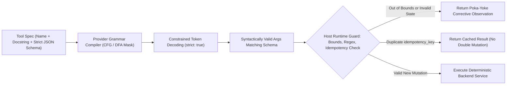
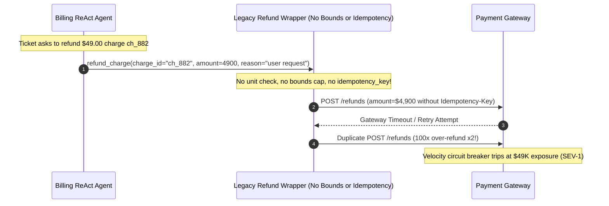

# Module 04: Tools: Definition and Schemas

> **Prerequisites:** [Module 03: Building a ReAct Agent From Scratch](../03-building-a-react-agent-from-scratch/README.md) and [Track 06, Module 07: Structured Outputs and JSON Schema](../../06-openai-and-the-model-landscape/07-structured-outputs-and-json-schema/README.md).  
> **Estimated Reading Time:** 34 minutes  
> **Target Audience:** AI Backend Engineers, API Designers, Platform Tooling Engineers

> [!TIP]
> **The Golden Rule of Agent Tool Design:**  
> A tool's name, docstring, parameter schema, and enums are your agent's **Agent-Computer Interface (ACI)**—simultaneously acting as a compiler-checked JSON type contract *and* the most influential lines in your system prompt. Enforce `strict: true` with `additionalProperties: false`, encode units directly in field names (`amount_cents`, `timeout_ms`), restrict discrete choices via `enum`, and require an `idempotency_key` on every state-mutating tool.

---

## Why This Matters

In **SWE-agent** (`arXiv:2405.15793`), researchers demonstrated that redesigning how tools and error messages are presented to the model (**Agent-Computer Interface**, or ACI) dramatically boosted coding benchmark solve rates *without changing the underlying LLM weights at all*. Anthropic's *"Building Effective Agents"* echoes the exact same lesson: engineering teams frequently spend `95%` of their effort tuning system prompts and `5%` copying raw REST/OpenAPI CRUD endpoints into `tools=[]`—then wonder why their agent picks wrong parameters, confuses cents vs. dollars, hallucinates extra keys, or burns `15,000` schema tokens on every turn.

Weak tool schemas fail in three expensive ways:

1. **Silent Parameter Ambiguity:** Naming a parameter `amount: number` leaves the model guessing whether `49` dollars should be passed as `49`, `49.0`, or `4900`.
2. **Schema-Constraint Bypass (`strict: false`):** Allowing `additionalProperties: true` (the JSON Schema default!) or optional un-required keys invites phantom fields (`currency_code: "USD"`) and missing arguments that crash backend handlers.
3. **Catalog Token Tax & Step Explosion:** Exposing `64` fine-grained 1:1 CRUD tools (`get_user`, `list_orders`, `get_order`, `check_policy`, `create_refund`) forces the agent through `8` sequential turns while billing `15,360` input tokens *per turn* just for tool JSON definitions (`122,880` cumulative schema tokens!).

---

## 1. The Agent-Computer Interface (ACI) & Strict JSON Schema Anatomy

Think of tool schemas like UI design for an LLM user (**Poka-Yoke**, or error-proofing by construction): make invalid states unrepresentable and correct usage obvious on first read.



### Mandatory Structural Rules for Strict JSON Tool Contracts

1. **Root & Nested Object Closure:** Set `"additionalProperties": false` on *every* object schema (including nested objects) and list *every* property name inside `"required": [...]`.
2. **Explicit Nullable Optionality:** Under OpenAI `strict: true`, omitting a field from `required` causes an API `400` validation error. Model optional arguments cleanly using `"type": ["string", "null"]` while keeping the key in `required`.
3. **Closed `enum` Domains Over Free Text:** Never let an LLM type `"Customer wants refund"` or `"usd"` when your backend expects `["duplicate", "fraudulent", "requested_by_customer"]` or `["USD", "EUR", "GBP"]`. Grammar-constrained decoding guarantees the model physically cannot emit an invalid enum string.
4. **Units, Bounds, and Formats in Field Names & Descriptions:** Prefer `amount_cents` (`integer`, `"Refund amount in USD cents, range 1..100000"`) over `amount` (`number`), and `since_utc` (`"ISO-8601 UTC timestamp, e.g. 2026-11-11T00:00:00Z"`) over `date`.
5. **Coarse Intent-Aligned Tools Over 1:1 CRUD Mirrors:** Instead of forcing the agent to orchestrate `get_user -> list_invoices -> check_eligible -> apply_refund`, expose cohesive domain actions like `inspect_refund_eligibility(order_id)` that aggregate checks server-side in deterministic code, cutting step count $k$ and boosting $p^k$.
6. **Mandatory `idempotency_key` on Mutating Tools:** Tag every tool in your registry as `read_only` vs. `mutating`. Any `mutating` tool MUST enforce an `idempotency_key` parameter backed by a server-side deduplication cache so retries never double-charge, double-refund, or send duplicate emails.

### Quantitative Mechanics: Tool Catalog Token Tax & Step Reduction

Sending $M$ tool definitions of average size $\bar{T}_{\text{schema}}$ tokens across a $k$-step ReAct trajectory incurs a recurring **Schema Token Tax**:

$$\text{Tokens}_{\text{tools}}(M, k) = k \cdot \sum_{j=1}^{M} \text{tok}(\text{schema}_j) \approx k \cdot M \cdot \bar{T}_{\text{schema}}$$

Compare `64` raw microservice CRUD wrappers ($\bar{T}_{\text{schema}} = 240$ tokens, averaging $k = 8$ steps at $p = 0.94$) against `6` coarse intent-aligned ACI tools ($\bar{T}_{\text{schema}} = 280$ tokens, averaging $k = 3$ steps at $p = 0.97$):

- **CRUD Catalog:** $8 \times 64 \times 240 = \mathbf{122{,}880}$ cumulative schema tokens; end-to-end reliability $0.94^8 = \mathbf{61.0\%}$.
- **Coarse ACI Toolset:** $3 \times 6 \times 280 = \mathbf{5{,}040}$ cumulative schema tokens (`24.4x` lower overhead!); end-to-end reliability $0.97^3 = \mathbf{91.3\%}$.

---

## 2. Systematic Comparison Matrix: Tool Contract Maturity Tiers

| Capability / Guarantee | Untyped Dict / Loose Args | Standard JSON Schema (`strict: false`) | Grammar-Constrained Strict (`strict: true`) | Full ACI Poka-Yoke Tool Contract |
| :--- | :--- | :--- | :--- | :--- |
| **Extra Phantom Keys Blocked?** | No | No (`additionalProperties` defaults `true`) | **Yes** (`additionalProperties: false`) | **Yes** + runtime allowlist defense |
| **Required Fields Enforced?** | No | Probabilistic only | **Yes** (grammar-guaranteed) | **Yes** + explicit nullable union types |
| **Discrete Values Constrained?** | Free strings | Prompt-nudged | Grammar-masked `enum` | Closed `enum` + clear domain descriptions |
| **Unit Ambiguity Eliminated?** | Frequent bugs (`dollars` vs `cents`) | Dependent on prose | Needs unit-encoded keys (`_cents`, `_ms`) | Unit keys + host min/max bounds validation |
| **Retry / Double-Write Safe?** | Unsafe | Unsafe | Unsafe (grammar checks syntax, not state) | **Yes:** `mutating` flag + `idempotency_key` dedup |
| **Corrective Feedback on Error?** | Stack trace crash | Raw `400` error | Valid syntax only | Actionable error hints (`Poka-Yoke` recovery) |

---

## 3. Production War Story Post-Mortem: The \$4,900 Unit-Ambiguity & Double-Refund Incident

| Field | Incident Details |
| :--- | :--- |
| **Severity** | **SEV-1** (Erroneous Over-Refunds & Duplicate Payment Gateway Calls) |
| **Detection / Resolution Time** | Detected `19` minutes post-launch by Stripe daily fraud/velocity ceiling / Tool disabled in `6` minutes |
| **Impact** | `11` customer refunds attempted at `100x` face value (\$4,900 instead of \$49); `4` duplicate refund mutations triggered on retry (\$49,000+ gross exposure halted by gateway velocity limit) |

### What Happened

A SaaS support automation team exposed a Stripe wrapper tool inside their ReAct agent with this exact schema:

```json
{
  "name": "refund_charge",
  "description": "Refunds a customer charge.",
  "parameters": {
    "type": "object",
    "properties": {
      "charge_id": { "type": "string" },
      "amount": { "type": "number" },
      "reason": { "type": "string" }
    },
    "required": ["charge_id"]
  }
}
```

Four defects compounded during a weekend billing spike:

1. **Missing Unit & Bounds (`amount: number`):** Stripe's raw API operates in cents, while the internal wrapper passed `amount` directly to a dollars-based legacy ledger or multiplied inconsistently. Reading `"$49.00 refund"` from a ticket, the model passed `amount: 4900` (thinking Stripe cents!), causing the handler to attempt a \$4,900 refund!
2. **`strict: false` + Missing `required`:** Occasionally the model omitted `amount` or invented `"currency": "usd"`, causing runtime `TypeError` failures.
3. **Free-Form `reason: string`:** The model passed `"customer asked nicely"`, failing downstream Stripe enum validation (`duplicate | fraudulent | requested_by_customer`).
4. **No `idempotency_key`:** When a `504` gateway timeout triggered a client retry on a valid call, the backend issued the refund **twice** for the same ticket.



### Root Cause Analysis

- **Ambiguous Tool Contract:** `amount` lacked explicit units (`amount_cents`), bounds (`1..100000`), `strict: true`, and `enum` constraints.
- **Non-Idempotent Mutating Tool:** State-changing payment calls executed without a deterministic `idempotency_key`.

### Architectural Hardening & Verified Fix

1. **Strict ACI Redesign:** Renamed `amount` to `amount_cents` (`integer`, explicit `1..100000` domain), locked `reason` to `enum: ["duplicate", "fraudulent", "requested_by_customer"]`, added `additionalProperties: false`, listed every field in `required`, and enabled `strict: true`.
2. **Mandatory Host Idempotency & Velocity Gate:** Required `idempotency_key` in the schema and backed mutating execution with a persistent deduplication ledger + server-side cap (`amount_cents <= original_charge_cents`).

---

## 4. Multi-Language Production Implementation: Strict Tool Linter, Validator & Idempotency Guard

Below is a reusable **Strict ACI Tool Linter, Argument Validator & Idempotent Dispatcher** across **Go**, **TypeScript**, **Python**, and **C#**. It audits schemas at startup (`strict == true`, `additionalProperties == false`, all properties in `required`, `idempotency_key` on mutating tools) and enforces runtime bounds and deduplication before calling downstream APIs.

````carousel

```go
package toolcontracts

import (
	"errors"
	"fmt"
	"sync"
)

type ParamSpec struct {
	Type        string
	Description string
	Enum        []string
	MinInt      *int
	MaxInt      *int
}

type ToolContract struct {
	Name                 string
	Description          string
	Strict               bool
	Mutating             bool
	AdditionalProperties bool
	Properties           map[string]ParamSpec
	Required             []string
}

func LintToolContract(c ToolContract) []string {
	var issues []string
	if !c.Strict {
		issues = append(issues, "strict must be true")
	}
	if c.AdditionalProperties {
		issues = append(issues, "additionalProperties must be false")
	}
	reqSet := make(map[string]bool, len(c.Required))
	for _, r := range c.Required {
		reqSet[r] = true
	}
	for name, prop := range c.Properties {
		if !reqSet[name] {
			issues = append(issues, fmt.Sprintf("property %q missing from required", name))
		}
		if prop.Description == "" {
			issues = append(issues, fmt.Sprintf("property %q missing description", name))
		}
	}
	if c.Mutating {
		if _, ok := c.Properties["idempotency_key"]; !ok {
			issues = append(issues, "mutating tool requires idempotency_key property")
		}
	}
	return issues
}

type IdempotentRefundRunner struct {
	mu    sync.Mutex
	cache map[string]string
}

func NewIdempotentRefundRunner() *IdempotentRefundRunner {
	return &IdempotentRefundRunner{cache: make(map[string]string)}
}

func (r *IdempotentRefundRunner) Execute(chargeID string, amountCents int, reason, idemKey string) (string, bool, error) {
	if amountCents < 1 || amountCents > 100_000 {
		return "", false, fmt.Errorf("amount_cents=%d out of allowed bounds [1, 100000]", amountCents)
	}
	if reason != "duplicate" && reason != "fraudulent" && reason != "requested_by_customer" {
		return "", false, errors.New("invalid refund reason enum")
	}
	r.mu.Lock()
	defer r.mu.Unlock()
	if cached, hit := r.cache[idemKey]; hit {
		return cached, true, nil
	}
	res := fmt.Sprintf("REFUNDED:%s:%d:%s", chargeID, amountCents, idemKey)
	r.cache[idemKey] = res
	return res, false, nil
}
```

<!-- slide -->

```typescript
export interface SchemaProperty {
  readonly type: string | readonly string[];
  readonly description?: string;
  readonly enum?: readonly string[];
  readonly minimum?: number;
  readonly maximum?: number;
}

export interface StrictToolContract {
  readonly name: string;
  readonly description: string;
  readonly strict: boolean;
  readonly mutating: boolean;
  readonly parameters: {
    readonly type: "object";
    readonly properties: Readonly<Record<string, SchemaProperty>>;
    readonly required: readonly string[];
    readonly additionalProperties: boolean;
  };
}

export function lintToolContract(spec: StrictToolContract): string[] {
  const issues: string[] = [];
  if (!spec.strict) issues.push("strict must be true");
  if (spec.parameters.additionalProperties !== false) {
    issues.push("additionalProperties must be false");
  }
  const req = new Set(spec.parameters.required);
  for (const [key, prop] of Object.entries(spec.parameters.properties)) {
    if (!req.has(key)) issues.push(`property "${key}" missing from required`);
    if (!prop.description?.trim()) issues.push(`property "${key}" missing description`);
  }
  if (spec.mutating && !("idempotency_key" in spec.parameters.properties)) {
    issues.push("mutating tool must declare idempotency_key");
  }
  return issues;
}

export class IdempotentToolExecutor {
  private readonly cache = new Map<string, Record<string, unknown>>();

  executeRefund(args: Record<string, unknown>): Record<string, unknown> {
    const allowed = new Set(["charge_id", "amount_cents", "reason", "idempotency_key"]);
    for (const k of Object.keys(args)) {
      if (!allowed.has(k)) {
        return { ok: false, code: "ERR_ADDITIONAL_PROPERTIES", extraKey: k };
      }
    }
    const amt = args.amount_cents;
    if (typeof amt !== "number" || !Number.isInteger(amt) || amt < 1 || amt > 100_000) {
      return { ok: false, code: "ERR_RANGE", detail: "amount_cents must be integer in [1, 100000]" };
    }
    const reason = args.reason;
    if (reason !== "duplicate" && reason !== "fraudulent" && reason !== "requested_by_customer") {
      return { ok: false, code: "ERR_ENUM", detail: "reason must match allowed enum" };
    }
    const key = String(args.idempotency_key ?? "");
    if (!key) return { ok: false, code: "ERR_MISSING_IDEMPOTENCY_KEY" };

    const cached = this.cache.get(key);
    if (cached) return { ok: true, dedupHit: true, result: cached };

    const result = { refundId: `re_${key}`, amountCents: amt, status: "REFUND_APPLIED" };
    this.cache.set(key, result);
    return { ok: true, dedupHit: false, result };
  }
}
```

<!-- slide -->

```python
"""
strict_tool_contracts.py
Startup JSON Schema linter, runtime Poka-Yoke validator, and idempotency cache for agent tools.
"""
from typing import Any


def lint_tool_contract(spec: dict[str, Any]) -> list[str]:
    issues: list[str] = []
    fn = spec.get("function", {})
    params = fn.get("parameters", {})

    if fn.get("strict") is not True:
        issues.append("strict!=true")
    if params.get("additionalProperties") is not False:
        issues.append("additionalProperties!=false")

    props = params.get("properties", {})
    required = set(params.get("required", []))
    for pname, pdef in props.items():
        if pname not in required:
            issues.append(f"unlisted_required:{pname}")
        if not pdef.get("description"):
            issues.append(f"missing_description:{pname}")
        if pname in ("amount", "timeout") and "cents" not in pname and "ms" not in pname:
            issues.append(f"ambiguous_unit_name:{pname}")

    if spec.get("mutating") and "idempotency_key" not in props:
        issues.append("mutating_tool_missing_idempotency_key")
    return issues


class IdempotentRefundGuard:
    ALLOWED_KEYS = frozenset({"charge_id", "amount_cents", "reason", "idempotency_key"})
    ALLOWED_REASONS = frozenset({"duplicate", "fraudulent", "requested_by_customer"})

    def __init__(self) -> None:
        self._cache: dict[str, dict[str, Any]] = {}

    def execute(self, args: dict[str, Any]) -> dict[str, Any]:
        extra = set(args.keys()) - self.ALLOWED_KEYS
        if extra:
            return {"ok": False, "code": "ERR_ADDITIONAL_PROPERTIES", "detail": sorted(extra)}

        missing = self.ALLOWED_KEYS - set(args.keys())
        if missing:
            return {"ok": False, "code": "ERR_MISSING_REQUIRED", "detail": sorted(missing)}

        amt = args["amount_cents"]
        if not isinstance(amt, int) or isinstance(amt, bool) or not (1 <= amt <= 100_000):
            return {"ok": False, "code": "ERR_RANGE", "detail": f"amount_cents={amt} outside [1, 100000]"}

        if args["reason"] not in self.ALLOWED_REASONS:
            return {"ok": False, "code": "ERR_ENUM", "detail": "Invalid refund reason"}

        idem_key = str(args["idempotency_key"])
        if idem_key in self._cache:
            return {"ok": True, "dedup_hit": True, "result": self._cache[idem_key]}

        result = {"refund_id": f"re_{idem_key}", "amount_cents": amt, "status": "REFUND_APPLIED"}
        self._cache[idem_key] = result
        return {"ok": True, "dedup_hit": False, "result": result}
```

<!-- slide -->

```csharp
using System;
using System.Collections.Concurrent;
using System.Collections.Generic;

namespace GenAI.Agents.ToolContracts;

public sealed record SchemaProperty(string Type, string Description, string[]? Enum = null);

public sealed record StrictToolContract(
    string Name,
    string Description,
    bool Strict,
    bool Mutating,
    bool AdditionalProperties,
    IReadOnlyDictionary<string, SchemaProperty> Properties,
    IReadOnlySet<string> Required);

public static class ToolContractLinter
{
    public static IReadOnlyList<string> Lint(StrictToolContract spec)
    {
        var issues = new List<string>();
        if (!spec.Strict) issues.Add("strict must be true");
        if (spec.AdditionalProperties) issues.Add("additionalProperties must be false");

        foreach (var (key, prop) in spec.Properties)
        {
            if (!spec.Required.Contains(key))
                issues.Add($"property '{key}' missing from required");
            if (string.IsNullOrWhiteSpace(prop.Description))
                issues.Add($"property '{key}' missing description");
        }

        if (spec.Mutating && !spec.Properties.ContainsKey("idempotency_key"))
            issues.Add("mutating tool must define idempotency_key");

        return issues;
    }
}

public sealed class IdempotentRefundService
{
    private static readonly HashSet<string> AllowedReasons = new(StringComparer.Ordinal)
    {
        "duplicate", "fraudulent", "requested_by_customer"
    };

    private readonly ConcurrentDictionary<string, string> _cache = new(StringComparer.Ordinal);

    public (bool Ok, bool DedupHit, string Payload) Execute(
        string chargeId,
        int amountCents,
        string reason,
        string idempotencyKey)
    {
        if (amountCents < 1 || amountCents > 100_000)
            return (false, false, $"ERR_RANGE: amount_cents={amountCents} outside [1, 100000]");

        if (!AllowedReasons.Contains(reason))
            return (false, false, "ERR_ENUM: invalid refund reason");

        if (_cache.TryGetValue(idempotencyKey, out var cached))
            return (true, true, cached);

        var applied = $"REFUND_APPLIED:id=re_{idempotencyKey},charge={chargeId},cents={amountCents}";
        _cache[idempotencyKey] = applied;
        return (true, false, applied);
    }
}
```

````

---

## 5. Practical Hands-On Verification CLI Workflows

Run these deterministic Python 3.13 verification scripts offline—no API keys or third-party dependencies required.

### Workflow 1: Startup Strict JSON Schema Linter (`strict: true` + Poka-Yoke Audit)

Run a startup contract linter over `4` candidate tool definitions and verify it flags legacy schema ambiguities while passing strict ACI specs:

```bash
python -c '
def lint_tool_spec(spec):
    issues = []
    fn = spec.get("function", {})
    name = fn.get("name", "<unnamed>")
    params = fn.get("parameters", {})
    if not fn.get("strict", False):
        issues.append("strict!=true")
    if params.get("additionalProperties") is not False:
        issues.append("missing additionalProperties=false")
    props = params.get("properties", {})
    req = set(params.get("required", []))
    if set(props.keys()) != req:
        issues.append(f"unlisted_required={sorted(set(props.keys()) - req)}")
    for pname, pdef in props.items():
        if not pdef.get("description"):
            issues.append(f"missing_desc:{pname}")
        if pname in ("amount", "timeout") and "unit" not in pdef.get("description", "").lower() and "cents" not in pname and "ms" not in pname:
            issues.append(f"ambiguous_unit:{pname}")
    if spec.get("mutating") and "idempotency_key" not in props:
        issues.append("mutating_tool_missing_idempotency_key")
    status = "PASS" if not issues else "FAIL"
    print(f"{name:<22} | {status:<4} | issues={issues}")

catalog = [
    {"mutating": True, "function": {"name": "legacy_refund", "strict": False, "parameters": {"type": "object", "properties": {"charge_id": {"type": "string"}, "amount": {"type": "number"}}, "required": ["charge_id"]}}},
    {"mutating": False, "function": {"name": "loose_search", "strict": True, "parameters": {"type": "object", "properties": {"query": {"type": "string", "description": "Search query"}, "limit": {"type": "integer"}}, "required": ["query"]}}},
    {"mutating": False, "function": {"name": "strict_lookup_order", "strict": True, "parameters": {"type": "object", "properties": {"order_id": {"type": "string", "description": "Canonical order ID, e.g. ORD-9921"}}, "required": ["order_id"], "additionalProperties": False}}},
    {"mutating": True, "function": {"name": "strict_refund_charge", "strict": True, "parameters": {"type": "object", "properties": {"charge_id": {"type": "string", "description": "Stripe charge ID ch_..."}, "amount_cents": {"type": "integer", "description": "Refund amount in integer USD cents (1..100000)"}, "reason": {"type": "string", "enum": ["duplicate", "fraudulent", "requested_by_customer"], "description": "Bounded refund reason enum"}, "idempotency_key": {"type": "string", "description": "Deterministic UUIDv4/step key to prevent double refund"}}, "required": ["charge_id", "amount_cents", "reason", "idempotency_key"], "additionalProperties": False}}},
]
for item in catalog:
    lint_tool_spec(item)
'
```

**Expected Output:**

```text
legacy_refund          | FAIL | issues=['strict!=true', 'missing additionalProperties=false', "unlisted_required=['amount']", 'missing_desc:charge_id', 'missing_desc:amount', 'ambiguous_unit:amount', 'mutating_tool_missing_idempotency_key']
loose_search           | FAIL | issues=['missing additionalProperties=false', "unlisted_required=['limit']", 'missing_desc:limit']
strict_lookup_order    | PASS | issues=[]
strict_refund_charge   | PASS | issues=[]
```

### Workflow 2: Runtime Argument Bounds & Idempotency Guard Harness

Verify host-level defense against phantom properties, `100x` unit confusion (`490000` cents), and duplicate network retries sharing the same `idempotency_key`:

```bash
python -c '
IDEM_CACHE = {}

def execute_refund(args):
    allowed = {"charge_id", "amount_cents", "reason", "idempotency_key"}
    extra = set(args.keys()) - allowed
    if extra:
        return {"ok": False, "code": "ERR_ADDITIONAL_PROPERTIES", "detail": f"Unexpected keys: {sorted(extra)}"}
    missing = allowed - set(args.keys())
    if missing:
        return {"ok": False, "code": "ERR_MISSING_REQUIRED", "detail": f"Missing: {sorted(missing)}"}
    amt = args["amount_cents"]
    if not isinstance(amt, int) or amt < 1 or amt > 100_000:
        return {"ok": False, "code": "ERR_RANGE", "detail": f"amount_cents={amt} outside [1, 100000]"}
    if args["reason"] not in ("duplicate", "fraudulent", "requested_by_customer"):
        return {"ok": False, "code": "ERR_ENUM", "detail": "Invalid reason enum"}
    key = args["idempotency_key"]
    if key in IDEM_CACHE:
        return {"ok": True, "dedup_hit": True, "result": IDEM_CACHE[key]}
    res = {"refund_id": f"re_{key}", "status": "REFUND_APPLIED", "amount_cents": amt}
    IDEM_CACHE[key] = res
    return {"ok": True, "dedup_hit": False, "result": res}

print("1. Phantom field:", execute_refund({"charge_id": "ch_1", "amount_cents": 4900, "reason": "duplicate", "idempotency_key": "k1", "currency": "USD"}))
print("2. Unit confusion ($4900):", execute_refund({"charge_id": "ch_1", "amount_cents": 490000, "reason": "duplicate", "idempotency_key": "k2"}))
print("3a. Valid Refund #1:", execute_refund({"charge_id": "ch_1", "amount_cents": 4900, "reason": "requested_by_customer", "idempotency_key": "idem_881"}))
print("3b. Retry Same Key :", execute_refund({"charge_id": "ch_1", "amount_cents": 4900, "reason": "requested_by_customer", "idempotency_key": "idem_881"}))
'
```

**Expected Output:**

```text
1. Phantom field: {'ok': False, 'code': 'ERR_ADDITIONAL_PROPERTIES', 'detail': "Unexpected keys: ['currency']"}
2. Unit confusion ($4900): {'ok': False, 'code': 'ERR_RANGE', 'detail': 'amount_cents=490000 outside [1, 100000]'}
3a. Valid Refund #1: {'ok': True, 'dedup_hit': False, 'result': {'refund_id': 're_idem_881', 'status': 'REFUND_APPLIED', 'amount_cents': 4900}}
3b. Retry Same Key : {'ok': True, 'dedup_hit': True, 'result': {'refund_id': 're_idem_881', 'status': 'REFUND_APPLIED', 'amount_cents': 4900}}
```

### Workflow 3: Tool Catalog Token-Tax & Reliability Audit

Quantify the cumulative schema token cost and $p^k$ reliability jump when collapsing `64` fine-grained CRUD endpoints into `6` cohesive ACI tools:

```bash
python -c '
def audit_catalog(name, num_tools, avg_schema_tok, avg_steps, p_step):
    schema_tok_per_step = num_tools * avg_schema_tok
    total_schema_tax = schema_tok_per_step * avg_steps
    e2e_rel = p_step ** avg_steps
    print(f"{name:<22} | tools={num_tools:<2} | schema/step={schema_tok_per_step:>6,} tok | steps={avg_steps} | total_tax={total_schema_tax:>7,} tok | p^k={e2e_rel:.1%}")

audit_catalog("Raw Microservice CRUD", 64, 240, 8, 0.94)
audit_catalog("Coarse ACI Toolset",     6,  280, 3, 0.97)
'
```

**Expected Output:**

```text
Raw Microservice CRUD  | tools=64 | schema/step=15,360 tok | steps=8 | total_tax=122,880 tok | p^k=61.0%
Coarse ACI Toolset     | tools=6  | schema/step= 1,680 tok | steps=3 | total_tax=  5,040 tok | p^k=91.3%
```

### Hands-On Exercises

1. **Nested Strict Validation:** Extend `lint_tool_contract` in Workflow 1 to recursively inspect nested `"type": "object"` properties (`items.properties` inside arrays and sub-objects), verifying that `additionalProperties: false` and complete `required` lists hold at *every* nesting depth.
2. **Nullable Optional Field Test:** Add an optional `"note": {"type": ["string", "null"], "description": "Optional audit note, or null"}` field to `strict_refund_charge`, confirming it remains in `required` and passes the linter cleanly.
3. **Optional Live Strict Mode Probe (Requires API Key):** Submit `loose_search` vs. `strict_refund_charge` to OpenAI's API with `strict: true` and observe the exact `400` validation message returned when `additionalProperties: false` or a key in `required` is omitted.

### Independent Challenge

A backend team exposes `42` auto-generated OpenAPI REST endpoints directly as LLM agent tools for an internal DevOps copilot (e.g., `get_cluster`, `list_namespaces`, `get_namespace`, `list_pods`, `get_pod`, `get_pod_events`, `delete_pod`, `scale_deployment`). Users complain the bot takes `9` turns per diagnosis, hallucinates undocumented query flags like `force=true`, and once deleted the wrong staging namespace twice during retries. Redesign this `42`-endpoint sprawl into a `4`-tool **ACI Poka-Yoke Contract** and define the safety invariants on any mutating operations.

<details><summary>Architectural Discussion</summary>

Replace the fragmented read endpoints (`get_cluster`, `list_namespaces`, `list_pods`, `get_pod_events`) with two coarse read-only ACI diagnostics: `inspect_service_health(service_name, environment_enum, include_recent_events_bool)` and `query_service_logs(service_name, environment_enum, severity_enum, window_minutes)` (bounded `window_minutes` `1..60`, capped rows). That cuts step count $k$ from `~9` down to `2–3` and eliminates `90%` of per-turn schema tokens. For mutations (`scale_deployment` / `restart_pod`), eliminate `delete_namespace` completely from the agent surface, require `strict: true` + `additionalProperties: false` + closed `environment: ["dev", "staging"]` enum (physically blocking `prod` deletions), add `dry_run: boolean`, and mandate a unique `idempotency_key` backed by server-side deduplication.

</details>

---

## 6. Common Mistakes & Troubleshooting

- **Auto-generating tool schemas directly from internal ORM/REST OpenAPI specs:** Internal CRUD APIs expose `50+` parameters (`limit`, `offset`, `cursor`, `dry_run_v2`, internal UUIDs) designed for backend microservices, not language models—bloating token budgets and hurting selection accuracy.
- **Forgetting `additionalProperties: false` on nested sub-objects:** Setting it only on the top-level `parameters` object fails OpenAI `strict: true` validation and allows phantom fields inside nested structs.
- **Omitting optional fields from `required` when `strict: true` is active:** Strict grammar compilers require *all* keys in `properties` to appear in `required`; represent optionality via `"type": ["string", "null"]`.
- **Relying on JSON Schema alone for business-logic safety:** Grammar decoding guarantees syntactic shape (`integer`), not semantic domain bounds (`amount_cents <= charge_amount_cents`); always pair schema constraints with deterministic host validation and idempotency keys.

---

## 7. Operational Validation Checkpoints & Checkpoint Quiz

### Operational Validation Checkpoints

<details><summary><strong>Checkpoint 1: Fixing an OpenAI strict-mode 400 schema rejection</strong></summary>

An engineer turns on `"strict": true` on an existing `search_tickets` tool containing `properties: {"query": {"type": "string"}, "assignee": {"type": "string"}}` and `required: ["query"]`. The API immediately rejects the request with `HTTP 400: Invalid schema for function 'search_tickets'`. Identify both strict-mode violations and write the compliant fix.

**Validation:** Two violations exist: (1) `additionalProperties: false` is missing at the root object level, and (2) `assignee` is present in `properties` but omitted from `required`. Fix by adding `"additionalProperties": false`, keeping `"required": ["query", "assignee"]`, and changing `assignee` to `"type": ["string", "null"]` so the model can safely pass `null` when unassigned.

</details>

<details><summary><strong>Checkpoint 2: Explaining why 60 CRUD tools degrade agent accuracy and cost</strong></summary>

A prototype agent initially worked well with `5` tools (`94%` accuracy, \$0.02/task), but after engineers attached all `60` internal microservice endpoints (`~240` schema tokens each), accuracy fell below `62%` and average run cost jumped `10x`. Explain mechanically why both metrics collapsed.

**Validation:** Passing `60` schemas burns `14,400` input tokens **on every single step** (`~115K` schema tokens over `8` turns!), driving up cost dramatically. Meanwhile, fine-grained 1:1 CRUD wrappers force the agent to take more sequential turns ($k$ grows, decaying reliability via $p^k$) and introduce overlapping tool descriptions that confuse tool selection.

</details>

<details><summary><strong>Checkpoint 3: Preventing duplicate side effects on mutating tool retries</strong></summary>

An agent triggers `create_jira_ticket(project="OPS", title="DB CPU Spike")`, the HTTP request times out on response read (`504`), and the client retries—creating two duplicate tickets. What schema + runtime pattern prevents duplicate mutations?

**Validation:** Require an explicit **`idempotency_key`** property inside every mutating tool's strict JSON schema (or inject a deterministic `run_id + step_id` key at the host dispatcher) backed by a server-side deduplication cache so retries return the original `ticket_id` without re-executing the side effect.

</details>

### Checkpoint Quiz

1. What does **Agent-Computer Interface (ACI)** mean in agent engineering, and why do tool schemas act as prompt engineering?
2. State the two strict JSON Schema rules required on every object node when `strict: true` is enabled.
3. How do you model an optional argument cleanly inside a strict JSON Schema without violating the complete-`required` rule?
4. Why does `amount_cents` (`integer`, bounded `1..100000`) prevent bugs that `amount` (`number`) misses?
5. What happens to cumulative schema token tax $\text{Tokens}_{\text{tools}}(M, k)$ if an agent takes $k = 6$ steps with $M = 50$ tools averaging $250$ tokens each?

<details><summary>Answers</summary>

1. **ACI** (from SWE-agent, `arXiv:2405.15793`) is the deliberate design of tools, parameters, descriptions, and structured error outputs tailored for an LLM rather than humans. Models inspect tool names, descriptions, and enums before picking actions, making schemas first-class steering instructions.
2. Every object node must explicitly set `"additionalProperties": false` and list every property key in its `"required"` array.
3. Keep the property key inside `"required"` and use a nullable union type such as `"type": ["string", "null"]`.
4. Embedding the unit directly in the field name (`_cents`) plus integer bounds eliminates dollar-vs-cents ambiguity (`49` vs `4900`) and prevents silent floating-point or magnitude errors.
5. $\text{Tokens}_{\text{tools}} = 6 \times 50 \times 250 = 75{,}000$ input tokens spent solely re-sending tool JSON schemas across that single run.

</details>

---

## Further Reading & Sources

- [SWE-agent: Agent-Computer Interfaces Enable Automated Software Engineering (Yang et al., 2024)](https://arxiv.org/abs/2405.15793) — empirical foundation of Agent-Computer Interface (ACI) design.
- [Anthropic Engineering: Building Effective Agents](https://www.anthropic.com/engineering/building-effective-agents) — Appendix on Poka-Yoke tool design and writing tool interfaces for LLMs.
- [OpenAI Structured Outputs Guide](https://platform.openai.com/docs/guides/structured-outputs) — complete specification for `strict: true`, `additionalProperties: false`, and nullable fields.
- [OpenAI Function Calling Guide](https://platform.openai.com/docs/guides/function-calling) — applying strict schemas directly to `tools`.
- [JSON Schema Specification: Understanding JSON Schema](https://json-schema.org/understanding-json-schema/) — core object, enum, and validation semantics.

## Next

[Module 05: Tool Calling With the OpenAI API](../05-tool-calling-with-the-openai-api/README.md)
