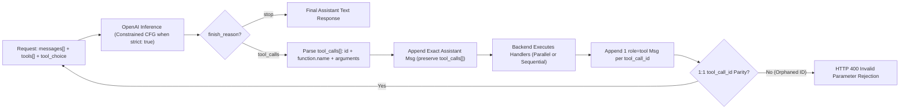
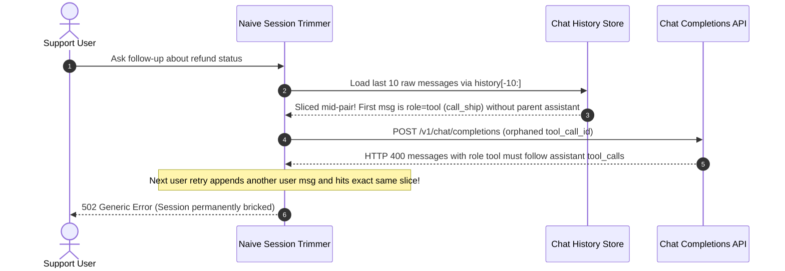

# Module 05: Tool Calling With the OpenAI API

> **Prerequisites:** [Module 03: Building a ReAct Agent From Scratch](../03-building-a-react-agent-from-scratch/README.md), [Module 04: Tools: Definition and Schemas](../04-tools-definition-and-schemas/README.md), [Track 06, Module 02: The Responses API and Statefulness](../../06-openai-and-the-model-landscape/02-the-responses-api-and-statefulness/README.md), and [Track 06, Module 07: Structured Outputs and JSON Schema](../../06-openai-and-the-model-landscape/07-structured-outputs-and-json-schema/README.md).  
> **Estimated Reading Time:** 32 minutes  
> **Target Audience:** AI Backend Engineers, Agent Runtime Developers, Platform Architects

> [!TIP]
> **The Golden Rule of OpenAI Tool Calling:** Never treat a `tool_calls` payload as executed work or an arbitrary JSON blob—treat it as an untrusted, typed **execution intent** governed by `strict: true` JSON Schemas, explicit `tool_choice` state transitions, and an atomic `(assistant.tool_calls -> role: "tool")` ledger invariant where every `tool_call_id` is answered in exact parity.

---

## Why This Matters

In early ReAct prototypes, developers instructed LLMs to print `Action: search_orders` and `Action Input: {"id": "123"}` in plain markdown and parsed those strings with fragile regular expressions. That approach collapses in production: unescaped quotes inside user queries break JSON parsing, markdown code fences confuse splitters, and models invent non-existent parameter keys under load.

The OpenAI API replaces text scraping with a native, token-level **tool-calling wire contract**. When `strict: true` is enabled, the inference server compiles your JSON Schema into a context-free grammar (CFG) finite-state machine that masks invalid next tokens at decode time—eliminating syntax failures at the logit layer. Yet backend teams still trigger widespread `HTTP 400` outages with OpenAI tool calling because they overlook the stateful ledger invariant: if your history trimmer, retry buffer, or parallel dispatcher drops even a single `tool_call_id` reply—or slices an `assistant` message away from its `role: "tool"` children—the API rejects every subsequent turn in that user session.

---

## 1. The OpenAI Tool Calling Wire Contract & State Machine

Unlike chat text generation, OpenAI tool calling separates **intent emission** (the model requesting one or more functions) from **observation ingestion** (your backend returning results keyed by `tool_call_id`).



### Wire Anatomy: Chat Completions (`tools[]`, `tool_choice`, `parallel_tool_calls`)

Every Chat Completions tool call turn operates over four tightly coupled request/response structures:

1. **Tool Definition (`tools[]`):** Each item uses `"type": "function"` wrapping `"name"`, `"description"`, optional `"strict": true`, and `"parameters"` (JSON Schema object).
2. **`tool_choice` Mode Control:**
   - `"auto"` *(default)*: Model decides between zero, one, or multiple `tool_calls` vs. a direct natural-language answer (`finish_reason: "stop"`).
   - `"required"`: Forces the model to emit **at least one** tool call—useful at step 1 of an intake router when conversational small talk is disallowed.
   - `"none"`: Disables tool emission completely while keeping `tools[]` definitions in the prompt prefix (preserving KV/prompt cache alignment and allowing clean budget-exhaustion summaries).
   - Forced Function `{"type": "function", "function": {"name": "emit_audit_report"}}`: Constrains decoding exclusively to one specific tool schema.
3. **`parallel_tool_calls` (`true` by default):** Allows the model to emit multiple entries in `message.tool_calls[]` in a single round-trip (e.g., checking weather in Tokyo and Paris simultaneously). Set `parallel_tool_calls: false` when tools share mutating side effects, depend on strict ordering, or when pairing with specific strict/reasoning constraints that require single-step verification.
4. **Assistant + Tool Message Pairing:** When `message.tool_calls` is non-empty, you **must** append the original `assistant` message (including its exact `tool_calls` array) to `messages`, immediately followed by **one** `{"role": "tool", "tool_call_id": tc.id, "content": "..."}` message for *every* `tc` in `tool_calls` before sending another `user` or `assistant` message.

### `strict: true` Structured Outputs Constraints

Setting `"strict": true` inside the tool's `"function"` definition engages OpenAI's grammar-constrained sampler. To compile into a deterministic CFG, your JSON Schema must obey strict structural rules—violating any of them returns an `HTTP 400` schema compilation error before inference begins:

| Constraint | Non-Strict (`strict: false`) | Strict (`strict: true`) Requirement | Engineering Workaround / Pattern |
| :--- | :--- | :--- | :--- |
| **`additionalProperties`** | Optional (defaults to `true`) | **Mandatory `"additionalProperties": false`** on every `object` (root, nested objects, `$defs`) | Explicitly set `additionalProperties: false` in schema builders (e.g., Pydantic `model_config = ConfigDict(extra="forbid")`) |
| **`required` Array** | Lists only mandatory keys | **Must list 100% of keys** defined in `properties` on every object | Model optional fields via nullable union types: `"type": ["string", "null"]` |
| **Nesting Depth & Size** | Lenient | Max `5` levels of object/array nesting (root = level 1); bounded total properties/enum chars | Flatten deeply nested config trees into shallow typed DTOs |
| **Validation Scope** | Syntax best-effort | Guarantees **syntactic schema adherence**, NOT business semantics (`amount > 0` or real IDs) | Always run runtime Pydantic/business validation after `json.loads()` |
| **Unsupported Keywords** | Ignored or prompt-guided | Certain numeric/string constraints (`minLength`, `maxItems`, `pattern` nuances) may be rejected or stripped | Enforce numeric bounds and cross-field invariants in backend handlers ([Module 06](../06-tool-execution-and-error-handling/README.md)) |

### Chat Completions vs. The Responses API Evolution

While Chat Completions (`/v1/chat/completions`) remains the universal baseline across OpenAI-compatible proxies (vLLM, LiteLLM, Azure, Bedrock adapters), OpenAI's **Responses API** (`/v1/responses`) refactors tool calling into flat polymorphic `input` / `output` items rather than nested `choices[0].message.tool_calls`:

- **Tool Schema Shape:** Chat Completions nests `{"type": "function", "function": {"name": ..., "parameters": ...}}`, whereas the Responses API flattens it to `{"type": "function", "name": ..., "strict": true, "parameters": ...}`.
- **Tool Call / Result Items:** Chat Completions pairs an `assistant` message containing `tool_calls[].id` with `role: "tool"` + `tool_call_id`. The Responses API emits typed output items `{"type": "function_call", "call_id": "fc_...", "name": "...", "arguments": "..."}`, and you submit results as `{"type": "function_call_output", "call_id": "fc_...", "output": "..."}`—optionally chained via `previous_response_id` so the server stores reasoning items and multi-turn state.
- **Architectural Rule:** Keep your internal tool registry format provider-agnostic, and compile to Chat Completions or Responses API wire payloads in a thin adapter layer.

### Quantitative Mechanics: Schema Bloat, Cost & Ledger Parity

1. **Tool Schema Prefix Overhead:** Every tool description and parameter property is serialized as input tokens on **every** turn of the agent loop:

$$T_{\text{schema}} = \sum_{j=1}^{M} \left( T_{\text{name}, j} + T_{\text{desc}, j} + T_{\text{params}, j} \right)$$

2. **Multi-Turn Cumulative Input Cost:** Across a $K$-turn agent session where each turn appends average call+observation tokens $\overline{T}_{\text{step}}$ and prompt caching discounts the static prefix (`sys + schema`) by $\alpha \in [0, 1)$ after turn `1`:

$$C_{\text{in}} = c_{\text{in}} \left[ T_{\text{prefix}} \left(1 + (K - 1)(1 - \alpha)\right) + \sum_{t=1}^{K} (t - 1)\overline{T}_{\text{step}} \right]$$

At `25` verbose tools (`7,000` schema tokens) across `10` turns at `\$2.50 / 1M` input tokens, static schema definitions alone account for `70,000` raw input tokens (`~77%` of total session input spend without prefix caching). Keeping `tools[]` order byte-identical across turns preserves prompt cache hits (`50%+` prefix savings).

3. **Atomic Ledger Parity Invariant:** At every API request boundary, the set of pending `tool_call_id` tokens in any `assistant` message must exactly equal the set of `tool_call_id` tokens in the contiguous block of immediately following `role: "tool"` messages:

$$\forall m_i \text{ with } m_i.\text{role} = \text{assistant} \land m_i.\text{tool\_calls} \neq \emptyset: \quad \{\text{tc.id} \mid \text{tc} \in m_i.\text{tool\_calls}\} \equiv \{m_k.\text{tool\_call\_id} \mid k \in (i, i + |m_i.\text{tool\_calls}|]\}$$

---

## 2. Systematic Comparison Matrix: Tool Calling Contracts

| Dimension | Prompted ReAct Text Parsing | Chat Completions (`strict: false`) | Chat Completions (`strict: true`) | Responses API (`function_call`) |
| :--- | :--- | :--- | :--- | :--- |
| **Wire Enforcement** | Regex / string parsing over markdown | Fine-tuned JSON function tokens (best-effort) | **CFG logit masking** guarantees valid schema syntax | **CFG logit masking** + native item typing |
| **Required / Extra Keys** | Model frequently drops or invents fields | Model may omit required keys or add extras | **100% locked** (`additionalProperties: false`, all keys required) | **100% locked** with identical strict schema rules |
| **State & History Format** | Single unstructured text transcript | Client-managed `messages[]` (`assistant` + `role: "tool"`) | Client-managed `messages[]` (`assistant` + `role: "tool"`) | Flat `input` items (`function_call_output`) or `previous_response_id` |
| **Parallel Multi-Call Support** | Fragile custom delimiter hacks | Native `tool_calls[]` array + `parallel_tool_calls` | Native `tool_calls[]` (note: check model/SDK `parallel_tool_calls` behavior) | Native multi-item `function_call` outputs |
| **Portability (vLLM / Open-Weight)** | Universal | **Universal** across OpenAI-compatible endpoints | Supported by OpenAI + modern vLLM (`xgrammar`/guided decoding) | OpenAI-native endpoint (limited proxy parity) |

---

## 3. Production War Story Post-Mortem: The Orphaned `tool_call_id` HTTP 400 Blackout

| Field | Incident Details |
| :--- | :--- |
| **Severity** | **SEV-1** (Permanent Session Bricking for Active Customer Support Conversations) |
| **Detection / Resolution Time** | Detected `42` minutes post-deploy via `4xx` spike (`18%` failure rate on `/chat/turn`) / Mitigated in `2.5` hours via atomic turn-group sliding window + pre-flight ledger sanitizer |
| **Impact** | `4,200` active support threads permanently bricked with unrecoverable `HTTP 400`; `\$14,500` SLA credit exposure and emergency manual thread resets |

### What Happened

An AI customer-support backend stored full multi-turn histories in Redis and applied a naive sliding window (`messages = [system_msg] + history[-10:]`) before calling `/v1/chat/completions` to keep prompt sizes bounded under `8,192` tokens.

When an order-lookup turn triggered `3` parallel tool calls (`call_ord`, `call_ship`, `call_refund`), that single agent cycle produced `4` messages in Redis: `1` `assistant` message (`tool_calls=[call_ord, call_ship, call_refund]`) followed by `3` `role: "tool"` responses. Five messages later, slicing `history[-10:]` landed squarely **between** the `assistant` message and `call_ship`—leaving `{"role": "tool", "tool_call_id": "call_ship"}` at index `1` of the request payload without its parent `assistant.tool_calls` message!



### Root Cause Analysis

- **Message-Level Slicing Ignored Turn Atoms:** Treating `messages[]` as independent flat rows rather than atomic groups broke the `(assistant.tool_calls -> role: "tool" * N)` foreign-key invariant whenever `history[-10:]` bisected a multi-tool batch.
- **No Pre-Flight Ledger Validator:** The backend blindly forwarded Redis payloads to OpenAI without checking `tool_call_id` parity, and every subsequent user retry appended another message without repairing the corrupted slice boundary.

### The Fix & Architectural Hardening

- **Atomic Turn-Group Eviction:** Refactored history trimming to partition messages into indivisible **atomic turns** (`[user]`, `[assistant]`, or `[assistant(tool_calls) + N * role="tool"]`) and evict only whole turn groups from the oldest end.
- **Pre-Flight Ledger Repair & Parity Assertion:** Added a deterministic validator before every API call that rejects or auto-quarantines any dangling `tool` or unanswered `tool_calls` block, guaranteeing `100%` `tool_call_id` parity.

---

## 4. Multi-Language Production Implementation: Strict Schema Linter & Atomic Tool Ledger

Below is a production-hardened **OpenAI Tool Calling Wire Ledger & Strict Schema Validator** across **Go**, **TypeScript**, **Python**, and **C#**. Each implementation validates `strict: true` constraints (`additionalProperties: false`, complete `required` keys, depth limit `<= 5`), builds balanced multi-tool-call pairs, and implements atomic turn-group slicing to prevent `HTTP 400` orphaned `tool_call_id` errors.

````carousel

```go
package openaitools

import (
	"errors"
	"fmt"
	"sort"
)

type ToolCall struct {
	ID        string `json:"id"`
	Name      string `json:"name"`
	Arguments string `json:"arguments"`
}

type ChatMessage struct {
	Role       string     `json:"role"`
	Content    string     `json:"content,omitempty"`
	ToolCalls  []ToolCall `json:"tool_calls,omitempty"`
	ToolCallID string     `json:"tool_call_id,omitempty"`
}

type JSONSchema struct {
	Type                 any                   `json:"type"`
	Properties           map[string]JSONSchema `json:"properties,omitempty"`
	Required             []string              `json:"required,omitempty"`
	AdditionalProperties *bool                 `json:"additionalProperties,omitempty"`
	Items                *JSONSchema           `json:"items,omitempty"`
}

// ValidateStrictSchema enforces OpenAI strict: true rules before registration.
func ValidateStrictSchema(schema JSONSchema, path string, depth int) []string {
	var errs []string
	if depth > 5 {
		errs = append(errs, fmt.Sprintf("%s: depth %d exceeds strict limit 5", path, depth))
	}
	if typeStr, ok := schema.Type.(string); ok && typeStr == "object" {
		if schema.AdditionalProperties == nil || *schema.AdditionalProperties {
			errs = append(errs, fmt.Sprintf("%s: additionalProperties must be explicitly false", path))
		}
		reqSet := make(map[string]bool, len(schema.Required))
		for _, r := range schema.Required {
			reqSet[r] = true
		}
		var propNames []string
		for k := range schema.Properties {
			propNames = append(propNames, k)
		}
		sort.Strings(propNames)
		for _, k := range propNames {
			if !reqSet[k] {
				errs = append(errs, fmt.Sprintf("%s.%s: strict mode requires key in required[] (use nullable union)", path, k))
			}
			errs = append(errs, ValidateStrictSchema(schema.Properties[k], path+"."+k, depth+1)...)
		}
	}
	if schema.Items != nil {
		errs = append(errs, ValidateStrictSchema(*schema.Items, path+"[]", depth+1)...)
	}
	return errs
}

// ValidateLedger verifies strict 1:1 assistant.tool_calls <-> role:tool parity.
func ValidateLedger(messages []ChatMessage) error {
	pending := make(map[string]bool)
	for i, msg := range messages {
		if msg.Role == "assistant" && len(msg.ToolCalls) > 0 {
			if len(pending) > 0 {
				return fmt.Errorf("idx %d: unresolved tool_calls before new assistant batch", i)
			}
			for _, tc := range msg.ToolCalls {
				if tc.ID == "" {
					return fmt.Errorf("idx %d: empty tool_call_id", i)
				}
				pending[tc.ID] = true
			}
		} else if msg.Role == "tool" {
			if !pending[msg.ToolCallID] {
				return fmt.Errorf("idx %d: orphaned tool_call_id %q", i, msg.ToolCallID)
			}
			delete(pending, msg.ToolCallID)
		} else if len(pending) > 0 {
			return fmt.Errorf("idx %d: role %q interrupted pending tool_calls", i, msg.Role)
		}
	}
	if len(pending) > 0 {
		return errors.New("trailing unresolved tool_calls in ledger")
	}
	return nil
}

// SliceAtomicTurns trims oldest turns without ever splitting assistant+tool groups.
func SliceAtomicTurns(messages []ChatMessage, maxMessages int) []ChatMessage {
	if len(messages) == 0 || maxMessages <= 0 {
		return nil
	}
	var head []ChatMessage
	start := 0
	if messages[0].Role == "system" {
		head = append(head, messages[0])
		start = 1
	}
	var groups [][]ChatMessage
	for i := start; i < len(messages); {
		if messages[i].Role == "assistant" && len(messages[i].ToolCalls) > 0 {
			grp := []ChatMessage{messages[i]}
			i++
			for i < len(messages) && messages[i].Role == "tool" {
				grp = append(grp, messages[i])
				i++
			}
			groups = append(groups, grp)
		} else {
			groups = append(groups, []ChatMessage{messages[i]})
			i++
		}
	}
	var kept [][]ChatMessage
	count := len(head)
	for i := len(groups) - 1; i >= 0; i-- {
		if count+len(groups[i]) > maxMessages {
			break
		}
		kept = append(kept, groups[i])
		count += len(groups[i])
	}
	out := append([]ChatMessage{}, head...)
	for i := len(kept) - 1; i >= 0; i-- {
		out = append(out, kept[i]...)
	}
	return out
}
```

<!-- slide -->

```typescript
export interface ToolCall {
  readonly id: string;
  readonly type: "function";
  readonly function: { readonly name: string; readonly arguments: string };
}

export interface ChatMessage {
  readonly role: "system" | "user" | "assistant" | "tool";
  readonly content: string | null;
  readonly tool_calls?: readonly ToolCall[];
  readonly tool_call_id?: string;
}

export interface StrictJsonSchema {
  readonly type?: string | readonly string[];
  readonly properties?: Record<string, StrictJsonSchema>;
  readonly required?: readonly string[];
  readonly additionalProperties?: boolean;
  readonly items?: StrictJsonSchema;
}

export function lintStrictSchema(schema: StrictJsonSchema, path = "$", depth = 1): string[] {
  const errors: string[] = [];
  if (depth > 5) {
    errors.push(`${path}: nesting depth ${depth} exceeds OpenAI strict limit of 5`);
  }
  const isObject = schema.type === "object" || (Array.isArray(schema.type) && schema.type.includes("object"));
  if (isObject) {
    if (schema.additionalProperties !== false) {
      errors.push(`${path}: strict mode requires additionalProperties: false`);
    }
    const props = schema.properties ?? {};
    const reqSet = new Set(schema.required ?? []);
    for (const key of Object.keys(props).sort()) {
      if (!reqSet.has(key)) {
        errors.push(`${path}.${key}: missing from required[] (use nullable union for optional fields)`);
      }
      errors.push(...lintStrictSchema(props[key], `${path}.${key}`, depth + 1));
    }
  }
  if (schema.items) {
    errors.push(...lintStrictSchema(schema.items, `${path}[]`, depth + 1));
  }
  return errors;
}

export function assertValidToolLedger(messages: readonly ChatMessage[]): void {
  const pending = new Set<string>();
  messages.forEach((msg, idx) => {
    if (msg.role === "assistant" && msg.tool_calls && msg.tool_calls.length > 0) {
      if (pending.size > 0) {
        throw new Error(`Index ${idx}: previous tool_calls still pending`);
      }
      for (const tc of msg.tool_calls) pending.add(tc.id);
    } else if (msg.role === "tool") {
      if (!msg.tool_call_id || !pending.has(msg.tool_call_id)) {
        throw new Error(`Index ${idx}: orphaned tool_call_id '${msg.tool_call_id ?? ""}'`);
      }
      pending.delete(msg.tool_call_id);
    } else if (pending.size > 0) {
      throw new Error(`Index ${idx}: role '${msg.role}' appeared before tool_calls resolved`);
    }
  });
  if (pending.size > 0) {
    throw new Error(`Unresolved trailing tool_call_ids: ${[...pending].join(", ")}`);
  }
}

export function sliceAtomicTurnWindow(messages: readonly ChatMessage[], maxMessages: number): ChatMessage[] {
  const head = messages[0]?.role === "system" ? [messages[0]] : [];
  const start = head.length;
  const groups: ChatMessage[][] = [];

  for (let i = start; i < messages.length; ) {
    const cur = messages[i];
    if (cur.role === "assistant" && cur.tool_calls && cur.tool_calls.length > 0) {
      const grp: ChatMessage[] = [cur];
      i += 1;
      while (i < messages.length && messages[i].role === "tool") {
        grp.push(messages[i]);
        i += 1;
      }
      groups.push(grp);
    } else {
      groups.push([cur]);
      i += 1;
    }
  }

  const kept: ChatMessage[][] = [];
  let count = head.length;
  for (let i = groups.length - 1; i >= 0; i -= 1) {
    if (count + groups[i].length > maxMessages) break;
    kept.unshift(groups[i]);
    count += groups[i].length;
  }
  return [...head, ...kept.flat()];
}
```

<!-- slide -->

```python
"""
openai_tool_ledger.py
Validates OpenAI strict: true schemas, builds balanced (assistant + tool[]) pairs,
and trims context windows on atomic turn boundaries to prevent HTTP 400 orphan errors.
"""
from dataclasses import dataclass
import json
from typing import Any, Callable


@dataclass(frozen=True)
class StrictToolSpec:
    name: str
    description: str
    parameters: dict[str, Any]

    def to_chat_completions_tool(self) -> dict[str, Any]:
        errors = lint_strict_schema(self.parameters)
        if errors:
            raise ValueError(f"Invalid strict schema for {self.name}: {errors}")
        return {
            "type": "function",
            "function": {
                "name": self.name,
                "description": self.description,
                "strict": True,
                "parameters": self.parameters,
            },
        }


def lint_strict_schema(schema: dict[str, Any], path: str = "$", depth: int = 1) -> list[str]:
    errors: list[str] = []
    if depth > 5:
        errors.append(f"{path}: depth {depth} exceeds strict limit 5")
    schema_type = schema.get("type")
    if schema_type == "object" or (isinstance(schema_type, list) and "object" in schema_type):
        if schema.get("additionalProperties") is not False:
            errors.append(f"{path}: additionalProperties must be false in strict mode")
        props = schema.get("properties", {})
        req = set(schema.get("required", []))
        for key in sorted(props):
            if key not in req:
                errors.append(f"{path}.{key}: must appear in required[] (use nullable union)")
            errors.extend(lint_strict_schema(props[key], f"{path}.{key}", depth + 1))
    if isinstance(schema.get("items"), dict):
        errors.extend(lint_strict_schema(schema["items"], f"{path}[]", depth + 1))
    return errors


def append_tool_turn(
    messages: list[dict[str, Any]],
    assistant_msg: dict[str, Any],
    executor: Callable[[str, dict[str, Any]], str],
) -> None:
    tool_calls = assistant_msg.get("tool_calls") or []
    tool_replies: list[dict[str, Any]] = []
    for tc in tool_calls:
        fn = tc["function"]
        try:
            args = json.loads(fn["arguments"])
            result_str = executor(fn["name"], args)
        except Exception as exc:  # Always fulfill every tool_call_id even on local error
            result_str = json.dumps({"ok": False, "error": str(exc)})
        tool_replies.append({"role": "tool", "tool_call_id": tc["id"], "content": result_str})

    # Commit assistant + ALL tool replies atomically so no partial failure leaves an orphan.
    messages.append(assistant_msg)
    messages.extend(tool_replies)


def slice_atomic_turns(messages: list[dict[str, Any]], max_messages: int) -> list[dict[str, Any]]:
    head = [messages[0]] if messages and messages[0].get("role") == "system" else []
    groups: list[list[dict[str, Any]]] = []
    i = len(head)
    while i < len(messages):
        msg = messages[i]
        if msg.get("role") == "assistant" and msg.get("tool_calls"):
            grp = [msg]
            i += 1
            while i < len(messages) and messages[i].get("role") == "tool":
                grp.append(messages[i])
                i += 1
            groups.append(grp)
        else:
            groups.append([msg])
            i += 1

    kept: list[list[dict[str, Any]]] = []
    total = len(head)
    for grp in reversed(groups):
        if total + len(grp) > max_messages:
            break
        kept.append(grp)
        total += len(grp)
    kept.reverse()
    return head + [m for grp in kept for m in grp]
```

<!-- slide -->

```csharp
using System;
using System.Collections.Generic;
using System.Linq;

namespace GenAI.OpenAITools;

public sealed record ToolCallRef(string Id, string Name, string ArgumentsJson);

public sealed record WireMessage(
    string Role,
    string? Content,
    IReadOnlyList<ToolCallRef>? ToolCalls = null,
    string? ToolCallId = null);

public static class ToolLedgerGuard
{
    public static void ValidateLedgerParity(IReadOnlyList<WireMessage> messages)
    {
        var pending = new HashSet<string>(StringComparer.Ordinal);
        for (int i = 0; i < messages.Count; i++)
        {
            var msg = messages[i];
            if (msg.Role == "assistant" && msg.ToolCalls is { Count: > 0 })
            {
                if (pending.Count > 0)
                    throw new InvalidOperationException($"Index {i}: pending tool calls unresolved.");
                foreach (var tc in msg.ToolCalls)
                    pending.Add(tc.Id);
            }
            else if (msg.Role == "tool")
            {
                if (string.IsNullOrEmpty(msg.ToolCallId) || !pending.Remove(msg.ToolCallId))
                    throw new InvalidOperationException($"Index {i}: orphaned tool_call_id '{msg.ToolCallId}'.");
            }
            else if (pending.Count > 0)
            {
                throw new InvalidOperationException($"Index {i}: role '{msg.Role}' broke tool_call pairing.");
            }
        }
        if (pending.Count > 0)
            throw new InvalidOperationException($"Unanswered tool_call_ids: {string.Join(", ", pending)}");
    }

    public static IReadOnlyList<WireMessage> SliceAtomicTurns(
        IReadOnlyList<WireMessage> messages,
        int maxMessages)
    {
        if (messages.Count == 0 || maxMessages <= 0)
            return Array.Empty<WireMessage>();

        var head = new List<WireMessage>();
        int start = 0;
        if (messages[0].Role == "system")
        {
            head.Add(messages[0]);
            start = 1;
        }

        var groups = new List<List<WireMessage>>();
        for (int i = start; i < messages.Count;)
        {
            var cur = messages[i];
            if (cur.Role == "assistant" && cur.ToolCalls is { Count: > 0 })
            {
                var grp = new List<WireMessage> { cur };
                i++;
                while (i < messages.Count && messages[i].Role == "tool")
                {
                    grp.Add(messages[i]);
                    i++;
                }
                groups.Add(grp);
            }
            else
            {
                groups.Add(new List<WireMessage> { cur });
                i++;
            }
        }

        var kept = new Stack<List<WireMessage>>();
        int count = head.Count;
        for (int i = groups.Count - 1; i >= 0; i--)
        {
            if (count + groups[i].Count > maxMessages) break;
            kept.Push(groups[i]);
            count += groups[i].Count;
        }

        var result = new List<WireMessage>(head);
        while (kept.Count > 0)
            result.AddRange(kept.Pop());
        return result;
    }
}
```

````

---

## 5. Practical Hands-On Verification CLI Workflows

Run these offline Python 3.13 verification scripts directly in your terminal—no OpenAI API key or third-party package required.

### Workflow 1: Lint JSON Schemas Against `strict: true` Constraints

Verify how OpenAI's schema compiler checks `additionalProperties: false`, complete `required[]` coverage, and nullable optional fields:

```bash
python -c '
def lint_strict_schema(schema, path="$", depth=1):
    errors = []
    if depth > 5:
        errors.append(f"{path}: nesting depth {depth} exceeds strict limit 5")
    if schema.get("type") == "object":
        if schema.get("additionalProperties") is not False:
            errors.append(f"{path}: strict mode requires additionalProperties: false")
        props = schema.get("properties", {})
        req = schema.get("required", [])
        missing = sorted(set(props.keys()) - set(req))
        extra = sorted(set(req) - set(props.keys()))
        if missing:
            errors.append(f"{path}: required missing properties {missing} (use nullable union for optional)")
        if extra:
            errors.append(f"{path}: required references unknown properties {extra}")
        for k, sub in props.items():
            errors.extend(lint_strict_schema(sub, f"{path}.{k}", depth + 1))
    elif schema.get("type") == "array" and isinstance(schema.get("items"), dict):
        errors.extend(lint_strict_schema(schema["items"], f"{path}[]", depth + 1))
    return errors

bad_tool = {
    "type": "object",
    "properties": {
        "order_id": {"type": "string"},
        "reason": {"type": "string"},
        "metadata": {"type": "object", "properties": {"source": {"type": "string"}}},
    },
    "required": ["order_id"],
}

good_tool = {
    "type": "object",
    "properties": {
        "order_id": {"type": "string"},
        "reason": {"type": ["string", "null"]},
        "metadata": {
            "type": "object",
            "properties": {"source": {"type": "string"}},
            "required": ["source"],
            "additionalProperties": False,
        },
    },
    "required": ["order_id", "reason", "metadata"],
    "additionalProperties": False,
}

print("BAD SCHEMA VIOLATIONS:", len(lint_strict_schema(bad_tool)))
for err in lint_strict_schema(bad_tool):
    print("  -", err)
print("GOOD SCHEMA VIOLATIONS:", len(lint_strict_schema(good_tool)))
'
```

**Expected Output:**

```text
BAD SCHEMA VIOLATIONS: 4
  - $: strict mode requires additionalProperties: false
  - $: required missing properties ['metadata', 'reason'] (use nullable union for optional)
  - $.metadata: strict mode requires additionalProperties: false
  - $.metadata: required missing properties ['source'] (use nullable union for optional)
GOOD SCHEMA VIOLATIONS: 0
```

### Workflow 2: Reproduce the Orphaned `tool_call_id` Bug vs. Atomic Turn Trimming

Compare naive `history[-4:]` slicing (which severs an `assistant` multi-tool call from its `role: "tool"` replies) against atomic turn-group eviction:

```bash
python -c '
def validate_ledger(messages):
    pending_ids = []
    for idx, msg in enumerate(messages):
        role = msg.get("role")
        if role == "assistant" and msg.get("tool_calls"):
            if pending_ids:
                return False, f"idx {idx}: new assistant tool_calls arrived before resolving {pending_ids}"
            pending_ids = [tc["id"] for tc in msg["tool_calls"]]
        elif role == "tool":
            tid = msg.get("tool_call_id")
            if tid not in pending_ids:
                return False, f"idx {idx}: orphaned tool_call_id {tid}"
            pending_ids.remove(tid)
        elif pending_ids:
            return False, f"idx {idx}: role={role} interrupted unresolved tool_calls {pending_ids}"
    if pending_ids:
        return False, f"trailing unresolved tool_calls {pending_ids}"
    return True, "VALID_LEDGER"

def slice_atomic_turns(messages, max_messages):
    groups = []
    i = 0
    while i < len(messages):
        m = messages[i]
        if m.get("role") == "assistant" and m.get("tool_calls"):
            grp = [m]
            i += 1
            while i < len(messages) and messages[i].get("role") == "tool":
                grp.append(messages[i])
                i += 1
            groups.append(grp)
        else:
            groups.append([m])
            i += 1
    head = [groups[0][0]] if groups and groups[0][0]["role"] == "system" else []
    tail_groups = groups[1:] if head else groups
    kept = []
    count = len(head)
    for grp in reversed(tail_groups):
        if count + len(grp) <= max_messages:
            kept.insert(0, grp)
            count += len(grp)
        else:
            break
    return head + [msg for grp in kept for msg in grp]

convo = [
    {"role": "system", "content": "You are a billing assistant."},
    {"role": "user", "content": "Check invoices A and B."},
    {"role": "assistant", "tool_calls": [{"id": "call_1"}, {"id": "call_2"}]},
    {"role": "tool", "tool_call_id": "call_1", "content": "paid"},
    {"role": "tool", "tool_call_id": "call_2", "content": "overdue"},
    {"role": "assistant", "content": "A is paid; B is overdue."},
    {"role": "user", "content": "Send reminder for B."},
]

naive_slice = [convo[0]] + convo[-4:]
ok_naive, reason_naive = validate_ledger(naive_slice)
atomic_slice = slice_atomic_turns(convo, max_messages=5)
ok_atomic, reason_atomic = validate_ledger(atomic_slice)

print(f"Naive slice (len={len(naive_slice)}): ok={ok_naive} | {reason_naive}")
print(f"Atomic slice (len={len(atomic_slice)}): ok={ok_atomic} | {reason_atomic}")
print("Atomic kept roles:", [m["role"] for m in atomic_slice])
'
```

**Expected Output:**

```text
Naive slice (len=5): ok=False | idx 1: orphaned tool_call_id call_1
Atomic slice (len=3): ok=True | VALID_LEDGER
Atomic kept roles: ['system', 'assistant', 'user']
```

### Workflow 3: Measure Schema Token Bloat Across Multi-Turn Tool Loops

Quantify how registering `4` vs. `60` verbose tools inflates cumulative session input spend—and how stable prefix caching offsets static schema overhead:

```bash
python -c '
def estimate_tool_session(num_tools, tokens_per_schema, turns, obs_tokens_per_turn, price_in_per_1m=2.50, cache_hit_discount=0.50):
    schema_tokens = num_tools * tokens_per_schema
    base_sys = 450
    uncached_in = 0
    cached_in = 0
    for t in range(1, turns + 1):
        prefix = base_sys + schema_tokens
        dynamic = (t - 1) * (45 + obs_tokens_per_turn)
        uncached_in += prefix + dynamic
        cached_in += (prefix * cache_hit_discount if t > 1 else prefix) + dynamic
    cost_uncached = (uncached_in / 1_000_000) * price_in_per_1m
    cost_cached = (cached_in / 1_000_000) * price_in_per_1m
    print(f"tools={num_tools:<2} ({schema_tokens:>5,} schema tok) | turns={turns} | raw_in={uncached_in:>7,} tok -> ${cost_uncached:.4f} | cached=${cost_cached:.4f}")

for tools_n, turns_k in [(4, 5), (25, 5), (25, 10), (60, 10)]:
    estimate_tool_session(tools_n, tokens_per_schema=280, turns=turns_k, obs_tokens_per_turn=320)
'
```

**Expected Output:**

```text
tools=4  (1,120 schema tok) | turns=5 | raw_in= 11,500 tok -> $0.0287 | cached=$0.0209
tools=25 (7,000 schema tok) | turns=5 | raw_in= 40,900 tok -> $0.1022 | cached=$0.0650
tools=25 (7,000 schema tok) | turns=10 | raw_in= 90,925 tok -> $0.2273 | cached=$0.1435
tools=60 (16,800 schema tok) | turns=10 | raw_in=188,925 tok -> $0.4723 | cached=$0.2782
```

### Hands-On Exercises

1. **Strict Schema Repair Challenge:** Extend Workflow 1's `lint_strict_schema` to support `$defs` / `$ref` resolution and verify that a `6`-level nested object triggers the strict depth violation while a flattened `3`-level version passes with `0` errors.
2. **Responses API Wire Adapter:** Write a converter function `chat_to_responses_payload(tools, messages)` that translates Chat Completions `tools[]` and `(assistant.tool_calls -> role: "tool")` pairs into Responses API `{"type": "function_call", "call_id": ...}` and `{"type": "function_call_output", "call_id": ...}` items cleanly.
3. **Optional Live OpenAI Probe (Requires `OPENAI_API_KEY` and `openai` SDK):** Call `client.chat.completions.create(model="gpt-4o-mini", messages=..., tools=[...], tool_choice="required")` with a `strict: true` tool, inspect `resp.choices[0].message.tool_calls`, append the `assistant` message + matching `role: "tool"` reply, and execute a second turn with `tool_choice="none"` to observe forced plain-text synthesis.

### Independent Challenge

Your platform team serves an OpenAI-backed analytics agent with `45` registered SQL/BI tools (`~14,000` schema tokens total). Users complain about `12`-second initial response latency and intermittent `HTTP 400` failures when they ask two questions in rapid succession across WebSocket disconnects. Furthermore, when the agent fetches two metrics concurrently (`parallel_tool_calls: true`), changing the tool list dynamically per turn destroyed prompt cache hit rates (`0%` cached tokens). Design an architecture addressing (a) tool-schema cache stability vs. bloat, (b) concurrent user message arrival while a `tool_calls` batch is still in flight, and (c) guaranteeing zero `tool_call_id` orphans during context compaction.

<details><summary>Architectural Discussion</summary>

1. **Prefix Cache Stability vs. Schema Bloat:** Keep a compact, **lexicographically sorted**, static core of `6–10` high-frequency tools in `tools[]` (or use a two-stage `discover_tools` / category router) and never reorder or dynamically mutate `tools[]` mid-session, preserving OpenAI prompt prefix cache hits across turns.
2. **In-Flight Concurrency Locking:** Because appending a `user` message immediately after an `assistant` message with unresolved `tool_calls` guarantees an `HTTP 400`, enforce a per-session distributed lock (or queue incoming user turns until the active `(assistant.tool_calls -> tool[])` atomic turn commits cleanly).
3. **Atomic Compaction:** Partition `messages[]` into atomic turn groups as shown in Section 4; evict or summarize only complete historical turns and run `ValidateLedger()` as a mandatory pre-flight gate before dispatching any OpenAI request.

</details>

---

## 6. Common Mistakes & Troubleshooting

- **Omitting keys from `required[]` under `strict: true`:** Developers expect optional parameters to simply be omitted from `required`. In OpenAI strict mode, *every* property must be in `required`, with optionality represented via `"type": ["string", "null"]`.
- **Re-serializing or stripping `tool_calls` from the saved `assistant` message:** Saving only `assistant.content` (which is often `null` during a tool call!) and dropping `tool_calls` before inserting the `role: "tool"` reply causes an immediate `HTTP 400` orphaned tool message error.
- **Handling only `tool_calls[0]` when `parallel_tool_calls` is enabled:** Indexing `message.tool_calls[0]` and ignoring `tool_calls[1..N]` leaves unanswered `tool_call_id`s, guaranteeing `HTTP 400` on the very next API turn. Always iterate over all entries or set `parallel_tool_calls: false`.
- **Confusing `strict: true` syntactic enforcement with semantic safety:** Constrained decoding prevents invalid JSON and unknown keys, but it will happily generate `"limit": 9999999` or `"sql": "DROP TABLE users"`. Always enforce business invariants and permissions in runtime handlers ([Module 06](../06-tool-execution-and-error-handling/README.md)).

---

## 7. Operational Validation Checkpoints & Checkpoint Quiz

### Operational Validation Checkpoints

<details><summary><strong>Checkpoint 1: Debugging an HTTP 400 "messages with role 'tool' must be a response..." crash</strong></summary>

Every conversation that runs `>= 4` tool steps fails on the next user turn with `HTTP 400: Invalid parameter: messages with role 'tool' must be a response to a preceding message with 'tool_calls'`. How do you diagnose and fix it?

**Validation:** Inspect your history windowing or Redis serialization logic. Naive sliding windows (`messages[-N:]`) or token-truncation loops frequently slice between an `assistant` message (`tool_calls[]`) and its trailing `role: "tool"` messages, leaving an orphan `role: "tool"` message at the start of the truncated window (or dropping one `tool_call_id` when parallel calls exceed `1`). Fix by grouping messages into indivisible atomic turns `(assistant + all matching tool messages)` before trimming and running a pre-flight `tool_call_id` parity check.

</details>

<details><summary><strong>Checkpoint 2: Fixing a rejected `strict: true` schema at registration time</strong></summary>

Your `create_ticket` schema passes with `strict: false`, but enabling `strict: true` fails with `Invalid schema for function 'create_ticket': 'additionalProperties' is required to be supplied and to be false` and missing `required` fields for optional `"assignee"`. How should you update the schema?

**Validation:** Add `"additionalProperties": False` to the root object *and* every nested sub-object, add `"assignee"` to `"required"`, and change `"assignee"`'s type from `"string"` to `["string", "null"]` so the model emits explicit `null` when unassigned rather than omitting the key.

</details>

<details><summary><strong>Checkpoint 3: Preventing infinite tool recursion on a final summary turn</strong></summary>

Your agent reached its maximum step cap (`8` steps) and needs one final LLM call to present an answer to the user, yet if you call Chat Completions normally the model emits another `tool_calls` batch instead of text. What wire parameter fixes this without altering `tools[]`?

**Validation:** Pass `tool_choice="none"` on the final synthesis turn while keeping `tools[]` unchanged in the request. Setting `tool_choice="none"` forces `finish_reason: "stop"` with natural-language output while preserving the static `tools[]` prefix so prompt caching stays intact.

</details>

### Checkpoint Quiz

1. When `strict: true` is enabled on an OpenAI tool schema, what two mandatory JSON Schema rules apply to every `object` node (including nested objects)?
2. What is the difference between `tool_choice="required"` and `tool_choice="none"`?
3. Why does handling only `message.tool_calls[0]` crash subsequent turns when `parallel_tool_calls` is left at its default (`true`)?
4. How does the Responses API represent a function call and its return value compared to Chat Completions?
5. Does `strict: true` guarantee that an `order_amount` integer will be positive (`> 0`) and belong to the authenticated tenant?

<details><summary>Answers</summary>

1. Every object must explicitly specify `"additionalProperties": false`, and `"required"` must list **all** keys present in `"properties"` (optional fields must use nullable unions such as `["string", "null"]`).
2. `tool_choice="required"` forces the model to emit at least one tool call rather than plain text, whereas `tool_choice="none"` forbids all tool calls and forces text output (`finish_reason: "stop"`).
3. When the model emits multiple parallel calls (`tool_calls[0]`, `tool_calls[1]`, ...), replying to only index `0` leaves the remaining `tool_call_id`s unanswered, triggering an `HTTP 400` parity error on the next API request.
4. Chat Completions pairs `assistant.tool_calls[].id` with `role: "tool"` + `tool_call_id` inside `messages[]`; the Responses API uses flat typed items: `{"type": "function_call", "call_id": ...}` in output and `{"type": "function_call_output", "call_id": ..., "output": ...}` in input.
5. No. `strict: true` enforces syntactic JSON Schema structure at the token sampler level, not business semantics or authorization—positive ranges, valid entity IDs, and caller ownership must always be checked in backend runtime handlers.

</details>

---

## Further Reading & Sources

- [OpenAI Docs: Function Calling Guide](https://platform.openai.com/docs/guides/function-calling) — authoritative specification of `tools`, `tool_choice`, `parallel_tool_calls`, and the request/response lifecycle.
- [OpenAI Docs: Structured Outputs Guide](https://platform.openai.com/docs/guides/structured-outputs) — exact `strict: true` JSON Schema constraints (`additionalProperties: false`, required keys, nesting limits, supported keywords).
- [OpenAI API Reference: Chat Completions](https://platform.openai.com/docs/api-reference/chat) — complete `assistant.tool_calls` and `role: "tool"` message contract.
- [OpenAI API Reference: Responses API](https://platform.openai.com/docs/api-reference/responses) — flat `function_call` / `function_call_output` item schema and `previous_response_id` statefulness.

## Next

[Module 06: Tool Execution and Error Handling](../06-tool-execution-and-error-handling/README.md)
