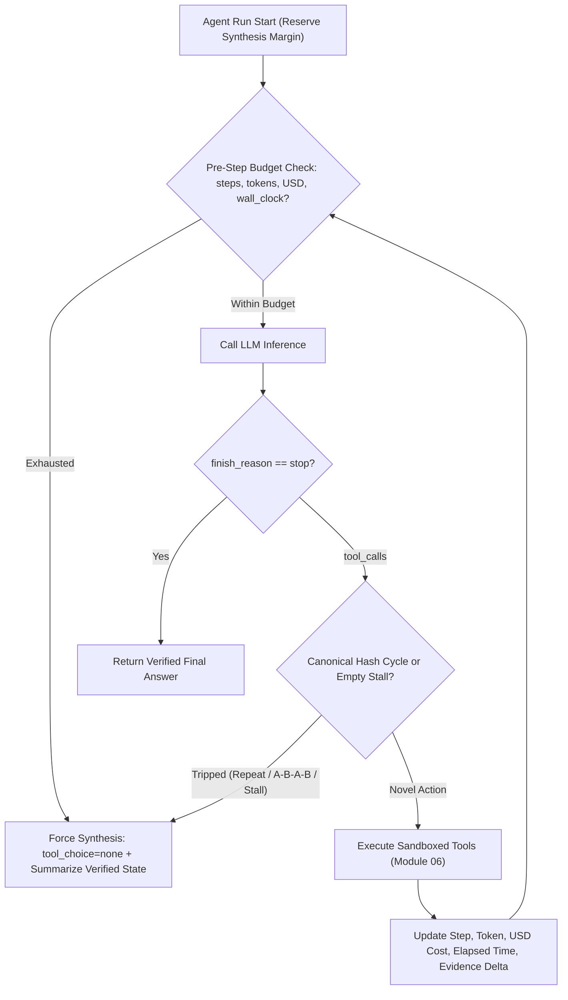
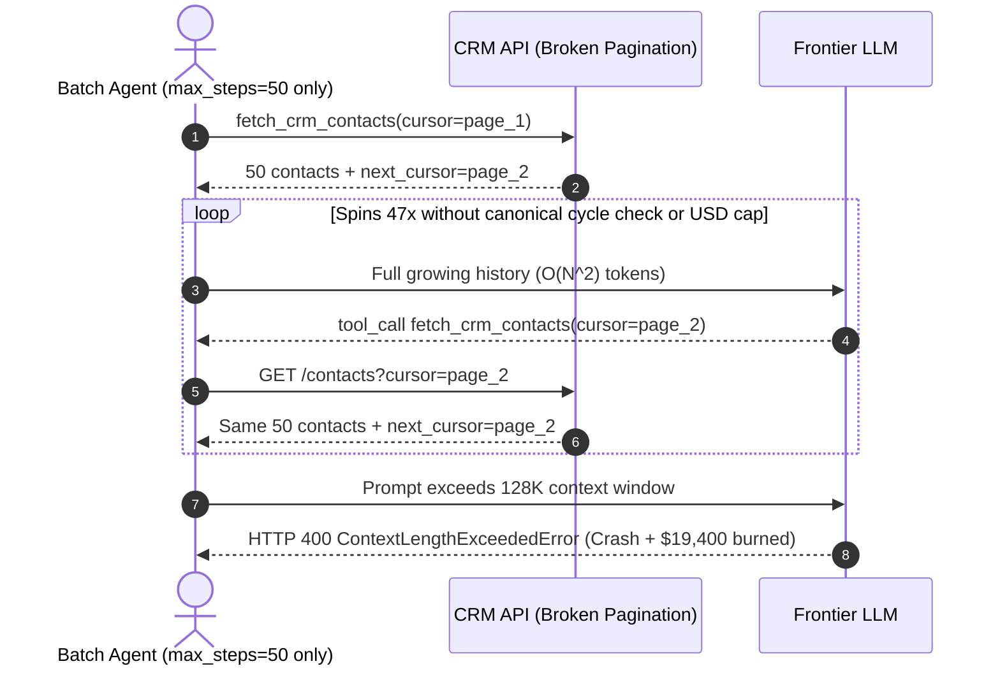

# Module 07: The Agent Loop: Termination and Limits

> **Prerequisites:** [Module 02: The ReAct Loop](../02-the-react-loop/README.md), [Module 05: Tool Calling With the OpenAI API](../05-tool-calling-with-the-openai-api/README.md), and [Module 06: Tool Execution and Error Handling](../06-tool-execution-and-error-handling/README.md).  
> **Estimated Reading Time:** 32 minutes  
> **Target Audience:** AI Backend Engineers, Agent Systems Architects, FinOps & Reliability Engineers

> [!TIP]
> **The Golden Rule of Agent Loops:** Never ship an unconstrained `while True:` agent loop—and never rely on `max_steps` alone. Enforce orthogonal limits across **steps, total tokens, USD cost, wall-clock time, and canonical cycle/stall signatures**, while always reserving final margin for a **`tool_choice="none"` graceful synthesis call** so budget-exhausted runs return verifiable partial answers instead of crashing with `500` errors.

---

## Why This Matters

In single-turn completion endpoints, worst-case latency and cost per request are tightly bounded by `max_tokens`. In an autonomous agent loop, **control flow belongs to a probabilistic model**. If a search tool returns empty results, an upstream API has a pagination loop bug, or a prompt has an impossible constraint, an unguarded agent happily loops until your gateway times out or your token bill explodes.

Worse still, setting only `max_steps=15` gives teams false comfort. One step with `8` parallel giant tool responses can exhaust a `128K` context window and burn `\$0.80` in `3` turns; meanwhile, an agent caught in a `fetch_page(2) -> fetch_page(2)` cycle burns `14` useless turns before `max_steps` finally kills it—only for the naive loop to `raise RuntimeError("Max steps exceeded")` and throw away all useful data gathered in turns `1–3`. Production loops bound **every failure axis** and fail gracefully.

---

## 1. Multi-Dimensional Loop Governance & Quantitative Bounds

A production agent loop checks hard budgets *before* every LLM inference call, inspects proposed actions *before* executing tools, and transitions deterministically into synthesis when any exit condition triggers:



### Why Single-Axis Caps Fail: The Five Orthogonal Loop Guards

| Guard Dimension | What It Prevents | Why It Must Be Orthogonal to `max_steps` | Recommended Production Policy |
| :--- | :--- | :--- | :--- |
| **`max_steps`** | Infinite reasoning trajectories | `1` step with `10` parallel tool calls can still blow token/time budgets | `6–12` steps for interactive UX; `15–25` for async batch |
| **`max_tokens_total`** | Quadratic prompt growth & context overflow | Cumulative input tokens scale as $O(N^2)$ across turns | Track running `prompt + completion` tokens; hold `1,500–2,500` reserve |
| **`max_cost_usd`** | Tiered model price spikes (reasoning/frontier drift) | Frontier tokens cost `15x–20x` mini models; token caps alone ignore pricing tiers | Compute exact dollar spend per turn (`in * c_in + out * c_out`) |
| **`max_wall_clock_s`** | Hanging downstream tools + slow TTFT | `4` slow `20s` tools blow a `30s` HTTP gateway timeout in just `4` steps | Global `asyncio.timeout` / `context.WithDeadline` minus `5s` synthesis margin |
| **Cycle & Stall Detection** | Spinning on identical calls or zero-progress queries | Stops useless loops on **turn 2–3** instead of wasting `max_steps` (`12`) | Canonical `(tool_name, canonical_json(args))` hashing + evidence-delta stall window |

### Canonical Action Hashing & Diminishing-Returns Stall Detection

1. **Canonical Call Hashing:** Never compare raw `tc.function.arguments` strings directly! LLMs frequently emit `{"filter": "active", "page": 2}` on step 1 and `{"page": 2, "filter": "active"}` on step 2—identical tool invocations with different whitespace or key order. Parse JSON, recursively sort object keys (`json.dumps(args, sort_keys=True, separators=(",", ":"))`), and hash `sha256(f"{tool_name}:{canonical_args}")`. Halt (or inject a hard recovery nudge) if:
   - Exact signature count $\ge \text{max\_repeats}$ (e.g., `2` for identical read calls), OR
   - Short cycle oscillation (`H[-1] == H[-3]` and `H[-2] == H[-4]`, catching `A -> B -> A -> B` ping-pong loops).
2. **Diminishing-Returns Stall Detector:** Models can bypass exact duplicate hashes by mutating search terms slightly (`"refund rule"`, `"refund policy"`, `"return policy"`) while receiving `0` new facts every turn. Maintain a sliding `stall_window` (`W = 3` turns) checking `new_evidence_count` or state hash delta: if `3` consecutive turns yield empty observations or identical state hashes, exit early.
3. **Graceful Budget-Exhaustion Synthesis (`tool_choice="none"`):** Reserve `1,500` output tokens and `3–5` seconds inside your outer deadline. Whenever *any* budget limit trips, **never discard accumulated observations**. Append a system note (*"Budget reached. Summarize strictly verified observations collected so far and clearly state unverified gaps."*) and execute one final inference call with `tool_choice="none"` (`Module 05`) so the user receives an accurate partial answer.

### Quantitative Failure Bounds: Reliability & Quadratic Cost Compounding

1. **Step-Depth Reliability Compounding:** If each reasoning + tool-execution step $i$ completes accurately and within constraints with independent probability $p_i$ (e.g., $p = 0.95$), the probability that an unassisted $n$-step loop reaches completion without error or divergence is:

$$P(\text{clean trajectory within } n \text{ steps}) = \prod_{i=1}^{n} p_i \approx p^n$$

At $p = 0.95$, a `3`-step agent succeeds **$85.7\%$** of the time; at `10` steps reliability drops to **$59.9\%$**; at `30` steps it collapses to **$21.5\%$**. Tight step limits and task decomposition ([Module 08](../08-planning-task-decomposition/README.md)) directly protect end-to-end reliability.

2. **Quadratic Input Token Growth:** In standard append-only message loops (`base_tokens` $T_0$, average per-turn call+observation addition $\overline{\Delta T}$), step $t$ resends the entire prefix `1..t-1`, making cumulative input tokens grow quadratically with $N$:

$$T_{\text{cum}}(N) = \sum_{t=1}^{N} \left( T_0 + (t - 1)\overline{\Delta T} \right) = N T_0 + \frac{N(N - 1)}{2}\overline{\Delta T}$$

At $T_0 = 2{,}000$ and $\overline{\Delta T} = 1{,}200$, jumping from `5` to `25` steps increases cumulative input tokens from `22,000` to `410,000`—an **`18.6x` token explosion** for only `5x` more steps!

---

## 2. Systematic Comparison Matrix: Loop Termination Strategies

| Dimension | Unbounded `while True` | Step-Cap Only (`max_steps`) | Cost / Token Cap Only | Multi-Dimensional Guard + Cycle/Stall + `tool_choice="none"` |
| :--- | :--- | :--- | :--- | :--- |
| **Runaway Protection** | None (crashes gateway / drains wallet) | Weak (vulnerable to fat parallel calls & slow tools) | Partial (misses 2-minute hanging I/O stalls) | **Complete** (`steps`, `tokens`, `cost`, `wall_clock`, `cycles`) |
| **Duplicate / Spin Catching** | None | Wastes all `max_steps` turns spinning | Wastes full token budget spinning | **Halts on turn 2–3** via canonical hash & stall window |
| **HTTP Timeout Safety** | Frequent `504 Gateway Timeout` | Frequent `504` when tools run slow | Frequent `504` | **Deterministic deadline** leaves `5s` synthesis buffer |
| **User Experience on Limit** | Hard `500` crash | Hard exception or empty error string | Hard exception | **Graceful partial summary** citing verified observations |

---

## 3. Production War Story Post-Mortem: The Weekend Pagination Spin & \$19,400 Token Spiral

| Field | Incident Details |
| :--- | :--- |
| **Severity** | **SEV-1** (Unbudgeted Cloud LLM Spend & Batch Worker Starvation) |
| **Detection / Resolution Time** | Detected `14` hours into weekend batch via OpenAI daily spend threshold alert / Mitigated in `45` minutes by killing jobs + deploying canonical cycle detector & `max_cost_usd` cap |
| **Impact** | `\$19,400` wasted OpenAI spend across `65` stuck CRM enrichment jobs; `100%` of stuck runs ended in `ContextLengthExceededError` with zero saved records |

### What Happened

A revenue-ops batch pipeline launched `65` background agent workers on Saturday evening using `max_steps=50` as its sole termination guard. An upstream CRM REST API had a subtle pagination defect: requesting `cursor="page_2"` returned `200 OK` with the exact same `50` rows and `"next_cursor": "page_2"` indefinitely.

Because `max_steps` was `50` and there was neither a canonical `(tool_name, args)` cycle detector nor a `max_cost_usd` cap, each agent dutifully executed `fetch_crm_contacts(cursor="page_2")` `48` times in a row—snowballing `12M+` cumulative input tokens per worker until every single run hit `ContextLengthExceededError` (`HTTP 400`) and crashed with nothing persisted.



### Root Cause Analysis

- **No Canonical Action Deduplication:** Calling the identical tool with identical arguments `fetch_crm_contacts(cursor="page_2")` twice was never flagged as a deterministic cycle.
- **No Cost / Token Budget or Graceful Synthesis:** `max_steps=50` allowed `O(N^2)` token amplification to hit the context wall instead of exiting at `\$0.25` with a `tool_choice="none"` report explaining the pagination loop.

### The Fix & Architectural Hardening

- **Canonical Call Hashing + Evidence-Delta Gate:** Halted immediately whenever the same `(tool_name, canonical_args)` signature repeated `2` times or zero new record IDs appeared across `3` consecutive turns.
- **Orthogonal Cost + Reserve Margin:** Added `max_cost_usd = 0.30` and `max_tokens_total = 35_000` with a `2,000`-token reserve triggering `tool_choice="none"` partial synthesis.

---

## 4. Multi-Language Production Implementation: Multi-Dimensional Agent Loop Guard

Below is a reusable **Agent Loop Termination & Budget Controller** across **Go**, **TypeScript**, **Python**, and **C#**. It enforces orthogonal limits (`maxSteps`, `maxTokens`, `maxCostUsd`, `deadline`), canonical JSON argument hashing for duplicate and `A->B->A->B` cycle detection, no-progress stall tracking, and clean transition into a final `tool_choice="none"` synthesis step.

````carousel

```go
package agentloop

import (
	"crypto/sha256"
	"encoding/hex"
	"encoding/json"
	"fmt"
	"time"
)

type BudgetConfig struct {
	MaxSteps         int
	MaxTokensTotal   int
	MaxCostUSD       float64
	MaxWallClock     time.Duration
	ReserveTokens    int
	ReserveWallClock time.Duration
	MaxExactRepeats  int
	StallWindow      int
}

type LoopTerminationReason string

const (
	ReasonNone          LoopTerminationReason = ""
	ReasonMaxSteps      LoopTerminationReason = "MAX_STEPS_REACHED"
	ReasonMaxTokens     LoopTerminationReason = "TOKEN_BUDGET_RESERVE_HIT"
	ReasonMaxCost       LoopTerminationReason = "MAX_COST_USD_REACHED"
	ReasonWallClock     LoopTerminationReason = "WALL_CLOCK_DEADLINE_HIT"
	ReasonCycleDetected LoopTerminationReason = "CANONICAL_CYCLE_DETECTED"
	ReasonStallDetected LoopTerminationReason = "NO_PROGRESS_STALL_DETECTED"
)

type LoopGuard struct {
	cfg           BudgetConfig
	startedAt     time.Time
	steps         int
	totalTokens   int
	totalCostUSD  float64
	callCounts    map[string]int
	callHistory   []string
	emptyStreak   int
}

func NewLoopGuard(cfg BudgetConfig) *LoopGuard {
	return &LoopGuard{
		cfg:        cfg,
		startedAt:  time.Now(),
		callCounts: make(map[string]int),
	}
}

func (g *LoopGuard) PreStepCheck() (bool, LoopTerminationReason) {
	if g.steps >= g.cfg.MaxSteps {
		return false, ReasonMaxSteps
	}
	if g.totalTokens+g.cfg.ReserveTokens >= g.cfg.MaxTokensTotal {
		return false, ReasonMaxTokens
	}
	if g.totalCostUSD >= g.cfg.MaxCostUSD {
		return false, ReasonMaxCost
	}
	if time.Since(g.startedAt)+g.cfg.ReserveWallClock >= g.cfg.MaxWallClock {
		return false, ReasonWallClock
	}
	return true, ReasonNone
}

func CanonicalCallHash(toolName string, args any) (string, error) {
	// json.Marshal sorts map keys deterministically in Go's encoding/json.
	raw, err := json.Marshal(args)
	if err != nil {
		return "", err
	}
	sum := sha256.Sum256([]byte(fmt.Sprintf("%s:%s", toolName, string(raw))))
	return hex.EncodeToString(sum[:])[:16], nil
}

func (g *LoopGuard) RecordToolAction(toolName string, args any, novelItems int) (bool, LoopTerminationReason) {
	sig, err := CanonicalCallHash(toolName, args)
	if err != nil {
		sig = toolName + ":unhashable"
	}
	g.callCounts[sig]++
	g.callHistory = append(g.callHistory, sig)
	if g.callCounts[sig] >= g.cfg.MaxExactRepeats {
		return false, ReasonCycleDetected
	}
	n := len(g.callHistory)
	if n >= 4 && g.callHistory[n-1] == g.callHistory[n-3] && g.callHistory[n-2] == g.callHistory[n-4] {
		return false, ReasonCycleDetected
	}
	if novelItems == 0 {
		g.emptyStreak++
		if g.emptyStreak >= g.cfg.StallWindow {
			return false, ReasonStallDetected
		}
	} else {
		g.emptyStreak = 0
	}
	return true, ReasonNone
}

func (g *LoopGuard) RecordTurnUsage(promptTok, completionTok int, costUSD float64) {
	g.steps++
	g.totalTokens += promptTok + completionTok
	g.totalCostUSD += costUSD
}
```

<!-- slide -->

```typescript
import { createHash } from "node:crypto";

export interface LoopBudgetConfig {
  readonly maxSteps: number;
  readonly maxTokensTotal: number;
  readonly maxCostUsd: number;
  readonly maxWallClockMs: number;
  readonly reserveTokens: number;
  readonly reserveWallClockMs: number;
  readonly maxExactRepeats: number;
  readonly stallWindow: number;
}

export type HaltReason =
  | "MAX_STEPS_REACHED"
  | "TOKEN_BUDGET_RESERVE_HIT"
  | "MAX_COST_USD_REACHED"
  | "WALL_CLOCK_DEADLINE_HIT"
  | "CANONICAL_CYCLE_DETECTED"
  | "NO_PROGRESS_STALL_DETECTED";

function canonicalize(value: unknown): unknown {
  if (Array.isArray(value)) return value.map(canonicalize);
  if (value !== null && typeof value === "object") {
    const sorted: Record<string, unknown> = {};
    for (const key of Object.keys(value as Record<string, unknown>).sort()) {
      sorted[key] = canonicalize((value as Record<string, unknown>)[key]);
    }
    return sorted;
  }
  return value;
}

export function hashToolCall(toolName: string, args: unknown): string {
  const normalized = JSON.stringify(canonicalize(args));
  return createHash("sha256").update(`${toolName}:${normalized}`).digest("hex").slice(0, 16);
}

export class AgentLoopGuard {
  private readonly startedAtMs = Date.now();
  private steps = 0;
  private totalTokens = 0;
  private totalCostUsd = 0;
  private readonly callCounts = new Map<string, number>();
  private readonly callHistory: string[] = [];
  private emptyStreak = 0;

  constructor(private readonly cfg: LoopBudgetConfig) {}

  preStepCheck(): { allowed: true } | { allowed: false; reason: HaltReason } {
    if (this.steps >= this.cfg.maxSteps) return { allowed: false, reason: "MAX_STEPS_REACHED" };
    if (this.totalTokens + this.cfg.reserveTokens >= this.cfg.maxTokensTotal) {
      return { allowed: false, reason: "TOKEN_BUDGET_RESERVE_HIT" };
    }
    if (this.totalCostUsd >= this.cfg.maxCostUsd) return { allowed: false, reason: "MAX_COST_USD_REACHED" };
    if (Date.now() - this.startedAtMs + this.cfg.reserveWallClockMs >= this.cfg.maxWallClockMs) {
      return { allowed: false, reason: "WALL_CLOCK_DEADLINE_HIT" };
    }
    return { allowed: true };
  }

  inspectToolAction(toolName: string, args: unknown, novelEvidenceCount: number): HaltReason | null {
    const sig = hashToolCall(toolName, args);
    const nextCount = (this.callCounts.get(sig) ?? 0) + 1;
    this.callCounts.set(sig, nextCount);
    this.callHistory.push(sig);

    if (nextCount >= this.cfg.maxExactRepeats) return "CANONICAL_CYCLE_DETECTED";
    const n = this.callHistory.length;
    if (n >= 4 && this.callHistory[n - 1] === this.callHistory[n - 3] && this.callHistory[n - 2] === this.callHistory[n - 4]) {
      return "CANONICAL_CYCLE_DETECTED";
    }
    this.emptyStreak = novelEvidenceCount === 0 ? this.emptyStreak + 1 : 0;
    if (this.emptyStreak >= this.cfg.stallWindow) return "NO_PROGRESS_STALL_DETECTED";
    return null;
  }

  recordUsage(promptTokens: number, completionTokens: number, costUsd: number): void {
    this.steps += 1;
    this.totalTokens += promptTokens + completionTokens;
    this.totalCostUsd += costUsd;
  }
}
```

<!-- slide -->

```python
"""
agent_loop_guard.py
Multi-dimensional loop governor enforcing step, token, USD cost, and deadline budgets,
canonical (tool_name, sorted_args) cycle detection, stall detection, and graceful tool_choice="none" fallback.
"""
from dataclasses import dataclass
import hashlib
import json
import time
from typing import Any


@dataclass(frozen=True)
class BudgetLimits:
    max_steps: int = 8
    max_tokens_total: int = 32_000
    max_cost_usd: float = 0.25
    max_wall_clock_s: float = 25.0
    reserve_tokens: int = 2_000
    reserve_wall_s: float = 4.0
    max_exact_repeats: int = 2
    stall_window: int = 3


def canonical_call_signature(tool_name: str, args: dict[str, Any]) -> str:
    canonical_args = json.dumps(args, sort_keys=True, separators=(",", ":"))
    return hashlib.sha256(f"{tool_name}:{canonical_args}".encode("utf-8")).hexdigest()[:16]


class AgentLoopGuard:
    def __init__(self, limits: BudgetLimits) -> None:
        self.limits = limits
        self.started_at = time.monotonic()
        self.steps = 0
        self.total_tokens = 0
        self.total_cost_usd = 0.0
        self._counts: dict[str, int] = {}
        self._history: list[str] = []
        self._empty_streak = 0

    def pre_step_check(self) -> tuple[bool, str]:
        if self.steps >= self.limits.max_steps:
            return False, "MAX_STEPS_REACHED"
        if self.total_tokens + self.limits.reserve_tokens >= self.limits.max_tokens_total:
            return False, "TOKEN_BUDGET_RESERVE_HIT"
        if self.total_cost_usd >= self.limits.max_cost_usd:
            return False, "MAX_COST_USD_REACHED"
        elapsed = time.monotonic() - self.started_at
        if elapsed + self.limits.reserve_wall_s >= self.limits.max_wall_clock_s:
            return False, "WALL_CLOCK_DEADLINE_HIT"
        return True, "OK"

    def check_action(self, tool_name: str, args: dict[str, Any], novel_facts_count: int) -> str | None:
        sig = canonical_call_signature(tool_name, args)
        self._counts[sig] = self._counts.get(sig, 0) + 1
        self._history.append(sig)
        if self._counts[sig] >= self.limits.max_exact_repeats:
            return "CANONICAL_CYCLE_DETECTED"
        if len(self._history) >= 4 and (
            self._history[-1] == self._history[-3] and self._history[-2] == self._history[-4]
        ):
            return "ABAB_OSCILLATION_DETECTED"
        self._empty_streak = self._empty_streak + 1 if novel_facts_count == 0 else 0
        if self._empty_streak >= self.limits.stall_window:
            return "NO_PROGRESS_STALL_DETECTED"
        return None

    def record_turn(self, prompt_tokens: int, completion_tokens: int, cost_usd: float) -> None:
        self.steps += 1
        self.total_tokens += prompt_tokens + completion_tokens
        self.total_cost_usd += cost_usd


def build_graceful_synthesis_instruction(halt_reason: str) -> dict[str, str]:
    return {
        "role": "system",
        "content": (
            f"Execution stopped ({halt_reason}). Tools are now disabled (tool_choice='none'). "
            "Synthesize ONLY verified tool outputs gathered so far, clearly list unresolved gaps, "
            "and never invent missing facts."
        ),
    }
```

<!-- slide -->

```csharp
using System;
using System.Collections.Generic;
using System.Linq;
using System.Security.Cryptography;
using System.Text;
using System.Text.Json;

namespace GenAI.AgentLoop;

public sealed record LoopBudgetLimits(
    int MaxSteps = 8,
    int MaxTokensTotal = 32_000,
    double MaxCostUsd = 0.25,
    double MaxWallClockSeconds = 25.0,
    int ReserveTokens = 2_000,
    double ReserveWallClockSeconds = 4.0,
    int MaxExactRepeats = 2,
    int StallWindow = 3);

public sealed class AgentLoopGuard
{
    private readonly LoopBudgetLimits _limits;
    private readonly DateTimeOffset _startedAt = DateTimeOffset.UtcNow;
    private readonly Dictionary<string, int> _counts = new(StringComparer.Ordinal);
    private readonly List<string> _history = new();
    private int _steps;
    private int _totalTokens;
    private double _totalCostUsd;
    private int _emptyStreak;

    public AgentLoopGuard(LoopBudgetLimits limits) => _limits = limits;

    public (bool Allowed, string Reason) PreStepCheck()
    {
        if (_steps >= _limits.MaxSteps) return (false, "MAX_STEPS_REACHED");
        if (_totalTokens + _limits.ReserveTokens >= _limits.MaxTokensTotal)
            return (false, "TOKEN_BUDGET_RESERVE_HIT");
        if (_totalCostUsd >= _limits.MaxCostUsd) return (false, "MAX_COST_USD_REACHED");
        var elapsed = (DateTimeOffset.UtcNow - _startedAt).TotalSeconds;
        if (elapsed + _limits.ReserveWallClockSeconds >= _limits.MaxWallClockSeconds)
            return (false, "WALL_CLOCK_DEADLINE_HIT");
        return (true, "OK");
    }

    public static string CanonicalHash(string toolName, IReadOnlyDictionary<string, object?> sortedArgs)
    {
        var ordered = sortedArgs.OrderBy(k => k.Key, StringComparer.Ordinal)
                                .ToDictionary(k => k.Key, k => k.Value);
        string payload = $"{toolName}:{JsonSerializer.Serialize(ordered)}";
        byte[] hash = SHA256.HashData(Encoding.UTF8.GetBytes(payload));
        return Convert.ToHexString(hash)[..16];
    }

    public string? InspectToolCall(string toolName, IReadOnlyDictionary<string, object?> args, int novelFacts)
    {
        string sig = CanonicalHash(toolName, args);
        _counts[sig] = _counts.GetValueOrDefault(sig) + 1;
        _history.Add(sig);

        if (_counts[sig] >= _limits.MaxExactRepeats) return "CANONICAL_CYCLE_DETECTED";
        int n = _history.Count;
        if (n >= 4 && _history[n - 1] == _history[n - 3] && _history[n - 2] == _history[n - 4])
            return "ABAB_OSCILLATION_DETECTED";

        _emptyStreak = novelFacts == 0 ? _emptyStreak + 1 : 0;
        return _emptyStreak >= _limits.StallWindow ? "NO_PROGRESS_STALL_DETECTED" : null;
    }

    public void RecordUsage(int promptTokens, int completionTokens, double costUsd)
    {
        _steps++;
        _totalTokens += promptTokens + completionTokens;
        _totalCostUsd += costUsd;
    }
}
```

````

---

## 5. Practical Hands-On Verification CLI Workflows

Run these offline Python 3.13 verification scripts in your terminal—no external packages or API keys required.

### Workflow 1: Reliability Compounding ($p^n$) & Quadratic Token Growth Sweep

Verify quantitatively why `20–30`-step unassisted loops suffer collapsing reliability and quadratic token cost:

```bash
python -c '
def simulate_loop_growth(steps_list, p_step=0.95, t0=2000, delta_t=1200, price_in_1m=2.50):
    for n in steps_list:
        p_ok = p_step ** n
        cum_in = sum(t0 + (t - 1) * delta_t for t in range(1, n + 1))
        cost = (cum_in / 1_000_000) * price_in_1m
        print(f"N={n:<2} steps | P(all_steps_ok)={p_ok*100:>5.1f}% | cum_input_tok={cum_in:>7,} | input_cost=${cost:.4f}")

simulate_loop_growth([3, 5, 10, 20, 30])
'
```

**Expected Output:**

```text
N=3  steps | P(all_steps_ok)= 85.7% | cum_input_tok=  9,600 | input_cost=$0.0240
N=5  steps | P(all_steps_ok)= 77.4% | cum_input_tok= 22,000 | input_cost=$0.0550
N=10 steps | P(all_steps_ok)= 59.9% | cum_input_tok= 74,000 | input_cost=$0.1850
N=20 steps | P(all_steps_ok)= 35.8% | cum_input_tok=268,000 | input_cost=$0.6700
N=30 steps | P(all_steps_ok)= 21.5% | cum_input_tok=582,000 | input_cost=$1.4550
```

### Workflow 2: Canonical Argument Cycle & Diminishing-Returns Stall Detector

Confirm that reordered JSON keys (`{"page": 2, "filter": "active"}` vs `{"filter": "active", "page": 2}`) hash identically and halt on step 2, while consecutive zero-hit queries trip the stall detector at step 3:

```bash
python -c '
import hashlib, json

def canonical_call_hash(tool_name, args):
    canonical_args = json.dumps(args, sort_keys=True, separators=(",", ":"))
    return hashlib.sha256(f"{tool_name}:{canonical_args}".encode()).hexdigest()[:12]

class LoopCycleDetector:
    def __init__(self, max_exact_repeats=2, stall_window=3):
        self.max_exact_repeats = max_exact_repeats
        self.stall_window = stall_window
        self.counts = {}
        self.history = []
        self.empty_streak = 0

    def check(self, tool_name, args, result_count):
        sig = canonical_call_hash(tool_name, args)
        self.counts[sig] = self.counts.get(sig, 0) + 1
        self.history.append(sig)
        self.empty_streak = self.empty_streak + 1 if result_count == 0 else 0
        if self.counts[sig] >= self.max_exact_repeats:
            return f"HALT_CYCLE(sig={sig}, count={self.counts[sig]})"
        if len(self.history) >= 4 and self.history[-1] == self.history[-3] and self.history[-2] == self.history[-4]:
            return "HALT_ABAB_OSCILLATION"
        if self.empty_streak >= self.stall_window:
            return f"HALT_STALL(empty_streak={self.empty_streak})"
        return "CONTINUE"

det = LoopCycleDetector(max_exact_repeats=2, stall_window=3)
trace = [
    ("search_crm", {"page": 2, "filter": "active"}, 5),
    ("search_crm", {"filter": "active", "page": 2}, 5),
]
for step, (tool, args, hits) in enumerate(trace, 1):
    verdict = det.check(tool, args, hits)
    print(f"Trace A step {step}: {tool}({args}) -> {verdict}")

det_stall = LoopCycleDetector(max_exact_repeats=3, stall_window=3)
for step, q in enumerate(["refund", "returns", "chargeback"], 1):
    verdict = det_stall.check("search", {"q": q}, 0)
    print(f"Trace B step {step}: search({q}) hits=0 -> {verdict}")
'
```

**Expected Output:**

```text
Trace A step 1: search_crm({'page': 2, 'filter': 'active'}) -> CONTINUE
Trace A step 2: search_crm({'filter': 'active', 'page': 2}) -> HALT_CYCLE(sig=37bd7468e3e0, count=2)
Trace B step 1: search(refund) hits=0 -> CONTINUE
Trace B step 2: search(returns) hits=0 -> CONTINUE
Trace B step 3: search(chargeback) hits=0 -> HALT_STALL(empty_streak=3)
```

### Workflow 3: Multi-Dimensional Reserve Budget & Graceful `tool_choice="none"` Transition

Simulate a multi-turn trajectory verifying how reserving `1,500` tokens inside a `12,000`-token ceiling stops turn `5` cleanly before overflowing the budget:

```bash
python -c '
class AgentBudget:
    def __init__(self, max_steps=6, max_tokens=20_000, max_cost_usd=0.10, max_wall_s=15.0, reserve_tokens=1500):
        self.max_steps = max_steps
        self.max_tokens = max_tokens
        self.max_cost_usd = max_cost_usd
        self.max_wall_s = max_wall_s
        self.reserve_tokens = reserve_tokens
        self.steps = 0
        self.tokens = 0
        self.cost_usd = 0.0
        self.elapsed_s = 0.0

    def pre_step_check(self):
        if self.steps >= self.max_steps:
            return False, "MAX_STEPS_REACHED"
        if self.tokens + self.reserve_tokens >= self.max_tokens:
            return False, "TOKEN_BUDGET_RESERVE_TRIGGERED"
        if self.cost_usd >= self.max_cost_usd:
            return False, "MAX_COST_USD_REACHED"
        if self.elapsed_s >= self.max_wall_s:
            return False, "WALL_CLOCK_TIMEOUT"
        return True, "OK"

    def record_turn(self, tok, cost, dur_s):
        self.steps += 1
        self.tokens += tok
        self.cost_usd += cost
        self.elapsed_s += dur_s

budget = AgentBudget(max_steps=8, max_tokens=12_000, max_cost_usd=0.05, max_wall_s=12.0, reserve_tokens=1500)
simulated_turns = [
    (2200, 0.008, 1.4),
    (3400, 0.014, 1.9),
    (4100, 0.017, 2.2),
    (3100, 0.012, 1.7),
    (1500, 0.005, 1.0),
]
for idx, (tok, c, dt) in enumerate(simulated_turns, 1):
    ok, reason = budget.pre_step_check()
    if not ok:
        print(f"Step {idx}: pre-check -> {reason} => switch to tool_choice=none graceful synthesis")
        break
    budget.record_turn(tok, c, dt)
    print(f"Step {idx}: ok | total_tok={budget.tokens:,} | total_cost=${budget.cost_usd:.3f} | elapsed={budget.elapsed_s:.1f}s")
'
```

**Expected Output:**

```text
Step 1: ok | total_tok=2,200 | total_cost=$0.008 | elapsed=1.4s
Step 2: ok | total_tok=5,600 | total_cost=$0.022 | elapsed=3.3s
Step 3: ok | total_tok=9,700 | total_cost=$0.039 | elapsed=5.5s
Step 4: ok | total_tok=12,800 | total_cost=$0.051 | elapsed=7.2s
Step 5: pre-check -> TOKEN_BUDGET_RESERVE_TRIGGERED => switch to tool_choice=none graceful synthesis
```

### Hands-On Exercises

1. **A-B-A-B Oscillation Test:** Extend Workflow 2 with a 4-step trace alternating `check_inventory(sku="A") -> update_cart(sku="A") -> check_inventory(sku="A") -> update_cart(sku="A")` and confirm `HALT_ABAB_OSCILLATION` fires on step 4 even when `max_exact_repeats=3`.
2. **Evidence-Hash Delta Stall Detector:** Upgrade `LoopCycleDetector` so instead of checking only `result_count == 0`, it hashes the set of returned record IDs and halts when `3` sequential tool calls add zero unseen IDs (`set(new_ids) <= seen_ids`).
3. **Optional Live Synthesis Probe (Requires API Key):** Run a tiny ReAct loop with `max_steps=2` on a 4-step research question (`"Look up Python 3.13 release date, PEP 703 summary, and compare with 3.12"`). On step 3 exhaustion, issue the final API call with `tool_choice="none"` and verify the response cleanly summarizes collected steps without throwing an error or attempting a tool call.

### Independent Challenge

You operate a multi-tenant code-review agent behind a `60`-second API gateway timeout (`max_cost_usd=\$0.40` per PR review). Some pull requests modify `40` files, tempting the agent to read files sequentially `1` by `1` (`max_steps=50` would take `90` seconds and cost `\$1.80`). Other PRs cause the agent to repeatedly run `pytest` on a broken fixture, failing identically every turn. Design the exact loop-governance architecture: (a) how to configure the multi-dimensional budget + reserve margin, (b) how to catch both exact `pytest` loops and alternating `edit_line -> pytest -> revert_line -> pytest` oscillations, and (c) how to enforce a `tool_choice="none"` summary before the `60s` gateway cuts off the TCP connection.

<details><summary>Architectural Discussion</summary>

1. **Multi-Dimensional Budget + Reserve:** Set `max_wall_clock_s = 52.0` (`8s` reserve under the `60s` gateway timeout), `max_cost_usd = 0.35` (`\$0.05` synthesis buffer), `max_tokens_total = 80_000`, and `max_steps = 10`. Encourage `parallel_tool_calls: true` for read-only file inspections so reading `8` files takes `1` step instead of `8`.
2. **Cycle & State-Fingerprint Detection:** Hash `(tool_name, canonical_args)` plus the git diff hash `sha256(working_tree_diff)`. If `pytest` runs consecutively against the exact same `working_tree_diff` hash (meaning `edit -> revert` restored an earlier state!), detect the semantic `A-B-A-B` state cycle immediately and halt.
3. **Pre-Deadline Synthesis Switch:** Wrap the step loop inside an `asyncio.timeout(52.0)` / `context.WithDeadline`. On timeout or budget trip, cancel pending non-critical reads and issue a final `tool_choice="none"` call bounded by the remaining `8s` window.

</details>

---

## 6. Common Mistakes & Troubleshooting

- **Setting `max_steps` without `max_tokens_total` or `max_cost_usd`:** One step invoking `12` parallel search tools returning `8 KB` each adds `~25,000` tokens in a single turn. Always check both token accumulation and dollar spend before every inference call.
- **Comparing uncanonicalized `arguments` strings for loop detection:** Comparing raw strings misses whitespace/key-ordering drift (`{"a":1,"b":2}` vs `{"b": 2, "a": 1}`). Always parse JSON and serialize with `sort_keys=True` before hashing.
- **Zero reserve margin before `max_wall_clock_s` or `max_tokens_total`:** Checking `tokens >= 128_000` leaves `0` room for the final `tool_choice="none"` synthesis call—causing the summary call itself to fail with `ContextLengthExceededError` or `GatewayTimeout`. Always reserve `1,500–2,500` tokens and `4–5s`.
- **Swallowing `finish_reason == "length"` inside the loop:** If the model hits `max_tokens` mid-tool-call JSON generation, parsing fails and the loop may re-prompt endlessly. Treat truncated `finish_reason == "length"` responses as a terminal or explicit compact-and-retry condition.

---

## 7. Operational Validation Checkpoints & Checkpoint Quiz

### Operational Validation Checkpoints

<details><summary><strong>Checkpoint 1: Diagnosing why a 20-step ReAct loop blows cost AND reliability</strong></summary>

A team increases `max_steps` from `5` to `25` hoping to solve harder analytics tasks. Instead, end-to-end task completion drops while average request cost increases `18x`. Explain both mathematical causes.

**Validation:** First, step-level errors compound multiplicatively ($P = \prod_i p_i \approx p^n$): even at $95\%$ per-step accuracy, `25` sequential steps yield only $0.95^{25} \approx 27.7\%$ end-to-end reliability. Second, append-only message histories grow quadratically ($T_{\text{cum}} = N T_0 + \frac{N(N-1)}{2}\overline{\Delta T}$), so `25` turns resend the growing trace `25` times—multiplying input spend nearly `18x–19x`. Fix with task decomposition ([Module 08](../08-planning-task-decomposition/README.md)) and scoped context compaction ([Module 10](../10-memory-short-term-and-scratchpad/README.md)).

</details>

<details><summary><strong>Checkpoint 2: Catching an A->B->A->B tool spin that bypasses exact-repeat limits</strong></summary>

Your loop halts only when the *immediately preceding* tool call equals the current one (`prev == curr`). An agent stuck between `lookup_user(id=9)` and `get_orders(user_id=9)` alternates indefinitely until `max_steps=20` expires. How do you detect this on turn 4?

**Validation:** Maintain a rolling list of canonical `(tool_name, sorted_args)` signatures and check both total frequency (`counts[sig] >= max_repeats`) **and** 2-cycle oscillation (`history[-1] == history[-3] and history[-2] == history[-4]`). On turn 4, `B -> A -> B -> A` triggers `ABAB_OSCILLATION_DETECTED` and stops cleanly.

</details>

<details><summary><strong>Checkpoint 3: Returning useful output when `max_wall_clock_s` expires mid-investigation</strong></summary>

An agent finishes `3` useful tool lookups in `18` seconds, hits a `25s` timeout on step `4`, and throws an unhandled `TimeoutError` returning `HTTP 500` to the user. How should the loop be structured so the user still gets the `3` verified findings?

**Validation:** Split the `25s` SLA into a `20s` tool-loop execution budget (`reserve_wall_s = 5.0`) and a `5s` synthesis reserve. When `elapsed >= 20s` (or an active step exceeds deadline cleanly), transition out of the loop and execute one final LLM call with `tool_choice="none"` instructing the model to summarize only the `3` verified observations and state what step timed out.

</details>

### Checkpoint Quiz

1. Why is `max_steps` alone insufficient to guarantee bounded cost and latency in an agent loop?
2. Under step reliability $p = 0.95$, what happens to $P(\text{clean trajectory})$ as step count rises from `3` to `20`?
3. Why must JSON tool arguments be canonicalized (sorted keys, stripped whitespace) before hashing for cycle detection?
4. What is the difference between a **cycle detector** and a **diminishing-returns stall detector**?
5. Why should you reserve `1,500–2,500` tokens and `3–5` seconds outside the main tool loop?

<details><summary>Answers</summary>

1. A single step with many parallel tool calls or huge outputs can consume tens of thousands of tokens, slow tools can exhaust HTTP timeouts in `2–3` steps, and frontier models cost far more per token than small models—requiring orthogonal caps across steps, tokens, USD cost, and wall-clock time.
2. Reliability compounds multiplicatively as $0.95^3 \approx 85.7\%$ vs. $0.95^{20} \approx 35.8\%$, cutting unassisted completion probability more than in half.
3. LLMs frequently emit semantically identical JSON objects with reordered keys or spacing (`{"a":1,"b":2}` vs `{"b": 2, "a": 1}`); canonical serialization ensures identical semantics map to the exact same hash signature.
4. A cycle detector catches repeated identical or oscillating `(tool_name, args)` signatures, whereas a stall detector catches *distinct* calls (e.g., paraphrased search queries) that produce zero new evidence or state change across `W` consecutive turns.
5. Reserving margin guarantees room to execute one final `tool_choice="none"` synthesis call summarizing verified partial results instead of crashing with `ContextLengthExceededError` or `GatewayTimeout`.

</details>

---

## Further Reading & Sources

- [OpenAI Docs: Function Calling Guide](https://platform.openai.com/docs/guides/function-calling) — controlling tool execution loops via `tool_choice` (`"auto"`, `"required"`, `"none"`).
- [ReAct: Synergizing Reasoning and Acting in Language Models (Yao et al., 2022)](https://arxiv.org/abs/2210.03629) — foundational agent trajectory loop and empirical failure modes on long horizons.
- [LangGraph Documentation: Recursion Limits & Graph Execution](https://langchain-ai.github.io/langgraph/) — practical framework patterns for step recursion caps and state transitions.

## Next

[Module 08: Planning: Task Decomposition](../08-planning-task-decomposition/README.md)
