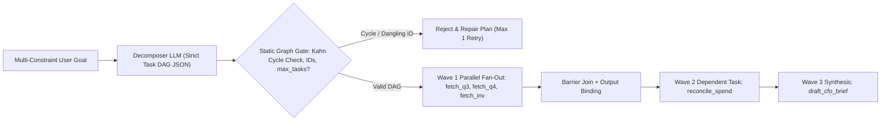
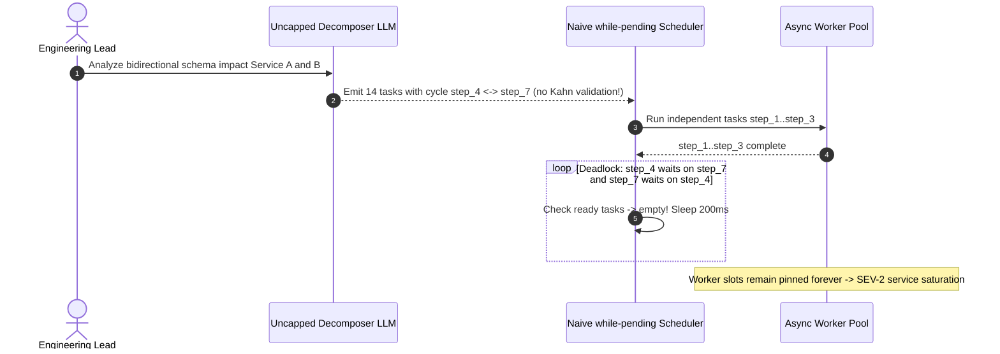

# Module 08: Planning: Task Decomposition

> **Prerequisites:** [Module 01: Agents vs. Chatbots vs. Workflows](../01-agents-vs-chatbots-vs-workflows/README.md), [Module 04: Tools: Definition and Schemas](../04-tools-definition-and-schemas/README.md), and [Module 07: The Agent Loop: Termination and Limits](../07-the-agent-loop-termination-and-limits/README.md).  
> **Estimated Reading Time:** 32 minutes  
> **Target Audience:** AI Backend Engineers, Workflow Orchestration Developers, Distributed Systems Architects

> [!TIP]
> **The Golden Rule of Task Decomposition:** Never hand a multi-constraint goal to a flat single prompt or execute LLM-generated sub-tasks blindly as a sequential list. Compile goals into an explicitly typed, **acyclically validated Directed Acyclic Graph (DAG)** using Kahn's topological check before turn `1` runs—unlocking parallel wavefront execution along the critical path while keeping sub-task granularity coarse enough that handoff overhead does not erase reliability.

---

## Why This Matters

Ask an LLM in a single prompt—or an unguided ReAct loop—to solve a six-constraint engineering workflow (*"Pull Q3 and Q4 AWS billing across 3 accounts, reconcile invoice #8812, flag any service over +15% MoM, check Savings Plan coverage, and draft a CFO summary"*). Without explicit decomposition, two things break immediately:

1. **Constraint Dropping & Attention Dilution:** Under multi-hop reasoning load, monolithic prompts silently skip `1–2` constraints (e.g., forgetting Savings Plan coverage) or hallucinate reconciliation math while trying to keep `5` data sources coherent inside one generation pass.
2. **Sequential Latency Waste:** Even when a flat ReAct agent gets the steps right, executing `fetch_q3`, `fetch_q4`, `fetch_invoice`, and `fetch_savings_plans` one step at a time serializes independent network I/O into `4` round-trips instead of `1` parallel wavefront.

Conversely, undisciplined decomposition creates its own outages: LLM planners can emit **circular dependencies** (`step_2` depends on `step_3` and vice versa), deadlock naive schedulers, or fracture a simple `2`-query task into `25` micro-steps whose handoff tokens cost `3x` more than the work itself.

---

## 1. Decomposition Architectures & DAG Mechanics

Production task decomposition transforms an ambiguous natural-language request into an executable, bounded wavefront schedule via four deterministic stages:



### Decomposition Patterns: Linear vs. Least-to-Most vs. Validated DAGs

1. **Chain-of-Thought (CoT) vs. Least-to-Most Prompting:** Standard Chain-of-Thought (`arXiv:2201.11903`) reasons sequentially inside a single forward pass—and degrades sharply when test goals require *compositional generalization* harder than few-shot examples. **Least-to-Most Prompting** (Zhou et al., `arXiv:2205.10625`) breaks decomposition into two explicit stages: first ask the model solely for the sub-problem list (`"To solve X, what sub-questions must we answer first?"`), then solve sub-questions sequentially by feeding earlier sub-answers as clean scoped inputs.
2. **Sequential Sub-Task Lists vs. Dependency DAGs:** A flat array `[step_1, step_2, step_3, step_4]` forces artificial sequential dependency ($O(N)$ latency) even when steps `1`, `2`, and `3` have zero data dependencies. Modeling tasks as a Directed Acyclic Graph $G = (V, E)$—where each node $v \in V$ declares `depends_on: [u_1, ...]`—lets your scheduler group independent nodes into concurrent **wavefronts** (`in_degree == 0`).
3. **Mandatory Static Acyclic Validation (Kahn's Algorithm):** Never feed an LLM-generated task list straight into an executor loop! Planners routinely hallucinate self-loops (`t2 -> t2`), 2-cycles (`t2 -> t3 -> t2`), or non-existent parent IDs (`depends_on: ["t99"]`). Before running step `1`, execute **Kahn's topological sort**:
   - Verify all `id` values are unique and `len(tasks) <= max_tasks`.
   - Verify every `dep` in `depends_on` exists in `tasks` and `dep != task.id`.
   - Iteratively peel nodes with `in_degree == 0`. If `len(sorted_order) != len(tasks)`, a cycle exists among remaining `in_degree > 0` nodes—reject and re-prompt cleanly before any tool executes.

### Quantitative Latency, Parallel Speedup & Granularity Trade-Offs

1. **Sequential vs. Critical-Path DAG Latency:** Let $l_v$ denote the latency of sub-task $v \in V$. Sequential execution sums every task, while parallel DAG wavefront scheduling is bounded strictly by the **longest dependency path** (critical path):

$$L_{\text{seq}} = \sum_{v \in V} l_v, \qquad L_{\text{DAG}} = \max_{\pi \in \text{paths}(G)} \sum_{v \in \pi} l_v, \qquad \text{Speedup} = \frac{L_{\text{seq}}}{L_{\text{DAG}}}$$

Example: `fetch_aws_q3(1.8s)`, `fetch_aws_q4(1.6s)`, and `fetch_invoice_8812(1.4s)` run in Wave `1` (`max = 1.8s`), followed by `reconcile(0.7s)` and `draft_brief(0.9s)`: $L_{\text{seq}} = 6.4\text{s}$ vs. $L_{\text{DAG}} = 1.8 + 0.7 + 0.9 = 3.4\text{s}$ (**`1.88x` speedup**).

2. **The Granularity U-Curve (Overhead vs. Blast Radius):** Choosing how many sub-tasks $k$ to split a job into balances competing forces:
   - **Too Coarse ($k = 1$):** Zero planner/handoff overhead, but `100%` blast radius on failure—one invalid assumption or context overload forces re-running the entire task.
   - **Too Fine ($k = 25$ micro-tasks):** Each sub-task pays prompt framing + JSON handoff cost $C_{\text{handoff}}$ (`~400–600` tokens), and independent step reliability compounds multiplicatively ($P(\text{all ok}) = p^k$):

$$C_{\text{total}}(k) = C_{\text{plan}} + k \cdot C_{\text{handoff}} + \sum_{i=1}^{k} C_{\text{work}, i}, \qquad \text{Blast Radius} \propto \frac{1}{k}$$

In practice, target **one atomic sub-task per external I/O boundary or stateful decision checkpoint** (`3–8` nodes for typical backend workflows), never `1` sub-task per sentence or single field!

---

## 2. Systematic Comparison Matrix: Decomposition Approaches

| Dimension | Monolithic Single Prompt | Flat Sequential ReAct | Least-to-Most Chain | Validated Parallel Task DAG |
| :--- | :--- | :--- | :--- | :--- |
| **Multi-Constraint Completeness** | Poor (`drops constraints` >3 hops) | Medium (drifts over long traces) | High (focused sub-problem scope) | **Highest** (typed node checklist) |
| **End-to-End Wall Latency** | `1` LLM call (fast, low accuracy) | $L_{\text{seq}} = \sum l_v$ (slowest) | $L_{\text{seq}}$ (strictly ordered) | **$L_{\text{DAG}}$ critical path** (parallel fan-out) |
| **Deadlock / Cycle Risk** | None | Low (runtime loop checks) | None (linear list) | Requires **mandatory Kahn cycle check** before execution |
| **Handoff Token Overhead** | Minimal | High ($O(N^2)$ full history) | Moderate (scoped sub-answers) | Moderate (`k * C_handoff`, controllable via granularity cap) |
| **Partial Failure Blast Radius** | `100%` (must restart whole prompt) | Medium (retries current step) | Low (`1` sub-question) | **Isolated** to affected node + downstream dependents |

---

## 3. Production War Story Post-Mortem: The Cyclic Sub-Task Deadlock & Micro-Decomposition Spike

| Field | Incident Details |
| :--- | :--- |
| **Severity** | **SEV-2** (Worker Thread Pool Exhaustion & `7x` Inference Spend Surge) |
| **Detection / Resolution Time** | Detected `55` minutes post-release via async worker saturation alert (`100%` busy workers) / Mitigated in `70` minutes via Kahn cycle guard + `max_tasks=8` cap |
| **Impact** | `32` async worker slots deadlocked indefinitely; `\$3,800` excess token spend on micro-decomposed `18`-step trivial queries |

### What Happened

An engineering analytics platform shipped an LLM task decomposer that parsed `[{"id": ..., "depends_on": [...]}]` JSON plans into an in-memory `while pending:` scheduler waiting for tasks whose dependencies were all in `completed`. The team omitted both a **topological cycle validator** and a **`max_tasks` cap**.

Two defects collided in production:
1. On a circular schema migration query (*"Check how Service A's schema impacts Service B and vice versa"*), the planner emitted `step_4` (`depends_on: ["step_7"]`) and `step_7` (`depends_on: ["step_4"]`). Neither node ever satisfied `deps <= completed`, locking `while pending:` inside an infinite `await asyncio.sleep(0.2)` poll until every async worker thread hung permanently.
2. On simple repo lookups, the un-capped planner shattered `2`-step queries into `18` overly granular micro-tasks (`list_dir`, `read_file_1`, `parse_import_1`, ...), inflating inference spend `7x`.



### Root Cause Analysis

- **Zero Static Graph Verification:** Executing a scheduler loop over untrusted LLM dependency edges without Kahn's topological sort left the runtime defenseless against hallucinated cycles and dangling IDs.
- **Unbounded Decomposition Granularity:** Without `max_tasks` or prompt guidance defining atomic I/O boundaries, the LLM over-split trivial reads into dozens of high-overhead sub-calls.

### The Fix & Architectural Hardening

- **Pre-Execution Kahn Gate:** Added deterministic topological sort validating uniqueness, valid dependency IDs, zero cycles, `max_tasks <= 10`, and `max_parallel_fanout <= 5` *before* launching turn `1`.
- **Granularity Prompt Contract:** Updated planner system instructions and schema constraints to target `3–8` coarse I/O-aligned nodes, cutting average task latency `58%` and eliminating deadlocks completely.

---

## 4. Multi-Language Production Implementation: Task DAG Validator & Wavefront Scheduler

Below is a production-grade **Task DAG Validator, Critical-Path Analyzer, and Parallel Wavefront Partitioner** across **Go**, **TypeScript**, **Python**, and **C#**. Each implementation performs static cycle/dangling-reference detection via Kahn's algorithm, calculates sequential vs. critical-path latency ($L_{\text{seq}}$ vs. $L_{\text{DAG}}$), and groups tasks into concurrent execution waves.

````carousel

```go
package taskdag

import (
	"fmt"
	"sort"
)

type TaskNode struct {
	ID                 string   `json:"id"`
	Tool               string   `json:"tool"`
	DependsOn          []string `json:"depends_on"`
	EstimatedLatencyMs int      `json:"estimated_latency_ms"`
}

type DAGSchedule struct {
	TopoOrder          []string
	Waves              [][]string
	SequentialLatencyMs int
	CriticalPathMs      int
}

func ValidateAndScheduleDAG(tasks []TaskNode, maxTasks int) (DAGSchedule, error) {
	if len(tasks) == 0 || len(tasks) > maxTasks {
		return DAGSchedule{}, fmt.Errorf("task count %d outside [1, %d]", len(tasks), maxTasks)
	}
	byID := make(map[string]TaskNode, len(tasks))
	inDeg := make(map[string]int, len(tasks))
	adj := make(map[string][]string, len(tasks))
	seqMs := 0

	for _, t := range tasks {
		if _, dup := byID[t.ID]; dup {
			return DAGSchedule{}, fmt.Errorf("duplicate task id %q", t.ID)
		}
		byID[t.ID] = t
		inDeg[t.ID] = 0
		seqMs += t.EstimatedLatencyMs
	}
	for _, t := range tasks {
		for _, dep := range t.DependsOn {
			if dep == t.ID {
				return DAGSchedule{}, fmt.Errorf("self-loop on task %q", t.ID)
			}
			if _, ok := byID[dep]; !ok {
				return DAGSchedule{}, fmt.Errorf("task %q references unknown dependency %q", t.ID, dep)
			}
			adj[dep] = append(adj[dep], t.ID)
			inDeg[t.ID]++
		}
	}

	var queue []string
	for id, deg := range inDeg {
		if deg == 0 {
			queue = append(queue, id)
		}
	}
	sort.Strings(queue)

	var order []string
	var waves [][]string
	earliestFinish := make(map[string]int, len(tasks))
	criticalMs := 0

	for len(queue) > 0 {
		wave := append([]string{}, queue...)
		waves = append(waves, wave)
		var nextQueue []string
		for _, cur := range wave {
			order = append(order, cur)
			depMax := 0
			for _, d := range byID[cur].DependsOn {
				if earliestFinish[d] > depMax {
					depMax = earliestFinish[d]
				}
			}
			earliestFinish[cur] = depMax + byID[cur].EstimatedLatencyMs
			if earliestFinish[cur] > criticalMs {
				criticalMs = earliestFinish[cur]
			}
			for _, nxt := range adj[cur] {
				inDeg[nxt]--
				if inDeg[nxt] == 0 {
					nextQueue = append(nextQueue, nxt)
				}
			}
		}
		sort.Strings(nextQueue)
		queue = nextQueue
	}

	if len(order) != len(tasks) {
		return DAGSchedule{}, fmt.Errorf("cycle detected: resolved %d of %d tasks", len(order), len(tasks))
	}
	return DAGSchedule{
		TopoOrder:           order,
		Waves:               waves,
		SequentialLatencyMs: seqMs,
		CriticalPathMs:      criticalMs,
	}, nil
}
```

<!-- slide -->

```typescript
export interface TaskNode {
  readonly id: string;
  readonly tool: string;
  readonly dependsOn: readonly string[];
  readonly estimatedLatencyMs: number;
}

export interface DagSchedule {
  readonly topoOrder: readonly string[];
  readonly waves: readonly (readonly string[])[];
  readonly sequentialLatencyMs: number;
  readonly criticalPathMs: number;
}

export function validateAndScheduleDag(tasks: readonly TaskNode[], maxTasks = 10): DagSchedule {
  if (tasks.length === 0 || tasks.length > maxTasks) {
    throw new Error(`Task count ${tasks.length} must be in [1, ${maxTasks}]`);
  }

  const byId = new Map<string, TaskNode>();
  const inDegree = new Map<string, number>();
  const adj = new Map<string, string[]>();
  let sequentialLatencyMs = 0;

  for (const t of tasks) {
    if (byId.has(t.id)) throw new Error(`Duplicate task id: ${t.id}`);
    byId.set(t.id, t);
    inDegree.set(t.id, 0);
    adj.set(t.id, []);
    sequentialLatencyMs += t.estimatedLatencyMs;
  }

  for (const t of tasks) {
    for (const dep of t.dependsOn) {
      if (dep === t.id) throw new Error(`Self-loop detected on ${t.id}`);
      if (!byId.has(dep)) throw new Error(`Task ${t.id} depends on missing ${dep}`);
      adj.get(dep)!.push(t.id);
      inDegree.set(t.id, (inDegree.get(t.id) ?? 0) + 1);
    }
  }

  let currentWave = [...inDegree.entries()].filter(([, d]) => d === 0).map(([id]) => id).sort();
  const topoOrder: string[] = [];
  const waves: string[][] = [];
  const earliestFinish = new Map<string, number>();
  let criticalPathMs = 0;

  while (currentWave.length > 0) {
    waves.push(currentWave);
    const nextWave: string[] = [];
    for (const tid of currentWave) {
      topoOrder.push(tid);
      const node = byId.get(tid)!;
      const depFinish = Math.max(0, ...node.dependsOn.map((d) => earliestFinish.get(d) ?? 0));
      const finish = depFinish + node.estimatedLatencyMs;
      earliestFinish.set(tid, finish);
      if (finish > criticalPathMs) criticalPathMs = finish;

      for (const nxt of adj.get(tid)!) {
        const nextDeg = (inDegree.get(nxt) ?? 0) - 1;
        inDegree.set(nxt, nextDeg);
        if (nextDeg === 0) nextWave.push(nxt);
      }
    }
    currentWave = nextWave.sort();
  }

  if (topoOrder.length !== tasks.length) {
    const cyclic = [...inDegree.entries()].filter(([, d]) => d > 0).map(([id]) => id);
    throw new Error(`Cycle detected involving tasks: ${cyclic.join(", ")}`);
  }

  return { topoOrder, waves, sequentialLatencyMs, criticalPathMs };
}
```

<!-- slide -->

```python
"""
task_dag_scheduler.py
Validates LLM-decomposed task graphs via Kahn's topological sort, catches cycles
and dangling IDs pre-execution, and partitions tasks into parallel wavefronts.
"""
from dataclasses import dataclass


@dataclass(frozen=True)
class TaskNode:
    id: str
    tool: str
    depends_on: tuple[str, ...]
    estimated_latency_ms: int


@dataclass(frozen=True)
class DagSchedule:
    topo_order: tuple[str, ...]
    waves: tuple[tuple[str, ...], ...]
    sequential_latency_ms: int
    critical_path_ms: int


def validate_and_schedule_dag(tasks: list[TaskNode], max_tasks: int = 10) -> DagSchedule:
    if not (1 <= len(tasks) <= max_tasks):
        raise ValueError(f"Task count {len(tasks)} outside [1, {max_tasks}]")

    by_id: dict[str, TaskNode] = {}
    in_degree: dict[str, int] = {}
    adj: dict[str, list[str]] = {}
    seq_ms = 0

    for task in tasks:
        if task.id in by_id:
            raise ValueError(f"Duplicate task ID: {task.id}")
        by_id[task.id] = task
        in_degree[task.id] = 0
        adj[task.id] = []
        seq_ms += task.estimated_latency_ms

    for task in tasks:
        for dep in task.depends_on:
            if dep == task.id:
                raise ValueError(f"Self-loop detected on task {task.id}")
            if dep not in by_id:
                raise ValueError(f"Task {task.id} references unknown dependency {dep}")
            adj[dep].append(task.id)
            in_degree[task.id] += 1

    wave = sorted(tid for tid, deg in in_degree.items() if deg == 0)
    topo_order: list[str] = []
    waves: list[tuple[str, ...]] = []
    earliest_finish: dict[str, int] = {}

    while wave:
        waves.append(tuple(wave))
        next_wave: list[str] = []
        for tid in wave:
            topo_order.append(tid)
            dep_max = max((earliest_finish[d] for d in by_id[tid].depends_on), default=0)
            earliest_finish[tid] = dep_max + by_id[tid].estimated_latency_ms
            for nxt in adj[tid]:
                in_degree[nxt] -= 1
                if in_degree[nxt] == 0:
                    next_wave.append(nxt)
        wave = sorted(next_wave)

    if len(topo_order) != len(tasks):
        stuck = sorted(tid for tid, deg in in_degree.items() if deg > 0)
        raise ValueError(f"Cycle detected involving tasks: {stuck}")

    return DagSchedule(
        topo_order=tuple(topo_order),
        waves=tuple(waves),
        sequential_latency_ms=seq_ms,
        critical_path_ms=max(earliest_finish.values()),
    )
```

<!-- slide -->

```csharp
using System;
using System.Collections.Generic;
using System.Linq;

namespace GenAI.TaskDecomposition;

public sealed record TaskNode(
    string Id,
    string Tool,
    IReadOnlyList<string> DependsOn,
    int EstimatedLatencyMs);

public sealed record DagSchedule(
    IReadOnlyList<string> TopoOrder,
    IReadOnlyList<IReadOnlyList<string>> Waves,
    int SequentialLatencyMs,
    int CriticalPathMs);

public static class TaskDagScheduler
{
    public static DagSchedule ValidateAndSchedule(IReadOnlyList<TaskNode> tasks, int maxTasks = 10)
    {
        if (tasks.Count == 0 || tasks.Count > maxTasks)
            throw new ArgumentException($"Task count {tasks.Count} outside [1, {maxTasks}].");

        var byId = new Dictionary<string, TaskNode>(StringComparer.Ordinal);
        var inDegree = new Dictionary<string, int>(StringComparer.Ordinal);
        var adj = new Dictionary<string, List<string>>(StringComparer.Ordinal);
        int seqMs = 0;

        foreach (var t in tasks)
        {
            if (!byId.TryAdd(t.Id, t))
                throw new InvalidOperationException($"Duplicate task id '{t.Id}'.");
            inDegree[t.Id] = 0;
            adj[t.Id] = new List<string>();
            seqMs += t.EstimatedLatencyMs;
        }

        foreach (var t in tasks)
        {
            foreach (var dep in t.DependsOn)
            {
                if (dep == t.Id)
                    throw new InvalidOperationException($"Self-loop detected on '{t.Id}'.");
                if (!byId.ContainsKey(dep))
                    throw new InvalidOperationException($"Task '{t.Id}' references unknown '{dep}'.");
                adj[dep].Add(t.Id);
                inDegree[t.Id]++;
            }
        }

        var wave = inDegree.Where(kv => kv.Value == 0).Select(kv => kv.Key).OrderBy(x => x, StringComparer.Ordinal).ToList();
        var topoOrder = new List<string>();
        var waves = new List<IReadOnlyList<string>>();
        var earliestFinish = new Dictionary<string, int>(StringComparer.Ordinal);
        int criticalMs = 0;

        while (wave.Count > 0)
        {
            waves.Add(wave);
            var nextWave = new List<string>();
            foreach (var tid in wave)
            {
                topoOrder.Add(tid);
                var node = byId[tid];
                int depMax = node.DependsOn.Count == 0 ? 0 : node.DependsOn.Max(d => earliestFinish[d]);
                int finish = depMax + node.EstimatedLatencyMs;
                earliestFinish[tid] = finish;
                if (finish > criticalMs) criticalMs = finish;

                foreach (var nxt in adj[tid])
                {
                    if (--inDegree[nxt] == 0) nextWave.Add(nxt);
                }
            }
            nextWave.Sort(StringComparer.Ordinal);
            wave = nextWave;
        }

        if (topoOrder.Count != tasks.Count)
            throw new InvalidOperationException("Cycle detected in decomposed task graph.");

        return new DagSchedule(topoOrder, waves, seqMs, criticalMs);
    }
}
```

````

---

## 5. Practical Hands-On Verification CLI Workflows

Run these offline Python 3.13 verification scripts locally—no API keys or external libraries required.

### Workflow 1: Kahn's Topological Validator (Catch Cycles & Dangling References)

Verify how static graph validation rejects both circular dependencies (`t2 <-> t3`) and hallucinated dependency IDs (`t99`) before execution begins:

```bash
python -c '
from collections import deque

def validate_task_dag(tasks, max_tasks=12):
    if len(tasks) > max_tasks:
        return False, f"Task count {len(tasks)} exceeds max_tasks={max_tasks}", []
    by_id = {t["id"]: t for t in tasks}
    if len(by_id) != len(tasks):
        return False, "Duplicate task IDs detected", []
    in_degree = {tid: 0 for tid in by_id}
    adj = {tid: [] for tid in by_id}
    for t in tasks:
        tid = t["id"]
        for dep in t["depends_on"]:
            if dep == tid:
                return False, f"Self-loop detected on task {dep}", []
            if dep not in by_id:
                return False, f"Task {tid} references unknown dependency {dep}", []
            adj[dep].append(tid)
            in_degree[tid] += 1
    q = deque(sorted(tid for tid, deg in in_degree.items() if deg == 0))
    order = []
    while q:
        cur = q.popleft()
        order.append(cur)
        for nxt in adj[cur]:
            in_degree[nxt] -= 1
            if in_degree[nxt] == 0:
                q.append(nxt)
    if len(order) != len(tasks):
        stuck = sorted(tid for tid, deg in in_degree.items() if deg > 0)
        return False, f"Cycle detected involving tasks {stuck}", []
    return True, "VALID_DAG", order

valid_plan = [
    {"id": "t1", "depends_on": []},
    {"id": "t2", "depends_on": []},
    {"id": "t3", "depends_on": ["t1", "t2"]},
    {"id": "t4", "depends_on": ["t3"]},
]
cyclic_plan = [
    {"id": "t1", "depends_on": []},
    {"id": "t2", "depends_on": ["t3"]},
    {"id": "t3", "depends_on": ["t2"]},
]
dangling_plan = [
    {"id": "t1", "depends_on": ["t99"]},
]

for label, plan in [("valid_plan", valid_plan), ("cyclic_plan", cyclic_plan), ("dangling_plan", dangling_plan)]:
    ok, msg, order = validate_task_dag(plan)
    print(f"{label:<14} -> ok={ok} | {msg} | order={order}")
'
```

**Expected Output:**

```text
valid_plan     -> ok=True | VALID_DAG | order=['t1', 't2', 't3', 't4']
cyclic_plan    -> ok=False | Cycle detected involving tasks ['t2', 't3'] | order=[]
dangling_plan  -> ok=False | Task t1 references unknown dependency t99 | order=[]
```

### Workflow 2: Critical-Path Latency ($L_{\text{DAG}}$) & Parallel Wavefront Partitioner

Verify the `1.88x` parallel speedup obtained by grouping independent billing lookups into Wave `1`:

```bash
python -c '
def schedule_wavefronts_and_critical_path(tasks):
    by_id = {t["id"]: t for t in tasks}
    remaining = set(by_id.keys())
    completed = set()
    earliest_finish = {}
    waves = []
    while remaining:
        ready = sorted(tid for tid in remaining if all(d in completed for d in by_id[tid]["depends_on"]))
        if not ready:
            raise ValueError("Graph has a cycle")
        waves.append(ready)
        for tid in ready:
            dep_finish = max((earliest_finish[d] for d in by_id[tid]["depends_on"]), default=0.0)
            earliest_finish[tid] = dep_finish + by_id[tid]["latency_s"]
        completed.update(ready)
        remaining.difference_update(ready)
    l_seq = sum(t["latency_s"] for t in tasks)
    l_dag = max(earliest_finish.values())
    return waves, l_seq, l_dag

audit_dag = [
    {"id": "fetch_aws_q3", "depends_on": [], "latency_s": 1.8},
    {"id": "fetch_aws_q4", "depends_on": [], "latency_s": 1.6},
    {"id": "fetch_invoice_8812", "depends_on": [], "latency_s": 1.4},
    {"id": "reconcile_spend", "depends_on": ["fetch_aws_q3", "fetch_aws_q4", "fetch_invoice_8812"], "latency_s": 0.7},
    {"id": "draft_cfo_brief", "depends_on": ["reconcile_spend"], "latency_s": 0.9},
]
waves, l_seq, l_dag = schedule_wavefronts_and_critical_path(audit_dag)
for idx, w in enumerate(waves, 1):
    w_lat = max(next(t["latency_s"] for t in audit_dag if t["id"] == tid) for tid in w)
    print(f"Wave {idx}: {w} (wave_latency={w_lat:.1f}s)")
print(f"L_seq={l_seq:.1f}s vs L_DAG={l_dag:.1f}s -> Parallel speedup={l_seq/l_dag:.2f}x")
'
```

**Expected Output:**

```text
Wave 1: ['fetch_aws_q3', 'fetch_aws_q4', 'fetch_invoice_8812'] (wave_latency=1.8s)
Wave 2: ['reconcile_spend'] (wave_latency=0.7s)
Wave 3: ['draft_cfo_brief'] (wave_latency=0.9s)
L_seq=6.4s vs L_DAG=3.4s -> Parallel speedup=1.88x
```

### Workflow 3: Granularity Sweep — Handoff Token Overhead vs. Blast Radius

Quantify how splitting a `6,000`-token task into `1..30` sub-tasks trades rework blast radius against handoff token bloat and $p^k$ reliability decay:

```bash
python -c '
def evaluate_granularity(k_values, total_work_tokens=6000, handoff_overhead=450, plan_tokens=700, p_step=0.96):
    for k in k_values:
        exec_tokens = total_work_tokens + k * handoff_overhead + plan_tokens
        reliability = (p_step ** k) * 100
        blast_radius_pct = 100.0 / k
        print(f"subtasks={k:<2} | total_tok={exec_tokens:>6,} | P(all_ok)={reliability:>5.1f}% | max_rework_blast={blast_radius_pct:>5.1f}%")

evaluate_granularity([1, 3, 5, 10, 20, 30])
'
```

**Expected Output:**

```text
subtasks=1  | total_tok= 7,150 | P(all_ok)= 96.0% | max_rework_blast=100.0%
subtasks=3  | total_tok= 8,050 | P(all_ok)= 88.5% | max_rework_blast= 33.3%
subtasks=5  | total_tok= 8,950 | P(all_ok)= 81.5% | max_rework_blast= 20.0%
subtasks=10 | total_tok=11,200 | P(all_ok)= 66.5% | max_rework_blast= 10.0%
subtasks=20 | total_tok=15,700 | P(all_ok)= 44.2% | max_rework_blast=  5.0%
subtasks=30 | total_tok=20,200 | P(all_ok)= 29.4% | max_rework_blast=  3.3%
```

### Hands-On Exercises

1. **Max-Fanout Concurrency Limiter:** Extend Workflow 2's wavefront scheduler with `max_concurrency=2` so if Wave 1 has `5` ready tasks, it batches them safely (`2 + 2 + 1`) without exhausting DB connection pools, and print the updated `L_DAG`.
2. **Failure Cascade Marking:** Write a function `mark_failed(task_id, tasks)` that traverses the DAG edges downstream from a failed node and marks all transitive dependents as `SKIPPED_UPSTREAM_FAILED` while letting unrelated parallel branches finish cleanly.
3. **Optional Live Decomposer Schema Test (Requires API Key):** Define a `strict: true` JSON Schema (`tasks: list[{id, description, tool, depends_on}]`) and prompt an LLM to decompose a 4-source competitive research task. Pass the returned JSON directly into Workflow 1's `validate_task_dag` and verify zero cycles or missing references.

### Independent Challenge

A compliance automation platform asks an agent to audit new SaaS vendors across `5` checks: (1) fetch SOC-2 report metadata (`1.2s`), (2) fetch privacy policy HTML (`0.9s`), (3) query CRM vendor spend (`0.5s`), (4) cross-check GDPR DPA clauses against the privacy policy (`2.1s`), and (5) synthesize final risk tier (`0.8s`). Previously, a sequential prompt-chaining script ran all 5 steps linearly, and occasionally split step (4) into `12` separate per-clause LLM calls (`12 * 1.5s`, costing `12x` tokens). Design the optimal Task DAG and granularity policy, compute $L_{\text{seq}}$ vs. $L_{\text{DAG}}$, and explain how you prevent partial failures in check (3) from blocking check (4).

<details><summary>Architectural Discussion</summary>

1. **Optimal DAG Topology & Granularity:** Wave `1` runs three independent I/O nodes in parallel: `fetch_soc2(1.2s)`, `fetch_privacy(0.9s)`, and `fetch_crm_spend(0.5s)` (`wave_1 = 1.2s`). Wave `2` runs a single batched `audit_dpa_clauses(2.1s)` (`depends_on: ["fetch_privacy"]`) instead of `12` micro-calls—keeping handoff overhead small and reliability high. Wave `3` runs `synthesize_risk_tier(0.8s)` (`depends_on: ["fetch_soc2", "audit_dpa_clauses", "fetch_crm_spend"]`).
2. **Latency Improvement:** Note that `fetch_privacy` finishes at `0.9s`, so with event-driven DAG scheduling (starting a node immediately once *its* dependencies finish rather than strict wave barriers), `audit_dpa_clauses` finishes at `0.9 + 2.1 = 3.0s` (`> fetch_soc2`'s `1.2s`). Thus $L_{\text{seq}} = 1.2 + 0.9 + 0.5 + 2.1 + 0.8 = 5.5\text{s}$ drops to $L_{\text{DAG}} = 3.0 + 0.8 = 3.8\text{s}$ (`1.45x` speedup—or even higher if `audit_dpa_clauses` runs concurrently with slow external scans).
3. **Failure Isolation:** Because `audit_dpa_clauses` depends *only* on `fetch_privacy`—not on `fetch_crm_spend`—a transient failure in CRM spend does not block GDPR analysis, and `synthesize_risk_tier` can treat `fetch_crm_spend` as a soft dependency producing a clear `"CRM spend unverified"` note.

</details>

---

## 6. Common Mistakes & Troubleshooting

- **Skipping cycle detection on LLM-generated `depends_on` arrays:** Models frequently invert dependency directions or create two-node cycles on reciprocal requirements. Running Kahn's algorithm takes microseconds and prevents production deadlocks.
- **Over-decomposing into micro-tasks (`20+` nodes):** Splitting a `3`-step query into `20` sub-tasks triples handoff tokens, destroys prompt-cache reuse, and causes end-to-end reliability $p^k$ to plummet below `50%`.
- **Using fragile string matching for data binding (`{{step_1.output}}`):** If `step_1` returns JSON or markdown containing `{{` syntax, naive template substitution corrupts prompts. Pass structured `artifacts[task_id]` objects or typed JSON extraction keys explicitly.
- **Blindly aborting the entire DAG on a non-critical leaf failure:** Distinguish `required: true` vs. `optional: true` edges so non-blocking enrichment branches degrade gracefully rather than discarding completed work.

---

## 7. Operational Validation Checkpoints & Checkpoint Quiz

### Operational Validation Checkpoints

<details><summary><strong>Checkpoint 1: Diagnosing an async scheduler hang on an LLM task plan</strong></summary>

Your DAG executor waits in a loop for tasks whose `depends_on` IDs are all present in `completed`. A complex user prompt causes three worker processes to hang indefinitely without throwing an exception. What happened and how do you stop it permanently?

**Validation:** The LLM planner emitted a cyclic dependency (e.g., `t3` depends on `t4` and `t4` depends on `t3`) or a dangling dependency ID (`t99` never produced). Neither task ever becomes ready (`in_degree == 0`), starving the `while pending:` loop forever. Fix by validating every generated plan with **Kahn's topological sort** and checking `dep in by_id` before executing task `1`.

</details>

<details><summary><strong>Checkpoint 2: Calculating critical-path speedup for parallel fan-out</strong></summary>

An insurance triage pipeline executes `4` steps: `fetch_policy(1.5s)`, `fetch_claims(2.0s)`, `fetch_driving_record(1.2s)` (all three mutually independent), followed by `score_risk(0.8s)` depending on all three. Compare $L_{\text{seq}}$ vs. $L_{\text{DAG}}$ and calculate the speedup.

**Validation:** Sequential execution sums all steps: $L_{\text{seq}} = 1.5 + 2.0 + 1.2 + 0.8 = 5.5\text{s}$. Parallel DAG execution runs the three fetches concurrently in Wave `1` (`max = 2.0s`) followed by `score_risk` (`0.8s`): $L_{\text{DAG}} = 2.0 + 0.8 = 2.8\text{s}$, yielding a `5.5 / 2.8 = 1.96x` latency speedup.

</details>

<details><summary><strong>Checkpoint 3: Correcting a micro-decomposition cost & failure explosion</strong></summary>

An engineer instructs a planner *"Break every problem down into the smallest possible single-action sub-tasks."* Average tasks generate `24` nodes, driving token spend up `3.1x` and cutting success rate from `89%` to `41%`. Why did this happen and what rule fixes it?

**Validation:** Micro-decomposition multiplies per-task handoff token overhead (`24 * C_handoff`) while compounding per-step error probability ($p^{24}$ drops sharply even at $p = 0.96$). Fix by bounding `max_tasks <= 8` and defining sub-task granularity around **distinct external I/O boundaries or reasoning stages**, keeping unrelated sub-steps consolidated into cohesive atomic tools.

</details>

### Checkpoint Quiz

1. Why does standard Chain-of-Thought prompting underperform **Least-to-Most Prompting** (`arXiv:2205.10625`) on compositional problems harder than prompt exemplars?
2. What three invariants must a static DAG validator check before dispatching any decomposed task graph?
3. Write the mathematical formula for critical-path latency $L_{\text{DAG}}$ given node latencies $l_v$.
4. Why is a flat ordered array (`[step_1, step_2, ...]`) suboptimal compared to an explicit `depends_on` graph for multi-source tool retrieval?
5. Explain the U-shaped trade-off between **too coarse** ($k = 1$) and **too fine** ($k = 25$) sub-task decomposition.

<details><summary>Answers</summary>

1. Chain-of-Thought attempts to generate the entire reasoning chain inside one forward pass without intermediate problem decomposition, leading to drift on deeper compositions; Least-to-Most splits the goal into simpler ordered sub-questions first and feeds solved sub-answers step by step.
2. (1) Uniqueness of node IDs and bounded graph size (`<= max_tasks`), (2) referential integrity (every `dep` exists and `dep != self`), and (3) acyclicity verified via topological sort (`len(topo_order) == len(tasks)`).
3. $L_{\text{DAG}} = \max_{\pi \in \text{paths}(G)} \sum_{v \in \pi} l_v$ — the maximum summed latency along any directed path from root to sink.
4. A flat list forces independent I/O calls to run sequentially ($L_{\text{seq}} = \sum l_v$), whereas explicit `depends_on` edges enable parallel wavefront execution bounded only by $L_{\text{DAG}}$.
5. Too coarse (`k=1`) creates a `100%` blast radius on failure and risks context overload; too fine (`k=25`) inflates cost with `25x` handoff overhead tokens and degrades overall reliability multiplicatively as $p^{25}$.

</details>

---

## Further Reading & Sources

- [Least-to-Most Prompting Enables Complex Reasoning in Large Language Models (Zhou et al., 2022)](https://arxiv.org/abs/2205.10625) — foundational compositional task-decomposition paradigm.
- [Chain-of-Thought Prompting Elicits Reasoning in Large Language Models (Wei et al., 2022)](https://arxiv.org/abs/2201.11903) — baseline single-pass decomposition behavior and limits.
- [OpenAI Docs: Structured Outputs Guide](https://platform.openai.com/docs/guides/structured-outputs) — enforcing strict JSON schemas for typed `TaskNode` DAG emissions.

## Next

[Module 09: Planning: Plan-and-Execute](../09-planning-plan-and-execute/README.md)
