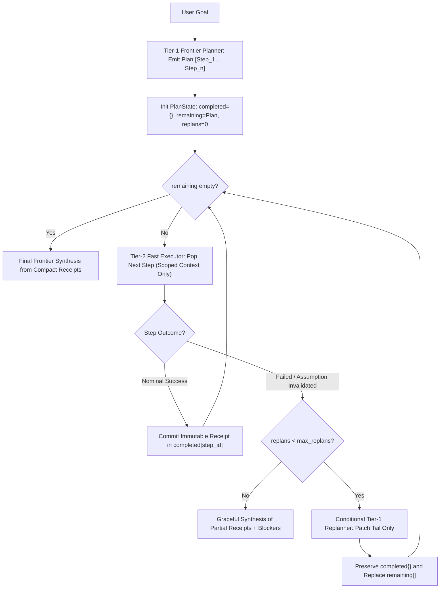
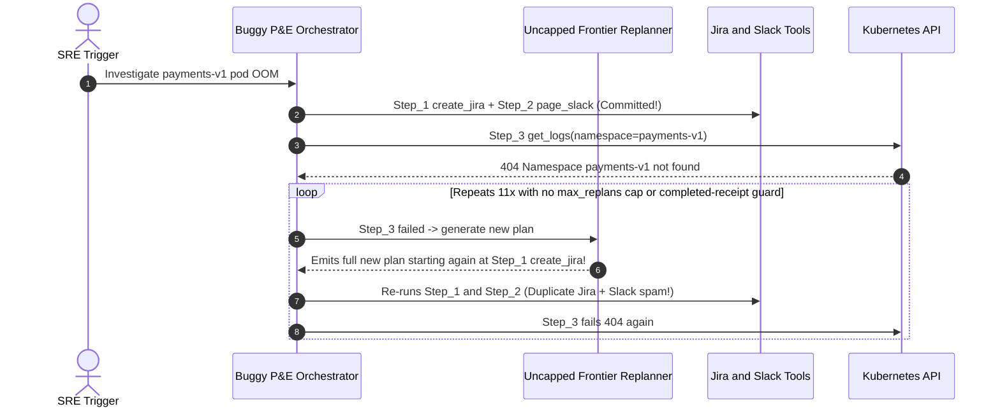

# Module 09: Planning: Plan-and-Execute

> **Prerequisites:** [Module 02: The ReAct Loop](../02-the-react-loop/README.md), [Module 07: The Agent Loop: Termination and Limits](../07-the-agent-loop-termination-and-limits/README.md), and [Module 08: Planning: Task Decomposition](../08-planning-task-decomposition/README.md).  
> **Estimated Reading Time:** 32 minutes  
> **Target Audience:** AI Backend Engineers, Agent Systems Architects, FinOps & Production ML Engineers

> [!TIP]
> **The Golden Rule of Plan-and-Execute:** Reserve your expensive frontier reasoning model for **initial plan creation and exception-driven conditional replanning**, delegate routine step execution to **fast, low-cost executor models or deterministic tools** operating on scoped state, and make completed steps **immutable receipts** so any mid-flight replan patches only the remaining tail without replaying prior side effects.

---

## Why This Matters

The classic ReAct loop ([Module 02](../02-the-react-loop/README.md)) mixes high-level strategic reasoning and routine tool invocation inside the exact same prompt history. On an `8`- to `12`-step workflow—say, investigating a customer incident across metrics, logs, billing, and Git history—ReAct sends the entire growing conversation trace to your frontier reasoning model on *every single turn*, incurring $O(k^2)$ input token growth at frontier pricing (`\$2.50–\$15.00 / 1M` tokens) and slow Time-to-First-Token (`2–4s` per step) even when steps `2..9` are routine lookups.

**Plan-and-Execute** decouples *strategic planning* (`Planner` -> `[Step_1, ..., Step_n]`) from *tactical execution* (`Executor` running scoped steps on a mini/SLM tier), bridged by a **conditional Replanner** that only wakes up the frontier tier when runtime observations break upfront assumptions. Done right, Plan-and-Execute cuts token costs by `60%–90%` and slashes latency `2x`; done naively, an unguarded replanner loops endlessly and replays mutating writes twice.

---

## 1. The Plan-and-Execute Architecture & Conditional Replanning

Modern production Plan-and-Execute (evolving from **Plan-and-Solve** in Wang et al., `arXiv:2305.04091`, and structured BabyAGI / LangGraph stateful workflows) replaces an open-ended task queue with a bounded three-tier state machine:



### Origins & Key Architectural Invariants

1. **Plan-and-Solve Prompting (`arXiv:2305.04091`) vs. Open Task Queues (BabyAGI):** Wang et al. proved that explicitly prompting an LLM to *"first devise a plan, then carry out the plan step-by-step"* prevents skipped sub-goals on multi-step tasks compared to zero-shot CoT. Early BabyAGI prototypes took this further with dynamic queues, but lacked global completion checks and replan caps—causing infinite task spawning. Modern **LangGraph Plan-and-Execute** architectures solve this using an explicit typed state (`goal`, `plan[]`, `past_steps[]`, `replan_count`) and a bounded conditional edge between Executor and Replanner.
2. **Scoped Executor Context (Breaking $O(k^2)$ Prompt Growth):** A Tier-2 Executor running `Step_4` does **not** need the raw `12 KB` JSON dump from `Step_1`. It receives strictly: `(a)` the original goal, `(b)` compact key-value summaries from `past_steps` referenced as dependencies, and `(c)` `Step_4`'s instructions and tool bindings. Input size per executor step remains roughly constant $O(1)$ rather than growing linearly $O(t)$.
3. **Conditional Replanning Triggers (When to Replan vs. When NOT to Replan):**
   - **DO Trigger Replanner:** (1) An upfront assumption is disproved by runtime state (e.g., plan expected a Postgres database, but `Step_2` discovered SQLite), (2) a non-transient `4xx`/`404` error makes downstream steps unreachable, or (3) a step assertion/verifier fails after Module 06 retries exhaust.
   - **DO NOT Trigger Replanner:** Never invoke the frontier Replanner on nominal step success (doing so turns Plan-and-Execute back into slow, expensive ReAct!) and never invoke it for transient `429`/`503` transport retries handled invisibly inside the tool dispatcher ([Module 06](../06-tool-execution-and-error-handling/README.md)).
4. **Partial-Progress State Mutation Safety:** Whenever the conditional Replanner fires at `Step_3`, `Step_1` and `Step_2` may have already executed mutating operations (`create_audit_ticket`, `reserve_inventory`). Store completed outcomes in an immutable `completed` map keyed by `step_id` (plus idempotency receipts). Instruct and enforce at the code level that the Replanner outputs **only the patched unexecuted suffix** (`remaining_plan`)—never re-queuing IDs present in `completed`.

### Quantitative Economics: ReAct vs. Plan-and-Execute Crossover

Let $c_{F,\text{in}}, c_{F,\text{out}}$ be frontier token rates (e.g., `\$2.50 / 1M` input, `\$10.00 / 1M` output) and $c_{E,\text{in}}, c_{E,\text{out}}$ be mini/SLM executor rates (e.g., `\$0.15 / 1M` input, `\$0.60 / 1M` output):

- **ReAct Cumulative Cost ($k$ steps):** Every turn runs on the frontier tier with linearly expanding history:

$$C_{\text{ReAct}}(k) \approx \sum_{t=1}^{k} \left( T_0 + (t - 1)\Delta T \right) c_{F,\text{in}} + k \cdot T_{\text{out}} c_{F,\text{out}}$$

- **Plan-and-Execute Cumulative Cost ($k$ steps, $r$ conditional replans):** `1 + r` frontier planning calls plus $k$ constant-scope cheap executor calls and `1` final synthesis:

$$C_{\text{P\&E}}(k, r) = (1 + r) C_{\text{Plan}}^{(F)} + k \cdot C_{\text{Exec}}^{(E)} + C_{\text{Synth}}^{(F)}$$

**The Volatility Crossover Insight:** For structured `8–16`-step tasks where $r \le 1$, Plan-and-Execute typically cuts cost by `70%–90%` and halves wall-clock latency. However, in highly adversarial/exploratory environments where nearly every observation invalidates the prior plan ($r \ge k / 2$), frontier replanning overhead dominates—making pure ReAct both simpler and faster!

---

## 2. Systematic Comparison Matrix: Execution-Planning Paradigms

| Dimension | Pure ReAct Loop | Static Plan-Only (No Replan) | Unbounded Queue (Early BabyAGI) | Bounded Plan-and-Execute + Conditional Replanner |
| :--- | :--- | :--- | :--- | :--- |
| **Token Cost Scaling** | $O(k^2)$ on **frontier** model | $O(k)$ on cheap executor | Unbounded (`O(inf)` risk) | **$O(1 + r)$ frontier + $O(k)$ cheap executor** |
| **Wall-Clock Latency** | High (`k` slow frontier turns) | Low (`1` plan + fast executor) | Slow & unpredictable | **Low** on happy path (`2x–3x` faster than ReAct) |
| **Mid-Flight Adaptability** | **High** (adapts every step) | None (crashes if assumption fails) | Medium (messy drift) | **High** (patches tail on invalidation/failure) |
| **Duplicate Side-Effect Risk** | Low (sequential awareness) | Low | High (regenerated tasks repeat actions) | **Protected** via immutable `completed{}` receipt guard |
| **Ideal Workload Fit** | Open-ended unknown exploration (`2–5` steps) | Deterministic fixed pipelines | Experimental sandboxes only | **Structured `5–16`-step workflows** with occasional surprises |

---

## 3. Production War Story Post-Mortem: The Unbounded Replanner & Duplicate Incident Storm

| Field | Incident Details |
| :--- | :--- |
| **Severity** | **SEV-1** (Duplicate Alerting Storm & Incident Ticketing Flood) |
| **Detection / Resolution Time** | Detected `4` minutes into incident triage via PagerDuty/Slack duplicate-page alarm / Mitigated in `35` minutes via kill-switch + `completed` receipt filter & `max_replans=2` |
| **Impact** | `11` duplicate Jira Sev-2 tickets opened and `11` Slack incident channels paged for a single Kubernetes pod crash; `\$38` frontier tokens burned on `1` run |

### What Happened

An SRE automation agent implemented Plan-and-Execute with two subtle bugs: (a) the orchestrator unconditionally called the Replanner after *every* step rather than only on failure/assumption-break, and (b) the Replanner returned a full fresh `plan` starting from `Step_1` without checking which side-effecting steps had already completed—and had no `max_replans` ceiling.

During an outage where `Step_3` (`inspect_k8s_logs`) failed on a deleted namespace `payments-v1`, the Replanner saw the missing namespace, regenerated a brand-new 4-step plan starting again with `Step_1: create_jira_incident` and `Step_2: page_slack_oncall`, and hit the exact same missing namespace at `Step_3`—looping `11` times before an engineer killed the worker.



### Root Cause Analysis

- **Unconditional Replanning & Missing Cap:** Calling the frontier Replanner indiscriminately without `max_replans` erased cost savings and enabled infinite retry loops.
- **Full-Plan Replacement Over Mutated State:** Overwriting `plan` from scratch instead of preserving immutable `completed` receipts caused non-idempotent steps (`create_jira`, `page_slack`) to replay on every replan cycle.

### The Fix & Architectural Hardening

- **Conditional Trigger + `max_replans = 2`:** Invoked the Replanner *only* on non-recoverable step failure or invalidated assumptions, capped strictly at `2` replans per run.
- **Immutable Receipt Deduplication:** Tracked completed `step_id` and deterministic `action_fingerprint` inside `PlanState.completed`; stripped or blocked any replanned step matching a previously committed side effect.

---

## 4. Multi-Language Production Implementation: Stateful Plan-and-Execute Orchestrator

Below is a clean, bounded **Plan-and-Execute Orchestrator with Conditional Replanner** across **Go**, **TypeScript**, **Python**, and **C#**. Notice how every implementation routes planning/replanning to Tier-1, executes steps with scoped compact state on Tier-2, preserves immutable `completed` receipts, and halts gracefully when `maxReplans` is exhausted.

````carousel

```go
package planexecute

import (
	"context"
	"fmt"
)

type Step struct {
	ID          string
	Description string
	Action      string
	DependsOn   []string
}

type StepOutcome struct {
	Success               bool
	OutputSummary         string
	AssumptionInvalidated bool
	ErrorReason           string
}

type Planner interface {
	CreatePlan(ctx context.Context, goal string) ([]Step, error)
	ReplanTail(ctx context.Context, goal string, completed map[string]string, failedStep Step, errReason string) ([]Step, error)
	Synthesize(ctx context.Context, goal string, completed map[string]string, haltNote string) (string, error)
}

type Executor interface {
	RunStep(ctx context.Context, goal string, step Step, scopedDeps map[string]string) StepOutcome
}

type Orchestrator struct {
	Planner    Planner
	Executor   Executor
	MaxReplans int
}

func (o *Orchestrator) Run(ctx context.Context, goal string) (string, int, error) {
	plan, err := o.Planner.CreatePlan(ctx, goal)
	if err != nil {
		return "", 0, fmt.Errorf("initial planning failed: %w", err)
	}

	completed := make(map[string]string)
	replans := 0
	haltNote := ""

	for len(plan) > 0 {
		step := plan[0]
		plan = plan[1:]

		// Never re-execute an already committed step receipt.
		if _, done := completed[step.ID]; done {
			continue
		}

		// Scope context strictly to declared dependency receipts (O(1) input growth).
		scoped := make(map[string]string, len(step.DependsOn))
		for _, depID := range step.DependsOn {
			if val, ok := completed[depID]; ok {
				scoped[depID] = val
			}
		}

		outcome := o.Executor.RunStep(ctx, goal, step, scoped)
		if outcome.Success {
			completed[step.ID] = outcome.OutputSummary
			continue
		}

		// Conditional replanning ONLY on failure / invalidated assumption.
		if replans >= o.MaxReplans {
			haltNote = fmt.Sprintf("Stopped at %s (%s); max_replans=%d reached.", step.ID, outcome.ErrorReason, o.MaxReplans)
			break
		}
		replans++
		tail, err := o.Planner.ReplanTail(ctx, goal, completed, step, outcome.ErrorReason)
		if err != nil {
			haltNote = fmt.Sprintf("Replanner error after %s: %v", step.ID, err)
			break
		}
		plan = tail
	}

	finalAnswer, err := o.Planner.Synthesize(ctx, goal, completed, haltNote)
	return finalAnswer, replans, err
}
```

<!-- slide -->

```typescript
export interface PlanStep {
  readonly id: string;
  readonly description: string;
  readonly action: string;
  readonly dependsOn: readonly string[];
}

export interface StepOutcome {
  readonly success: boolean;
  readonly summary: string;
  readonly errorReason?: string;
}

export interface Tier1Planner {
  createPlan(goal: string): Promise<PlanStep[]>;
  replanTail(
    goal: string,
    completed: ReadonlyMap<string, string>,
    failedStep: PlanStep,
    reason: string,
  ): Promise<PlanStep[]>;
  synthesize(goal: string, completed: ReadonlyMap<string, string>, haltNote?: string): Promise<string>;
}

export interface Tier2Executor {
  executeStep(goal: string, step: PlanStep, scopedContext: Record<string, string>): Promise<StepOutcome>;
}

export async function runPlanAndExecute(
  goal: string,
  planner: Tier1Planner,
  executor: Tier2Executor,
  maxReplans = 2,
): Promise<{ answer: string; replans: number; completedIds: string[] }> {
  let remaining = await planner.createPlan(goal);
  const completed = new Map<string, string>();
  let replans = 0;
  let haltNote: string | undefined;

  while (remaining.length > 0) {
    const step = remaining.shift()!;
    if (completed.has(step.id)) continue; // Protect immutable completed receipts

    const scopedContext: Record<string, string> = {};
    for (const dep of step.dependsOn) {
      const val = completed.get(dep);
      if (val !== undefined) scopedContext[dep] = val;
    }

    const outcome = await executor.executeStep(goal, step, scopedContext);
    if (outcome.success) {
      completed.set(step.id, outcome.summary);
      continue;
    }

    if (replans >= maxReplans) {
      haltNote = `Halted on ${step.id}: ${outcome.errorReason ?? "step failed"} (maxReplans=${maxReplans})`;
      break;
    }
    replans += 1;
    const patchedTail = await planner.replanTail(goal, completed, step, outcome.errorReason ?? "failed");
    remaining = patchedTail.filter((s) => !completed.has(s.id));
  }

  const answer = await planner.synthesize(goal, completed, haltNote);
  return { answer, replans, completedIds: [...completed.keys()] };
}
```

<!-- slide -->

```python
"""
plan_and_execute.py
Decouples Tier-1 Frontier Planning/Conditional Replanning from Tier-2 Scoped Execution,
preserving immutable completed step receipts across replans and bounding max_replans.
"""
from dataclasses import dataclass
from typing import Protocol


@dataclass(frozen=True)
class PlanStep:
    id: str
    description: str
    action: str
    depends_on: tuple[str, ...] = ()


@dataclass(frozen=True)
class StepOutcome:
    success: bool
    summary: str
    error_reason: str = ""


class Tier1Planner(Protocol):
    def create_plan(self, goal: str) -> list[PlanStep]: ...
    def replan_tail(
        self, goal: str, completed: dict[str, str], failed_step: PlanStep, reason: str
    ) -> list[PlanStep]: ...
    def synthesize(self, goal: str, completed: dict[str, str], halt_note: str) -> str: ...


class Tier2Executor(Protocol):
    def execute_step(self, goal: str, step: PlanStep, scoped_inputs: dict[str, str]) -> StepOutcome: ...


def run_plan_and_execute(
    goal: str,
    planner: Tier1Planner,
    executor: Tier2Executor,
    max_replans: int = 2,
) -> tuple[str, int, dict[str, str]]:
    remaining = planner.create_plan(goal)
    completed: dict[str, str] = {}
    replans = 0
    halt_note = ""

    while remaining:
        step = remaining.pop(0)
        if step.id in completed:
            continue  # Never replay already-committed side-effecting steps

        scoped_inputs = {dep: completed[dep] for dep in step.depends_on if dep in completed}
        outcome = executor.execute_step(goal, step, scoped_inputs)
        if outcome.success:
            completed[step.id] = outcome.summary
            continue

        # Trigger Tier-1 Replanner ONLY on failure / invalidated assumption
        if replans >= max_replans:
            halt_note = f"Halted at {step.id} ({outcome.error_reason}); max_replans={max_replans} reached."
            break
        replans += 1
        patched_tail = planner.replan_tail(goal, completed, step, outcome.error_reason)
        remaining = [s for s in patched_tail if s.id not in completed]

    answer = planner.synthesize(goal, completed, halt_note)
    return answer, replans, completed
```

<!-- slide -->

```csharp
using System;
using System.Collections.Generic;
using System.Linq;
using System.Threading;
using System.Threading.Tasks;

namespace GenAI.PlanAndExecute;

public sealed record PlanStep(string Id, string Description, string Action, IReadOnlyList<string> DependsOn);
public sealed record StepOutcome(bool Success, string Summary, string? ErrorReason = null);

public interface ITier1Planner
{
    Task<List<PlanStep>> CreatePlanAsync(string goal, CancellationToken ct);
    Task<List<PlanStep>> ReplanTailAsync(string goal, IReadOnlyDictionary<string, string> completed, PlanStep failed, string reason, CancellationToken ct);
    Task<string> SynthesizeAsync(string goal, IReadOnlyDictionary<string, string> completed, string? haltNote, CancellationToken ct);
}

public interface ITier2Executor
{
    Task<StepOutcome> ExecuteStepAsync(string goal, PlanStep step, IReadOnlyDictionary<string, string> scopedContext, CancellationToken ct);
}

public sealed class PlanAndExecuteOrchestrator
{
    private readonly ITier1Planner _planner;
    private readonly ITier2Executor _executor;
    private readonly int _maxReplans;

    public PlanAndExecuteOrchestrator(ITier1Planner planner, ITier2Executor executor, int maxReplans = 2)
    {
        _planner = planner;
        _executor = executor;
        _maxReplans = maxReplans;
    }

    public async Task<(string Answer, int Replans)> RunAsync(string goal, CancellationToken ct = default)
    {
        var remaining = await _planner.CreatePlanAsync(goal, ct);
        var completed = new Dictionary<string, string>(StringComparer.Ordinal);
        int replans = 0;
        string? haltNote = null;

        while (remaining.Count > 0)
        {
            var step = remaining[0];
            remaining.RemoveAt(0);

            if (completed.ContainsKey(step.Id)) continue; // Protect immutable receipts

            var scoped = step.DependsOn
                .Where(completed.ContainsKey)
                .ToDictionary(d => d, d => completed[d], StringComparer.Ordinal);

            var outcome = await _executor.ExecuteStepAsync(goal, step, scoped, ct);
            if (outcome.Success)
            {
                completed[step.Id] = outcome.Summary;
                continue;
            }

            if (replans >= _maxReplans)
            {
                haltNote = $"Stopped at {step.Id}: {outcome.ErrorReason} (maxReplans={_maxReplans})";
                break;
            }
            replans++;
            var patched = await _planner.ReplanTailAsync(goal, completed, step, outcome.ErrorReason ?? "failed", ct);
            remaining = patched.Where(s => !completed.ContainsKey(s.Id)).ToList();
        }

        string answer = await _planner.SynthesizeAsync(goal, completed, haltNote, ct);
        return (answer, replans);
    }
}
```

````

---

## 5. Practical Hands-On Verification CLI Workflows

Run these deterministic Python 3.13 simulations offline—no API keys or third-party dependencies required.

### Workflow 1: ReAct vs. Plan-and-Execute Cost & Latency Sweep

Compare cumulative USD cost and end-to-end latency across `k = 4..16` steps and `r = 0..6` replans, surfacing both the `70%–90%` savings on structured workflows and the volatility crossover when `r` climbs:

```bash
python -c '
def compare_react_vs_plan_execute(k_steps, replans=1):
    # Frontier pricing ($2.50 / 1M in, $10.00 / 1M out) vs Mini executor ($0.15 / 1M in, $0.60 / 1M out)
    t0, delta_t, t_out = 1800, 950, 140
    react_in = sum(t0 + (t - 1) * delta_t for t in range(1, k_steps + 1))
    react_out = k_steps * t_out
    react_cost = (react_in * 2.50 + react_out * 10.00) / 1_000_000
    react_lat_s = k_steps * 2.4

    plan_calls = 1 + replans
    pe_f_in = plan_calls * 2600 + 2800
    pe_f_out = plan_calls * 320 + 450
    pe_e_in = k_steps * 1400  # scoped step context, constant per step!
    pe_e_out = k_steps * 110
    pe_cost = (pe_f_in * 2.50 + pe_f_out * 10.00 + pe_e_in * 0.15 + pe_e_out * 0.60) / 1_000_000
    pe_lat_s = plan_calls * 2.8 + k_steps * 0.7 + 1.5
    savings = ((react_cost - pe_cost) / react_cost) * 100
    print(f"k={k_steps:<2} r={replans} | ReAct=${react_cost:.4f} ({react_lat_s:>4.1f}s) | P&E=${pe_cost:.4f} ({pe_lat_s:>4.1f}s) | savings={savings:>5.1f}%")

for k, r in [(4, 0), (8, 0), (8, 1), (12, 1), (16, 1), (8, 6)]:
    compare_react_vs_plan_execute(k, r)
'
```

**Expected Output:**

```text
k=4  r=0 | ReAct=$0.0379 ( 9.6s) | P&E=$0.0223 ( 7.1s) | savings= 41.1%
k=8  r=0 | ReAct=$0.1137 (19.2s) | P&E=$0.0234 ( 9.9s) | savings= 79.4%
k=8  r=1 | ReAct=$0.1137 (19.2s) | P&E=$0.0331 (12.7s) | savings= 70.9%
k=12 r=1 | ReAct=$0.2276 (28.8s) | P&E=$0.0342 (15.5s) | savings= 85.0%
k=16 r=1 | ReAct=$0.3794 (38.4s) | P&E=$0.0353 (18.3s) | savings= 90.7%
k=8  r=6 | ReAct=$0.1137 (19.2s) | P&E=$0.0816 (26.7s) | savings= 28.2%
```

### Workflow 2: Conditional Replanner Preserving Completed Receipts

Simulate an execution trace where `step_1_lock_incident` commits a side effect, `step_2_probe_db` discovers the environment uses `sqlite` instead of `postgres`, and the conditional Replanner patches only the tail while verifying `Step1Count == 1`:

```bash
python -c '
def run_plan_and_execute(initial_plan, max_replans=2):
    completed = {}
    plan = list(initial_plan)
    replan_count = 0
    executions = []

    while plan:
        step = plan.pop(0)
        sid = step["id"]
        if sid in completed:
            continue
        executions.append(sid)
        if sid == "step_2_probe_db":
            replan_count += 1
            print(f"[Exec] {sid} FAILED_ASSUMPTION: db_engine=sqlite (not postgres)")
            if replan_count > max_replans:
                return False, completed, executions, replan_count
            kept_ids = list(completed.keys())
            print(f"[Replanner #{replan_count}] Preserving {kept_ids}; patching remaining tail only")
            plan = [
                {"id": "step_2b_query_sqlite", "action": "SELECT count(*) FROM sqlite_master"},
                {"id": "step_3_summarize", "action": "summarize_sqlite_schema"},
            ]
        else:
            act = step["action"]
            completed[sid] = f"OK:{act}"
            print(f"[Exec] {sid} -> {completed[sid]}")
    return True, completed, executions, replan_count

init = [
    {"id": "step_1_lock_incident", "action": "create_audit_ticket(idempotent=True)"},
    {"id": "step_2_probe_db", "action": "pg_stat_activity"},
    {"id": "step_3_query_pg", "action": "SELECT * FROM pg_locks"},
]
ok, done, trace, replans = run_plan_and_execute(init, max_replans=2)
s1_cnt = trace.count("step_1_lock_incident")
print(f"Done={ok} | Replans={replans} | ExecutionTrace={trace} | Step1Count={s1_cnt}")
'
```

**Expected Output:**

```text
[Exec] step_1_lock_incident -> OK:create_audit_ticket(idempotent=True)
[Exec] step_2_probe_db FAILED_ASSUMPTION: db_engine=sqlite (not postgres)
[Replanner #1] Preserving ['step_1_lock_incident']; patching remaining tail only
[Exec] step_2b_query_sqlite -> OK:SELECT count(*) FROM sqlite_master
[Exec] step_3_summarize -> OK:summarize_sqlite_schema
Done=True | Replans=1 | ExecutionTrace=['step_1_lock_incident', 'step_2_probe_db', 'step_2b_query_sqlite', 'step_3_summarize'] | Step1Count=1
```

### Workflow 3: Enforcing the `max_replans` Circuit Guard on Unsolvable Plans

Verify that when a required step remains permanently unachievable even after tail patching, `max_replans=2` halts cleanly and synthesizes partial verified progress:

```bash
python -c '
def simulate_replan_cap(max_replans=2):
    replans = 0
    remaining = ["step_1_fetch_ok", "step_2_impossible"]
    completed = {"step_1_fetch_ok": "verified_metrics=42"}
    for _ in range(1, 6):
        if not remaining:
            break
        cur = remaining[0]
        if cur == "step_2_impossible":
            replans += 1
            if replans > max_replans:
                kept = list(completed.keys())
                print(f"HALT: max_replans={max_replans} exceeded -> returning partial synthesis from {kept}")
                return
            print(f"Replan #{replans} issued for failed {cur}")
            remaining = ["step_2_impossible"]
        else:
            remaining.pop(0)

simulate_replan_cap(max_replans=2)
'
```

**Expected Output:**

```text
Replan #1 issued for failed step_2_impossible
Replan #2 issued for failed step_2_impossible
HALT: max_replans=2 exceeded -> returning partial synthesis from ['step_1_fetch_ok']
```

### Hands-On Exercises

1. **Action-Fingerprint Deduplication:** In Workflow 2, even if a buggy Replanner gives the duplicate step a *new* `id` (`"step_1b_create_ticket"` instead of `"step_1_lock_incident"`), hash `(tool_name, canonical_args)` (`Module 07`) inside `completed_fingerprints` so side-effect replay is blocked regardless of step ID renaming.
2. **DAG-Powered Plan-and-Execute Merger:** Combine `Module 08`'s wavefront scheduler with `Module 09`'s `PlanAndExecuteOrchestrator` so independent plan steps inside `remaining` execute concurrently on Tier-2 while preserving Kahn cycle checks after every Tier-1 replan!
3. **Optional Dual-Model API Probe (Requires `OPENAI_API_KEY`):** Wire a frontier reasoning model (`o3-mini` or `gpt-4o`) as `Tier1Planner` with `strict: true` plan JSON output and a fast model (`gpt-4o-mini`) as `Tier2Executor` on a 5-step repository audit task, logging total frontier vs. mini token spend.

### Independent Challenge

A financial-operations agent handles quarterly close reconciliations (`~14` sub-steps: pulling trial balances across 3 ERP shards, matching bank feeds, resolving FX anomalies, and posting journal drafts). Most runs succeed with `0–1` replans, **except** during quarter-end FX schema changes when `30%` of runs discover mismatched currency codes mid-flight. Meanwhile, an exploratory fraud-investigation agent (`3–4` hops) almost never knows its second tool until inspecting the first tool's output. Decide which architecture (**ReAct** vs. **Plan-and-Execute**) fits each workload, justify using token/latency scaling equations, and specify how the close-reconciliation agent avoids double-posting journal drafts if a replan triggers at step `11`.

<details><summary>Architectural Discussion</summary>

1. **Workload Routing:**
   - *Quarterly Close (`14` structured steps, $r \le 1$):* Use **Plan-and-Execute**. At `k=14`, ReAct incurs $O(k^2)$ frontier prefill growth (`~10x` more expensive), whereas Plan-and-Execute runs `1–2` frontier plans + `14` constant-scope mini executor calls (`~80%` lower cost and `2x+` faster).
   - *Exploratory Fraud Triage (`3–4` highly volatile hops):* Use **ReAct** (`Module 02`). When every observation shifts the next query ($r \approx k$), upfront planning wastes tokens on discarded steps while ReAct reaches convergence in `3–4` adaptive turns.
2. **Double-Posting Prevention on Step 11 Replan:** Tag mutating journal steps with `completed_receipts[step_id]` AND deterministic `Idempotency-Key` values (`f"{close_run_id}:{journal_batch_id}"`). When a mid-flight replan triggers at step `11`, the Replanner sees immutable receipts for steps `1..10`, patches only steps `11..14`, and the tool gateway rejects duplicate ledger postings even if a replan re-emits an equivalent draft call.

</details>

---

## 6. Common Mistakes & Troubleshooting

- **Re-invoking the Tier-1 Replanner after *every* healthy step:** Unconditional replanning destroys the `70%–90%` cost and latency advantage of Plan-and-Execute—turning it into a slower, two-model version of ReAct. Trigger replanning *only* on errors or invalidated assumptions.
- **Passing the entire raw ReAct history to Tier-2 Executor calls:** Dumping `40 KB` of raw prior tool outputs into every executor prompt re-introduces $O(k^2)$ cost bloat and confuses smaller executor models. Pass only compact summaries of declared dependencies.
- **Letting the Replanner overwrite `completed` steps:** Replacing the entire plan array without filtering against `completed` receipts causes already-executed side effects (`send_email`, `create_ticket`, `charge_card`) to run again on replan.
- **Omitting `max_replans`:** An unsolvable constraint (`404` missing permission or absent dataset) causes the Replanner to rewrite plans infinitely until the outer wall-clock or token cap trips. Always cap `max_replans` (`1–3`).

---

## 7. Operational Validation Checkpoints & Checkpoint Quiz

### Operational Validation Checkpoints

<details><summary><strong>Checkpoint 1: Diagnosing why a Plan-and-Execute rollout cost MORE than ReAct</strong></summary>

A team migrates an `8`-step customer onboarding agent from `gpt-4o` ReAct to `Plan-and-Execute`, expecting `70%` cost reduction—yet monthly spend *increases* `20%` and latency worsens. Inspecting traces shows `8` frontier Planner/Replanner calls per `8`-step run. What went wrong?

**Validation:** The orchestrator invoked the Tier-1 Replanner unconditionally after **every** step (`r = 7` replans on an `8`-step workflow) instead of routing nominal `StepOutcome.success == True` results directly to the next step in `remaining`. Fixing the conditional gate so the Replanner runs *only* on failure/assumption-break drops frontier planning calls from `8` down to `1–2` and restores `70%+` savings.

</details>

<details><summary><strong>Checkpoint 2: Preventing duplicate mutations when Step 3 invalidates the initial plan</strong></summary>

During a `5`-step IT provisioning flow, `Step_1` creates an IAM role, `Step_2` provisions a storage bucket, and `Step_3` fails because the region quota is full. The Replanner updates the plan to switch regions, and the executor re-runs `Step_1` and `Step_2`, creating orphaned duplicate IAM roles. How do you enforce safety?

**Validation:** Maintain an immutable `completed` state map recording both `step_id` and canonical action fingerprints (`(tool, sorted_args)`). Instruct the Replanner to patch **only the unexecuted tail** (`remaining_plan`) and enforce deterministic deduplication in the orchestrator loop (`if step.id in completed or fingerprint in completed_fingerprints: skip`).

</details>

<details><summary><strong>Checkpoint 3: Deciding between ReAct and Plan-and-Execute at design review</strong></summary>

An engineer proposes Plan-and-Execute for an open-ended root-cause debugger where `75%` of log inspections invalidate the hypothesis and alter the next command (`3–5` steps total). Should you approve Plan-and-Execute or recommend ReAct?

**Validation:** Recommend **ReAct** (`Module 02`). Because `75%` of steps invalidate the initial plan ($r \approx k$), Plan-and-Execute pays extra frontier planning calls (`(1 + r) * C_Plan`) that get thrown away every turn while adding orchestration latency. Plan-and-Execute shines on `5–16+`-step structured tasks where initial plans mostly hold ($r \le 1$).

</details>

### Checkpoint Quiz

1. How does Plan-and-Execute avoid the $O(k^2)$ frontier input token growth inherent to standard ReAct loops?
2. What two events justify waking up the expensive Tier-1 Replanner mid-flight?
3. Why does **Plan-and-Solve** (`arXiv:2305.04091`) reduce missing-step errors compared to naive zero-shot Chain-of-Thought?
4. When does a pure ReAct loop outperform Plan-and-Execute in both cost and latency?
5. What state invariant prevents duplicate side effects when patching a plan mid-execution?

<details><summary>Answers</summary>

1. It calls the frontier model once upfront to emit `[Step_1..Step_n]` (and conditionally only `0–2` times on failure), while running all `k` routine sub-steps on a cheap Tier-2 executor fed strictly with constant-size scoped dependency summaries rather than the entire raw conversation trace.
2. (1) An unrecoverable tool/step failure after transport retries exhaust, or (2) a runtime observation that invalidates an assumption embedded in the remaining plan.
3. Explicitly separating plan generation (*"first devise a plan"*) from step-by-step execution forces the model to enumerate all constraints upfront before filling in details, preventing mid-generation constraint omission.
4. On short (`2–5` steps), highly volatile/exploratory workloads where nearly every observation invalidates earlier assumptions ($r \ge k / 2$), because repeated discarded replans cost more than direct ReAct adaptation.
5. Storing immutable completed-step receipts (keyed by `step_id` and canonical action fingerprint) outside `remaining_plan` and strictly skipping or deduplicating any previously committed step after replanning.

</details>

---

## Further Reading & Sources

- [Plan-and-Solve Prompting: Improving Zero-Shot Chain-of-Thought Reasoning by Large Language Models (Wang et al., 2023)](https://arxiv.org/abs/2305.04091) — empirical foundations for separating planning from step execution.
- [ReAct: Synergizing Reasoning and Acting in Language Models (Yao et al., 2022)](https://arxiv.org/abs/2210.03629) — interleaved step-by-step reasoning baseline for volatility comparison.
- [LangGraph Documentation: Plan-and-Execute Agents](https://langchain-ai.github.io/langgraph/) — production stateful Planner, Executor, and Conditional Replanner graph architecture.

## Next

[Module 10: Memory: Short-Term and Scratchpad](../10-memory-short-term-and-scratchpad/README.md)
