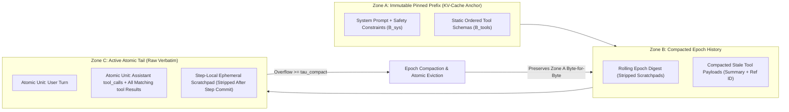

# Module 10: Memory: Short-Term and Scratchpad

> **Prerequisites:** [Module 03: Building a ReAct Agent From Scratch](../03-building-a-react-agent-from-scratch/README.md), [Module 05: Tool Calling With the OpenAI API](../05-tool-calling-with-the-openai-api/README.md), and [Track 01, Module 11: Context Windows Explained](../../01-tokens-and-language-modeling/11-context-windows-explained/README.md).  
> **Estimated Reading Time:** 35 minutes  
> **Target Audience:** AI Backend Engineers, Agent Runtime Developers, LLM Platform Architects

> [!TIP]
> **The Golden Rule of Short-Term Agent Memory:** Model working memory as an **immutable-prefix, atomically grouped, token-budgeted transaction log**—never as a raw `messages.append()` list sliced by message count. Slicing inside an active `tool_call` / `tool` pair causes immediate provider HTTP `400` rejections, while rewriting early history every turn destroys KV-cache prefix reuse and multiplies inference costs.

---

## Why This Matters

In a single-turn chat app, keeping the last `10` messages in memory looks harmless. In a multi-step agent loop, it is an outage generator.

Consider a production Kubernetes triage agent executing `14` sequential diagnostic steps—listing pods, inspecting CrashLoopBackOff logs (`6,500` tokens), querying Prometheus metrics, and running `EXPLAIN` against PostgreSQL. Within one incident, working memory balloons past `32,000` tokens. When an engineer patches the overflow with a naive sliding window (`messages = [system] + messages[-6:]`), two production failures strike simultaneously:

1. **Orphaned Tool-Call Schema Crashes:** Slicing by message count or token FIFO lands between an `assistant` message emitting `tool_calls` and its subsequent `tool` responses. Model APIs (OpenAI Chat Completions, Responses API, and Anthropic Messages API) immediately reject the payload with **HTTP 400 Bad Request**.
2. **KV-Cache Thrashing & Scratchpad Bloat:** Conversely, engineers who re-summarize `[1:]` into the system prompt or leave `<scratchpad>` internal monologues inside persisted history invalidate the KV-cache prefix on every single iteration—collapsing cached-token hit rates from `85%` to `0%` and forcing full uncached quadratic prefill billing.

Mastering **short-term working memory**, **ephemeral scratchpad isolation**, **atomic turn-pair eviction**, and **KV-cache prefix stability** separates brittle toy loops from predictable production agent runtimes.

---

## 1. Working Memory vs. Ephemeral Reasoning Scratchpads

Production agents operate on **two distinct short-term state planes** that are routinely conflated in naive implementations:

1. **Working Memory (Persisted Thread Transcript):** The ordered sequence of `system`, `user`, `assistant`, and `tool` frames transmitted across ReAct iterations and multi-turn requests. It stores authoritative commitments: user goals, invoked `tool_calls`, and tool execution observations.
2. **Ephemeral Reasoning Scratchpad (Step-Local Working Sheet):** Intermediate Chain-of-Thought hypotheses, `<scratchpad>...</scratchpad>` tags, draft JSON parameter plans, or self-critique notes generated *during* a single reasoning step (or supplied by reasoning models via separated `reasoning` fields).

Once an agent finishes a step and executes a tool or emits a final answer, keeping verbatim `<scratchpad>` prose inside future turns wastes precious context budget and anchors the model on superseded hypotheses. **Commit the decision and the authoritative tool observation to working memory; strip or externalize the ephemeral scratchpad.**



### Quantitative Mechanics: Token Budget & Prefix Cost Math

Before appending a single tool observation to working memory, compute the deterministic **available history budget** $B_{\text{avail}}$:

$$B_{\text{avail}} = C_{\max} - B_{\text{sys}} - B_{\text{tools}} - B_{\text{out}} - B_{\text{safety}}$$

Where:
- $C_{\max}$ is the model's hard context limit (e.g., `128,000` or `32,768` tokens).
- $B_{\text{sys}}$ is the static pinned system prompt token count.
- $B_{\text{tools}}$ is the serialized JSON schema token cost of all declared tools (often `1,500–8,000` tokens in tool-rich agents).
- $B_{\text{out}}$ is the reserved completion budget (`max_tokens` / `max_output_tokens`, e.g., `4,096`).
- $B_{\text{safety}}$ reserves chat-template framing overhead (`~4` tokens per message wrapper plus tokenizer estimation margin, typically `512–1,024` tokens).

Trigger compaction proactively when active working memory $B_{\text{hist}}$ crosses a soft watermark $\tau_{\text{compact}} \in [0.75, 0.85]$ of $B_{\text{avail}}$:

$$B_{\text{hist}} \ge \tau_{\text{compact}} \cdot B_{\text{avail}}$$

Now examine **cumulative prefill growth** across an $N$-step agent run starting from a static prefix $P_0 = B_{\text{sys}} + B_{\text{tools}}$ where each step appends $\Delta_t$ tokens of `tool_calls` + `tool` observations:

$$T_{\text{uncached}} = \sum_{t=1}^{N} \left( P_0 + \sum_{i=1}^{t-1} \Delta_i \right) = N \cdot P_0 + \sum_{t=1}^{N} (N - t) \Delta_t$$

Without prompt caching (or when mutating early messages busts the cache prefix every step), input token volume scales **quadratically** $\mathcal{O}(N^2)$ with step count! On a `15`-step loop with $P_0 = 3,000$ and $\Delta = 1,200$ tokens per step, total billed input tokens reach `171,000` tokens for a single user request.

---

## 2. Four Production Failure Modes & Their Exact Fixes

### 2.1 The Orphaned `tool_call` / `tool` Pair Bug (HTTP 400)

Provider APIs enforce strict structural pairing invariants across the `messages` array:

- Every `assistant` message containing `tool_calls: [id_1, ..., id_k]` (or Anthropic `tool_use` blocks) **must** be followed contiguously by `tool` (or `tool_result`) responses covering **every** `id_j` before any subsequent `user` or `assistant` message.
- Every `tool` message **must** reference a `tool_call_id` declared in the immediately preceding `assistant` `tool_calls` turn.

A naive slicer (`messages[-8:]` or dropping the oldest message until `tokens < budget`) inevitably cuts *inside* a multi-tool batch—deleting the `assistant` parent while leaving `role="tool"` at index `1` right after `system`, or truncating the final `tool` response of an earlier turn. **Fix:** Partition history into **Atomic Turn Units** before trimming. Never slice individual messages; evict whole atomic groups `[assistant(tool_calls), tool(id_1), ..., tool(id_k)]` as an indivisible unit.

### 2.2 Progressive Observation Compaction vs. Hard Truncation

Hard eviction deletes stale turns completely—which causes amnesia if step 2 fetched the customer's `account_id` or database schema needed at step 11. **Progressive Observation Compaction** preserves semantic continuity in two tiers:

1. **Tool Payload Compaction (Low Cost, Zero LLM Call):** Keep the `assistant(tool_calls)` and `tool(tool_call_id)` skeleton intact, but replace verbose stale tool outputs older than $K_{\text{raw}}$ recent steps with a deterministic pointer + preview (`"Compacted 9,420 chars from get_pod_logs; key errors: OOMKilled x3 [artifact_id=obs_02]"`).
2. **Epoch Digest Compaction (Periodic Summarization):** When compacted observations still exceed $\tau_{\text{compact}} \cdot B_{\text{avail}}$, summarize the oldest $M$ atomic units into a single structured summary block while keeping the last $K_{\text{raw}}$ atomic units verbatim.

### 2.3 KV-Cache Prefix Stability

Automatic prompt caching (OpenAI Prompt Caching, Anthropic `cache_control` breakpoints, and vLLM Automatic Prefix Caching) matches an **exact token prefix from index `0`** (`tools -> system -> messages[0..k]`). Any byte-level mutation inside the prefix invalidates the cache for **every single token after the edit point**:

- Injecting a live wall-clock timestamp (`"Current time: 2026-11-11T13:20:04Z"`) into the `system` prompt busts `100%` of the prefix cache on every call. Put volatile timestamps in the latest `user` message or a tool output instead.
- Reordering keys inside `tools` JSON schemas or dynamically toggling tool arrays mid-loop invalidates the `tools` prefix. Keep `tools` statically ordered!
- Re-summarizing `[1..t-3]` at **every** turn mutates message `[1]` continuously, guaranteeing a `0%` history cache hit rate. Instead, perform **epoch-aligned compaction**: append-only for `4–6` turns (scoring `80–90%` prefix hits), then run one checkpoint compaction only when $B_{\text{hist}}$ reaches $\tau_{\text{compact}} \cdot B_{\text{avail}}$.

---

## 3. Systematic Comparison Matrix: Short-Term Memory Strategies

| Strategy | Tool-Pair Integrity | KV-Cache Prefix Hit Rate | Input Token Growth | Exact ID / Error Recall | Best Production Fit |
| :--- | :--- | :--- | :--- | :--- | :--- |
| **Unbounded Append-Only** | Safe | Highest (`85–95%`) | Quadratic $\mathcal{O}(N^2)$ until context crash | Exact | Short `<= 5`-step bounded workflows |
| **Naive Sliding Window (`[-N:]`)** | **Broken** (orphans `tool` pairs -> HTTP `400`) | Low (prefix shifts every turn) | Bounded | Drops early constraints | **Never use in tool-calling agents** |
| **Atomic-Unit Eviction** | Guaranteed Safe | Moderate (shifts only on eviction) | Bounded | Drops oldest turns cleanly | Stateless/simple agents without long dependencies |
| **Per-Turn Rolling Summary** | Safe if tail preserved | **Broken** (`0%` past system prompt) | Bounded | Lossy on early numbers | Avoid unless prefix caching is unavailable |
| **Epoch-Aligned Compaction + Raw Tail** | Guaranteed Safe | High (`75–88%` between epochs) | Sub-quadratic + capped | Preserves recent raw details + artifact refs | **Production default for multi-step agents** |

---

## 4. Production War Story Post-Mortem: The HTTP 400 Retry Storm & 4.2x Cache Meltdown

| Field | Incident Details |
| :--- | :--- |
| **Severity** | **SEV-1** (P0 Alert Triage Agent Down + **\$38,400** Overrun Over 36 Hours) |
| **Detection / Resolution Time** | Triggered at 02:14 UTC during regional DB failover / Mitigated in 2 hours 10 minutes |
| **Impact** | `100%` of deep multi-step triage workflows (`> 7` tool steps) crashed with HTTP `400`; blind retries amplified API RPS `5x`; hotfix cache-busting spiked daily inference bill `4.2x` |

### What Happened

An on-call SRE automation agent ingested Kubernetes pod logs and PostgreSQL wait-event tables during a database failover. To prevent context overflows, the runtime used `windowed = [system_msg] + messages[-8:]` before every completion call.

At step 8, a single `assistant` turn emitted `3` parallel tool calls (`tc_4`, `tc_5`, `tc_6`), producing `4` list entries (`1` assistant + `3` tool messages). Slicing `[-8:]` cut right between `assistant(tool_calls)` and `tc_5`, leaving `role="tool", tool_call_id="tc_5"` immediately after `system_msg`. The LLM API returned **HTTP 400**. Worse, the HTTP wrapper retried *all* `4xx/5xx` errors `5` times with exponential backoff, flooding rate limits across `400` concurrent incident threads.

An emergency hotfix replaced slicing with `"summarize history into system_prompt on every step"`, injecting `rolling_summary` directly into message `0`. HTTP `400`s disappeared—but the mutating prefix invalidated every prompt cache hit, dropping `cached_tokens` from `86%` to `0%` and quadrupling daily token spend.

```mermaid
sequenceDiagram
    autonumber
    participant Loop as Agent Runtime
    participant Trimmer as Naive Window / Hotfix
    participant API as Model Provider API

    Note over Loop,Trimmer: Step 8 emits 1 assistant message plus 3 tool responses
    Loop->>Trimmer: Trim messages[-8:] before next completion
    Trimmer-->>Loop: Drops assistant parent and leaves orphaned tool tc_5 at idx 1
    Loop->>API: POST /chat/completions with orphaned role=tool
    API-->>Loop: HTTP 400 Invalid tool_call_id sequence
    Loop->>API: Naive retry loop fires 5x per failed thread (rate-limit storm)
    Note over Trimmer,API: Emergency hotfix mutates system prompt summary every turn
    Trimmer->>API: POST with dynamically rewritten index 0 prefix
    API-->>Trimmer: HTTP 200 OK but cached_tokens=0 (4.2x cost spike)
```

### Root Cause Analysis

- **Non-Atomic Eviction:** `messages[-8:]` ignored parent-child coupling between `assistant.tool_calls` and `tool` frames.
- **Unclassified Client Retries:** Treating deterministic `400 Bad Request` schema bugs as transient retryable errors multiplied load `5x`.
- **Mutable Prefix:** Placing dynamic summaries and timestamps inside `messages[0]` (`system`) wiped out KV-cache hits across every subsequent turn.

### The Fix & Architectural Hardening

- **Atomic Turn-Group Eviction + Pre-Flight Invariant Validator:** Partitioned history into indivisible turn groups and ran an $O(N)$ `tool_call_id` pairing assertion before every API dispatch (aborting locally instead of calling the provider if corrupted).
- **Non-Retryable `400` Classification:** Restricted retries strictly to `408`, `429`, and `5xx` statuses.
- **Immutable Prefix + Epoch Compaction:** Locked `tools` + `system` read-only, stripped `<scratchpad>` tags on turn commit, and switched to **epoch-aligned compaction** triggered only at `80%` of $B_{\text{avail}}$, restoring `83%` KV-cache hit rates.

---

## 5. Multi-Language Production Implementation: Atomic Working Memory Manager

Below is a production-hardened **Short-Term Working Memory Manager** implemented across **Go**, **TypeScript**, **Python**, and **C#**. Every implementation enforces:
1. Exact budget math $B_{\text{avail}} = C_{\max} - B_{\text{sys}} - B_{\text{tools}} - B_{\text{out}} - B_{\text{safety}}$,
2. Stripping `<scratchpad>...</scratchpad>` blocks prior to persistence,
3. Grouping `assistant.tool_calls` + matching `tool` results into atomic eviction units, and
4. Progressive observation compaction of stale tool payloads before any atomic group eviction.

````carousel

```go
package memory

import (
	"fmt"
	"regexp"
	"strings"
)

type ToolCall struct {
	ID   string
	Name string
	Args string
}

type Message struct {
	Role       string     // "system" | "user" | "assistant" | "tool"
	Content    string
	ToolCalls  []ToolCall
	ToolCallID string
}

type TokenBudget struct {
	CMax    int
	BSys    int
	BTools  int
	BOut    int
	BSafety int
}

func (b TokenBudget) Available() int {
	avail := b.CMax - b.BSys - b.BTools - b.BOut - b.BSafety
	if avail < 0 {
		return 0
	}
	return avail
}

var scratchpadRe = regexp.MustCompile(`(?s)<scratchpad>.*?</scratchpad>\s*`)

func StripScratchpad(text string) string {
	return strings.TrimSpace(scratchpadRe.ReplaceAllString(text, ""))
}

func EstimateTokens(m Message) int {
	chars := len(m.Content) + len(m.ToolCallID)
	for _, tc := range m.ToolCalls {
		chars += len(tc.ID) + len(tc.Name) + len(tc.Args)
	}
	return (chars+3)/4 + 4 // +4 message framing overhead
}

// GroupAtomicTurns ensures assistant tool_calls and their tool replies never split on eviction.
func GroupAtomicTurns(history []Message) ([][]Message, error) {
	var groups [][]Message
	for i := 0; i < len(history); {
		msg := history[i]
		if msg.Role == "assistant" && len(msg.ToolCalls) > 0 {
			pending := make(map[string]bool, len(msg.ToolCalls))
			for _, tc := range msg.ToolCalls {
				pending[tc.ID] = true
			}
			unit := []Message{msg}
			j := i + 1
			for j < len(history) && history[j].Role == "tool" {
				unit = append(unit, history[j])
				delete(pending, history[j].ToolCallID)
				j++
			}
			if len(pending) > 0 {
				return nil, fmt.Errorf("incomplete tool_calls group at index %d", i)
			}
			groups = append(groups, unit)
			i = j
			continue
		}
		if msg.Role == "tool" {
			return nil, fmt.Errorf("orphaned tool message at index %d (tool_call_id=%s)", i, msg.ToolCallID)
		}
		groups = append(groups, []Message{msg})
		i++
	}
	return groups, nil
}

// CompactAndFit keeps pinnedSystem immutable, compacts stale tool payloads, and evicts atomic tail-first.
func CompactAndFit(pinnedSystem Message, rawHistory []Message, budget TokenBudget, keepRawTailGroups int) ([]Message, error) {
	avail := budget.Available()
	if avail <= 0 {
		return nil, fmt.Errorf("negative or zero available history budget: %d", avail)
	}
	cleaned := make([]Message, len(rawHistory))
	for i, m := range rawHistory {
		m.Content = StripScratchpad(m.Content)
		cleaned[i] = m
	}
	groups, err := GroupAtomicTurns(cleaned)
	if err != nil {
		return nil, err
	}

	// Step 1: Compact verbose tool outputs outside the recent raw tail
	staleCutoff := len(groups) - keepRawTailGroups
	for gIdx := 0; gIdx < staleCutoff; gIdx++ {
		for mIdx := range groups[gIdx] {
			m := &groups[gIdx][mIdx]
			if m.Role == "tool" && len(m.Content) > 160 {
				m.Content = m.Content[:120] + fmt.Sprintf("... [compacted %d chars]", len(m.Content))
			}
		}
	}

	// Step 2: Evict oldest whole atomic groups until fitting inside B_avail
	groupCost := func(g []Message) int {
		sum := 0
		for _, m := range g {
			sum += EstimateTokens(m)
		}
		return sum
	}
	total := 0
	for _, g := range groups {
		total += groupCost(g)
	}
	start := 0
	for total > avail && start < len(groups)-1 {
		total -= groupCost(groups[start])
		start++
	}

	out := []Message{pinnedSystem}
	for _, g := range groups[start:] {
		out = append(out, g...)
	}
	return out, nil
}
```

<!-- slide -->

```typescript
export interface ToolCall {
  readonly id: string;
  readonly name: string;
  readonly argsJson: string;
}

export interface AgentMessage {
  readonly role: "system" | "user" | "assistant" | "tool";
  readonly content: string;
  readonly toolCalls?: readonly ToolCall[];
  readonly toolCallId?: string;
}

export interface BudgetSpec {
  readonly cMax: number;
  readonly bSys: number;
  readonly bTools: number;
  readonly bOut: number;
  readonly bSafety: number;
}

const SCRATCHPAD_RE = /<scratchpad>[\s\S]*?<\/scratchpad>\s*/g;

export function stripScratchpad(text: string): string {
  return text.replace(SCRATCHPAD_RE, "").trim();
}

export function estimateMessageTokens(msg: AgentMessage): number {
  let chars = msg.content.length + (msg.toolCallId?.length ?? 0);
  for (const tc of msg.toolCalls ?? []) {
    chars += tc.id.length + tc.name.length + tc.argsJson.length;
  }
  return Math.ceil(chars / 4) + 4;
}

export function groupAtomicTurns(messages: readonly AgentMessage[]): AgentMessage[][] {
  const groups: AgentMessage[][] = [];
  let i = 0;
  while (i < messages.length) {
    const msg = messages[i];
    if (msg.role === "assistant" && msg.toolCalls && msg.toolCalls.length > 0) {
      const pending = new Set(msg.toolCalls.map((tc) => tc.id));
      const unit: AgentMessage[] = [msg];
      let j = i + 1;
      while (j < messages.length && messages[j].role === "tool") {
        const reply = messages[j];
        unit.push(reply);
        if (reply.toolCallId) pending.delete(reply.toolCallId);
        j += 1;
      }
      if (pending.size > 0) {
        throw new Error(`Incomplete tool_calls at index ${i}: missing ${[...pending].join(",")}`);
      }
      groups.push(unit);
      i = j;
      continue;
    }
    if (msg.role === "tool") {
      throw new Error(`Orphaned tool message at index ${i} (toolCallId=${msg.toolCallId ?? "none"})`);
    }
    groups.push([msg]);
    i += 1;
  }
  return groups;
}

export function fitWorkingMemory(
  pinnedSystem: AgentMessage,
  rawHistory: readonly AgentMessage[],
  budget: BudgetSpec,
  keepRawTailGroups = 2,
): AgentMessage[] {
  const bAvail = budget.cMax - budget.bSys - budget.bTools - budget.bOut - budget.bSafety;
  if (bAvail <= 0) {
    throw new RangeError(`Insufficient B_avail=${bAvail} after fixed reservations`);
  }

  const sanitized = rawHistory.map((m) => ({ ...m, content: stripScratchpad(m.content) }));
  const groups = groupAtomicTurns(sanitized);

  const staleCutoff = Math.max(0, groups.length - keepRawTailGroups);
  for (let gi = 0; gi < staleCutoff; gi += 1) {
    groups[gi] = groups[gi].map((m) =>
      m.role === "tool" && m.content.length > 160
        ? { ...m, content: `${m.content.slice(0, 120)}... [compacted ${m.content.length} chars]` }
        : m,
    );
  }

  const groupTokens = (g: readonly AgentMessage[]) =>
    g.reduce((acc, m) => acc + estimateMessageTokens(m), 0);

  let used = groups.reduce((acc, g) => acc + groupTokens(g), 0);
  let start = 0;
  while (used > bAvail && start < groups.length - 1) {
    used -= groupTokens(groups[start]);
    start += 1;
  }

  return [pinnedSystem, ...groups.slice(start).flat()];
}
```

<!-- slide -->

```python
"""
working_memory_manager.py
Token-budgeted working memory with scratchpad stripping, progressive compaction, and atomic tool-pair eviction.
"""
from dataclasses import dataclass, replace
import re
from typing import Sequence


@dataclass(frozen=True)
class ToolCall:
    id: str
    name: str
    args_json: str


@dataclass(frozen=True)
class ChatMessage:
    role: str  # "system" | "user" | "assistant" | "tool"
    content: str
    tool_calls: tuple[ToolCall, ...] = ()
    tool_call_id: str | None = None


@dataclass(frozen=True)
class TokenBudget:
    c_max: int
    b_sys: int
    b_tools: int
    b_out: int
    b_safety: int = 256

    @property
    def b_avail(self) -> int:
        return max(0, self.c_max - self.b_sys - self.b_tools - self.b_out - self.b_safety)


_SCRATCHPAD_RE = re.compile(r"<scratchpad>.*?</scratchpad>\s*", re.DOTALL)


def strip_scratchpad(text: str) -> str:
    return _SCRATCHPAD_RE.sub("", text).strip()


def estimate_tokens(msg: ChatMessage) -> int:
    chars = len(msg.content) + len(msg.tool_call_id or "")
    for tc in msg.tool_calls:
        chars += len(tc.id) + len(tc.name) + len(tc.args_json)
    return (chars + 3) // 4 + 4


def group_atomic_turns(messages: Sequence[ChatMessage]) -> list[list[ChatMessage]]:
    groups: list[list[ChatMessage]] = []
    i = 0
    while i < len(messages):
        msg = messages[i]
        if msg.role == "assistant" and msg.tool_calls:
            pending = {tc.id for tc in msg.tool_calls}
            unit = [msg]
            j = i + 1
            while j < len(messages) and messages[j].role == "tool":
                reply = messages[j]
                unit.append(reply)
                if reply.tool_call_id:
                    pending.discard(reply.tool_call_id)
                j += 1
            if pending:
                raise ValueError(f"Incomplete tool_calls at index {i}: missing {sorted(pending)}")
            groups.append(unit)
            i = j
        elif msg.role == "tool":
            raise ValueError(f"Orphaned tool message at index {i} (tool_call_id={msg.tool_call_id})")
        else:
            groups.append([msg])
            i += 1
    return groups


def compact_working_memory(
    pinned_system: ChatMessage,
    raw_history: Sequence[ChatMessage],
    budget: TokenBudget,
    keep_raw_tail_groups: int = 2,
) -> list[ChatMessage]:
    b_avail = budget.b_avail
    if b_avail <= 0:
        raise ValueError("Available working memory budget B_avail must be positive")

    cleaned = [replace(m, content=strip_scratchpad(m.content)) for m in raw_history]
    groups = group_atomic_turns(cleaned)

    stale_cutoff = max(0, len(groups) - keep_raw_tail_groups)
    for gi in range(stale_cutoff):
        groups[gi] = [
            replace(m, content=f"{m.content[:120]}... [compacted {len(m.content)} chars]")
            if m.role == "tool" and len(m.content) > 160
            else m
            for m in groups[gi]
        ]

    group_costs = [sum(estimate_tokens(m) for m in g) for g in groups]
    used = sum(group_costs)
    start = 0
    while used > b_avail and start < len(groups) - 1:
        used -= group_costs[start]
        start += 1

    return [pinned_system, *(msg for grp in groups[start:] for msg in grp)]
```

<!-- slide -->

```csharp
using System;
using System.Collections.Generic;
using System.Linq;
using System.Text.RegularExpressions;

namespace GenAI.Agents.Memory;

public sealed record ToolCall(string Id, string Name, string ArgsJson);

public sealed record AgentMessage(
    string Role,
    string Content,
    IReadOnlyList<ToolCall>? ToolCalls = null,
    string? ToolCallId = null);

public sealed record TokenBudget(int CMax, int BSys, int BTools, int BOut, int BSafety = 256)
{
    public int Available => Math.Max(0, CMax - BSys - BTools - BOut - BSafety);
}

public static class WorkingMemoryManager
{
    private static readonly Regex ScratchpadRegex = new(
        @"<scratchpad>.*?</scratchpad>\s*",
        RegexOptions.Singleline | RegexOptions.Compiled);

    public static string StripScratchpad(string content) =>
        ScratchpadRegex.Replace(content, string.Empty).Trim();

    public static int EstimateTokens(AgentMessage m)
    {
        int chars = m.Content.Length + (m.ToolCallId?.Length ?? 0);
        if (m.ToolCalls is not null)
        {
            foreach (var tc in m.ToolCalls)
                chars += tc.Id.Length + tc.Name.Length + tc.ArgsJson.Length;
        }
        return (chars + 3) / 4 + 4;
    }

    public static List<List<AgentMessage>> GroupAtomicTurns(IReadOnlyList<AgentMessage> history)
    {
        var groups = new List<List<AgentMessage>>();
        int i = 0;
        while (i < history.Count)
        {
            var msg = history[i];
            if (msg.Role == "assistant" && msg.ToolCalls is { Count: > 0 })
            {
                var pending = msg.ToolCalls.Select(tc => tc.Id).ToHashSet(StringComparer.Ordinal);
                var unit = new List<AgentMessage> { msg };
                int j = i + 1;
                while (j < history.Count && history[j].Role == "tool")
                {
                    var reply = history[j];
                    unit.Add(reply);
                    if (reply.ToolCallId is not null) pending.Remove(reply.ToolCallId);
                    j++;
                }
                if (pending.Count > 0)
                    throw new InvalidOperationException($"Incomplete tool_calls group at index {i}.");
                groups.Add(unit);
                i = j;
                continue;
            }
            if (msg.Role == "tool")
                throw new InvalidOperationException($"Orphaned tool message at index {i}.");
            groups.Add(new List<AgentMessage> { msg });
            i++;
        }
        return groups;
    }

    public static List<AgentMessage> CompactAndFit(
        AgentMessage pinnedSystem,
        IReadOnlyList<AgentMessage> rawHistory,
        TokenBudget budget,
        int keepRawTailGroups = 2)
    {
        int avail = budget.Available;
        if (avail <= 0)
            throw new ArgumentOutOfRangeException(nameof(budget), "Available budget must be positive.");

        var cleaned = rawHistory
            .Select(m => m with { Content = StripScratchpad(m.Content) })
            .ToList();
        var groups = GroupAtomicTurns(cleaned);

        int staleCutoff = Math.Max(0, groups.Count - keepRawTailGroups);
        for (int gi = 0; gi < staleCutoff; gi++)
        {
            for (int mi = 0; mi < groups[gi].Count; mi++)
            {
                var m = groups[gi][mi];
                if (m.Role == "tool" && m.Content.Length > 160)
                {
                    groups[gi][mi] = m with
                    {
                        Content = $"{m.Content[..120]}... [compacted {m.Content.Length} chars]"
                    };
                }
            }
        }

        var costs = groups.Select(g => g.Sum(EstimateTokens)).ToList();
        int used = costs.Sum();
        int start = 0;
        while (used > avail && start < groups.Count - 1)
        {
            used -= costs[start];
            start++;
        }

        var result = new List<AgentMessage> { pinnedSystem };
        for (int gi = start; gi < groups.Count; gi++)
            result.AddRange(groups[gi]);
        return result;
    }
}
```

````

---

## 6. Practical Hands-On Verification CLI Workflows

Run these deterministic Python 3.13 scripts offline—no third-party packages or API keys required.

### Workflow 1: Reproduce the Orphaned `tool_call` HTTP 400 Bug vs. Atomic Eviction

Simulate a multi-tool agent history, slice naively by message count (`[-2:]`, `[-4:]`, `[-5:]`), and contrast with atomic turn-group eviction using a strict provider invariant validator:

```bash
python -c '
def naive_slice(messages, keep_last=4):
    return [messages[0]] + messages[-keep_last:]

def group_atomic_turns(messages):
    groups = []
    i = 0
    while i < len(messages):
        msg = messages[i]
        if msg["role"] == "assistant" and msg.get("tool_calls"):
            expected_ids = {tc["id"] for tc in msg["tool_calls"]}
            unit = [msg]
            j = i + 1
            while j < len(messages) and messages[j]["role"] == "tool":
                unit.append(messages[j])
                expected_ids.discard(messages[j]["tool_call_id"])
                j += 1
            if expected_ids:
                raise ValueError(f"Corrupt input history: missing tool outputs {sorted(expected_ids)}")
            groups.append(unit)
            i = j
        else:
            groups.append([msg])
            i += 1
    return groups

def validate_provider_invariants(messages):
    pending_ids = set()
    for idx, msg in enumerate(messages):
        role = msg["role"]
        if role == "tool":
            tc_id = msg.get("tool_call_id")
            if tc_id not in pending_ids:
                return False, f"HTTP 400 at idx={idx}: orphaned role=tool for tool_call_id={tc_id}"
            pending_ids.remove(tc_id)
        else:
            if pending_ids:
                return False, f"HTTP 400 at idx={idx}: unclosed tool_calls {sorted(pending_ids)}"
            if role == "assistant" and msg.get("tool_calls"):
                pending_ids = {tc["id"] for tc in msg["tool_calls"]}
    if pending_ids:
        return False, f"HTTP 400 at end: missing tool responses {sorted(pending_ids)}"
    return True, "HTTP 200 OK (all tool_call/tool pairs intact)"

history = [
    {"role": "system", "content": "You are an SRE triage agent."},
    {"role": "user", "content": "Check checkout-api latency."},
    {"role": "assistant", "tool_calls": [{"id": "tc_1", "name": "get_metrics"}, {"id": "tc_2", "name": "get_pods"}]},
    {"role": "tool", "tool_call_id": "tc_1", "content": "p99=1420ms"},
    {"role": "tool", "tool_call_id": "tc_2", "content": "3/3 ready"},
    {"role": "assistant", "content": "Latency is elevated; checking logs."},
    {"role": "assistant", "tool_calls": [{"id": "tc_3", "name": "tail_logs"}]},
    {"role": "tool", "tool_call_id": "tc_3", "content": "DB pool exhausted at 02:14Z"},
]

for k in (2, 4, 5):
    sliced = naive_slice(history, keep_last=k)
    ok, status = validate_provider_invariants(sliced)
    print(f"Naive slice[-{k}:] (len={len(sliced)}): ok={ok} -> {status}")

groups = group_atomic_turns(history[1:])
atomic_tail = [history[0]] + [m for g in groups[-2:] for m in g]
ok_a, status_a = validate_provider_invariants(atomic_tail)
print(f"Atomic tail[-2 groups:] (len={len(atomic_tail)}): ok={ok_a} -> {status_a}")
'
```

**Expected Output:**

```text
Naive slice[-2:] (len=3): ok=True -> HTTP 200 OK (all tool_call/tool pairs intact)
Naive slice[-4:] (len=5): ok=False -> HTTP 400 at idx=1: orphaned role=tool for tool_call_id=tc_2
Naive slice[-5:] (len=6): ok=False -> HTTP 400 at idx=1: orphaned role=tool for tool_call_id=tc_1
Atomic tail[-2 groups:] (len=4): ok=True -> HTTP 200 OK (all tool_call/tool pairs intact)
```

### Workflow 2: Token Accounting ($B_{\text{avail}}$), Scratchpad Stripping, and Progressive Compaction

Compute $B_{\text{avail}}$ and measure token savings when stripping `<scratchpad>` blocks and compacting stale tool payloads while leaving the newest step raw:

```bash
python -c '
import re

def estimate_tokens(text):
    return max(1, (len(text) + 3) // 4)

def strip_scratchpad(text):
    return re.sub(r"<scratchpad>.*?</scratchpad>\s*", "", text, flags=re.DOTALL).strip()

def compact_tool_payload(tool_name, raw_output, max_chars=70):
    if len(raw_output) <= max_chars:
        return raw_output
    return f"{raw_output[:max_chars]}... [compacted {tool_name}: {len(raw_output)} chars]"

c_max, b_sys, b_tools, b_out, b_safety = 4096, 320, 640, 800, 96
b_avail = c_max - b_sys - b_tools - b_out - b_safety
print(f"Budget B_avail = {c_max} - {b_sys} - {b_tools} - {b_out} - {b_safety} = {b_avail} tokens")

raw_turns = [
    {"role": "assistant", "content": "<scratchpad>Hypothesis: check pg_stat_activity first.</scratchpad>Running query.", "tool": "sql_query", "out": "row_1: idle_in_tx=94s | " * 22},
    {"role": "assistant", "content": "<scratchpad>94s idle tx found; inspect locks.</scratchpad>Checking pg_locks.", "tool": "pg_locks", "out": "pid=8812 relation=orders granted=false | " * 18},
    {"role": "assistant", "content": "<scratchpad>pid 8812 blocked by pid 7104.</scratchpad>Inspecting blocker.", "tool": "pg_pid", "out": "pid=7104 query=ALTER TABLE orders ADD COLUMN..."},
]

raw_tok = sum(estimate_tokens(t["content"]) + estimate_tokens(t["out"]) for t in raw_turns)
compacted_tok = 0
for idx, t in enumerate(raw_turns):
    cleaned = strip_scratchpad(t["content"])
    is_stale = idx < len(raw_turns) - 1
    status = "STALE" if is_stale else "RECENT"
    obs = compact_tool_payload(t["tool"], t["out"]) if is_stale else t["out"]
    compacted_tok += estimate_tokens(cleaned) + estimate_tokens(obs)
    print(f"Step {idx+1} ({status}): msg={cleaned!r} | obs={obs}")

print(f"Raw working tokens={raw_tok} (util={raw_tok/b_avail:.1%}) -> Compacted tokens={compacted_tok} (util={compacted_tok/b_avail:.1%}, saved={1 - compacted_tok/raw_tok:.1%})")
'
```

**Expected Output:**

```text
Budget B_avail = 4096 - 320 - 640 - 800 - 96 = 2240 tokens
Step 1 (STALE): msg='Running query.' | obs=row_1: idle_in_tx=94s | row_1: idle_in_tx=94s | row_1: idle_in_tx=94s ... [compacted sql_query: 528 chars]
Step 2 (STALE): msg='Checking pg_locks.' | obs=pid=8812 relation=orders granted=false | pid=8812 relation=orders gran... [compacted pg_locks: 738 chars]
Step 3 (RECENT): msg='Inspecting blocker.' | obs=pid=7104 query=ALTER TABLE orders ADD COLUMN...
Raw working tokens=387 (util=17.3%) -> Compacted tokens=80 (util=3.6%, saved=79.3%)
```

### Workflow 3: KV-Cache Prefix Stability & $\mathcal{O}(N^2)$ Cost Sweep

Compare 10-step agent prefill costs (`\$2.50` / 1M input tokens, `75%` cached-token discount) across per-step prefix mutation, epoch-aligned compaction (every 5 steps), and pure append-only:

```bash
python -c '
def simulate_kv_trajectory(steps=10, prefix_tok=2400, step_delta=450, input_price_per_1m=2.50, cached_discount=0.75, compact_every=None):
    total_uncached_equiv = 0.0
    total_actual_dollars = 0.0
    total_prompt_tokens = 0
    total_cached_tokens = 0
    history_tok = 0

    for t in range(1, steps + 1):
        if compact_every == "every_step" and t > 1:
            cached_tok = 0
            uncached_tok = prefix_tok + history_tok
        elif isinstance(compact_every, int) and t > 1 and (t - 1) % compact_every == 0:
            history_tok = int(history_tok * 0.35)
            cached_tok = prefix_tok
            uncached_tok = history_tok
        else:
            cached_tok = prefix_tok + max(0, history_tok - step_delta) if t > 1 else 0
            uncached_tok = (prefix_tok + history_tok) - cached_tok

        step_prompt = prefix_tok + history_tok
        total_prompt_tokens += step_prompt
        total_cached_tokens += cached_tok
        step_cost = (uncached_tok * input_price_per_1m + cached_tok * input_price_per_1m * (1.0 - cached_discount)) / 1_000_000
        total_actual_dollars += step_cost
        total_uncached_equiv += (step_prompt * input_price_per_1m) / 1_000_000
        history_tok += step_delta

    hit_rate = total_cached_tokens / total_prompt_tokens if total_prompt_tokens else 0.0
    return total_prompt_tokens, hit_rate, total_actual_dollars, total_uncached_equiv

for label, mode in [
    ("Mutate prefix every step (cache bust)", "every_step"),
    ("Epoch compact every 5 steps (75% disc)", 5),
    ("Pure append-only (75% disc)", None),
]:
    tot, hit, cost, base = simulate_kv_trajectory(compact_every=mode)
    print(f"{label:<40} | prompt_tok={tot:>6,} | cache_hit={hit:>5.1%} | cost=${cost:.4f} vs uncached=${base:.4f}")
'
```

**Expected Output:**

```text
Mutate prefix every step (cache bust)    | prompt_tok=44,250 | cache_hit= 0.0% | cost=$0.1106 vs uncached=$0.1106
Epoch compact every 5 steps (75% disc)   | prompt_tok=36,935 | cache_hit=81.6% | cost=$0.0358 vs uncached=$0.0923
Pure append-only (75% disc)              | prompt_tok=44,250 | cache_hit=85.4% | cost=$0.0397 vs uncached=$0.1106
```

Observe that **epoch-aligned compaction** beats *both* per-step mutation (cutting cost by `67.6%`, from `\$0.1106` to `\$0.0358`) *and* pure append-only (`\$0.0397`) by shrinking cumulative prompt volume while preserving an `81.6%` cache hit rate.

### Hands-On Exercises

1. **Extend the Validator for Missing Tail Replies:** Modify Workflow 1's `history` by deleting the final `tool` message (`tc_3`), and confirm `validate_provider_invariants` catches `"HTTP 400 at end: missing tool responses ['tc_3']"` before any API request is sent.
2. **Artifact Pointer Offloading:** Extend Workflow 2's `compact_tool_payload` to hash the raw output with `hashlib.sha256`, store the full blob in an in-memory dictionary keyed by `artifact_id`, and return `"[compacted sql_query: 528 chars; artifact_id=...]"`, so the agent can fetch raw rows via a `read_artifact(id)` tool only when needed.
3. **Optional Live Provider Cache Probe (Requires API Key):** Using the OpenAI or Anthropic Python SDK with a static `1,500`-token system prompt and tool array, execute 3 sequential turns with (a) an unchanging prefix and (b) a dynamic `datetime.utcnow()` timestamp injected into message `0`, and inspect `usage.prompt_tokens_details.cached_tokens` (or `cache_read_input_tokens`) to observe the drop to `0`.

### Independent Challenge

Your team operates an internal coding assistant that navigates repositories using `read_file`, `grep`, and `run_tests`. Users complain that after ~10 iterations, (a) the agent intermittently crashes with HTTP `400` from the LLM API, (b) when it doesn't crash, it forgets the original user acceptance criteria from turn `1`, and (c) monthly token bills are `3.5x` higher than projected despite OpenAI Prompt Caching being enabled. Design a short-term working memory architecture addressing all three symptoms without reducing tool functionality.

<details><summary>Architectural Discussion</summary>

1. **Eliminating HTTP `400` Crashes:** Replace flat message slicing with **Atomic Turn-Group Eviction**, keeping `assistant(tool_calls)` coupled with all matching `tool` replies (`tool_call_id`), and insert a deterministic pre-flight pairing check before calling the provider.
2. **Preventing Original Goal Amnesia:** Pin the `system` prompt *and* the initial `user` task specification (or a dedicated pinned `task_contract` message right after `system`) inside **Zone A (Pinned Prefix)** so eviction/compaction only touches intermediate trajectory steps (`messages[2:]`).
3. **Restoring Prompt Caching (`3.5x` Cost Drop):** Audit `tools` ordering and `system` text to remove volatile fields (`cwd` timestamps, dynamic session IDs, shifting git branch banners), strip `<scratchpad>` blocks prior to commit, and replace per-turn summarization with **epoch-aligned observation compaction** triggered only at `80%` of $B_{\text{avail}}$.

</details>

---

## 7. Common Mistakes & Troubleshooting

- **Injecting dynamic timestamps or per-request UUIDs into the `system` prompt:** Even a 1-second timestamp bump at token `45` invalidates the entire downstream KV-cache across `tools` / `system` / `history`. Put dynamic request metadata in the newest `user` frame instead.
- **Counting only `len(msg["content"])` while forgetting `tools` schemas and `max_tokens`:** Declaring `25` verbose MCP tools can silently consume `4,500+` tokens of $B_{\text{tools}}$, causing context overflow errors even when `messages` itself appears small. Always enforce $B_{\text{avail}} = C_{\max} - B_{\text{sys}} - B_{\text{tools}} - B_{\text{out}} - B_{\text{safety}}$.
- **Blindly dropping `tool` messages when compacting without updating `assistant.tool_calls`:** Removing a `tool` output while leaving its `tool_call_id` inside the parent `assistant.tool_calls` array produces an invalid hanging call (`400 Bad Request`). Compact the `tool` message's *content string* rather than deleting the message object.
- **Retrying HTTP `400` schema errors with exponential backoff:** Malformed message history is a deterministic client bug—retrying `5` times only burns rate-limit quota and turns a single bug into a cascading outage. Fail fast, log the message structure, and trip the pre-flight validator.

---

## 8. Operational Validation Checkpoints & Checkpoint Quiz

### Operational Validation Checkpoints

<details><summary><strong>Checkpoint 1: Diagnosing an intermittent HTTP 400 on long tool chains</strong></summary>

An agent works reliably for 1–6 turns, then suddenly fails on turn 9 with `Invalid parameter: messages with role 'tool' must be a response to a preceeding message with 'tool_calls'`. Inspecting logs shows the agent trimmed working memory from `18` messages to `10` messages right before turn 9. Explain the exact bug and the atomic fix.

**Validation:** Slicing by raw message index (`[-9:]`) split an atomic `(assistant[tool_calls], tool[id_1], tool[id_2])` group, removing the `assistant` message while leaving a `role="tool"` message orphaned immediately after `system`. Fix by grouping every `assistant` `tool_calls` turn with all contiguous matching `tool` replies into indivisible atomic units before eviction, and run a pre-flight `pending_ids` invariant check before dispatching API calls.

</details>

<details><summary><strong>Checkpoint 2: Sizing $B_{\text{avail}}$ accurately for a production model</strong></summary>

You deploy an agent on a `32,768`-token model with a `1,400`-token system prompt, `2,800` tokens of static tool schemas, a `4,096`-token completion cap (`max_tokens`), and a `600`-token safety/framing reserve. Compute $B_{\text{avail}}$ and the `80%` epoch compaction trigger threshold.

**Validation:** $B_{\text{avail}} = 32,768 - 1,400 - 2,800 - 4,096 - 600 = 23,872$ tokens. Triggering compaction at the `0.80` soft watermark sets the compaction threshold at $0.80 \times 23,872 \approx 19,098$ working-memory tokens.

</details>

<details><summary><strong>Checkpoint 3: Auditing zero KV-cache hits despite Prompt Caching enabled</strong></summary>

Your monitoring dashboard shows `cached_tokens = 0` on every turn of a 12-step agent loop even though the system prompt and tool schemas total `3,500` tokens. List the three most likely culprits in priority order.

**Validation:** (1) A volatile value (current timestamp, trace ID, or rolling summary) is being injected inside the `system` prompt or `tools` definitions at index `0`, busting the prefix hash on every call; (2) tool definitions in the `tools` array are serialized in non-deterministic dictionary/set order across requests; or (3) a rolling history compactor rewrites message `[1]` every turn instead of appending across epochs.

</details>

### Checkpoint Quiz

1. Why should `<scratchpad>` reasoning blocks be stripped before committing an agent turn to persisted working memory?
2. What invariant must hold between `assistant` messages containing `tool_calls` and subsequent `tool` messages in OpenAI/Anthropic chat protocols?
3. Write the formula for $B_{\text{avail}}$ and explain why omitting $B_{\text{tools}}$ causes silent runtime overflow.
4. Why does mutating message `[1]` to summarize history on *every* step often cost more money than keeping 4–5 uncompacted turns before compacting?
5. How does **Progressive Observation Compaction** avoid losing exact identifiers needed in later turns while still shrinking token usage?

<details><summary>Answers</summary>

1. Ephemeral `<scratchpad>` hypotheses inflate $\mathcal{O}(N^2)$ prefill tokens on every subsequent turn and anchor the model on stale trial drafts once an authoritative tool execution or final decision has occurred.
2. Every `assistant` message with `tool_calls` must be contiguously followed by `tool` messages covering every declared `tool_call_id`, and no `tool` message may exist without its immediately preceding `assistant` `tool_calls` parent.
3. $B_{\text{avail}} = C_{\max} - B_{\text{sys}} - B_{\text{tools}} - B_{\text{out}} - B_{\text{safety}}$. Tool JSON schemas are serialized into the prompt prefix alongside system instructions; ignoring $B_{\text{tools}}$ overestimates free history capacity by thousands of tokens.
4. Rewriting message `[1]` every turn breaks the exact token prefix required by KV-cache / Prompt Caching right at the start of history, forfeiting `50–90%` cached-input discounts across all subsequent steps. Epoch-aligned append preserves cache hits for multiple steps before paying one compaction reset.
5. It preserves the `tool_call` / `tool` frame skeleton and leaves recent turns raw while condensing verbose stale tool payloads into concise summaries + `artifact_id` pointers that can be re-fetched on demand.

</details>

---

## Further Reading & Sources

- [OpenAI Docs: Prompt Caching Guide](https://platform.openai.com/docs/guides/prompt-caching) — official specification for automatic prefix caching, tool definition ordering, and `cached_tokens` diagnostics.
- [Anthropic Docs: Prompt Caching](https://docs.anthropic.com/en/docs/build-with-claude/prompt-caching) — explicit `cache_control` breakpoints and the sequential `tools -> system -> messages` evaluation order.
- [OpenAI Docs: Function Calling](https://platform.openai.com/docs/guides/function-calling) — strict `tool_calls` and `tool_call_id` message pairing rules.
- [Track 14, Module 03: The KV Cache](../../14-inference-and-serving-vllm/03-the-kv-cache/README.md) — GPU memory layout and prefix sharing mechanics behind prompt caching.

## Next

[Module 11: Memory: Long-Term and Vector-Backed](../11-memory-long-term-and-vector-backed/README.md)
