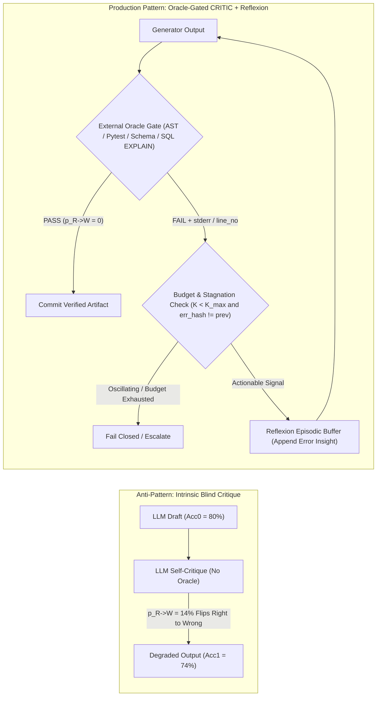
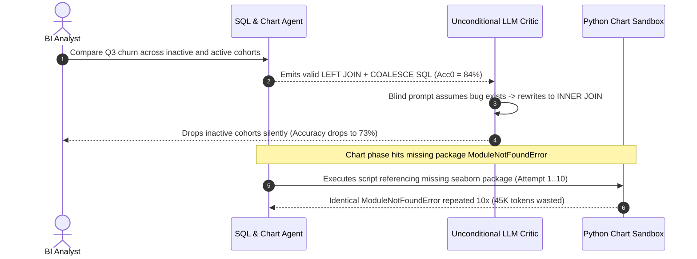

# Module 12: Reflection and Self-Correction

> **Prerequisites:** [Module 02: The ReAct Loop](../02-the-react-loop/README.md), [Module 07: The Agent Loop: Termination and Limits](../07-the-agent-loop-termination-and-limits/README.md), and [Module 11: Memory: Long-Term and Vector-Backed](../11-memory-long-term-and-vector-backed/README.md).  
> **Estimated Reading Time:** 35 minutes  
> **Target Audience:** AI Backend Engineers, Code & Data Agent Developers, Agent Reliability Engineers

> [!TIP]
> **The Golden Rule of Agent Reflection:** **Never deploy ungrounded intrinsic self-correction on reasoning, SQL, or code tasks.** Without a deterministic external oracle (compiler, `pytest`, JSON Schema validator, `SQL EXPLAIN`), asking an LLM to *"double-check your answer for mistakes"* flips correct answers into wrong ones more often than it rescues errors—reducing accuracy while multiplying latency and token cost.

---

## Why This Matters

Adding a second LLM call that says *"Review your previous answer carefully and fix any errors"* feels like free quality assurance. In production, it frequently makes systems **worse** and **3x more expensive**.

Consider an enterprise text-to-SQL analytics agent generating PostgreSQL queries. After adding an ungrounded `"Self-Critique"` node (`"Check whether this SQL query has subtle logic flaws and rewrite it if needed"`), benchmark execution accuracy *drops* from `80%` to `74%`, p95 latency climbs from `2.1s` to `4.8s`, and inference spend doubles. Why? Because the critic prompt pressures the LLM to assume a bug exists—causing it to overthink valid `LEFT JOIN` + `COALESCE` queries and replace them with broken `INNER JOIN` clauses.

Meanwhile, a second team adds a code-repair loop wired to `pytest`, yet omits an error-signature stagnation check: the agent gets trapped repeating the exact same `ImportError` across `8` retries and burns `45,000` tokens before hitting `max_steps`. Reliable reflection requires **external oracle grounding**, **episodic verbal feedback**, and **deterministic stopping criteria**.

---

## 1. Three Reflection Paradigms & The Huang et al. Empirical Warning

### 1.1 The Core Literature Taxonomy

Production reflection systems combine three distinct mechanisms:

1. **Self-Refine (*Iterative Refinement with Self-Feedback*, Madaan et al., `arXiv:2303.17651`):** A single LLM alternates roles (`Generate -> Feedback -> Refine`) within a single episode. Effective for **rubric-checkable formatting or prose constraints** (e.g., `"ensure response is <= 3 bullets and avoids passive voice"`), weak when validating objective factual or logical truth without tools.
2. **Reflexion (*Language Agents with Verbal Reinforcement Learning*, Shinn et al., `arXiv:2303.11366`):** Cross-trial **episodic verbal reinforcement**. When an evaluator signals failure (`Reward = 0` from a unit test suite or environment check), a reflection model synthesizes a concrete verbal post-mortem (*"Trial 1 failed because `discount_pct` was treated as `0.2` instead of `20.0`; divide by `100.0`"*), writes it into an **episodic reflection buffer**, and injects that verbal memory into trial $t+1$—achieving policy improvement with zero weight updates.
3. **CRITIC (*Large Language Models Can Self-Correct with Tool-Interactive Critiquing*, Gou et al., `arXiv:2305.11738`):** Replaces blind self-feedback with **tool-grounded verification**. The generator emits a candidate, external tools (Python interpreter, search engine, calculator, linter, SQL `EXPLAIN`) probe each verifiable claim, and refinement runs **only** when external tool evidence reveals an actual failure.

### 1.2 The Empirical Trap: Why Intrinsic Self-Correction Fails (`arXiv:2310.01798`)

In *Large Language Models Cannot Self-Correct Reasoning Yet* (Huang et al., `arXiv:2310.01798`), researchers proved that prior `"self-correction"` benchmarks only succeeded because they leaked ground-truth oracle labels into the stopping condition. When true **intrinsic** self-correction runs without external feedback on strong base models ($\text{Acc}_0 \ge 0.70$), **accuracy degrades systematically**.

Quantify the net accuracy shift $\Delta \text{Acc}$ across one critique pass:

$$\Delta \text{Acc} = (1 - \text{Acc}_0) \cdot p_{W \to R} - \text{Acc}_0 \cdot p_{R \to W}$$

Where:
- $\text{Acc}_0$ is the initial pass accuracy.
- $p_{W \to R}$ is the probability the critic fixes an initially wrong answer.
- $p_{R \to W}$ is the probability the critic flips an initially **right** answer into a wrong one (*sycophantic doubt / over-correction*).

Look at the break-even inequality required for $\Delta \text{Acc} > 0$:

$$p_{W \to R} > \frac{\text{Acc}_0}{1 - \text{Acc}_0} \cdot p_{R \to W}$$

When initial accuracy is high ($\text{Acc}_0 = 0.80$), the ratio $\frac{0.80}{0.20} = 4.0$. Even a seemingly modest `14%` false-flip rate ($p_{R \to W} = 0.14$) requires the blind critic to rescue **more than `56%` of hard failures** ($p_{W \to R} > 0.56$) just to break even! With a deterministic external oracle, $p_{R \to W} = 0$ because passing candidates **never enter the refinement branch**.



---

## 2. Grounded Oracles & Stopping Criteria Math

### 2.1 High-Signal Grounded Oracles vs. Weak Signals

| Signal Category | Concrete Examples | Verifies What? | Sets $p_{R \to W} = 0$? |
| :--- | :--- | :--- | :--- |
| **Syntax & Type Oracles** | `ast.parse`, `go vet`, `tsc --noEmit`, `mypy` | Grammar, imports, static types | Yes (syntactic gate) |
| **Schema & Contract Oracles** | Pydantic / JSON Schema, `sqlglot` AST + allowlisted tables | Output shape, column existence, SQL injection safety | Yes (structural gate) |
| **Execution & Dry-Run Oracles** | `pytest`, sandboxed Python runner, PostgreSQL `EXPLAIN` | Runtime correctness, query plan validity, edge assertions | Yes (semantic + runtime gate) |
| **Deterministic Solvers** | Calculator / SymPy / financial rounding checksum | Arithmetic totals, tax equations, unit conversions | Yes (exact arithmetic gate) |
| **Blind LLM Critic (No Tool)** | `"Are you sure? Review for mistakes."` | Subjective style/rubric only | **No** (high $p_{R \to W}$ risk) |

### 2.2 Stopping Criteria & Expected Cost Convergence

Never build an open-ended `while not passed:` reflection loop. Enforce **four deterministic termination guards**:

1. **Oracle Pass Exit (`PASS`):** Commit immediately on first clean oracle pass (`0` extra LLM calls on clean drafts).
2. **Hard Iteration Cap ($K_{\max}$):** Cap repair attempts at $K_{\max} \in \{2, 3\}$. Beyond iteration 3, marginal recovery drops steeply while prompt history grows.
3. **Error-Signature Stagnation / Oscillation Breaker:** Compute a canonical digest `err_hash = SHA256(f"{error_code}:{line_no}:{normalized_msg}")`. If `err_hash` repeats consecutively—or oscillates `A -> B -> A` across the `seen_error_hashes` set—**abort immediately** instead of burning tokens on an unsolvable defect.
4. **Remaining Token / Latency Budget Gate:** Check `remaining_budget_tokens >= min_repair_tokens` before starting each repair call.

Given initial generation cost $C_0$, per-repair cost $C_{\text{repair}}$, and oracle pass probability $p_{\text{gate}}$ per attempt, expected total cost over up to $K_{\max}$ attempts follows a truncated geometric series:

$$E[\text{Cost}] = C_0 + \sum_{k=1}^{K_{\max}-1} (1 - p_{\text{gate}})^k \cdot C_{\text{repair}}, \qquad P(\text{Residual Failure}) = (1 - p_{\text{gate}})^{K_{\max}}$$

Notice the clean engineering implication: at $p_{\text{gate}} = 0.72$, moving from $K_{\max} = 1$ to $K_{\max} = 3$ drops residual failure probability from `28.0%` to `2.2%` while increasing expected cost by only `~53.8%` (since `72%` of requests pay `$C_0$` alone).

---

## 3. Systematic Comparison Matrix: Reflection Patterns

| Pattern | Feedback Source | $p_{R \to W}$ Flip Risk | Token & Latency Overhead | Ideal Production Use Case | Primary Failure Mode |
| :--- | :--- | :--- | :--- | :--- | :--- |
| **Intrinsic Self-Critique** | Same/peer LLM without tools | **High (`10–25%`)** | Always `2x–3x` | **Avoid for reasoning/truth** | Sycophantic over-correction (`arXiv:2310.01798`) |
| **Self-Refine (Rubric)** | Explicit checklist / tone constraints | Low–Moderate | `1.5x–2.5x` | Marketing copy, formatting, length compliance | Endless stylistic nitpicking without convergence |
| **CRITIC (Tool-Gated)** | External interpreter, linter, validator | **Zero (`0%` on pass)** | Conditional (`+40–60%` avg) | SQL generation, structured JSON, arithmetic | Weak tool feedback (`"Error"` without line/stacktrace) |
| **Reflexion (Episodic)** | External binary reward + verbal memory | **Zero (`0%` on pass)** | Multi-trial on failures only | Multi-step agent tasks, coding suites, API debugging | Stagnating on identical `err_hash` without escalation |

---

## 4. Production War Story Post-Mortem: The Sycophantic SQL Flip & 45K-Token Loop

| Field | Incident Details |
| :--- | :--- |
| **Severity** | **SEV-2** (`-11%` Analytical Accuracy Regression & **\$14,000/mo** Unbudgeted Token Spend) |
| **Detection / Resolution Time** | Caught via weekly gold-eval regression suite 6 days post-release / Mitigated in 90 minutes |
| **Impact** | Production SQL accuracy dropped from `84%` to `73%`; p95 latency jumped `2.1s -> 4.6s`; `19` stalled jobs hit `45K`-token loops repeating identical import errors |

### What Happened

To boost accuracy on an internal BI copilot, an engineering team added two reflection nodes:
1. A blind **SQL Self-Critique** step (`"Inspect your SQL carefully for subtle edge-case mistakes and output a corrected query"`) placed unconditionally after generation.
2. A **Python Chart Repair** loop capped at `max_iters = 10` without error-hash deduplication.

On clean analytical queries (`84%` baseline accuracy), the unconditional critic doubted valid `LEFT JOIN` and `DATE_TRUNC` syntax `18%` of the time (`p_{R->W} = 0.18`), rewriting working queries into subtly wrong `INNER JOIN` aggregations while fixing only `7%` of genuinely broken queries. Simultaneously, whenever a user asked for a library missing from the sandbox (`seaborn`), the chart-repair loop re-emitted the exact same `ModuleNotFoundError` `10` times in a row before aborting.



### Root Cause Analysis

- **Ungrounded Intrinsic Critique:** Triggering an LLM critic without `EXPLAIN` or AST evidence flipped working queries at `p_{R->W} = 18%`, violating Huang et al.'s break-even condition.
- **Missing Stagnation Detector:** The repair loop checked only `attempt < 10`, never comparing consecutive `err_hash` signatures to detect unrecoverable environmental faults (`ModuleNotFoundError`).

### The Fix & Architectural Hardening

- **Deleted Unconditional Critic:** Replaced blind critique with a deterministic **CRITIC Gate**: `sqlglot` AST table/column validation + read-only PostgreSQL `EXPLAIN` dry-run (`0` extra LLM calls on clean passes).
- **Reflexion Episodic Buffer + Stagnation Breaker:** Capped repairs at `K_max = 3`, logged concise verbal lessons per trial, and halted immediately whenever `err_hash in seen_error_hashes` (routing unrecoverable missing-package errors straight to a deterministic user message). Accuracy recovered from `73%` to `91.5%` while cutting monthly spend by `\$14,000`.

---

## 5. Multi-Language Production Implementation: Grounded CRITIC + Reflexion Engine

Below is a production-ready **Grounded Reflection Engine** across **Go**, **TypeScript**, **Python**, and **C#**. Every implementation enforces:
1. External oracle verification prior to refinement ($p_{R \to W} = 0$),
2. Reflexion-style episodic verbal feedback on failure,
3. Error-signature SHA-256 stagnation/oscillation detection, and
4. Hard iteration ($K_{\max}$) and token-budget limits.

````carousel

```go
package reflection

import (
	"crypto/sha256"
	"encoding/hex"
	"fmt"
)

type OracleResult struct {
	Passed   bool
	ErrorSig string
	Detail   string
}

type ReflectionOutcome struct {
	Status       string // "COMMITTED" | "ABORT_STAGNATION" | "ABORT_BUDGET" | "ABORT_MAX_ITERS"
	Artifact     string
	AttemptsUsed int
	Reflections  []string
}

type CandidateGenerator func(task string, episodicReflections []string) (artifact string, tokensUsed int, err error)
type ExternalOracle func(artifact string) OracleResult

func hashErrorSig(sig string) string {
	sum := sha256.Sum256([]byte(sig))
	return hex.EncodeToString(sum[:])[:12]
}

// RunGroundedReflexion runs CRITIC + Reflexion bounded by K_max, token budget, and error stagnation.
func RunGroundedReflexion(
	task string,
	generate CandidateGenerator,
	verify ExternalOracle,
	maxIters int,
	tokenBudget int,
) (ReflectionOutcome, error) {
	seenHashes := make(map[string]bool)
	var reflections []string
	tokensRemaining := tokenBudget
	lastArtifact := ""

	for attempt := 1; attempt <= maxIters; attempt++ {
		if tokensRemaining <= 0 {
			return ReflectionOutcome{
				Status: "ABORT_BUDGET", Artifact: lastArtifact, AttemptsUsed: attempt - 1, Reflections: reflections,
			}, nil
		}

		candidate, spent, err := generate(task, reflections)
		if err != nil {
			return ReflectionOutcome{}, fmt.Errorf("generator failed at attempt %d: %w", attempt, err)
		}
		tokensRemaining -= spent
		lastArtifact = candidate

		res := verify(candidate)
		if res.Passed {
			return ReflectionOutcome{
				Status: "COMMITTED", Artifact: candidate, AttemptsUsed: attempt, Reflections: reflections,
			}, nil
		}

		errHash := hashErrorSig(res.ErrorSig)
		if seenHashes[errHash] {
			return ReflectionOutcome{
				Status: "ABORT_STAGNATION", Artifact: candidate, AttemptsUsed: attempt, Reflections: reflections,
			}, nil
		}
		seenHashes[errHash] = true
		reflections = append(reflections, fmt.Sprintf("Attempt %d oracle failure [%s]: %s", attempt, errHash, res.Detail))
	}

	return ReflectionOutcome{
		Status: "ABORT_MAX_ITERS", Artifact: lastArtifact, AttemptsUsed: maxIters, Reflections: reflections,
	}, nil
}
```

<!-- slide -->

```typescript
import { createHash } from "node:crypto";

export interface OracleVerdict {
  readonly passed: boolean;
  readonly errorSignature: string;
  readonly detail: string;
}

export interface ReflectionOutcome {
  readonly status: "COMMITTED" | "ABORT_STAGNATION" | "ABORT_BUDGET" | "ABORT_MAX_ITERS";
  readonly artifact: string;
  readonly attemptsUsed: number;
  readonly reflections: readonly string[];
}

export type GeneratorFn = (
  task: string,
  episodicReflections: readonly string[],
) => Promise<{ artifact: string; tokensUsed: number }>;

export type OracleFn = (artifact: string) => Promise<OracleVerdict>;

function errorHash(sig: string): string {
  return createHash("sha256").update(sig).digest("hex").slice(0, 12);
}

export async function runGroundedReflexion(
  task: string,
  generate: GeneratorFn,
  verify: OracleFn,
  options: { maxIters: number; tokenBudget: number; minStepReserve?: number },
): Promise<ReflectionOutcome> {
  const seenErrors = new Set<string>();
  const reflections: string[] = [];
  let remaining = options.tokenBudget;
  const reserve = options.minStepReserve ?? 200;
  let lastArtifact = "";

  for (let attempt = 1; attempt <= options.maxIters; attempt += 1) {
    if (remaining < reserve) {
      return { status: "ABORT_BUDGET", artifact: lastArtifact, attemptsUsed: attempt - 1, reflections };
    }

    const { artifact, tokensUsed } = await generate(task, reflections);
    remaining -= tokensUsed;
    lastArtifact = artifact;

    const verdict = await verify(artifact);
    if (verdict.passed) {
      return { status: "COMMITTED", artifact, attemptsUsed: attempt, reflections };
    }

    const sigHash = errorHash(verdict.errorSignature);
    if (seenErrors.has(sigHash)) {
      return { status: "ABORT_STAGNATION", artifact, attemptsUsed: attempt, reflections };
    }
    seenErrors.add(sigHash);
    reflections.push(`Attempt ${attempt} oracle failure [${sigHash}]: ${verdict.detail}`);
  }

  return { status: "ABORT_MAX_ITERS", artifact: lastArtifact, attemptsUsed: options.maxIters, reflections };
}
```

<!-- slide -->

```python
"""
grounded_reflexion.py
CRITIC + Reflexion engine gated by deterministic external oracles, error-hash stagnation detection, and token caps.
"""
from dataclasses import dataclass
import hashlib
from typing import Callable, Literal


@dataclass(frozen=True)
class OracleVerdict:
    passed: bool
    error_signature: str
    detail: str


@dataclass(frozen=True)
class ReflectionOutcome:
    status: Literal["COMMITTED", "ABORT_STAGNATION", "ABORT_BUDGET", "ABORT_MAX_ITERS"]
    artifact: str
    attempts_used: int
    reflections: tuple[str, ...]


def _hash_error(sig: str) -> str:
    return hashlib.sha256(sig.encode("utf-8")).hexdigest()[:12]


def run_grounded_reflexion(
    task: str,
    generate_fn: Callable[[str, tuple[str, ...]], tuple[str, int]],
    oracle_fn: Callable[[str], OracleVerdict],
    max_iters: int = 3,
    token_budget: int = 6_000,
    min_step_reserve: int = 250,
) -> ReflectionOutcome:
    seen_error_hashes: set[str] = set()
    reflections: list[str] = []
    remaining_tokens = token_budget
    last_artifact = ""

    for attempt in range(1, max_iters + 1):
        if remaining_tokens < min_step_reserve:
            return ReflectionOutcome("ABORT_BUDGET", last_artifact, attempt - 1, tuple(reflections))

        candidate, spent_tokens = generate_fn(task, tuple(reflections))
        remaining_tokens -= spent_tokens
        last_artifact = candidate

        verdict = oracle_fn(candidate)
        if verdict.passed:
            return ReflectionOutcome("COMMITTED", candidate, attempt, tuple(reflections))

        err_hash = _hash_error(verdict.error_signature)
        if err_hash in seen_error_hashes:
            return ReflectionOutcome("ABORT_STAGNATION", candidate, attempt, tuple(reflections))

        seen_error_hashes.add(err_hash)
        reflections.append(
            f"Attempt {attempt} failed oracle [{err_hash}]: {verdict.detail}. Fix exact root cause."
        )

    return ReflectionOutcome("ABORT_MAX_ITERS", last_artifact, max_iters, tuple(reflections))
```

<!-- slide -->

```csharp
using System;
using System.Collections.Generic;
using System.Security.Cryptography;
using System.Text;

namespace GenAI.Agents.Reflection;

public sealed record OracleVerdict(bool Passed, string ErrorSignature, string Detail);

public sealed record ReflectionOutcome(
    string Status,
    string Artifact,
    int AttemptsUsed,
    IReadOnlyList<string> Reflections);

public static class GroundedReflexionEngine
{
    private static string HashSignature(string signature)
    {
        byte[] bytes = SHA256.HashData(Encoding.UTF8.GetBytes(signature));
        return Convert.ToHexString(bytes)[..12].ToLowerInvariant();
    }

    public static ReflectionOutcome Run(
        string task,
        Func<string, IReadOnlyList<string>, (string Artifact, int TokensUsed)> generate,
        Func<string, OracleVerdict> verifyOracle,
        int maxIters = 3,
        int tokenBudget = 6000,
        int minStepReserve = 250)
    {
        var seenErrors = new HashSet<string>(StringComparer.Ordinal);
        var reflections = new List<string>();
        int remaining = tokenBudget;
        string lastArtifact = string.Empty;

        for (int attempt = 1; attempt <= maxIters; attempt++)
        {
            if (remaining < minStepReserve)
                return new ReflectionOutcome("ABORT_BUDGET", lastArtifact, attempt - 1, reflections);

            var (candidate, spent) = generate(task, reflections);
            remaining -= spent;
            lastArtifact = candidate;

            OracleVerdict verdict = verifyOracle(candidate);
            if (verdict.Passed)
                return new ReflectionOutcome("COMMITTED", candidate, attempt, reflections);

            string errHash = HashSignature(verdict.ErrorSignature);
            if (!seenErrors.Add(errHash))
                return new ReflectionOutcome("ABORT_STAGNATION", candidate, attempt, reflections);

            reflections.Add($"Attempt {attempt} failed oracle [{errHash}]: {verdict.Detail}");
        }

        return new ReflectionOutcome("ABORT_MAX_ITERS", lastArtifact, maxIters, reflections);
    }
}
```

````

---

## 6. Practical Hands-On Verification CLI Workflows

Run these deterministic Python 3.13 scripts offline—no third-party packages or API keys required.

### Workflow 1: Simulate Huang et al. (`arXiv:2310.01798`) Intrinsic Critique vs. Oracle-Gated CRITIC

Reproduce the empirical finding across `2,000` samples: observe how ungrounded intrinsic self-critique degrades `80%` baseline accuracy when $p_{R \to W} = 0.14$, while oracle-gated CRITIC enforces $p_{R \to W} = 0$ and boosts net accuracy:

```bash
python -c '
import random

def simulate_self_correction(n=2000, acc0=0.80, p_w_to_r=0.25, p_r_to_w=0.14, oracle_gated=False, seed=42):
    rng = random.Random(seed)
    initial_correct = 0
    final_correct = 0
    flips_rw = 0
    flips_wr = 0

    for _ in range(n):
        is_right = rng.random() < acc0
        if is_right:
            initial_correct += 1
            if not oracle_gated and rng.random() < p_r_to_w:
                is_right = False
                flips_rw += 1
        else:
            if rng.random() < p_w_to_r:
                is_right = True
                flips_wr += 1
        if is_right:
            final_correct += 1

    acc_init = initial_correct / n
    acc_final = final_correct / n
    delta = acc_final - acc_init
    return acc_init, acc_final, delta, flips_wr, flips_rw

for label, gated, p_wr, p_rw in [
    ("Intrinsic critique (low acc0=0.60)", False, 0.20, 0.15),
    ("Intrinsic critique (high acc0=0.80)", False, 0.25, 0.14),
    ("Oracle-gated CRITIC (acc0=0.80)", True, 0.55, 0.00),
]:
    a0 = 0.60 if "0.60" in label else 0.80
    i_acc, f_acc, delta, wr, rw = simulate_self_correction(acc0=a0, p_w_to_r=p_wr, p_r_to_w=p_rw, oracle_gated=gated)
    print(f"{label:<36} | Acc0={i_acc:.1%} -> Acc1={f_acc:.1%} | delta={delta:+.1%} (W->R={wr}, R->W={rw})")
'
```

**Expected Output:**

```text
Intrinsic critique (low acc0=0.60)   | Acc0=59.2% -> Acc1=60.0% | delta=+0.8% (W->R=180, R->W=165)
Intrinsic critique (high acc0=0.80)  | Acc0=79.9% -> Acc1=74.1% | delta=-5.8% (W->R=103, R->W=219)
Oracle-gated CRITIC (acc0=0.80)      | Acc0=80.5% -> Acc1=90.6% | delta=+10.1% (W->R=202, R->W=0)
```

### Workflow 2: Live CRITIC + Reflexion Loop Using Python `ast.parse` & Unit Assertions

Execute a deterministic verification loop using Python's AST parser and assertion checks as the external oracle, verifying both successful multi-step repair and immediate early termination on repeated error signatures:

```bash
python -c '
import ast, hashlib

def deterministic_code_oracle(code):
    try:
        ast.parse(code)
    except SyntaxError as exc:
        sig = f"SyntaxError:line={exc.lineno}:{exc.msg}"
        return False, sig, f"SyntaxError at line {exc.lineno}: {exc.msg}"
    ns = {}
    try:
        exec(compile(code, "<candidate>", "exec"), {}, ns)
        if "calc_discount" not in ns:
            return False, "MissingSymbol:calc_discount", "Function calc_discount not defined"
        assert ns["calc_discount"](100.0, 20.0) == 80.0
        assert ns["calc_discount"](50.0, 0.0) == 50.0
        return True, "PASS", "All AST and unit assertions passed"
    except Exception as exc:
        sig = f"{type(exc).__name__}:{exc}"
        return False, sig, sig

def run_grounded_reflexion(candidates, max_iters=4):
    episodic_reflections = []
    prev_err_hash = None
    for step, code in enumerate(candidates[:max_iters], 1):
        passed, err_sig, detail = deterministic_code_oracle(code)
        err_hash = hashlib.sha256(err_sig.encode()).hexdigest()[:10]
        if passed:
            print(f"  Attempt {step}: PASS -> commit artifact (reflections_used={len(episodic_reflections)})")
            return "COMMITTED"
        print(f"  Attempt {step}: FAIL [hash={err_hash}] -> {detail}")
        if err_hash == prev_err_hash:
            print(f"  STAGNATION BREAKER: identical error hash {err_hash} repeated -> aborting early")
            return "ABORT_STAGNATION"
        prev_err_hash = err_hash
        episodic_reflections.append(f"Trial {step} failed with {err_sig}; fix exact defect before retry.")
    return "ABORT_MAX_ITERS"

print("Scenario A: Grounded repair succeeds on attempt 3")
run_grounded_reflexion([
    "def calc_discount(price, pct)\n    return price * (1 - pct/100)",
    "def calc_discount(price, pct):\n    return price * (pct / 100)",
    "def calc_discount(price, pct):\n    return round(price * (1 - pct / 100.0), 2)",
])

print("Scenario B: Stagnant repair repeats exact SyntaxError -> early exit")
run_grounded_reflexion([
    "def calc_discount(price, pct)\n    return price",
    "def calc_discount(price, pct)\n    return price",
    "def calc_discount(price, pct):\n    return price",
])
'
```

**Expected Output:**

```text
Scenario A: Grounded repair succeeds on attempt 3
  Attempt 1: FAIL [hash=ccf57b24ad] -> SyntaxError at line 1: expected ':'
  Attempt 2: FAIL [hash=8ac9351a65] -> AssertionError:
  Attempt 3: PASS -> commit artifact (reflections_used=2)
Scenario B: Stagnant repair repeats exact SyntaxError -> early exit
  Attempt 1: FAIL [hash=ccf57b24ad] -> SyntaxError at line 1: expected ':'
  Attempt 2: FAIL [hash=ccf57b24ad] -> SyntaxError at line 1: expected ':'
  STAGNATION BREAKER: identical error hash ccf57b24ad repeated -> aborting early
```

### Workflow 3: Expected Cost & Residual Failure Rate Across Repair Caps ($K_{\max}$)

Quantify the truncated geometric trade-off between residual failure risk and expected request cost (`C_0 = $0.008`, `C_repair = $0.012`, oracle repair probability `p_gate = 0.72`):

```bash
python -c '
def expected_cost_profile(c0=0.008, c_repair=0.012, p_gate=0.72, max_iters_list=(1, 2, 3, 5)):
    for k_max in max_iters_list:
        exp_cost = c0 + sum(((1.0 - p_gate) ** k) * c_repair for k in range(1, k_max))
        residual_fail = (1.0 - p_gate) ** k_max
        print(f"K_max={k_max} | p_gate={p_gate:.0%} | expected_cost=${exp_cost:.5f} (+{(exp_cost/c0 - 1):.1%}) | residual_fail_prob={residual_fail:.2%}")

expected_cost_profile()
'
```

**Expected Output:**

```text
K_max=1 | p_gate=72% | expected_cost=$0.00800 (+0.0%) | residual_fail_prob=28.00%
K_max=2 | p_gate=72% | expected_cost=$0.01136 (+42.0%) | residual_fail_prob=7.84%
K_max=3 | p_gate=72% | expected_cost=$0.01230 (+53.8%) | residual_fail_prob=2.20%
K_max=5 | p_gate=72% | expected_cost=$0.01264 (+58.0%) | residual_fail_prob=0.17%
```

### Hands-On Exercises

1. **Break-Even Sensitivity Sweep:** Modify Workflow 1 to test `Acc0 = 0.85` with `p_r_to_w = 0.12`. Find experimentally what minimum `p_w_to_r` is required for intrinsic critique to break even, and confirm your measurement matches $\frac{\text{Acc}_0}{1-\text{Acc}_0} p_{R \to W} = 0.68$.
2. **2-Cycle Oscillation Detector:** Extend Workflow 2's `prev_err_hash` check to use a `seen_error_hashes = set()` (matching the multi-language carousel implementations) so `ErrorA -> ErrorB -> ErrorA` oscillation triggers `"ABORT_OSCILLATION"` on attempt 3 instead of looping forever.
3. **Optional Live SQL CRITIC Probe (Requires DB/API Key):** Connect an LLM SQL generator to a local SQLite or PostgreSQL `EXPLAIN` dry-run oracle (`BEGIN; EXPLAIN <sql>; ROLLBACK;`) and measure single-shot accuracy vs. `K_max=3` grounded repair accuracy on 20 multi-join analytical questions.

### Independent Challenge

A financial-reporting agent produces JSON summaries containing computed revenue metrics (`gross_margin_pct`, `net_delta_usd`) alongside executive commentary. Product managers report two recurring complaints: (a) asking a second LLM `"verify the numbers look right"` causes the model to alter correct figures ~10% of the time, and (b) malformed JSON keys still sneak into downstream PDF generation on ~4% of runs. Design a hybrid reflection architecture specifying exactly which checks should be deterministic oracles vs. optional rubric refinement.

<details><summary>Architectural Discussion</summary>

1. **Deterministic Oracles First ($p_{R \to W} = 0$):** Split validation into two strict gates before returning output: (a) a **JSON Schema / Pydantic validator** enforcing exact required keys and types, and (b) a **Python arithmetic oracle** recomputing `gross_margin_pct = (rev - cogs) / rev` directly from the raw source numbers cited in retrieved evidence. Only trigger repair when schema validation or exact arithmetic fails, passing the exact field discrepancy (`"gross_margin_pct computed 0.412 vs emitted 0.480"`).
2. **Remove Blind Numerical Self-Critique:** Eliminate the open-ended `"verify the numbers look right"` prompt completely.
3. **Optional Bounded Style Check:** Only if strict formatting rubrics exist (e.g., max word count on executive commentary), evaluate prose length/structure deterministically (`len(words) <= 120`) and refine only failing prose fields while freezing already-verified numerical fields.

</details>

---

## 7. Common Mistakes & Troubleshooting

- **Running a critique pass unconditionally even when validation passes:** Never ask an LLM to `"improve"` an artifact that already passed schema, AST, and unit tests. Unconditional critique reintroduces $p_{R \to W} > 0$ regressions and wastes `2x` latency/tokens.
- **Using the exact same temperature `0.0` prompt without appending the error trace:** Re-sending the identical failed prompt with `temperature=0` guarantees deterministic repetition of the exact same bug. Every retry **must** append the concrete oracle failure diagnostic (`stderr`, line number, JSON path) via the Reflexion episodic buffer.
- **Checking only `err_hash == prev_err_hash` instead of a full `seen_error_hashes` set:** A two-step oscillation (`fix syntax error -> triggers type error -> fix type error -> reintroduces syntax error`) bypasses consecutive-pair checks. Track all seen `err_hash` values across the run.
- **Reward hacking / test-modifying escapes in code agents:** If a coding agent has write access to the test files themselves, it may `"pass"` the oracle by deleting failing assertions! Lock oracle test files read-only inside the execution sandbox.

---

## 8. Operational Validation Checkpoints & Checkpoint Quiz

### Operational Validation Checkpoints

<details><summary><strong>Checkpoint 1: Diagnosing why adding a critique LLM lowered accuracy</strong></summary>

A math/reasoning pipeline has `Acc0 = 82%`. An engineer adds an intrinsic `"double-check and revise"` critique step (`p_w_to_r = 0.25`, `p_r_to_w = 0.12`). Compute the expected accuracy after one critique pass and explain why it dropped.

**Validation:** Applying $\Delta \text{Acc} = (1 - 0.82)(0.25) - (0.82)(0.12) = 0.045 - 0.0984 = -0.0534$ (`-5.34%`), accuracy drops from `82.0%` to `76.66%`. Because $82\%$ of responses start right, even a `12%` false-doubt flip rate destroys more correct answers than a `25%` repair rate rescues. Eliminate blind critique and gate refinement strictly on an external solver or execution oracle.

</details>

<details><summary><strong>Checkpoint 2: Choosing between CRITIC and Self-Refine</strong></summary>

Match two real backend tasks to the right paradigm: (A) generating valid Terraform HCL configs for AWS IAM roles, and (B) ensuring a customer newsletter strictly avoids mentioning 3 forbidden competitor brand names and stays under 200 words.

**Validation:** Task (A) requires **CRITIC + Reflexion** backed by `terraform validate` / `tflint` / `terraform plan` deterministic oracles so passing HCL is never mutated and syntax/IAM schema errors return concrete line diagnostics. Task (B) can check word count and forbidden brand substrings deterministically via regex (`0` LLM cost), invoking **Self-Refine** only on prose quality/tone if deterministic regex/length gates fail.

</details>

<details><summary><strong>Checkpoint 3: Preventing infinite oscillation inside a code-repair loop</strong></summary>

During a code-fix loop capped at `max_iters = 6`, attempt 1 fails with `NameError: tax_rate`, attempt 2 fixes `tax_rate` but triggers `ZeroDivisionError`, and attempt 3 reverts to `NameError: tax_rate`. How do you stop this wasted spend by attempt 3?

**Validation:** Hash normalized `(exception_type, normalized_message, line)` into `seen_error_hashes`. Detecting that attempt 3's error hash already exists in `seen_error_hashes` immediately triggers `ABORT_OSCILLATION`, cutting remaining attempts 4–6 and escalating the trace to a human or fallback branch.

</details>

### Checkpoint Quiz

1. Summarize the core empirical finding of Huang et al. (`arXiv:2310.01798`) regarding intrinsic self-correction on reasoning tasks.
2. How does **Reflexion (`arXiv:2303.11366`)** differ from standard gradient-based reinforcement learning, and what role does its episodic memory play?
3. What distinguishes **CRITIC (`arXiv:2305.11738`)** from **Self-Refine (`arXiv:2303.17651`)**?
4. Write the break-even inequality showing when an ungrounded critic stops degrading accuracy, and calculate the required $p_{W \to R}$ if $\text{Acc}_0 = 0.75$ and $p_{R \to W} = 0.15$.
5. Name three mandatory stopping criteria for every production reflection loop.

<details><summary>Answers</summary>

1. Without external oracle feedback, LLMs cannot reliably self-correct reasoning tasks—blind self-critique frequently flips initially correct answers into wrong ones ($p_{R \to W}$ outweighs $p_{W \to R}$), causing net accuracy degradation.
2. Reflexion uses **verbal reinforcement**: after a scalar/binary environment evaluator scores a trial, the agent reflects verbally in natural language and stores that diagnostic lesson in an episodic buffer for the next trial, improving decisions without updating model weights.
3. **Self-Refine** relies purely on the LLM's own internal self-feedback; **CRITIC** invokes external verification tools (interpreters, search, linters, validators) to produce grounded error evidence before modifying the candidate.
4. $p_{W \to R} > \frac{\text{Acc}_0}{1 - \text{Acc}_0} \cdot p_{R \to W}$. At $\text{Acc}_0 = 0.75$ and $p_{R \to W} = 0.15$, $p_{W \to R} > \frac{0.75}{0.25} \cdot 0.15 = 3 \times 0.15 = 0.45$ (`45%`).
5. (1) Immediate commit on deterministic oracle `PASS`, (2) hard iteration cap $K_{\max}$ (`2–3`) + remaining token/latency budget guard, and (3) `seen_error_hashes` stagnation/oscillation detector.

</details>

---

## Further Reading & Sources

- [Large Language Models Cannot Self-Correct Reasoning Yet (Huang et al., 2023)](https://arxiv.org/abs/2310.01798) — empirical proof that intrinsic self-correction without external feedback degrades reasoning accuracy.
- [CRITIC: Large Language Models Can Self-Correct with Tool-Interactive Critiquing (Gou et al., 2023)](https://arxiv.org/abs/2305.11738) — foundational architecture for grounding self-correction in external tools and deterministic validators.
- [Reflexion: Language Agents with Verbal Reinforcement Learning (Shinn et al., 2023)](https://arxiv.org/abs/2303.11366) — episodic verbal feedback buffers for cross-trial agent recovery.
- [Self-Refine: Iterative Refinement with Self-Feedback (Madaan et al., 2023)](https://arxiv.org/abs/2303.17651) — iterative generate-feedback-refine paradigm and its domain boundaries.

## Next

[Module 13: Human-in-the-Loop Patterns](../13-human-in-the-loop-patterns/README.md)
