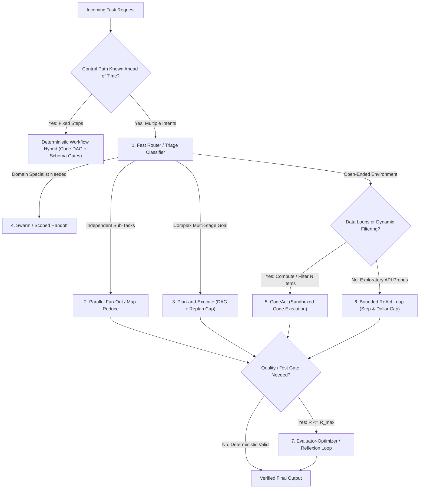
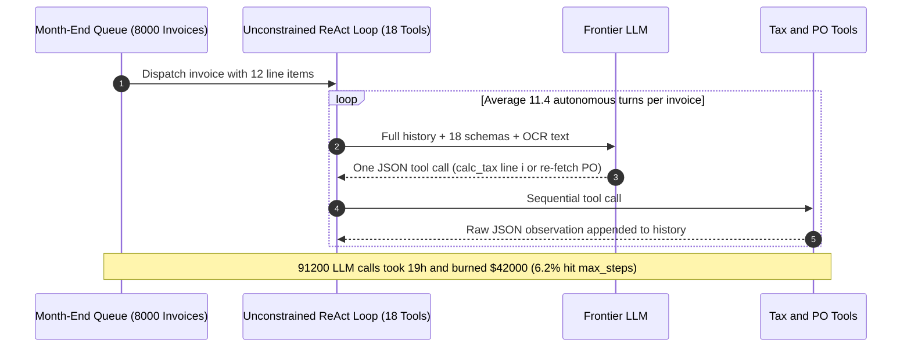

# Module 14: An Agent Design Pattern Catalog

> **Prerequisites:** [Module 01: Agents vs. Chatbots vs. Workflows](../01-agents-vs-chatbots-vs-workflows/README.md), [Module 02: The ReAct Loop](../02-the-react-loop/README.md), [Module 09: Planning: Plan-and-Execute](../09-planning-plan-and-execute/README.md), [Module 12: Reflection and Self-Correction](../12-reflection-and-self-correction/README.md), and [Module 13: Human-in-the-Loop Patterns](../13-human-in-the-loop-patterns/README.md).  
> **Estimated Reading Time:** 35 minutes  
> **Target Audience:** AI Backend Engineers, Distributed Systems Architects, Agent Platform Engineers

> [!TIP]
> **The Golden Rule of Agent Design Patterns:** Always select the **least autonomous pattern** that satisfies your task variance (`Deterministic Workflow Hybrid -> Routing -> Parallel Fan-Out -> Plan-and-Execute -> Evaluator-Optimizer -> CodeAct / ReAct`). Never wrap a predictable control path inside an unbounded ReAct loop—every unnecessary autonomous turn multiplies token cost, tail latency, and compounding failure probability.

---

## Why This Matters

Once backend teams learn the ReAct loop ([Module 02](../02-the-react-loop/README.md)), a predictable anti-pattern emerges: engineers dump 15 tools into one system prompt and ask a frontier LLM to figure everything out dynamically. On three interactive demo queries, it looks magical. On `10,000` daily production tasks, that single-loop hammer becomes an operational liability—taking 11 turns to execute a fixed 3-step pipeline, burning `4x–8x` excess tokens, timing out downstream gateways, and occasionally skipping mandatory compliance checks.

As Anthropic documented in *Building Effective Agents*, reliable agent engineering begins by distinguishing **Workflows** (systems where LLMs and tools are orchestrated along predefined code paths) from **Agents** (systems where LLMs dynamically direct their own control flow and tool usage). Master backend architects treat ReAct, Plan-and-Execute, Routing, Map-Reduce Fan-Out, Evaluator-Optimizer, Swarm Handoffs, and CodeAct as **composable building blocks**, matching pattern autonomy strictly to task uncertainty.

---

## 1. Architectural Mental Model & Pattern Taxonomy

Every production agentic architecture resolves a trade-off between **control-flow predictability** and **environmental adaptability**. You can classify all canonical industry and research patterns along how much control-flow authority code retains versus ceding it to the model:

1. **Deterministic Workflow Hybrid (Prompt Chaining + Code Gates):** Application code owns the directed acyclic graph (DAG) of steps. LLMs perform bounded classification, extraction, or synthesis at fixed nodes, while deterministic code asserts schemas, runs business rules, and branches cleanly.
2. **Routing / Triage:** A lightweight, low-latency model classifies the incoming request into one of $M$ explicit intents and hands execution to a specialized prompt template, model tier, or sub-workflow.
3. **Parallel Fan-Out / Map-Reduce (Sectioning & Voting):** Independent sub-tasks (e.g., auditing 6 contract sections, running 3 diverse verifiers) execute concurrently across workers and merge via deterministic aggregation or a bounded reducer call.
4. **Plan-and-Execute (`arXiv:2305.04091`) / Orchestrator-Workers:** A planner model decomposes an ambiguous multi-step goal into an explicit task DAG upfront; lightweight workers execute leaf tasks; a bounded replanner adjusts only when an execution invariant breaks.
5. **Evaluator-Optimizer / Reflexion (`arXiv:2303.11366`):** An Actor generates a candidate artifact (SQL, code patch, compliance memo), an independent Evaluator (unit test runner, linter, or rubric LLM) emits structured critique stored in an episodic buffer, and the Actor iterates up to $R_{\max}$ bounded rounds.
6. **Swarm / Handoff (Decentralized Role Transfer):** Specialized agents hold narrow tool subsets (`billing_agent`, `refund_agent`, `infra_agent`) and transfer active session control via explicit `transfer_to_<agent>` handoff tools, avoiding one bloated 40-tool prompt.
7. **ReAct (`arXiv:2210.03629`):** Interleaved `Thought -> Action -> Observation` closed loop where the next tool depends strictly on the previous external environment observation and the step count cannot be predicted statically.
8. **Code-Execution Agent / CodeAct (`arXiv:2402.01030`):** Instead of emitting $N$ separate JSON tool calls to filter records, loop over pagination cursors, and compute aggregates, the LLM emits executable sandboxed code (Python/TypeScript/SQL) that composes tools, loops, and branches inside a single turn.



### Quantitative Mechanics: Latency, Token Cost, and Error Compounding

Before choosing a pattern, quantify how turns, concurrency, and per-step accuracy govern production reliability:

- **Sequential Reliability Compounding:** If each autonomous step succeeds independently with probability $1 - \epsilon$ (where $\epsilon$ covers schema drift, tool mis-selection, or observation misreads), an unguarded $k$-turn trajectory completes cleanly with probability:

$$P(\text{clean trajectory}) = (1 - \epsilon)^k$$

At $\epsilon = 0.05$ (`95%` per-step accuracy!), a `2`-step workflow succeeds `90.2%` of the time, whereas an unconstrained `12`-turn ReAct loop drops to $0.95^{12} = 54.0\%$ end-to-end reliability unless verified mid-flight.

- **Sequential vs. Parallel Fan-Out Wall Latency:** Across $m$ independent sub-tasks requiring $L_{\text{split}}$ triage, $L_i$ worker execution, and $L_{\text{reduce}}$ synthesis:

$$L_{\text{seq}} = \sum_{i=1}^{m} (L_{\text{LLM}, i} + L_{\text{tool}, i}), \qquad L_{\text{fanout}} = L_{\text{split}} + \max_{i=1..m}(L_i) + L_{\text{reduce}}$$

- **CodeAct Turn Compression:** Filtering and aggregating $N$ tool outputs via sequential JSON tool calls requires $N + 1$ full prompt-prefill cycles ($O(N^2)$ cumulative input tokens; detailed in [Module 16](../16-cost-and-latency-control-in-agents/README.md)), whereas CodeAct executes the loop inside a local sandbox in $C \approx 2$ turns (code generation + result synthesis), saving $(N + 1 - C)$ inference round-trips.

---

## 2. Systematic Comparison Matrix & Composability Rules

### Pattern Selection Matrix

| Pattern | Control Flow Owner | Ideal Task Structure | Token & Latency Multiplier | Primary Failure Risk | When NOT to Use |
| :--- | :--- | :--- | :--- | :--- | :--- |
| **Deterministic Workflow Hybrid** | Application code DAG | Fixed-order ETL, form triage, compliance pipelines | `1x` baseline (lowest cost & lowest variance) | Brittle if unexpected edge cases exceed static branches | Open-ended debugging or dynamic tool paths |
| **Routing / Triage** | Single classifier LLM + code switch | Multi-intent support desks, model-tier dispatch | `~1.05x` (`1` fast call saves downstream waste) | Misclassification sends task to wrong specialist | Single uniform task type needing no specialization |
| **Parallel Fan-Out / Map-Reduce** | Code orchestrator + `m` workers | Auditing `N` independent docs, multi-perspective voting | `~1.3x–2.5x` tokens, `0.3x` wall latency | Reducer context overload if raw worker dumps exceed cap | Sequential dependencies where step $i+1$ needs step $i$ |
| **Plan-and-Execute (`arXiv:2305.04091`)** | Planner LLM + DAG runner | Multi-step research, migration plans, report generation | `~1.8x–3.0x` tokens, moderate latency | Stale plan rigidity or infinite replanning loops | Simple 1-step lookups or volatile real-time APIs |
| **Evaluator-Optimizer / Reflexion (`arXiv:2303.11366`)** | Generator + bounded Critic (`<= R_max`) | Code patching, SQL generation, strict rubric writing | `~(1 + R)x` tokens and latency | Sycophantic critic rubber-stamping or oscillating edits | Tasks lacking deterministic tests or clear rubrics |
| **Swarm / Handoff** | Active persona agent + handoff tool | Multi-department workflows (Sales -> Billing -> Tech) | `~1.5x–2.8x` tokens across transfers | Ping-pong handoff cycles without shared state summary | Single-domain tasks where 3–5 tools fit cleanly |
| **ReAct (`arXiv:2210.03629`)** | LLM dynamic loop | Exploratory debugging, interactive incident triage | `3x–10x` ($O(k^2)$ prefill growth across $k$ turns) | Tool thrashing, goal drift, runaway loop cost | Predictable ETL, fixed pipelines, bulk row iteration |
| **CodeAct (`arXiv:2402.01030`)** | LLM emitting sandboxed code | Data filtering, math, multi-API joins, batch loops | `0.2x–0.5x` vs. sequential ReAct on batch data | Arbitrary code RCE / infinite `while` loops without sandbox | Simple single API calls or non-programmable actions |

### Composability Rules (How Patterns Snap Together)

Production architectures rarely deploy one pattern in isolation. Follow these strict composition rules:

1. **Top-Down Funnel (`Router -> Specialized Workflow / Pattern -> Evaluator-Optimizer`):** Always route *first* on cheap features or a small classifier so high-volume predictable queries hit `Deterministic Workflow Hybrid` (`1`–`2` calls) while complex queries enter `Plan-and-Execute` or `CodeAct`, gated at the exit by a bounded `Evaluator-Optimizer` (`R_max <= 2`).
2. **Scoped Worker Substitution (`Plan-and-Execute -> Parallel Map-Reduce / CodeAct Workers`):** Let the Planner emit a typed DAG where independent nodes fan out concurrently (`Parallel Map-Reduce`) and data-heavy nodes run inside a `CodeAct` sandbox rather than spawning nested autonomous ReAct loops.
3. **Never Nest Unbounded Loops Inside Loops:** Wrapping a `10`-step ReAct loop inside a `3`-round Evaluator-Optimizer inside a Swarm without a shared global `RunBudget` explodes worst-case inference calls to $3 \times 10 \times \text{handoffs}$. Pass one shared, immutable `BudgetContext` down every composition boundary ([Module 07](../07-the-agent-loop-termination-and-limits/README.md)).

---

## 3. Production War Story Post-Mortem: The \$42,000 ReAct-for-ETL Thrashing Outage

| Field | Incident Details |
| :--- | :--- |
| **Severity** | **SEV-2** (Monthly FinOps Budget Exhaustion & 19-Hour Batch SLA Breach) |
| **Detection / Resolution Time** | Detected 14 hours into month-end close via cloud billing alert and batch queue lag / Mitigated in 6 hours via Router + Deterministic Workflow refactor |
| **Impact** | `8,000` invoice reconciliations took `19` hours (SLA: `4` hours); LLM API spend spiked from **\$1,800** baseline to **\$42,000**; `6.2%` invoices still failed mid-loop |

### What Happened

A fintech operations team needed to reconcile `8,000` multi-page vendor invoices every month-end: extract line items from OCR text, normalize SKU tax codes, cross-check against ERP purchase orders, and flag variances over **\$50**. Instead of modeling the fixed pipeline as a workflow, the team reused their customer support ReAct harness—binding `18` tools (`read_ocr`, `lookup_vendor`, `get_po`, `calc_tax`, `format_currency`, `post_ledger`, etc.) into one autonomous loop with `max_steps = 25`.

During month-end load, ReAct behavior degraded catastrophically:

1. **Redundant Exploration:** On `68%` of invoices, the agent re-called `lookup_vendor` and `get_po` multiple times because OCR formatting variations confused the scratchpad.
2. **JSON Tool Math Thrashing:** Without `CodeAct` or deterministic Python arithmetic, the agent executed `5`–`8` sequential `calc_tax` JSON calls per invoice (one per line item), exploding turn counts to an average of `11.4` turns (`91,200` frontier LLM calls) and quadratically re-prefilling long OCR payloads on every step.
3. **Compounding Step Failures:** At $\epsilon \approx 0.035$ per step across `11.4` turns, roughly `6.2%` of invoices exhausted `max_steps = 25` mid-reconciliation without posting.



### Root Cause Analysis

- **Autonomy Mismatch:** Invoice reconciliation follows a **known control path** (`Classify -> Parallel Extract -> Deterministic Arithmetic -> Variance Check`). Giving an LLM dynamic loop control over a deterministic ETL pipeline turned `3` predictable stages into `11.4` stochastic turns.
- **Missing Code Execution / Batching:** Issuing sequential JSON tool calls for per-line math inflated turns linearly and input tokens quadratically.

### The Fix & Architectural Hardening

- **Replaced ReAct with `Router -> Parallel Fan-Out -> Deterministic Workflow + Evaluator-Optimizer`:**
  - A fast router classifies invoice template complexity (`standard` vs. `multi_po_exception`).
  - Line-item extraction and PO lookup execute via deterministic concurrent calls (`Parallel Fan-Out`), arithmetic runs deterministically in application code (`0` LLM turns), and only flagged anomalies enter a `1`-round `Evaluator-Optimizer` check (`R_max = 1`).
  - Result: average LLM calls dropped from `11.4` to `1.8` per invoice, batch runtime fell from `19 hours` to `48 minutes`, and monthly API spend dropped from **\$42,000** to **\$1,420**.

---

## 4. Multi-Language Production Implementation: Composable Pattern Router & Bounded Orchestrator

Below is a production-grade **Pattern Router & Bounded Orchestrator** across **Go**, **TypeScript**, **Python**, and **C#**. It implements strict autonomy triage (`DeterministicWorkflow` vs. `ParallelFanOut` vs. `EvaluatorOptimizer` vs. `BoundedReAct`), propagates an immutable `RunBudget` across composed patterns, and enforces deterministic exit conditions.

````carousel

```go
package agentpatterns

import (
	"context"
	"errors"
	"fmt"
	"sync"
	"time"
)

type PatternKind string

const (
	PatternDeterministicDAG   PatternKind = "deterministic_dag"
	PatternParallelFanOut     PatternKind = "parallel_fan_out"
	PatternEvaluatorOptimizer PatternKind = "evaluator_optimizer"
	PatternBoundedReAct       PatternKind = "bounded_react"
)

type RunBudget struct {
	MaxSteps     int
	MaxRevisions int
	Deadline     time.Time
	StepsUsed    int
}

func (b *RunBudget) ConsumeStep() error {
	if time.Now().After(b.Deadline) {
		return errors.New("global pattern deadline exceeded")
	}
	if b.StepsUsed >= b.MaxSteps {
		return fmt.Errorf("global step cap exhausted (%d)", b.MaxSteps)
	}
	b.StepsUsed++
	return nil
}

type TaskRequest struct {
	TaskID           string
	KnownControlPath bool
	IndependentParts []string
	NeedsCriticGate  bool
}

// RoutePattern picks the least-autonomous valid pattern before dispatching work.
func RoutePattern(req TaskRequest) PatternKind {
	if req.KnownControlPath && len(req.IndependentParts) > 1 {
		return PatternParallelFanOut
	}
	if req.KnownControlPath {
		return PatternDeterministicDAG
	}
	if req.NeedsCriticGate {
		return PatternEvaluatorOptimizer
	}
	return PatternBoundedReAct
}

func ExecuteComposed(
	ctx context.Context,
	req TaskRequest,
	workerFn func(context.Context, string) (string, error),
	criticFn func(string) (bool, string),
) (PatternKind, []string, error) {
	budget := &RunBudget{MaxSteps: 8, MaxRevisions: 2, Deadline: time.Now().Add(15 * time.Second)}
	pattern := RoutePattern(req)

	var results []string
	if pattern == PatternParallelFanOut {
		if err := budget.ConsumeStep(); err != nil {
			return pattern, nil, err
		}
		results = make([]string, len(req.IndependentParts))
		errs := make([]error, len(req.IndependentParts))
		var wg sync.WaitGroup
		for i, part := range req.IndependentParts {
			wg.Add(1)
			go func(idx int, p string) {
				defer wg.Done()
				results[idx], errs[idx] = workerFn(ctx, p)
			}(i, part)
		}
		wg.Wait()
		for _, err := range errs {
			if err != nil {
				return pattern, nil, err
			}
		}
	} else {
		if err := budget.ConsumeStep(); err != nil {
			return pattern, nil, err
		}
		out, err := workerFn(ctx, req.TaskID)
		if err != nil {
			return pattern, nil, err
		}
		results = []string{out}
	}

	// Optional bounded Evaluator-Optimizer gate composed at the exit boundary
	if req.NeedsCriticGate && len(results) > 0 {
		for rev := 0; rev <= budget.MaxRevisions; rev++ {
			passed, critique := criticFn(results[0])
			if passed {
				return pattern, results, nil
			}
			if rev == budget.MaxRevisions {
				return pattern, results, fmt.Errorf("critic gate unresolved after %d revisions: %s", rev, critique)
			}
			if err := budget.ConsumeStep(); err != nil {
				return pattern, results, err
			}
			revised, err := workerFn(ctx, results[0]+"|fix:"+critique)
			if err != nil {
				return pattern, results, err
			}
			results[0] = revised
		}
	}
	return pattern, results, nil
}
```

<!-- slide -->

```typescript
export type PatternKind =
  | "deterministic_dag"
  | "parallel_fan_out"
  | "evaluator_optimizer"
  | "bounded_react";

export interface TaskRequest {
  readonly taskId: string;
  readonly knownControlPath: boolean;
  readonly independentParts: readonly string[];
  readonly needsCriticGate: boolean;
}

export class RunBudget {
  private stepsUsed = 0;
  private readonly deadlineMs: number;

  constructor(
    public readonly maxSteps = 8,
    public readonly maxRevisions = 2,
    timeoutMs = 15_000,
  ) {
    this.deadlineMs = Date.now() + timeoutMs;
  }

  consumeStep(): void {
    if (Date.now() > this.deadlineMs) {
      throw new Error("Global pattern timeout exceeded");
    }
    if (this.stepsUsed >= this.maxSteps) {
      throw new Error(`Global step budget exhausted (${this.maxSteps})`);
    }
    this.stepsUsed += 1;
  }
}

export function routePattern(req: TaskRequest): PatternKind {
  if (req.knownControlPath && req.independentParts.length > 1) {
    return "parallel_fan_out";
  }
  if (req.knownControlPath) {
    return "deterministic_dag";
  }
  return req.needsCriticGate ? "evaluator_optimizer" : "bounded_react";
}

export async function executeComposedPattern(
  req: TaskRequest,
  runWorker: (input: string) => Promise<string>,
  evaluateDraft: (draft: string) => { passed: boolean; critique: string },
): Promise<{ pattern: PatternKind; outputs: string[] }> {
  const budget = new RunBudget(8, 2, 15_000);
  const pattern = routePattern(req);
  let outputs: string[];

  budget.consumeStep();
  if (pattern === "parallel_fan_out") {
    outputs = await Promise.all(req.independentParts.map((part) => runWorker(part)));
  } else {
    outputs = [await runWorker(req.taskId)];
  }

  if (req.needsCriticGate && outputs.length > 0) {
    for (let rev = 0; rev <= budget.maxRevisions; rev += 1) {
      const verdict = evaluateDraft(outputs[0]);
      if (verdict.passed) return { pattern, outputs };
      if (rev === budget.maxRevisions) {
        throw new Error(`Evaluator gate failed after ${rev} revisions: ${verdict.critique}`);
      }
      budget.consumeStep();
      outputs[0] = await runWorker(`${outputs[0]}|fix:${verdict.critique}`);
    }
  }
  return { pattern, outputs };
}
```

<!-- slide -->

```python
"""
pattern_orchestrator.py
Composable agent pattern router enforcing least-autonomy selection and shared RunBudget bounds.
"""
from concurrent.futures import ThreadPoolExecutor
from dataclasses import dataclass
from enum import Enum
import time
from typing import Callable, Sequence


class PatternKind(str, Enum):
    DETERMINISTIC_DAG = "deterministic_dag"
    PARALLEL_FAN_OUT = "parallel_fan_out"
    EVALUATOR_OPTIMIZER = "evaluator_optimizer"
    BOUNDED_REACT = "bounded_react"


@dataclass(frozen=True)
class TaskRequest:
    task_id: str
    known_control_path: bool
    independent_parts: tuple[str, ...]
    needs_critic_gate: bool


class RunBudget:
    def __init__(self, max_steps: int = 8, max_revisions: int = 2, timeout_s: float = 15.0) -> None:
        self.max_steps = max_steps
        self.max_revisions = max_revisions
        self.deadline = time.monotonic() + timeout_s
        self.steps_used = 0

    def consume_step(self) -> None:
        if time.monotonic() > self.deadline:
            raise TimeoutError("Global pattern execution deadline exceeded")
        if self.steps_used >= self.max_steps:
            raise RuntimeError(f"Global step cap exhausted ({self.max_steps})")
        self.steps_used += 1


def route_pattern(req: TaskRequest) -> PatternKind:
    if req.known_control_path and len(req.independent_parts) > 1:
        return PatternKind.PARALLEL_FAN_OUT
    if req.known_control_path:
        return PatternKind.DETERMINISTIC_DAG
    if req.needs_critic_gate:
        return PatternKind.EVALUATOR_OPTIMIZER
    return PatternKind.BOUNDED_REACT


def execute_composed_pattern(
    req: TaskRequest,
    worker_fn: Callable[[str], str],
    critic_fn: Callable[[str], tuple[bool, str]],
) -> tuple[PatternKind, list[str]]:
    budget = RunBudget(max_steps=8, max_revisions=2, timeout_s=15.0)
    pattern = route_pattern(req)
    budget.consume_step()

    if pattern == PatternKind.PARALLEL_FAN_OUT:
        with ThreadPoolExecutor(max_workers=min(8, len(req.independent_parts))) as pool:
            outputs = list(pool.map(worker_fn, req.independent_parts))
    else:
        outputs = [worker_fn(req.task_id)]

    if req.needs_critic_gate and outputs:
        for rev in range(budget.max_revisions + 1):
            passed, critique = critic_fn(outputs[0])
            if passed:
                return pattern, outputs
            if rev == budget.max_revisions:
                raise ValueError(f"Critic gate unresolved after {rev} revisions: {critique}")
            budget.consume_step()
            outputs[0] = worker_fn(f"{outputs[0]}|fix:{critique}")

    return pattern, outputs
```

<!-- slide -->

```csharp
using System;
using System.Collections.Generic;
using System.Linq;
using System.Threading;
using System.Threading.Tasks;

namespace GenAI.AgentPatterns;

public enum PatternKind
{
    DeterministicDag,
    ParallelFanOut,
    EvaluatorOptimizer,
    BoundedReact
}

public sealed record TaskRequest(
    string TaskId,
    bool KnownControlPath,
    IReadOnlyList<string> IndependentParts,
    bool NeedsCriticGate);

public sealed class RunBudget
{
    private readonly DateTimeOffset _deadline;
    public int MaxSteps { get; }
    public int MaxRevisions { get; }
    public int StepsUsed { get; private set; }

    public RunBudget(int maxSteps = 8, int maxRevisions = 2, TimeSpan? timeout = null)
    {
        MaxSteps = maxSteps;
        MaxRevisions = maxRevisions;
        _deadline = DateTimeOffset.UtcNow.Add(timeout ?? TimeSpan.FromSeconds(15));
    }

    public void ConsumeStep()
    {
        if (DateTimeOffset.UtcNow > _deadline)
            throw new TimeoutException("Global pattern deadline exceeded.");
        if (StepsUsed >= MaxSteps)
            throw new InvalidOperationException($"Global step cap exhausted ({MaxSteps}).");
        StepsUsed++;
    }
}

public static class PatternOrchestrator
{
    public static PatternKind Route(TaskRequest req)
    {
        if (req.KnownControlPath && req.IndependentParts.Count > 1)
            return PatternKind.ParallelFanOut;
        if (req.KnownControlPath)
            return PatternKind.DeterministicDag;
        return req.NeedsCriticGate ? PatternKind.EvaluatorOptimizer : PatternKind.BoundedReact;
    }

    public static async Task<(PatternKind Pattern, string[] Outputs)> ExecuteAsync(
        TaskRequest req,
        Func<string, CancellationToken, Task<string>> workerAsync,
        Func<string, (bool Passed, string Critique)> criticFn,
        CancellationToken ct = default)
    {
        var budget = new RunBudget(maxSteps: 8, maxRevisions: 2);
        var pattern = Route(req);
        budget.ConsumeStep();

        string[] outputs = pattern == PatternKind.ParallelFanOut
            ? await Task.WhenAll(req.IndependentParts.Select(part => workerAsync(part, ct)))
            : [await workerAsync(req.TaskId, ct)];

        if (req.NeedsCriticGate && outputs.Length > 0)
        {
            for (int rev = 0; rev <= budget.MaxRevisions; rev++)
            {
                var (passed, critique) = criticFn(outputs[0]);
                if (passed) return (pattern, outputs);
                if (rev == budget.MaxRevisions)
                    throw new InvalidOperationException($"Critic failed after {rev} revisions: {critique}");
                budget.ConsumeStep();
                outputs[0] = await workerAsync($"{outputs[0]}|fix:{critique}", ct);
            }
        }

        return (pattern, outputs);
    }
}
```

````

---

## 5. Practical Hands-On Verification CLI Workflows

Run these deterministic Python 3.13 verification scripts offline—zero third-party libraries or API keys required.

### Workflow 1: Quantify Token Spend, Wall Latency, and Compounding Reliability Across 5 Patterns

Compare `DeterministicDAG`, `ParallelMapReduce4`, `PlanAndExecute`, `CodeAct_Sandbox`, and `UnboundedReAct_x10` across sequential stages, total inference calls, cumulative input tokens, wall latency, dollar cost (\$2.50/M input, \$10.00/M output), and compounding trajectory survival probability $(1 - \epsilon)^k$:

```bash
python -c '
patterns = [
    ("DeterministicDAG",   3, 3, 0.02, 1800, 120, 420),
    ("ParallelMapReduce4", 3, 6, 0.02, 2200, 180, 480),
    ("PlanAndExecute",     5, 5, 0.03, 2400, 220, 520),
    ("CodeAct_Sandbox",    2, 2, 0.03, 2800, 350, 680),
    ("UnboundedReAct_x10", 10, 10, 0.05, 2800, 190, 450),
]

for name, stages, calls, step_err, p0, out_tok, lat_ms in patterns:
    delta = out_tok + 450
    if name == "ParallelMapReduce4":
        input_tok = p0 + 4 * (p0 + 400) + (p0 + 4 * 350)
    else:
        input_tok = stages * p0 + (stages * (stages - 1) // 2) * delta
    est_cost = (input_tok * 2.50 + calls * out_tok * 10.00) / 1_000_000
    wall_ms = stages * lat_ms
    p_clean = (1.0 - step_err) ** calls
    print(f"{name:<19} | stages={stages:>2} | calls={calls:>2} | in_tok={input_tok:>6,} | wall={wall_ms:>4}ms | cost=${est_cost:.4f} | P(clean)={p_clean:.1%}")
'
```

**Expected Output:**

```text
DeterministicDAG    | stages= 3 | calls= 3 | in_tok= 7,110 | wall=1260ms | cost=$0.0214 | P(clean)=94.1%
ParallelMapReduce4  | stages= 3 | calls= 6 | in_tok=16,200 | wall=1440ms | cost=$0.0513 | P(clean)=88.6%
PlanAndExecute      | stages= 5 | calls= 5 | in_tok=18,700 | wall=2600ms | cost=$0.0578 | P(clean)=85.9%
CodeAct_Sandbox     | stages= 2 | calls= 2 | in_tok= 6,400 | wall=1360ms | cost=$0.0230 | P(clean)=94.1%
UnboundedReAct_x10  | stages=10 | calls=10 | in_tok=56,800 | wall=4500ms | cost=$0.1610 | P(clean)=59.9%
```

Notice why `UnboundedReAct_x10` is a production trap whenever a structured pattern fits: `7.5x` the cost of `DeterministicDAG`, `3.5x` the wall latency, and `P(clean) = 59.9%` vs. `94.1%`.

### Workflow 2: Composable `Router -> Parallel Fan-Out -> Evaluator-Optimizer` Dry Run

Verify how a fast router dispatches a multi-section audit into parallel section drafts and enforces bounded critic revision (`max_revisions = 2`):

```bash
python -c '
def route_task(task_kind):
    routes = {
        "invoice_ocr": "DeterministicDAG",
        "multi_doc_audit": "Router->ParallelFanOut->EvaluatorOptimizer",
        "incident_triage": "PlanAndExecute->CodeAct",
    }
    return routes.get(task_kind, "BoundedReAct")

def run_composed_audit(sections, max_revisions=2):
    pattern = route_task("multi_doc_audit")
    drafts = [f"{s}:ok(cited)" if s != "pricing" else "pricing:missing_citation" for s in sections]
    revisions = 0
    while True:
        missing = [d for d in drafts if "missing_citation" in d]
        print(f"pass={revisions} | pattern={pattern} | drafts={drafts} | missing={len(missing)}")
        if not missing or revisions >= max_revisions:
            status = "PASSED" if not missing else "ESCALATE_HITL"
            print(f"final_status={status} | total_critic_rounds={revisions}")
            break
        revisions += 1
        drafts = [d.replace("missing_citation", "ok(cited)") for d in drafts]

run_composed_audit(["sla", "security", "pricing"])
'
```

**Expected Output:**

```text
pass=0 | pattern=Router->ParallelFanOut->EvaluatorOptimizer | drafts=['sla:ok(cited)', 'security:ok(cited)', 'pricing:missing_citation'] | missing=1
pass=1 | pattern=Router->ParallelFanOut->EvaluatorOptimizer | drafts=['sla:ok(cited)', 'security:ok(cited)', 'pricing:ok(cited)'] | missing=0
final_status=PASSED | total_critic_rounds=1
```

### Workflow 3: CodeAct vs. Sequential JSON Tool-Calling Turn Compression

Verify how collapsing iterative tool calls over `N` items into sandboxed `CodeAct` turns eliminates quadratic prompt prefill inflation:

```bash
python -c '
p0 = 2400
per_tool_obs = 550
for n_items in (4, 10, 25):
    seq_in = n_items * p0 + (n_items * (n_items - 1) // 2) * (120 + per_tool_obs)
    codeact_turns = 2
    codeact_in = codeact_turns * p0 + 900
    reduction = (1.0 - codeact_in / seq_in) * 100
    print(f"items={n_items:>2} | ReAct_turns={n_items:>2} in_tok={seq_in:>7,} | CodeAct_turns={codeact_turns} in_tok={codeact_in:>5,} | savings={reduction:.1f}%")
'
```

**Expected Output:**

```text
items= 4 | ReAct_turns= 4 in_tok= 13,620 | CodeAct_turns=2 in_tok=5,700 | savings=58.1%
items=10 | ReAct_turns=10 in_tok= 54,150 | CodeAct_turns=2 in_tok=5,700 | savings=89.5%
items=25 | ReAct_turns=25 in_tok=261,000 | CodeAct_turns=2 in_tok=5,700 | savings=97.8%
```

### Hands-On Exercises

1. **Failure Escalation Test:** Modify Workflow 2 so `"pricing"` stays `"pricing:missing_citation"` across every revision and verify that `max_revisions = 2` halts cleanly with `ESCALATE_HITL` rather than looping infinitely.
2. **Swarm Handoff Guard:** Extend the `RunBudget` class in your preferred carousel language (`Go`, `TypeScript`, `Python`, or `C#`) with a `visited_agents` list that rejects ping-pong transitions (`Billing -> Support -> Billing`) once any agent appears twice in one turn chain.
3. **Optional Live API Pattern Benchmark (Requires API Key):** Run a 5-section document extraction task via (a) a single sequential prompt chain vs. (b) concurrent `Promise.all`/`asyncio.gather` Map-Reduce using OpenAI or Anthropic SDKs, and record real wall-clock latency `p50`/`p95`.

### Independent Challenge

Your platform team operates a Customer Onboarding Verification service that receives new vendor applications (`company_profile`, `tax_pdf`, `soc2_report`, `bank_letter`), validates all four documents independently against compliance rules, cross-checks bank routing vs. tax EIN via an external API, and produces an auditable onboarding memo—escalating to a human analyst whenever confidence is ambiguous. A junior engineer proposes implementing this with a 3-agent Swarm (`intake_agent <-> compliance_agent <-> writer_agent`) using free-form ReAct loops inside each agent. Critique this design using the catalog and propose a simpler, faster, higher-reliability composed architecture.

<details><summary>Architectural Discussion</summary>

A free-form 3-agent Swarm with nested ReAct loops is over-engineered and fragile because the control path of onboarding verification is **95% deterministic**: all 4 documents arrive upfront and every compliance check is mandatory. Nesting autonomous loops introduces non-deterministic handoff ping-pong, skips checks silently when step caps hit, and blows up latency (`O(k^2)` token re-prefill per agent).

Replace it with **Router -> Parallel Fan-Out -> Deterministic Gate -> Bounded Evaluator-Optimizer**: (1) a fast **Router** checks document completeness; (2) **Parallel Fan-Out** runs 4 independent extraction/validation workers concurrently (`wall latency = max(doc_i)`); (3) **Deterministic Code** verifies EIN-to-bank matching via exact API calls (`0` LLM variance); and (4) an **Evaluator-Optimizer** (`R_max = 1`) reviews only the drafted memo against citation rules before routing unresolved flags to HITL ([Module 13](../13-human-in-the-loop-patterns/README.md)).

</details>

---

## 6. Common Mistakes & Troubleshooting

- **Choosing Swarm/Multi-Agent Personas for aesthetic "org-chart" appeal:** Splitting one cohesive 4-tool workflow into "Manager, Researcher, Reviewer, Writer" personas adds inter-agent serialization overhead, drops shared context nuances across handoffs, and makes debugging `4x` harder. Split agents only when distinct tool permissions, context budgets, or domain prompts genuinely conflict.
- **Building a ReAct loop to iterate over arrays or paginated APIs:** Asking an LLM to call `fetch_page(cursor=1)`, `fetch_page(cursor=2)`, ... one JSON call at a time causes quadratic token growth and transcription errors. Use deterministic code loops or **CodeAct** inside an isolated sandbox.
- **Running Evaluator-Optimizer without a deterministic exit signal or `R_max`:** Pairing two LLMs (`Generator` + `Critic`) on subjective prose with `while not approved` leads to endless stylistic nitpicking. Always bind `R_max <= 2–3` and prefer programmatic validators (tests, regex, schema parsers, linters) as the primary Evaluator.
- **Letting nested sub-patterns maintain independent step counters:** If an Orchestrator allows 5 sub-tasks and each sub-task runs `max_steps = 10`, one user request can trigger `50` LLM calls. Propagate one shared global `RunBudget` across every child pattern.

---

## 7. Operational Validation Checkpoints & Checkpoint Quiz

### Operational Validation Checkpoints

<details><summary><strong>Checkpoint 1: Selecting between Deterministic Workflow Hybrid, CodeAct, and ReAct</strong></summary>

A backend service answers queries like *"Calculate average p95 latency across the 18 microservices tagged `tier=payments` over the past 7 days by joining Prometheus metrics with PagerDuty incident IDs."* Why should this use **CodeAct** (or a deterministic analytics query) instead of sequential **ReAct** JSON tool calls?

**Validation:** Sequential ReAct would emit 18+ separate `get_service_metrics(service)` and `get_incidents(service)` JSON tool turns, compounding failure probability $(1-\epsilon)^{18}$ and paying $O(k^2)$ prefill costs over 18+ rounds. **CodeAct (`arXiv:2402.01030`)** lets the model emit one sandboxed Python script executing the loop, join, and p95 aggregation deterministically in `1`–`2` LLM turns (`~89%–97%` input token savings).

</details>

<details><summary><strong>Checkpoint 2: Diagnosing why a Swarm handoff dropped critical compliance state</strong></summary>

In a two-agent Swarm (`TriageAgent -> BillingAgent`), `TriageAgent` extracts the customer's verified `account_tier = "ENTERPRISE"` during step `1`, then invokes `transfer_to_billing()`. `BillingAgent` immediately asks the user for their account tier again or applies standard consumer rules. What architectural omission caused this?

**Validation:** Decentralized Swarm handoffs fail when only the user's raw last message or an ambiguous prose summary passes across the handoff boundary. Every `transfer_to_<agent>` tool must persist an explicit, schema-validated **Shared State Envelope** (`account_tier`, `verified_claims`, `handoff_count`) and prepend it deterministically to the receiving agent's prompt context.

</details>

<details><summary><strong>Checkpoint 3: Preventing runaway loops in composed Plan-and-Execute + Evaluator-Optimizer pipelines</strong></summary>

You compose `Plan-and-Execute -> Evaluator-Optimizer` for automated SQL dashboard generation. During an edge-case query where an upstream table column was renamed, the Evaluator rejects every generated SQL query and triggers full replanning repeatedly until the process hits a 5-minute API timeout. Which three bounds fix this?

**Validation:** Enforce: (1) a hard **replan cap** (`max_replans <= 2`) on the Planner so missing schema errors abort or escalate instead of replanning endlessly; (2) a strict **critic iteration cap** (`R_max <= 2`) inside Evaluator-Optimizer; and (3) one shared global **`RunBudget`** (`max_steps` + `deadline`) passed across Planner, Workers, and Evaluator so total calls remain strictly bounded.

</details>

### Checkpoint Quiz

1. According to Anthropic's *Building Effective Agents* taxonomy, what is the primary structural difference between a **Workflow** and an **Agent**?
2. If an autonomous agent has a `4%` per-step error rate ($\epsilon = 0.04$), what is its expected clean completion probability across a `10`-step sequential ReAct loop versus a `2`-step CodeAct execution?
3. Name two **canonical legal pattern compositions** and one **anti-composition** to avoid.
4. Why does **Parallel Fan-Out (Map-Reduce)** cut end-to-end wall latency even when total token consumption increases slightly?
5. When should you reach for **Swarm / Handoff** rather than keeping a single prompt with all tools?

<details><summary>Answers</summary>

1. In a **Workflow**, LLMs and tools are orchestrated along predefined, deterministic code paths; in an **Agent**, the LLM dynamically directs its own control flow, branching, and tool selection at runtime.
2. For `10`-step ReAct: $(1 - 0.04)^{10} = 0.96^{10} \approx 66.5\%$. For `2`-step CodeAct: $(1 - 0.04)^2 = 0.96^2 = 92.2\%$.
3. Legal compositions: `Router -> Parallel Fan-Out -> Evaluator-Optimizer` and `Plan-and-Execute -> CodeAct Workers`. Anti-composition: nesting unbounded ReAct loops inside an unbounded Evaluator-Optimizer or Swarm without a shared global `RunBudget`.
4. Because $m$ independent LLM/tool calls execute concurrently, compressing wall-clock latency from the sum $\sum_{i=1}^m L_i$ down to $\max_{i=1..m}(L_i)$ plus split/reduce overhead.
5. Only when distinct domain workflows require mutually conflicting instructions, strict least-privilege tool scoping per role, or large persona-specific context that degrades tool-selection accuracy when crammed into one prompt—and always paired with a handoff hop cap and shared state envelope.

</details>

---

## Further Reading & Sources

- [Anthropic Engineering: Building Effective Agents](https://www.anthropic.com/engineering/building-effective-agents) — canonical production taxonomy contrasting composable Workflows vs. autonomous Agents.
- [ReAct: Synergizing Reasoning and Acting in Language Models (Yao et al., 2022)](https://arxiv.org/abs/2210.03629) — foundational interleaved reasoning/action loop specification.
- [Plan-and-Solve Prompting (Wang et al., 2023)](https://arxiv.org/abs/2305.04091) — upfront structured decomposition for multi-step reasoning stability.
- [Reflexion: Language Agents with Verbal Reinforcement Learning (Shinn et al., 2023)](https://arxiv.org/abs/2303.11366) — episodic verbal feedback and bounded self-correction architecture.
- [Executable Code Actions Elicit Better LLM Agents / CodeAct (Wang et al., 2024)](https://arxiv.org/abs/2402.01030) — unifying agent action spaces via sandboxed code execution rather than sequential JSON tool calls.

## Next

[Module 15: Agent Failure Modes and Debugging](../15-agent-failure-modes-and-debugging/README.md)
