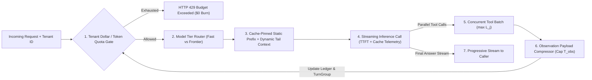
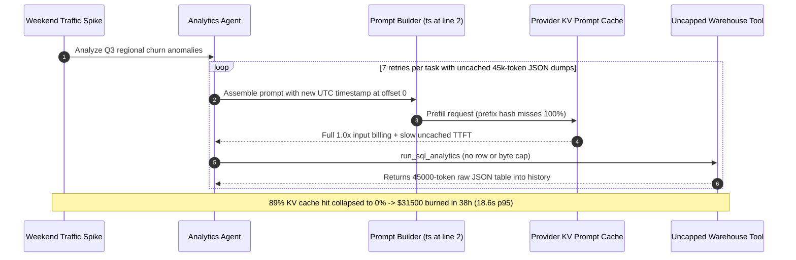

# Module 16: Cost and Latency Control in Agents

> **Prerequisites:** [Module 02: The ReAct Loop](../02-the-react-loop/README.md), [Module 07: The Agent Loop: Termination and Limits](../07-the-agent-loop-termination-and-limits/README.md), [Module 14: An Agent Design Pattern Catalog](../14-an-agent-design-pattern-catalog/README.md), and [Module 15: Agent Failure Modes and Debugging](../15-agent-failure-modes-and-debugging/README.md).  
> **Estimated Reading Time:** 35 minutes  
> **Target Audience:** AI Backend Engineers, FinOps / LLMOps Architects, Inference Infrastructure Engineers

> [!TIP]
> **The Golden Rule of Agent Economics:** Never scale an agent loop on raw unpruned observations or inject dynamic timestamps at the start of your system prompt. Pin an **immutable static prefix** (`system_prompt + sorted_tool_schemas`) for KV prompt caching, compress every tool observation to a hard token ceiling, dispatch independent tools in parallel, route simple turns to small models, and enforce hard per-request and per-tenant dollar quotas before every inference call.

---

## Why This Matters

In a single-turn RAG chatbot, passing `2,000` extra input tokens happens once and costs fractions of a cent. In a multi-step agent loop, every unpruned message and verbose tool response stays inside the conversation array and gets **re-prefilled from scratch on every subsequent step**. A single raw `SELECT *` JSON dump or HTML scrape injected at step `1` is re-billed and re-computed on steps `2, 3, ..., k`—turning linear step growth into **quadratic $O(k^2)$ token spend and tail latency**.

Meanwhile, a seemingly harmless engineering convenience—putting `Current time: 2026-11-11T08:00:00Z` or `trace_id` on line 2 of the system prompt—silently invalidates provider KV prompt caches (`85%` hit rate drops to `0%`), erasing `75%–90%` cache-read discounts and multiplying Time-to-First-Token (`TTFT`). Controlling agent unit economics requires treating tokens, KV cache prefixes, model tiers, concurrency, and tenant budgets as first-class distributed systems primitives.

---

## 1. Quantitative Cost & Latency Mechanics

### The $O(k^2)$ ReAct Token Growth Law

Suppose an agent begins at turn $t = 0$ with a base prompt of $P_0 = P_{\text{sys}} + P_{\text{tools}} + P_{\text{query}}$ tokens, and each completed turn appends $\Delta = O_{\text{act}} + O_{\text{obs}}$ tokens (model action/reasoning plus tool observation) to the conversation history. At step $t \in \{0, 1, \dots, k - 1\}$, the prompt sent to the LLM contains $I_t = P_0 + t \cdot \Delta$ input tokens.

Summing across all $k$ turns yields the exact cumulative input token count:

$$T_{\text{input}}(k) = \sum_{t=0}^{k-1} (P_0 + t \cdot \Delta) = k P_0 + \frac{k(k - 1)}{2}\Delta$$

Adding $k \cdot O_{\text{act}}$ generated output tokens gives total processed tokens:

$$T_{\text{total}}(k) = k(P_0 + O_{\text{act}}) + \frac{k(k - 1)}{2}\Delta$$

Consider concrete production numbers: with $P_0 = 2{,}500$, $O_{\text{act}} = 200$, and an uncompressed tool payload $O_{\text{obs}} = 1{,}600$ ($\Delta = 1{,}800$), a **`10`-step agent run processes**:

$$T_{\text{input}}(10) = 10(2{,}500) + \frac{10 \times 9}{2}(1{,}800) = 25{,}000 + 81{,}000 = 106{,}000 \text{ input tokens}$$

Notice that `76.4%` of all billed input tokens come purely from the quadratic $\frac{k(k-1)}{2}\Delta$ term! Compressing $O_{\text{obs}}$ from `1,600` to `300` tokens (`\Delta = 500`) immediately slashes $T_{\text{input}}(10)$ from `106,000` down to `47,500`—before prompt caching even kicks in.

### Prompt-Cache Prefix Stability & Effective Billed Cost

Modern inference engines (OpenAI automatic prompt caching, Anthropic `cache_control` breakpoints, vLLM Prefix Caching) retain computed Key-Value (`KV`) attention tensors in GPU HBM when the **byte-exact leading token prefix** matches a recent request. Let $\alpha_{\text{cache}} \in [0.10, 0.25]$ denote the discounted cache-read price multiplier (`90%` discount at $\alpha_{\text{cache}} = 0.10$). Over an append-only $k$-step trajectory with compressed $\Delta_{\text{comp}}$:

- Only the *initial* $P_0$ plus the *newly appended* $(k - 1)\Delta_{\text{comp}}$ tokens pay full uncached prefill price ($1.0\times$).
- All previously seen prefix tokens $T_{\text{cached}}(k) = T_{\text{input}}(k) - \bigl(P_0 + (k - 1)\Delta_{\text{comp}}\bigr)$ hit the KV cache at $\alpha_{\text{cache}}$:

$$T_{\text{effective\_input}}(k) = \bigl(P_0 + (k - 1)\Delta_{\text{comp}}\bigr) + \alpha_{\text{cache}} \cdot \Bigl[(k - 1)P_0 + \frac{(k - 1)(k - 2)}{2}\Delta_{\text{comp}}\Bigr]$$

Crucially, **one single byte mutation at offset `0` of the prefix** (e.g., an incrementing timestamp, random UUID, or unsorted JSON tool schema dictionary) forces $T_{\text{cached}}(k) = 0$ and eliminates the entire discount.

### End-to-End Agent Latency & Streaming TTFT

Total wall-clock latency across $k$ turns depends on uncached prefill (`TTFT`), decode speed $R_{\text{tok/s}}$, and whether tools execute sequentially or concurrently:

$$L_{\text{agent}} = \sum_{t=0}^{k-1} \left( L_{\text{TTFT}}(I_t^{\text{uncached}}) + \frac{O_{\text{act}, t}}{R_{\text{tok/s}}} + \max_{j \in \text{batch}_t} L_{\text{tool}, j} \right)$$



---

## 2. Systematic Comparison Matrix: Cost & Latency Control Levers

| Control Lever | Typical Token / Cost Reduction | Wall-Latency Impact | Implementation Complexity | Accuracy / Quality Risk | Primary Failure Mode if Misconfigured |
| :--- | :--- | :--- | :--- | :--- | :--- |
| **1. KV Prompt-Cache Pinning** | `45%–80%` input spend reduction on multi-turn loops | `2x–4x` lower `TTFT` on cached turns | Low (move dynamic state to suffix + sort tools) | Zero (bit-exact attention equivalence) | Injecting timestamps, request IDs, or shuffled schemas inside prefix drops hit rate to `0%` |
| **2. Observation Payload Compression** | `50%–85%` cumulative token reduction via $\Delta$ shrinkage | Lower `TTFT` and prevents context-overflow trims | Medium (field allowlisting + artifact spillover) | Moderate if critical status flags are stripped | Dropping `error_code` or pagination `next_cursor` triggers `FM-1`/`FM-2` loops |
| **3. Model Routing & Cascading** | `60%–90%` savings on triage, parsing, and simple lookups | `2x–5x` faster `TTFT` & higher `tok/s` on small tiers | Medium (classifier + fallback escalation rule) | Low when hard synthesis stays on frontier tier | Over-routing complex multi-constraint reasoning to weak small models |
| **4. Parallel / Speculative Tool Execution** | `0%` direct token savings (can reduce intermediate turns) | `2x–6x` lower tool-wait wall time ($\max L_j$ vs $\sum L_j$) | Low–Medium (`errgroup` / `Promise.all` / `asyncio.gather`) | Low (only parallelize independent reads) | Running dependent or conflicting mutations concurrently creates race conditions |
| **5. Sliding History Compaction** | Caps max context growth at $O(1)$ window beyond step $W$ | Stabilizes late-turn `TTFT` on `20+` step jobs | High (requires atomic `TurnGroup` + summary) | Moderate (lossy abstraction over early facts) | Splitting `tool_call_id` pairs (`FM-3`) or breaking KV cache prefix continuously |
| **6. Per-Request & Per-Tenant Quotas** | Caps worst-case tail burn (`100%` runaway protection) | Prevents queue starvation across noisy neighbors | Low (integer microdollar ledger pre-check) | None when sized for p99 legitimate jobs | Setting overly tight caps mid-transaction without clean partial-state handoff |

---

## 3. Production War Story Post-Mortem: The \$31,500 Cache-Busting Timestamp & SQL Dump Meltdown

| Field | Incident Details |
| :--- | :--- |
| **Severity** | **SEV-1** (Weekend FinOps Spend Spike & `p95` Latency SLA Breach) |
| **Detection / Resolution Time** | Detected 38 hours after Friday deploy via provider spend anomaly alert / Mitigated in 75 minutes via prefix pinning + SQL row-cap hotfix |
| **Impact** | **\$31,500** unexpected API bill over 38 hours; cost per task jumped `48x` (\$0.04 -> \$1.92); `p95` latency degraded from `4.1s` to `18.6s` |

### What Happened

An internal Revenue Ops analytics agent answered Slack data questions by generating warehouse queries via `run_sql_analytics` and summarizing metrics. On Friday afternoon, two seemingly minor changes shipped together:

1. **Prefix-Busting Observability Header:** An engineer injected `"Current UTC Timestamp: {iso_now} | Slack Trace ID: {uuid}"` at line `2` of the system prompt (`offset 0`) to help the model understand `"today"`. Every single inference turn now had a unique leading string, plummeting KV prompt-cache hit rates from `89%` to `0%`.
2. **Uncapped SQL Observation Payloads:** The `run_sql_analytics` tool executed arbitrary `SELECT` queries without forcing `LIMIT 25` or trimming columns, returning up to `45,000` tokens of raw wide-table JSON rows directly into scratchpad history whenever an analyst asked an open question.
3. **Quadratic Retry Amplification:** When the model spotted formatting issues or missing columns, it retried `run_sql_analytics` `6`–`8` times—re-prefilling uncached `45,000+`-token SQL dumps on every turn at full `1.0x` input rates.



### Root Cause Analysis

- **Dynamic Metadata Inside Static Prefix:** Placing mutable timestamps and trace IDs before static instructions and tool JSON schemas invalidated the entire KV cache prefix on every turn.
- **Unbounded Tool Observations ($\Delta$ Uncapped):** Letting a raw database tool emit unbounded JSON directly into LLM message history triggered severe $O(k^2)$ token explosion (`Module 15` `FM-2` + quadratic prefill cost).

### The Fix & Architectural Hardening

- **Immutable Prefix + Tail `<runtime_context>`:** Moved `current_date` (day granularity, not millisecond!) and `trace_id` to a dynamic suffix placed *after* the pinned static system prompt and canonically sorted tool schemas, restoring `87%` KV cache hits.
- **Observation Compressor & Artifact Spillover:** Capped inline SQL observations at `25` rows / `1,200` tokens (`truncated: true`, `artifact_id`), storing full CSVs in object storage while giving the model column summaries + `query_artifact` slicing.
- **Microdollar Quota Ledger & Tiered Routing:** Enforced hard **\$0.25/run** and per-tenant daily sliding-window dollar caps alongside a fast router model for simple metadata lookups.

---

## 4. Multi-Language Production Implementation: Cache-Stable Prompt, Compressor, Quota Ledger & Parallel Tools

Below is a cohesive **Cost & Latency Control Engine** across **Go**, **TypeScript**, **Python**, and **C#** implementing: (1) **Cache-Stable Prefix Assembly**, (2) **Observation Payload Compression**, (3) **Integer Microdollar Tenant Quota Ledger + Tiered Model Router**, and (4) **Parallel Tool Batch Execution**.

````carousel

```go
package agentfinops

import (
	"context"
	"crypto/sha256"
	"encoding/hex"
	"errors"
	"fmt"
	"sort"
	"strings"
	"sync"
)

type ModelTier string

const (
	TierFast     ModelTier = "fast-mini"
	TierFrontier ModelTier = "frontier-pro"
)

type CacheStablePrompt struct {
	StaticPrefix     string // Pinned: System rules + canonically sorted tool schemas
	StaticPrefixHash string
	DynamicSuffix    string // Dynamic: Runtime timestamp, trace_id, turn history
}

// BuildCacheStablePrompt pins static rules & sorted schemas at offset 0 for maximum KV hits.
func BuildCacheStablePrompt(systemRules string, toolSchemas map[string]string, runtimeMeta, query string) CacheStablePrompt {
	names := make([]string, 0, len(toolSchemas))
	for k := range toolSchemas {
		names = append(names, k)
	}
	sort.Strings(names)

	var sb strings.Builder
	sb.WriteString(systemRules)
	sb.WriteString("\n<tools>\n")
	for _, name := range names {
		sb.WriteString(fmt.Sprintf("%s:%s\n", name, toolSchemas[name]))
	}
	sb.WriteString("</tools>")
	prefix := sb.String()
	sum := sha256.Sum256([]byte(prefix))

	suffix := fmt.Sprintf("<runtime_context>\n%s\n</runtime_context>\n<query>%s</query>", runtimeMeta, query)
	return CacheStablePrompt{
		StaticPrefix:     prefix,
		StaticPrefixHash: hex.EncodeToString(sum[:6]),
		DynamicSuffix:    suffix,
	}
}

// CompressObservation caps tool payloads by char/token proxy while keeping truncation hints.
func CompressObservation(raw string, maxChars int) string {
	if len(raw) <= maxChars {
		return raw
	}
	head := raw[:maxChars]
	return fmt.Sprintf("%s\n...[TRUNCATED total_chars=%d kept=%d; narrow query filters]", head, len(raw), maxChars)
}

func RouteModelTier(needsDeepSynthesis bool, stepIdx int) ModelTier {
	if !needsDeepSynthesis && stepIdx == 0 {
		return TierFast
	}
	return TierFrontier
}

// QuotaLedger tracks exact microdollars (1 USD = 1,000,000 microdollars) avoiding float drift.
type QuotaLedger struct {
	mu           sync.Mutex
	tenantLimit  map[string]int64
	tenantSpent  map[string]int64
}

func NewQuotaLedger(defaultMicroUSD int64) *QuotaLedger {
	return &QuotaLedger{
		tenantLimit: map[string]int64{"default": defaultMicroUSD},
		tenantSpent: map[string]int64{},
	}
}

func (q *QuotaLedger) Reserve(tenantID string, estMicroUSD int64) error {
	q.mu.Lock()
	defer q.mu.Unlock()
	limit, ok := q.tenantLimit[tenantID]
	if !ok {
		limit = q.tenantLimit["default"]
	}
	if q.tenantSpent[tenantID]+estMicroUSD > limit {
		return fmt.Errorf("tenant %s quota exceeded (spent=%d est=%d limit=%d microUSD)", tenantID, q.tenantSpent[tenantID], estMicroUSD, limit)
	}
	q.tenantSpent[tenantID] += estMicroUSD
	return nil
}

// ExecuteToolsParallel bounds wall latency to max(tool_j) instead of sum(tool_j).
func ExecuteToolsParallel(ctx context.Context, calls []string, fn func(context.Context, string) (string, error)) ([]string, error) {
	results := make([]string, len(calls))
	errs := make([]error, len(calls))
	var wg sync.WaitGroup
	for i, c := range calls {
		wg.Add(1)
		go func(idx int, call string) {
			defer wg.Done()
			results[idx], errs[idx] = fn(ctx, call)
		}(i, c)
	}
	wg.Wait()
	for _, err := range errs {
		if err != nil {
			return nil, errors.Join(errs...)
		}
	}
	return results, nil
}
```

<!-- slide -->

```typescript
import { createHash } from "node:crypto";

export type ModelTier = "fast-mini" | "frontier-pro";

export interface CacheStablePrompt {
  readonly staticPrefix: string;
  readonly staticPrefixHash: string;
  readonly dynamicSuffix: string;
}

export function buildCacheStablePrompt(
  systemRules: string,
  toolSchemas: Readonly<Record<string, string>>,
  runtimeMeta: string,
  query: string,
): CacheStablePrompt {
  const sortedSchemas = Object.keys(toolSchemas)
    .sort()
    .map((k) => `${k}:${toolSchemas[k]}`)
    .join("\n");

  const staticPrefix = `${systemRules}\n<tools>\n${sortedSchemas}\n</tools>`;
  const staticPrefixHash = createHash("sha256").update(staticPrefix).digest("hex").slice(0, 12);
  const dynamicSuffix = `<runtime_context>\n${runtimeMeta}\n</runtime_context>\n<query>${query}</query>`;

  return { staticPrefix, staticPrefixHash, dynamicSuffix };
}

export function compressObservation(raw: string, maxChars = 4800): string {
  if (raw.length <= maxChars) return raw;
  return `${raw.slice(0, maxChars)}\n...[TRUNCATED total_chars=${raw.length} kept=${maxChars}; use narrower filters]`;
}

export function routeModelTier(needsDeepSynthesis: boolean, stepIdx: number): ModelTier {
  return !needsDeepSynthesis && stepIdx === 0 ? "fast-mini" : "frontier-pro";
}

export class MicroDollarQuotaLedger {
  private readonly spent = new Map<string, number>();

  constructor(private readonly defaultLimitMicroUsd: number) {}

  reserve(tenantId: string, estMicroUsd: number, customLimitMicroUsd?: number): void {
    const limit = customLimitMicroUsd ?? this.defaultLimitMicroUsd;
    const current = this.spent.get(tenantId) ?? 0;
    if (current + estMicroUsd > limit) {
      throw new Error(`Tenant ${tenantId} budget exceeded (${current} + ${estMicroUsd} > ${limit} microUSD)`);
    }
    this.spent.set(tenantId, current + estMicroUsd);
  }
}

export async function executeToolsParallel<T>(
  calls: readonly string[],
  runner: (call: string) => Promise<T>,
): Promise<T[]> {
  return Promise.all(calls.map((c) => runner(c)));
}
```

<!-- slide -->

```python
"""
agent_finops.py
Cache-stable prompt pinning, observation compression, microdollar tenant quotas, and parallel tool batching.
"""
from concurrent.futures import ThreadPoolExecutor
from dataclasses import dataclass
import hashlib
import threading
from typing import Callable, Mapping, Sequence


@dataclass(frozen=True)
class CacheStablePrompt:
    static_prefix: str
    static_prefix_hash: str
    dynamic_suffix: str


def build_cache_stable_prompt(
    system_rules: str,
    tool_schemas: Mapping[str, str],
    runtime_meta: str,
    query: str,
) -> CacheStablePrompt:
    schema_lines = "\n".join(f"{name}:{tool_schemas[name]}" for name in sorted(tool_schemas))
    static_prefix = f"{system_rules}\n<tools>\n{schema_lines}\n</tools>"
    prefix_hash = hashlib.sha256(static_prefix.encode("utf-8")).hexdigest()[:12]
    dynamic_suffix = f"<runtime_context>\n{runtime_meta}\n</runtime_context>\n<query>{query}</query>"
    return CacheStablePrompt(
        static_prefix=static_prefix,
        static_prefix_hash=prefix_hash,
        dynamic_suffix=dynamic_suffix,
    )


def compress_observation(raw: str, max_chars: int = 4800) -> str:
    if len(raw) <= max_chars:
        return raw
    return (
        f"{raw[:max_chars]}\n"
        f"...[TRUNCATED total_chars={len(raw)} kept={max_chars}; add filter or pagination cursor]"
    )


def route_model_tier(needs_deep_synthesis: bool, step_idx: int) -> str:
    return "fast-mini" if (not needs_deep_synthesis and step_idx == 0) else "frontier-pro"


class MicroDollarQuotaLedger:
    def __init__(self, default_limit_micro_usd: int) -> None:
        self._default_limit = default_limit_micro_usd
        self._spent: dict[str, int] = {}
        self._lock = threading.Lock()

    def reserve(self, tenant_id: str, est_micro_usd: int, limit_override: int | None = None) -> int:
        limit = limit_override if limit_override is not None else self._default_limit
        with self._lock:
            current = self._spent.get(tenant_id, 0)
            if current + est_micro_usd > limit:
                raise PermissionError(
                    f"Quota exceeded for tenant={tenant_id}: {current + est_micro_usd} > {limit} microUSD"
                )
            self._spent[tenant_id] = current + est_micro_usd
            return self._spent[tenant_id]


def execute_tools_parallel(calls: Sequence[str], fn: Callable[[str], str]) -> list[str]:
    if not calls:
        return []
    with ThreadPoolExecutor(max_workers=min(8, len(calls))) as pool:
        return list(pool.map(fn, calls))
```

<!-- slide -->

```csharp
using System;
using System.Collections.Concurrent;
using System.Collections.Generic;
using System.Linq;
using System.Security.Cryptography;
using System.Text;
using System.Threading;
using System.Threading.Tasks;

namespace GenAI.AgentFinOps;

public sealed record CacheStablePrompt(
    string StaticPrefix,
    string StaticPrefixHash,
    string DynamicSuffix);

public sealed class MicroDollarQuotaLedger
{
    private readonly long _defaultLimitMicroUsd;
    private readonly ConcurrentDictionary<string, long> _spent = new(StringComparer.Ordinal);
    private readonly object _gate = new();

    public MicroDollarQuotaLedger(long defaultLimitMicroUsd) => _defaultLimitMicroUsd = defaultLimitMicroUsd;

    public long Reserve(string tenantId, long estMicroUsd, long? customLimit = null)
    {
        long limit = customLimit ?? _defaultLimitMicroUsd;
        lock (_gate)
        {
            long current = _spent.GetValueOrDefault(tenantId, 0);
            if (current + estMicroUsd > limit)
                throw new InvalidOperationException($"Tenant {tenantId} budget exceeded ({current + estMicroUsd} > {limit} microUSD).");
            long updated = current + estMicroUsd;
            _spent[tenantId] = updated;
            return updated;
        }
    }
}

public static class AgentCostLatencyControls
{
    public static CacheStablePrompt BuildCacheStablePrompt(
        string systemRules,
        IReadOnlyDictionary<string, string> toolSchemas,
        string runtimeMeta,
        string query)
    {
        var sortedSchemas = string.Join("\n", toolSchemas.OrderBy(kv => kv.Key, StringComparer.Ordinal).Select(kv => $"{kv.Key}:{kv.Value}"));
        string prefix = $"{systemRules}\n<tools>\n{sortedSchemas}\n</tools>";
        string hash = Convert.ToHexString(SHA256.HashData(Encoding.UTF8.GetBytes(prefix)))[..12].ToLowerInvariant();
        string suffix = $"<runtime_context>\n{runtimeMeta}\n</runtime_context>\n<query>{query}</query>";
        return new CacheStablePrompt(prefix, hash, suffix);
    }

    public static string CompressObservation(string raw, int maxChars = 4800) =>
        raw.Length <= maxChars
            ? raw
            : $"{raw[..maxChars]}\n...[TRUNCATED total_chars={raw.Length} kept={maxChars}; apply tighter filter]";

    public static string RouteModelTier(bool needsDeepSynthesis, int stepIdx) =>
        !needsDeepSynthesis && stepIdx == 0 ? "fast-mini" : "frontier-pro";

    public static Task<string[]> ExecuteToolsParallelAsync(
        IEnumerable<string> calls,
        Func<string, CancellationToken, Task<string>> runnerAsync,
        CancellationToken ct = default) =>
        Task.WhenAll(calls.Select(c => runnerAsync(c, ct)));
}
```

````

---

## 5. Practical Hands-On Verification CLI Workflows

Run these deterministic Python 3.13 verification scripts offline—zero third-party dependencies or API keys needed.

### Workflow 1: Verify the $O(k^2)$ Formula vs. Observation Compression + KV Caching Savings

Assert step-by-step input summation matches the closed-form $T_{\text{input}}(k) = k P_0 + \frac{k(k-1)}{2}\Delta$ across $k \in \{2, 5, 10, 15\}$ and quantify combined compression (`1,600 -> 300` obs tokens) + `90%`-discounted KV prompt caching:

```bash
python -c '
P0 = 2500
OUT_PER_STEP = 200
OBS_RAW = 1600
OBS_COMPRESSED = 300
IN_PRICE_PER_M = 3.00
CACHE_READ_ALPHA = 0.10
OUT_PRICE_PER_M = 15.00

for k in (2, 5, 10, 15):
    delta_raw = OUT_PER_STEP + OBS_RAW
    iter_sum = sum(P0 + t * delta_raw for t in range(k))
    formula_sum = k * P0 + (k * (k - 1) // 2) * delta_raw
    assert iter_sum == formula_sum
    raw_cost = (formula_sum * IN_PRICE_PER_M + k * OUT_PER_STEP * OUT_PRICE_PER_M) / 1_000_000

    delta_comp = OUT_PER_STEP + OBS_COMPRESSED
    comp_total_in = k * P0 + (k * (k - 1) // 2) * delta_comp
    uncached_in = P0 + (k - 1) * delta_comp
    cached_in = comp_total_in - uncached_in
    opt_cost = ((uncached_in + CACHE_READ_ALPHA * cached_in) * IN_PRICE_PER_M + k * OUT_PER_STEP * OUT_PRICE_PER_M) / 1_000_000
    saved = (1.0 - opt_cost / raw_cost) * 100
    print(f"k={k:>2} | raw_in={formula_sum:>7,} (${raw_cost:.4f}) | comp+cache_eff_in={int(uncached_in + CACHE_READ_ALPHA * cached_in):>6,} (${opt_cost:.4f}) | saved={saved:.1f}%")
'
```

**Expected Output:**

```text
k= 2 | raw_in=  6,800 ($0.0264) | comp+cache_eff_in= 3,250 ($0.0158) | saved=40.3%
k= 5 | raw_in= 30,500 ($0.1065) | comp+cache_eff_in= 5,800 ($0.0324) | saved=69.6%
k=10 | raw_in=106,000 ($0.3480) | comp+cache_eff_in=11,050 ($0.0631) | saved=81.9%
k=15 | raw_in=226,500 ($0.7245) | comp+cache_eff_in=17,550 ($0.0977) | saved=86.5%
```

### Workflow 2: Prompt-Cache Prefix Stability Simulator

Verify why injecting a changing timestamp at offset `0` drops KV cache hits to `0.0%` across a `6`-turn trajectory while moving dynamic variables to the tail `<runtime_context>` achieves `83.3%` prefix reuse (`5/6` hits after initial turn `0` warm-up):

```bash
python -c '
import hashlib

static_sys = "ROLE: Production SRE Agent. RULES: Cite IDs. TOOLS: [query_logs, get_metrics, restart_pod]."

def sim_prefix_cache(inject_ts_at_start):
    seen_prefixes = set()
    hits = 0
    turns = 6
    for t in range(turns):
        ts = f"2026-11-11T08:00:0{t}Z"
        if inject_ts_at_start:
            prefix = f"ts={ts}\n{static_sys}"
        else:
            prefix = static_sys
        phash = hashlib.sha256(prefix.encode()).hexdigest()[:12]
        is_hit = phash in seen_prefixes
        seen_prefixes.add(phash)
        if is_hit:
            hits += 1
    return hits, turns, (hits / turns) * 100

h_bad, n_bad, pct_bad = sim_prefix_cache(True)
h_good, n_good, pct_good = sim_prefix_cache(False)
print(f"Anti-pattern (ts in prefix)  : hits={h_bad}/{n_bad} ({pct_bad:.1f}%)")
print(f"Pinned prefix + tail runtime : hits={h_good}/{n_good} ({pct_good:.1f}%)")
'
```

**Expected Output:**

```text
Anti-pattern (ts in prefix)  : hits=0/6 (0.0%)
Pinned prefix + tail runtime : hits=5/6 (83.3%)
```

### Workflow 3: Tiered Model Cascade + Parallel Tool Batching Sweep

Compare sequential frontier-only execution against a fast-model planner + parallel `6`-tool dispatch + single frontier synthesis call:

```bash
python -c '
tools_ms = [320, 410, 280, 520, 390, 450]

seq_llm_calls = 7
seq_llm_ms = seq_llm_calls * 950
seq_tools_ms = sum(tools_ms)
seq_wall = seq_llm_ms + seq_tools_ms
seq_cost = (7 * 4500 * 3.00 + 7 * 220 * 15.00) / 1_000_000

opt_llm_ms = 280 + 950
opt_tools_ms = max(tools_ms)
opt_wall = opt_llm_ms + opt_tools_ms
opt_cost = ((2500 * 0.15 + 240 * 0.60) + (4200 * 3.00 + 380 * 15.00)) / 1_000_000

print(f"Frontier-Sequential : wall={seq_wall:>5} ms | cost=${seq_cost:.4f}")
print(f"Cascade+Parallel    : wall={opt_wall:>5} ms | cost=${opt_cost:.4f}")
print(f"Speedup / Savings   : {seq_wall / opt_wall:.2f}x faster | {(1.0 - opt_cost / seq_cost) * 100:.1f}% cheaper")
'
```

**Expected Output:**

```text
Frontier-Sequential : wall= 9020 ms | cost=$0.1176
Cascade+Parallel    : wall= 1750 ms | cost=$0.0188
Speedup / Savings   : 5.15x faster | 84.0% cheaper
```

### Hands-On Exercises

1. **Tool Schema Sorting Invariant:** Extend Workflow 2 to hash `json.dumps(tools_dict)` with random key insertion orders vs. `sort_keys=True`, proving unsorted schema serialization silently breaks KV cache hit rates across workers.
2. **Sliding-Window Microdollar Quota Test:** Modify `MicroDollarQuotaLedger` in your chosen language (`Go`, `TypeScript`, `Python`, or `C#`) to track a per-run cap (\$0.25) *and* a per-tenant daily cap (\$25.00), ensuring an attempted \$0.08 step when \$0.21 is already spent fails before calling the LLM API.
3. **Optional Live Prompt-Cache Telemetry Check (Requires API Key):** Send two sequential `2,000+`-token system-prompt requests to OpenAI or Anthropic (`usage.prompt_tokens_details.cached_tokens` / `usage.cache_read_input_tokens`) first with a dynamic timestamp at line 1 and then moved into the tail user message, and inspect the live API cache telemetry fields.

### Independent Challenge

A coding assistant agent edits a monorepo (`40` files) across `12` ReAct turns. Currently, `read_file` returns entire `1,200`-line files into message history, `run_tests` dumps full `3,000`-line verbose stack logs, and the agent updates a `"Step X of 12 | Elapsed: 14.2s"` counter inside its `system` message every turn. Its average task costs **\$0.69** and takes **52 seconds**. Design a 4-point optimization plan using the levers in this module to cut cost and latency by at least `70%` *without* lowering final test-pass accuracy.

<details><summary>Architectural Discussion</summary>

1. **Pin the Static Prefix (Eliminate Dynamic System Counter):** Move `"Step X | Elapsed"` out of the `system` message into the appended dynamic user/runtime suffix. Removing that per-turn mutation unlocks multi-turn KV prompt caching (`~80%–90%` cache hit rates across steps `1..11` at `0.1x` read pricing).
2. **Compress `read_file` & `run_tests` Observations:** Restrict `read_file` to targeted symbol/line ranges (`start_line`, `end_line`) plus outline maps rather than full `1,200`-line dumps, and parse `run_tests` to return only failing test names + last `30` relevant traceback lines (spilling full logs to an artifact file), shrinking $\Delta$ by `75%+` in the quadratic $\frac{k(k-1)}{2}\Delta$ term.
3. **Model Cascading & Parallel Reads:** Route initial file-search and symbol triage to a fast small model (`tier="fast-mini"`) and batch independent `read_file` calls in parallel (`max L_j`).
4. **Hard Budget & Streaming TTFT:** Stream reasoning/progress tokens immediately and enforce a per-run ceiling (\$0.15) to terminate thrashing loops early.

</details>

---

## 6. Common Mistakes & Troubleshooting

- **Injecting `datetime.now()`, `uuid4()`, or dynamic user memory at the start of the `system` prompt:** Any single changing character prior to your static rules and tool definitions busts the entire KV cache (`0%` hit rate). Keep `[static_system -> sorted_tool_schemas -> static_few_shots]` strictly immutable and append dynamic fields at the tail.
- **Using floating-point `float` arithmetic for real-time billing quotas:** Repeatedly adding `0.000013` across millions of calls accumulates IEEE-754 rounding drift. Store all token budgets and dollar caps as integer **microdollars** (`1 USD = 1_000_000`) or **microcents**.
- **Compressing tool JSON with naive substring slicing `raw[:500]` without preserving status keys:** Blind string truncation cuts mid-JSON (`SyntaxError` if parsed) or discards `"status": "error"` / `"next_cursor"` fields at the bottom of the object, causing `FM-2` silent misreads. Parse structured JSON first, prune verbose array bodies, and preserve metadata keys + truncation markers.
- **Parallelizing mutating or order-dependent tool calls (`create_order`, `apply_migration`):** Only dispatch concurrent read-only or provably independent tools in parallel (`Promise.all` / `errgroup`); serialize dependent state mutations.

---

## 7. Operational Validation Checkpoints & Checkpoint Quiz

### Operational Validation Checkpoints

<details><summary><strong>Checkpoint 1: Computing exact $O(k^2)$ token growth for an unpruned agent</strong></summary>

An uncached, unpruned ReAct agent starts with `P_0 = 3,000` input tokens and appends `Delta = 1,200` tokens (`action + raw observation`) after each completed step. Compute the exact total input tokens billed across a `k = 8` step run, and identify what fraction comes from the quadratic history growth term.

**Validation:** Applying $T_{\text{input}}(k) = k P_0 + \frac{k(k - 1)}{2}\Delta$:
- Linear base term: $8 \times 3{,}000 = 24{,}000$ tokens.
- Quadratic growth term: $\frac{8 \times 7}{2} \times 1{,}200 = 28 \times 1{,}200 = 33{,}600$ tokens.
- Total input tokens = $24{,}000 + 33{,}600 = 57{,}600$, of which $\frac{33{,}600}{57{,}600} = 58.3\%$ stems strictly from re-prefilling growing intermediate steps.

</details>

<details><summary><strong>Checkpoint 2: Debugging a `0%` KV prompt-cache hit rate in production</strong></summary>

Your team upgrades to a provider supporting automatic KV prompt caching for prefixes `>= 1,024` tokens. Your system prompt + `12` tool schemas total `2,800` tokens, yet provider telemetry shows `cached_tokens = 0` on `100%` of requests. List the three most common causes and how to inspect them.

**Validation:** Hash the exact serialized payload bytes sent to the API at `offset 0..2800` across two consecutive turns and diff them: (1) a dynamic variable (`timestamp`, `request_id`, user name, or RAG snippet) is placed *before* the static rules/tools; (2) tool schema dicts serialize with non-deterministic JSON key ordering across workers (`sort_keys=False`); or (3) a sliding-window history trimmer edits/summarizes an *early* message inside the cached prefix rather than evicting strictly behind a pinned prefix boundary.

</details>

<details><summary><strong>Checkpoint 3: Enforcing streaming TTFT & parallel batching without violating tool dependencies</strong></summary>

An agent emits `4` tool calls in one assistant turn: `get_user_profile(u1)`, `get_recent_orders(u1)`, `get_billing_ledger(u1)`, and `compute_refund_preview(order_id)` where the first three are independent reads and the fourth requires data returned by `get_recent_orders`. Can all 4 run in one `asyncio.gather` batch?

**Validation:** No—running `compute_refund_preview` concurrently before `get_recent_orders` completes either fails with a missing `order_id` or runs against stale data. Batch only the 3 independent read calls concurrently in turn `t` ($\max(L_1, L_2, L_3)$), pass their compressed results back, and execute `compute_refund_preview` in turn `t + 1` (or encode explicit DAG dependencies if using Plan-and-Execute).

</details>

### Checkpoint Quiz

1. Write the closed-form formula for cumulative input tokens $T_{\text{input}}(k)$ over $k$ unpruned ReAct steps starting at $P_0$ with step growth $\Delta$.
2. Why does placing `"Current date/time: {utc_now}"` on line 1 of a system prompt hurt both **cost** and **TTFT latency**?
3. When compressing a `20,000`-token SQL JSON payload down to `< 1,200` tokens, which metadata fields MUST remain intact?
4. Why should backend quota ledgers store budgets in **integer microdollars** rather than `float64` dollars?
5. On a `6`-tool investigation taking `400 ms` per tool call and `900 ms` per LLM turn, compare sequential ReAct wall latency (`7` LLM turns + `6` serial tools) versus `Fast Router + Parallel Tool Batch + Frontier Synthesis` (`2` LLM turns + `1` parallel batch).

<details><summary>Answers</summary>

1. $T_{\text{input}}(k) = k P_0 + \frac{k(k - 1)}{2}\Delta$.
2. Because changing even one token at the beginning of the prompt invalidates the KV cache for the entire prompt prefix (`0%` cache hits), forcing full `1.0x` input token billing and full prefill computation (`TTFT`) on every step.
3. Execution status (`ok`/`error`/`truncated`), total row/byte count (`total_rows`), schema/column headers, and any pagination cursor (`next_cursor` or `artifact_id`) so the model knows the result is partial and how to narrow its next query.
4. Integer microdollar math (`1 USD = 1,000,000 microUSD`) eliminates IEEE-754 floating-point accumulation drift and race-prone rounding errors during atomic quota reservations.
5. Sequential ReAct: `7 * 900 + 6 * 400 = 6,300 + 2,400 = 8,700 ms`. Cascade + Parallel: `2 * 900 + max(400) = 2,200 ms` (nearly `4x` faster, and even faster when the first router step uses a `~250 ms` small model!).

</details>

---

## Further Reading & Sources

- [OpenAI API Docs: Prompt Caching](https://platform.openai.com/docs/guides/prompt-caching) — automatic prefix matching thresholds, cache-read billing rules, and static-prefix ordering guidance.
- [Anthropic Docs: Prompt Caching](https://docs.anthropic.com/en/docs/build-with-claude/prompt-caching) — explicit `cache_control` breakpoints and multi-turn prefix reuse mechanics.
- [Anthropic Docs: Tool Use with Prompt Caching](https://docs.anthropic.com/en/docs/agents-and-tools/tool-use/tool-use-with-prompt-caching) — pinning tool definitions and system instructions stably across agent loops.
- [Module 07: The Agent Loop: Termination and Limits](../07-the-agent-loop-termination-and-limits/README.md) — hard iteration, wall-clock, and termination boundaries.
- [Module 15: Agent Failure Modes and Debugging](../15-agent-failure-modes-and-debugging/README.md) — ensuring compression and history trimming never trigger `FM-2` misreads or `FM-3` `tool_call_id` corruption.

## Next

[Module 17: Capstone Project](../17-capstone-project/README.md)
