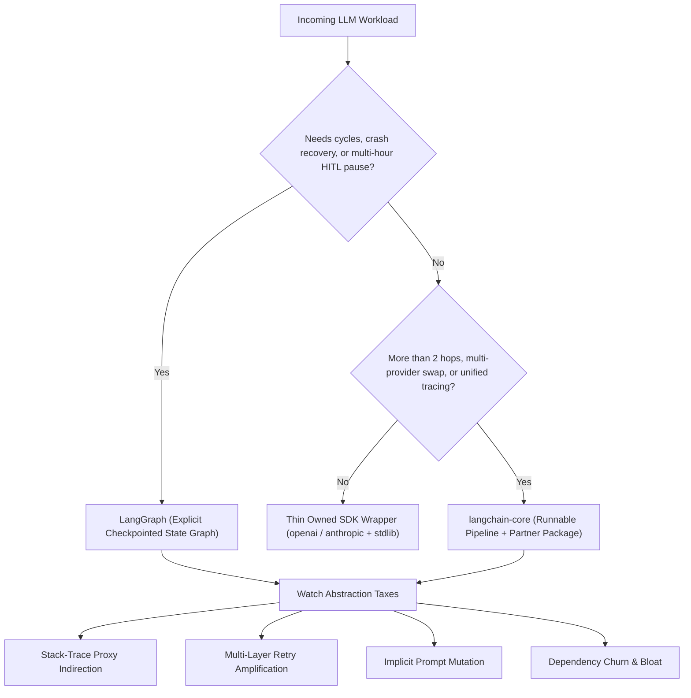
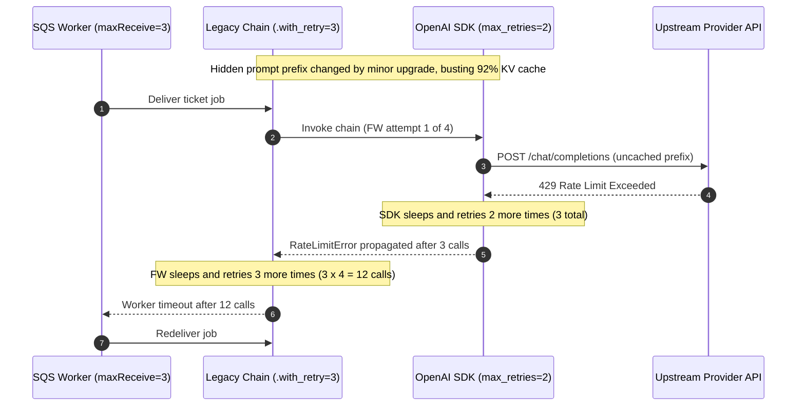

# Module 00: Why Frameworks Exist (and When to Skip Them)

> **Prerequisites:** [Track 10, Module 03: Building a ReAct Agent From Scratch](../../10-ai-agents/03-building-a-react-agent-from-scratch/README.md), [Track 06, Module 17: Provider Abstraction and Model Routing](../../06-openai-and-the-model-landscape/17-provider-abstraction-and-model-routing/README.md), and [Track 09, Module 01: Naive RAG End to End](../../09-retrieval-augmented-generation/01-naive-rag-end-to-end/README.md).  
> **Estimated Reading Time:** 32 minutes  
> **Target Audience:** AI Backend Engineers, Platform Architects, Production Systems Developers

> [!TIP]
> **The Golden Rule of LLM Frameworks:** Never adopt an orchestration framework out of habit—and never reject one out of dogma. Frameworks exist to eliminate **cross-cutting plumbing** (provider normalization, callback/trace propagation, streaming multiplexers, tool-schema compilation, and durable checkpointed state). Skip heavy frameworks for simple, latency-critical `1`-to-`2`-hop services where a `90`-line SDK wrapper wins on stack-trace clarity and p99 latency; adopt **explicit state-graph frameworks (`LangGraph`)** the moment workflows require cycles, multi-hour pause/resume durability, or human-in-the-loop (HITL) interrupts.

---

## Why This Matters

In Track 10, you built a complete ReAct tool-calling agent in roughly `120` lines of pure Python with zero orchestration libraries. That exercise exposed an uncomfortable engineering secret: calling an LLM API over HTTPS and dispatching JSON tool arguments does not inherently require a framework.

Yet in production teams, two opposite failure modes repeat constantly:

1. **Framework Over-Engineering:** A team builds a single-hop support ticket classifier (`1` prompt, `1` structured JSON response) inside three stacked layers of legacy chains, bloated document loaders, and implicit callback proxies. When OpenAI returns an HTTP `429` or `400`, engineers wade through a `45`-frame framework traceback while nested SDK + framework + worker retries silently trigger a `36x` request storm.
2. **Homegrown Framework Reinvention:** Another team bans all frameworks after reading a blog post, writes a thin `openai` wrapper, and six months later finds themselves poorly re-implementing LangChain's streaming chunk accumulator, OpenTelemetry parent-child span correlation across `8` parallel retrievers, Anthropic/Gemini tool-call normalizers, and PostgreSQL state-snapshot recovery for multi-step approval workflows.

Senior AI engineers evaluate frameworks as **cost-vs-leverage architectural boundaries**, asking precisely which cross-cutting problems justify the **abstraction tax** and where direct SDK code wins.

---

## 1. Architectural Mental Model: Leverage vs. The Abstraction Tax

LLM engineering frameworks sit on a complexity spectrum bounded by **workflow topology** (linear request-response vs. cyclic stateful graphs) and **operational requirements** (single-provider speed vs. multi-provider portability and durable checkpoints).



### What Frameworks Actually Buy You (Legitimate Engineering Value)

When teams adopt `langchain-core`, LlamaIndex, or LangGraph deliberately, they are buying four concrete infrastructural capabilities—not prompt magic:

1. **Unified Execution & Streaming Protocol:** One contract (`.invoke()`, `.ainvoke()`, `.stream()`, `.astream()`, `.batch()`) shared across prompt templates, chat models, retrievers, and parsers, plus automatic chunk merging (`AIMessageChunk`) during token streaming.
2. **Out-of-Band Trace & Callback Propagation:** Automatic `run_id` / `parent_run_id` tree propagation to LangSmith or OpenTelemetry across nested parallel branches without manually passing `trace_ctx` into every helper signature.
3. **Provider-Normalized Tool & Message Translation:** Compiling one Pydantic/Zod/JSON schema into OpenAI `tools`, Anthropic `input_schema`, or Gemini `function_declarations` and normalizing returned `usage_metadata` and `tool_calls`.
4. **Durable Checkpointed Graph Execution (`LangGraph`):** Persisting exact super-step snapshots to PostgreSQL/SQLite so a workflow that crashes at step `7`—or waits `14` hours for a manager's Slack approval—resumes cleanly without re-running steps `1`–`6`.

### The 4 Hidden Abstraction Taxes

Every layer between your application code and `httpx`/`fetch` imposes measurable engineering costs:

1. **Stack-Trace & Payload Obscurity:** A validation error inside an LCEL pipe (`prompt | model | parser`) wraps the underlying HTTP status or Pydantic failure inside internal dispatcher frames (`RunnableSequence._call_with_config`), slowing root-cause diagnosis during incidents unless raw HTTP payloads and trace spans are logged explicitly.
2. **Retry-Layer Duplication (`A_max` Multiplier):** Official provider SDKs enable retries by default (`openai` Python/TS SDK defaults to `max_retries=2`, i.e., `3` attempts). Wrapping that client inside framework `.with_retry()` (`3` attempts) behind a background queue worker (`3` job retries) multiplies upstream requests geometrically.
3. **Implicit Prompt & Schema Mutation:** Legacy high-level convenience chains (like early `RetrievalQA` or `AgentExecutor` prompts) silently prepend undocumented boilerplate strings (`"Use the following pieces of context..."`) or alter tool descriptions during upgrades—breaking byte-exact KV prompt caches and compliance wording.
4. **Dependency Churn & Container Bloat:** Installing monolithic wrapper metapackages pulls dozens of vector store clients, parsers, and transitive pins that widen CVE surface area and bloat serverless cold starts.

### Quantitative Mechanics: Retry Amplification & Net Framework ROI

#### 1. Worst-Case Retry Amplification Formula
Suppose your provider SDK retries $R_{\text{sdk}}$ times, your framework wrapper retries $R_{\text{fw}}$ times, and your outer API gateway or job worker retries $R_{\text{app}}$ times. Each logical caller request can emit up to:

$$A_{\max} = (1 + R_{\text{sdk}}) \cdot (1 + R_{\text{fw}}) \cdot (1 + R_{\text{app}})$$

With single-call request timeout $t_{\text{timeout}}$, initial backoff $b_0$, and backoff cap $c$, worst-case failure wall-clock hang time reaches:

$$T_{\text{fail}} \approx A_{\max} \cdot t_{\text{timeout}} + \sum_{i=1}^{A_{\max}-1} \min\!\left(c,\ b_0 \cdot 2^{\min(i-1,\, 6)}\right)$$

At `R_sdk = 2`, `R_fw = 3`, and `R_app = 2`, $A_{\max} = 3 \times 4 \times 3 = 36$ upstream calls for a single failed job—turning a transient `429` blip into a `13+` minute worker stall and a `36x` quota storm. **Rule:** Exactly *one* layer may own retries (`max_retries=0` everywhere underneath).

#### 2. Net Abstraction ROI & Complexity Decision Threshold
Model whether a framework generates net positive engineering leverage over a service's lifecycle:

$$\text{ROI}_{\text{fw}} = \left(\Delta T_{\text{boilerplate}} + \Delta T_{\text{tracing}} + \Delta T_{\text{portability}}\right) - \left(N_{\text{hops}} \cdot L_{\text{overhead}} + D_{\text{debug}} + M_{\text{upgrade}}\right)$$

- $\Delta T_{\text{boilerplate}}, \Delta T_{\text{tracing}}, \Delta T_{\text{portability}}$: engineering hours saved by standardized streaming, trace trees, and provider swaps.
- $N_{\text{hops}} \cdot L_{\text{overhead}}$: framework dispatch latency across $N_{\text{hops}}$ steps (typically `0.5–4 ms` per hop in Python—negligible next to `400–2000 ms` LLM inference, but non-zero for sub-`500 ms` guardrail classifiers).
- $D_{\text{debug}} + M_{\text{upgrade}}$: debugging overhead from proxy indirection plus breaking-change maintenance tax across minor releases.

**Practical Threshold Rule:**
- **Skip frameworks (Thin SDK Wrapper):** $N_{\text{hops}} \le 2$, stateless request-response, single provider (or simple routing), strict p99 `< 1,000 ms` SLA, no durable mid-run pause.
- **Adopt `langchain-core` (Modular Runnables):** $N_{\text{hops}} \ge 3$ linear/parallel DAGs, multi-provider model parity, unified token streaming + structured output + callback tracing.
- **Adopt `LangGraph` (State Graph):** Any workflow with conditional **cycles**, retry/reflection loops, parallel scatter-gather fan-out (`Send`), crash-safe **checkpointing**, or **Human-in-the-Loop (HITL)** pause/resume.

---

## 2. Systematic Comparison Matrix: Thin SDK vs. LangChain vs. LlamaIndex vs. LangGraph

| Dimension | Thin Raw SDK Wrapper (`openai` / `anthropic` + stdlib) | LangChain (`langchain-core` + Partner Packages) | LlamaIndex (Data & RAG Framework) | LangGraph (Stateful Graph Runtime) |
| :--- | :--- | :--- | :--- | :--- |
| **Primary Sweet Spot** | Single-hop classifiers, ultra-low-latency extractors, strict compliance gateways | Composable `Runnable` pipelines, multi-provider model/prompt/parser normalization | Document ingestion, hierarchical indexing, hybrid retrieval & query engines | Cyclic agents, durable multi-step workflows, HITL approvals, multi-agent systems |
| **State & Cycle Support** | Hand-written `while` loop (`Track 10` style); ephemeral in-RAM state | Linear/parallel DAGs (`LCEL`); awkward for arbitrary backward loops | Workflows API supports event-driven steps; core strength remains indexing/querying | Native `StateGraph` with typed reducers, conditional cycles, and `interrupt()` |
| **Stack-Trace Transparency** | **High** — direct HTTP client call stack and exact JSON payload | **Medium** — LCEL pipe frames wrap errors unless traced via LangSmith/OTel | **Medium** — pipeline/retriever abstractions hide prompt assembly by default | **High (per-node)** — explicit node boundaries + step-by-step state snapshots |
| **Implicit Prompt Mutation Risk** | **Zero** — you author every byte of `messages` | **Low** in `langchain-core`, **High** in legacy `langchain.chains` | **Medium-High** — default `Synthesizer` / `QueryEngine` templates pack hidden prompts | **Zero** — nodes explicitly build and pass messages in state |
| **Checkpointing & Durability** | Manual DB serialization at loop boundaries | None built into linear `Runnable` execution | Workflow context serialization available in newer versions | **First-class** — super-step checkpoints (`PostgresSaver`, `SqliteSaver`), time travel |
| **Dependency Footprint** | Minimal (`httpx` + `pydantic` + provider SDK, `< 40 MB`) | Lightweight if strictly `langchain-core` + `langchain-<provider>` | Moderate-to-heavy when pulling readers/connectors (`llama-index-core` + readers) | Lightweight (`langgraph` + `langchain-core`) |
| **Skip / Adopt Trigger** | **Adopt** for `<= 2` hops & `< 1s` SLA; **Skip** once building custom trace trees + HITL | **Adopt** for shared model/prompt/callback contracts; **Skip** legacy `langchain-community` bloat | **Adopt** for complex ingestion/tree-index RAG; **Skip** for general non-RAG tool workflows | **Adopt** when durability, cycles, or HITL matter; **Skip** for single-shot REST calls |

---

## 3. Production War Story Post-Mortem: The 36x Retry Storm & Silent Cache-Busting Upgrade

| Field | Incident Details |
| :--- | :--- |
| **Severity** | **SEV-1** (Service-Wide Queue Saturation + **\$14,200** Unbudgeted Weekend Token Spend) |
| **Detection / Resolution Time** | Detected 55 minutes after a minor framework bump + traffic spike / Mitigated in 2 hours (disabled inner SDK/FW retries + rolled back to explicit pinned messages) |
| **Impact** | `18,400` support triage jobs backed up in SQS dead-letter queue; upstream TPM quota throttled for `42` minutes; `92%` prompt cache hit rate collapsed to `0%` |

### What Happened

A SaaS operations team built an automated support ticket router using a legacy LangChain QA chain backed by `ChatOpenAI` inside an AWS SQS worker fleet. Three seemingly harmless defaults interacted catastrophically:

1. **Stacked Retry Defaults:** `ChatOpenAI` inherited `openai`'s default `max_retries=2` (`3` attempts), the pipeline engineer added `.with_retry(stop_after_attempt=3)` (`4` attempts) to "make it resilient," and the SQS consumer configured `maxReceiveCount=3` (`3` job deliveries).
2. **Minor Framework Upgrade Mutation:** During a Friday dependency update, a legacy high-level QA wrapper subtly altered two whitespace/wording lines in its internal built-in system prompt prefix before concatenating the company's `1,800`-token classification rubric.
3. **Cascade:** At 02:00 UTC Saturday, a brief `12`-second upstream `429 Rate Limit` event tripped worker timeouts. Instead of `3` clean retries per job, each failing ticket triggered up to $3 \times 4 \times 3 = 36$ upstream LLM calls, locking worker concurrency behind exponential backoffs and saturating TPM limits for `42` minutes. Simultaneously, the hidden prefix edit invalidated byte-exact prompt caching on every request for `48` hours, adding **\$14,200** in uncached prefill charges.



### Root Cause Analysis

- **Retry Ownership Ambiguity:** Three layers independently configured retries without disabling lower-layer retries (`max_retries=0`), causing multiplicative `36x` request amplification during partial brownouts.
- **Implicit Prompt Ownership:** Relying on an opaque legacy chain wrapper rather than an explicit, version-pinned `ChatPromptTemplate` hid a prefix mutation from CI diff review and broke KV prompt caching silently.
- **Missing Preflight Observability:** Neither stack-depth timeout budgets (`total_deadline_ms`) nor SHA-256 prompt-prefix digests were emitted in request telemetry.

### Architectural Hardening & Verified Fix

- **Enforced Single-Owner Retry Policy:** Set `max_retries=0` on both the HTTP/provider SDK client and any inner Runnable wrappers; delegated bounded retries (`max_attempts=3` with full jitter and `Retry-After` respect) exclusively to the outer resilient gateway/worker with a strict end-to-end deadline (`deadline_s=25`).
- **Replaced Opaque Legacy Chain with Explicit Contract:** Migrated off the legacy QA wrapper to an explicit `ChatPromptTemplate` with `langchain-core` (or thin direct SDK wrapper for single-hop routes) emitting a startup `prompt_prefix_sha256` metric and CI golden-hash test.
- **Upgraded Multi-Step Paths to `LangGraph`:** Any ticket workflow needing tool calls or manual escalation moved onto an explicit `StateGraph` with PostgreSQL checkpointing instead of opaque chain loops.

---

## 4. Multi-Language Production Implementation: Single-Owner Retry & Framework Boundary Guard

Across **Go**, **TypeScript**, **Python**, and **C#**, production teams enforce the same boundary guard around LLM calls: **disable nested inner retries**, enforce an **explicit wall-clock deadline**, verify **immutable prompt-prefix hashes** against accidental mutation, and route simple single-hop traffic through a **thin direct adapter** while escalating cyclic/durable traffic to a **state-graph engine**.

````carousel

```go
package llmboundary

import (
	"context"
	"crypto/sha256"
	"encoding/hex"
	"errors"
	"fmt"
	"math/rand"
	"time"
)

type ExecutionTier string

const (
	TierThinSDK   ExecutionTier = "THIN_SDK_WRAPPER"
	TierCorePipe  ExecutionTier = "CORE_COMPOSABLE_PIPELINE"
	TierStateGraph ExecutionTier = "DURABLE_STATE_GRAPH"
)

type WorkloadSpec struct {
	Hops           int
	NeedsCycles    bool
	NeedsHITLPause bool
	MultiProvider  bool
	P99SlaMs       int
}

func SelectArchitectureTier(w WorkloadSpec) ExecutionTier {
	if w.NeedsCycles || w.NeedsHITLPause {
		return TierStateGraph
	}
	if w.Hops <= 2 && w.P99SlaMs <= 1000 {
		return TierThinSDK
	}
	if w.MultiProvider || w.Hops >= 3 {
		return TierCorePipe
	}
	return TierThinSDK
}

var ErrRetryableUpstream = errors.New("retryable upstream 429/503")

// SingleOwnerCall enforces ONE retry owner (max_retries=0 inside provider client) and a hard deadline.
func SingleOwnerCall(
	ctx context.Context,
	expectedPrefixHash string,
	systemPrefix string,
	maxAttempts int,
	innerNoRetryCall func(context.Context, string) (string, error),
) (string, error) {
	sum := sha256.Sum256([]byte(systemPrefix))
	actualHash := hex.EncodeToString(sum[:8])
	if actualHash != expectedPrefixHash {
		return "", fmt.Errorf("prompt prefix drift detected: expected=%s got=%s", expectedPrefixHash, actualHash)
	}

	var lastErr error
	for attempt := 1; attempt <= maxAttempts; attempt++ {
		if ctx.Err() != nil {
			return "", ctx.Err()
		}
		out, err := innerNoRetryCall(ctx, systemPrefix)
		if err == nil {
			return out, nil
		}
		lastErr = err
		if !errors.Is(err, ErrRetryableUpstream) || attempt == maxAttempts {
			break
		}
		// Full jitter backoff capped at 2s; respects parent context deadline.
		backoff := time.Duration(100*(1<<(attempt-1))) * time.Millisecond
		if backoff > 2*time.Second {
			backoff = 2 * time.Second
		}
		jitter := time.Duration(rand.Int63n(int64(backoff)))
		select {
		case <-ctx.Done():
			return "", ctx.Err()
		case <-time.After(jitter):
		}
	}
	return "", fmt.Errorf("exhausted %d single-owner attempts: %w", maxAttempts, lastErr)
}
```

<!-- slide -->

```typescript
import { createHash } from "node:crypto";

export type ArchitectureTier =
  | "THIN_SDK_WRAPPER"
  | "LANGCHAIN_CORE_LCEL"
  | "LANGGRAPH_STATEFUL";

export interface WorkloadProfile {
  readonly hops: number;
  readonly needsCycles: boolean;
  readonly needsHitlPause: boolean;
  readonly multiProvider: boolean;
  readonly p99SlaMs: number;
}

export function chooseFrameworkTier(w: WorkloadProfile): ArchitectureTier {
  if (w.needsCycles || w.needsHitlPause) {
    return "LANGGRAPH_STATEFUL";
  }
  if (w.hops <= 2 && w.p99SlaMs <= 1000) {
    return "THIN_SDK_WRAPPER";
  }
  if (w.multiProvider || w.hops >= 3) {
    return "LANGCHAIN_CORE_LCEL";
  }
  return "THIN_SDK_WRAPPER";
}

export class RetryableUpstreamError extends Error {
  constructor(message: string) {
    super(message);
    this.name = "RetryableUpstreamError";
  }
}

export function computePrefixDigest(systemPrefix: string): string {
  return createHash("sha256").update(systemPrefix, "utf8").digest("hex").slice(0, 16);
}

/**
 * Single-owner retry guard: inner SDK client MUST be initialized with maxRetries: 0
 * (e.g., new ChatOpenAI({ maxRetries: 0, timeout: 10_000 })).
 */
export async function executeWithSingleRetryOwner<T>(
  systemPrefix: string,
  expectedPrefixDigest: string,
  maxAttempts: number,
  deadlineMs: number,
  innerNoRetryCall: (signal: AbortSignal) => Promise<T>,
): Promise<T> {
  const actual = computePrefixDigest(systemPrefix);
  if (actual !== expectedPrefixDigest) {
    throw new Error(`KV cache prefix mutated silently: expected=${expectedPrefixDigest}, actual=${actual}`);
  }

  const deadlineAt = Date.now() + deadlineMs;
  let lastError: unknown;

  for (let attempt = 1; attempt <= maxAttempts; attempt += 1) {
    const remaining = deadlineAt - Date.now();
    if (remaining <= 0) {
      throw new Error(`Deadline of ${deadlineMs}ms exceeded before attempt ${attempt}`);
    }
    const controller = new AbortController();
    const timer = setTimeout(() => controller.abort(), remaining);
    try {
      return await innerNoRetryCall(controller.signal);
    } catch (err) {
      lastError = err;
      const isRetryable = err instanceof RetryableUpstreamError;
      if (!isRetryable || attempt === maxAttempts) break;
      const capMs = Math.min(2000, 150 * 2 ** (attempt - 1));
      const sleepMs = Math.floor(Math.random() * capMs);
      if (Date.now() + sleepMs >= deadlineAt) break;
      await new Promise((r) => setTimeout(r, sleepMs));
    } finally {
      clearTimeout(timer);
    }
  }
  throw lastError instanceof Error ? lastError : new Error("Upstream call failed");
}
```

<!-- slide -->

```python
"""
framework_boundary.py
Single-owner retry guard, prefix-drift detector, and complexity-driven tier selector.
"""
from dataclasses import dataclass
import hashlib
import random
import time
from typing import Callable, Literal, TypeVar

T = TypeVar("T")
Tier = Literal["RAW_SDK_WRAPPER", "LANGCHAIN_CORE_LCEL", "LANGGRAPH_STATEFUL"]


class RetryableUpstreamError(RuntimeError):
    """Raised only on transient 429/503 responses from an inner client configured with max_retries=0."""


@dataclass(frozen=True)
class WorkloadProfile:
    hops: int
    needs_cycles: bool
    needs_hitl_pause: bool
    multi_provider: bool
    p99_sla_ms: int


def select_architecture_tier(w: WorkloadProfile) -> Tier:
    if w.needs_cycles or w.needs_hitl_pause:
        return "LANGGRAPH_STATEFUL"
    if w.hops <= 2 and w.p99_sla_ms <= 1000:
        return "RAW_SDK_WRAPPER"
    if w.multi_provider or w.hops >= 3:
        return "LANGCHAIN_CORE_LCEL"
    return "RAW_SDK_WRAPPER"


def prefix_digest(system_prefix: str) -> str:
    return hashlib.sha256(system_prefix.encode("utf-8")).hexdigest()[:16]


def run_single_retry_owner(
    system_prefix: str,
    expected_digest: str,
    inner_call_no_retry: Callable[[float], T],
    max_attempts: int = 3,
    total_deadline_s: float = 20.0,
) -> T:
    """Enforces byte-identical prompt prefix and guarantees <= max_attempts total upstream calls."""
    actual = prefix_digest(system_prefix)
    if actual != expected_digest:
        raise ValueError(f"Implicit prompt mutation detected: expected={expected_digest}, got={actual}")

    deadline = time.monotonic() + total_deadline_s
    last_exc: Exception | None = None

    for attempt in range(1, max_attempts + 1):
        remaining = deadline - time.monotonic()
        if remaining <= 0:
            raise TimeoutError(f"Total deadline {total_deadline_s:.1f}s exhausted")
        try:
            return inner_call_no_retry(remaining)
        except RetryableUpstreamError as exc:
            last_exc = exc
            if attempt == max_attempts:
                break
            cap_s = min(2.0, 0.15 * (2 ** (attempt - 1)))
            sleep_s = random.uniform(0.0, min(cap_s, max(0.0, deadline - time.monotonic())))
            time.sleep(sleep_s)

    assert last_exc is not None
    raise last_exc
```

<!-- slide -->

```csharp
using System;
using System.Security.Cryptography;
using System.Text;
using System.Threading;
using System.Threading.Tasks;

namespace GenAI.FrameworkBoundary;

public enum ArchitectureTier
{
    RawSdkWrapper,
    LangChainCorePipeline,
    DurableStateGraph
}

public sealed record WorkloadSpec(
    int Hops,
    bool NeedsCycles,
    bool NeedsHitlPause,
    bool MultiProvider,
    int P99SlaMs);

public sealed class RetryableUpstreamException : Exception
{
    public RetryableUpstreamException(string message) : base(message) { }
}

public static class BoundaryGuard
{
    public static ArchitectureTier SelectTier(WorkloadSpec w)
    {
        if (w.NeedsCycles || w.NeedsHitlPause) return ArchitectureTier.DurableStateGraph;
        if (w.Hops <= 2 && w.P99SlaMs <= 1000) return ArchitectureTier.RawSdkWrapper;
        if (w.MultiProvider || w.Hops >= 3) return ArchitectureTier.LangChainCorePipeline;
        return ArchitectureTier.RawSdkWrapper;
    }

    public static string ComputePrefixDigest(string systemPrefix)
    {
        var hash = SHA256.HashData(Encoding.UTF8.GetBytes(systemPrefix));
        return Convert.ToHexString(hash)[..16].ToLowerInvariant();
    }

    public static async Task<T> ExecuteSingleRetryOwnerAsync<T>(
        string systemPrefix,
        string expectedDigest,
        int maxAttempts,
        TimeSpan totalDeadline,
        Func<CancellationToken, Task<T>> innerNoRetryCall,
        CancellationToken outerCt = default)
    {
        var actual = ComputePrefixDigest(systemPrefix);
        if (!string.Equals(actual, expectedDigest, StringComparison.Ordinal))
        {
            throw new InvalidOperationException($"Prompt prefix mutated: expected={expectedDigest}, got={actual}");
        }

        using var deadlineCts = CancellationTokenSource.CreateLinkedTokenSource(outerCt);
        deadlineCts.CancelAfter(totalDeadline);

        Exception? last = null;
        for (int attempt = 1; attempt <= maxAttempts; attempt++)
        {
            try
            {
                return await innerNoRetryCall(deadlineCts.Token).ConfigureAwait(false);
            }
            catch (RetryableUpstreamException ex) when (attempt < maxAttempts && !deadlineCts.IsCancellationRequested)
            {
                last = ex;
                var capMs = Math.Min(2000, 150 * (1 << (attempt - 1)));
                var jitterMs = Random.Shared.Next(0, capMs + 1);
                await Task.Delay(jitterMs, deadlineCts.Token).ConfigureAwait(false);
            }
        }
        throw last ?? new InvalidOperationException("Upstream call failed without exception details.");
    }
}
```

````

---

## 5. Practical Hands-On Verification CLI Workflows

Run these deterministic Python 3.13 verification scripts offline—zero third-party packages or API keys required.

### Workflow 1: Quantify Stacked Retry Amplification vs. Single-Owner Policy

Calculate worst-case upstream API attempts and total stall duration when SDK, framework, and worker retries stack multiplicatively versus isolating retry ownership in one layer:

```bash
python -c '
def simulate_retry_storm(sdk_r, fw_r, worker_r, timeout_s=15.0, base_backoff_s=1.0, cap_s=8.0):
    attempts = (1 + sdk_r) * (1 + fw_r) * (1 + worker_r)
    total_wait = 0.0
    for i in range(1, attempts):
        total_wait += min(cap_s, base_backoff_s * (2 ** min(i - 1, 6)))
    worst_wall_s = attempts * timeout_s + total_wait
    return attempts, worst_wall_s

configs = [
    ("Stacked Defaults (SDK=2, FW=3, Worker=2)", 2, 3, 2),
    ("Partial Disable (SDK=2, FW=0, Worker=2)", 2, 0, 2),
    ("Single-Owner Retry (SDK=0, FW=0, Worker=2)", 0, 0, 2),
]

for label, s, f, w in configs:
    att, wall = simulate_retry_storm(s, f, w)
    print(f"{label:<44} | max_attempts={att:>2} | worst_hang={wall:>6.1f}s ({wall/60:.1f} min)")
'
```

**Expected Output:**

```text
Stacked Defaults (SDK=2, FW=3, Worker=2)     | max_attempts=36 | worst_hang= 803.0s (13.4 min)
Partial Disable (SDK=2, FW=0, Worker=2)      | max_attempts= 9 | worst_hang= 182.0s (3.0 min)
Single-Owner Retry (SDK=0, FW=0, Worker=2)   | max_attempts= 3 | worst_hang=  48.0s (0.8 min)
```

Notice how leaving `max_retries=2` enabled inside the underlying SDK triples worker failures (`9` attempts / `3.0 min`) even after removing the framework `.with_retry()` wrapper.

### Workflow 2: Evaluate Workload Fit Across Raw SDK, `langchain-core`, and `LangGraph`

Apply an explicit complexity decision threshold across four realistic microservice workloads:

```bash
python -c '
def decide_stack(name, hops, needs_cycles, needs_hitl_pause, p99_sla_ms, multi_provider):
    if needs_cycles or needs_hitl_pause:
        tier = "LANGGRAPH_STATEFUL"
        why = "cyclic state or durable HITL pause requires explicit checkpointed graph"
    elif hops <= 2 and p99_sla_ms <= 1000:
        tier = "RAW_SDK_WRAPPER"
        why = "low-hop strict latency SLA favors <100 lines of direct SDK + zero proxy stack"
    elif multi_provider or hops >= 3:
        tier = "LANGCHAIN_CORE_LCEL"
        why = "multi-provider normalization + unified stream/trace justifies core abstractions"
    else:
        tier = "RAW_SDK_WRAPPER"
        why = "minimal surface area keeps stack traces and dependency footprint tiny"
    print(f"{name:<30} -> {tier:<21} | {why}")

workloads = [
    ("Ticket Intent Classifier", 1, False, False, 800, False),
    ("Multi-Provider Streaming RAG", 3, False, False, 3500, True),
    ("Invoice Approval + HITL Agent", 6, True, True, 30000, True),
    ("P99 Sub-Second PII Redactor", 1, False, False, 650, True),
]

for w in workloads:
    decide_stack(*w)
'
```

**Expected Output:**

```text
Ticket Intent Classifier       -> RAW_SDK_WRAPPER       | low-hop strict latency SLA favors <100 lines of direct SDK + zero proxy stack
Multi-Provider Streaming RAG   -> LANGCHAIN_CORE_LCEL   | multi-provider normalization + unified stream/trace justifies core abstractions
Invoice Approval + HITL Agent  -> LANGGRAPH_STATEFUL    | cyclic state or durable HITL pause requires explicit checkpointed graph
P99 Sub-Second PII Redactor    -> RAW_SDK_WRAPPER       | low-hop strict latency SLA favors <100 lines of direct SDK + zero proxy stack
```

### Workflow 3: Detect Silent Prompt Prefix Mutation & KV-Cache Busting

Verify how a one-word change inside an opaque wrapper silently alters the system prefix hash and breaks provider KV caching:

```bash
python -c '
import hashlib

def prefix_hash(messages):
    joined = "|".join(f"{r}:{c}" for r, c in messages)
    return hashlib.sha256(joined.encode()).hexdigest()[:16]

explicit_sys = "You are a strict billing classifier. Return JSON only."
opaque_chain_v02 = "Use the following context to answer.\n" + explicit_sys
opaque_chain_v03 = "Use the following context to answer the question.\n" + explicit_sys

h_explicit = prefix_hash([("system", explicit_sys)])
h_v02 = prefix_hash([("system", opaque_chain_v02)])
h_v03 = prefix_hash([("system", opaque_chain_v03)])

print(f"Explicit owned contract : sha256={h_explicit} (cache_stable=True)")
print(f"Legacy chain v0.2 prefix: sha256={h_v02} (diverged={h_v02 != h_explicit})")
print(f"Minor upgrade v0.3 diff : sha256={h_v03} (cache_busted={h_v03 != h_v02})")
'
```

**Expected Output:**

```text
Explicit owned contract : sha256=2821686aca94aefc (cache_stable=True)
Legacy chain v0.2 prefix: sha256=68afdbda2478f7ad (diverged=True)
Minor upgrade v0.3 diff : sha256=618c1fdc7030403a (cache_busted=True)
```

### Hands-On Exercises

1. **Retry Budget Audit:** Extend Workflow 1 to compute total amplified token spend when an upstream `504 Gateway Timeout` occurs *after* prefill tokens (`4,000` input tokens at `\$2.50 / 1M`) are already billed on `20%` of failed attempts under stacked retries (`36` attempts) vs. single-owner retries (`3` attempts).
2. **Complexity Threshold Tuning:** Add a `requires_trace_tree` boolean to Workflow 2 and determine whether a `2`-hop service requiring OpenTelemetry child spans across OpenAI and Anthropic should move from `RAW_SDK_WRAPPER` to `LANGCHAIN_CORE_LCEL` or stay direct with a lightweight decorator.
3. **Optional Live SDK Comparison (Requires API Key):** Implement the same `1`-hop JSON classifier (`{"priority": "P1|P2|P3", "category": "..."}`) once using the raw `openai` SDK (`max_retries=0`, `timeout=5.0`) and once using `langchain_openai.ChatOpenAI(max_retries=0).with_structured_output(...)`. Compare package import times (`time python -c "import ..."`) and inspect the full stack trace of each when forcing an invalid `model="bad-model"` HTTP `404`.

### Independent Challenge

Your platform team maintains two microservices: (a) a real-time checkout fraud scorer (`1` prompt, strict `450 ms` p99 SLA, OpenAI only, `12,000` RPM), and (b) a legal contract review workflow (`4` parallel clause extractors, deterministic compliance check, conditional retry loop if citations fail validation, plus a mandatory `4`-hour legal-counsel approval pause). A newly hired staff engineer proposes standardizing the entire company onto legacy `langchain.chains.SequentialChain` for both services to "avoid maintaining two patterns." Write an architectural critique diagnosing why forcing a single legacy abstraction onto both services causes failure in opposite ways, and specify the right boundary for each service.

<details><summary>Architectural Discussion</summary>

1. **Checkout Fraud Scorer (`450 ms` SLA, `1` hop, `12,000` RPM):** Forcing a legacy framework adds proxy serialization frames, extra dependency surface, and opaque traceback wrapping with zero functional upside—there are no cycles, no multi-provider tool loops, and no HITL pause. Keep this on a **thin owned `openai` / `httpx` wrapper** with `max_retries=0`, explicit strict connection pooling, and tight timeouts.
2. **Legal Contract Review (`4` parallel extractors + conditional retry cycle + `4`-hour HITL pause):** Legacy `SequentialChain` is a strictly linear DAG with *no native cyclic loop* and *no durable state persistence*—if a worker pod recycles during the `4`-hour approval wait, the entire run disappears from RAM. Use **LangGraph** backed by a `PostgresSaver` checkpointer for explicit parallel scatter-gather, conditional citation-repair loops, and durable `interrupt()` approval pauses, paired with `langchain-core` Runnable components inside individual nodes.

</details>

---

## 6. Common Mistakes & Troubleshooting

- **Adopting a framework on Day 1 for a `1`-hop REST endpoint:** Wrapping a single `chat.completions.create()` call in three abstraction layers obscures raw payload debugging without delivering multi-step orchestration value.
- **Stacking default SDK retries under framework `.with_retry()` and queue retries:** `openai` and `anthropic` clients silently default to `max_retries=2`. Always pass `max_retries=0` to inner clients whenever an outer retry policy or queue redelivery already exists.
- **Using deprecated legacy chains (`LLMChain`, `RetrievalQA`, `SequentialChain`) instead of `langchain-core` LCEL or `LangGraph`:** Legacy chains bake hidden prompt templates into library internals and lack clean streaming, typing, and cyclic recovery.
- **Rebuilding LangGraph's checkpointer inside custom `while` loops:** Teams that reject frameworks entirely for long-running HITL agents often spend months debugging partial-step crash recovery, thread locking, and state migrations that `LangGraph` solves out of the box.

---

## 7. Operational Validation Checkpoints & Checkpoint Quiz

### Operational Validation Checkpoints

<details><summary><strong>Checkpoint 1: Diagnosing a mysterious 12-minute worker hang during a brief 429 burst</strong></summary>

A Celery worker processes LLM summarization tasks with a `20`-second API timeout. During a minor `30`-second rate-limit spike, individual Celery jobs hang for over `12` minutes before failing. You see `ChatOpenAI()` initialized with defaults, `.with_retry(stop_after_attempt=4)`, and Celery configured with `max_retries=2`. Explain the exact math behind the stall and how to fix it.

**Validation:** Default `ChatOpenAI` inherits OpenAI SDK `max_retries=2` (`3` attempts), `.with_retry(stop_after_attempt=4)` adds a `4x` multiplier, and Celery `max_retries=2` adds `3x`, yielding $A_{\max} = 3 \times 4 \times 3 = 36$ upstream attempts per logical job (`36 * 20s = 720s = 12 min` before backoff sleeps!). Fix by setting `max_retries=0` on `ChatOpenAI` and removing `.with_retry()` so Celery (or a single outer gateway policy) is the sole retry owner (`3` total attempts max) with a total wall-clock deadline.

</details>

<details><summary><strong>Checkpoint 2: Justifying when to skip vs. adopt LangGraph on an architecture review</strong></summary>

Two teams submit RFCs: Team A is building a synchronous `1`-hop PII detector (`p99 <= 600 ms`); Team B is building an invoice-reconciliation agent that calls ERP APIs, loops on discrepancy resolution, and waits up to `24` hours for finance sign-off. Which team should skip frameworks and which should adopt `LangGraph`?

**Validation:** Team A should **skip heavy frameworks** and use a thin owned HTTP/provider SDK wrapper (`<= 100` lines) to maximize trace transparency and tail-latency control. Team B has both **conditional cycles** and a **multi-hour HITL pause**, which will crash or lose state in memory-only scripts or linear DAG chains—Team B should adopt **LangGraph** with a persistent database checkpointer (`PostgresSaver`).

</details>

<details><summary><strong>Checkpoint 3: Catching implicit prompt drift across framework upgrades</strong></summary>

After upgrading a high-level framework dependency in `requirements.txt`, functional unit tests pass, yet production Anthropic/OpenAI `cache_read_input_tokens` drops from `88%` to `0%` overnight. How do you pinpoint and permanently prevent this regression?

**Validation:** High-level convenience wrappers or legacy chains sometimes embed internal default prompt prefixes that change across minor releases, shifting byte-exact prefix tokens starting near token `0`. Pin explicit `ChatPromptTemplate` / owned system message constants directly in application code, emit a `prompt_prefix_sha256` tag on every request span, and assert golden SHA-256 prefix digests in CI so any unintentional byte change fails tests before deploy.

</details>

### Checkpoint Quiz

1. Why do provider SDKs (`openai`, `anthropic`) combined with framework `.with_retry()` and queue retries create multiplicative traffic spikes during `429` events?
2. Name three legitimate cross-cutting engineering capabilities that justify adopting `langchain-core` or `LangGraph` over raw SDK scripts.
3. Under what exact complexity boundary should a backend service skip orchestration frameworks entirely?
4. Why does `LangGraph` solve a fundamentally different problem than linear `LCEL` chains (`prompt | model | parser`)?
5. What risk do legacy convenience chains (`RetrievalQA`, `LLMChain`) pose to KV prompt caching and compliance audits?

<details><summary>Answers</summary>

1. Retries at nested layers multiply rather than add: $A_{\max} = (1 + R_{\text{sdk}})(1 + R_{\text{fw}})(1 + R_{\text{app}})$, turning a `3`-attempt policy per layer into `27`–`36` upstream calls per failed job.
2. (1) Unified `.invoke()`/`.stream()`/`.batch()` protocol across components, (2) automatic parent-child callback/trace propagation (`LangSmith`/OpenTelemetry), (3) provider-normalized tool/message schemas, and (4) durable super-step checkpointing + HITL pause/resume (`LangGraph`).
3. Stateless `1`-to-`2`-hop request-response paths with strict tail-latency SLAs (`p99 <= 1,000 ms`), single/simple routing, and no cycles or durable human-in-the-loop pauses.
4. `LCEL` chains compose forward-only DAG pipelines, whereas `LangGraph` provides explicit mutable state with reducers, conditional backward cycles, crash-safe super-step checkpointing, and durable `interrupt()` pauses.
5. Legacy chains silently inject undocumented system/instruction strings inside library code, breaking compliance review visibility and invalidating byte-exact KV cache prefixes on minor upgrades.

</details>

---

## Further Reading & Sources

- [LangChain Docs: Conceptual Architecture & Package Layering](https://python.langchain.com/docs/concepts/architecture/) — official guide explaining package splits (`langchain-core`, partner packages, `langchain`, `langchain-community`).
- [LangGraph Documentation: Overview & Persistence](https://langchain-ai.github.io/langgraph/) — official documentation for stateful cyclic graphs, reducers, and checkpointing.
- [OpenAI Prompt Caching Guide](https://platform.openai.com/docs/guides/prompt-caching) — explains why byte-identical static prompt prefixes are essential for cache hit rates.
- [Track 10, Module 03: Building a ReAct Agent From Scratch](../../10-ai-agents/03-building-a-react-agent-from-scratch/README.md) — baseline pure-Python `120`-line agent loop to compare against framework layers.

## Next

[Module 01: LangChain Architecture Overview](../01-langchain-architecture-overview/README.md)
