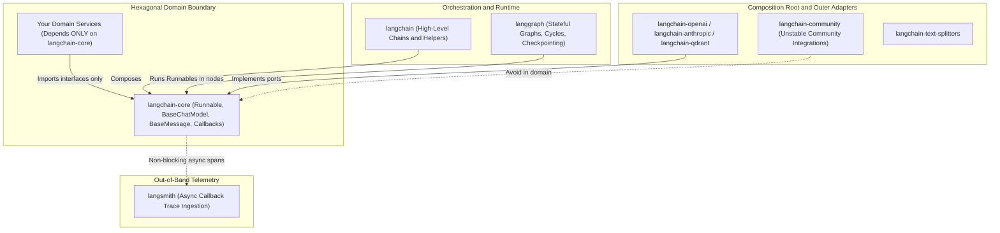
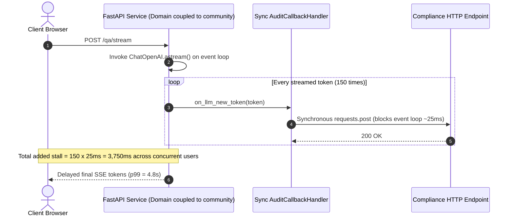

# Module 01: LangChain Architecture Overview

> **Prerequisites:** [Module 00: Why Frameworks Exist (and When to Skip Them)](../00-why-frameworks-exist/README.md) and [Track 06, Module 17: Provider Abstraction and Model Routing](../../06-openai-and-the-model-landscape/17-provider-abstraction-and-model-routing/README.md).  
> **Estimated Reading Time:** 30 minutes  
> **Target Audience:** AI Backend Engineers, Microservice Architects, Platform Infrastructure Teams

> [!TIP]
> **The Golden Rule of LangChain Architecture:** Always program your domain logic strictly against **`langchain-core`** abstractions (`Runnable`, `BaseChatModel`, `BaseMessage`, `BasePromptTemplate`, `BaseRetriever`), and isolate `langchain-<provider>` integrations inside your startup **composition root**. Never import `langchain-community` inside production business logic—keeping `langchain-core` as your hexagonal port protects you from dependency bloat, CVE sprawl, and vendor lock-in.

---

## Why This Matters

Early LangChain (`v0.0.x`) shipped as a single monolithic Python package (`langchain`) bundling core abstractions, prompt templates, OpenAI wrappers, PDF loaders, and `150+` third-party vector database adapters in one dependency tree. In production microservices, that monolith caused chronic pain: installing one chat bot dragged in unpinned transitive SDKs, inflated Docker images past `1 GB`, triggered Pydantic version conflicts, and coupled business services directly to community-maintained loaders.

Beginning in **`v0.1`**, hardened across **`v0.2` / `v0.3`** (full Pydantic v2 alignment), and carrying into **`v1.0`** modular runtime conventions, LangChain decoupled its ecosystem into strictly layered packages built around **Clean / Hexagonal Architecture**. Knowing exactly where each package sits—and which imports belong in domain modules versus edge adapters—is the difference between a cleanly testable service and an unupgradable monolith.

---

## 1. Architectural Mental Model: Layered Packages & Hexagonal Boundaries

Think of the modern LangChain stack as concentric dependency rings: **`langchain-core`** defines the stable inner **Ports** (interfaces and the `Runnable` execution protocol), **`langchain-<provider>`** partner packages implement verified **Adapters**, **`langgraph`** executes stateful cyclic workflows atop those Runnables, and **`langsmith`** observes callback events out-of-band.



### The `Runnable` Protocol: Universal Execution Contract

The centerpiece of `langchain-core` is the generic **`Runnable[Input, Output]`** interface (`langchain_core.runnables.Runnable`). Nearly every component—`ChatPromptTemplate`, `BaseChatModel`, `BaseOutputParser`, `BaseRetriever`, and custom `RunnableLambda` functions—implements the exact same execution surface:

- **`.invoke(input, config=None)` / `.ainvoke(...)`:** Synchronous or async single-item execution.
- **`.stream(input, config=None)` / `.astream(...)`:** Incremental chunk-by-chunk token or delta streaming.
- **`.batch(inputs, config=None)` / `.abatch(...)`:** Bounded parallel execution across a batch of inputs (`max_concurrency`).
- **`.astream_events(input, version="v2")`:** Fine-grained async event stream emitting intermediate token, tool, and retriever payloads across nested chains.
- **Immutability Wrappers:** `.with_config()`, `.with_retry()`, `.with_fallbacks()`, and `.bind()` return new configured `RunnableBinding` instances rather than mutating shared singletons.

Because inputs and outputs align cleanly, `a | b | c` compiles to a **`RunnableSequence`** that propagates `RunnableConfig` (including `callbacks`, `tags`, `metadata`, and `run_id` parent pointers) automatically from root to leaf.

### Ecosystem Evolution: `v0.0` Monolith to `v0.3` / `v1.0` Modularity

| Era / Version | Structural Shift | Impact on Production Codebases |
| :--- | :--- | :--- |
| **`v0.0.x` (Legacy Monolith)** | All abstractions, community loaders, and vendor integrations inside `langchain` | Bloated containers, frequent transitive clashes, `from langchain.chat_models import ChatOpenAI` coupled directly to monolith |
| **`v0.1` (Core / Community Split)** | Extracted `langchain-core` and `langchain-community`; introduced `LCEL` `Runnable` pipe standard | Domain services could depend solely on `langchain-core` without pulling `200+` community connectors |
| **`v0.2` (Partner Isolation)** | Moved major vendors out of `langchain-community` into dedicated `langchain-openai`, `langchain-anthropic`, etc. | Independent SemVer bugfixes per provider; `langchain_community` imports inside `langchain` deprecated |
| **`v0.3` (Pydantic v2 Native)** | Dropped legacy Pydantic v1 compatibility shims internally; standardized `usage_metadata` & `tool_calls` | Cleaner serialization, faster schema validation, strict separation of provider adapters |
| **`v1.0` Era (LangGraph-First Agents)** | Legacy `AgentExecutor` / monolithic chains superseded by `LangGraph` stateful runtimes + lean `langchain-core` | Explicit cyclic graphs, durable PostgreSQL checkpointing, and zero-magic prompt/tool control |

### Quantitative Engineering Formulas: Container Bloat & Callback Overhead

#### 1. Dependency Surface & Container Footprint
Your deployable microservice container size $S_{\text{image}}$ scales directly with which ring of the package graph you install:

$$S_{\text{image}} = S_{\text{base}} + S_{\text{core}} + \sum_{p \in P_{\text{used}}} S_{\text{partner}(p)} + \mathbb{I}_{\text{community}} \cdot S_{\text{community\_extras}}$$

Installing `langchain-core` + `langchain-openai` keeps the LLM layer compact and fast to cold-start on serverless/Kubernetes pods, whereas importing `langchain-community` alongside optional document/ML extras triggers transitive bloat and CVE audit churn.

#### 2. Callback Event Amplification During Streaming
Suppose a composed `RunnableSequence` has $N_{\text{nodes}}$ chained steps, $K_{\text{callbacks}}$ attached handlers (e.g., LangSmith + OpenTelemetry + custom logger), and streams $T_{\text{tokens}}$ output tokens. Total synchronous or async callback invocations equal:

$$E_{\text{events}} = 2 \cdot N_{\text{nodes}} \cdot K_{\text{callbacks}} + T_{\text{tokens}} \cdot K_{\text{callbacks}}$$

If a blocking handler adds $t_{\text{block}}$ milliseconds per `on_llm_new_token` event, total added stream latency is:

$$\Delta L_{\text{stream}} = T_{\text{tokens}} \cdot K_{\text{callbacks}} \cdot t_{\text{block}}$$

At `T_tokens = 120`, `K_callbacks = 2`, and `t_block = 15 ms` (such as a synchronous HTTP audit post inside `on_llm_new_token`), the user experiences **`3,600 ms` (`3.6 s`) of stalled token streaming**. **Rule:** Callbacks must *never* perform blocking network/disk I/O on the hot path—push events onto a non-blocking in-memory queue flushed by a background worker (how `LangSmith` operates).

---

## 2. Systematic Comparison Matrix: The 6 LangChain Ecosystem Packages

| Package | Architectural Role | Dependency & CVE Risk | SemVer / Stability | Allowed Inside Domain Services? | Key Primitives Exported | If You Drop It Later |
| :--- | :--- | :--- | :--- | :--- | :--- | :--- |
| **`langchain-core`** | Pure interfaces, `Runnable` protocol, message & prompt abstractions | **Very Low** (Pydantic + packaging + tenacity/orjson) | **High** (stable interface boundary) | **Yes — Primary Port** | `Runnable`, `BaseChatModel`, `BaseMessage`, `ChatPromptTemplate`, `BaseRetriever` | Replace with your own `Protocol` / interface + `TypedDict` types |
| **`langchain-<provider>`** | Official partner adapters (`langchain-openai`, `langchain-anthropic`, etc.) | **Low** (depends only on `langchain-core` + vendor SDK) | **High** (independently released) | **No — Composition Root Only** | `ChatOpenAI`, `ChatAnthropic`, `OpenAIEmbeddings` | Swap one partner factory file without touching domain logic |
| **`langchain`** | High-level chain factories & legacy orchestration helpers | **Medium** (pulls `langchain-core` + text splitters + SQLAlchemy/httpx) | **Medium** (legacy APIs deprecated toward LangGraph) | **Sparingly / Edge** (prefer pure `langchain-core` or `langgraph`) | `create_retrieval_chain`, `init_chat_model` | Replace with explicit `LCEL` pipes or `LangGraph` nodes |
| **`langchain-community`** | Community-contributed loaders, vector connectors, niche tools | **High** (large optional dependency graph, mixed maintenance quality) | **Low-Medium** | **NEVER** — isolate or vendor the `30` lines you need | Legacy loaders (`PyPDFLoader`, `WebBaseLoader`), niche stores | Write a clean `40`-line adapter using native library (`pypdf`, `httpx`) |
| **`langgraph`** | Stateful cyclic graph runtime, reducers, HITL interrupts, persistence | **Low** (depends on `langchain-core` + msgpack/checkpoint backends) | **High** (production agent runtime) | **Yes (Workflow Layer)** | `StateGraph`, `START`, `END`, `interrupt`, `PostgresSaver` | Replace with durable workflow engine (Temporal) or custom state machine |
| **`langsmith`** | Out-of-band tracing, prompt commit registry, offline eval datasets | **Very Low** (background threaded HTTP batch client) | **High** | **Runtime Env / Tracer Only** | `Client`, `@traceable`, `LANGSMITH_TRACING` | Swap OpenTelemetry collector (`OTLP`) via `langchain-core` callbacks |

---

## 3. Production War Story Post-Mortem: The `langchain-community` Bloat & Blocking Callback Freeze

| Field | Incident Details |
| :--- | :--- |
| **Severity** | **SEV-2** (P99 Streaming Latency Regression from `340 ms` to `4.8 s` + CI Security Block) |
| **Detection / Resolution Time** | Detected 20 minutes after canary rollout via streaming ITL alerts / Mitigated in 90 minutes (isolated `langchain-core` port + async queue callback) |
| **Impact** | Docker build ballooned from `215 MB` to `1.38 GB`; `3` high-severity transitive CVEs flagged by container scanner; p99 streaming response stalled `14x` under load |

### What Happened

A developer added a document Q&A endpoint to an existing FastAPI microservice. Copying an outdated blog tutorial, the developer imported `ChatOpenAI` and a Markdown loader directly from `langchain_community` inside `services/qa_domain.py`, and wrote a custom `AuditCallbackHandler(BaseCallbackHandler)` to ship streamed tokens to an internal compliance log API via `requests.post(...)` inside `on_llm_new_token`.

1. **Dependency Bloat & Coupling:** Pulling `langchain_community` inside `services/` dragged `42` transitive packages into the production container and triggered `3` security scanner CVEs from unused legacy connectors.
2. **Event-Loop Freeze Under Streaming:** During canary testing, every `150`-token answer fired `on_llm_new_token` `150` times synchronously on the FastAPI Uvicorn thread, executing `150` blocking `requests.post` calls (`~25 ms` each) and freezing concurrent async coroutines on the worker pod.



### Root Cause Analysis

- **Broken Hexagonal Boundary:** Domain code imported concrete integrations from `langchain_community` instead of accepting a `langchain_core` `BaseChatModel` / `Runnable` dependency injected at startup.
- **Synchronous I/O Inside Hot Callback Path:** Calling blocking HTTP `requests.post` inside `on_llm_new_token` multiplied $T_{\text{tokens}} \cdot t_{\text{block}}$ directly onto end-user streaming latency and starved asyncio worker threads.

### Architectural Hardening & Verified Fix

- **Enforced `langchain-core` Domain Isolation:** Removed `langchain-community` from `pyproject.toml` entirely; refactored `services/qa_domain.py` to accept `Runnable` / `BaseChatModel` interfaces from `langchain-core`, wiring `langchain-openai` only in `app/bootstrap.py` plus adding an `ast` CI import-boundary check.
- **Moved Telemetry Out-of-Band:** Replaced the synchronous `on_llm_new_token` HTTP logger with `LangSmith` background tracing (`LANGSMITH_TRACING=true`) and an `asyncio.Queue` batcher emitting token-usage metrics only once at `on_llm_end`.

---

## 4. Multi-Language Production Implementation: Hexagonal `Runnable` Port & Composition Root

Whether using LangChain's official **Python** (`langchain-core`) or **TypeScript** (`@langchain/core`) libraries—or clean **Go** and **C#** equivalents—the production architecture pattern is identical: **domain logic speaks only to a `Runnable` port**, while **provider adapters and non-blocking trace callbacks plug in at the composition root**.

````carousel

```go
package hexagonal

import (
	"context"
	"fmt"
)

// Core Port (equivalent to langchain-core Runnable[I, O]): zero vendor imports.
type Runnable[I any, O any] interface {
	Invoke(ctx context.Context, input I, cfg RunConfig) (O, error)
}

type TraceEvent struct {
	NodeName string
	RunID    string
	ParentID string
}

type NonBlockingTracer interface {
	TryEmit(evt TraceEvent) // Never blocks caller; drops/buffers to background channel.
}

type RunConfig struct {
	ParentRunID string
	Tracer      NonBlockingTracer
}

type RunnableFunc[I any, O any] struct {
	Name string
	Fn   func(context.Context, I) (O, error)
}

func (r RunnableFunc[I, O]) Invoke(ctx context.Context, input I, cfg RunConfig) (O, error) {
	runID := fmt.Sprintf("%s-span", r.Name)
	if cfg.Tracer != nil {
		cfg.Tracer.TryEmit(TraceEvent{NodeName: r.Name, RunID: runID, ParentID: cfg.ParentRunID})
	}
	return r.Fn(ctx, input)
}

// Compose pipes A -> B while preserving RunConfig propagation across boundaries.
func Compose[A, B, C any](first Runnable[A, B], second Runnable[B, C]) Runnable[A, C] {
	return RunnableFunc[A, C]{
		Name: "RunnableSequence",
		Fn: func(ctx context.Context, in A) (C, error) {
			var zero C
			mid, err := first.Invoke(ctx, in, RunConfig{})
			if err != nil {
				return zero, err
			}
			return second.Invoke(ctx, mid, RunConfig{})
		},
	}
}

// Domain service accepts Runnable[string, string] port; vendor SDK stays in main().
type SupportClassifier struct {
	Model Runnable[string, string]
}

func (s SupportClassifier) Classify(ctx context.Context, ticket string, tracer NonBlockingTracer) (string, error) {
	prompt := fmt.Sprintf("Classify ticket strictly as P1|P2|P3:\n%s", ticket)
	return s.Model.Invoke(ctx, prompt, RunConfig{ParentRunID: "root-req", Tracer: tracer})
}
```

<!-- slide -->

```typescript
// Domain layer: depends ONLY on @langchain/core interfaces, never @langchain/openai or community.
import type { RunnableInterface } from "@langchain/core/runnables";
import { RunnableLambda, RunnableSequence } from "@langchain/core/runnables";

export interface TriageInput {
  readonly ticketText: string;
}

export interface TriageOutput {
  readonly category: string;
  readonly priority: "P1" | "P2" | "P3";
}

/**
 * Domain pipeline built strictly on @langchain/core Runnables.
 * Testable offline with a deterministic mock Runnable and swappable in bootstrap.
 */
export function buildTriagePipeline(
  modelPort: RunnableInterface<string, string>,
): RunnableInterface<TriageInput, TriageOutput> {
  const formatPrompt = RunnableLambda.from<TriageInput, string>(
    (input) => `Classify ticket into category|priority:\n${input.ticketText.trim()}`,
  );

  const parseOutcome = RunnableLambda.from<string, TriageOutput>((raw) => {
    const [category = "general", prio = "P3"] = raw.split("|").map((s) => s.trim());
    const priority = prio === "P1" || prio === "P2" ? prio : "P3";
    return { category, priority };
  });

  return RunnableSequence.from([formatPrompt, modelPort, parseOutcome]);
}

// Composition Root (bootstrap.ts): ONLY place importing @langchain/openai or mock adapters.
export async function runWithAdapter(): Promise<TriageOutput> {
  const offlineAdapter = RunnableLambda.from<string, string>(async () => "billing|P1");
  const pipeline = buildTriagePipeline(offlineAdapter);
  return pipeline.invoke({ ticketText: "Duplicate charge on invoice #4401" });
}
```

<!-- slide -->

```python
"""
hexagonal_runnable.py
Domain service imports ONLY langchain-core abstractions (never partner/community packages).
Wire langchain-openai / langchain-anthropic strictly inside the composition root.
"""
from queue import Full, Queue
from typing import Protocol, Sequence


# --- Domain Layer (domain/triage.py): Depends strictly on abstract Runnable / BaseMessage ports ---
class MessageLike(Protocol):
    role: str
    content: str


class ChatModelPort(Protocol):
    """Equivalent to langchain_core.language_models.BaseChatModel Runnable interface."""

    def invoke(self, messages: Sequence[MessageLike], config: dict | None = None) -> MessageLike: ...


class NonBlockingAuditCallback:
    """Pushes completion metrics to a bounded queue without blocking token streaming."""

    def __init__(self, maxsize: int = 1024) -> None:
        self.queue: Queue[dict] = Queue(maxsize=maxsize)

    def on_llm_end(self, run_id: str, output_chars: int) -> None:
        try:
            self.queue.put_nowait({"run_id": run_id, "output_chars": output_chars})
        except Full:
            pass  # Shed telemetry under load rather than stalling user traffic


class DomainMessage:
    def __init__(self, role: str, content: str) -> None:
        self.role = role
        self.content = content


class TriageService:
    def __init__(self, chat_model: ChatModelPort) -> None:
        self._chat_model = chat_model

    def classify(self, ticket_body: str, trace_cb: NonBlockingAuditCallback) -> str:
        messages = [
            DomainMessage("system", "Classify ticket as P1, P2, or P3."),
            DomainMessage("human", ticket_body[:2000]),
        ]
        response = self._chat_model.invoke(messages, config={"callbacks": [trace_cb]})
        return response.content.strip()


# --- Composition Root (app/bootstrap.py): Partner SDK or mock injected here ---
class MockOpenAIAdapter:
    def invoke(self, messages: Sequence[MessageLike], config: dict | None = None) -> MessageLike:
        reply = DomainMessage("assistant", "P1")
        for cb in (config or {}).get("callbacks", []):
            cb.on_llm_end(run_id="run-01", output_chars=len(reply.content))
        return reply


def create_service() -> TriageService:
    return TriageService(chat_model=MockOpenAIAdapter())
```

<!-- slide -->

```csharp
using System;
using System.Collections.Concurrent;
using System.Threading;
using System.Threading.Tasks;

namespace GenAI.HexagonalArchitecture;

// Domain Port (counterpart to langchain-core Runnable<I, O>): zero vendor SDK references.
public interface IRunnable<in TIn, TOut>
{
    Task<TOut> InvokeAsync(TIn input, RunConfig? config = null, CancellationToken ct = default);
}

public sealed record RunConfig(string? ParentRunId = null, Action<string>? NonBlockingAudit = null);

public sealed class SupportTriageDomainService
{
    private readonly IRunnable<string, string> _modelPort;

    public SupportTriageDomainService(IRunnable<string, string> modelPort)
    {
        _modelPort = modelPort;
    }

    public async Task<string> ClassifyAsync(string ticket, RunConfig config, CancellationToken ct)
    {
        var prompt = $"Return P1|P2|P3 only for ticket: {ticket}";
        return await _modelPort.InvokeAsync(prompt, config, ct).ConfigureAwait(false);
    }
}

// Composition Root Adapter: vendor SDK stays isolated outside domain project.
public sealed class StubPartnerModelAdapter : IRunnable<string, string>
{
    private readonly ConcurrentQueue<string> _telemetryQueue = new();

    public Task<string> InvokeAsync(string input, RunConfig? config = null, CancellationToken ct = default)
    {
        var answer = input.Contains("outage", StringComparison.OrdinalIgnoreCase) ? "P1" : "P2";
        config?.NonBlockingAudit?.Invoke($"parent={config.ParentRunId ?? "none"},len={answer.Length}");
        _telemetryQueue.Enqueue(answer);
        return Task.FromResult(answer);
    }
}
```

````

---

## 5. Practical Hands-On Verification CLI Workflows

Run these deterministic Python 3.13 scripts offline to verify `Runnable` composition, architectural import boundaries, and callback latency effects.

### Workflow 1: Build a Minimal `Runnable` Engine with `|` Pipe & `parent_run_id` Trace Tree

Verify how `langchain-core` composes steps using `__or__`, shares `.invoke()` / `.batch()`, and threads `parent_run_id` across nested nodes via `RunnableConfig`:

```bash
python -c '
class TraceCollector:
    def __init__(self):
        self.events = []
        self._seq = 0

    def next_id(self):
        self._seq += 1
        return f"run_{self._seq:02d}"

    def on_start(self, name, run_id, parent_id):
        self.events.append(("START", name, run_id, parent_id))

    def on_end(self, name, run_id, parent_id):
        self.events.append(("END", name, run_id, parent_id))

class Runnable:
    def __init__(self, name):
        self.name = name

    def _run(self, x):
        raise NotImplementedError

    def invoke(self, x, config=None):
        cfg = config or {}
        cb = cfg.get("callbacks")
        parent_id = cfg.get("parent_run_id")
        run_id = cb.next_id() if cb else "no_trace"
        if cb:
            cb.on_start(self.name, run_id, parent_id)
        out = self._run_with_config(x, {**cfg, "parent_run_id": run_id})
        if cb:
            cb.on_end(self.name, run_id, parent_id)
        return out

    def _run_with_config(self, x, child_cfg):
        return self._run(x)

    def stream(self, x, config=None):
        yield self.invoke(x, config)

    def batch(self, items, config=None):
        return [self.invoke(item, config) for item in items]

    def __or__(self, other):
        return RunnableSequence([self, other])

class RunnableSequence(Runnable):
    def __init__(self, steps):
        super().__init__("RunnableSequence")
        self.steps = steps

    def _run_with_config(self, x, child_cfg):
        cur = x
        for s in self.steps:
            cur = s.invoke(cur, child_cfg)
        return cur

    def __or__(self, other):
        return RunnableSequence(self.steps + [other])

class RunnableLambda(Runnable):
    def __init__(self, name, fn):
        super().__init__(name)
        self.fn = fn

    def _run(self, x):
        return self.fn(x)

prompt = RunnableLambda("ChatPrompt", lambda d: "[SYS] Concise: " + d["q"])
model = RunnableLambda("MockChatModel", lambda p: {"content": f"Answer({p})", "tokens": 12})
parser = RunnableLambda("StrOutputParser", lambda msg: msg["content"])

chain = prompt | model | parser
tracer = TraceCollector()
res = chain.invoke({"q": "What is LCEL?"}, config={"callbacks": tracer})
print("Result:", res)
print("Batch :", chain.batch([{"q": "A"}, {"q": "B"}]))
for kind, name, rid, pid in tracer.events:
    print(f"  {kind:<5} | node={name:<16} | run={rid} | parent={pid}")
'
```

**Expected Output:**

```text
Result: Answer([SYS] Concise: What is LCEL?)
Batch : ['Answer([SYS] Concise: A)', 'Answer([SYS] Concise: B)']
  START | node=RunnableSequence | run=run_01 | parent=None
  START | node=ChatPrompt       | run=run_02 | parent=run_01
  END   | node=ChatPrompt       | run=run_02 | parent=run_01
  START | node=MockChatModel    | run=run_03 | parent=run_01
  END   | node=MockChatModel    | run=run_03 | parent=run_01
  START | node=StrOutputParser  | run=run_04 | parent=run_01
  END   | node=StrOutputParser  | run=run_04 | parent=run_01
  END   | node=RunnableSequence | run=run_01 | parent=None
```

### Workflow 2: Run an AST Architectural Boundary Linter Against `domain/` vs. `adapters/`

Enforce clean hexagonal architecture in CI by detecting forbidden `langchain_community`, `langchain_openai`, or raw vendor imports inside `domain/` files:

```bash
python -c '
import ast

FORBIDDEN_IN_DOMAIN = ("langchain_community", "langchain_openai", "langchain_anthropic", "openai", "anthropic")

files = {
    "domain/classifier.py": (
        "from langchain_core.runnables import Runnable\n"
        "from langchain_core.messages import HumanMessage\n"
    ),
    "domain/leaky_service.py": (
        "from langchain_core.prompts import ChatPromptTemplate\n"
        "from langchain_community.document_loaders import WebBaseLoader\n"
        "from langchain_openai import ChatOpenAI\n"
    ),
    "adapters/openai_factory.py": (
        "from langchain_openai import ChatOpenAI\n"
        "from langchain_core.language_models import BaseChatModel\n"
    ),
}

for path, src in files.items():
    tree = ast.parse(src)
    violations = []
    if path.startswith("domain/"):
        for node in ast.walk(tree):
            if isinstance(node, ast.ImportFrom) and node.module:
                top = node.module.split(".")[0]
                if top in FORBIDDEN_IN_DOMAIN:
                    violations.append(node.module)
    status = "PASS" if not violations else f"FAIL violations={violations}"
    print(f"{path:<28} -> {status}")
'
```

**Expected Output:**

```text
domain/classifier.py         -> PASS
domain/leaky_service.py      -> FAIL violations=['langchain_community.document_loaders', 'langchain_openai']
adapters/openai_factory.py   -> PASS
```

### Workflow 3: Measure Callback Overhead Under Streaming Token Events

Quantify how blocking HTTP logging inside `on_llm_new_token` stalls streaming responses compared to non-blocking background queueing:

```bash
python -c '
def simulate_stream_callbacks(nodes=4, callbacks=2, tokens=120, blocking_io_ms=15.0, queue_push_ms=0.01):
    lifecycle_events = 2 * nodes * callbacks
    token_events = tokens * callbacks
    total_events = lifecycle_events + token_events
    sync_stall_ms = token_events * blocking_io_ms
    async_stall_ms = token_events * queue_push_ms
    return total_events, sync_stall_ms, async_stall_ms

tot, sync_ms, async_ms = simulate_stream_callbacks()
print(f"Total callback dispatches : {tot} events (nodes=4, cbs=2, tokens=120)")
print(f"Blocking HTTP in callback : +{sync_ms:.1f} ms added to stream duration")
print(f"Non-blocking background Q : +{async_ms:.2f} ms added to stream duration")
'
```

**Expected Output:**

```text
Total callback dispatches : 256 events (nodes=4, cbs=2, tokens=120)
Blocking HTTP in callback : +3600.0 ms added to stream duration
Non-blocking background Q : +2.40 ms added to stream duration
```

### Hands-On Exercises

1. **Extend Workflow 1 with `RunnableParallel`:** Add a `RunnableParallel(branches: dict[str, Runnable])` class to Workflow 1 that executes each branch and attaches `parent_run_id` of the parallel container to every branch's trace events.
2. **Harden the AST Boundary Checker:** Extend Workflow 2 to catch plain `import langchain_community` statements (`ast.Import`, not just `ast.ImportFrom`) and fail on aliased imports like `import openai as oa`.
3. **Optional Installed-Package Inspection (Requires `langchain-core`):** Run `python -m pip show langchain-core` vs. `python -m pip show langchain-community` (in a clean `venv`) and compare their `Requires:` dependency lists to see why keeping `langchain-community` out of microservices prevents transitive dependency sprawl.

### Independent Challenge

A fast-growing fintech backend has `6` microservices importing `langchain_community.chat_models.ChatOpenAI`, `langchain_community.document_loaders.PyPDFLoader`, and `langchain.chains.LLMChain` directly inside business-logic modules. Now they need to (a) migrate from OpenAI to Anthropic Claude for `40%` of endpoints for compliance, (b) cut their `1.6 GB` container image below `350 MB`, and (c) pass strict zero-network unit tests in CI. Design a three-step refactoring plan mapping each package boundary without halting feature delivery.

<details><summary>Architectural Discussion</summary>

1. **Isolate Domain Ports (`langchain-core` only):** Refactor business services to depend strictly on `langchain_core.language_models.BaseChatModel`, `langchain_core.runnables.Runnable`, and `langchain_core.prompts.ChatPromptTemplate`. Replace deprecated `LLMChain` calls with explicit `prompt | model` sequences.
2. **Eliminate `langchain-community`:** Replace `langchain_community.chat_models.ChatOpenAI` with partner packages (`langchain-openai`, `langchain-anthropic`) wired solely in an `app/providers.py` composition root. Replace `PyPDFLoader` with a `35`-line adapter wrapping `pypdf` directly so `langchain-community` can be deleted from `pyproject.toml`—shrinking the container image drastically.
3. **Enforce CI Fitness & Offline Testing:** Inject `GenericFakeChatModel` (from `langchain_core.language_models.fake_chat_models`) or a deterministic `RunnableLambda` mock in unit tests for zero-network CI verification, and add the Workflow 2 AST import linter so `langchain_community` or vendor imports can never creep back into `domain/`.

</details>

---

## 6. Common Mistakes & Troubleshooting

- **Importing `ChatOpenAI` or `OpenAIEmbeddings` from `langchain_community` or `langchain.chat_models`:** Deprecated legacy paths drag bloated dependencies and miss partner bugfixes. Always import official partner packages (`langchain_openai`, `langchain_anthropic`) at the composition root.
- **Putting `langchain-community` in production `requirements.txt` for one helper:** Copying one `40`-line PDF or HTML loader from `langchain-community` pulls in dozens of unrelated transitive drivers. Vendor or write the minimal loader yourself.
- **Executing synchronous DB or HTTP calls inside `on_llm_new_token`:** Every streamed token invokes your callback synchronously; use non-blocking queues or `on_llm_end` batch emission.
- **Mutating a shared `ChatModel` or `Runnable` instance per request:** Never overwrite model attributes (`model.temperature = ...`) on a singleton across concurrent requests—use `.bind()` or `.with_config(configurable=...)` to derive immutable per-request wrappers.

---

## 7. Operational Validation Checkpoints & Checkpoint Quiz

### Operational Validation Checkpoints

<details><summary><strong>Checkpoint 1: Auditing a bloated Docker container before deployment</strong></summary>

A newly created Python LLM microservice has a `1.4 GB` container image and fails CVE scanning because of `unstructured`, `pinecone`, and `sqlalchemy` packages, even though the service only calls OpenAI chat completions and parses JSON. What went wrong in its package imports?

**Validation:** The team installed the `langchain` / `langchain-community` metapackages (and likely broad extras) instead of depending strictly on `langchain-core` + `langchain-openai`. Removing `langchain-community` and pinning only `langchain-core` and the specific partner package (`langchain-openai`) eliminates unused transitive dependencies and drops container size by hundreds of megabytes.

</details>

<details><summary><strong>Checkpoint 2: Explaining why `run_id` and `parent_run_id` matter in nested Runnables</strong></summary>

A `prompt | retriever | model | parser` chain throws an intermittent `JSONDecodeError` in production, and application logs only show `Error in RunnableSequence`. How does `langchain-core`'s `RunnableConfig` architecture solve trace attribution?

**Validation:** When a `RunnableSequence` invokes child steps, it clones `RunnableConfig` with `parent_run_id` set to the sequence's `run_id` and forwards callback handlers (`LangSmith` or OpenTelemetry) to every nested node. Viewing the resulting trace tree isolates the exact failing leaf node (`parser`) alongside the raw `AIMessage` input received from `model`.

</details>

<details><summary><strong>Checkpoint 3: Keeping domain logic provider-agnostic during an emergency failover</strong></summary>

An engineering org must switch its contract-summarization domain service from `ChatOpenAI` to `ChatAnthropic` within `2` hours due to a regional vendor outage, without rewriting domain logic or breaking unit tests. Which `langchain-core` boundaries make this a 1-file change?

**Validation:** Because domain code depends solely on `langchain_core.language_models.BaseChatModel` (or `Runnable[PromptValue, AIMessage]`) and normalized `BaseMessage` / `AIMessage` contracts, swapping `ChatOpenAI(...)` for `ChatAnthropic(...)` happens strictly inside the startup composition root/factory (`1` file) while domain logic and offline `GenericFakeChatModel` tests remain untouched.

</details>

### Checkpoint Quiz

1. What is the single core abstraction in `langchain-core` that allows prompts, chat models, retrievers, and parsers to be composed with `|`?
2. Why should `langchain-community` never be imported directly inside core domain modules of a production microservice?
3. What is the architectural role of `langchain-<provider>` partner packages compared to `langchain-core`?
4. Why does performing blocking HTTP telemetry inside `on_llm_new_token` severely degrade streaming performance?
5. How did LangChain's evolution from `v0.0.x` to `v0.3`/`v1.0` address dependency bloat and stateful looping?

<details><summary>Answers</summary>

1. The **`Runnable` interface** (`invoke`, `ainvoke`, `stream`, `astream`, `batch`, `abatch`, `astream_events`), where `|` composes steps into a `RunnableSequence` propagating `RunnableConfig`.
2. `langchain-community` aggregates hundreds of community adapters with mixed stability and large transitive dependencies, bloating containers, increasing CVE exposure, and coupling business logic to unstable external libraries.
3. `langchain-core` defines pure provider-agnostic ports/contracts (`Runnable`, `BaseChatModel`, `BaseMessage`), while `langchain-<provider>` (`langchain-openai`, `langchain-anthropic`) implements isolated, independently versioned vendor adapters wired at the composition root.
4. `on_llm_new_token` fires once per streamed token (`T_tokens * K_callbacks` times); synchronous blocking I/O on each token multiplies stall latency directly onto end-user delivery and blocks event loops.
5. `v0.1`–`v0.3` split monolithic `langchain` into lightweight `langchain-core` + isolated `langchain-<provider>` partner packages on Pydantic v2, while `LangGraph` superseded legacy chain loops with explicit cyclic, checkpointed state graphs.

</details>

---

## Further Reading & Sources

- [LangChain Docs: Architecture & Packages](https://python.langchain.com/docs/concepts/architecture/) — official reference on `langchain-core`, partner packages, `langchain`, and `langchain-community`.
- [LangChain Docs: Runnable Interface](https://python.langchain.com/docs/concepts/runnables/) — official specification for `invoke`, `stream`, `batch`, `RunnableConfig`, and `astream_events`.
- [LangGraph Overview](https://langchain-ai.github.io/langgraph/) — stateful graph runtime layer built over `langchain-core` Runnables.
- [LangSmith Observability Documentation](https://docs.smith.langchain.com/) — out-of-band callback trace collection and evaluation.

## Next

[Module 02: Models and Messages](../02-models-and-messages/README.md)
