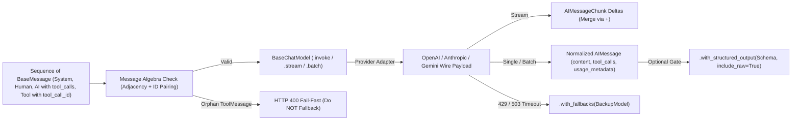
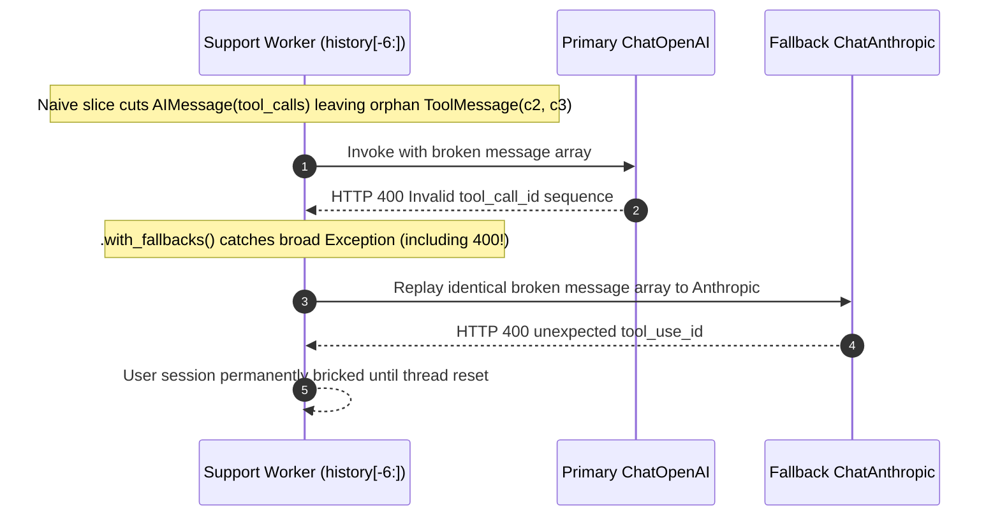

# Module 02: Models and Messages

> **Prerequisites:** [Module 01: LangChain Architecture Overview](../01-langchain-architecture-overview/README.md), [Track 06, Module 06: Function Calling Basics](../../06-openai-and-the-model-landscape/06-function-calling-basics/README.md), and [Track 06, Module 07: Structured Outputs and JSON Schema](../../06-openai-and-the-model-landscape/07-structured-outputs-and-json-schema/README.md).  
> **Estimated Reading Time:** 34 minutes  
> **Target Audience:** AI Backend Engineers, Multi-Provider Platform Developers, Agent Infrastructure Builders

> [!TIP]
> **The Golden Rule of Models and Messages:** Treat every chat message sequence as a **strict algebraic protocol**, never a loose list of text strings. An `AIMessage` containing `tool_calls` *must* be immediately followed by matching `ToolMessage` instances carrying every exact `tool_call_id` before any new `HumanMessage` or `AIMessage`; always read normalized `AIMessage.usage_metadata` rather than character heuristics; always pass `include_raw=True` on `.with_structured_output()` in production; and guard every `BaseChatModel` with explicit `timeout`, `max_retries=0` (when outer retries exist), bounded `max_concurrency`, and non-`400` `.with_fallbacks()`.

---

## Why This Matters

Legacy text-completion interfaces (`str -> str`) are obsolete for production agents and structured workflows. Modern reasoning and chat engines operate via **`BaseChatModel`** (`Sequence[BaseMessage] -> AIMessage`), where role boundaries, multi-part content blocks, parallel tool calls, and token accounting differ significantly across wire APIs:

- **OpenAI Chat Completions / Responses:** Uses `role: "assistant"` with `tool_calls: [{id, type, function}]` followed by separate `role: "tool"` messages referencing `tool_call_id`.
- **Anthropic Messages API:** Uses top-level `system` blocks outside `messages`, represents tool requests as `tool_use` content blocks inside `assistant` turns, and expects `tool_result` blocks inside `user` turns.
- **Google Gemini API:** Uses `contents` with `functionCall` and `functionResponse` parts keyed by function name/ID.

LangChain's `BaseChatModel` and `BaseMessage` abstractions normalize these wire discrepancies behind one uniform contract—allowing `.invoke()`, `.stream()`, `.batch()`, `.bind_tools()`, `.with_structured_output()`, and `.with_fallbacks()` to behave predictably. Yet misunderstanding the underlying **message role algebra** or **stream/fallback semantics** causes immediate HTTP `400` crashes and lost billing telemetry in production.

---

## 1. Architectural Mental Model: `BaseChatModel` Execution & Message Role Algebra

Every call to a `BaseChatModel` compiles a typed sequence of `BaseMessage` objects through a provider serializer, enforces transport/concurrency limits, and normalizes the provider's payload back into an `AIMessage` (or stream of `AIMessageChunk` deltas).



### Canonical Message Role Algebra & Types (`langchain_core.messages`)

1. **`SystemMessage`:** Highest-priority behavioral instructions, safety rules, and static schema guidance. Kept invariant at prefix index `0` to maximize provider KV prompt caching.
2. **`HumanMessage`:** Untrusted end-user input or multimodal content blocks (`text`, `image_url`). Never concatenate tool outputs or system instructions blindly into a `HumanMessage`.
3. **`AIMessage`:** Model turn output carrying:
   - `.content`: `str` or list of provider content blocks (`text`, `thinking`).
   - `.tool_calls`: Normalized list of dicts `[{"name": "...", "args": {...}, "id": "call_...", "type": "tool_call"}]`.
   - `.invalid_tool_calls`: Safely captured malformed tool JSON (`raw_args`, `error`) so bad syntax surfaces cleanly instead of crashing the stream parser.
   - `.usage_metadata`: Normalized dict `{"input_tokens", "output_tokens", "total_tokens", "input_token_details": {"cache_read": ...}, "output_token_details": {"reasoning": ...}}`.
   - `.response_metadata`: Raw provider envelope (`model_name`, `finish_reason`, `id`) for deep incident logs.
4. **`ToolMessage`:** Carries tool execution output back to the model, keyed strictly by `tool_call_id` (plus `status="success" | "error"`).

#### The Tool-Call Adjacency Invariant (Non-Negotiable Protocol Law)
Let a conversation sequence be $M = [m_0, m_1, \dots, m_{n-1}]$. For every `AIMessage` $m_t$ whose `tool_calls` set $C_t = \{c_1, \dots, c_k\}$ is non-empty:

$$\forall c \in C_t,\ \exists!\ m_{t+j}\ (1 \le j \le k) \text{ such that } m_{t+j} \in \text{ToolMessage} \land m_{t+j}.\text{tool\_call\_id} = c.\text{id}$$

And conversely, **no `ToolMessage` may exist unless immediately preceded by an `AIMessage` whose `tool_calls` contains its `tool_call_id`** (with only sibling `ToolMessage`s from that same turn in between). Violating this rule via naive array slicing (`messages[-6:]`) triggers immediate HTTP `400 Bad Request` errors across OpenAI, Anthropic, and Gemini alike.

### The 5 Execution Methods on `BaseChatModel`

| Method | Async Counterpart | Return Contract | Production Role |
| :--- | :--- | :--- | :--- |
| `.invoke(msgs, config)` | `.ainvoke(...)` | Complete `AIMessage` (or parsed object if structured) | Synchronous/async request-response steps, classification, extraction |
| `.stream(msgs, config)` | `.astream(...)` | `Iterator[AIMessageChunk]` | Real-time SSE/WebSocket token delivery; chunks support additive merging (`c1 + c2`) |
| `.batch(inputs, config)` | `.abatch(...)` | `list[AIMessage]` in input order | Parallel document classification; **always** set `config={"max_concurrency": N}` |

#### `AIMessageChunk` Accumulation Algebra
During `.stream()`, providers emit partial text deltas and partial JSON argument fragments (`tool_call_chunks`) followed by a trailing usage chunk (`stream_options={"include_usage": True}` on OpenAI). In `langchain-core`, `AIMessageChunk` implements `__add__`:

$$M_{\text{full}} = \bigoplus_{i=1}^{K} \text{chunk}_i = \text{chunk}_1 + \text{chunk}_2 + \dots + \text{chunk}_K$$

Summing streamed chunks reconstructs complete `.content`, stitches valid `.tool_calls` from fragmented JSON strings, and captures final `.usage_metadata` in one final object for persistence and cost logging.

### Quantitative Mechanics: Normalized Billing & Batch Concurrency Ceilings

1. **Exact Per-Request Cost Using `usage_metadata`:**
   Never estimate cost via `len(text) / 4`. Read `ai_msg.usage_metadata` directly, accounting for cached input tokens $T_{\text{cached}} = \text{input\_token\_details.get("cache\_read", 0)}$:

   $$C_{\text{req}} = \frac{T_{\text{in}} - T_{\text{cached}}}{10^6} P_{\text{in}} + \frac{T_{\text{cached}}}{10^6} P_{\text{cache}} + \frac{T_{\text{out}}}{10^6} P_{\text{out}}$$

2. **Batch `max_concurrency` Rate-Limit Sizing:**
   Running `.batch(items)` without `max_concurrency` fires every input simultaneously onto asyncio/thread pools. With `max_concurrency = M`, average request latency $L_{\text{avg}}$ (seconds), and average total tokens per item $T_{\text{item}}$, peak request and token rates reach:

   $$R_{\text{RPM\_peak}} \approx M \cdot \frac{60}{L_{\text{avg}}}, \qquad T_{\text{TPM\_peak}} \approx M \cdot \frac{60}{L_{\text{avg}}} \cdot (T_{\text{in}} + T_{\text{out}})$$

   Given an organization quota $Q_{\text{TPM}}$, cap concurrency safely below headroom factor $\alpha = 0.75$:

   $$M_{\max} = \left\lfloor \frac{\alpha \cdot Q_{\text{TPM}} \cdot L_{\text{avg}}}{60 \cdot (T_{\text{in}} + T_{\text{out}})} \right\rfloor$$

---

## 2. Production Binding Patterns: Tools, Structured Outputs, Fallbacks & Timeouts

### 1. `.bind_tools(tools, tool_choice=..., parallel_tool_calls=...)`
`.bind_tools()` returns an immutable `RunnableBinding` attaching normalized schemas to every model invocation without mutating the base `BaseChatModel`:
- `tool_choice="auto"`: Model may answer in text or call zero or more tools.
- `tool_choice="any"` (or `"required"`): Forces at least one tool call—ideal when deterministic tool execution is mandatory before answering.
- `tool_choice="exact_tool_name"`: Forces a specific tool schema.
- `parallel_tool_calls=False`: Disables multi-tool fan-out when downstream stateful tools cannot execute safely in parallel.

### 2. `.with_structured_output(Schema, method=..., include_raw=True)`
- **`method="json_schema"` (Strict Native Schema):** Uses OpenAI `strict: true` constrained decoding or Anthropic structured JSON compliance so output adheres syntactically to the schema at decode time.
- **`method="function_calling"`:** Binds the schema as a synthetic tool call and extracts arguments. Works broadly across models lacking native `json_schema` constrained decoding.
- **Always Set `include_raw=True` in Production:** Without `include_raw=True`, `.with_structured_output(Schema)` discards the underlying `AIMessage`—stripping `.usage_metadata`, `.response_metadata`, and raw tokens whenever validation succeeds *or* fails! With `include_raw=True`, every invocation returns:
  `{"raw": AIMessage, "parsed": SchemaInstance | None, "parsing_error": Exception | None}`, letting you log exact token spend and route validation failures cleanly.

### 3. `.with_fallbacks([backup_model], exceptions_to_handle=(...))`
`.with_fallbacks()` swaps to a secondary region or provider (`Azure East US -> West US` or `ChatOpenAI -> ChatAnthropic`) on transient failures (`429 RateLimitError`, `503 ServiceUnavailable`, `TimeoutException`). Two strict rules apply:
- **Never Catch `400 BadRequest` or `ValueError` in Fallbacks:** Malformed histories (like an orphaned `ToolMessage`) or context-window overflows fail identically on the backup provider—wasting double latency and error budget. Pass explicit `exceptions_to_handle` covering *only* transient transport/provider errors.
- **Tool-Call ID Normalization Across Providers:** When resuming an active multi-turn conversation on a different vendor after a mid-turn `503`, normalize `tool_call_id` formats (OpenAI uses `call_...`; Anthropic requires `^[a-zA-Z0-9_-]+$`; Gemini maps by function name) before sending history across vendor boundaries.

### 4. Timeout, Retry & Rate-Limit Hygiene
- Always configure explicit connect/read `timeout` (`timeout=15.0` or `(3.0, 20.0)`) and `max_retries=0` when an outer resiliency layer owns retries.
- Use `InMemoryRateLimiter` (or a distributed Redis token bucket across pods) plus `max_concurrency` in `.batch()` to smooth burst RPM spikes before hitting upstream `429` walls.

---

## 3. Systematic Comparison Matrix: `BaseChatModel` Capabilities & Guards

| Feature / Method | Input → Output Contract | Streaming Support | Key Configuration | Primary Production Failure Mode | Hardened Mitigation |
| :--- | :--- | :--- | :--- | :--- | :--- |
| **`.invoke()` / `.ainvoke()`** | `list[BaseMessage]` → `AIMessage` | No (buffers full reply) | `timeout`, `max_retries` | Hanging socket on provider stall (`requests` default infinite/long wait) | Always pass explicit `timeout` and cancel context |
| **`.stream()` / `.astream()`** | `list[BaseMessage]` → `Iterator[AIMessageChunk]` | **Yes** (`+` mergeable) | `stream_usage=True` | Missing `usage_metadata` in streams when trailing usage chunk disabled | Enable `stream_usage=True` and sum chunks via `+` |
| **`.batch()` / `.abatch()`** | `list[inputs]` → `list[AIMessage]` | No | `config={"max_concurrency": M}` | Unbounded fan-out bursts immediately trigger `429` throttling | Calculate $M_{\max}$ from $Q_{\text{TPM}}$ and enforce `max_concurrency` |
| **`.bind_tools()`** | Returns immutable `RunnableBinding` | Yes (yields `tool_call_chunks`) | `tool_choice`, `parallel_tool_calls` | Orphaned `ToolMessage` after sliding-window history trim (`400`) | Trim conversation history by atomic `(AI, Tool...)` turn groups |
| **`.with_structured_output()`** | Returns `Schema` or `{raw, parsed, parsing_error}` | Partial JSON chunks | `method`, `include_raw=True` | Omitting `include_raw=True` loses `usage_metadata` and raw response on errors | Always deploy with `include_raw=True` |
| **`.with_fallbacks()`** | Wraps primary + `[backup...]` | Yes (if primary fails before 1st chunk) | `exceptions_to_handle` | Replaying deterministic `400 BadRequest` onto fallback doubles failure latency | Restrict `exceptions_to_handle` strictly to `429/5xx/Timeout` |

---

## 4. Production War Story Post-Mortem: The Orphaned `tool_call_id` Trimmer & `include_raw` Blindspot

| Field | Incident Details |
| :--- | :--- |
| **Severity** | **SEV-1** (100% Error Rate for Multi-Turn Support Sessions + Blind Billing Telemetry) |
| **Detection / Resolution Time** | Detected 18 minutes after deploy via HTTP `400` spike / Mitigated in 65 minutes (atomic group trimmer + strict fallback filter) |
| **Impact** | `3,100` active customer refund chats locked in permanent error state; fallback provider billed useless `400` attempts; failed structured parses lost `usage_metadata` tracking |

### What Happened

An order-refund assistant built with `ChatOpenAI` + `.bind_tools(...)` + `.with_structured_output(RefundDecision)` (without `include_raw=True`) + `.with_fallbacks([ChatAnthropic(...)])` implemented a simple sliding-window context cap: `trimmed = history[-6:]`.

1. On a complex refund turn, the model emitted an `AIMessage` calling `3` tools in parallel (`c1`, `c2`, `c3`), followed by `3` `ToolMessage` replies, a clarifying `AIMessage`, and a final `HumanMessage` (`8` total new messages).
2. `history[-6:]` sliced straight through the middle of the tool group, dropping the `AIMessage(tool_calls=[c1, c2, c3])` while keeping `ToolMessage(tool_call_id="c2")` and `ToolMessage(tool_call_id="c3")` at indices `1` and `2`.
3. OpenAI rejected the request with `HTTP 400: An assistant message with 'tool_calls' must be followed by tool messages responding to each 'tool_call_id'`. Because `.with_fallbacks()` caught generic `Exception`, it dutifully replayed the exact same broken message array to Anthropic, which rejected it with `400: unexpected tool_use_id`—and missing `include_raw=True` elsewhere hid token counts on intermittent schema errors.



### Root Cause Analysis

- **Violated Tool-Call Adjacency Invariant:** Message-count slicing operated on individual messages rather than atomic `(AIMessage, ToolMessage...)` turn units.
- **Over-Broad Fallback Exception Handling:** `.with_fallbacks()` caught client `400` schema/protocol bugs instead of filtering strictly to `429 / 5xx / Timeout` transport errors.
- **Dropped Raw Envelope:** `.with_structured_output(RefundDecision)` ran with default `include_raw=False`, discarding `AIMessage.usage_metadata` whenever schema parsing raised.

### Architectural Hardening & Verified Fix

- **Atomic Turn-Group Trimmer:** Built a `trim_atomic_groups()` preprocessor keeping `SystemMessage` pinned at index `0` and treating every `(AIMessage(tool_calls), ToolMessage...)` block as an indivisible unit so partial tool turns are never orphaned.
- **Algebraic Pre-Flight Validator + Narrow Fallbacks:** Added a `0.1 ms` pre-flight adjacency check before calling `BaseChatModel` and restricted `exceptions_to_handle` on `.with_fallbacks()` strictly to `(RateLimitError, APITimeoutError, InternalServerError)`.
- **Enabled `include_raw=True` Globally:** Wrapped `.with_structured_output(..., include_raw=True)` behind a central telemetry adapter capturing `raw.usage_metadata` on both success and parse failures.

---

## 5. Multi-Language Production Implementation: Message Algebra Validator, Chunk Merger & Safe Structured Envelope

Across **Go**, **TypeScript**, **Python**, and **C#**, enforce identical message protocol guarantees before any provider SDK or LangChain `BaseChatModel` sees the payload.

````carousel

```go
package chatprotocol

import (
	"encoding/json"
	"fmt"
	"sort"
)

type Role string

const (
	RoleSystem Role = "system"
	RoleHuman  Role = "human"
	RoleAI     Role = "ai"
	RoleTool   Role = "tool"
)

type ToolCall struct {
	ID   string
	Name string
	Args map[string]any
}

type Message struct {
	Role       Role
	Content    string
	ToolCalls  []ToolCall
	ToolCallID string
}

type UsageMetadata struct {
	InputTokens  int
	OutputTokens int
	CachedTokens int
}

// ValidateAdjacency guarantees every AIMessage(tool_calls) is immediately paired with ToolMessages.
func ValidateAdjacency(msgs []Message) error {
	for i := 0; i < len(msgs); {
		m := msgs[i]
		if m.Role == RoleTool {
			return fmt.Errorf("index %d: orphan tool message tool_call_id=%s", i, m.ToolCallID)
		}
		if m.Role == RoleAI && len(m.ToolCalls) > 0 {
			want := make([]string, len(m.ToolCalls))
			for idx, tc := range m.ToolCalls {
				want[idx] = tc.ID
			}
			sort.Strings(want)

			var got []string
			j := i + 1
			for j < len(msgs) && msgs[j].Role == RoleTool {
				got = append(got, msgs[j].ToolCallID)
				j++
			}
			sort.Strings(got)
			if len(got) != len(want) {
				return fmt.Errorf("index %d: mismatched tool responses want=%v got=%v", i, want, got)
			}
			for k := range want {
				if want[k] != got[k] {
					return fmt.Errorf("index %d: mismatched tool_call_id want=%s got=%s", i, want[k], got[k])
				}
			}
			i = j
			continue
		}
		i++
	}
	return nil
}

type StructuredEnvelope[T any] struct {
	RawContent string
	Usage      UsageMetadata
	Parsed     *T
	ParseError error
}

func ParseWithRaw[T any](raw string, usage UsageMetadata) StructuredEnvelope[T] {
	var out T
	if err := json.Unmarshal([]byte(raw), &out); err != nil {
		return StructuredEnvelope[T]{RawContent: raw, Usage: usage, Parsed: nil, ParseError: err}
	}
	return StructuredEnvelope[T]{RawContent: raw, Usage: usage, Parsed: &out, ParseError: nil}
}
```

<!-- slide -->

```typescript
export type MessageRole = "system" | "human" | "ai" | "tool";

export interface ToolCall {
  readonly id: string;
  readonly name: string;
  readonly args: Record<string, unknown>;
}

export interface ChatMessage {
  readonly role: MessageRole;
  readonly content: string;
  readonly toolCalls?: readonly ToolCall[];
  readonly toolCallId?: string;
}

export interface UsageMetadata {
  readonly inputTokens: number;
  readonly outputTokens: number;
  readonly cacheReadTokens: number;
}

export function assertMessageAlgebra(messages: readonly ChatMessage[]): void {
  for (let i = 0; i < messages.length; ) {
    const msg = messages[i];
    if (msg.role === "tool") {
      throw new Error(`Orphan ToolMessage at index ${i} (toolCallId=${msg.toolCallId ?? "missing"})`);
    }
    if (msg.role === "ai" && msg.toolCalls && msg.toolCalls.length > 0) {
      const expected = msg.toolCalls.map((tc) => tc.id).sort();
      const found: string[] = [];
      let j = i + 1;
      while (j < messages.length && messages[j].role === "tool") {
        found.push(messages[j].toolCallId ?? "");
        j += 1;
      }
      found.sort();
      if (expected.length !== found.length || expected.some((id, idx) => id !== found[idx])) {
        throw new Error(`Tool-call mismatch at index ${i}: expected=${expected.join(",")} got=${found.join(",")}`);
      }
      i = j;
      continue;
    }
    i += 1;
  }
}

export interface RawIncludedResult<T> {
  readonly rawContent: string;
  readonly usage: UsageMetadata;
  readonly parsed: T | null;
  readonly parsingError: string | null;
}

export function parseStructuredIncludeRaw<T>(
  rawContent: string,
  usage: UsageMetadata,
  validator: (obj: unknown) => T,
): RawIncludedResult<T> {
  try {
    const parsed = validator(JSON.parse(rawContent));
    return { rawContent, usage, parsed, parsingError: null };
  } catch (err) {
    return {
      rawContent,
      usage,
      parsed: null,
      parsingError: err instanceof Error ? err.message : "Unknown schema error",
    };
  }
}
```

<!-- slide -->

```python
"""
message_algebra.py
Pre-flight Tool-Call Adjacency verifier, atomic turn trimmer, AIMessageChunk merger,
and include_raw=True structured output telemetry wrapper.
"""
from dataclasses import dataclass, field
import json
from typing import Any, Callable, Sequence, TypeVar

T = TypeVar("T")


@dataclass(frozen=True)
class ToolCall:
    id: str
    name: str
    args: dict[str, Any]


@dataclass(frozen=True)
class ChatMsg:
    role: str  # "system" | "human" | "ai" | "tool"
    content: str
    tool_calls: tuple[ToolCall, ...] = ()
    tool_call_id: str | None = None
    usage_metadata: dict[str, Any] | None = None


@dataclass
class AIMessageChunk:
    content: str = ""
    tool_arg_fragments: dict[str, str] = field(default_factory=dict)
    usage_metadata: dict[str, Any] | None = None

    def __add__(self, other: "AIMessageChunk") -> "AIMessageChunk":
        merged = dict(self.tool_arg_fragments)
        for tid, frag in other.tool_arg_fragments.items():
            merged[tid] = merged.get(tid, "") + frag
        return AIMessageChunk(
            content=self.content + other.content,
            tool_arg_fragments=merged,
            usage_metadata=other.usage_metadata or self.usage_metadata,
        )


def validate_message_algebra(messages: Sequence[ChatMsg]) -> None:
    i = 0
    while i < len(messages):
        m = messages[i]
        if m.role == "tool":
            raise ValueError(f"Index {i}: orphan ToolMessage(tool_call_id={m.tool_call_id})")
        if m.role == "ai" and m.tool_calls:
            want = sorted(tc.id for tc in m.tool_calls)
            got: list[str] = []
            j = i + 1
            while j < len(messages) and messages[j].role == "tool":
                if not messages[j].tool_call_id:
                    raise ValueError(f"Index {j}: ToolMessage missing tool_call_id")
                got.append(messages[j].tool_call_id)  # type: ignore[arg-type]
                j += 1
            if sorted(got) != want:
                raise ValueError(f"Index {i}: tool_call_id mismatch want={want} got={sorted(got)}")
            i = j
            continue
        i += 1


def trim_atomic_turns(messages: Sequence[ChatMsg], max_messages: int) -> list[ChatMsg]:
    """Keeps SystemMessage pinned and never splits an (AIMessage, ToolMessages...) group."""
    pinned_sys = [m for m in messages if m.role == "system"]
    body = [m for m in messages if m.role != "system"]
    groups: list[list[ChatMsg]] = []
    i = 0
    while i < len(body):
        if body[i].role == "ai" and body[i].tool_calls:
            j = i + 1
            while j < len(body) and body[j].role == "tool":
                j += 1
            groups.append(body[i:j])
            i = j
        else:
            groups.append([body[i]])
            i += 1
    kept: list[ChatMsg] = []
    budget = max(0, max_messages - len(pinned_sys))
    for grp in reversed(groups):
        if len(kept) + len(grp) <= budget:
            kept = grp + kept
        else:
            break
    return pinned_sys + kept


def structured_with_raw(raw_msg: ChatMsg, validator: Callable[[dict[str, Any]], T]) -> dict[str, Any]:
    try:
        parsed = validator(json.loads(raw_msg.content))
        return {"raw": raw_msg, "parsed": parsed, "parsing_error": None}
    except Exception as exc:
        return {"raw": raw_msg, "parsed": None, "parsing_error": exc}
```

<!-- slide -->

```csharp
using System;
using System.Collections.Generic;
using System.Linq;
using System.Text.Json;

namespace GenAI.ModelsAndMessages;

public sealed record ToolCall(string Id, string Name, IReadOnlyDictionary<string, object?> Args);

public sealed record ChatMessage(
    string Role,
    string Content,
    IReadOnlyList<ToolCall>? ToolCalls = null,
    string? ToolCallId = null);

public sealed record UsageMetadata(int InputTokens, int OutputTokens, int CacheReadTokens);

public sealed record StructuredEnvelope<T>(
    string RawContent,
    UsageMetadata Usage,
    T? Parsed,
    string? ParsingError);

public static class MessageAlgebra
{
    public static void ValidateAdjacency(IReadOnlyList<ChatMessage> messages)
    {
        for (int i = 0; i < messages.Count;)
        {
            var msg = messages[i];
            if (msg.Role == "tool")
                throw new InvalidOperationException($"Index {i}: orphan ToolMessage({msg.ToolCallId}).");

            if (msg.Role == "ai" && msg.ToolCalls is { Count: > 0 })
            {
                var expected = msg.ToolCalls.Select(t => t.Id).OrderBy(x => x, StringComparer.Ordinal).ToArray();
                var actual = new List<string>();
                int j = i + 1;
                while (j < messages.Count && messages[j].Role == "tool")
                {
                    actual.Add(messages[j].ToolCallId ?? string.Empty);
                    j++;
                }
                actual.Sort(StringComparer.Ordinal);
                if (!expected.SequenceEqual(actual, StringComparer.Ordinal))
                {
                    throw new InvalidOperationException(
                        $"Index {i}: expected tool_call_ids=[{string.Join(",", expected)}] got=[{string.Join(",", actual)}]");
                }
                i = j;
                continue;
            }
            i++;
        }
    }

    public static StructuredEnvelope<T> ParseIncludeRaw<T>(string rawJson, UsageMetadata usage)
    {
        try
        {
            var parsed = JsonSerializer.Deserialize<T>(rawJson);
            if (parsed is null) return new StructuredEnvelope<T>(rawJson, usage, default, "Deserialized null");
            return new StructuredEnvelope<T>(rawJson, usage, parsed, null);
        }
        catch (Exception ex)
        {
            return new StructuredEnvelope<T>(rawJson, usage, default, ex.Message);
        }
    }
}
```

````

---

## 6. Practical Hands-On Verification CLI Workflows

Run these deterministic Python 3.13 scripts offline to validate message role algebra, chunk merging, `include_raw=True` telemetry preservation, and batch/fallback limits.

### Workflow 1: Reproduce Orphan `ToolMessage` `400` Bug vs. Atomic Turn-Group Trimming

Compare naive `[-3:]` list slicing against atomic `(AIMessage, ToolMessage...)` group trimming:

```bash
python -c '
def validate_message_algebra(messages):
    i = 0
    while i < len(messages):
        msg = messages[i]
        if msg["role"] == "tool":
            return False, f"index {i}: orphan ToolMessage without preceding AIMessage(tool_calls)"
        if msg["role"] == "ai" and msg.get("tool_calls"):
            expected_ids = [tc["id"] for tc in msg["tool_calls"]]
            found_ids = []
            j = i + 1
            while j < len(messages) and messages[j]["role"] == "tool":
                found_ids.append(messages[j]["tool_call_id"])
                j += 1
            if sorted(found_ids) != sorted(expected_ids):
                return False, f"index {i}: expected tool_call_ids={expected_ids}, found={found_ids}"
            i = j
            continue
        i += 1
    return True, "VALID"

def trim_atomic_groups(messages, max_messages):
    system = [m for m in messages if m["role"] == "system"]
    rest = [m for m in messages if m["role"] != "system"]
    groups = []
    i = 0
    while i < len(rest):
        if rest[i]["role"] == "ai" and rest[i].get("tool_calls"):
            j = i + 1
            while j < len(rest) and rest[j]["role"] == "tool":
                j += 1
            groups.append(rest[i:j])
            i = j
        else:
            groups.append([rest[i]])
            i += 1
    kept = []
    budget = max(0, max_messages - len(system))
    for grp in reversed(groups):
        if len(kept) + len(grp) <= budget:
            kept = grp + kept
        else:
            break
    return system + kept

history = [
    {"role": "system", "content": "Support bot"},
    {"role": "human", "content": "Refund #101"},
    {"role": "ai", "content": "", "tool_calls": [{"id": "c1", "name": "get_order"}, {"id": "c2", "name": "check_sla"}]},
    {"role": "tool", "tool_call_id": "c1", "content": "paid"},
    {"role": "tool", "tool_call_id": "c2", "content": "eligible"},
    {"role": "ai", "content": "Eligible for refund."},
    {"role": "human", "content": "Please process it"},
]

naive_slice = [history[0]] + history[-3:]
atomic_slice = trim_atomic_groups(history, max_messages=4)

print("Original valid? :", validate_message_algebra(history))
print("Naive slice[-3:]:", validate_message_algebra(naive_slice))
print("Atomic trimmer  :", validate_message_algebra(atomic_slice), "len=", len(atomic_slice))
'
```

**Expected Output:**

```text
Original valid? : (True, 'VALID')
Naive slice[-3:]: (False, 'index 1: orphan ToolMessage without preceding AIMessage(tool_calls)')
Atomic trimmer  : (True, 'VALID') len= 3
```

### Workflow 2: Merge `AIMessageChunk` Deltas & Preserve `usage_metadata` via `include_raw=True`

Verify additive `+` accumulation of streamed text, fragmented JSON tool arguments, and trailing token counts, alongside `include_raw=True` failure capture:

```bash
python -c '
import json
from dataclasses import dataclass, field

@dataclass
class AIMessageChunk:
    content: str = ""
    tool_args_fragments: dict = field(default_factory=dict)
    usage_metadata: dict | None = None

    def __add__(self, other):
        merged_frags = dict(self.tool_args_fragments)
        for tid, frag in other.tool_args_fragments.items():
            merged_frags[tid] = merged_frags.get(tid, "") + frag
        usage = other.usage_metadata or self.usage_metadata
        return AIMessageChunk(
            content=self.content + other.content,
            tool_args_fragments=merged_frags,
            usage_metadata=usage,
        )

chunks = [
    AIMessageChunk(content="Checking ", tool_args_fragments={"call_1": "{\"sku\":"}),
    AIMessageChunk(content="inventory...", tool_args_fragments={"call_1": " \"PRO-99\"}"}),
    AIMessageChunk(content="", usage_metadata={"input_tokens": 140, "output_tokens": 22, "total_tokens": 162}),
]

acc = chunks[0]
for ch in chunks[1:]:
    acc = acc + ch

parsed_args = json.loads(acc.tool_args_fragments["call_1"])
print("Merged content:", acc.content)
print("Merged tool   :", parsed_args)
print("Merged usage  :", acc.usage_metadata)

def with_structured_include_raw(raw_text, usage):
    try:
        obj = json.loads(raw_text)
        if "decision" not in obj:
            raise ValueError("Missing required field: decision")
        return {"raw_usage": usage, "parsed": obj, "parsing_error": None}
    except Exception as exc:
        return {"raw_usage": usage, "parsed": None, "parsing_error": str(exc)}

bad_resp = with_structured_include_raw("{\"reason\": \"unclear\"}", acc.usage_metadata)
print("include_raw=True on failure:", bad_resp)
'
```

**Expected Output:**

```text
Merged content: Checking inventory...
Merged tool   : {'sku': 'PRO-99'}
Merged usage  : {'input_tokens': 140, 'output_tokens': 22, 'total_tokens': 162}
include_raw=True on failure: {'raw_usage': {'input_tokens': 140, 'output_tokens': 22, 'total_tokens': 162}, 'parsed': None, 'parsing_error': 'Missing required field: decision'}
```

### Workflow 3: Calibrate Batch `max_concurrency` & Filter `.with_fallbacks()` Errors

Sweep `.batch()` concurrency levels against a `500,000` TPM quota and verify that `400` errors fail fast instead of failing over:

```bash
python -c '
def batch_tpm_check(items=24, max_concurrency=4, avg_latency_s=1.2, tokens_per_item=1500, tpm_limit=500_000):
    eff_conc = min(items, max_concurrency)
    peak_rpm = eff_conc * (60.0 / avg_latency_s)
    peak_tpm = peak_rpm * tokens_per_item
    status = "WITHIN_QUOTA" if peak_tpm <= tpm_limit else "RATE_LIMIT_429_RISK"
    print(f"max_concurrency={max_concurrency:<2} -> peak_RPM={peak_rpm:>6.0f} | peak_TPM={peak_tpm:>9,.0f} | {status}")

for conc in (24, 8, 4, 2):
    batch_tpm_check(max_concurrency=conc)

def run_with_fallback(status_code):
    retryable_for_fallback = {429, 500, 503}
    if status_code == 200:
        return "PRIMARY_OK"
    if status_code in retryable_for_fallback:
        return f"FALLBACK_OK (primary hit {status_code})"
    return f"FAIL_FAST_{status_code} (never replay malformed payload to fallback)"

for code in (200, 429, 400):
    print(f"HTTP {code} -> {run_with_fallback(code)}")
'
```

**Expected Output:**

```text
max_concurrency=24 -> peak_RPM=  1200 | peak_TPM=1,800,000 | RATE_LIMIT_429_RISK
max_concurrency=8  -> peak_RPM=   400 | peak_TPM=  600,000 | RATE_LIMIT_429_RISK
max_concurrency=4  -> peak_RPM=   200 | peak_TPM=  300,000 | WITHIN_QUOTA
max_concurrency=2  -> peak_RPM=   100 | peak_TPM=  150,000 | WITHIN_QUOTA
HTTP 200 -> PRIMARY_OK
HTTP 429 -> FALLBACK_OK (primary hit 429)
HTTP 400 -> FAIL_FAST_400 (never replay malformed payload to fallback)
```

### Hands-On Exercises

1. **Detect Interleaved `HumanMessage` Bugs:** Modify Workflow 1's `validate_message_algebra` to construct an invalid sequence `[AIMessage(tool_calls=[c1, c2]), ToolMessage(c1), HumanMessage("wait"), ToolMessage(c2)]` and confirm your validator rejects it immediately.
2. **CalculateExact Token Spend with Cache Discount:** Extend Workflow 2 to compute USD cost from `usage_metadata` including `input_token_details={"cache_read": 100}` at `\$2.50/1M` input (`90%` cache discount) and `\$10.00/1M` output.
3. **Optional Live Parity Probe (Requires API Key):** Initialize `ChatOpenAI(model="gpt-4o-mini", max_retries=0, timeout=10.0).with_structured_output(Schema, include_raw=True)` and `.stream()` with `stream_usage=True`, and verify that `sum(chunks)` yields identical `usage_metadata` structure to `.invoke()`.

### Independent Challenge

Your team deploys a multi-provider extraction service running `model.with_structured_output(InvoiceSchema)` inside `.batch(documents)` with `.with_fallbacks([backup_claude])`. Two weeks after launch, finance asks why monthly LLM billing is `22%` higher than logged token telemetry, and SRE reports `429` spikes every morning at 09:00 UTC when `200`-page batches run, plus duplicate latency on bad-PDF `400` errors. Diagnose all three root causes in the `BaseChatModel` setup and write the hardened configuration spec.

<details><summary>Architectural Discussion</summary>

1. **Missing `22%` Token Telemetry:** `.with_structured_output(InvoiceSchema)` was called without `include_raw=True`. Any failed schema validation or invalid JSON call threw an exception *before* token usage was recorded, causing failed/retried LLM calls to drop out of internal billing logs even though the vendor billed them. Switching to `include_raw=True` captures `raw.usage_metadata` unconditionally on every call.
2. **09:00 UTC `429` Storms:** `.batch(documents)` ran with unbounded default concurrency, launching hundreds of simultaneous requests at 09:00 UTC and blowing past TPM limits. Setting `config={"max_concurrency": M_max}` calibrated to `75%` of $Q_{\text{TPM}}$ (plus an `InMemoryRateLimiter` / distributed token bucket) eliminates self-inflicted `429` bursts.
3. **Double Latency on `400` Errors:** `.with_fallbacks()` lacked a strict `exceptions_to_handle` tuple, so oversized context / invalid payload `400` errors from OpenAI were blindly replayed to Anthropic. Restrict `exceptions_to_handle` strictly to `(RateLimitError, APITimeoutError, InternalServerError, APIConnectionError)`.

</details>

---

## 7. Common Mistakes & Troubleshooting

- **Using naive `messages[-N:]` truncation on tool-calling agents:** Slicing raw message counts severs an `AIMessage(tool_calls)` from its `ToolMessage` responses and triggers deterministic `400` errors. Always trim by atomic `(AI, Tool...)` groups or use LangChain's `trim_messages`.
- **Calling `.with_structured_output(Schema)` without `include_raw=True`:** Discards `AIMessage.usage_metadata` and raw response text whenever validation fails, breaking cost attribution and root-cause debugging.
- **Forgetting `stream_usage=True` when streaming tokens:** Many providers omit token usage counts from final SSE frames unless `stream_usage=True` is enabled on the `ChatModel`.
- **Catching `Exception` in `.with_fallbacks()`:** Causes deterministic client errors (`400 BadRequest`, `401 AuthenticationError`) to fail over to backup models unnecessarily, inflating tail latency.

---

## 8. Operational Validation Checkpoints & Checkpoint Quiz

### Operational Validation Checkpoints

<details><summary><strong>Checkpoint 1: Resolving an HTTP 400 "tool_call_id" error after turn 5</strong></summary>

A production tool-calling bot works cleanly for turns `1`–`4`, then fails consistently on turn `5` with `400 BadRequest: An assistant message with 'tool_calls' must be followed by tool messages responding to each 'tool_call_id'`. What bug introduced this error on turn `5`?

**Validation:** Context-window trimming kicked in once message count crossed the sliding threshold (e.g., `last_k = 8`), slicing off an `AIMessage` that requested tools while leaving one or more of its `ToolMessage` replies at the start of the kept slice (or dropping a pending `ToolMessage` when injecting a `HumanMessage`). Switch to an atomic turn-group trimmer and run a pre-flight adjacency check before dispatching to `BaseChatModel`.

</details>

<details><summary><strong>Checkpoint 2: Diagnosing missing token usage during `.stream()` and `.with_structured_output()`</strong></summary>

Cost telemetry records `0` tokens on both streaming endpoints and failed structured-JSON extractions. Which two `BaseChatModel` configuration parameters fix both blind spots?

**Validation:** (1) Enable `stream_usage=True` (and sum `AIMessageChunk` deltas with `+` to read `.usage_metadata` from the trailing usage chunk) on streaming paths; (2) pass `include_raw=True` to `.with_structured_output(Schema, include_raw=True)` so `result["raw"].usage_metadata` is preserved even when `result["parsing_error"]` is non-`None`.

</details>

<details><summary><strong>Checkpoint 3: Preventing `.batch()` from triggering instant `429` outages</strong></summary>

A nightly script invokes `model.batch(five_hundred_docs)` against a `250,000` TPM quota where each document averages `2,000` tokens (`1.0 s` latency). Within `2` seconds, `80%` of requests fail with `429 RateLimitError`. Calculate a safe `max_concurrency` limit.

**Validation:** Unbounded concurrency submits all `500` items at once (`~1,000,000` tokens in `< 2 s`). Using $M_{\max} = \lfloor \frac{0.75 \cdot Q_{\text{TPM}} \cdot L_{\text{avg}}}{60 \cdot T_{\text{item}}} \rfloor = \lfloor \frac{0.75 \cdot 250000 \cdot 1.0}{60 \cdot 2000} \rfloor = \lfloor 1.56 \rfloor = 1$–`2` concurrent requests (or `config={"max_concurrency": 2}` paired with `InMemoryRateLimiter`) keeps throughput safely inside the `250,000` TPM ceiling.

</details>

### Checkpoint Quiz

1. What is the **Tool-Call Adjacency Invariant** governing `AIMessage` and `ToolMessage` pairs?
2. Why does `AIMessageChunk` overload the `+` operator in `langchain-core`?
3. What three keys does `.with_structured_output(Schema, include_raw=True)` return, and why is it mandatory in production?
4. Why must `400 BadRequest` errors be excluded from `.with_fallbacks(..., exceptions_to_handle=...)`?
5. What happens when `model.bind_tools(tools)` is called on a shared `BaseChatModel` singleton? Does it mutate the original instance?

<details><summary>Answers</summary>

1. Every `AIMessage` containing non-empty `tool_calls` must be immediately followed by `ToolMessage` replies matching every `tool_call_id` before any `HumanMessage` or subsequent `AIMessage` appears; orphan `ToolMessage`s are forbidden.
2. Adding `AIMessageChunk`s (`chunk_1 + chunk_2`) incrementally stitches streamed text `.content`, partial JSON `tool_call_chunks`, and final `usage_metadata` into one complete message object.
3. It returns `{"raw": AIMessage, "parsed": Model | None, "parsing_error": Exception | None}`, preserving `usage_metadata`, `response_metadata`, and the exact unparsed model text even when schema validation fails.
4. `400 BadRequest` signals a deterministic client payload or schema bug (such as an orphaned `tool_call_id` or context overflow) that will fail identically on the backup provider—failing over only doubles error latency and cost.
5. No—`.bind_tools()` is immutable and returns a new `RunnableBinding` wrapping the underlying model without mutating shared instance state across concurrent requests.

</details>

---

## Further Reading & Sources

- [LangChain Docs: Chat Models Overview](https://python.langchain.com/docs/concepts/chat_models/) — official reference on `BaseChatModel`, `bind_tools`, `with_structured_output`, and `with_fallbacks`.
- [LangChain Docs: Messages & Roles](https://python.langchain.com/docs/concepts/messages/) — message hierarchy (`SystemMessage`, `HumanMessage`, `AIMessage`, `ToolMessage`), `tool_calls`, and `usage_metadata`.
- [OpenAI Structured Outputs Guide](https://platform.openai.com/docs/guides/structured-outputs) — `strict: true` JSON Schema decoding behavior vs. function calling extraction.
- [Anthropic Tool Use Documentation](https://docs.anthropic.com/en/docs/agents-and-tools/tool-use) — `tool_use` / `tool_result` block adjacency constraints across multi-turn conversations.

## Next

[Module 03: Prompt Templates](../03-prompt-templates/README.md)
