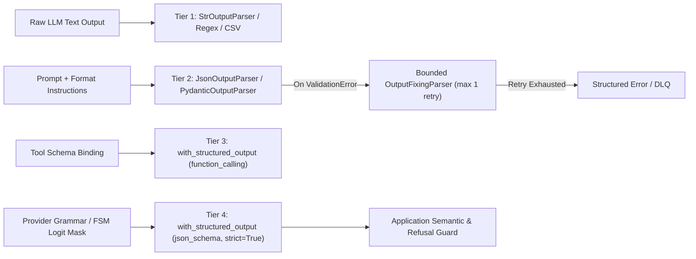
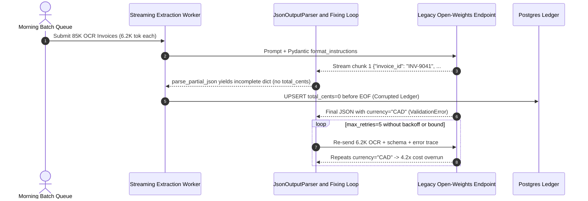

# Module 04: Output Parsers

> **Prerequisites:** [Module 02: Models and Messages](../02-models-and-messages/README.md), [Module 03: Prompt Templates](../03-prompt-templates/README.md), and [Track 07, Module 08: Structured Output Prompting](../../07-prompt-engineering/08-structured-output-prompting/README.md).  
> **Estimated Reading Time:** 35 minutes  
> **Target Audience:** AI Backend Engineers, LLM Platform Engineers, API Integration Developers

> [!TIP]
> **The Golden Rule of Output Parsers:** Never rely on prompt instructions plus regex/JSON text extraction in production when the model provider supports grammar-constrained decoding (`.with_structured_output(..., method="json_schema", strict=True)`). Treat prompt-instructed parsers (`PydanticOutputParser`, `JsonOutputParser`) strictly as fallback adapters for legacy or open-weights endpoints—and whenever you pair them with `OutputFixingParser`, bound repair retries ($R_{\max} \le 1$) and isolate streamed partial chunks from persisted database writes.

---

## Why This Matters

Large language models emit probabilistic token sequences, while backend services, SQL databases, and workflow engines demand deterministic typed contracts. In notebook demos, asking a model to *"Return valid JSON with keys `invoice_id` and `amount_cents`"* works often enough to look finished. Under production load across `100,000` daily requests, even a `2%` formatting failure rate creates `2,000` broken payloads every single day: markdown code fences (` ```json `), conversational preambles (`"Sure, here is the extracted invoice:"`), formatted currency strings (`"\$1,240.00"` instead of integer `124000`), missing required fields, or extra hallucinated keys that crash strict downstream serializers.

Worse, engineers often try to patch brittle prompt-based parsers using two traps: (1) wrapping `PydanticOutputParser` in unbounded `OutputFixingParser` loops that re-send massive context prompts on every minor schema violation, multiplying token bills during subtle prompt drift, and (2) forwarding incremental `.stream()` / `.astream()` partial-JSON chunks directly into webhooks or databases before the complete object passes validation. Mastering the **4-tier structured extraction hierarchy**, partial-stream safety, and bounded repair math turns LLM integration from fragile text scraping into a predictable typed service boundary.

---

## 1. The 4-Tier Output Parsing & Structured Extraction Hierarchy

LangChain separates output extraction into two eras: **post-hoc text parsers** (`langchain_core.output_parsers`) that instruct the model via text and parse `AIMessage.content`, and **provider-enforced structured outputs** (`.with_structured_output()`) that constrain token generation at the API or logit-masking layer.



### Tier 1: String & Delimiter Parsers (`StrOutputParser`, `CommaSeparatedListOutputParser`)

- **`StrOutputParser`:** Unwraps a chat model's `AIMessage` (handling string content or provider-specific multi-block arrays such as Anthropic text + thinking blocks) into a plain `str`. Because it imposes zero schema assumptions, it supports **true token-by-token streaming** (`stream` / `astream`) and belongs at the end of user-facing prose chains.
- **`CommaSeparatedListOutputParser` / Regex Parsers:** Inject format rules into the prompt (`"Your response should be a list of comma separated values..."`) and split on `,`. **Production hazard:** any item containing an unescaped comma (e.g., `"Acme, Inc."`) splits one entity into two corrupted elements. Reserve list/regex parsers strictly for controlled non-production scripts.

### Tier 2: Prompt-Instructed JSON & Pydantic Parsers (`JsonOutputParser`, `PydanticOutputParser`)

When targeting endpoints that lack native tool calling or constrained decoding (such as older local `llama.cpp` templates or custom fine-tunes), `PydanticOutputParser` and `JsonOutputParser` serialize your Pydantic v2 `BaseModel` into JSON Schema via `.get_format_instructions()`, inject it into the prompt, strip markdown fences with `parse_json_markdown()`, and validate the resulting Python object:

- **Input Token Tax:** Calling `parser.get_format_instructions()` injects the full JSON Schema plus boilerplate rules (`~180–900` extra input tokens per request depending on schema complexity).
- **The Partial-JSON Streaming Trap:** `JsonOutputParser` overrides `.transform()` using `parse_partial_json()`, which closes open braces/brackets optimistically on every streamed token delta. On chunk `#1`, `{"invoice_id": "INV-882", "items": [` parses cleanly to `{"invoice_id": "INV-882", "items": []}`—before `tax_cents` or `total_cents` have been generated! Conversely, running strict `PydanticOutputParser.parse()` on incomplete chunks raises `ValidationError` mid-stream. **Rule:** Stream partial JSON *only* for progressive UI rendering, and never write to databases or trigger side effects until end-of-stream (`finish_reason == "stop"`) passes complete schema validation.

### Tier 3 vs. Tier 4: `.with_structured_output()` (Tool Binding vs. Strict Constrained Decoding)

Calling `model.with_structured_output(Schema, method=..., strict=..., include_raw=True)` returns an LCEL `Runnable` that shifts structural enforcement from prompt prose into the provider API:

1. **`method="function_calling"` (Tool-Call Binding):** Converts the Pydantic/Zod/JSON Schema into a synthetic tool definition (`tool_choice` forced to that tool name). The model populates `tool_calls[0].args`. While vastly more reliable than raw prompt instructions, models without grammar masking can still emit wrong enum casing, omit deeply nested fields, or mis-type `"42"` as a string under high temperature.
2. **`method="json_schema", strict=True` (Grammar-Constrained Decoding):** Compiles the JSON Schema into a deterministic Finite-State Machine (FSM) at the inference layer (via OpenAI Structured Outputs, vLLM `xgrammar` / `outlines` per Willard & Louf `arXiv:2307.09702`, or Gemini `response_schema`). At every decode step, invalid tokens receive logit bias $-\infty$, forcing **100% syntactic compliance**.
   - **Strict Schema Constraints:** Every `object` node must declare `"additionalProperties": false`, and every key in `"properties"` must appear in `"required"`. Optional fields must be modeled explicitly as nullable unions (`anyOf: [{"type": "string"}, {"type": "null"}]`).
   - **First-Schema Compilation Latency:** Providers cache compiled FSM grammars per schema hash; the very first call with a novel complex schema can incur `1–10 s` compilation overhead, after which subsequent requests execute at normal decode speed.
   - **Reasoning Ordering Rule (Tam et al., `arXiv:2408.02442`):** Forcing a model to emit rigid JSON directly into a single classification field (`{"risk": "HIGH"}`) suppresses chain-of-thought reasoning tokens and degrades accuracy on complex tasks. Always place a `reasoning: str` field **before** the verdict/enum field in your schema so autoregressive generation computes justification before committing to the label.
   - **Always Inspect Refusals (`include_raw=True`):** Strict decoding guarantees syntax, not compliance with safety or domain preconditions. Always pass `include_raw=True` (returning `{"raw": AIMessage, "parsed": Model | None, "parsing_error": Exception | None}`) so you can distinguish a provider `refusal` field from a transport or validation failure.

### Quantitative Cost & Cascade Math for `OutputFixingParser`

When operating against Tier 2 prompt-instructed endpoints, teams frequently wrap `PydanticOutputParser` in `OutputFixingParser` (which sends the original schema, malformed output, and `ValidationError` back to an LLM to repair). Let single-call baseline cost be $c_0$, first-pass validity probability be $p \in (0, 1]$, per-repair call cost be $c_{\text{fix}}$, per-repair latency be $L_{\text{fix}}$, and maximum repair retries be $R_{\max}$. The expected cost, expected latency penalty, and failure escape rate are:

$$E[\text{cost}] = c_0 + \sum_{k=1}^{R_{\max}} (1 - p)^k c_{\text{fix}} = c_0 + c_{\text{fix}} \cdot \frac{(1 - p)\bigl(1 - (1 - p)^{R_{\max}}\bigr)}{p}$$

$$E[\Delta L] = \sum_{k=1}^{R_{\max}} (1 - p)^k L_{\text{fix}}, \qquad P_{\text{fail}} = (1 - p)^{R_{\max} + 1}$$

Notice two critical operational consequences:
1. **Repair Calls Cost More Than Initial Calls ($c_{\text{fix}} > c_0$):** The repair prompt must carry the full schema instructions, the malformed response, and the validator traceback.
2. **Schema Drift Multiplies Bills Exponentially:** If a prompt change drops $p$ from `0.95` to `0.35` while `R_max = 5`, $(1-p) = 0.65$ drives repair inflation across 5 sequential round-trips—spiking request cost by `4x+` and adding `1.5+ seconds` of tail latency before failing `7.5%` of requests anyway. Keep $R_{\max} \le 1$ and route repair attempts to a smaller, low-cost model—or eliminate repairs altogether via Tier 4 `strict=True` decoding.

---

## 2. Systematic Comparison Matrix: Output Parsing Strategies

| Strategy / Parser | Mechanism | Structural Guarantee | Streaming Behavior | Token & Latency Overhead | Primary Production Fit |
| :--- | :--- | :--- | :--- | :--- | :--- |
| **`StrOutputParser`** | Extracts `AIMessage.content` string | None (unstructured text) | True token-by-token (`stream` / `astream`) | Zero extra tokens or latency | User-facing chat prose, RAG narrative answers |
| **Regex / `CommaSeparatedListOutputParser`** | Prompt hint + regex / delimiter split | Very Low (breaks on commas/chatter) | Buffers or splits fragile chunks | `~40–100` prompt tokens | Quick prototypes only; avoid in production APIs |
| **`JsonOutputParser`** | Injects JSON hint; `parse_partial_json` | Low–Medium (chatter/trailing commas can fail) | Emits **incomplete partial dicts** per chunk | `~150–600` schema tokens | Progressive UI streaming when paired with end-of-stream gate |
| **`PydanticOutputParser`** | Injects JSON Schema; Pydantic v2 validation | Medium (catches schema errors post-decode) | Must buffer until complete valid JSON | `~200–900` schema tokens | Open-weights/legacy models lacking tool or schema APIs |
| **`OutputFixingParser` (Bounded)** | Sends malformed text + traceback to repair LLM | Medium–High (bounded by $R_{\max} \le 1$) | Non-streaming on repair path | `+(1-p) \cdot c_{\text{fix}}$ cost; `+L_fix` tail | Last-resort fallback adapter on legacy endpoints |
| **`.with_structured_output(method="function_calling")`** | Native tool call schema binding | High (provider parses `tool_calls`) | Streams partial tool-call arg deltas | Native tool tokens; low retry rate | Multi-provider apps needing broad model compatibility |
| **`.with_structured_output(method="json_schema", strict=True)`** | FSM grammar-constrained logit masking | **100% Syntactic** (requires `additionalProperties: false`) | Streams valid partial JSON; validate EOF | First-schema FSM compile cache; zero syntax retries | Production microservices, billing, SQL/API payload generation |

---

## 3. Production War Story Post-Mortem: The \$38,400 Partial-JSON & Unbounded Retry Storm

| Field | Incident Details |
| :--- | :--- |
| **Severity** | **SEV-1** (Database Ledger Corruption + Unbounded LLM Spend Spike) |
| **Detection / Resolution Time** | Detected 36 hours post-deploy via finance reconciliation alert / Mitigated in 2 hours (rollback + strict decoding patch) |
| **Impact** | `1,420` expense records persisted with truncated `total_cents = 0`; **\$38,400** unplanned inference overrun from `5x` retry cascades |

### What Happened

An accounts-payable SaaS platform migrated its invoice extractor from batch processing to a streaming FastAPI worker using a prompt-instructed `JsonOutputParser` for live UI previews and a custom `OutputFixingParser` wrapper (`max_retries=5`) for backend database persistence. Simultaneously, product added a strict new field `currency: Literal["USD", "EUR", "GBP"]` to the Pydantic model.

Two failures compounded under morning batch traffic (`85,000` invoices):

1. **Streaming Partial-JSON Commit Bug:** To lower perceived latency, the webhook handler subscribed to `.astream()` from `JsonOutputParser` and executed an idempotent Postgres `UPSERT` whenever `chunk.get("invoice_id")` was non-empty. Because `parse_partial_json()` closes braces early, chunk `#1` emitted `{"invoice_id": "INV-9041"}` before `tax_cents` or `total_cents` arrived, writing `total_cents = 0` defaults that bypassed downstream approval checks when workers timed out mid-stream.
2. **Unbounded `OutputFixingParser` Cascade:** The older open-weights model frequently returned `"USD "` (trailing space) or `"CAD"` for Canadian invoices, failing `Literal["USD", "EUR", "GBP"]`. Every failure triggered `OutputFixingParser` up to `5` times, each time resending the `6,200`-token raw OCR invoice plus full schema instructions and traceback—inflating spend `4.2x` (\$38,400 in 36 hours) and saturating worker queues.



### Root Cause Analysis

- **Conflating Progressive UI Chunks with Transactional Completeness:** `JsonOutputParser.astream()` yields syntactically closed dictionaries from incomplete token prefixes; persistence code treated any `dict` containing a primary key as final.
- **Using Repair Loops for Semantic / Enum Mismatches:** An LLM cannot invent `"USD"` for a `"CAD"` invoice by retrying five times with a syntax-repair prompt. Unbounded `OutputFixingParser` turned an enum mismatch into a `6x` token multiplier.

### The Fix & Architectural Hardening

- **Constrained Decoding + Explicit `UNKNOWN` / Nullable Enums:** Migrated to `.with_structured_output(InvoiceSchema, method="json_schema", strict=True, include_raw=True)` and added `"OTHER"` to the currency enum alongside an `is_supported_currency` semantic flag.
- **Transactional End-of-Stream Gate:** Kept streaming strictly for read-only WebSocket UI previews and moved Postgres writes exclusively behind `finish_reason == "stop"` + full Pydantic `model_validate_json(..., strict=True)`.
- **Bounded Repair Circuit Breaker:** Capped fallback repair at $R_{\max} = 1$ using a low-cost model (`gpt-4o-mini` / small validator) and routed remaining failures directly to a Dead-Letter Queue (DLQ) with structured rejection metrics.

---

## 4. Multi-Language Production Implementation: Strict Schema Extraction, Partial-Stream Guard & Bounded Repair

The production implementations below across **Go**, **TypeScript**, **Python**, and **C#** implement a hardened extraction layer: (1) strict schema validation rejecting unknown keys (`additionalProperties: false` / `extra="forbid"`), (2) explicit refusal separation, (3) safe stream buffering that withholds database commits until complete EOF validation passes, and (4) bounded $R_{\max} \le 1$ repair fallback.

````carousel

```go
package parsers

import (
	"bytes"
	"context"
	"encoding/json"
	"errors"
	"fmt"
	"regexp"
	"strings"
)

type InvoiceExtraction struct {
	Reasoning   string `json:"reasoning"`
	InvoiceID   string `json:"invoice_id"`
	AmountCents int64  `json:"amount_cents"`
	Currency    string `json:"currency"`
	Refusal     string `json:"refusal,omitempty"`
}

var markdownFenceRe = regexp.MustCompile("(?s)```(?:json)?\\s*(\\{.*?\\})\\s*```")

// ParseStrictInvoice enforces strict field matching (no unknown fields) and domain enums.
func ParseStrictInvoice(raw string) (*InvoiceExtraction, error) {
	cleaned := strings.TrimSpace(raw)
	if match := markdownFenceRe.FindStringSubmatch(cleaned); len(match) == 2 {
		cleaned = match[1]
	}

	var out InvoiceExtraction
	dec := json.NewDecoder(bytes.NewBufferString(cleaned))
	dec.DisallowUnknownFields() // Equivalent to additionalProperties: false
	if err := dec.Decode(&out); err != nil {
		return nil, fmt.Errorf("json schema decode failed: %w", err)
	}
	if out.Refusal != "" {
		return nil, fmt.Errorf("model refusal: %s", out.Refusal)
	}
	if strings.TrimSpace(out.InvoiceID) == "" || out.AmountCents < 0 {
		return nil, errors.New("missing invoice_id or negative amount_cents")
	}
	switch out.Currency {
	case "USD", "EUR", "GBP":
		return &out, nil
	default:
		return nil, fmt.Errorf("unsupported currency enum: %q", out.Currency)
	}
}

type RepairClient interface {
	GenerateStrict(ctx context.Context, prompt string) (string, error)
}

// ExtractWithBoundedRepair enforces R_max <= 1 to prevent cost cascade storms.
func ExtractWithBoundedRepair(
	ctx context.Context,
	rawInitial string,
	repairer RepairClient,
	maxRepairs int,
) (*InvoiceExtraction, error) {
	if maxRepairs > 1 {
		maxRepairs = 1 // Hard safety ceiling
	}
	parsed, err := ParseStrictInvoice(rawInitial)
	if err == nil {
		return parsed, nil
	}
	if maxRepairs == 0 || repairer == nil {
		return nil, err
	}

	repairPrompt := fmt.Sprintf(
		"Fix ONLY the schema error (%v) and return strict JSON:\n%s",
		err, rawInitial,
	)
	repairedRaw, repErr := repairer.GenerateStrict(ctx, repairPrompt)
	if repErr != nil {
		return nil, fmt.Errorf("repair call failed (%v) after initial error (%w)", repErr, err)
	}
	return ParseStrictInvoice(repairedRaw)
}

// StreamAccumulator buffers deltas and validates ONLY at EOF to block partial-JSON DB writes.
type StreamAccumulator struct {
	buf strings.Builder
}

func (s *StreamAccumulator) AppendDelta(delta string) {
	s.buf.WriteString(delta)
}

func (s *StreamAccumulator) FinalizeEOF() (*InvoiceExtraction, error) {
	return ParseStrictInvoice(s.buf.String())
}
```

<!-- slide -->

```typescript
import { ChatOpenAI } from "@langchain/openai";
import { ChatPromptTemplate } from "@langchain/core/prompts";
import { z } from "zod";

// Place reasoning BEFORE enum/decision fields to avoid constrained-decoding accuracy loss.
export const InvoiceSchema = z
  .object({
    reasoning: z.string().describe("Brief audit justification from invoice text"),
    invoiceId: z.string().min(1),
    amountCents: z.number().int().nonnegative(),
    currency: z.enum(["USD", "EUR", "GBP"]),
  })
  .strict(); // Disallows extra hallucinated properties

export type InvoiceExtraction = z.infer<typeof InvoiceSchema>;

export interface SafeExtractionResult {
  ok: boolean;
  data?: InvoiceExtraction;
  refusal?: string;
  error?: string;
  repairUsed: boolean;
}

export async function extractInvoiceStrict(
  ocrText: string,
  primaryModel: ChatOpenAI,
  fallbackRepairModel?: ChatOpenAI,
): Promise<SafeExtractionResult> {
  const prompt = ChatPromptTemplate.fromMessages([
    ["system", "Extract normalized invoice fields strictly from evidence."],
    ["human", "{ocrText}"],
  ]);

  // Tier 4: Strict JSON Schema constrained decoding + raw envelope inspection
  const structuredLlm = primaryModel.withStructuredOutput(InvoiceSchema, {
    name: "invoice_extraction",
    method: "jsonSchema",
    strict: true,
    includeRaw: true,
  });

  const chain = prompt.pipe(structuredLlm);
  const res = await chain.invoke({ ocrText });

  const refusal = (res.raw as { additional_kwargs?: { refusal?: string } })
    ?.additional_kwargs?.refusal;
  if (refusal) {
    return { ok: false, refusal, repairUsed: false };
  }
  if (!res.parsingError && res.parsed) {
    return { ok: true, data: res.parsed, repairUsed: false };
  }

  // Bounded 1-attempt fallback repair (R_max = 1)
  if (!fallbackRepairModel) {
    return {
      ok: false,
      error: String(res.parsingError ?? "Unknown parse error"),
      repairUsed: false,
    };
  }

  const repairLlm = fallbackRepairModel.withStructuredOutput(InvoiceSchema, {
    method: "jsonSchema",
    strict: true,
  });
  try {
    const repaired = await repairLlm.invoke(
      `Repair validation error (${String(res.parsingError)}) for payload: ${JSON.stringify(res.raw.content)}`,
    );
    return { ok: true, data: repaired, repairUsed: true };
  } catch (err) {
    return { ok: false, error: String(err), repairUsed: true };
  }
}

// Stream UI preview safely while withholding persistence until final validated state
export async function streamWithTransactionalGate(
  chain: ReturnType<ChatPromptTemplate["pipe"]>,
  input: Record<string, string>,
  onUiPreview: (partial: Partial<InvoiceExtraction>) => void,
  onPersistComplete: (finalData: InvoiceExtraction) => Promise<void>,
): Promise<void> {
  let latestChunk: Partial<InvoiceExtraction> | null = null;
  const stream = await chain.stream(input);
  for await (const chunk of stream) {
    latestChunk = chunk as Partial<InvoiceExtraction>;
    onUiPreview(latestChunk); // Read-only preview only
  }
  const validated = InvoiceSchema.parse(latestChunk); // Throws if stream truncated
  await onPersistComplete(validated);
}
```

<!-- slide -->

```python
"""
strict_output_extractor.py
Production LangChain v0.3 structured extraction using strict JSON Schema decoding,
reasoning-first field ordering, refusal inspection, and R_max=1 bounded repair.
"""
from dataclasses import dataclass
from typing import Literal
from langchain_core.language_models import BaseChatModel
from langchain_core.prompts import ChatPromptTemplate
from pydantic import BaseModel, ConfigDict, Field, ValidationError


class InvoiceExtraction(BaseModel):
    model_config = ConfigDict(extra="forbid")  # Maps to additionalProperties: false

    # Reasoning precedes decision/amount fields (Tam et al., arXiv:2408.02442)
    reasoning: str = Field(description="Concise justification quoting line items")
    invoice_id: str = Field(min_length=1)
    amount_cents: int = Field(ge=0)
    currency: Literal["USD", "EUR", "GBP"]


@dataclass(frozen=True)
class ExtractionOutcome:
    ok: bool
    data: InvoiceExtraction | None
    refusal: str | None
    error: str | None
    repair_used: bool


async def extract_invoice_strict(
    ocr_text: str,
    primary_model: BaseChatModel,
    repair_model: BaseChatModel | None = None,
) -> ExtractionOutcome:
    prompt = ChatPromptTemplate.from_messages([
        ("system", "Extract normalized invoice data strictly from the OCR text."),
        ("human", "{ocr_text}"),
    ])
    # Tier 4: Constrained JSON Schema decoding with raw envelope preserved
    structured = primary_model.with_structured_output(
        InvoiceExtraction,
        method="json_schema",
        strict=True,
        include_raw=True,
    )
    chain = prompt | structured
    result = await chain.ainvoke({"ocr_text": ocr_text})

    raw_msg = result["raw"]
    refusal = getattr(raw_msg, "additional_kwargs", {}).get("refusal")
    if refusal:
        return ExtractionOutcome(ok=False, data=None, refusal=str(refusal), error=None, repair_used=False)

    if result["parsing_error"] is None and result["parsed"] is not None:
        return ExtractionOutcome(ok=True, data=result["parsed"], refusal=None, error=None, repair_used=False)

    # Bounded R_max = 1 repair fallback (never unbounded loops)
    if repair_model is None:
        return ExtractionOutcome(
            ok=False, data=None, refusal=None, error=str(result["parsing_error"]), repair_used=False
        )

    repair_chain = repair_model.with_structured_output(InvoiceExtraction, method="json_schema", strict=True)
    try:
        fixed = await repair_chain.ainvoke(
            f"Repair schema failure ({result['parsing_error']}) from raw output:\n{raw_msg.content}"
        )
        return ExtractionOutcome(ok=True, data=fixed, refusal=None, error=None, repair_used=True)
    except (ValidationError, Exception) as exc:
        return ExtractionOutcome(ok=False, data=None, refusal=None, error=str(exc), repair_used=True)


async def stream_with_eof_commit(chain, payload: dict[str, str], on_preview, on_commit) -> InvoiceExtraction:
    """Emit partial objects strictly for UI preview; commit ONLY after EOF full validation."""
    final_candidate: dict | BaseModel | None = None
    async for chunk in chain.astream(payload):
        final_candidate = chunk
        await on_preview(chunk)

    # Re-validate complete payload at EOF to guarantee no truncated stream reached DB
    validated = (
        final_candidate
        if isinstance(final_candidate, InvoiceExtraction)
        else InvoiceExtraction.model_validate(final_candidate)
    )
    await on_commit(validated)
    return validated
```

<!-- slide -->

```csharp
using System;
using System.Collections.Generic;
using System.Text;
using System.Text.Json;
using System.Text.Json.Serialization;
using System.Text.RegularExpressions;
using System.Threading;
using System.Threading.Tasks;

namespace GenAI.OutputParsers;

[JsonUnmappedMemberHandling(JsonUnmappedMemberHandling.Disallow)]
public sealed record InvoiceExtraction
{
    [JsonRequired]
    [JsonPropertyName("reasoning")]
    public required string Reasoning { get; init; }

    [JsonRequired]
    [JsonPropertyName("invoice_id")]
    public required string InvoiceId { get; init; }

    [JsonRequired]
    [JsonPropertyName("amount_cents")]
    public required long AmountCents { get; init; }

    [JsonRequired]
    [JsonPropertyName("currency")]
    public required string Currency { get; init; }

    [JsonPropertyName("refusal")]
    public string? Refusal { get; init; }
}

public sealed record ParseOutcome(bool Ok, InvoiceExtraction? Data, string? Error, bool RepairUsed);

public static partial class StrictInvoiceParser
{
    private static readonly HashSet<string> AllowedCurrencies = new(StringComparer.Ordinal) { "USD", "EUR", "GBP" };

    [GeneratedRegex(@"```(?:json)?\s*(\{.*?\})\s*```", RegexOptions.Singleline)]
    private static partial Regex MarkdownFenceRegex();

    public static ParseOutcome ParseStrict(string raw)
    {
        string cleaned = raw.Trim();
        var match = MarkdownFenceRegex().Match(cleaned);
        if (match.Success)
        {
            cleaned = match.Groups[1].Value;
        }

        try
        {
            var data = JsonSerializer.Deserialize<InvoiceExtraction>(cleaned);
            if (data is null)
                return new ParseOutcome(false, null, "Null JSON root", false);
            if (!string.IsNullOrWhiteSpace(data.Refusal))
                return new ParseOutcome(false, null, $"Model refusal: {data.Refusal}", false);
            if (string.IsNullOrWhiteSpace(data.InvoiceId) || data.AmountCents < 0)
                return new ParseOutcome(false, null, "Invalid invoice_id or negative amount_cents", false);
            if (!AllowedCurrencies.Contains(data.Currency))
                return new ParseOutcome(false, null, $"Unsupported currency: {data.Currency}", false);

            return new ParseOutcome(true, data, null, false);
        }
        catch (JsonException ex)
        {
            return new ParseOutcome(false, null, $"Strict schema violation: {ex.Message}", false);
        }
    }

    public static async Task<ParseOutcome> ExtractWithBoundedRepairAsync(
        string initialRaw,
        Func<string, CancellationToken, Task<string>> repairCallAsync,
        CancellationToken ct)
    {
        var first = ParseStrict(initialRaw);
        if (first.Ok) return first;

        // Hard cap R_max = 1 to avoid runaway cascade bills
        string repairPrompt = $"Fix schema violation ({first.Error}) and return ONLY valid JSON:\n{initialRaw}";
        string repairedRaw = await repairCallAsync(repairPrompt, ct);
        var second = ParseStrict(repairedRaw);
        return second with { RepairUsed = true };
    }
}

public sealed class SafeStreamBuffer
{
    private readonly StringBuilder _buffer = new();

    public void AppendChunk(string delta) => _buffer.Append(delta);

    // Prevent partial JSON from writing incomplete rows before EOF
    public ParseOutcome ValidateAtEof() => StrictInvoiceParser.ParseStrict(_buffer.ToString());
}
```

````

---

## 5. Practical Hands-On Verification CLI Workflows

Run these deterministic Python 3.13 verification scripts locally with zero third-party packages or API keys required.

### Workflow 1: Reproduce the Streaming Partial-JSON Corruption Trap

Simulate streaming token deltas of an invoice JSON object, comparing optimistic partial-JSON auto-closure (which corrupts intermediate `total_cents = 0` reads) against an end-of-stream strict completeness gate:

```bash
python -c '
import json

deltas = [
    "{\"invoice_id\": \"INV-882\", ",
    "\"items\": [{\"sku\": \"A1\", \"qty\": 2}], ",
    "\"tax_cents\": 450, ",
    "\"total_cents\": 5450}"
]

def naive_partial_parse(buf):
    if not buf.strip().endswith("}"):
        candidate = buf.rstrip(", ") + "}"
    else:
        candidate = buf
    try:
        return json.loads(candidate)
    except json.JSONDecodeError:
        return None

def strict_complete_parse(buf, required_keys):
    try:
        obj = json.loads(buf)
    except json.JSONDecodeError:
        return None
    if not required_keys.issubset(obj.keys()):
        return None
    return obj

buffer = ""
required = {"invoice_id", "items", "tax_cents", "total_cents"}
for step, chunk in enumerate(deltas, 1):
    buffer += chunk
    partial_obj = naive_partial_parse(buffer)
    strict_obj = strict_complete_parse(buffer, required)
    partial_total = partial_obj.get("total_cents", 0) if partial_obj else "ERR"
    strict_status = "COMMIT_OK" if strict_obj else "WAIT_FOR_EOF"
    print(f"chunk={step} | naive_partial_total_cents={partial_total} | strict_gate={strict_status}")
'
```

**Expected Output:**

```text
chunk=1 | naive_partial_total_cents=0 | strict_gate=WAIT_FOR_EOF
chunk=2 | naive_partial_total_cents=0 | strict_gate=WAIT_FOR_EOF
chunk=3 | naive_partial_total_cents=0 | strict_gate=WAIT_FOR_EOF
chunk=4 | naive_partial_total_cents=5450 | strict_gate=COMMIT_OK
```

Chunks `1–3` all look syntactically valid after `parse_partial_json` auto-closure, yet default `total_cents` to `0` until chunk `4` completes.

### Workflow 2: Simulate `OutputFixingParser` Cascade Spend & Failure Escape Rates

Quantify expected per-request cost, tail latency inflation, failure escape rate, and `10,000`-request spend across reliability tiers ($c_0$ = \$0.0040, $c_{\text{fix}}$ = \$0.0075, $L_{\text{fix}} = 950\text{ ms}$):

```bash
python -c '
def cascade_metrics(p_valid, r_max, c0=0.0040, c_fix=0.0075, l_fix_ms=950.0, n_reqs=10_000):
    repair_cost = sum(((1.0 - p_valid) ** k) * c_fix for k in range(1, r_max + 1))
    exp_cost = c0 + repair_cost
    exp_extra_ms = sum(((1.0 - p_valid) ** k) * l_fix_ms for k in range(1, r_max + 1))
    p_fail = (1.0 - p_valid) ** (r_max + 1)
    total_bill = exp_cost * n_reqs
    return exp_cost, exp_extra_ms, p_fail, total_bill

configs = [
    ("Schema Drift (p=0.35, R=5)", 0.35, 5),
    ("Prompt-only (p=0.72, R=0)", 0.72, 0),
    ("Prompt + Fix (p=0.72, R=1)", 0.72, 1),
    ("Prompt + Fix (p=0.72, R=5)", 0.72, 5),
    ("Tool-call (p=0.96, R=1)", 0.96, 1),
    ("Strict Schema (p=0.999, R=1)", 0.999, 1),
]
for name, p, r in configs:
    ec, ems, pf, bill = cascade_metrics(p, r)
    print(f"{name:<30} | E[cost]=${ec:.5f} | +lat={ems:6.1f}ms | fail={pf*100:7.4f}% | 10k=${bill:7.2f}")
'
```

**Expected Output:**

```text
Schema Drift (p=0.35, R=5)     | E[cost]=$0.01631 | +lat=1559.6ms | fail= 7.5419% | 10k=$ 163.12
Prompt-only (p=0.72, R=0)      | E[cost]=$0.00400 | +lat=   0.0ms | fail=28.0000% | 10k=$  40.00
Prompt + Fix (p=0.72, R=1)      | E[cost]=$0.00610 | +lat= 266.0ms | fail= 7.8400% | 10k=$  61.00
Prompt + Fix (p=0.72, R=5)      | E[cost]=$0.00691 | +lat= 368.8ms | fail= 0.0482% | 10k=$  69.12
Tool-call (p=0.96, R=1)        | E[cost]=$0.00430 | +lat=  38.0ms | fail= 0.1600% | 10k=$  43.00
Strict Schema (p=0.999, R=1)   | E[cost]=$0.00401 | +lat=   1.0ms | fail= 0.0001% | 10k=$  40.07
```

Notice how schema drift (`p=0.35, R=5`) inflates the `10K`-request bill from `\$40.07` to `\$163.12` (`4.07x`) and adds `+1.56 s` mean latency—while still dropping `7.54%` of payloads!

### Workflow 3: Strict Validator Test Suite Across 6 Adversarial Model Outputs

Verify markdown-fence stripping, required-key checks, `extra="forbid"` rejection, enum enforcement, and explicit model refusal handling:

```bash
python -c '
import json, re

ALLOWED_CURRENCIES = {"USD", "EUR", "GBP"}
REQUIRED = {"invoice_id", "amount_cents", "currency"}

def strip_fences_and_validate(raw):
    text = raw.strip()
    fence = re.search(r"```(?:json)?\s*(\{.*?\})\s*```", text, flags=re.DOTALL)
    if fence:
        text = fence.group(1)
    try:
        data = json.loads(text)
    except json.JSONDecodeError as exc:
        return False, f"JSON_SYNTAX_ERROR: {exc.msg}"
    if not isinstance(data, dict):
        return False, "SCHEMA_ERROR: root must be object"
    if "refusal" in data and data["refusal"]:
        ref = data["refusal"]
        return False, f"MODEL_REFUSAL: {ref}"
    missing = REQUIRED - data.keys()
    if missing:
        return False, f"MISSING_REQUIRED: {sorted(missing)}"
    extra = set(data.keys()) - REQUIRED
    if extra:
        return False, f"FORBIDDEN_EXTRA_KEYS: {sorted(extra)}"
    if not isinstance(data["amount_cents"], int) or data["amount_cents"] < 0:
        return False, "TYPE_ERROR: amount_cents must be non-negative int"
    cur = data["currency"]
    if cur not in ALLOWED_CURRENCIES:
        return False, f"ENUM_ERROR: unsupported currency {cur}"
    return True, f"VALID: {data}"

samples = [
    ("Clean JSON", json.dumps({"invoice_id": "I-1", "amount_cents": 1900, "currency": "USD"})),
    ("Fenced + Chatter", "Sure! Here is the JSON:\n```json\n" + json.dumps({"invoice_id": "I-2", "amount_cents": 4200, "currency": "EUR"}) + "\n```"),
    ("Missing Key", json.dumps({"invoice_id": "I-3", "currency": "USD"})),
    ("Extra Hallucinated Key", json.dumps({"invoice_id": "I-4", "amount_cents": 500, "currency": "GBP", "notes": "vip"})),
    ("Invalid Enum", json.dumps({"invoice_id": "I-5", "amount_cents": 500, "currency": "CAD"})),
    ("Explicit Refusal", json.dumps({"refusal": "Input contains unredacted SSN"})),
]
for label, raw in samples:
    ok, msg = strip_fences_and_validate(raw)
    print(f"{label:<22} -> ok={str(ok):<5} | {msg}")
'
```

**Expected Output:**

```text
Clean JSON             -> ok=True  | VALID: {'invoice_id': 'I-1', 'amount_cents': 1900, 'currency': 'USD'}
Fenced + Chatter       -> ok=True  | VALID: {'invoice_id': 'I-2', 'amount_cents': 4200, 'currency': 'EUR'}
Missing Key            -> ok=False | MISSING_REQUIRED: ['amount_cents']
Extra Hallucinated Key -> ok=False | FORBIDDEN_EXTRA_KEYS: ['notes']
Invalid Enum           -> ok=False | ENUM_ERROR: unsupported currency CAD
Explicit Refusal       -> ok=False | MODEL_REFUSAL: Input contains unredacted SSN
```

### Hands-On Exercises

1. **Semantic Cross-Field Check:** Extend Workflow 3 so the payload includes `subtotal_cents` and `tax_cents`, and fail validation if `subtotal_cents + tax_cents != total_cents`—proving why strict JSON Schema syntax compliance never replaces domain invariants.
2. **Repair Budget Cap (`R_max`):** Modify Workflow 2 so `c_fix` drops to `\$0.0005` by routing repairs to a small validator model while capping `R_max = 1`. Record the cost savings vs. `R_max = 5` at `p = 0.72`.
3. **Optional Live SDK Probe (Requires API Key & `langchain-openai`):** Call `ChatOpenAI(model="gpt-4o-mini").with_structured_output(InvoiceExtraction, method="json_schema", strict=True, include_raw=True)` on a synthetic prompt containing both valid and policy-refusal inputs, verifying that `result["raw"]` exposes refusal signals separately from `result["parsed"]`.

### Independent Challenge

Your team migrates an HR resume-screening service from a prompt-instructed `PydanticOutputParser` to `.with_structured_output(CandidateScore, method="json_schema", strict=True)`. Syntax parse failures drop from `6.4%` to `0%`, **but** human auditors report that precision on borderline candidates drops by `9%` and first-time schema deploys experience unexpected `8-second` latency spikes on worker restarts. Diagnose both phenomena and design the exact schema and deployment fix without abandoning strict constrained decoding.

<details><summary>Architectural Discussion</summary>

Two distinct mechanisms explain the symptoms: (1) **Accuracy degradation under strict JSON** (Tam et al., `arXiv:2408.02442`): if `CandidateScore` places `decision: Literal["HIRE", "REJECT"]` first (or omits an explanatory field entirely), the constrained FSM forces the model to emit the binary label on token #1 with zero intermediate reasoning space. Moving a `reasoning: str` field *ahead* of `decision` inside the schema restores step-by-step justification before classification tokens are sampled. (2) **Cold FSM compilation latency**: strict JSON Schema engines compile and cache finite-state token masks per unique schema hash; rolling worker updates or dynamic runtime fields in schema descriptions invalidate cache keys, causing `1–10 s` compilation spikes on the first request. Keep schemas static across requests and warm the schema grammar cache during readiness probes before shifting production traffic.

</details>

---

## 6. Common Mistakes & Troubleshooting

- **Using `PydanticOutputParser` on frontier APIs that natively support `strict=True`:** Injecting `parser.get_format_instructions()` wastes `200–900` input tokens per call and invites markdown-fence failures when `.with_structured_output(..., method="json_schema", strict=True)` eliminates syntax defects at the token-sampling layer.
- **Putting `"optional_field": str = None` in strict JSON Schema without nullable unions:** OpenAI and vLLM strict schema modes mandate that every property appear in `"required"` and `"additionalProperties": false` be set on every object; optional fields must serialize as `anyOf: [T, null]`.
- **Forwarding `.astream()` partial-JSON dicts straight to database writes or external webhooks:** Incremental `parse_partial_json` auto-closes truncated keys and yields incomplete states (`items: []`, missing totals). Only use partials for read-only UI updates; validate complete payloads at `EOF`.
- **Wrapping prompt parsers in unbounded `OutputFixingParser` loops:** Retrying semantic or missing-context errors five times with the full source document amplifies costs by `4x+`. Bound repairs to $R_{\max} \le 1$ on a cheap validator model and dead-letter persistent errors.
- **Skipping semantic assertions after `strict=True`:** Grammar constraints guarantee `amount_cents` is an integer, not that `line_items` sum up to `total_cents` or that a date isn't in the year `1970`. Always pair constrained decoding with Pydantic `@model_validator` domain assertions.

---

## 7. Operational Validation Checkpoints & Checkpoint Quiz

### Operational Validation Checkpoints

<details><summary><strong>Checkpoint 1: Diagnosing why strict JSON Schema still threw a downstream failure</strong></summary>

A billing microservice switched to `.with_structured_output(Invoice, method="json_schema", strict=True)` and achieved `0%` `JSONDecodeError` rates, yet still crashed downstream when processing an uploaded medical record containing an unredacted patient ID. Explain what happened and how `include_raw=True` resolves it.

**Validation:** Constrained decoding guarantees syntactic adherence to your schema *unless* the provider triggers a safety or policy refusal, which returns a `refusal` message instead of valid structured JSON args. Without `include_raw=True`, `parsed` becomes `None` and downstream code hits an attribute error or opaque parsing exception. Enabling `include_raw=True` surfaces `raw.additional_kwargs["refusal"]` explicitly so the service can return a clean `422 Unprocessable Entity` audit message instead of retrying blindly.

</details>

<details><summary><strong>Checkpoint 2: Why OutputFixingParser doubled monthly token bills</strong></summary>

After deploying a prompt-instructed `PydanticOutputParser` with `OutputFixingParser(max_retries=4)` on an open-weights 8B model (`p_valid = 0.70`), monthly inference spend nearly doubled and `p99` latency jumped by `2.4 s`. Compute the expected repair overhead and propose the production fix.

**Validation:** At $p = 0.70$, $(1-p) = 0.30$ of requests fail first-pass validation, triggering $0.30 + 0.09 + 0.027 + 0.0081 \approx 0.425$ extra repair calls per request—each carrying the full schema instructions, raw input context, and error traceback ($c_{\text{fix}} > c_0$). Fix by migrating to grammar-constrained decoding (`vLLM` `xgrammar` / `.with_structured_output(..., strict=True)`) if supported, or capping `max_retries=1` routed to a dedicated lightweight repair model with DLQ fallback.

</details>

<details><summary><strong>Checkpoint 3: Preventing partial-stream state corruption in SSE pipelines</strong></summary>

A frontend team asks for token-level streaming on an expense extraction endpoint so fields populate live as the LLM generates them, while the backend persists the final record to PostgreSQL. Which parser behavior causes corruption if wired naively, and how do you architect both cleanly?

**Validation:** `JsonOutputParser.astream()` uses `parse_partial_json()` to auto-close incomplete JSON objects on every token delta, emitting valid Python `dict`s missing trailing keys (`total_cents`, `currency`). If the backend triggers `INSERT`/`UPSERT` on streamed `dict`s before `EOF`, truncated rows corrupt the database. Architect the endpoint so `.astream()` forwards partial dicts strictly to read-only SSE UI events, while a single post-stream gate validates the accumulated complete object with `model_validate(..., strict=True)` before executing the database transaction.

</details>

### Checkpoint Quiz

1. Why does `.with_structured_output(..., method="json_schema", strict=True)` outperform `PydanticOutputParser` in both reliability and input token efficiency?
2. What two JSON Schema constraints are required by strict constrained decoding engines (`OpenAI` / `xgrammar`) on every nested `object` definition?
3. Explain the **streaming partial-JSON trap** when combining `JsonOutputParser.astream()` with stateful side effects.
4. Given $c_0$ = \$0.0040, $c_{\text{fix}}$ = \$0.0075, first-pass validity $p = 0.72$, and $R_{\max} = 1$, what is $E[\text{cost}]$ per request and what percentage of requests still fail after repair?
5. Why should a schema place a `reasoning: str` field *before* a `verdict: Literal[...]` field when using constrained decoding?

<details><summary>Answers</summary>

1. Strict constrained decoding compiles the schema into an FSM logit mask at the token-sampling layer, enforcing `100%` structural syntax compliance without injecting `200–900` tokens of `get_format_instructions()` prose into every prompt.
2. Every `object` node must set `"additionalProperties": false`, and every key in `"properties"` must be listed in `"required"` (with optional fields modeled explicitly as nullable unions `anyOf: [T, null]`).
3. `JsonOutputParser.astream()` incrementally runs `parse_partial_json()`, closing unclosed braces early so partial dicts appear structurally valid long before trailing fields finish streaming—causing incomplete/default values to persist if writes execute before `EOF`.
4. $E[\text{cost}] = 0.0040 + (1 - 0.72)\cdot 0.0075 = 0.0040 + 0.0021 = 0.0061$ USD (\$0.0061 per request); residual failure rate is $(1 - 0.72)^2 = 0.28^2 = 7.84\%$.
5. Autoregressive models sample left-to-right; placing `reasoning` before `verdict` allows the model to generate intermediate justification tokens that condition the final decision logit, avoiding the accuracy drop observed when rigid JSON forces immediate classification on token `#1` (Tam et al., `arXiv:2408.02442`).

</details>

---

## Further Reading & Sources

- [LangChain Python Docs: Structured Outputs](https://python.langchain.com/docs/concepts/structured_outputs/) — official specification for `.with_structured_output()`, `strict=True`, and `include_raw=True`.
- [LangChain Python Docs: Output Parsers](https://python.langchain.com/docs/concepts/output_parsers/) — reference for `StrOutputParser`, `JsonOutputParser`, `PydanticOutputParser`, and streaming partial JSON behavior.
- [LangChain.js Docs: Output Parsers & Structured Outputs](https://js.langchain.com/docs/concepts/output_parsers/) — TypeScript `@langchain/core` parser interfaces and Zod schema integration.
- [OpenAI Docs: Structured Outputs Guide](https://platform.openai.com/docs/guides/structured-outputs) — formal rules for `strict: true`, `additionalProperties: false`, nullable unions, and `refusal` envelopes.
- [Efficient Guided Generation for Large Language Models (Willard & Louf, 2023)](https://arxiv.org/abs/2307.09702) — FSM grammar-constrained token masking (`Outlines`) mechanics behind zero-syntax-error decoding.
- [Let Me Speak Freely? A Study on the Impact of Format Restrictions on Performance of Large Language Models (Tam et al., 2024)](https://arxiv.org/abs/2408.02442) — empirical findings on reasoning degradation under rigid formatting constraints.
- [Pydantic v2 Documentation](https://docs.pydantic.dev/latest/) — strict mode (`ConfigDict(extra="forbid")`), `model_validate_json()`, and cross-field `@model_validator` invariants.

## Next

[Module 05: LCEL: The LangChain Expression Language](../05-lcel-the-langchain-expression-language/README.md)
