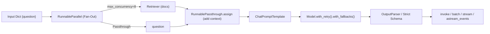
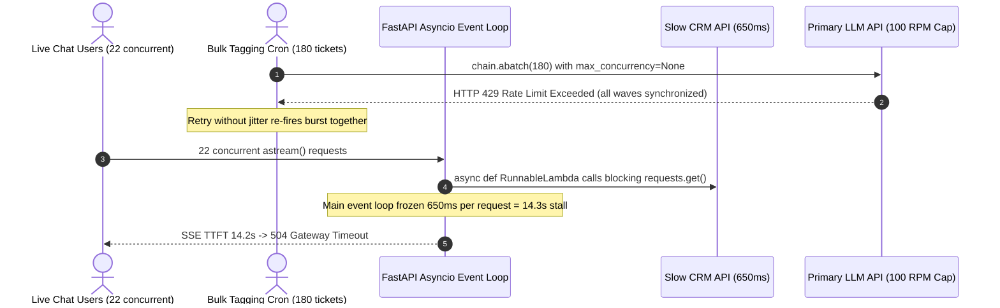

# Module 05: LCEL: The LangChain Expression Language

> **Prerequisites:** [Module 02: Models and Messages](../02-models-and-messages/README.md), [Module 03: Prompt Templates](../03-prompt-templates/README.md), and [Module 04: Output Parsers](../04-output-parsers/README.md).  
> **Estimated Reading Time:** 35 minutes  
> **Target Audience:** AI Backend Engineers, Async Services Engineers, LLM Platform Developers

> [!TIP]
> **The Golden Rule of LCEL:** Use `Runnable` composition (`|`, `RunnableParallel`, `.with_retry()`, `.with_fallbacks()`) for declarative, streamable linear transforms where every stage benefits from automatic LangSmith tracing and `astream_events` telemetry—and drop down to explicit `async def` functions wrapped in `RunnableLambda` (with bounded `max_concurrency`) the moment complex branching, loop control, or strict static type checking (`mypy`/`pyright`) makes nested pipe expressions harder to debug than plain code.

---

## Why This Matters

In quick prototypes, engineers glue prompts, vector retrievers, LLM calls, and parsers together with imperative glue functions. That works for a single synchronous call—until your backend ships to production behind FastAPI or Node.js and immediately hits four operational walls: (1) adding token-by-token Server-Sent Events (SSE) streaming forces you to rewrite every helper around async generators, (2) running `batch` over `200` documents without concurrency caps triggers instant HTTP `429` rate-limit storms, (3) placing synchronous HTTP or database calls inside an async pipeline freezes the shared event loop for every active user, and (4) observability collapses without unified trace spans across steps.

**LCEL (LangChain Expression Language)** solves these problems through a single unified protocol: **`Runnable[Input, Output]`**. Understanding the exact execution semantics of `|`, `RunnableParallel`, `RunnablePassthrough.assign()`, `RunnableLambda`, `.with_config()`, `.with_retry()`, and `.with_fallbacks()`—alongside the exact boundary where plain `async def` beats over-nested pipe expressions—keeps your pipelines fast, observable, and debuggable.

---

## 1. The `Runnable` Protocol & Composition Mechanics

Every core LangChain primitive (`ChatPromptTemplate`, `BaseChatModel`, `Retriever`, `OutputParser`, `RunnableLambda`) implements `Runnable[Input, Output]`. Chaining them with `|` (Python `__or__` / `__ror__`) or `.pipe()` (TypeScript) constructs an executable DAG (`RunnableSequence` and `RunnableParallel`) whose stages propagate configuration, cancellation, streaming generators, and trace IDs automatically.



### The 7 Standard `Runnable` Execution Methods

| Method | Execution Semantics | Concurrency & Streaming Behavior |
| :--- | :--- | :--- |
| **`invoke(x, config)` / `ainvoke(x, config)`** | Single-input sync / async execution returning final `Output` | Runs branches inside `RunnableParallel` concurrently (`ThreadPoolExecutor` for sync, `asyncio.gather` for async) |
| **`batch(xs, config)` / `abatch(xs, config)`** | Processes a list of inputs concurrently, preserving order | **Always** pass `config={"max_concurrency": N}` to prevent unbounded socket/429 burst storms |
| **`stream(x, config)` / `astream(x, config)`** | Yields incremental output chunks as upstream generates | Streams end-to-end *only* if every stage supports streaming `.transform()`; a non-streaming `RunnableLambda` forces upstream buffering |
| **`astream_events(x, version="v2")`** | Emits structured lifecycle events (`on_chain_start`, `on_chat_model_stream`, `on_retriever_end`) | Filter by `event["name"]` or `event["tags"]` via `.with_config()` to isolate user-visible SSE tokens from internal classifiers |

### Core LCEL Primitives & Subtle Runtime Traps

1. **`|` (`RunnableSequence`) & Implicit Coercion:** Writing `prompt | model | parser` constructs `RunnableSequence(steps=[prompt, model, parser])`. When you place a raw dict (`{"ctx": retriever, "q": RunnablePassthrough()}`) or plain function (`clean_text`) inside `|`, LCEL coerces them to `RunnableParallel` and `RunnableLambda`. **Type-checker hazard:** implicit coercion hides static input/output types from `mypy` and `pyright`, collapsing chain types to `Runnable[Any, Any]`. Explicitly instantiate `RunnableParallel(...)` and `RunnableLambda(...)` when maintaining strict typed libraries.
2. **`RunnableParallel` & `RunnablePassthrough.assign()`:**
   - `RunnableParallel` fans out a single input across named branches and gathers results into a dictionary.
   - `RunnablePassthrough.assign(context=retriever)` executes `retriever` on the incoming dict and merges `context` back into a shallow copy of the original dict—preserving existing keys like `question` and `tenant_id`. **Payload bloat risk:** repeatedly calling `.assign()` across 5 stages retains heavy intermediate arrays unless you project/drop unused keys between hops.
3. **`RunnableLambda(func=..., afunc=...)` (Sync vs. Async Event-Loop Safety):**
   - Passing **only a synchronous `func`** and calling `.ainvoke()`: LCEL automatically offloads `func` to AnyIO's worker threadpool (`40` default threads in Python) via `run_in_executor`. Safe against blocking the event loop, *but* limited by threadpool saturation under heavy concurrency.
   - Passing **an `async def afunc` that calls blocking I/O** (`time.sleep()`, `requests.get()`, synchronous `psycopg2`): **catastrophic anti-pattern**. Because LCEL awaits `afunc` directly on the main asyncio event loop, a single `400 ms` blocking socket call stalls *every concurrent user* on that worker process!
   - **Production rule:** Provide true non-blocking `httpx`/`asyncpg` inside `afunc` (and optionally a matching sync `func`), or keep blocking SDKs inside `func` so LCEL/AnyIO runs them in a worker thread.
4. **`.with_config()`, `.with_retry()`, and `.with_fallbacks()`:**
   - **`.with_config(tags=["user_sse"], run_name="final_synthesizer", max_concurrency=8)`:** Binds immutable runtime config onto a `Runnable` without mutating shared module-level singletons. Essential for isolating `astream_events` tags and throttling `abatch`.
   - **`.with_retry(stop_after_attempt=3, wait_exponential_jitter=True)`:** Wraps transient transport/rate-limit faults (`429`, `503`, timeouts) with jittered exponential backoff. *Never* retry `ValidationError` or deterministic `400 Bad Request` errors here.
   - **`.with_fallbacks([secondary_chain])`:** Switches to an alternate provider/model or smaller context route when primary retries exhaust or context limits fail. Note that `.stream()` fallbacks only trigger if the primary fails *before yielding its first chunk*!

### Quantitative Concurrency, Threadpool Queuing & Latency Math

Consider a `RunnableParallel` fan-out across $B$ independent I/O branches (`retriever`, `feature_store`, `policy_api`) with concurrency limit $M = \text{max\_concurrency}$ and individual branch latencies $L_1, \dots, L_B$:

$$L_{\text{seq}} = \sum_{i=1}^{B} L_i, \qquad L_{\text{parallel}}(B, M) \approx \left\lceil \frac{B}{M} \right\rceil \cdot \max_{\text{wave}} (L_i) + \epsilon_{\text{sched}}$$

When $M \ge B$ with true non-blocking async I/O, total stage latency drops from the *sum* to the *slowest single branch*. Conversely, if $N_{\text{req}}$ concurrent `ainvoke()` requests hit a synchronous `RunnableLambda` running blocking I/O of duration $L_{\text{io}}$ on a threadpool of $W$ workers (default $W = 40$), requests beyond $W$ queue behind occupied threads:

$$L_{\text{queue}} \approx \max\left(0,\; \left\lfloor \frac{N_{\text{req}}}{W} \right\rfloor\right) \cdot L_{\text{io}}, \qquad L_{\text{effective}} = L_{\text{io}} + L_{\text{queue}}$$

At `120` concurrent requests hitting a `500 ms` sync SQL query on a `40`-thread pool, queuing adds `1,000 ms`—tripling latency to `1.5 s`. If that same blocking call accidentally runs inside an `async def` `RunnableLambda` ($W_{\text{loop}} = 1$), all `120` requests serialize sequentially into **$60\text{ seconds}$**!

### When Plain `async def` Beats Nested `|` Operator Chains

LCEL excels for `2–4` streamable stages (`prompt | model | parser` or a single `RunnableParallel` RAG fetch). Drop down to an explicit `async def` orchestrator wrapped in one outer `RunnableLambda` whenever you hit any of these 3 thresholds:

1. **Multi-branch state mutations or >3 `.assign()` hops:** Nested `RunnablePassthrough.assign()` + `itemgetter()` + `RunnableBranch` obscures variable scope and produces `35+` internal LCEL stack frames (`_acall_with_config`, `_transform_stream_with_config`) on exceptions.
2. **Strict static typing (`mypy --strict` / `pyright`):** Multi-hop `|` chains erase intermediate Pydantic field types in Python; an `async def` function keeps 100% IDE autocomplete and static verification while preserving LangSmith tracing via `@chain` or `RunnableLambda`.
3. **Mid-stream conditional loops or stateful recovery:** Cycles, dynamic tool loops, and persistence belong in explicit `async def` code or **LangGraph** ([Modules 11–16](../11-why-langgraph-the-limits-of-chains/README.md)), not unreadable `|` operator gymnastics.

---

## 2. Systematic Comparison Matrix: LCEL Primitives vs. Plain Async Functions

| Pattern / Primitive | Execution Model | Streaming Compatibility | Static Type Safety | Stack Trace Readability | Recommended Production Boundary |
| :--- | :--- | :--- | :--- | :--- | :--- |
| **`\|` (`RunnableSequence`)** | Sequential stage pipeline | End-to-end streaming when all stages support `.transform()` | Low–Medium (`Any` across dict coercions) | Moderate (`15–35` internal LCEL frames) | Linear `2–4` stage `prompt \| model \| parser` pipelines |
| **`RunnableParallel`** | Concurrent branch fan-out | Streams partial dict keys `{branch: delta}` | Medium (dict keys untyped in Python) | Moderate | Fetching independent retrieval + metadata sources simultaneously |
| **`RunnablePassthrough.assign()`** | Enriches dict keys non-destructively | Passes upstream chunks through once branch finishes | Low (untyped string dict mutations) | Harder across >3 chained `.assign()` calls | Adding `context` to `{question}` before prompt formatting |
| **`RunnableLambda(func, afunc)`** | Custom transform (`to_thread` vs async) | Buffers whole output unless generator function | High (if wrapped around typed helpers) | High inside user function | Input sanitization, payload pruning, custom async I/O adapters |
| **`.with_retry()` + `.with_fallbacks()`** | Jittered backoff + secondary route | Fallbacks work *only before first yielded chunk* | Preserves outer `Runnable` signature | Clear retry exhaustion error | Transient `429`/`503` protection & primary provider failover |
| **Explicit `async def` + `@chain` / `RunnableLambda`** | Standard Python/TS async control flow | Explicit `async yield` / `astream_events` | **100% Strict** (`mypy` / `tsc` verified) | **Crystal Clear** (direct line numbers) | Complex multi-step logic, loops, cross-field error handling |

---

## 3. Production War Story Post-Mortem: The 14-Second Event Loop Freeze & Unbounded `abatch` 429 Cascade

| Field | Incident Details |
| :--- | :--- |
| **Severity** | **SEV-2** (API Gateway `504` Timeouts + Organization-Wide Rate-Limit Exhaustion) |
| **Detection / Resolution Time** | Detected 18 minutes after Monday traffic ramp via `p99 > 12 s` alert / Mitigated in 35 minutes |
| **Impact** | Live chat SSE TTFT spiked from `420 ms` to `14.2 s`; background `abatch` job burned `100%` of org RPM quota via synchronized `4x` retries |

### What Happened

A customer-experience engineering team launched a unified LCEL support router running on FastAPI (`uvicorn`, 1 async event loop per worker) alongside an overnight bulk ticket-tagging cron using `.abatch()`. Two seemingly innocuous LCEL mistakes collided at `09:05 UTC`:

1. **Blocking HTTP Call Inside an `async def` `RunnableLambda`:** Inside `RunnableParallel({"crm": RunnableLambda(fetch_crm_async), "kb": retriever})`, an engineer wrote `async def fetch_crm_async(state): return requests.get(CRM_URL, timeout=2.0).json()`. Because `fetch_crm_async` was declared `async def`, LCEL ran it directly on the main asyncio loop. When the CRM endpoint slowed to `650 ms`, `22` concurrent chat requests serialized into `22 * 650 ms = 14.3 s`—freezing *all* SSE token streaming across the worker!
2. **Unbounded `abatch()` + Jitterless `.with_retry()`:** Simultaneously, the cron worker called `chain.abatch(tickets)` with default `max_concurrency=None` across `180` tickets, using `.with_retry(stop_after_attempt=4, wait_exponential_jitter=False)`. All `180` requests fired in the same `20 ms` burst, exceeding the `100` RPM org cap and slamming the API in synchronized retry waves that starved live user chat requests of rate-limit tokens.



### Root Cause Analysis

- **Blocking I/O inside `async def` `RunnableLambda`:** Using synchronous `requests` inside an `async def` function bypassed AnyIO's threadpool offload and blocked the single-threaded asyncio scheduler.
- **Missing Concurrency Cap & Jitter:** Uncapped `abatch` saturated global RPM limits shared with real-time user endpoints, while deterministic backoff amplified synchronized `429` collisions.

### The Fix & Architectural Hardening

- **True Non-Blocking `afunc` + Sync `func` Separation:** Replaced `requests.get()` with a shared pooled `httpx.AsyncClient(timeout=1.5)` inside `afunc`, keeping sync utilities strictly in `func`.
- **Bounded Concurrency + Jitter + Fallback:** Enforced `.with_config({"max_concurrency": 6})` on batch jobs, enabled `wait_exponential_jitter=True` inside `.with_retry(stop_after_attempt=3)`, and attached `.with_fallbacks([secondary_region_chain])`.
- **Event Loop Lag Probe + SSE Tag Isolation:** Added an asyncio loop-lag watchdog metric (`> 50 ms` alerts immediately) and tagged the final response node `tags=["user_sse"]` so `astream_events(..., version="v2")` forwarded only user-facing tokens.

---

## 4. Multi-Language Production Implementation: Resilient LCEL & Typed `Runnable` Pipelines

Below are complete defensive pipeline implementations in **Go**, **TypeScript**, **Python**, and **C#** demonstrating composable sequence + bounded parallel fan-out, jittered retry, fallback routing, and event/stream isolation.

````carousel

```go
package lcel

import (
	"context"
	"errors"
	"math/rand"
	"sync"
	"time"
)

// Runnable mirrors LCEL's unified Invoke / Batch abstraction with strict Go generics.
type Runnable[I any, O any] interface {
	Invoke(ctx context.Context, input I) (O, error)
}

type Lambda[I any, O any] struct {
	Fn func(ctx context.Context, input I) (O, error)
}

func (l Lambda[I, O]) Invoke(ctx context.Context, input I) (O, error) {
	return l.Fn(ctx, input)
}

// Pipe composes two typed Runnables into a RunnableSequence without losing static types.
type Sequence[A any, B any, C any] struct {
	First  Runnable[A, B]
	Second Runnable[B, C]
}

func Pipe[A any, B any, C any](first Runnable[A, B], second Runnable[B, C]) Runnable[A, C] {
	return Sequence[A, B, C]{First: first, Second: second}
}

func (s Sequence[A, B, C]) Invoke(ctx context.Context, input A) (C, error) {
	var zero C
	mid, err := s.First.Invoke(ctx, input)
	if err != nil {
		return zero, err
	}
	return s.Second.Invoke(ctx, mid)
}

// BatchBounded executes inputs concurrently with a strict maxConcurrency semaphore.
func BatchBounded[I any, O any](
	ctx context.Context,
	r Runnable[I, O],
	inputs []I,
	maxConcurrency int,
) ([]O, error) {
	if maxConcurrency <= 0 {
		maxConcurrency = 4
	}
	sem := make(chan struct{}, maxConcurrency)
	results := make([]O, len(inputs))
	errs := make([]error, len(inputs))
	var wg sync.WaitGroup

	for i, item := range inputs {
		wg.Add(1)
		go func(idx int, in I) {
			defer wg.Done()
			select {
			case sem <- struct{}{}:
				defer func() { <-sem }()
			case <-ctx.Done():
				errs[idx] = ctx.Err()
				return
			}
			results[idx], errs[idx] = r.Invoke(ctx, in)
		}(i, item)
	}
	wg.Wait()
	return results, errors.Join(errs...)
}

// WithRetryAndFallback wraps transient failures with full-jitter backoff before falling back.
type ResilientRunnable[I any, O any] struct {
	Primary     Runnable[I, O]
	Fallback    Runnable[I, O]
	MaxAttempts int
	BaseDelay   time.Duration
}

func (rr ResilientRunnable[I, O]) Invoke(ctx context.Context, input I) (O, error) {
	var lastErr error
	for attempt := 0; attempt < rr.MaxAttempts; attempt++ {
		out, err := rr.Primary.Invoke(ctx, input)
		if err == nil {
			return out, nil
		}
		lastErr = err
		if ctx.Err() != nil || attempt == rr.MaxAttempts-1 {
			break
		}
		capDelay := rr.BaseDelay << attempt
		jitter := time.Duration(rand.Int63n(int64(capDelay) + 1))
		select {
		case <-time.After(jitter):
		case <-ctx.Done():
			var zero O
			return zero, ctx.Err()
		}
	}
	if rr.Fallback != nil {
		return rr.Fallback.Invoke(ctx, input)
	}
	var zero O
	return zero, lastErr
}
```

<!-- slide -->

```typescript
import { ChatOpenAI } from "@langchain/openai";
import { ChatPromptTemplate } from "@langchain/core/prompts";
import { StringOutputParser } from "@langchain/core/output_parsers";
import {
  RunnableLambda,
  RunnableParallel,
  RunnablePassthrough,
} from "@langchain/core/runnables";

interface SupportInput {
  question: string;
  tenantId: string;
}

async function fetchTenantPolicy(input: SupportInput): Promise<string> {
  // True non-blocking async I/O (never block Node's event loop with *Sync APIs)
  return `Tenant=${input.tenantId} SLA=99.95%`;
}

export function buildResilientSupportChain() {
  const primaryModel = new ChatOpenAI({ model: "gpt-4o-mini", timeout: 10_000 })
    .withConfig({ runName: "final_synthesizer", tags: ["user_sse"] })
    .withRetry({ stopAfterAttempt: 3 });

  const backupModel = new ChatOpenAI({ model: "gpt-4o", timeout: 15_000 }).withConfig({
    runName: "final_synthesizer_fallback",
    tags: ["user_sse"],
  });

  const resilientModel = primaryModel.withFallbacks({ fallbacks: [backupModel] });

  const prompt = ChatPromptTemplate.fromMessages([
    ["system", "Use policy context strictly:\n{policy}"],
    ["human", "{question}"],
  ]);

  // RunnablePassthrough.assign enriches incoming keys without dropping question/tenantId
  const enrichedInput = RunnablePassthrough.assign({
    policy: RunnableLambda.from(fetchTenantPolicy),
  });

  // Explicit RunnableParallel example for independent lookups
  const parallelLookup = RunnableParallel.from({
    question: (x: SupportInput) => x.question,
    policy: RunnableLambda.from(fetchTenantPolicy),
  });
  void parallelLookup; // Available when dropping extra keys intentionally

  return enrichedInput
    .pipe(prompt)
    .pipe(resilientModel)
    .pipe(new StringOutputParser())
    .withConfig({ maxConcurrency: 8, runName: "support_lcel_chain" });
}

// Stream ONLY user-facing synthesizer tokens via streamEvents v2 tag filtering
export async function streamFilteredUserTokens(
  chain: ReturnType<typeof buildResilientSupportChain>,
  input: SupportInput,
  onToken: (token: string) => void,
): Promise<void> {
  for await (const ev of chain.streamEvents(input, { version: "v2" })) {
    if (ev.event === "on_chat_model_stream" && ev.tags?.includes("user_sse")) {
      const text = ev.data?.chunk?.content;
      if (typeof text === "string" && text.length > 0) {
        onToken(text);
      }
    }
  }
}
```

<!-- slide -->

```python
"""
resilient_lcel_pipeline.py
Production LangChain v0.3 LCEL architecture: paired sync/async RunnableLambda,
bounded max_concurrency, jittered retry + fallback, and SSE event tag filtering.
"""
import asyncio
from typing import AsyncIterator
import httpx
from langchain_core.language_models import BaseChatModel
from langchain_core.output_parsers import StrOutputParser
from langchain_core.prompts import ChatPromptTemplate
from langchain_core.runnables import (
    Runnable,
    RunnableLambda,
    RunnableParallel,
    RunnablePassthrough,
)
from pydantic import BaseModel


class SupportOutput(BaseModel):
    answer: str
    policy_used: str


def normalize_question_sync(payload: dict[str, str]) -> str:
    return payload["question"].strip()[:1000]


async def fetch_policy_async(payload: dict[str, str]) -> str:
    # Non-blocking async I/O; never call requests.get() or time.sleep() here
    async with httpx.AsyncClient(timeout=1.5) as client:
        # Simulated policy lookup; replace with real tenant endpoint
        await asyncio.sleep(0.01)
        _ = client
        return f"Tenant {payload['tenant_id']}: 24h SLA"


def fetch_policy_sync(payload: dict[str, str]) -> str:
    return f"Tenant {payload['tenant_id']}: 24h SLA"


def build_support_chain(primary: BaseChatModel, fallback: BaseChatModel) -> Runnable:
    # Pair func and afunc cleanly so invoke() and ainvoke() use optimal paths
    policy_lambda = RunnableLambda(func=fetch_policy_sync, afunc=fetch_policy_async)

    resilient_model = (
        primary.with_config({"run_name": "final_synthesizer", "tags": ["user_sse"]})
        .with_retry(stop_after_attempt=3, wait_exponential_jitter=True)
        .with_fallbacks([
            fallback.with_config({"run_name": "fallback_synthesizer", "tags": ["user_sse"]})
        ])
    )

    prompt = ChatPromptTemplate.from_messages([
        ("system", "Answer strictly using policy:\n{policy}"),
        ("human", "{clean_question}"),
    ])

    # Narrow 3-stage pipeline keeps LCEL streaming intact and payload bounded
    chain = (
        RunnableParallel(
            clean_question=RunnableLambda(normalize_question_sync),
            policy=policy_lambda,
        )
        | prompt
        | resilient_model
        | StrOutputParser()
    ).with_config({"max_concurrency": 8, "run_name": "support_lcel_pipeline"})
    return chain


# Hybrid typed async def alternative when branching/loops outgrow | syntax
async def run_typed_pipeline(
    question: str,
    tenant_id: str,
    chain: Runnable,
) -> SupportOutput:
    policy = await fetch_policy_async({"tenant_id": tenant_id})
    answer = await chain.ainvoke({"question": question, "tenant_id": tenant_id})
    return SupportOutput(answer=str(answer), policy_used=policy)


async def stream_user_sse(chain: Runnable, payload: dict[str, str]) -> AsyncIterator[str]:
    async for event in chain.astream_events(payload, version="v2"):
        if event["event"] == "on_chat_model_stream" and "user_sse" in event.get("tags", []):
            chunk = event["data"].get("chunk")
            content = getattr(chunk, "content", "")
            if isinstance(content, str) and content:
                yield content
```

<!-- slide -->

```csharp
using System;
using System.Collections.Generic;
using System.Runtime.CompilerServices;
using System.Threading;
using System.Threading.Tasks;

namespace GenAI.Lcel;

public interface IRunnable<in TIn, TOut>
{
    Task<TOut> InvokeAsync(TIn input, CancellationToken ct = default);
}

public sealed class LambdaRunnable<TIn, TOut>(Func<TIn, CancellationToken, Task<TOut>> fn)
    : IRunnable<TIn, TOut>
{
    public Task<TOut> InvokeAsync(TIn input, CancellationToken ct = default) => fn(input, ct);
}

public sealed class SequenceRunnable<TA, TB, TC>(
    IRunnable<TA, TB> first,
    IRunnable<TB, TC> second) : IRunnable<TA, TC>
{
    public async Task<TC> InvokeAsync(TA input, CancellationToken ct = default)
    {
        var mid = await first.InvokeAsync(input, ct).ConfigureAwait(false);
        return await second.InvokeAsync(mid, ct).ConfigureAwait(false);
    }
}

public sealed class ResilientRunnable<TIn, TOut>(
    IRunnable<TIn, TOut> primary,
    IRunnable<TIn, TOut> fallback,
    int maxAttempts = 3,
    int baseDelayMs = 150) : IRunnable<TIn, TOut>
{
    public async Task<TOut> InvokeAsync(TIn input, CancellationToken ct = default)
    {
        for (int attempt = 0; attempt < maxAttempts; attempt++)
        {
            try
            {
                return await primary.InvokeAsync(input, ct).ConfigureAwait(false);
            }
            catch (Exception) when (attempt < maxAttempts - 1 && !ct.IsCancellationRequested)
            {
                int maxMs = baseDelayMs << attempt;
                int jitterMs = Random.Shared.Next(0, maxMs + 1);
                await Task.Delay(jitterMs, ct).ConfigureAwait(false);
            }
        }
        return await fallback.InvokeAsync(input, ct).ConfigureAwait(false);
    }
}

public static class RunnableBatchExtensions
{
    public static async Task<IReadOnlyList<TOut>> BatchBoundedAsync<TIn, TOut>(
        this IRunnable<TIn, TOut> runnable,
        IReadOnlyList<TIn> inputs,
        int maxConcurrency = 8,
        CancellationToken ct = default)
    {
        using var gate = new SemaphoreSlim(maxConcurrency, maxConcurrency);
        var tasks = new Task<TOut>[inputs.Count];
        for (int i = 0; i < inputs.Count; i++)
        {
            var item = inputs[i];
            tasks[i] = RunOneAsync(item);
        }
        return await Task.WhenAll(tasks).ConfigureAwait(false);

        async Task<TOut> RunOneAsync(TIn item)
        {
            await gate.WaitAsync(ct).ConfigureAwait(false);
            try
            {
                return await runnable.InvokeAsync(item, ct).ConfigureAwait(false);
            }
            finally
            {
                gate.Release();
            }
        }
    }
}
```

````

---

## 5. Practical Hands-On Verification CLI Workflows

Run these deterministic Python 3.13 verification scripts locally with zero external dependencies or API keys required.

### Workflow 1: Measure Async Event-Loop Blocking vs. `to_thread` vs. Non-Blocking `RunnableLambda`

Implement a minimal stdlib `Runnable` / `RunnableSequence` (`|`) / `RunnableParallel` engine and benchmark `24` concurrent `50 ms` requests across blocking async, threadpool-offloaded sync, and true non-blocking async execution:

```bash
python -c '
import asyncio, time

class Runnable:
    def __or__(self, other):
        return RunnableSequence(self, other)
    async def ainvoke(self, x):
        raise NotImplementedError

class RunnableSequence(Runnable):
    def __init__(self, first, second):
        self.steps = []
        for s in (first, second):
            self.steps.extend(s.steps if isinstance(s, RunnableSequence) else [s])
    async def ainvoke(self, x):
        val = x
        for s in self.steps:
            val = await s.ainvoke(val)
        return val

class RunnableLambda(Runnable):
    def __init__(self, func=None, afunc=None):
        self.func = func
        self.afunc = afunc
    async def ainvoke(self, x):
        if self.afunc is not None:
            return await self.afunc(x)
        return await asyncio.to_thread(self.func, x)

class RunnableParallel(Runnable):
    def __init__(self, branches, max_concurrency=None):
        self.branches = branches
        self.max_concurrency = max_concurrency
    async def ainvoke(self, x):
        sem = asyncio.Semaphore(self.max_concurrency) if self.max_concurrency else None
        async def run_one(k, r):
            if sem:
                async with sem:
                    return k, await r.ainvoke(x)
            return k, await r.ainvoke(x)
        pairs = await asyncio.gather(*(run_one(k, r) for k, r in self.branches.items()))
        return dict(pairs)

def blocking_io(x):
    time.sleep(0.05)
    return f"sync_ok:{x}"

async def bad_blocking_async(x):
    time.sleep(0.05)  # ANTI-PATTERN: blocks event loop!
    return f"blocked:{x}"

async def true_async_io(x):
    await asyncio.sleep(0.05)
    return f"async_ok:{x}"

async def bench(label, chain, n=24, max_conc=24):
    sem = asyncio.Semaphore(max_conc)
    async def one(i):
        async with sem:
            return await chain.ainvoke(i)
    t0 = time.perf_counter()
    await asyncio.gather(*(one(i) for i in range(n)))
    elapsed_ms = (time.perf_counter() - t0) * 1000
    print(f"{label:<36} | n={n} | conc={max_conc:>2} | wall={elapsed_ms:6.1f} ms")

async def main():
    await bench("1. Blocking time.sleep inside async", RunnableLambda(afunc=bad_blocking_async))
    await bench("2. Sync func via threadpool (conc=24)", RunnableLambda(func=blocking_io))
    await bench("3. True non-blocking async (conc=24)", RunnableLambda(afunc=true_async_io))
    await bench("4. True async throttled (conc=6)", RunnableLambda(afunc=true_async_io), max_conc=6)
    fanout = RunnableParallel({"a": RunnableLambda(afunc=true_async_io), "b": RunnableLambda(afunc=true_async_io)}) | RunnableLambda(afunc=true_async_io)
    await bench("5. Parallel(2x50ms)|Seq(50ms) n=12", fanout, n=12, max_conc=12)

asyncio.run(main())
'
```

**Expected Output:**

```text
1. Blocking time.sleep inside async  | n=24 | conc=24 | wall=1219.5 ms
2. Sync func via threadpool (conc=24) | n=24 | conc=24 | wall= 148.5 ms
3. True non-blocking async (conc=24) | n=24 | conc=24 | wall=  59.9 ms
4. True async throttled (conc=6)     | n=24 | conc= 6 | wall= 239.6 ms
5. Parallel(2x50ms)|Seq(50ms) n=12   | n=12 | conc=12 | wall= 124.0 ms
```

*(Exact millisecond wall times vary slightly by host CPU scheduler.)* Putting `time.sleep(0.05)` inside an `async def` serialized all `24` requests into `~1,220 ms` (`20x` slower than true async `~60 ms`), while `RunnableParallel` (`2 x 50 ms`) followed by a `50 ms` stage completed `12` requests concurrently in `~124 ms`.

### Workflow 2: Benchmark `max_concurrency` + Jittered Retry vs. 429 Storms

Simulate an `abatch` run of `24` items hitting an API capped at `6` concurrent in-flight slots, contrasting uncapped jitterless retries (`max_concurrency=24`), uncapped jittered retries, and bounded concurrency (`max_concurrency=6`):

```bash
python -c '
import asyncio, random

async def simulate_rate_limited_batch(n_items=24, max_concurrency=24, inflight_cap=6, max_retries=2, jitter=True):
    random.seed(42)
    in_flight = 0
    rate_429_hits = 0
    fallback_hits = 0
    succeeded = 0
    sem = asyncio.Semaphore(max_concurrency)

    async def call_primary(item):
        nonlocal in_flight, rate_429_hits
        in_flight += 1
        try:
            await asyncio.sleep(0.015)
            if in_flight > inflight_cap:
                rate_429_hits += 1
                raise RuntimeError("429_RATE_LIMIT")
            return f"primary:{item}"
        finally:
            in_flight -= 1

    async def run_with_retry_fallback(item):
        nonlocal fallback_hits, succeeded
        async with sem:
            for attempt in range(max_retries + 1):
                try:
                    res = await call_primary(item)
                    succeeded += 1
                    return res
                except RuntimeError:
                    if attempt == max_retries:
                        fallback_hits += 1
                        succeeded += 1
                        return f"fallback:{item}"
                    base = 0.02 * (2 ** attempt)
                    delay = random.uniform(0, base) if jitter else base
                    await asyncio.sleep(delay)

    await asyncio.gather(*(run_with_retry_fallback(i) for i in range(n_items)))
    print(f"max_conc={max_concurrency:>2} jitter={str(jitter):<5} | 429_hits={rate_429_hits:>2} | fallbacks={fallback_hits:>2} | ok={succeeded}/{n_items}")

async def main():
    await simulate_rate_limited_batch(max_concurrency=24, jitter=False)
    await simulate_rate_limited_batch(max_concurrency=24, jitter=True)
    await simulate_rate_limited_batch(max_concurrency=6, jitter=True)

asyncio.run(main())
'
```

**Expected Output:**

```text
max_conc=24 jitter=False | 429_hits=36 | fallbacks= 6 | ok=24/24
max_conc=24 jitter=True  | 429_hits=32 | fallbacks= 2 | ok=24/24
max_conc= 6 jitter=True  | 429_hits= 0 | fallbacks= 0 | ok=24/24
```

Setting `max_concurrency=6` via `.with_config()` eliminates `36` wasted `429` calls and `6` costly fallback switches completely!

### Workflow 3: Filter `astream_events` by Tag to Prevent Internal Router Token Leakage

Verify how tagging only user-facing models (`tags=["user_sse"]`) keeps internal JSON router tokens out of the client SSE stream:

```bash
python -c '
import asyncio

async def emit_lcel_events(query):
    yield {"event": "on_chain_start", "name": "support_pipeline", "tags": ["root"], "data": {}}
    yield {"event": "on_chat_model_stream", "name": "intent_router", "tags": ["internal"], "data": {"chunk": "{\"route\": \"billing\"}"}}
    yield {"event": "on_retriever_end", "name": "kb_retriever", "tags": ["rag"], "data": {"docs": ["doc#1", "doc#2"]}}
    for tok in ["Your ", "invoice ", "is ", "paid."]:
        yield {"event": "on_chat_model_stream", "name": "final_synthesizer", "tags": ["user_sse"], "data": {"chunk": tok}}
    yield {"event": "on_chain_end", "name": "support_pipeline", "tags": ["root"], "data": {}}

async def stream_user_sse(query):
    emitted = []
    async for ev in emit_lcel_events(query):
        if ev["event"] == "on_chat_model_stream" and "user_sse" in ev["tags"]:
            name = ev["name"]
            chunk = ev["data"]["chunk"]
            emitted.append(chunk)
            print(f"[SSE] {name}: {chunk!r}")
    print("Combined client output:", "".join(emitted))

asyncio.run(stream_user_sse("Check my invoice"))
'
```

**Expected Output:**

```text
[SSE] final_synthesizer: 'Your '
[SSE] final_synthesizer: 'invoice '
[SSE] final_synthesizer: 'is '
[SSE] final_synthesizer: 'paid.'
Combined client output: Your invoice is paid.
```

### Hands-On Exercises

1. **Add `RunnablePassthrough.assign` to Workflow 1:** Extend Workflow 1's `Runnable` harness with `.assign(**branches)` so incoming dictionary keys are preserved alongside newly fetched branch values, and verify key retention after `|`.
2. **Wave Latency Verification:** Set `n_items=18`, `max_concurrency=6`, and per-item latency `0.05 s` in Workflow 1 (`bench`) and verify that wall time scales cleanly as $\lceil 18 / 6 \rceil \times 50\text{ ms} \approx 150\text{ ms}$.
3. **Optional Live SDK Probe (Requires API Key & `langchain-openai`):** Build a `2`-LLM chain (`router_llm | prompt | answer_llm.with_config({"tags": ["user_sse"]})`) and run `.astream_events(..., version="v2")`, asserting that filtering by `tags` hides `router_llm` JSON tokens from the SSE stream.

### Independent Challenge

A backend team builds a `6`-stage compliance analyzer completely out of LCEL operators: `RunnablePassthrough.assign(ocr=...) | RunnablePassthrough.assign(pii=...) | RunnableBranch(...) | RunnableLambda(itemgetter("summary")) | model.with_retry(...) | parser`. During staging tests, mypy flags `Any` across the entire file, stack traces span `48` internal LCEL frames when `ocr` fails on corrupt PDFs, and `.stream()` hangs for `9 seconds` before emitting the first token. Explain *every* root cause and refactor the architecture cleanly without losing LangSmith tracing or `user_sse` streaming.

<details><summary>Architectural Discussion</summary>

Three LCEL anti-patterns hit simultaneously: (1) **Streaming blocked by mid-chain non-streaming `RunnableLambda` / `RunnableBranch`:** `itemgetter` and synchronous `.assign()` steps materialize the full dictionary before passing downstream, stalling `.stream()` for `9 s` until upstream completes; (2) **Static type erasure:** chained dict coercions and `RunnablePassthrough.assign()` hide field types from `mypy`; and (3) **Deep internal frame stack traces:** nesting `6` LCEL combinators wraps every stage in `_acall_with_config`. Refactor by orchestrating steps `1–4` (OCR, PII redaction, conditional routing, prompt payload construction) inside a strictly typed `async def prepare_compliance_prompt(doc_bytes: bytes) -> list[BaseMessage]` helper (decorated with `@chain` or wrapped in one outer `RunnableLambda`), then pipe only the final streamable boundary `| final_model.with_config({"tags": ["user_sse"]}) | StrOutputParser()`. You retain strict `mypy` types, crisp 4-frame Python tracebacks, LangSmith spans, and immediate SSE token streaming.

</details>

---

## 6. Common Mistakes & Troubleshooting

- **Calling `time.sleep()`, `requests`, or sync DB drivers inside `async def` `RunnableLambda`:** This freezes the asyncio event loop across all concurrent requests. Move sync I/O to `func=` (so AnyIO uses a worker thread) or use true non-blocking libraries (`httpx.AsyncClient`, `asyncpg`) in `afunc=`.
- **Running `.abatch(items)` with default `max_concurrency=None`:** Unbounded `abatch` fires every item simultaneously, exhausting provider RPM/TPM quotas and starving real-time user endpoints. Always pass `.with_config({"max_concurrency": N})` calibrated to your quota headroom.
- **Expecting `.with_fallbacks()` to rescue mid-stream disconnects:** Fallbacks trigger only if the primary `Runnable` raises *before emitting its first chunk*. Once streaming begins to an HTTP client, mid-stream drops must be handled via application-level resume or client retry.
- **Subscribing to `astream_events()` without filtering `name` or `tags`:** Unfiltered `on_chat_model_stream` fires for every intermediate classifier, query-rewriter, and HyDE LLM step in your pipeline, leaking internal JSON scratchpads directly into the user's chat bubble.
- **Forcing >5 conditional branches and loops into `|` syntax:** Deeply nested `RunnablePassthrough.assign()` and `RunnableBranch` chains ruin stack traces and IDE type inference. Switch to typed `async def` functions—or LangGraph when cycles are needed.

---

## 7. Operational Validation Checkpoints & Checkpoint Quiz

### Operational Validation Checkpoints

<details><summary><strong>Checkpoint 1: Diagnosing why chain.stream() buffered for 8 seconds before emitting token #1</strong></summary>

A team builds `prompt | model | RunnableLambda(postprocess_text)` and notices that calling `.stream()` waits `8.2 seconds` and dumps the entire paragraph in one chunk instead of streaming token-by-token. Explain the exact LCEL mechanism causing the stall.

**Validation:** Standard `RunnableLambda(func)` receives a single fully materialized input value, not an iterator/generator stream. When placed downstream of `model`, LCEL's `_transform_stream_with_config` buffers *all* yielded `AIMessageChunk` deltas from `model` into memory until generation completes before invoking `postprocess_text`. Fix by converting `postprocess_text` into a streaming generator (`def postprocess_stream(chunks): for c in chunks: yield ...`), moving post-processing *after* `StrOutputParser()` as a stream transform, or forwarding `on_chat_model_stream` events directly via `astream_events(..., version="v2")`.

</details>

<details><summary><strong>Checkpoint 2: Sizing abatch concurrency and threadpool headroom</strong></summary>

A FastAPI service receives `80` concurrent `ainvoke()` requests calling a `RunnableLambda` that wraps a synchronous `300 ms` `boto3` S3 fetch (`func=fetch_s3_sync`). Assuming Python's default AnyIO worker threadpool size `W = 40`, calculate the expected queuing delay and describe how to eliminate it.

**Validation:** At `80` simultaneous requests on a `40`-thread pool, the first `40` requests occupy all worker threads for `300 ms`, forcing requests `41–80` to wait $L_{\text{queue}} \approx \lfloor 80/40 \rfloor_{\text{batch}} \rightarrow 300\text{ ms}$ extra queuing delay (`600 ms` total instead of `300 ms`). Either raise the AnyIO thread limiter cleanly for sync SDKs or—better—replace blocking `boto3` calls with a true non-blocking async client (`aioboto3` / `httpx.AsyncClient`) passed via `afunc=`, eliminating threadpool contention entirely.

</details>

<details><summary><strong>Checkpoint 3: Isolating retry vs. fallback responsibilities</strong></summary>

An engineer configures `model.with_retry(stop_after_attempt=4)` expecting it to rescue `ContextWindowExceededError` (`400 Bad Request`) by automatically switching to a `128K`-context backup model. Why does this fail in production?

**Validation:** `.with_retry()` re-invokes the *same* `Runnable` with identical input—so retrying a `400 ContextWindowExceededError` four times fails deterministically four times while wasting latency. Configure `.with_retry()` exclusively for transient transport/rate faults (`429`, `502`, `503`, `TimeoutError`, passing `retry_if_exception_type`), and chain `.with_fallbacks([long_context_model])` outside `.with_retry()` to route deterministic capability/context exceptions to the secondary model immediately.

</details>

### Checkpoint Quiz

1. What happens internally when you place a raw Python `dict` or plain function inside an LCEL `|` pipe expression?
2. Why is calling blocking `requests.get()` inside an `async def` `RunnableLambda` *far worse* than passing a synchronous `requests.get()` wrapper via `RunnableLambda(func=...)`?
3. Explain why `chain.abatch(items)` without `max_concurrency` triggers cascading `429` outages when combined with jitterless `.with_retry()`.
4. What limitation applies to `.with_fallbacks()` during `.stream()` / `.astream()` execution?
5. Give two concrete engineering criteria indicating when to replace a nested `|` LCEL chain with a typed `async def` orchestrator.

<details><summary>Answers</summary>

1. LCEL's `__or__` operator automatically coerces raw dictionaries into `RunnableParallel` and plain functions into `RunnableLambda`, creating a composite `RunnableSequence`—though implicit coercion sacrifices static type inference in `mypy`/`pyright`.
2. A synchronous `func=` is offloaded by LCEL to AnyIO's worker threadpool (`40` threads), keeping the main asyncio loop responsive; an `async def` `afunc=` runs directly on the single-threaded event loop, so blocking socket I/O freezes *every* concurrent request on that worker.
3. Unbounded `abatch` launches all items simultaneously, blowing past RPM/TPM ceilings; without jitter, every failed request sleeps the identical backoff duration and retries in synchronized waves that continuously re-trigger `429` limits.
4. Fallbacks can only take over if the primary `Runnable` fails *before* emitting its first streamed chunk; once streaming chunks have started yielding to downstream consumers, switching mid-response would corrupt the output stream.
5. (a) When >3 `.assign()` / `RunnableBranch` transformations degrade stack-trace readability (`35+` internal LCEL frames) and collapse `mypy`/`pyright` signatures to `Any`, and (b) when you need multi-step conditional error handling, retries across dependent variables, or iterative loops.

</details>

---

## Further Reading & Sources

- [LangChain Python Docs: LangChain Expression Language (LCEL)](https://python.langchain.com/docs/concepts/lcel/) — design rationale, operator semantics, and when to prefer plain functions vs. LCEL.
- [LangChain Python Docs: Runnable Interface](https://python.langchain.com/docs/concepts/runnables/) — official reference for `invoke`, `batch`, `stream`, `astream_events`, `with_retry`, `with_fallbacks`, and `with_config`.
- [LangChain.js Docs: LangChain Expression Language (LCEL)](https://js.langchain.com/docs/concepts/lcel/) — TypeScript `.pipe()`, `RunnableParallel`, `RunnablePassthrough.assign`, and `streamEvents` API.
- [Module 04: Output Parsers](../04-output-parsers/README.md) — strict schema validation and streaming partial-JSON safety inside LCEL pipelines.
- [Module 11: Why LangGraph — The Limits of Chains](../11-why-langgraph-the-limits-of-chains/README.md) — transitioning cyclic or stateful workflows beyond DAG-only LCEL compositions.

## Next

[Module 06: Chains](../06-chains/README.md)
