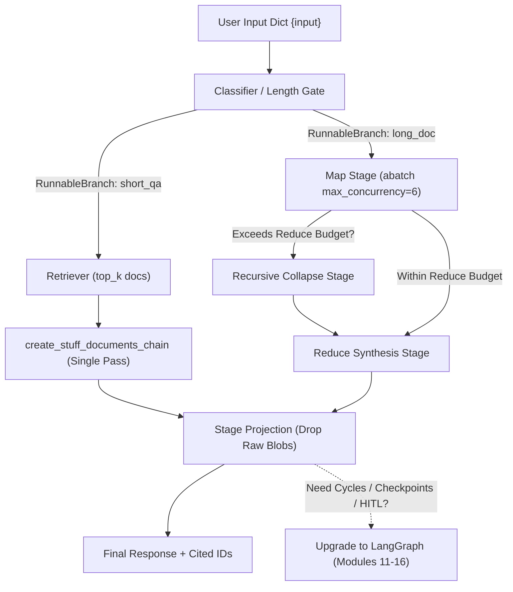
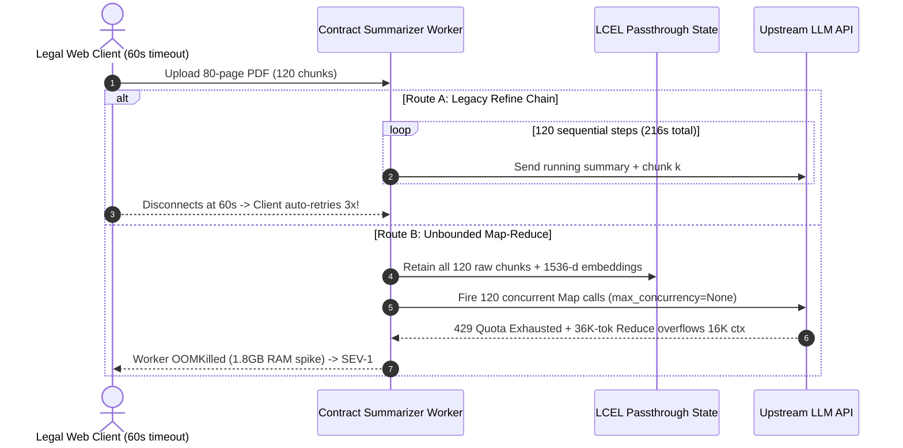

# Module 06: Chains

> **Prerequisites:** [Module 04: Output Parsers](../04-output-parsers/README.md), [Module 05: LCEL: The LangChain Expression Language](../05-lcel-the-langchain-expression-language/README.md), and [Track 07, Module 10: Prompt Chaining](../../07-prompt-engineering/10-prompt-chaining/README.md).  
> **Estimated Reading Time:** 35 minutes  
> **Target Audience:** AI Backend Engineers, RAG Pipeline Architects, Search & Orchestration Engineers

> [!TIP]
> **The Golden Rule of Chains:** Treat chains strictly as **deterministic, acyclic Directed Acyclic Graphs (DAGs)** with bounded concurrency, explicit intermediate payload projection, and end-to-end latency budgets. Use modern composable LCEL helpers (`create_stuff_documents_chain`, `create_retrieval_chain`, `RunnableBranch`) instead of deprecated v0.1 monoliths (`LLMChain`, `SequentialChain`, `RetrievalQA`)—and the moment a workflow requires reflection loops, retry-and-repair cycles, or persistent checkpointing, stop forcing it into a static chain and move to **LangGraph** ([Modules 11–16](../11-why-langgraph-the-limits-of-chains/README.md)).

---

## Why This Matters

Every production LLM backend eventually outgrows a single prompt-to-model call. Real workflows classify user intent, branch across domain handlers, retrieve and combine multiple document chunks, summarize long contracts that exceed single-pass prompt windows, and enforce per-stage latency budgets.

Unfortunately, two widespread anti-patterns plague production chain codebases. First, legacy tutorials still ship deprecated v0.1 monolithic classes (`LLMChain`, `SequentialChain`, `RetrievalQA`, `LLMRouterChain`), which hide prompt formatting behind magic string keys (`"query"` vs `"question"` vs `"text"`), break token streaming, and swallow trace spans. Second, teams migrating to modern LCEL chains often overlook three scale traps: (1) **state-dict payload bloat** from chaining `.assign()` across stages without pruning heavy retrieved documents or embeddings, (2) **unbounded Map-Reduce / sequential Refine blowups** when summarizing large PDFs without `max_concurrency` caps or recursive collapse bounds, and (3) **faking cycles inside static DAGs** instead of adopting stateful graph orchestration.

---

## 1. Legacy Monoliths vs. Modern Composable LCEL DAGs

Modern LangChain decomposes opaque v0.1 `Chain` subclasses (now isolated in `langchain-classic`) into transparent, streamable LCEL `Runnable` DAGs where every step is inspectable, independently testable, and observable.



### Legacy v0.1 Anti-Patterns & Exact Modern Replacements

| Deprecated v0.1 Monolith | Why It Fails in Production | Modern Composable Replacement | Key Production Advantage |
| :--- | :--- | :--- | :--- |
| **`LLMChain`** | Couples prompt, model, and memory keys tightly; `.run()` breaks streaming & typing | `prompt \| llm \| parser` (or `.with_structured_output()`) | Native `astream`, strict Pydantic schemas, zero hidden keys |
| **`SimpleSequentialChain` / `SequentialChain`** | Implicit input/output string key wiring (`output_key`), no async fan-out | `RunnableSequence` + `RunnableParallel` + explicit projection | Concurrent branching (`max_concurrency`), transparent trace spans |
| **`RetrievalQA`** | Black-box retrieval + prompt; awkward to return source doc metadata or stream | `create_retrieval_chain(retriever, create_stuff_documents_chain(llm, prompt))` | Returns `{"input", "context", "answer"}` cleanly; streams `answer` chunks |
| **`MultiPromptChain` / `LLMRouterChain`** | Brittle text parsing of router destination prompts; high latency | Structured classifier `\| RunnableBranch(...)` or `async def` router | Deterministic fallback branch + strict enum routing |

### Document Combination Strategies: Stuff vs. Map-Reduce vs. Refine vs. Map-Rerank

When a chain must synthesize $N$ retrieved or uploaded document chunks (each $T_i$ tokens with system overhead $T_{\text{sys}}$ and output budget $O_i$), four canonical patterns exist:

1. **Stuff (`create_stuff_documents_chain`):** Concatenates all $N$ documents directly into `{context}` inside a single prompt call.
   - **Pros:** Lowest latency (`1` LLM call), lowest token spend, preserves full cross-document reasoning.
   - **Limit:** Fails completely once $T_{\text{sys}} + \sum_{i=1}^N T_i + O_{\text{final}} > W_{\text{ctx}}$, and suffers **Lost-in-the-Middle** recall decay (`arXiv:2307.03172`) when stuffing dozens of low-signal chunks.
2. **Map-Reduce (with Bounded Concurrency & Collapse Gate):** Maps each of the $N$ chunks independently into a concise intermediate summary ($O_i$ tokens) using `.abatch(..., config={"max_concurrency": M})`, then reduces all intermediate summaries into a final synthesis.
   - **Token Cost & Wave Latency:**
     $$C_{\text{map-reduce}} = \sum_{i=1}^{N} \Bigl(P_{\text{in}}(T_{\text{sys}} + T_i) + P_{\text{out}} O_i\Bigr) + P_{\text{in}}\Bigl(T_{\text{reduce}} + \sum_{i=1}^{N} O_i\Bigr) + P_{\text{out}} O_{\text{final}}$$
     $$L_{\text{map-reduce}} \approx \left\lceil \frac{N}{M} \right\rceil L_{\text{map}} + L_{\text{collapse}} + L_{\text{reduce}}$$
   - **Critical Collapse Guard:** If $\sum_{i=1}^N O_i$ still exceeds `token_max` for the reduce prompt (e.g., `48` chunks yielding `300` summary tokens each = `14,400` tokens against an `8K` budget), you **must** run an intermediate recursive *collapse* pass grouping summaries until the combined payload fits safely beneath `reduce_budget`.
3. **Refine (Sequential Rolling Summary):** Feeds chunk `#1`, then iteratively feeds `(running_summary, chunk #k)` across $N$ strictly sequential LLM steps.
   - **Why to Avoid Online:** Latency grows linearly as $L_{\text{refine}} = N \cdot L_{\text{step}}$ (`48` chunks at `650 ms` = `31.2 seconds`!), preventing parallel execution and risking API gateway timeouts. Reserve Refine strictly for offline batch jobs requiring sequential narrative continuity.
4. **Map-Rerank:** Runs parallel extraction on each chunk using a strict structured schema `{reasoning, answer, confidence_score}`, then selects the highest-scoring response (`argmax`). Fast ($M$-bounded), filters irrelevant chunks well, but cannot synthesize answers spanning multiple documents.

### Multi-Hop State-Dict Payload Bloat & Stage Latency Accounting

Inside multi-hop LCEL chains built with `RunnablePassthrough.assign()`, every stage appends keys (`raw_docs`, `embeddings`, `rerank_candidates`, `intermediate_prompts`) while retaining all prior keys. Across `4–5` hops, serialized state balloons from `~200 bytes` to `20–80 KB` per trace—slowing JSON logging, breaking LangSmith payload limits, and causing worker memory pressure during large batches.

**Fix:** Insert an explicit **projection function** (`SelectKeys` / `RunnableLambda`) right after heavy retrieval or map stages that retains *only* downstream-required fields (e.g., `cited_ids` and trimmed `context` text).

Meanwhile, end-to-end sequential chain reliability $P_{\text{e2e}}$ and total latency $L_{\text{chain}}$ across $K$ serial stages obey:

$$P_{\text{e2e}} = \prod_{k=1}^{K} p_k, \qquad L_{\text{chain}} = \sum_{k=1}^{K} L_k$$

Notice how chaining `4` hops each at `99.0%` reliability drops overall chain reliability to `96.06%`, while serial `p99` tail spikes compound additively across hops. Keep online interactive chains shallow (`<= 3` LLM hops) and execute independent retrieval/classification branches in parallel (`RunnableParallel`).

### The Linear DAG Limit: When Chains Break and LangGraph Begins

LCEL chains—including `create_retrieval_chain` and `RunnableBranch`—are **static Directed Acyclic Graphs (DAGs)**: data flows strictly forward from entry to exit. They fail structurally whenever your application requires:

- **Bounded Self-Correction Cycles:** e.g., `generate_sql -> execute_sandbox -> inspect_sql_error -> fix_sql` repeating up to `3` times until queries succeed.
- **Persistent Checkpointing & Crash Recovery:** Resuming step `4` of a `20`-minute workflow from Postgres after a container restart without re-paying for steps `1–3`.
- **Human-in-the-Loop (HITL) Interrupts:** Pausing execution before a destructive mutation (`refund_invoice`), awaiting webhook approval hours later, and resuming state cleanly.

Trying to simulate cycles inside LCEL using recursive `RunnableLambda` calls destroys observability, risks infinite spend loops without explicit iteration guards, and breaks state replay. That structural gap is the exact reason **LangGraph** exists ([Module 11: Why LangGraph — The Limits of Chains](../11-why-langgraph-the-limits-of-chains/README.md)).

---

## 2. Systematic Comparison Matrix: Chain Topologies & Document Strategies

| Chain Topology / Strategy | Execution Graph | Latency Scaling ($N$ Docs) | Token Cost Profile | Primary Strength | When to Avoid |
| :--- | :--- | :--- | :--- | :--- | :--- |
| **Legacy `LLMChain` / `RetrievalQA`** | Rigid v0.1 class wrapper | Single pass (`1` LLM hop) | Low (plus hidden prompt prose) | Quick migration reference for legacy codebases | Any new production service; blocks clean streaming/typing |
| **Stuff (`create_stuff_documents_chain`)** | Parallel retrieval $\rightarrow$ single LLM | $O(1)$ (`~650 ms` gen) | Lowest ($1\times$ prompt overhead) | Full cross-chunk synthesis; minimal latency | Context exceeds window or triggers Lost-in-the-Middle |
| **RunnableBranch Conditional Router** | Classifier $\rightarrow$ deterministic `1-of-K` DAG | $L_{\text{cls}} + L_{\text{branch}}$ | Pays small router overhead (`~150` tok) | Isolates cheap vs. expensive routes cleanly | >5 nested branches (use typed `async def` or LangGraph) |
| **Map-Reduce (Bounded + Collapse)** | Parallel map ($M$) $\rightarrow$ collapse $\rightarrow$ reduce | $O(\lceil N/M \rceil)$ waves | High ($N$ map calls + reduce) | Summarizes `50–500+` chunks under strict SLA | Queries needing holistic multi-chunk cross-referencing |
| **Refine Chain** | Strictly sequential $1 \to 2 \to \dots \to N$ | $O(N)$ (prohibitive online) | High (repeated running summary) | Narrative refinement across ordered chapters | Interactive APIs with `< 5 s` latency SLAs |
| **LangGraph `StateGraph` (Next Track)** | Cyclic state machine + checkpoints | Bounded by `max_iterations` | Controlled per loop iteration | Self-correction loops, HITL pause/resume, state persistence | Simple single-shot `prompt \| llm \| parser` transforms |

---

## 3. Production War Story Post-Mortem: The Unbounded `Refine` Timeout & Map-Reduce OOM Crash

| Field | Incident Details |
| :--- | :--- |
| **Severity** | **SEV-1** (Total Legal Summarization Worker Outage + Gateway Retry Storm) |
| **Detection / Resolution Time** | Detected 25 minutes post-release via Kubernetes `OOMKilled` alerts / Mitigated in 90 minutes |
| **Impact** | `100%` of long M&A contract uploads (`> 60` pages) timed out at `60 s`; client retries spawned `3x` duplicate Map-Reduce bursts exhausting org TPM quota |

### What Happened

A legal-tech team replaced an older `RetrievalQA` prototype with two new chain routes for contract due-diligence: (1) an inherited `Refine` chain for `80`-page PDFs (`N = 120` chunks), and (2) an experimental Map-Reduce LCEL pipeline using `RunnablePassthrough.assign()` without `max_concurrency` or intermediate payload projection.

When customers uploaded `80`-page M&A data-room PDFs:

1. **Sequential `Refine` Gateway Timeout:** `120` sequential LLM calls at `~1.8 s` each required `216 seconds` (`3.6 minutes`)—breaching the `60 s` reverse-proxy timeout. The frontend SDK automatically retried timed-out requests `3` times, queueing triple duplicate sequential runs on backend workers!
2. **State-Dict Bloat + Unbounded Map Collapse Crash:** Switching large jobs to the new Map-Reduce branch fired all `120` chunks concurrently (`max_concurrency=None`), triggering `429` limits while `RunnablePassthrough.assign()` retained raw `1.8 KB` OCR text plus `1536`-dim float embeddings inside every intermediate trace dict (`~1.8 GB` RAM across queued tasks -> `OOMKilled`). Worse, the `120` map summaries totaled `36,000` tokens and crashed the `16K`-context reduce model with `400 ContextWindowExceededError` because there was no collapse pass.



### Root Cause Analysis

- **Linear `O(N)` Latency Applied to Long Documents:** Using sequential `Refine` behind a synchronous `60 s` HTTP gateway guarantees timeouts whenever $N \cdot L_{\text{step}} > 60\text{ s}$.
- **Missing Collapse Gate, Concurrency Cap & State Pruning:** Map-Reduce without `max_concurrency`, recursive token collapse, and state projection blows past both provider rate limits and reduce context limits simultaneously.

### The Fix & Architectural Hardening

- **Async Job Queue + `RunnableBranch` Length Gate:** Routed `<= 6,000`-token inputs synchronously through `create_stuff_documents_chain`, while moving `> 6,000`-token jobs to an asynchronous job ID pattern (`202 Accepted` + polling/WebSocket).
- **Bounded Map-Collapse-Reduce + Payload Projection:** Enforced `max_concurrency=6` on `.abatch()`, added a recursive collapse loop whenever combined map summaries exceeded `6,000` tokens, and immediately dropped raw embeddings and chunk payloads after retrieval/map stages.
- **Graduated Iterative Verification to LangGraph:** Moved multi-pass clause conflict checking out of nested chains into an explicit LangGraph workflow with `max_iterations=3` and Postgres checkpointing.

---

## 4. Multi-Language Production Implementation: Composable Retrieval, `RunnableBranch` & Bounded Map-Collapse Chains

The production implementations below across **Go**, **TypeScript**, **Python**, and **C#** demonstrate modern composable chains featuring (1) `create_stuff_documents_chain` + `create_retrieval_chain` equivalents, (2) deterministic length/intent `RunnableBranch` routing, (3) bounded concurrency + recursive collapse Map-Reduce, and (4) explicit state pruning with per-stage latency telemetry.

````carousel

```go
package chains

import (
	"context"
	"fmt"
	"strings"
	"sync"
	"time"
)

type Document struct {
	ID         string
	Content    string
	TokenCount int
}

type ChainOutput struct {
	Branch       string
	Answer       string
	CitedIDs     []string
	StageTimings map[string]int64
}

type LLMFunc func(ctx context.Context, systemPrompt, userPrompt string) (string, error)
type RetrieveFunc func(ctx context.Context, query string) ([]Document, error)

// ExecuteSmartRetrievalChain routes between single-pass Stuff and bounded Map-Collapse-Reduce,
// explicitly pruning raw document blobs from the final state and recording per-stage latencies.
func ExecuteSmartRetrievalChain(
	ctx context.Context,
	query string,
	retrieve RetrieveFunc,
	llm LLMFunc,
	stuffTokenBudget int,
	reduceTokenBudget int,
	maxConcurrency int,
) (*ChainOutput, error) {
	timings := make(map[string]int64)

	tRet := time.Now()
	docs, err := retrieve(ctx, query)
	timings["retrieve_ms"] = time.Since(tRet).Milliseconds()
	if err != nil {
		return nil, fmt.Errorf("retrieval stage failed: %w", err)
	}

	totalTokens := 0
	citedIDs := make([]string, 0, len(docs))
	for _, d := range docs {
		totalTokens += d.TokenCount
		citedIDs = append(citedIDs, d.ID)
	}

	// Deterministic length router (RunnableBranch equivalent)
	if totalTokens <= stuffTokenBudget {
		tGen := time.Now()
		var sb strings.Builder
		for _, d := range docs {
			sb.WriteString(fmt.Sprintf("[%s] %s\n", d.ID, d.Content))
		}
		ans, err := llm(ctx, "Answer strictly from context:\n"+sb.String(), query)
		timings["stuff_gen_ms"] = time.Since(tGen).Milliseconds()
		if err != nil {
			return nil, err
		}
		// Stage projection: return only answer + citedIDs (never raw Document payloads)
		return &ChainOutput{Branch: "STUFF", Answer: ans, CitedIDs: citedIDs, StageTimings: timings}, nil
	}

	// Bounded Map stage
	tMap := time.Now()
	summaries, err := mapBounded(ctx, docs, query, llm, maxConcurrency)
	timings["map_ms"] = time.Since(tMap).Milliseconds()
	if err != nil {
		return nil, err
	}

	// Recursive Collapse gate if summaries exceed reduceTokenBudget
	tCol := time.Now()
	summaries, err = collapseToBudget(ctx, summaries, reduceTokenBudget, llm)
	timings["collapse_ms"] = time.Since(tCol).Milliseconds()
	if err != nil {
		return nil, err
	}

	tRed := time.Now()
	finalAns, err := llm(ctx, "Synthesize final answer from summaries:\n"+strings.Join(summaries, "\n---\n"), query)
	timings["reduce_ms"] = time.Since(tRed).Milliseconds()
	if err != nil {
		return nil, err
	}
	return &ChainOutput{Branch: "MAP_COLLAPSE_REDUCE", Answer: finalAns, CitedIDs: citedIDs, StageTimings: timings}, nil
}

func mapBounded(ctx context.Context, docs []Document, query string, llm LLMFunc, maxConc int) ([]string, error) {
	if maxConc <= 0 {
		maxConc = 4
	}
	sem := make(chan struct{}, maxConc)
	out := make([]string, len(docs))
	errs := make([]error, len(docs))
	var wg sync.WaitGroup
	for i, d := range docs {
		wg.Add(1)
		go func(idx int, doc Document) {
			defer wg.Done()
			sem <- struct{}{}
			defer func() { <-sem }()
			out[idx], errs[idx] = llm(ctx, "Extract key facts relevant to query.", fmt.Sprintf("Query: %s\nChunk: %s", query, doc.Content))
		}(i, d)
	}
	wg.Wait()
	for _, err := range errs {
		if err != nil {
			return nil, err
		}
	}
	return out, nil
}

func collapseToBudget(ctx context.Context, summaries []string, tokenBudget int, llm LLMFunc) ([]string, error) {
	estTokens := func(items []string) int {
		tot := 0
		for _, s := range items {
			tot += len(s)/4 + 1
		}
		return tot
	}
	cur := summaries
	for estTokens(cur) > tokenBudget && len(cur) > 1 {
		var next []string
		for i := 0; i < len(cur); i += 4 {
			end := i + 4
			if end > len(cur) {
				end = len(cur)
			}
			merged, err := llm(ctx, "Condense these partial summaries concisely.", strings.Join(cur[i:end], "\n"))
			if err != nil {
				return nil, err
			}
			next = append(next, merged)
		}
		cur = next
	}
	return cur, nil
}
```

<!-- slide -->

```typescript
import { ChatOpenAI } from "@langchain/openai";
import { ChatPromptTemplate } from "@langchain/core/prompts";
import { StringOutputParser } from "@langchain/core/output_parsers";
import { Document } from "@langchain/core/documents";
import { BaseRetriever } from "@langchain/core/retrievers";
import { RunnableBranch, RunnableLambda, RunnableSequence } from "@langchain/core/runnables";
import { createStuffDocumentsChain } from "langchain/chains/combine_documents";
import { createRetrievalChain } from "langchain/chains/retrieval";

interface SmartChainInput {
  input: string;
  docs: Document[];
}

export async function buildModernRetrievalChain(retriever: BaseRetriever) {
  const llm = new ChatOpenAI({ model: "gpt-4o-mini", temperature: 0 });
  const prompt = ChatPromptTemplate.fromMessages([
    ["system", "Answer strictly from context:\n{context}"],
    ["human", "{input}"],
  ]);

  // Modern replacement for legacy RetrievalQA
  const combineDocsChain = await createStuffDocumentsChain({ llm, prompt });
  const retrievalChain = await createRetrievalChain({ retriever, combineDocsChain });

  // Project output immediately so bulky Document objects don't bloat downstream state
  return retrievalChain.pipe(
    RunnableLambda.from((res: { input: string; context: Document[]; answer: string }) => ({
      answer: res.answer,
      citedDocIds: res.context.map((d) => String(d.metadata?.docId ?? "unknown")),
    })),
  );
}

export function buildLengthRoutedChain(stuffLimitChars = 24_000) {
  const llm = new ChatOpenAI({ model: "gpt-4o-mini", temperature: 0 });
  const parser = new StringOutputParser();

  const stuffBranch = ChatPromptTemplate.fromMessages([
    ["system", "Synthesize concisely from context:\n{joined}"],
    ["human", "{input}"],
  ])
    .pipe(llm)
    .pipe(parser);

  // Bounded Map-Reduce branch when context exceeds stuffLimitChars
  const mapPrompt = ChatPromptTemplate.fromTemplate("Summarize facts for '{input}':\n{chunk}");
  const mapChain = mapPrompt.pipe(llm).pipe(parser).withConfig({ maxConcurrency: 6 });
  const reduceChain = ChatPromptTemplate.fromTemplate("Merge summaries for '{input}':\n{summaries}")
    .pipe(llm)
    .pipe(parser);

  const mapReduceBranch = RunnableLambda.from(async (state: SmartChainInput) => {
    const mapInputs = state.docs.map((d) => ({ input: state.input, chunk: d.pageContent }));
    const summaries = await mapChain.batch(mapInputs, { maxConcurrency: 6 });
    return reduceChain.invoke({ input: state.input, summaries: summaries.join("\n---\n") });
  });

  const router = RunnableBranch.from([
    [
      (s: SmartChainInput) => s.docs.reduce((acc, d) => acc + d.pageContent.length, 0) <= stuffLimitChars,
      RunnableSequence.from([
        (s: SmartChainInput) => ({
          input: s.input,
          joined: s.docs.map((d) => d.pageContent).join("\n\n"),
        }),
        stuffBranch,
      ]),
    ],
    mapReduceBranch,
  ]);

  return router;
}
```

<!-- slide -->

```python
"""
modern_composable_chains.py
Replaces deprecated RetrievalQA/LLMChain with create_retrieval_chain,
RunnableBranch routing, bounded Map-Collapse-Reduce, and explicit state pruning.
"""
import time
from langchain.chains import create_retrieval_chain
from langchain.chains.combine_documents import create_stuff_documents_chain
from langchain_core.documents import Document
from langchain_core.language_models import BaseChatModel
from langchain_core.output_parsers import StrOutputParser
from langchain_core.prompts import ChatPromptTemplate
from langchain_core.retrievers import BaseRetriever
from langchain_core.runnables import Runnable, RunnableBranch, RunnableLambda


def project_slim_rag_result(raw_state: dict) -> dict:
    """Explicit stage projection: drop heavy Document page_content & embeddings."""
    docs: list[Document] = raw_state.get("context", [])
    return {
        "answer": raw_state["answer"],
        "cited_doc_ids": [str(d.metadata.get("doc_id", "unknown")) for d in docs],
        "source_count": len(docs),
    }


def build_modern_rag_chain(retriever: BaseRetriever, llm: BaseChatModel) -> Runnable:
    """Modern v0.3 replacement for deprecated RetrievalQA."""
    prompt = ChatPromptTemplate.from_messages([
        ("system", "Answer strictly from context. Cite [doc_id].\n\n{context}"),
        ("human", "{input}"),
    ])
    combine_docs = create_stuff_documents_chain(llm, prompt)
    retrieval_chain = create_retrieval_chain(retriever, combine_docs)
    return retrieval_chain | RunnableLambda(project_slim_rag_result)


def build_smart_summarization_chain(
    llm: BaseChatModel,
    stuff_char_budget: int = 24_000,
    reduce_char_budget: int = 24_000,
    max_concurrency: int = 6,
) -> Runnable:
    """Routes short inputs to single-pass Stuff and long inputs to bounded Map-Collapse-Reduce."""
    parser = StrOutputParser()
    stuff_prompt = ChatPromptTemplate.from_messages([
        ("system", "Synthesize concisely from context:\n{context}"),
        ("human", "{input}"),
    ])
    stuff_chain = (
        RunnableLambda(
            lambda s: {
                "input": s["input"],
                "context": "\n\n".join(d.page_content for d in s["docs"]),
            }
        )
        | stuff_prompt
        | llm
        | parser
    )

    map_chain = (
        ChatPromptTemplate.from_template("Extract key facts for '{input}':\n{chunk}")
        | llm
        | parser
    )
    collapse_chain = (
        ChatPromptTemplate.from_template("Condense these partial summaries:\n{batch_text}")
        | llm
        | parser
    )
    reduce_chain = (
        ChatPromptTemplate.from_template("Produce final answer for '{input}' from summaries:\n{summaries}")
        | llm
        | parser
    )

    async def map_collapse_reduce(state: dict) -> dict:
        t0 = time.perf_counter()
        docs: list[Document] = state["docs"]
        summaries = await map_chain.abatch(
            [{"input": state["input"], "chunk": d.page_content} for d in docs],
            config={"max_concurrency": max_concurrency},
        )
        collapse_rounds = 0
        while sum(len(s) for s in summaries) > reduce_char_budget and len(summaries) > 1:
            collapse_rounds += 1
            groups = ["\n".join(summaries[i : i + 4]) for i in range(0, len(summaries), 4)]
            summaries = await collapse_chain.abatch(
                [{"batch_text": g} for g in groups],
                config={"max_concurrency": max_concurrency},
            )
        answer = await reduce_chain.ainvoke({"input": state["input"], "summaries": "\n---\n".join(summaries)})
        return {
            "branch": "MAP_COLLAPSE_REDUCE" if collapse_rounds else "MAP_REDUCE",
            "collapse_rounds": collapse_rounds,
            "latency_ms": round((time.perf_counter() - t0) * 1000, 1),
            "answer": answer,
        }

    return RunnableBranch(
        (
            lambda s: sum(len(d.page_content) for d in s["docs"]) <= stuff_char_budget,
            RunnableLambda(lambda s: {"branch": "STUFF", "collapse_rounds": 0, "answer": stuff_chain.invoke(s)}),
        ),
        RunnableLambda(map_collapse_reduce),
    )
```

<!-- slide -->

```csharp
using System;
using System.Collections.Generic;
using System.Diagnostics;
using System.Linq;
using System.Threading;
using System.Threading.Tasks;

namespace GenAI.Chains;

public sealed record RetrievedDoc(string DocId, string Content, int TokenEstimate);

public sealed record ChainSummaryResult(
    string Branch,
    string Answer,
    IReadOnlyList<string> CitedDocIds,
    int CollapseRounds,
    IReadOnlyDictionary<string, long> StageLatenciesMs);

public static class ComposableRagChains
{
    public static async Task<ChainSummaryResult> ExecuteRoutedChainAsync(
        string query,
        Func<string, CancellationToken, Task<IReadOnlyList<RetrievedDoc>>> retrieveAsync,
        Func<string, string, CancellationToken, Task<string>> callLlmAsync,
        int stuffTokenBudget = 6000,
        int reduceTokenBudget = 6000,
        int maxConcurrency = 6,
        CancellationToken ct = default)
    {
        var timings = new Dictionary<string, long>();
        var sw = Stopwatch.StartNew();

        var docs = await retrieveAsync(query, ct).ConfigureAwait(false);
        timings["retrieve_ms"] = sw.ElapsedMilliseconds;

        var citedIds = docs.Select(d => d.DocId).ToArray(); // Pruned projection
        int totalTokens = docs.Sum(d => d.TokenEstimate);

        // Conditional Branch 1: Stuff (single-pass low latency)
        if (totalTokens <= stuffTokenBudget)
        {
            sw.Restart();
            string context = string.Join("\n\n", docs.Select(d => $"[{d.DocId}] {d.Content}"));
            string answer = await callLlmAsync($"Answer using context:\n{context}", query, ct).ConfigureAwait(false);
            timings["stuff_gen_ms"] = sw.ElapsedMilliseconds;
            return new ChainSummaryResult("STUFF", answer, citedIds, 0, timings);
        }

        // Conditional Branch 2: Bounded Map-Collapse-Reduce
        sw.Restart();
        using var gate = new SemaphoreSlim(maxConcurrency, maxConcurrency);
        var mapTasks = docs.Select(async d =>
        {
            await gate.WaitAsync(ct).ConfigureAwait(false);
            try
            {
                return await callLlmAsync("Extract key facts concisely.", $"Query: {query}\nChunk: {d.Content}", ct)
                    .ConfigureAwait(false);
            }
            finally
            {
                gate.Release();
            }
        });
        var summaries = (await Task.WhenAll(mapTasks).ConfigureAwait(false)).ToList();
        timings["map_ms"] = sw.ElapsedMilliseconds;

        int collapseRounds = 0;
        sw.Restart();
        while (summaries.Sum(s => s.Length / 4 + 1) > reduceTokenBudget && summaries.Count > 1)
        {
            collapseRounds++;
            var next = new List<string>();
            foreach (var group in summaries.Chunk(4))
            {
                string condensed = await callLlmAsync("Condense summaries:", string.Join("\n", group), ct)
                    .ConfigureAwait(false);
                next.Add(condensed);
            }
            summaries = next;
        }
        timings["collapse_ms"] = sw.ElapsedMilliseconds;

        sw.Restart();
        string finalAnswer = await callLlmAsync(
            "Synthesize final answer from summaries:",
            $"Query: {query}\n{string.Join("\n---\n", summaries)}",
            ct).ConfigureAwait(false);
        timings["reduce_ms"] = sw.ElapsedMilliseconds;

        return new ChainSummaryResult(
            collapseRounds > 0 ? "MAP_COLLAPSE_REDUCE" : "MAP_REDUCE",
            finalAnswer,
            citedIds,
            collapseRounds,
            timings);
    }
}
```

````

---

## 5. Practical Hands-On Verification CLI Workflows

Run these deterministic Python 3.13 verification scripts locally with zero third-party packages or API keys required.

### Workflow 1: Compare Stuff vs. Map-Reduce vs. Refine Latency & Token Scaling

Quantify token consumption and wall-clock latency across $N \in \{4, 16, 48\}$ chunks (`700` tokens/chunk, `max_concurrency=6`, `8,192`-token context limit, `650 ms` per LLM step):

```bash
python -c '
import math

def analyze_doc_chains(n_docs, chunk_tok=700, sys_tok=250, out_tok=180, max_conc=6, step_ms=650.0, ctx_limit=8192):
    # 1. Stuff
    stuff_in = sys_tok + n_docs * chunk_tok
    stuff_ok = (stuff_in + out_tok) <= ctx_limit
    stuff_ms = step_ms if stuff_ok else float("inf")
    stuff_tok = stuff_in + out_tok if stuff_ok else 0

    # 2. Map-Reduce (with bounded concurrency)
    map_in = n_docs * (sys_tok + chunk_tok)
    map_out = n_docs * out_tok
    reduce_in = sys_tok + map_out
    mr_waves = math.ceil(n_docs / max_conc)
    mr_ms = (mr_waves + 1) * step_ms
    mr_tok = map_in + map_out + reduce_in + out_tok

    # 3. Refine (strictly sequential, accumulates running summary)
    refine_in = sum(sys_tok + chunk_tok + (0 if i == 0 else out_tok) for i in range(n_docs))
    refine_out = n_docs * out_tok
    refine_ms = n_docs * step_ms
    refine_tok = refine_in + refine_out

    print(f"=== N={n_docs} docs ({n_docs*chunk_tok:,} source tokens) ===")
    print(f"  Stuff      : ok={str(stuff_ok):<5} | tokens={stuff_tok:>6,} | est_lat={stuff_ms if stuff_ok else -1:>7.0f} ms")
    print(f"  Map-Reduce : ok=True  | tokens={mr_tok:>6,} | est_lat={mr_ms:>7.0f} ms (conc={max_conc})")
    print(f"  Refine     : ok=True  | tokens={refine_tok:>6,} | est_lat={refine_ms:>7.0f} ms (serial)")

for n in (4, 16, 48):
    analyze_doc_chains(n)
'
```

**Expected Output:**

```text
=== N=4 docs (2,800 source tokens) ===
  Stuff      : ok=True  | tokens= 3,230 | est_lat=    650 ms
  Map-Reduce : ok=True  | tokens= 5,670 | est_lat=   1300 ms (conc=6)
  Refine     : ok=True  | tokens= 5,060 | est_lat=   2600 ms (serial)
=== N=16 docs (11,200 source tokens) ===
  Stuff      : ok=False | tokens=     0 | est_lat=     -1 ms
  Map-Reduce : ok=True  | tokens=21,390 | est_lat=   2600 ms (conc=6)
  Refine     : ok=True  | tokens=20,780 | est_lat=  10400 ms (serial)
=== N=48 docs (33,600 source tokens) ===
  Stuff      : ok=False | tokens=     0 | est_lat=     -1 ms
  Map-Reduce : ok=True  | tokens=63,310 | est_lat=   5850 ms (conc=6)
  Refine     : ok=True  | tokens=62,700 | est_lat=  31200 ms (serial)
```

At `48` chunks, sequential `Refine` consumes `31.2 seconds`—over `5x` slower than `6`-way bounded `Map-Reduce` (`5.85 s`) at virtually identical total token spend!

### Workflow 2: Measure State-Dict Payload Bloat & Compound Multi-Hop Reliability

Simulate a `4`-stage chain (`router -> retriever -> reranker -> generator`), measuring serialized state bloat before vs. after explicit stage projection and computing end-to-end compound reliability $P_{\text{e2e}}$:

```bash
python -c '
import json

docs = [{"doc_id": f"doc_{i}", "text": "x" * 1800, "embedding": [0.0123] * 128} for i in range(6)]
state_bloated = {"input": "What is our SLA?", "route": "policy"}

state_bloated["raw_docs"] = docs
state_bloated["rerank_scores"] = [0.91, 0.87, 0.72, 0.40, 0.31, 0.19]
state_bloated["context_str"] = "\n".join(d["text"] for d in docs[:3])
state_bloated["answer"] = "99.95% uptime SLA [doc_0]."

state_pruned = {
    "input": state_bloated["input"],
    "route": state_bloated["route"],
    "cited_ids": [d["doc_id"] for d in docs[:3]],
    "answer": state_bloated["answer"],
}

bloated_bytes = len(json.dumps(state_bloated))
pruned_bytes = len(json.dumps(state_pruned))
print(f"Bloated Passthrough State : {bloated_bytes:>6,} bytes")
print(f"Projected Pruned State    : {pruned_bytes:>6,} bytes ({bloated_bytes / pruned_bytes:.1f}x smaller)")

stages = [("router", 0.995, 110), ("retriever", 0.990, 85), ("reranker", 0.995, 140), ("generator", 0.990, 920)]
e2e_rel = 1.0
e2e_ms = 0
for name, p, ms in stages:
    e2e_rel *= p
    e2e_ms += ms
    print(f"  stage={name:<10} | p={p:.3f} | lat={ms:>3} ms")
print(f"End-to-End Compound P_ok={e2e_rel*100:.2f}% | Total Serial Latency={e2e_ms} ms")
'
```

**Expected Output:**

```text
Bloated Passthrough State : 22,811 bytes
Projected Pruned State    :    130 bytes (175.5x smaller)
  stage=router     | p=0.995 | lat=110 ms
  stage=retriever  | p=0.990 | lat= 85 ms
  stage=reranker   | p=0.995 | lat=140 ms
  stage=generator  | p=0.990 | lat=920 ms
End-to-End Compound P_ok=97.03% | Total Serial Latency=1255 ms
```

Dropping raw chunks and embeddings via explicit projection reduces trace payload size by **`175.5x`** (`22.8 KB` down to `130 B`) while keeping `cited_ids` intact.

### Workflow 3: Simulate `RunnableBranch` + Recursive Map-Collapse Gate

Test how a conditional length router handles `4`, `12`, and `48` chunks (`1,200` tokens/chunk, `stuff_budget=6000`, `reduce_budget=6000`), automatically activating recursive collapse on `48` chunks:

```bash
python -c '
import math

def route_and_execute_chain(chunks, tok_per_chunk=1200, stuff_budget=6000, reduce_budget=6000, max_conc=4):
    total_tok = len(chunks) * tok_per_chunk
    if total_tok <= stuff_budget:
        return {"branch": "STUFF", "llm_calls": 1, "waves": 1, "collapse_rounds": 0}

    summary_tok = 300
    calls = len(chunks)
    waves = math.ceil(len(chunks) / max_conc)
    current_tokens = len(chunks) * summary_tok
    collapse_rounds = 0

    while current_tokens > reduce_budget:
        collapse_rounds += 1
        group_count = math.ceil(current_tokens / reduce_budget)
        calls += group_count
        waves += math.ceil(group_count / max_conc)
        current_tokens = group_count * summary_tok

    calls += 1
    waves += 1
    return {
        "branch": "MAP_COLLAPSE_REDUCE" if collapse_rounds else "MAP_REDUCE",
        "llm_calls": calls,
        "waves": waves,
        "collapse_rounds": collapse_rounds,
    }

for label, n_chunks in [("Short Policy (4 chunks)", 4), ("Quarterly Report (12 chunks)", 12), ("M&A Data Room (48 chunks)", 48)]:
    res = route_and_execute_chain([f"c{i}" for i in range(n_chunks)])
    branch = res["branch"]
    calls = res["llm_calls"]
    waves = res["waves"]
    collapses = res["collapse_rounds"]
    print(f"{label:<28} -> branch={branch:<19} | calls={calls:>2} | waves={waves:>2} | collapses={collapses}")
'
```

**Expected Output:**

```text
Short Policy (4 chunks)      -> branch=STUFF               | calls= 1 | waves= 1 | collapses=0
Quarterly Report (12 chunks) -> branch=MAP_REDUCE          | calls=13 | waves= 4 | collapses=0
M&A Data Room (48 chunks)    -> branch=MAP_COLLAPSE_REDUCE | calls=52 | waves=14 | collapses=1
```

### Hands-On Exercises

1. **Multi-Round Collapse Stress Test:** Run Workflow 3 with `n_chunks = 250` (`summary_tok = 300`, `reduce_budget = 6000`) and verify that `collapse_rounds` climbs to `2` to guarantee the final reduce prompt never overflows `6,000` tokens.
2. **Stage Failure Amplification:** Lower `retriever` and `generator` per-stage reliability in Workflow 2 to `0.95` and compute the resulting compound chain reliability $P_{\text{e2e}}$, noting why independent `.with_retry()` per stage is mandatory.
3. **Optional Live SDK Probe (Requires API Key & `langchain`):** Refactor a legacy `RetrievalQA.from_chain_type(...)` call into `create_retrieval_chain(retriever, create_stuff_documents_chain(llm, prompt))` and stream `.astream({"input": ...})` printing both `chunk.get("context")` and `chunk.get("answer")` events.

### Independent Challenge

A technical product manager wants an automated code-migration assistant implemented as a single LCEL chain: *"Read the repository files, draft a SQL migration, execute it against a staging Postgres container, and if Postgres returns a syntax or foreign-key error, send the traceback back to the LLM to rewrite the SQL until tests pass (up to 4 tries), pausing for DBA approval before committing."* Explain why forcing this workflow into `RunnableSequence` / `RunnableBranch` creates architectural failure, and outline which parts remain pure LCEL chains vs. which parts require upgrading to **LangGraph**.

<details><summary>Architectural Discussion</summary>

Two requirements violate the **DAG contract** of LCEL chains: (1) **Bounded Cyclic Self-Correction (`draft -> execute -> inspect_error -> redraft`)**: `RunnableSequence` and `RunnableBranch` are strictly acyclic forward pipes; encoding up to `4` feedback iterations requires explicit cyclic edges, iteration counters, and conditional transitions (`max_iterations=4`), otherwise hidden recursion breaks LangSmith step replay and creates runaway spend risk; and (2) **Durable Human-in-the-Loop (HITL) Pause/Resume**: waiting hours for a DBA approval webhook cannot hold an in-memory HTTP worker open—it requires persistent state checkpointing and interrupt/resume semantics. Keep the single-step LLM transforms (`prompt | model.with_structured_output(SqlMigration)`) as clean LCEL Runnables *inside* individual graph nodes, and orchestrate the cyclic execution, Postgres error feedback loop, and DBA interrupt checkpoint using **LangGraph** ([Modules 11–16](../11-why-langgraph-the-limits-of-chains/README.md)).

</details>

---

## 6. Common Mistakes & Troubleshooting

- **Shipping deprecated v0.1 `LLMChain`, `SequentialChain`, or `RetrievalQA` in new services:** Legacy monoliths obscure prompt inputs, break native `.astream()` token forwarding, and reside in `langchain-classic`. Always compose `create_stuff_documents_chain`, `create_retrieval_chain`, and LCEL `|` pipes instead.
- **Using `Refine` chains behind synchronous HTTP gateways:** Sequential $O(N)$ refinement takes tens of seconds for `>15` chunks, causing `504` timeouts and client retry multiplication. Switch to single-pass `Stuff` (for `<= 8K` context) or bounded `Map-Collapse-Reduce` (`async` job queue for huge docs).
- **Omitting recursive collapse in Map-Reduce pipelines:** If `50` map outputs of `300` tokens each (`15,000` tokens) exceed your reduce prompt budget, the final reduce step crashes with `400 ContextWindowExceededError`. Always enforce a `while sum(tokens) > reduce_budget` collapse loop.
- **Accumulating raw documents and embeddings in `RunnablePassthrough.assign()`:** Retaining every intermediate array bloats trace serialization (`20+ KB/req`) and worker RAM. Insert explicit projection (`SelectKeys`) right after heavy stages.
- **Forcing feedback loops or HITL pauses into nested `RunnableBranch`:** Chains are strictly acyclic DAGs. Whenever workflows need retries across steps, conditional cycles, or durable checkpoints, migrate orchestration to **LangGraph**.

---

## 7. Operational Validation Checkpoints & Checkpoint Quiz

### Operational Validation Checkpoints

<details><summary><strong>Checkpoint 1: Diagnosing why RetrievalQA broke streaming & citations</strong></summary>

An engineer inherits a legacy `RetrievalQA.from_chain_type(llm, chain_type="stuff", retriever=ret)` endpoint. Frontend clients complain that tokens arrive in one big block instead of streaming, and responses drop source `doc_id` metadata unless `return_source_documents=True` is parsed awkwardly. How does migrating to `create_retrieval_chain` fix both?

**Validation:** `create_retrieval_chain(retriever, create_stuff_documents_chain(llm, prompt))` composes standard LCEL Runnables natively: `.astream({"input": ...})` yields `{"context": [Document, ...]}` as soon as retrieval completes, then streams incremental `{"answer": delta}` string chunks token-by-token as the LLM generates—preserving exact `Document.metadata` (`doc_id`, `page`) cleanly alongside the streaming answer.

</details>

<details><summary><strong>Checkpoint 2: Preventing Map-Reduce reduce-stage ContextWindowExceededError</strong></summary>

A Map-Reduce chain summarizing `60` support tickets runs cleanly on `15`-ticket batches, but throws `400 ContextWindowExceededError` at the final reduce step on `60`-ticket batches even though each chunk was mapped individually under `2,000` tokens. Explain why and implement the fix.

**Validation:** Each of the `60` map calls produced a `~250–350` token partial summary; concatenating all `60` summaries fed `18,000+` tokens into a single `reduce` call whose prompt + output exceeded an `8K–16K` model budget (or triggered cost/latency spikes). Fix by inserting a bounded **recursive collapse loop** before `reduce`: batch summaries into groups under `reduce_token_budget` and condense iteratively with `abatch(config={"max_concurrency": 6})` until the combined summary text fits comfortably below the reduce ceiling.

</details>

<details><summary><strong>Checkpoint 3: Identifying the exact DAG boundary requiring LangGraph</strong></summary>

A team proposes implementing a `"Generate Unit Tests -> Run Pytest -> If Fail, Patch Code & Re-run up to 3x"` workflow inside an LCEL `RunnableSequence` using `RunnableBranch` and Python recursion inside `RunnableLambda`. Identify three concrete production failures this causes compared to LangGraph.

**Validation:** (1) **Opaque Observability & Replay:** Recursive `RunnableLambda` nests dynamic spans uncontrollably instead of cleanly indexing graph supersteps/iterations; (2) **Unbounded State & Crash Loss:** If the worker restarts after `Run Pytest` attempt `#2`, an in-memory recursive chain loses all test logs and restarts from scratch (`0` checkpointing); and (3) **No Native HITL Interrupts:** Pausing mid-cycle for engineer review cannot serialize and resume execution cleanly without an explicit `StateGraph` checkpointer.

</details>

### Checkpoint Quiz

1. Which two modern LangChain functions replace the legacy v0.1 `RetrievalQA` monolith, and what dictionary keys does the modern chain output?
2. Why does a `48`-chunk `Refine` chain blow past standard `30–60 s` API gateway timeouts while `6`-way bounded `Map-Reduce` completes nearly `5x` faster at similar token cost?
3. Explain the purpose of the **collapse stage** inside a production Map-Reduce document chain.
4. How does explicit **stage state projection** prevent `RunnablePassthrough.assign()` payload bloat across multi-hop chains?
5. Name three workflow capabilities that exceed static DAG chains and require **LangGraph**.

<details><summary>Answers</summary>

1. `create_stuff_documents_chain(llm, prompt)` combined inside `create_retrieval_chain(retriever, combine_docs_chain)`; the chain outputs `{"input": ..., "context": [Document, ...], "answer": ...}` cleanly.
2. `Refine` is strictly sequential ($L = N \cdot L_{\text{step}}$) because step $k$ depends on step $k-1$'s running summary (`48 * 650 ms = 31.2 s`). Bounded `Map-Reduce` executes map calls concurrently in $\lceil 48 / 6 \rceil = 8$ parallel waves plus `1` reduce wave (`~5.85 s`).
3. When concatenated map outputs ($\sum O_i$) exceed the reduce prompt's token budget (`reduce_budget`), the recursive collapse stage groups and condenses subsets of summaries until the combined input safely fits inside the reduce window.
4. By emitting a slim projected dictionary (`{"answer": ..., "cited_ids": [...]}`) immediately after retrieval or map steps, dropping multi-kilobyte `page_content` strings and embedding vectors before downstream hops serialize state.
5. (a) Bounded cyclic feedback/self-correction loops (`generate -> test -> repair`), (b) durable persistent checkpointing for crash recovery, and (c) asynchronous Human-in-the-Loop (`interrupt` / resume) pauses across hours or days.

</details>

---

## Further Reading & Sources

- [LangChain Python Docs: Build a RAG App (create_retrieval_chain & LCEL)](https://python.langchain.com/docs/tutorials/rag/) — official pattern using `create_retrieval_chain` and `create_stuff_documents_chain`.
- [LangChain Python Docs: LangChain Expression Language & Legacy Migration](https://python.langchain.com/docs/concepts/lcel/) — rationale for replacing v0.1 chain monoliths (`LLMChain`, `RetrievalQA`) with composable `Runnable` DAGs.
- [LangChain.js Docs: RunnableBranch & Composable Chains](https://js.langchain.com/docs/concepts/lcel/) — TypeScript patterns for `createRetrievalChain`, `createStuffDocumentsChain`, and conditional branching.
- [Lost in the Middle: How Language Models Use Long Contexts (Liu et al., 2023)](https://arxiv.org/abs/2307.03172) — empirical justification for capping stuffed document count vs. map-reduce/rerank filtering.
- [Module 05: LCEL: The LangChain Expression Language](../05-lcel-the-langchain-expression-language/README.md) — `Runnable` concurrency bounds, `RunnableParallel`, and `astream_events` telemetry.
- [Module 11: Why LangGraph — The Limits of Chains](../11-why-langgraph-the-limits-of-chains/README.md) — transitioning cyclic workflows, persistent state, and HITL interrupts out of static chains.

## Next

[Module 07: Memory in LangChain](../07-memory-in-langchain/README.md)
