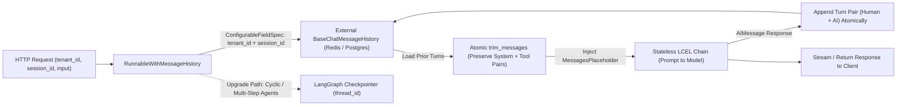
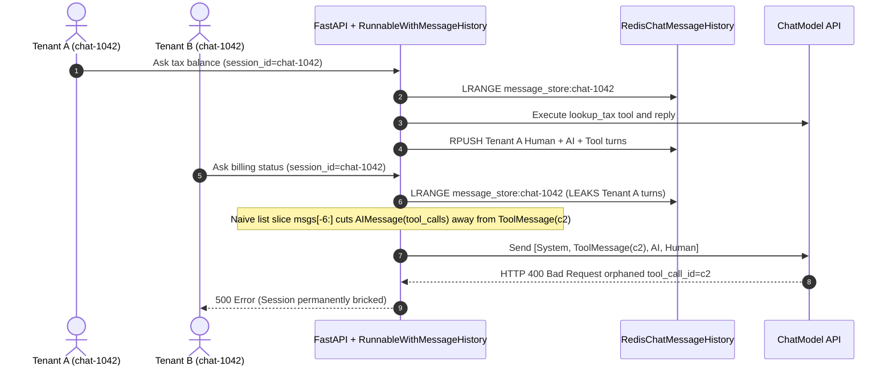

# Module 07: Memory in LangChain

> **Prerequisites:** [Module 02: Models and Messages](../02-models-and-messages/README.md), [Module 05: LCEL: The LangChain Expression Language](../05-lcel-the-langchain-expression-language/README.md), and [Track 10, Module 10: Memory — Short-Term and Scratchpad](../../10-ai-agents/10-memory-short-term-and-scratchpad/README.md).  
> **Estimated Reading Time:** 35 minutes  
> **Target Audience:** AI Backend Engineers, Stateful API Architects, LLM Platform Developers

> [!TIP]
> **The Golden Rule of Memory in LangChain:** Never store mutable conversation state inside in-process Python objects (`ConversationBufferMemory`, `ConversationSummaryMemory`, or module-level dictionaries). Wrap stateless LCEL pipelines in `RunnableWithMessageHistory` backed by an external `BaseChatMessageHistory` store (Redis or PostgreSQL) keyed by composite `(tenant_id, user_id, session_id)` `configurable_fields`, trim history strictly on **atomic turn boundaries** (`trim_messages`) so `AIMessage(tool_calls)` and `ToolMessage(tool_call_id)` pairs are never severed—and migrate directly to **LangGraph checkpointers** (`PostgresSaver` / `AsyncPostgresSaver`) whenever an agent or multi-step workflow owns the state lifecycle.

---

## Why This Matters

In quick tutorial notebooks, adding conversational memory looks trivial: instantiate `ConversationBufferMemory()`, attach it to a chain, and pass two sequential questions. On a single developer laptop running one process, the assistant remembers your name and feels magical.

The moment that code ships behind FastAPI, Express, or Go microservices with horizontal auto-scaling, four production failures trigger almost immediately:

1. **Process-Local State Loss & Split-Brain:** Request `1` hits Worker Pod A (storing `"My SKU is ENT-2026"` in Pod A's RAM); Request `2` load-balances to Worker Pod B, which has an empty `ConversationBufferMemory` and asks the customer to repeat themselves.
2. **Cross-Tenant Session Collisions:** Keying external memory solely by a client-supplied `session_id` (like `"default"` or `"chat-101"`) without composite tenant/user scoping lets User B read User A's tax identifiers or billing history.
3. **Quadratic Token & Cost Blowups:** Appending every turn verbatim without bounded trimming or rolling summarization inflates input prompt tokens quadratically ($O(T^2)$ across $T$ turns), turning cheap 3-turn chats into multi-dollar 40-turn context bombs.
4. **Orphaned `tool_call_id` HTTP `400` Crashes:** Slicing the last `k` messages (`history[-6:]`) mid-turn separates an `AIMessage(tool_calls=[...])` from its paired `ToolMessage(tool_call_id=...)`—causing OpenAI and Anthropic APIs to reject every subsequent request in that session with `400 Bad Request`.

---

## 1. Legacy v0.1 State Coupling vs. Stateless LCEL & LangGraph Persistence

LangChain v0.1 memory classes (`ConversationBufferMemory`, `ConversationBufferWindowMemory`, `ConversationSummaryMemory`, `ConversationSummaryBufferMemory`—now deprecated and isolated inside `langchain-classic`) coupled **prompt formatting**, **mutable Python state**, and **single magic input keys** (`"history"` / `"input"`) inside one non-thread-safe object. They could not cleanly persist per-request tenant metadata, crashed under concurrent async HTTP requests, and broke LCEL streaming.

Modern LangChain separates **stateless execution** from **external state hydration** using `RunnableWithMessageHistory` + `BaseChatMessageHistory` (for linear chat LCEL chains) and **LangGraph persistence checkpointers** (`thread_id`) for multi-step stateful graphs.



### How `RunnableWithMessageHistory` Works Mechanically

1. **Zero In-Memory State in the Chain:** Your core chain (`prompt | model`) stays completely stateless (`Runnable[dict, AIMessage]`), accepting `{"input": ..., "history": list[BaseMessage]}` via `MessagesPlaceholder(variable_name="history")`.
2. **Composite Session Factory:** You supply a factory `get_session_history(tenant_id: str, session_id: str) -> BaseChatMessageHistory` declared via `history_factory_config=[ConfigurableFieldSpec(id="tenant_id", ...), ConfigurableFieldSpec(id="session_id", ...)]`. Never rely solely on a raw `session_id` string.
3. **Request Hydration & Atomic Commit:** On `.ainvoke()` or `.astream()`, `RunnableWithMessageHistory` loads existing messages from Redis/PostgreSQL *before* the chain runs, binds them into `history_messages_key`, executes the chain, and appends the new `(HumanMessage, AIMessage)` delta back to the external store once generation completes.

### Quantitative Mechanics: Token Growth, Budget Sizing, and Trimming Safety

- **Unbounded Quadratic Token & Cost Growth:** Given a system prompt of $S_{\text{sys}}$ tokens, average per-turn user tokens $\bar{u}$, and average assistant response tokens $\bar{a}$, turn $t \in \{1, \dots, T\}$ sends $S_{\text{sys}} + (t-1)(\bar{u}+\bar{a}) + \bar{u}$ input tokens. Total cumulative input tokens across a $T$-turn session equal:

$$C_{\text{total}}(T) = \sum_{t=1}^{T} \Big[ S_{\text{sys}} + \bar{u} + (t - 1)(\bar{u} + \bar{a}) \Big] = T(S_{\text{sys}} + \bar{u}) + \frac{T(T - 1)}{2}(\bar{u} + \bar{a})$$

At $S_{\text{sys}} = 800$, $\bar{u} = 80$, and $\bar{a} = 270$ (`350` tokens/turn), a `40`-turn conversation processes **`308,200` cumulative input tokens** (`3.2x` more than a `4`-turn + rolling summary setup at `95,400` tokens).

- **Bounded Sliding Window + Rolling Summary Budget:** If your model context allocation for chat memory is $B_{\max}$, reserve space for the system prompt ($S_{\text{sys}}$), rolling summary ($S_{\text{sum}}$), current user query ($U_{\text{cur}}$), and output reserve ($O_{\max}$):

$$B_{\text{recent\_turns}} = B_{\max} - S_{\text{sys}} - S_{\text{sum}} - U_{\text{cur}} - O_{\max}$$

Trigger asynchronous compaction whenever stored history exceeds $B_{\text{recent\_turns}}$: fold the oldest evicted turn groups into an updated `S_sum <= 300` token state digest while preserving the most recent turns verbatim.

- **The Atomic Turn-Group Invariant:** Provider tool-calling APIs enforce strict structural pairing: every `ToolMessage(tool_call_id=x)` *must* immediately follow (modulo sibling tool results) an `AIMessage` declaring `x` in `tool_calls`. Define each atomic turn group $G_i$ starting at a `HumanMessage` and spanning all trailing `AIMessage` / `ToolMessage` hops until the next `HumanMessage`. In LangChain, always configure `trim_messages`:

```python
trim_messages(
    messages,
    max_tokens=4000,
    strategy="last",
    token_counter=model,
    include_system=True,
    allow_partial=False,
    start_on="human",
)
```

Setting `include_system=True`, `allow_partial=False`, and `start_on="human"` guarantees trimming drops whole oldest conversations cleanly without leaving an orphaned `ToolMessage` or `AIMessage` at position `1`.

---

## 2. Systematic Comparison Matrix: LangChain Memory Patterns

| Architecture Pattern | Storage & Process Affinity | Multi-Tenant Isolation | Tool-Call Pairing Safety | Streaming & Async Support | Production Verdict |
| :--- | :--- | :--- | :--- | :--- | :--- |
| **`ConversationBufferMemory` (`langchain-classic`)** | In-process Python list (lost on pod restart / worker switch) | None by default; breaks under multi-user APIs | Unsafe (`k` window slices arbitrarily) | Poor; breaks modern LCEL `astream` | **Deprecated — Do Not Use** |
| **`ConversationSummaryMemory` (`langchain-classic`)** | In-process string + blocking sync LLM summarization per turn | None by default | Drops tool structure into flat prose | Blocks TTFB on every evicted turn | **Deprecated — Migrate Away** |
| **`RunnableWithMessageHistory` + Redis/Postgres** | External `BaseChatMessageHistory` (Redis TTL / Postgres table) | Strong if keyed via composite `(tenant_id, user_id, session_id)` `ConfigurableFieldSpec` | Safe **only** when paired with `trim_messages(start_on="human", include_system=True)` | Native `.ainvoke()`, `.astream()`, `.astream_events()` | **Recommended for Linear Chat LCEL Chains** |
| **Async Rolling Summary + `trim_messages`** | External `PostgresChatMessageHistory` + separate summary column | Strong composite primary key `(tenant_id, session_id)` | Safe: compacts whole oldest `G_i` turn groups offline | Zero TTFB penalty if compaction runs post-response | **Recommended for Long (`20+` Turn) Chat Apps** |
| **LangGraph Checkpointer (`PostgresSaver`)** | Versioned state snapshots + message reducers (`add_messages`) | Native `thread_id` + namespace scoping (`user_id`, `tenant_id`) | Built-in graph superstep atomicity + `RemoveMessage` IDs | Native token + node streaming + time-travel replay | **Recommended for Agents & Multi-Step Apps** |

---

## 3. Production War Story Post-Mortem: The \$62,000 Cross-Tenant PII Leak & Tool-Call 400 Storm

| Field | Incident Details |
| :--- | :--- |
| **Severity** | **SEV-1** (Cross-Tenant Financial PII Exposure + Total Chat Outage on Tool-Using Sessions) |
| **Detection / Resolution Time** | Detected 90 minutes post-deploy via customer support escalation & `400` error rate alert / Mitigated in 2 hours via emergency hotfix & Redis key purge |
| **Impact** | `19` enterprise users received snippets of another tenant's invoice context; `~1,400` active tool-calling sessions entered permanent HTTP `400` failure loops; **\$62,000** SLA credits & incident response cost |

### What Happened

A SaaS accounting startup migrated a single-user prototype into production behind `4` FastAPI workers using `RunnableWithMessageHistory` and `RedisChatMessageHistory`. The frontend generated sequential conversation IDs (`"chat-1042"`) stored in browser `localStorage`, and backend engineers passed `config={"configurable": {"session_id": req.session_id}}` straight into `get_session_history(session_id)`. To control OpenAI token bills, they also added a 1-line trimmer inside the chain: `lambda msgs: msgs[:1] + msgs[-6:]` (keeping the system prompt plus the last `6` list elements).

Two catastrophic failures collided on launch day:

1. **Cross-Tenant Collision:** Tenant A and Tenant B both opened new chats and received sequential ID `"chat-1042"`. Both read and wrote to the identical Redis key `message_store:chat-1042`, exposing Tenant A's tax ID and overdue ledger amounts inside Tenant B's answers.
2. **Orphaned `tool_call_id` 400 Loop:** Whenever an assistant invoked two lookup tools in one turn (`HumanMessage`, `AIMessage(tool_calls=[c1, c2])`, `ToolMessage(c1)`, `ToolMessage(c2)`, `AIMessage`), subsequent turns pushed the list length so `msgs[-6:]` started right on `ToolMessage(c2)`, cutting off `AIMessage(tool_calls=[c1, c2])`. OpenAI rejected the payload with `400: messages with role 'tool' must be a response to a preceeding message with 'tool_calls'`, permanently locking that session until cleared.



### Root Cause Analysis

- `get_session_history` accepted an untrusted client-supplied string without binding the server-verified JWT `tenant_id` and `user_id` into the storage partition key.
- List slicing (`msgs[-6:]`) operated on individual messages rather than atomic turn groups, breaking provider protocol invariants around `tool_calls` and `tool_call_id`.

### The Fix & Architectural Hardening

- **Server-Verified Composite Partitioning:** Replaced single `session_id` lookup with `ConfigurableFieldSpec` enforcing `(tenant_id, user_id, session_id)` derived strictly from verified JWT auth claims—never trusting client-declared tenant fields—plus UUIDv4 session tokens and Redis TTL expiration (`7 days`).
- **Atomic Turn-Group Trimmer:** Replaced `msgs[-6:]` with `trim_messages(..., strategy="last", include_system=True, allow_partial=False, start_on="human")` plus a pre-flight validator asserting every `ToolMessage` has a matching preceding `AIMessage.tool_calls` entry.
- **Tool-Step State Migration:** Moved multi-tool accounting workflows onto LangGraph `PostgresSaver` checkpointers so state transitions and message pruning run transactionally per `thread_id`.

---

## 4. Multi-Language Production Implementation: Multi-Tenant Memory Store & Atomic Turn Trimmer

Below is a production-hardened **Stateless Memory Hydrator with Composite Tenant Isolation and Atomic Turn-Group Trimming** across **Go**, **TypeScript**, **Python**, and **C#**. Every implementation enforces composite `(tenant_id, session_id)` key isolation, preserves the system message, trims strictly on `human` turn boundaries so `tool_calls`/`tool_call_id` pairs are never severed, and validates provider wire invariants before calling the LLM.

````carousel

```go
package chatmemory

import (
	"errors"
	"fmt"
	"sync"
)

type Role string

const (
	RoleSystem    Role = "system"
	RoleHuman     Role = "human"
	RoleAssistant Role = "assistant"
	RoleTool      Role = "tool"
)

type Message struct {
	Role       Role
	Content    string
	Tokens     int
	ToolCalls  []string // populated on assistant messages invoking tools
	ToolCallID string   // populated on tool responses
}

type SessionKey struct {
	TenantID  string
	UserID    string
	SessionID string
}

func (k SessionKey) StorageKey() (string, error) {
	if k.TenantID == "" || k.UserID == "" || k.SessionID == "" {
		return "", errors.New("tenant_id, user_id, and session_id are mandatory")
	}
	return fmt.Sprintf("tenant:%s:user:%s:sess:%s", k.TenantID, k.UserID, k.SessionID), nil
}

// ScopedHistoryStore simulates a Redis/Postgres backend isolated by composite key.
type ScopedHistoryStore struct {
	mu      sync.RWMutex
	buckets map[string][]Message
}

func NewScopedHistoryStore() *ScopedHistoryStore {
	return &ScopedHistoryStore{buckets: make(map[string][]Message)}
}

func (s *ScopedHistoryStore) AppendTurn(key SessionKey, turn ...Message) error {
	sk, err := key.StorageKey()
	if err != nil {
		return err
	}
	s.mu.Lock()
	defer s.mu.Unlock()
	s.buckets[sk] = append(s.buckets[sk], turn...)
	return nil
}

func (s *ScopedHistoryStore) LoadTrimmed(key SessionKey, sysMsg Message, maxTokens int) ([]Message, error) {
	sk, err := key.StorageKey()
	if err != nil {
		return nil, err
	}
	s.mu.RLock()
	raw := append([]Message(nil), s.buckets[sk]...)
	s.mu.RUnlock()

	trimmed := TrimAtomicTurns(sysMsg, raw, maxTokens)
	if err := ValidateToolPairing(trimmed); err != nil {
		return nil, fmt.Errorf("post-trim validation failed: %w", err)
	}
	return trimmed, nil
}

// TrimAtomicTurns groups messages starting at each human message so tool pairs stay intact.
func TrimAtomicTurns(sysMsg Message, history []Message, maxTokens int) []Message {
	var groups [][]Message
	var cur []Message
	for _, m := range history {
		if m.Role == RoleHuman && len(cur) > 0 {
			groups = append(groups, cur)
			cur = []Message{m}
		} else {
			cur = append(cur, m)
		}
	}
	if len(cur) > 0 {
		groups = append(groups, cur)
	}

	budget := maxTokens - sysMsg.Tokens
	var kept [][]Message
	for i := len(groups) - 1; i >= 0; i-- {
		gTokens := 0
		for _, m := range groups[i] {
			gTokens += m.Tokens
		}
		if gTokens > budget {
			break
		}
		kept = append(kept, groups[i])
		budget -= gTokens
	}

	out := []Message{sysMsg}
	for i := len(kept) - 1; i >= 0; i-- {
		out = append(out, kept[i]...)
	}
	return out
}

func ValidateToolPairing(msgs []Message) error {
	open := make(map[string]bool)
	for i, m := range msgs {
		if m.Role == RoleAssistant {
			for _, id := range m.ToolCalls {
				open[id] = true
			}
		} else if m.Role == RoleTool {
			if !open[m.ToolCallID] {
				return fmt.Errorf("orphaned tool_call_id=%s at index %d", m.ToolCallID, i)
			}
			delete(open, m.ToolCallID)
		}
	}
	if len(open) > 0 {
		return fmt.Errorf("unclosed tool_calls remaining: %d", len(open))
	}
	return nil
}
```

<!-- slide -->

```typescript
export type MessageRole = "system" | "human" | "assistant" | "tool";

export interface ChatMessage {
  readonly role: MessageRole;
  readonly content: string;
  readonly tokens: number;
  readonly toolCalls?: readonly string[];
  readonly toolCallId?: string;
}

export interface TenantSessionScope {
  readonly tenantId: string;
  readonly userId: string;
  readonly sessionId: string;
}

function buildCompositeKey(scope: TenantSessionScope): string {
  if (!scope.tenantId || !scope.userId || !scope.sessionId) {
    throw new Error("tenantId, userId, and sessionId must all be non-empty");
  }
  return `tenant:${scope.tenantId}:user:${scope.userId}:sess:${scope.sessionId}`;
}

export function trimAtomicTurns(
  systemMessage: ChatMessage,
  history: readonly ChatMessage[],
  maxTokens: number,
): ChatMessage[] {
  const turnGroups: ChatMessage[][] = [];
  let current: ChatMessage[] = [];

  for (const msg of history) {
    if (msg.role === "human" && current.length > 0) {
      turnGroups.push(current);
      current = [msg];
    } else {
      current.push(msg);
    }
  }
  if (current.length > 0) {
    turnGroups.push(current);
  }

  let remainingBudget = maxTokens - systemMessage.tokens;
  const keptGroups: ChatMessage[][] = [];

  for (let i = turnGroups.length - 1; i >= 0; i -= 1) {
    const group = turnGroups[i];
    const groupCost = group.reduce((sum, m) => sum + m.tokens, 0);
    if (groupCost > remainingBudget) {
      break;
    }
    keptGroups.push(group);
    remainingBudget -= groupCost;
  }

  return [systemMessage, ...keptGroups.reverse().flat()];
}

export function assertValidToolCallSequence(messages: readonly ChatMessage[]): void {
  const pendingCalls = new Set<string>();
  messages.forEach((msg, index) => {
    if (msg.role === "assistant" && msg.toolCalls) {
      msg.toolCalls.forEach((id) => pendingCalls.add(id));
    } else if (msg.role === "tool") {
      if (!msg.toolCallId || !pendingCalls.has(msg.toolCallId)) {
        throw new Error(`HTTP 400 prevention: orphaned tool_call_id=${msg.toolCallId} at idx=${index}`);
      }
      pendingCalls.delete(msg.toolCallId);
    }
  });
  if (pendingCalls.size > 0) {
    throw new Error(`HTTP 400 prevention: unclosed tool_calls=${Array.from(pendingCalls).join(",")}`);
  }
}

export class ScopedChatMemoryStore {
  private readonly store = new Map<string, ChatMessage[]>();

  appendMessages(scope: TenantSessionScope, messages: readonly ChatMessage[]): void {
    const key = buildCompositeKey(scope);
    const existing = this.store.get(key) ?? [];
    this.store.set(key, [...existing, ...messages]);
  }

  prepareModelPayload(
    scope: TenantSessionScope,
    systemMessage: ChatMessage,
    maxTokens: number,
  ): ChatMessage[] {
    const key = buildCompositeKey(scope);
    const history = this.store.get(key) ?? [];
    const trimmed = trimAtomicTurns(systemMessage, history, maxTokens);
    assertValidToolCallSequence(trimmed);
    return trimmed;
  }
}
```

<!-- slide -->

```python
"""
scoped_memory_hydrator.py
Stateless composite-key history store + atomic turn-group trimming safe for tool calls.
Maps directly to LangChain's RunnableWithMessageHistory + ConfigurableFieldSpec + trim_messages.
"""
from dataclasses import dataclass
from typing import Protocol, Sequence


@dataclass(frozen=True)
class Message:
    role: str  # "system" | "human" | "assistant" | "tool"
    content: str
    tokens: int
    tool_calls: tuple[str, ...] = ()
    tool_call_id: str | None = None


class ChatHistoryBackend(Protocol):
    def get_messages(self, partition_key: str) -> list[Message]: ...
    def append_messages(self, partition_key: str, msgs: Sequence[Message]) -> None: ...


class InMemoryRedisStub:
    """Stand-in for RedisChatMessageHistory / PostgresChatMessageHistory."""
    def __init__(self) -> None:
        self._buckets: dict[str, list[Message]] = {}

    def get_messages(self, partition_key: str) -> list[Message]:
        return list(self._buckets.get(partition_key, ()))

    def append_messages(self, partition_key: str, msgs: Sequence[Message]) -> None:
        self._buckets.setdefault(partition_key, []).extend(msgs)


def make_partition_key(tenant_id: str, user_id: str, session_id: str) -> str:
    if not (tenant_id and user_id and session_id):
        raise ValueError("tenant_id, user_id, and session_id are required to prevent cross-tenant leaks")
    return f"t:{tenant_id}:u:{user_id}:s:{session_id}"


def trim_atomic_turn_groups(
    system_msg: Message,
    history: Sequence[Message],
    max_tokens: int,
) -> list[Message]:
    """Equivalent to trim_messages(..., strategy='last', include_system=True, start_on='human', allow_partial=False)."""
    groups: list[list[Message]] = []
    current: list[Message] = []
    for msg in history:
        if msg.role == "human" and current:
            groups.append(current)
            current = [msg]
        else:
            current.append(msg)
    if current:
        groups.append(current)

    budget = max_tokens - system_msg.tokens
    kept_groups: list[list[Message]] = []
    for group in reversed(groups):
        cost = sum(m.tokens for m in group)
        if cost > budget:
            break
        kept_groups.append(group)
        budget -= cost

    return [system_msg, *[m for g in reversed(kept_groups) for m in g]]


def validate_tool_invariants(messages: Sequence[Message]) -> None:
    open_calls: set[str] = set()
    for idx, msg in enumerate(messages):
        if msg.role == "assistant" and msg.tool_calls:
            open_calls.update(msg.tool_calls)
        elif msg.role == "tool":
            if msg.tool_call_id not in open_calls:
                raise ValueError(f"Orphaned tool_call_id={msg.tool_call_id} at idx={idx}")
            open_calls.remove(msg.tool_call_id)
    if open_calls:
        raise ValueError(f"Unclosed tool_calls remaining: {sorted(open_calls)}")


# In real LangChain services, bind get_session_history via ConfigurableFieldSpec:
#   ConfigurableFieldSpec(id="tenant_id", annotation=str, ...)
#   ConfigurableFieldSpec(id="user_id", annotation=str, ...)
#   ConfigurableFieldSpec(id="session_id", annotation=str, ...)
def build_safe_prompt_messages(
    backend: ChatHistoryBackend,
    tenant_id: str,
    user_id: str,
    session_id: str,
    system_msg: Message,
    max_tokens: int,
) -> list[Message]:
    key = make_partition_key(tenant_id, user_id, session_id)
    raw = backend.get_messages(key)
    trimmed = trim_atomic_turn_groups(system_msg, raw, max_tokens)
    validate_tool_invariants(trimmed)
    return trimmed
```

<!-- slide -->

```csharp
using System;
using System.Collections.Concurrent;
using System.Collections.Generic;
using System.Linq;

namespace GenAI.LangChainMemory;

public enum MessageRole { System, Human, Assistant, Tool }

public sealed record ChatMessage(
    MessageRole Role,
    string Content,
    int Tokens,
    IReadOnlyList<string>? ToolCalls = null,
    string? ToolCallId = null);

public sealed record SessionScope(string TenantId, string UserId, string SessionId)
{
    public string ToPartitionKey()
    {
        if (string.IsNullOrWhiteSpace(TenantId) ||
            string.IsNullOrWhiteSpace(UserId) ||
            string.IsNullOrWhiteSpace(SessionId))
        {
            throw new ArgumentException("TenantId, UserId, and SessionId are mandatory.");
        }
        return $"tenant:{TenantId}:user:{UserId}:sess:{SessionId}";
    }
}

public sealed class ScopedMemoryHydrator
{
    private readonly ConcurrentDictionary<string, List<ChatMessage>> _store = new();

    public void AppendTurn(SessionScope scope, params ChatMessage[] messages)
    {
        string key = scope.ToPartitionKey();
        var list = _store.GetOrAdd(key, _ => new List<ChatMessage>());
        lock (list)
        {
            list.AddRange(messages);
        }
    }

    public IReadOnlyList<ChatMessage> PrepareTrimmedPrompt(
        SessionScope scope,
        ChatMessage systemMessage,
        int maxTokens)
    {
        string key = scope.ToPartitionKey();
        List<ChatMessage> snapshot;
        if (_store.TryGetValue(key, out var list))
        {
            lock (list) { snapshot = list.ToList(); }
        }
        else
        {
            snapshot = new List<ChatMessage>();
        }

        var trimmed = TrimAtomicTurnGroups(systemMessage, snapshot, maxTokens);
        ValidateToolCallPairing(trimmed);
        return trimmed;
    }

    public static IReadOnlyList<ChatMessage> TrimAtomicTurnGroups(
        ChatMessage systemMessage,
        IReadOnlyList<ChatMessage> history,
        int maxTokens)
    {
        var groups = new List<List<ChatMessage>>();
        var current = new List<ChatMessage>();

        foreach (var msg in history)
        {
            if (msg.Role == MessageRole.Human && current.Count > 0)
            {
                groups.Add(current);
                current = new List<ChatMessage> { msg };
            }
            else
            {
                current.Add(msg);
            }
        }
        if (current.Count > 0) groups.Add(current);

        int remaining = maxTokens - systemMessage.Tokens;
        var kept = new List<List<ChatMessage>>();
        for (int i = groups.Count - 1; i >= 0; i--)
        {
            int groupCost = groups[i].Sum(m => m.Tokens);
            if (groupCost > remaining) break;
            kept.Add(groups[i]);
            remaining -= groupCost;
        }

        kept.Reverse();
        var result = new List<ChatMessage>(1 + kept.Sum(g => g.Count)) { systemMessage };
        foreach (var g in kept) result.AddRange(g);
        return result;
    }

    public static void ValidateToolCallPairing(IReadOnlyList<ChatMessage> messages)
    {
        var openCalls = new HashSet<string>(StringComparer.Ordinal);
        for (int i = 0; i < messages.Count; i++)
        {
            var m = messages[i];
            if (m.Role == MessageRole.Assistant && m.ToolCalls is not null)
            {
                foreach (var id in m.ToolCalls) openCalls.Add(id);
            }
            else if (m.Role == MessageRole.Tool)
            {
                if (m.ToolCallId is null || !openCalls.Remove(m.ToolCallId))
                    throw new InvalidOperationException($"Orphaned tool_call_id={m.ToolCallId} at idx={i}");
            }
        }
        if (openCalls.Count > 0)
            throw new InvalidOperationException($"Unclosed tool_calls remaining: {string.Join(",", openCalls)}");
    }
}
```

````

---

## 5. Practical Hands-On Verification CLI Workflows

Run these deterministic Python 3.13 verification scripts offline—no third-party packages or API keys required.

### Workflow 1: Reproduce the Orphaned `tool_call_id` HTTP 400 Bug vs. Atomic Turn Trimming

Compare naive reversed message slicing against atomic `start_on="human"` turn-group trimming across a multi-turn tool-calling history under a strict `280`-token budget:

```bash
python -c '
from dataclasses import dataclass

@dataclass
class Msg:
    role: str
    content: str
    tokens: int
    tool_calls: tuple[str, ...] = ()
    tool_call_id: str | None = None

def validate_provider_messages(msgs: list[Msg]) -> tuple[bool, str]:
    open_calls: set[str] = set()
    for idx, m in enumerate(msgs):
        if m.role == "assistant" and m.tool_calls:
            open_calls.update(m.tool_calls)
        elif m.role == "tool":
            if m.tool_call_id not in open_calls:
                return False, f"HTTP 400 Bad Request at idx={idx}: orphaned tool_call_id={m.tool_call_id}"
            open_calls.remove(m.tool_call_id)
    if open_calls:
        return False, f"HTTP 400 Bad Request: unclosed tool_calls={sorted(open_calls)}"
    return True, "HTTP 200 OK"

def naive_slice_trim(msgs: list[Msg], max_tokens: int) -> list[Msg]:
    sys_msg = [m for m in msgs if m.role == "system"]
    rest = [m for m in msgs if m.role != "system"]
    kept, total = [], sum(m.tokens for m in sys_msg)
    for m in reversed(rest):
        if total + m.tokens > max_tokens:
            break
        kept.append(m)
        total += m.tokens
    return sys_msg + list(reversed(kept))

def atomic_turn_trim(msgs: list[Msg], max_tokens: int) -> list[Msg]:
    sys_msg = [m for m in msgs if m.role == "system"]
    rest = [m for m in msgs if m.role != "system"]
    groups: list[list[Msg]] = []
    cur: list[Msg] = []
    for m in rest:
        if m.role == "human" and cur:
            groups.append(cur)
            cur = [m]
        else:
            cur.append(m)
    if cur:
        groups.append(cur)

    kept_groups: list[list[Msg]] = []
    total = sum(m.tokens for m in sys_msg)
    for g in reversed(groups):
        g_tokens = sum(m.tokens for m in g)
        if total + g_tokens > max_tokens:
            break
        kept_groups.append(g)
        total += g_tokens
    flat = [m for g in reversed(kept_groups) for m in g]
    return sys_msg + flat

history = [
    Msg("system", "You are a billing assistant.", 30),
    Msg("human", "Check INV-101.", 20),
    Msg("assistant", "", 35, tool_calls=("call_101",)),
    Msg("tool", "{status: paid, amount: 420}", 45, tool_call_id="call_101"),
    Msg("assistant", "INV-101 is paid ($420).", 30),
    Msg("human", "Check INV-202.", 20),
    Msg("assistant", "", 35, tool_calls=("call_202",)),
    Msg("tool", "{status: overdue, amount: 890}", 50, tool_call_id="call_202"),
    Msg("assistant", "INV-202 is overdue ($890).", 30),
    Msg("human", "Send a payment reminder for INV-202.", 25),
]

for name, fn in [("Naive reversed slice (budget=280)", naive_slice_trim), ("Atomic turn-group trim (budget=280)", atomic_turn_trim)]:
    trimmed = fn(history, max_tokens=280)
    ok, status = validate_provider_messages(trimmed)
    roles = [m.role for m in trimmed]
    toks = sum(m.tokens for m in trimmed)
    print(f"{name} -> {status} | tokens={toks} | roles={roles}")
'
```

**Expected Output:**

```text
Naive reversed slice (budget=280) -> HTTP 400 Bad Request at idx=1: orphaned tool_call_id=call_101 | tokens=265 | roles=['system', 'tool', 'assistant', 'human', 'assistant', 'tool', 'assistant', 'human']
Atomic turn-group trim (budget=280) -> HTTP 200 OK | tokens=190 | roles=['system', 'human', 'assistant', 'tool', 'assistant', 'human']
```

Observe how naive slicing kept `tool(call_101)` without its preceding `assistant(tool_calls=("call_101",))`, guaranteeing an immediate provider `HTTP 400` error, while atomic turn-group trimming cleanly evicted the entire `INV-101` turn and preserved `INV-202` intact.

### Workflow 2: Quantify Quadratic Token & Cost Amplification Across 40 Turns

Measure cumulative input tokens and spend across a `40`-turn conversation (`S_sys=800`, `user=80`, `assistant=270` tokens, `\$2.50 / 1M` input tokens):

```bash
python -c '
def simulate_memory_cost(turns=40, sys_tok=800, user_tok=80, ai_tok=270, price_per_1m=2.50):
    strategies = [
        ("Unbounded Buffer", None, 0),
        ("Sliding Window (W=8 turns)", 8, 0),
        ("Rolling Summary + W=4 turns", 4, 220),
    ]
    for label, w, sum_tok in strategies:
        cum_in = 0
        for t in range(1, turns + 1):
            hist_turns = (t - 1) if w is None else min(t - 1, w)
            active_sum = sum_tok if (w is not None and sum_tok > 0 and t - 1 > w) else 0
            cum_in += sys_tok + active_sum + hist_turns * (user_tok + ai_tok) + user_tok
        cost = (cum_in / 1_000_000) * price_per_1m
        print(f"{label:<28} | turns={turns} | cum_input_tokens={cum_in:>7,} | est_input_cost=${cost:.4f}")

simulate_memory_cost()
'
```

**Expected Output:**

```text
Unbounded Buffer             | turns=40 | cum_input_tokens=308,200 | est_input_cost=$0.7705
Sliding Window (W=8 turns)   | turns=40 | cum_input_tokens=134,600 | est_input_cost=$0.3365
Rolling Summary + W=4 turns  | turns=40 | cum_input_tokens= 95,400 | est_input_cost=$0.2385
```

### Workflow 3: Verify Composite Tenant Partitioning vs. Single-Key Session Collisions

Demonstrate how `ConfigurableFieldSpec`-style composite keys `(tenant_id, session_id)` eliminate cross-tenant memory leaks when two customers reuse identical `session_id` values:

```bash
python -c '
naive_store: dict[str, list[str]] = {}
scoped_store: dict[tuple[str, str], list[str]] = {}

def append_naive(session_id: str, msg: str):
    naive_store.setdefault(session_id, []).append(msg)

def append_scoped(tenant_id: str, session_id: str, msg: str):
    scoped_store.setdefault((tenant_id, session_id), []).append(msg)

append_naive("chat-101", "TENANT_A secret: tax_id=99-1234567")
append_naive("chat-101", "TENANT_B query: show my profile")
append_scoped("tenant_a", "chat-101", "TENANT_A secret: tax_id=99-1234567")
append_scoped("tenant_b", "chat-101", "TENANT_B query: show my profile")

print("Naive single-key (tenant_b reads chat-101):", naive_store["chat-101"])
print("Composite key (tenant_b reads (tenant_b, chat-101)):", scoped_store[("tenant_b", "chat-101")])
'
```

**Expected Output:**

```text
Naive single-key (tenant_b reads chat-101): ['TENANT_A secret: tax_id=99-1234567', 'TENANT_B query: show my profile']
Composite key (tenant_b reads (tenant_b, chat-101)): ['TENANT_B query: show my profile']
```

### Hands-On Exercises

1. **Extend Workflow 1 for Single Oversized Turn Protection:** What happens if the *newest* single turn in Workflow 1 (`human + tool + assistant`) exceeds `max_tokens` (`190 > 150`)? Modify `atomic_turn_trim` to log a warning and preserve at minimum `[system_msg, newest_human_msg]` rather than returning an empty history that erases the user's question.
2. **Rolling Summary Compaction Simulator:** Extend Workflow 2 to compute net cost including summarization overhead (`\$0.15 / 1M` tokens using a small fast model running asynchronously every `4` turns) and verify the break-even turn count $T^*$ where Rolling Summary beats Sliding Window.
3. **(Optional — Requires `langchain-core` & Redis/Postgres)** Wrap `prompt | model` in `RunnableWithMessageHistory` with `history_factory_config=[ConfigurableFieldSpec(id="tenant_id", ...), ConfigurableFieldSpec(id="session_id", ...)]` and assert that passing `config={"configurable": {"tenant_id": "acme", "session_id": "s1"}}` isolates writes from `"globex"`.

### Independent Challenge

A healthcare triage chatbot uses `RunnableWithMessageHistory` backed by PostgreSQL (`session_id` derived from a random UUIDv4). During a `30`-turn patient intake flow, users frequently ask follow-up questions while an upstream lookup tool returns `1,200`-token lab panels. To cap costs, an engineer adds `trim_messages(..., max_tokens=2500, strategy="last", include_system=True)` *without* setting `start_on="human"` or `allow_partial=False`. Patients suddenly complain that mid-conversation requests crash with `HTTP 500`, and when the team inspects logs, they also notice PostgreSQL rows growing indefinitely without TTL pruning or PHI redaction. Diagnose every defect and specify the complete production architecture.

<details><summary>Architectural Discussion</summary>

Three distinct defects occur: (1) **Broken Tool-Call Boundaries:** Without `start_on="human"` and `allow_partial=False`, `trim_messages` cuts right between an `AIMessage(tool_calls)` and the `1,200`-token lab-panel `ToolMessage`, triggering `HTTP 400 Bad Request` errors from the LLM provider that surface as `500`s to patients; fix by setting `start_on="human", allow_partial=False` and keeping lab-panel artifacts out of raw conversation memory (`content_and_artifact` in [Module 08](../08-tools-and-toolkits/README.md)). (2) **Multi-Turn Intake Context Loss:** Trimming verbatim `1,200`-token tool payloads pushes earlier patient symptoms out of memory within `2` turns; fix by summarizing/extracting structured patient intake state (`allergies`, `medications`) into a slim rolling JSON state object or LangGraph `PostgresSaver` state schema. (3) **Compliance & Retention Gap:** Unbounded PostgreSQL chat logs leak PHI indefinitely; partition primary keys by `(tenant_id, patient_user_id, session_id)`, run PII scrubbing before persistence, and enforce retention TTL sweeps.

</details>

---

## 6. Common Mistakes & Troubleshooting

- **Instantiating `ConversationBufferMemory` as a module global or chain field:** All concurrent requests across users share the identical Python list in RAM, causing immediate cross-user data leaks and silent state loss across multi-worker pods.
- **Slicing history with `messages[-N:]` instead of atomic turn-group trimming:** Arbitrary message counts cut between `AIMessage(tool_calls)` and `ToolMessage(tool_call_id)` or start prompts with an orphaned `AIMessage`, causing instant `400 Bad Request` rejections.
- **Accepting `tenant_id` or `user_id` inside the LLM JSON body or raw request payload:** Always inject verified auth claims server-side into `config["configurable"]` from validated JWT/session middleware so neither prompt injection nor parameter tampering can switch partitions.
- **Running synchronous `ConversationSummaryMemory` inline before responding:** Blocking the main turn to summarize old messages adds `600–1,500 ms` to Time-to-First-Token (`TTFT`). Run rolling compaction asynchronously after streaming the assistant turn back to the client.
- **Using `RunnableWithMessageHistory` when workflows branch, loop, or invoke sub-agents:** `RunnableWithMessageHistory` tracks only a single linear list of `BaseMessage` turns. Move to LangGraph checkpointers (`PostgresSaver`) as soon as state requires structured fields, branching, or crash-resumable checkpoints.

---

## 7. Operational Validation Checkpoints & Checkpoint Quiz

### Operational Validation Checkpoints

<details><summary><strong>Checkpoint 1: Diagnosing why a 12-turn chat suddenly throws HTTP 400 on Turn 13</strong></summary>

A customer support bot works smoothly for `12` turns—including invoking `lookup_order` on Turn `10`—but on Turn `13` every request permanently fails with `400: messages with role 'tool' must be a response to a preceding message with 'tool_calls'`. Identify the exact defect and fix.

**Validation:** On Turn `13`, total token count exceeded the trimmer's budget, causing a naive `trim_messages(..., strategy="last")` call *without* `start_on="human"` (or raw `msgs[-N:]` slicing) to evict Turn `10`'s `AIMessage(tool_calls=[...])` while keeping its trailing `ToolMessage` inside the prompt window. Fix by configuring `trim_messages(..., include_system=True, allow_partial=False, start_on="human")` so Turn `10` is retained or evicted as one atomic `[Human, AI(tool_calls), Tool, AI]` group.

</details>

<details><summary><strong>Checkpoint 2: Preventing multi-worker split-brain and cross-tenant history leaks</strong></summary>

A backend deployed on `6` Kubernetes pods stores chat history using `RunnableWithMessageHistory` backed by an in-memory Python `dict` (`store = {}`) keyed by `session_id` from a query param `?session_id=1`. Identify both production hazards and the exact LangChain fix.

**Validation:** (1) **Split-Brain Loss:** An in-process Python `dict` lives inside each pod's local memory, so subsequent requests routed by the ingress load balancer to a different pod lose prior history; replace with an external persistent `BaseChatMessageHistory` (`RedisChatMessageHistory` or `PostgresChatMessageHistory`). (2) **Cross-Tenant IDOR:** Keying solely by client-supplied `session_id=1` merges conversations from every customer using `"1"`; add `history_factory_config=[ConfigurableFieldSpec(id="tenant_id", ...), ConfigurableFieldSpec(id="session_id", ...)]` populated exclusively from server-verified JWT claims.

</details>

<details><summary><strong>Checkpoint 3: Calculating token savings from bounded rolling summary vs. unbounded history</strong></summary>

An assistant has `S_sys = 1,000` system tokens and averages `400` total tokens per turn (`user=100`, `ai=300`) across `30`-turn sessions. Compare cumulative input tokens for unbounded buffer vs. a `4`-turn verbatim window plus a `250`-token rolling summary.

**Validation:** Unbounded buffer sends $30(1000 + 100) + \frac{30 \times 29}{2}(400) = 33,000 + 174,000 = \mathbf{207,000}$ input tokens per session. The `4`-turn window + `250`-token rolling summary sends turns `1–5` without a summary (`1,100 + 1,500 + 1,900 + 2,300 + 2,700 = 9,500` tokens) and turns `6–30` (`25` turns) at `1,000 + 250 + 4(400) + 100 = 2,950` tokens/turn (`73,750` tokens), totaling **`83,250` input tokens**—a `~60%` input token and cost reduction.

</details>

### Checkpoint Quiz

1. Why were `ConversationBufferMemory` and `ConversationSummaryMemory` deprecated in modern LangChain?
2. What configuration parameters inside `RunnableWithMessageHistory` prevent cross-tenant session leaks?
3. Why does naive `messages[-6:]` slicing trigger `HTTP 400 Bad Request` errors in tool-using conversations?
4. What is the mathematical asymptotic scaling ($O(\cdot)$) of cumulative input tokens over $T$ turns in an unbounded chat buffer?
5. When should a team migrate from `RunnableWithMessageHistory` to a LangGraph checkpointer (`PostgresSaver`)?

<details><summary>Answers</summary>

1. They bundled mutable state inside non-thread-safe Python objects with magic single keys, breaking horizontal scaling across pods, per-tenant request isolation, and async LCEL streaming.
2. `history_factory_config` declaring `ConfigurableFieldSpec` entries for composite server-verified fields like `(tenant_id, user_id, session_id)`, backed by a partitioned external `BaseChatMessageHistory` store.
3. Arbitrary tail slicing can cut right between an `AIMessage(tool_calls=[id])` and its paired `ToolMessage(tool_call_id=id)`, violating provider message sequencing invariants.
4. Quadratic growth: $O(T^2)$, because every turn re-sends the accumulated prefix of all $t - 1$ earlier turns.
5. As soon as workflows move beyond linear Q&A chat into cyclic loops, agentic tool branching, structured custom state schemas, crash-resumable durability, or human-in-the-loop pause/resume checkpoints.

</details>

---

## Further Reading & Sources

- [LangChain Python Docs: How to Add Message History (Memory)](https://python.langchain.com/docs/how_to/message_history/) — official guide to `RunnableWithMessageHistory`, `ConfigurableFieldSpec`, and external backends.
- [LangChain Python Docs: How to Trim Messages](https://python.langchain.com/docs/how_to/trim_messages/) — preserving system messages and atomic `human`/tool turn boundaries with `trim_messages`.
- [LangChain Python Docs: Chat History Concepts](https://python.langchain.com/docs/concepts/chat_history/) — architectural overview of stateless chains vs. external persistence.
- [LangGraph Docs: Persistence & Checkpointers](https://langchain-ai.github.io/langgraph/concepts/persistence/) — migrating chat memory to durable `thread_id` graph checkpoints.
- [Module 08: Tools and Toolkits](../08-tools-and-toolkits/README.md) — keeping heavy tool outputs out of chat memory via `content_and_artifact`.

## Next

[Module 08: Tools and Toolkits](../08-tools-and-toolkits/README.md)
