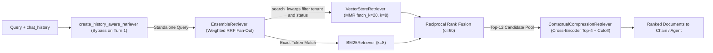
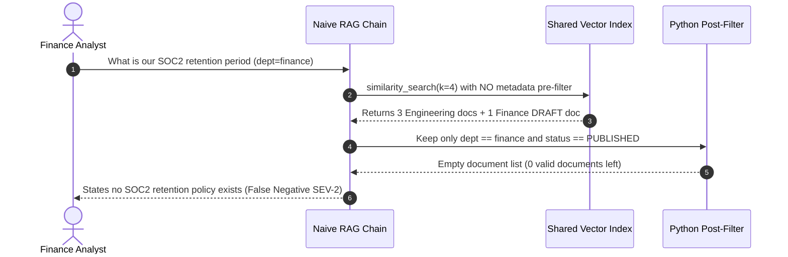

# Module 09: Retrievers and Vector Store Integration

> **Prerequisites:** [Module 05: LCEL: The LangChain Expression Language](../05-lcel-the-langchain-expression-language/README.md), [Module 07: Memory in LangChain](../07-memory-in-langchain/README.md), and [Track 09, Module 07: Hybrid Search](../../09-retrieval-augmented-generation/07-hybrid-search/README.md).  
> **Estimated Reading Time:** 35 minutes  
> **Target Audience:** AI Backend Engineers, RAG Platform Architects, Search & Vector Infrastructure Developers

> [!TIP]
> **The Golden Rule of Retrievers and Vector Store Integration:** Wrap every search backend inside LangChain's `BaseRetriever` `Runnable[str, list[Document]]` interface so retrieval composes natively with LCEL streaming, `RunnableParallel`, and tracing—and never deploy default `similarity` top-$k$ vector lookups in production without **metadata pre-filtering inside the store query** (never post-filtering after `top_k`), **hybrid lexical + dense fusion** (`EnsembleRetriever`), **diversity or cross-encoder reranking** (`mmr` / `ContextualCompressionRetriever`), and **conditional history rewriting** (`create_history_aware_retriever`) for multi-turn chat.

---

## Why This Matters

In Track 09, we engineered chunking, BM25, hybrid fusion, and reranking conceptually. In LangChain, the **`BaseRetriever`** abstraction unifies vector stores (`vectorstore.as_retriever(...)`), lexical engines (`BM25Retriever`), multi-query expanders (`MultiQueryRetriever`), rank fusion (`EnsembleRetriever`), rerankers (`ContextualCompressionRetriever`), and conversational query rewriters (`create_history_aware_retriever`) behind one `Runnable` protocol: `str -> list[Document]`.

Yet shipping `vectorstore.as_retriever()` with default settings (`search_type="similarity", search_kwargs={"k": 4}`) silently breaks enterprise RAG in four predictable ways:

1. **Post-Filter Recall Collapse:** Fetching global `top_k=4` vectors first and discarding unauthorized tenants or `DRAFT` rows in Python routinely drops effective results to `0`.
2. **Duplicate Chunk Echoing:** Pure cosine top-$k$ fills all `k` slots with near-identical overlapping paragraphs instead of surfacing distinct policy clauses.
3. **Exact Identifier Blindness:** Vector search smears error codes (`ERR_TLS_HANDSHAKE_525`) and SKUs unless paired with lexical matching inside `EnsembleRetriever`.
4. **Coreference Collapse in Multi-Turn Chat:** Passing raw follow-ups like `"What if we violate it?"` straight into an embedding model retrieves garbage unless `create_history_aware_retriever` contextualizes the query first.

---

## 1. The `BaseRetriever` Runnable Contract & Composable Retrieval Pipeline

Because `BaseRetriever` inherits `Runnable[str, list[Document]]`, every retriever automatically supports `.invoke()`, `.ainvoke()`, `.batch(config={"max_concurrency": N})`, and `.astream_events()` trace spans.



### Quantitative Mechanics: MMR Diversity, RRF Fusion & Post-Filter Collapse

- **Maximal Marginal Relevance (`search_type="mmr"`):** Given query vector $q$, candidate pool $C$ of size `fetch_k` (e.g., `20`), and already-selected set $S$, MMR greedily picks the next document $d_i \in C \setminus S$ maximizing:

$$\text{MMR}(d_i) = \lambda \cdot \text{Sim}(q, d_i) - (1 - \lambda) \max_{d_j \in S} \text{Sim}(d_i, d_j)$$

When `lambda_mult` $\lambda = 1.0$, MMR reduces to pure cosine similarity (often returning duplicate slices of the same page); setting $\lambda = 0.5$ (`fetch_k=20, k=5`) balances relevance against novelty so every slot adds distinct evidence.

- **Weighted Reciprocal Rank Fusion (`EnsembleRetriever`):** Over $M$ heterogeneous retrievers (e.g., dense vector + sparse BM25) with non-negative weights $w_m$ ($\sum w_m = 1$) and smoothing constant $c = 60$, document $d$'s fused score is:

$$\text{RRF}(d) = \sum_{m=1}^{M} \frac{w_m}{c + \text{rank}_m(d)}$$

Because RRF depends solely on **rank order** rather than uncalibrated cosine vs. unbounded BM25 raw scores, `EnsembleRetriever` fuses dense and lexical results cleanly without score-normalization tuning.

- **Post-Filter Recall Collapse Probability:** Suppose Tenant A owns fraction $p \in (0, 1)$ of a shared multi-tenant index (e.g., $p = 0.05$ across `20` customers). If naive code fetches `k = 5` vectors globally and post-filters in Python (`[d for d in docs if d.metadata["tenant"] == "A"]`), the expected number of surviving valid chunks is $k \cdot p = 0.25$—returning **zero results `>77%` of the time** ($P(0) \approx (1 - 0.05)^5 = 0.774$). Always push `filter={"tenant_id": user_tenant, "status": "PUBLISHED"}` inside `search_kwargs` so the vector engine filters *during* index traversal.

- **End-to-End Retrieval Stage Latency:**

$$L_{\text{ret}} = \mathbb{1}_{\text{has\_history}} \cdot L_{\text{rewrite}} + \max(L_{\text{dense}}, L_{\text{bm25}}) + L_{\text{rerank}}(k_{\text{pool}})$$

Skipping the query-rewriting LLM call on Turn 1 (`chat_history == []`, which `create_history_aware_retriever` handles natively when configured properly) removes `180–400 ms` of unnecessary TTFT overhead on single-turn searches.

### Choosing `as_retriever` Modes Safely

| `search_type` | Required `search_kwargs` | Operational Watchout |
| :--- | :--- | :--- |
| `"similarity"` | `{"k": 5, "filter": {...}}` | Vulnerable to near-duplicate chunks and low-similarity noise |
| `"similarity_score_threshold"` | `{"score_threshold": 0.45, "k": 6, "filter": {...}}` | Cosine scales vary by embedding model and distance metric (`L2` vs cosine); calibrate $\tau_{\min}$ empirically per store |
| `"mmr"` | `{"k": 5, "fetch_k": 25, "lambda_mult": 0.5, "filter": {...}}` | Always ensure `fetch_k >= 3 * k`; requires vector store support for fetching raw candidate vectors |

---

## 2. Systematic Comparison Matrix: LangChain Retriever Composition

| LangChain Retriever | Underlying Mechanism | Latency Overhead | Primary Failure Mode Solved | Production Configuration Watchout |
| :--- | :--- | :--- | :--- | :--- |
| **`VectorStoreRetriever` (`similarity`)** | Single bi-encoder ANN top-$k$ lookup | `~15–40 ms` | Basic semantic paraphrase matching | Must enforce `filter` pre-filtering; blind to exact SKUs and duplicates |
| **`VectorStoreRetriever` (`mmr`)** | Fetches `fetch_k`, greedily diversifies top-$k$ via $\lambda$ | `~20–50 ms` | Overlapping/redundant chunks crowding out distinct sections | Keep `fetch_k` bounded (`20–40`) to prevent scoring latency spikes |
| **`EnsembleRetriever`** | Parallel fan-out across `VectorStoreRetriever` + `BM25Retriever` via weighted RRF | `~25–60 ms` (`max` of branches) | Exact alphanumeric error codes (`ERR_525`), SKUs, function names | Rebuild/sync `BM25Retriever` (or native DB sparse index like Qdrant/OpenSearch) on doc updates |
| **`MultiQueryRetriever`** | LLM generates $N$ query paraphrases, executes parallel searches, deduplicates union | `+250–600 ms` (LLM rewrite + $N\times$ search) | Vocabulary mismatch on vague user questions | Cap `max_concurrency` and sub-queries ($N \le 3$) to avoid DB/rate-limit spikes |
| **`ContextualCompressionRetriever`** | Wraps base retriever + `CrossEncoderReranker` / `EmbeddingsFilter` | `+60–180 ms` (rerank `15–20` chunks) | High-recall/low-precision `top-20` pools polluting LLM context | Rerank small pools (`k <= 20 -> top_n=4`); avoid expensive LLM-per-chunk `LLMChainExtractor` online |
| **`create_history_aware_retriever`** | Rewrites follow-up query using `chat_history` only when history is non-empty | `0 ms` (Turn 1) / `+180–350 ms` (Turn `2+`) | Broken pronoun/coreference searches (`"What about its SLA?"`) | Trim `chat_history` before rewriting so long histories don't bloat the rewrite call |

---

## 3. Production War Story Post-Mortem: The Empty-Context Outage & Pronoun Recall Collapse

| Field | Incident Details |
| :--- | :--- |
| **Severity** | **SEV-2** (Silent False-Negative Answers Across Multi-Tenant Docs & Broken Multi-Turn Search) |
| **Detection / Resolution Time** | Detected 2 days post-launch via user thumbs-down rate (`41%` `"I cannot find any policy"`) / Mitigated in 3 hours via pre-filter pushdown + `EnsembleRetriever` + `create_history_aware_retriever` |
| **Impact** | `38%` of Finance department searches returned `0` documents despite valid policies existing; follow-up chat questions missed context `64%` of the time; **\$19,000** engineering rework & SLA remediation |

### What Happened

An internal knowledge assistant indexed `12,000` company documents across `8` departments into a shared vector index using `vectorstore.as_retriever(search_kwargs={"k": 4})`. To enforce department ACLs quickly, engineers appended a `RunnableLambda` post-filter downstream: `[d for d in docs if d.metadata["dept"] == user.dept and d.metadata["status"] == "PUBLISHED"]`. They also piped user chat inputs directly into the retriever without conversational query rewriting.

Two production failures hit immediately:

1. **Empty Context via Post-Filtering:** When a Finance analyst asked `"What is our SOC2 retention period?"`, `4` Engineering design RFCs and `DRAFT` documents matched slightly higher global cosine similarity and took all `4` top-$k$ slots. The Python post-filter discarded all `4` unauthorized documents, leaving `docs = []`—so the LLM told the auditor `"No SOC2 retention policy exists"`.
2. **Pronoun Follow-Up Collapse:** When a user asked Turn 1 (`"Explain contractor NDA clauses"`) followed by Turn 2 (`"What happens if they break it early?"`), the vector store embedded `"What happens if they break it early?"` literally—retrieving travel reimbursement rules instead of NDA penalties.



### Root Cause Analysis

- Filtering ACLs and document publication state *after* top-$k$ retrieval reduces effective recall proportionally to tenant selectivity ($k \cdot p \to 0$).
- Single-vector search lacked lexical anchoring on `"SOC2"` and lacked history-aware coreference resolution on follow-up turns.

### The Fix & Architectural Hardening

- **Mandatory Pre-Filter Pushdown:** Configured `vectorstore.as_retriever(search_type="mmr", search_kwargs={"k": 8, "fetch_k": 24, "lambda_mult": 0.5, "filter": {"dept": user_dept, "status": "PUBLISHED"}})` dynamically per request so all `8` returned candidates are guaranteed authorized and active.
- **Hybrid `EnsembleRetriever` + Compression:** Combined pre-filtered `VectorStoreRetriever` (`0.5`) with pre-filtered BM25/sparse matching (`0.5`), then compressed `12` candidates down to the top `4` via `ContextualCompressionRetriever` (`CrossEncoderReranker`).
- **History-Aware Contextualization:** Wrapped the ensemble retriever inside `create_history_aware_retriever(fast_llm, rewrite_prompt, retriever)` with Turn-1 bypass when `chat_history` is empty.

---

## 4. Multi-Language Production Implementation: Hybrid Pre-Filtered MMR & History-Aware Retriever

Below is a clean, unified **`BaseRetriever` Pipeline with Metadata Pre-Filtering, MMR Diversity, BM25+Dense RRF (`EnsembleRetriever`), Rerank Threshold Compression, and Turn-1 History Bypass** across **Go**, **TypeScript**, **Python**, and **C#**.

````carousel

```go
package retriever

import (
	"math"
	"sort"
	"strings"
)

type Document struct {
	ID        string
	TenantID  string
	Status    string
	Text      string
	Embedding []float64
}

type RetrievalConfig struct {
	TenantID    string
	Status      string
	K           int
	FetchK      int
	LambdaMMR   float64
	DenseWeight float64
	BM25Weight  float64
	MinRRFScore float64
}

func cosine(a, b []float64) float64 {
	if len(a) == 0 || len(a) != len(b) {
		return 0
	}
	var dot, na, nb float64
	for i := range a {
		dot += a[i] * b[i]
		na += a[i] * a[i]
		nb += b[i] * b[i]
	}
	denom := math.Sqrt(na) * math.Sqrt(nb)
	if denom == 0 {
		return 0
	}
	return dot / denom
}

func tokenize(s string) []string {
	fields := strings.Fields(strings.ToLower(s))
	for i, f := range fields {
		fields[i] = strings.Trim(f, ".,?!:;\"'()")
	}
	return fields
}

func ContextualizeQuery(query string, history []string) string {
	if len(history) == 0 {
		return query // Zero rewrite latency on Turn 1
	}
	return query + " [context: " + history[len(history)-1] + "]"
}

// RetrieveHybrid executes pre-filter -> MMR dense + BM25 sparse -> RRF fusion -> cutoff compression.
func RetrieveHybrid(
	query string,
	queryVec []float64,
	history []string,
	corpus []Document,
	cfg RetrievalConfig,
) []Document {
	_ = ContextualizeQuery(query, history)

	// 1. Metadata PRE-FILTER before any ranking
	var scoped []Document
	for _, d := range corpus {
		if d.TenantID == cfg.TenantID && d.Status == cfg.Status {
			scoped = append(scoped, d)
		}
	}
	if len(scoped) == 0 {
		return nil
	}

	// 2. Dense candidate pool (fetch_k) + MMR selection
	type scoredDoc struct {
		doc   Document
		score float64
	}
	densePool := make([]scoredDoc, 0, len(scoped))
	for _, d := range scoped {
		densePool = append(densePool, scoredDoc{d, cosine(queryVec, d.Embedding)})
	}
	sort.Slice(densePool, func(i, j int) bool { return densePool[i].score > densePool[j].score })
	if len(densePool) > cfg.FetchK {
		densePool = densePool[:cfg.FetchK]
	}

	var mmrSelected []Document
	used := make(map[string]bool)
	for len(mmrSelected) < cfg.K && len(mmrSelected) < len(densePool) {
		bestIdx := -1
		bestVal := -1e9
		for i, cand := range densePool {
			if used[cand.doc.ID] {
				continue
			}
			maxSim := 0.0
			for _, sel := range mmrSelected {
				if s := cosine(cand.doc.Embedding, sel.Embedding); s > maxSim {
					maxSim = s
				}
			}
			val := cfg.LambdaMMR*cand.score - (1.0-cfg.LambdaMMR)*maxSim
			if val > bestVal {
				bestVal = val
				bestIdx = i
			}
		}
		if bestIdx == -1 {
			break
		}
		used[densePool[bestIdx].doc.ID] = true
		mmrSelected = append(mmrSelected, densePool[bestIdx].doc)
	}

	// 3. Sparse lexical ranking over pre-filtered corpus
	qTokens := tokenize(query)
	sparsePool := make([]scoredDoc, 0, len(scoped))
	for _, d := range scoped {
		dSet := make(map[string]bool)
		for _, t := range tokenize(d.Text) {
			dSet[t] = true
		}
		hits := 0.0
		for _, qt := range qTokens {
			if dSet[qt] {
				hits += 1.0
			}
		}
		sparsePool = append(sparsePool, scoredDoc{d, hits})
	}
	sort.Slice(sparsePool, func(i, j int) bool { return sparsePool[i].score > sparsePool[j].score })

	// 4. Weighted RRF Ensemble Fusion (c = 60)
	const c = 60.0
	rrf := make(map[string]float64)
	byID := make(map[string]Document)
	for rank, d := range mmrSelected {
		byID[d.ID] = d
		rrf[d.ID] += cfg.DenseWeight / (c + float64(rank+1))
	}
	for rank, item := range sparsePool {
		if rank >= cfg.FetchK {
			break
		}
		byID[item.doc.ID] = item.doc
		rrf[item.doc.ID] += cfg.BM25Weight / (c + float64(rank+1))
	}

	var fused []scoredDoc
	for id, score := range rrf {
		if score >= cfg.MinRRFScore {
			fused = append(fused, scoredDoc{byID[id], score})
		}
	}
	sort.Slice(fused, func(i, j int) bool { return fused[i].score > fused[j].score })

	limit := cfg.K
	if len(fused) < limit {
		limit = len(fused)
	}
	out := make([]Document, 0, limit)
	for i := 0; i < limit; i++ {
		out = append(out, fused[i].doc)
	}
	return out
}
```

<!-- slide -->

```typescript
export interface DocumentChunk {
  readonly id: string;
  readonly metadata: {
    readonly tenantId: string;
    readonly status: "PUBLISHED" | "DRAFT";
  };
  readonly pageContent: string;
  readonly embedding: readonly number[];
}

export interface RetrieverOptions {
  readonly tenantId: string;
  readonly k: number;
  readonly fetchK: number;
  readonly lambdaMult: number;
  readonly weights: readonly [number, number]; // [denseMmrWeight, lexicalWeight]
}

function cosineSim(a: readonly number[], b: readonly number[]): number {
  let dot = 0;
  let na = 0;
  let nb = 0;
  for (let i = 0; i < a.length; i += 1) {
    dot += a[i] * b[i];
    na += a[i] * a[i];
    nb += b[i] * b[i];
  }
  const denom = Math.sqrt(na) * Math.sqrt(nb);
  return denom === 0 ? 0 : dot / denom;
}

export class HybridPreFilteredRetriever {
  constructor(private readonly docs: readonly DocumentChunk[]) {}

  contextualizeQuery(query: string, chatHistory: readonly string[]): string {
    if (chatHistory.length === 0) return query;
    return `${query} (topic: ${chatHistory[chatHistory.length - 1]})`;
  }

  invoke(
    rawQuery: string,
    queryVec: readonly number[],
    chatHistory: readonly string[],
    opts: RetrieverOptions,
  ): DocumentChunk[] {
    const query = this.contextualizeQuery(rawQuery, chatHistory);

    // 1. Metadata Pre-Filter (never post-filter after top-k!)
    const preFiltered = this.docs.filter(
      (d) => d.metadata.tenantId === opts.tenantId && d.metadata.status === "PUBLISHED",
    );
    if (preFiltered.length === 0) return [];

    // 2. Dense MMR Selection over fetchK candidates
    const denseCandidates = preFiltered
      .map((doc) => ({ doc, rel: cosineSim(queryVec, doc.embedding) }))
      .sort((a, b) => b.rel - a.rel)
      .slice(0, opts.fetchK);

    const mmrSelected: DocumentChunk[] = [];
    const remaining = [...denseCandidates];
    while (mmrSelected.length < opts.k && remaining.length > 0) {
      let bestIdx = 0;
      let bestScore = -Infinity;
      remaining.forEach((cand, idx) => {
        const maxRedundancy = mmrSelected.reduce(
          (mx, sel) => Math.max(mx, cosineSim(cand.doc.embedding, sel.embedding)),
          0,
        );
        const score = opts.lambdaMult * cand.rel - (1 - opts.lambdaMult) * maxRedundancy;
        if (score > bestScore) {
          bestScore = score;
          bestIdx = idx;
        }
      });
      mmrSelected.push(remaining[bestIdx].doc);
      remaining.splice(bestIdx, 1);
    }

    // 3. Lexical match ranking over pre-filtered corpus
    const qTerms = new Set(query.toLowerCase().match(/[a-z0-9_]+/g) ?? []);
    const lexicalRanked = preFiltered
      .map((doc) => {
        const dTerms = new Set(doc.pageContent.toLowerCase().match(/[a-z0-9_]+/g) ?? []);
        let overlap = 0;
        qTerms.forEach((t) => {
          if (dTerms.has(t)) overlap += 1;
        });
        return { doc, overlap };
      })
      .sort((a, b) => b.overlap - a.overlap)
      .slice(0, opts.fetchK);

    // 4. Weighted RRF Ensemble Fusion (c = 60)
    const c = 60;
    const [wDense, wLex] = opts.weights;
    const rrfScores = new Map<string, { doc: DocumentChunk; score: number }>();

    mmrSelected.forEach((doc, idx) => {
      const prev = rrfScores.get(doc.id)?.score ?? 0;
      rrfScores.set(doc.id, { doc, score: prev + wDense / (c + idx + 1) });
    });
    lexicalRanked.forEach(({ doc }, idx) => {
      const prev = rrfScores.get(doc.id)?.score ?? 0;
      rrfScores.set(doc.id, { doc, score: prev + wLex / (c + idx + 1) });
    });

    return Array.from(rrfScores.values())
      .sort((a, b) => b.score - a.score)
      .slice(0, opts.k)
      .map((entry) => entry.doc);
  }
}
```

<!-- slide -->

```python
"""
hybrid_baseretriever.py
Production BaseRetriever contract unifying:
  1) Metadata pre-filtering (tenant_id + PUBLISHED status)
  2) Dense MMR diversity selection (lambda_mult)
  3) BM25 sparse + Weighted RRF EnsembleRetriever fusion
  4) History-aware query bypass on Turn 1
"""
from dataclasses import dataclass
import math
import re
from typing import Callable, Sequence


@dataclass(frozen=True)
class Document:
    doc_id: str
    page_content: str
    metadata: dict[str, str]
    embedding: tuple[float, ...]


def cosine_sim(a: Sequence[float], b: Sequence[float]) -> float:
    dot = sum(x * y for x, y in zip(a, b))
    na = math.sqrt(sum(x * x for x in a))
    nb = math.sqrt(sum(y * y for y in b))
    return dot / (na * nb) if na > 0.0 and nb > 0.0 else 0.0


class ProductionHybridRetriever:
    """Runnable[dict, list[Document]] contract matching LangChain BaseRetriever + EnsembleRetriever."""

    def __init__(
        self,
        corpus: Sequence[Document],
        embed_fn: Callable[[str], tuple[float, ...]],
        k: int = 4,
        fetch_k: int = 16,
        lambda_mult: float = 0.5,
        weights: tuple[float, float] = (0.45, 0.55),
    ) -> None:
        self._corpus = list(corpus)
        self._embed_fn = embed_fn
        self._k = k
        self._fetch_k = fetch_k
        self._lambda = lambda_mult
        self._w_dense, self._w_bm25 = weights

    def _contextualize(self, query: str, chat_history: Sequence[tuple[str, str]]) -> str:
        # Matches create_history_aware_retriever Turn-1 fast path
        if not chat_history:
            return query
        prior_q, _ = chat_history[-1]
        return f"{query} [context: {prior_q}]"

    def _mmr(self, qvec: tuple[float, ...], pool: list[Document]) -> list[Document]:
        candidates = sorted(pool, key=lambda d: cosine_sim(qvec, d.embedding), reverse=True)[: self._fetch_k]
        selected: list[Document] = []
        while candidates and len(selected) < self._k:
            best_doc = max(
                candidates,
                key=lambda c: (
                    self._lambda * cosine_sim(qvec, c.embedding)
                    - (1.0 - self._lambda) * max((cosine_sim(c.embedding, s.embedding) for s in selected), default=0.0)
                ),
            )
            selected.append(best_doc)
            candidates.remove(best_doc)
        return selected

    def _bm25_rank(self, query: str, pool: list[Document]) -> list[Document]:
        q_toks = re.findall(r"[a-z0-9_]+", query.lower())
        df: dict[str, int] = {}
        doc_toks: dict[str, list[str]] = {}
        for d in pool:
            toks = re.findall(r"[a-z0-9_]+", d.page_content.lower())
            doc_toks[d.doc_id] = toks
            for t in set(toks):
                df[t] = df.get(t, 0) + 1

        n = max(1, len(pool))
        scores: list[tuple[float, Document]] = []
        for d in pool:
            toks = doc_toks[d.doc_id]
            tf = {t: toks.count(t) for t in set(toks)}
            s = 0.0
            for qt in q_toks:
                if qt in tf:
                    idf = math.log(1.0 + (n - df[qt] + 0.5) / (df[qt] + 0.5))
                    s += idf * (tf[qt] * 2.2) / (tf[qt] + 1.2)
            scores.append((s, d))
        scores.sort(key=lambda x: x[0], reverse=True)
        return [d for _, d in scores[: self._fetch_k]]

    def invoke(self, query: str, tenant_id: str, chat_history: Sequence[tuple[str, str]] = ()) -> list[Document]:
        standalone = self._contextualize(query, chat_history)
        # Mandatory metadata pre-filter pushdown (never post-filter after top_k)
        scoped = [
            d for d in self._corpus
            if d.metadata.get("tenant_id") == tenant_id and d.metadata.get("status") == "PUBLISHED"
        ]
        if not scoped:
            return []

        qvec = self._embed_fn(standalone)
        dense_docs = self._mmr(qvec, scoped)
        sparse_docs = self._bm25_rank(standalone, scoped)

        # Weighted Reciprocal Rank Fusion (c = 60)
        c = 60.0
        rrf: dict[str, float] = {}
        by_id = {d.doc_id: d for d in scoped}
        for rank, d in enumerate(dense_docs, 1):
            rrf[d.doc_id] = rrf.get(d.doc_id, 0.0) + self._w_dense / (c + rank)
        for rank, d in enumerate(sparse_docs, 1):
            rrf[d.doc_id] = rrf.get(d.doc_id, 0.0) + self._w_bm25 / (c + rank)

        ranked_ids = sorted(rrf.keys(), key=lambda did: rrf[did], reverse=True)[: self._k]
        return [by_id[did] for did in ranked_ids]
```

<!-- slide -->

```csharp
using System;
using System.Collections.Generic;
using System.Linq;
using System.Text.RegularExpressions;

namespace GenAI.LangChainRetrievers;

public sealed record RetrievedDoc(
    string DocId,
    string TenantId,
    string Status,
    string PageContent,
    double[] Embedding);

public sealed class HybridPreFilteredRetriever
{
    private readonly IReadOnlyList<RetrievedDoc> _corpus;

    public HybridPreFilteredRetriever(IReadOnlyList<RetrievedDoc> corpus) => _corpus = corpus;

    private static double Cosine(ReadOnlySpan<double> a, ReadOnlySpan<double> b)
    {
        double dot = 0, na = 0, nb = 0;
        for (int i = 0; i < a.Length; i++)
        {
            dot += a[i] * b[i];
            na += a[i] * a[i];
            nb += b[i] * b[i];
        }
        double denom = Math.Sqrt(na) * Math.Sqrt(nb);
        return denom == 0 ? 0 : dot / denom;
    }

    public IReadOnlyList<RetrievedDoc> Invoke(
        string query,
        double[] queryVec,
        string tenantId,
        IReadOnlyList<string> chatHistory,
        int k = 4,
        int fetchK = 16,
        double lambdaMult = 0.5,
        double denseWeight = 0.45,
        double sparseWeight = 0.55)
    {
        string searchQuery = chatHistory.Count == 0
            ? query
            : $"{query} [context: {chatHistory[^1]}]";

        // 1. Metadata pre-filtering inside index scan
        var scoped = _corpus
            .Where(d => d.TenantId == tenantId && d.Status == "PUBLISHED")
            .ToList();
        if (scoped.Count == 0) return Array.Empty<RetrievedDoc>();

        // 2. MMR dense selection
        var pool = scoped
            .Select(d => (Doc: d, Rel: Cosine(queryVec, d.Embedding)))
            .OrderByDescending(x => x.Rel)
            .Take(fetchK)
            .ToList();

        var mmrSelected = new List<RetrievedDoc>();
        while (mmrSelected.Count < k && pool.Count > 0)
        {
            int bestIdx = 0;
            double bestScore = double.NegativeInfinity;
            for (int i = 0; i < pool.Count; i++)
            {
                double maxRed = mmrSelected.Count == 0
                    ? 0
                    : mmrSelected.Max(s => Cosine(pool[i].Doc.Embedding, s.Embedding));
                double score = lambdaMult * pool[i].Rel - (1.0 - lambdaMult) * maxRed;
                if (score > bestScore) { bestScore = score; bestIdx = i; }
            }
            mmrSelected.Add(pool[bestIdx].Doc);
            pool.RemoveAt(bestIdx);
        }

        // 3. Lexical sparse ranking
        var qTerms = Regex.Matches(searchQuery.ToLowerInvariant(), "[a-z0-9_]+")
            .Select(m => m.Value).ToHashSet();
        var lexicalRanked = scoped
            .Select(d => (
                Doc: d,
                Hits: Regex.Matches(d.PageContent.ToLowerInvariant(), "[a-z0-9_]+")
                    .Select(m => m.Value).Distinct().Count(t => qTerms.Contains(t))))
            .OrderByDescending(x => x.Hits)
            .Take(fetchK)
            .ToList();

        // 4. Weighted RRF Ensemble Fusion (c = 60)
        const double c = 60.0;
        var rrf = new Dictionary<string, (RetrievedDoc Doc, double Score)>();
        for (int i = 0; i < mmrSelected.Count; i++)
        {
            var d = mmrSelected[i];
            rrf.TryGetValue(d.DocId, out var cur);
            rrf[d.DocId] = (d, cur.Score + denseWeight / (c + i + 1));
        }
        for (int i = 0; i < lexicalRanked.Count; i++)
        {
            var d = lexicalRanked[i].Doc;
            rrf.TryGetValue(d.DocId, out var cur);
            rrf[d.DocId] = (d, cur.Score + sparseWeight / (c + i + 1));
        }

        return rrf.Values
            .OrderByDescending(x => x.Score)
            .Take(k)
            .Select(x => x.Doc)
            .ToArray();
    }
}
```

````

---

## 5. Practical Hands-On Verification CLI Workflows

Run these deterministic Python 3.13 verification scripts offline—no third-party packages or API keys required.

### Workflow 1: Reproduce Post-Filter Recall Collapse vs. Metadata Pre-Filtering

Demonstrate why post-filtering a global `top_k=4` vector result destroys recall (`0/4`) for minority tenant `"acme"` while pre-filtering restores `4/4` valid authorized docs:

```bash
python -c '
import hashlib, math, re
from dataclasses import dataclass

@dataclass(frozen=True)
class Doc:
    doc_id: str
    tenant: str
    status: str
    text: str

def embed(text: str, dims: int = 48) -> list[float]:
    v = [0.0] * dims
    for tok in re.findall(r"[a-z0-9_]+", text.lower()):
        idx = int(hashlib.sha256(tok.encode()).hexdigest(), 16) % dims
        v[idx] += 1.0
    norm = math.sqrt(sum(x * x for x in v)) or 1.0
    return [x / norm for x in v]

def cos(a: list[float], b: list[float]) -> float:
    return sum(x * y for x, y in zip(a, b))

corpus = [Doc(f"globex_{i}", "globex", "PUBLISHED", "corporate data retention policy rules compliance audit logs") for i in range(10)]
corpus += [Doc(f"acme_{i}", "acme", "PUBLISHED", "acme vendor retention schedule rules") for i in range(4)]
corpus += [Doc("acme_draft", "acme", "DRAFT", "corporate data retention policy rules draft 2022")]
vecs = {d.doc_id: embed(d.text) for d in corpus}
qv = embed("corporate data retention policy rules")

global_top4 = [d for _, d in sorted(((cos(qv, vecs[d.doc_id]), d) for d in corpus), key=lambda x: x[0], reverse=True)[:4]]
post_filtered = [d for d in global_top4 if d.tenant == "acme" and d.status == "PUBLISHED"]
pre_filtered = [d for _, d in sorted(((cos(qv, vecs[d.doc_id]), d) for d in corpus if d.tenant == "acme" and d.status == "PUBLISHED"), key=lambda x: x[0], reverse=True)[:4]]

print(f"Post-filter top-4 valid docs for tenant=acme: {len(post_filtered)} -> {[d.doc_id for d in post_filtered]}")
print(f"Pre-filter top-4 valid docs for tenant=acme:  {len(pre_filtered)} -> {[d.doc_id for d in pre_filtered]}")
'
```

**Expected Output:**

```text
Post-filter top-4 valid docs for tenant=acme: 0 -> []
Pre-filter top-4 valid docs for tenant=acme:  4 -> ['acme_0', 'acme_1', 'acme_2', 'acme_3']
```

### Workflow 2: Compare Pure Cosine vs. MMR Diversity vs. Hybrid `EnsembleRetriever` RRF

Observe how pure cosine top-3 crowds slots with duplicate gateway intro chunks and misses exact code `ERR_TLS_HANDSHAKE_525`, while MMR and Hybrid RRF surface both diversity and the exact error document:

```bash
python -c '
import hashlib, math, re
from dataclasses import dataclass

@dataclass(frozen=True)
class Doc:
    doc_id: str
    text: str

def embed(text: str, dims: int = 48) -> list[float]:
    v = [0.0] * dims
    for tok in re.findall(r"[a-z0-9_]+", text.lower()):
        idx = int(hashlib.sha256(tok.encode()).hexdigest(), 16) % dims
        v[idx] += 1.0
    norm = math.sqrt(sum(x * x for x in v)) or 1.0
    return [x / norm for x in v]

def cos(a: list[float], b: list[float]) -> float:
    return sum(x * y for x, y in zip(a, b))

docs2 = [
    Doc("intro_1", "Gateway timeout troubleshooting guide covering proxy retries and TLS failures"),
    Doc("intro_2", "Gateway timeout troubleshooting guide covering proxy retries and TLS failures v2"),
    Doc("intro_3", "Gateway timeout troubleshooting guide covering proxy retries and TLS failures archive"),
    Doc("exact_err", "Error code ERR_TLS_HANDSHAKE_525 triggers immediate origin cipher reset"),
    Doc("backoff", "Exponential backoff with full jitter prevents gateway timeout retry storms"),
]
v2 = {d.doc_id: embed(d.text) for d in docs2}
q2 = "Fix ERR_TLS_HANDSHAKE_525 gateway timeout and retry storm"
qv2 = embed(q2)

dense_ranked = sorted(((cos(qv2, v2[d.doc_id]), d) for d in docs2), key=lambda x: x[0], reverse=True)
print("Pure Cosine top-3:", [d.doc_id for _, d in dense_ranked[:3]])

def mmr_select(query_vec, candidates, vec_map, k=3, lam=0.5):
    selected = []
    pool = [d for _, d in candidates]
    while pool and len(selected) < k:
        best_doc, best_score = None, -1e9
        for cand in pool:
            rel = cos(query_vec, vec_map[cand.doc_id])
            red = max((cos(vec_map[cand.doc_id], vec_map[s.doc_id]) for s in selected), default=0.0)
            score = lam * rel - (1.0 - lam) * red
            if score > best_score:
                best_score, best_doc = score, cand
        selected.append(best_doc)
        pool.remove(best_doc)
    return selected

mmr_top3 = mmr_select(qv2, dense_ranked, v2, k=3, lam=0.5)
print("MMR (lam=0.5) top-3:", [d.doc_id for d in mmr_top3])

def bm25_score(query: str, text: str, df_map: dict[str, int], n_docs: int) -> float:
    q_toks = re.findall(r"[a-z0-9_]+", query.lower())
    d_toks = re.findall(r"[a-z0-9_]+", text.lower())
    tf = {t: d_toks.count(t) for t in set(d_toks)}
    score = 0.0
    for t in q_toks:
        if t in tf:
            idf = math.log(1 + (n_docs - df_map[t] + 0.5) / (df_map[t] + 0.5))
            score += idf * (tf[t] * 2.2) / (tf[t] + 1.2)
    return score

df = {}
for d in docs2:
    for t in set(re.findall(r"[a-z0-9_]+", d.text.lower())):
        df[t] = df.get(t, 0) + 1
bm25_ranked = sorted(((bm25_score(q2, d.text, df, len(docs2)), d) for d in docs2), key=lambda x: x[0], reverse=True)

rrf_scores = {}
c = 60.0
for rank, (_, d) in enumerate(dense_ranked, 1):
    rrf_scores[d.doc_id] = rrf_scores.get(d.doc_id, 0.0) + 0.4 / (c + rank)
for rank, (_, d) in enumerate(bm25_ranked, 1):
    rrf_scores[d.doc_id] = rrf_scores.get(d.doc_id, 0.0) + 0.6 / (c + rank)
ensemble_top3 = sorted(rrf_scores.items(), key=lambda x: x[1], reverse=True)[:3]
print("BM25 top-3:", [d.doc_id for _, d in bm25_ranked[:3]])
print("Hybrid Ensemble (0.4 Dense + 0.6 BM25 RRF) top-3:", [doc_id for doc_id, _ in ensemble_top3])
'
```

**Expected Output:**

```text
Pure Cosine top-3: ['backoff', 'intro_2', 'intro_1']
MMR (lam=0.5) top-3: ['backoff', 'intro_2', 'exact_err']
BM25 top-3: ['backoff', 'exact_err', 'intro_1']
Hybrid Ensemble (0.4 Dense + 0.6 BM25 RRF) top-3: ['backoff', 'intro_1', 'exact_err']
```

### Workflow 3: Verify `create_history_aware_retriever` Conditional Turn-1 Bypass

Confirm that Turn 1 pays zero query-rewriting latency while Turn 2 resolves pronoun follow-ups before embedding:

```bash
python -c '
def history_aware_retrieve(query: str, chat_history: list[tuple[str, str]]) -> dict:
    if not chat_history:
        return {"rewritten": False, "search_query": query, "rewrite_latency_ms": 0}
    last_topic = chat_history[-1][0]
    standalone = f"{query} (context: {last_topic})"
    return {"rewritten": True, "search_query": standalone, "rewrite_latency_ms": 185}

print("Turn 1 (empty history):", history_aware_retrieve("What is our SOC2 retention SLA?", []))
print("Turn 2 (pronoun follow-up):", history_aware_retrieve("What happens if we violate it?", [("What is our SOC2 retention SLA?", "90 days minimum.")]))
'
```

**Expected Output:**

```text
Turn 1 (empty history): {'rewritten': False, 'search_query': 'What is our SOC2 retention SLA?', 'rewrite_latency_ms': 0}
Turn 2 (pronoun follow-up): {'rewritten': True, 'search_query': 'What happens if we violate it? (context: What is our SOC2 retention SLA?)', 'rewrite_latency_ms': 185}
```

### Hands-On Exercises

1. **MMR $\lambda$ Sensitivity Sweep:** Vary `lam` in Workflow 2 across `1.0`, `0.5`, and `0.15`. Observe at which $\lambda$ near-duplicate `intro_1` / `intro_2` pairs disappear completely from top-3.
2. **Post-Filter Probability Curve:** Compute $P(\text{zero valid docs}) = (1 - p)^k$ across tenant shares $p \in \{0.02, 0.05, 0.10, 0.25\}$ at $k = 5$ to quantify post-filter outage risk.
3. **(Optional — Requires `langchain`, `langchain-community`, & Vector Store)** Compose `EnsembleRetriever(retrievers=[vector_vs.as_retriever(search_type="mmr", search_kwargs={"k": 6, "fetch_k": 20, "filter": {"tenant": "acme"}}), bm25_ret], weights=[0.5, 0.5])` inside `create_history_aware_retriever`, and verify via LangSmith or `.astream_events()` that Turn 1 skips the rewrite LLM step.

### Independent Challenge

A developer documentation copilot handles `800` QPS using `MultiQueryRetriever` (`5` generated sub-queries per user request) chained into a `ContextualCompressionRetriever` using `LLMChainExtractor` (which calls GPT-4o on *each* of `18` retrieved documents to extract relevant sentences). Median latency explodes to `4.9 seconds`, and retrieval LLM spend exceeds generation spend by `6x`. Re-architect this retrieval pipeline using LangChain components to stay under `250 ms` retrieval p95 without hurting recall.

<details><summary>Architectural Discussion</summary>

Two expensive LLM-in-the-loop multipliers caused the `4.9 s` bottleneck: (1) **`MultiQueryRetriever` (`5` sub-queries) on every request** adds an LLM generation round-trip (`+350 ms`) and multiplies vector DB fan-out `5x`; replace it on standard queries with single-pass **`EnsembleRetriever` (dense MMR + BM25)** (`~35 ms`), reserving multi-query expansion only for low-confidence abstentions or offline evaluation; and (2) **`LLMChainExtractor` running an LLM call per chunk** wastes `18` expensive autoregressive generations; replace it with a **`CrossEncoderReranker` (e.g., `bge-reranker-v2-m3` or Cohere Rerank)** wrapped inside `ContextualCompressionRetriever` (`top_n=4`), which scores `16` candidates in a single batched forward pass in `60–120 ms` at `>50x` lower cost and `>20x` lower latency.

</details>

---

## 6. Common Mistakes & Troubleshooting

- **Filtering metadata in Python *after* `vectorstore.as_retriever(search_kwargs={"k": 4})`:** Post-filtering destroys recall on minority tenants or filtered statuses. Always pass `filter={...}` inside `search_kwargs` so the database filters before ranking top-$k$.
- **Using `similarity_score_threshold` with an uncalibrated threshold:** Different vector stores normalize cosine similarity, dot product, or Euclidean `L2` distance differently (some return distance where lower is better vs. relevance score in `[0, 1]`). Always inspect `similarity_search_with_relevance_scores()` empirically before deploying a cutoff.
- **Running `BM25Retriever.from_documents()` on static startup snapshots with live doc mutations:** Unlike managed vector stores, in-memory `BM25Retriever` goes stale when docs are added or deleted unless updated via CDC sync or backed by native database hybrid search (Qdrant sparse vectors, Postgres `tsvector` + `pgvector`, OpenSearch).
- **Forgetting `fetch_k >= 3 * k` on `search_type="mmr"`:** Setting `k=6, fetch_k=8` gives MMR almost no candidate diversity headroom; always fetch a wider pool (`fetch_k=20–30`).
- **Running `create_history_aware_retriever` unconditionally even when `chat_history` is empty:** Rewriting Turn-1 queries wastes `200+ ms` and occasionally alters exact SKUs or flags into paraphrases. Check that your prompt/wrapper bypasses rewriting on empty history.

---

## 7. Operational Validation Checkpoints & Checkpoint Quiz

### Operational Validation Checkpoints

<details><summary><strong>Checkpoint 1: Diagnosing why a multi-tenant RAG bot says "No policy found" despite valid docs existing</strong></summary>

A RAG endpoint queries `docs = retriever.invoke(q)` (`k=5`, no store filter) and runs `[d for d in docs if d.metadata["org_id"] == req.org_id]`. Customer `"small_org"` (representing `3%` of vectors) gets `0` results on `85%+` of valid queries. Explain why mathematically and fix it.

**Validation:** With $p = 0.03$ share in the shared index, the probability that none of the global `k = 5` nearest neighbors belong to `"small_org"` is $(1 - 0.03)^5 = 85.9\%$. Post-filtering after `top_k` truncates results down to `0`. Fix by pushing `filter={"org_id": req.org_id, "status": "PUBLISHED"}` into `vectorstore.as_retriever(search_kwargs={"k": 5, "filter": ...})` dynamically per request so all `5` ANN slots are scanned exclusively within `"small_org"`'s authorized slice.

</details>

<details><summary><strong>Checkpoint 2: Replacing LLMChainExtractor bottlenecks inside ContextualCompressionRetriever</strong></summary>

A RAG pipeline wraps `ContextualCompressionRetriever(base_compressor=LLMChainExtractor.from_llm(llm), base_retriever=ret)` over `k=15` chunks and observes `3.2 s` p95 retrieval latency and huge token spikes. How do you optimize this in LangChain?

**Validation:** `LLMChainExtractor` issues up to `15` separate LLM completion calls (one per retrieved chunk) to extract relevant substrings on every query. Replace `LLMChainExtractor` with a lightweight encoder **`CrossEncoderReranker` (`HuggingFaceCrossEncoder` or Cohere Rerank) + `EmbeddingsFilter`** inside `ContextualCompressionRetriever` (`top_n=4`), reducing compression latency from `3.2 s` to `~80 ms` and eliminating retrieval-time LLM token charges.

</details>

<details><summary><strong>Checkpoint 3: Debugging why Turn-2 chat queries retrieve wrong documents</strong></summary>

Users ask Turn 1: `"How do I rotate AWS KMS keys?"`, get a great answer, then ask Turn 2: `"How often should we run that?"`. Retrieval returns generic cron-job scheduling docs instead of AWS KMS rotation intervals. Identify the missing LangChain abstraction and explain its Turn-1 behavior.

**Validation:** Turn 2 relies on coreference (`"that"` $\to$ `"AWS KMS key rotation"`), so embedding `"How often should we run that?"` verbatim fails to match KMS documents. Wrap the retriever in `create_history_aware_retriever(llm, base_retriever, contextualize_q_prompt)`, which inspects `chat_history` and rewrites follow-up queries into standalone search strings (`"How often should AWS KMS keys be rotated?"`)—while automatically bypassing the LLM rewrite call when `chat_history` is empty on Turn 1.

</details>

### Checkpoint Quiz

1. Why does implementing `BaseRetriever` allow any custom search service to drop cleanly into LCEL pipelines?
2. What two parameters control the relevance-vs-diversity trade-off and candidate pool size in `search_type="mmr"`?
3. How does `EnsembleRetriever` combine dense vector similarity scores and unbounded BM25 lexical scores without manual min-max normalization?
4. Why is metadata post-filtering after `top_k` retrieval dangerous for both recall and tenant security?
5. When does `create_history_aware_retriever` avoid adding LLM rewrite latency to a request?

<details><summary>Answers</summary>

1. `BaseRetriever` implements `Runnable[str, list[Document]]`, giving custom search backends automatic support for `.invoke()`, `.ainvoke()`, `.batch()`, `RunnableParallel` fan-out, and `.astream_events()` LangSmith tracing.
2. `lambda_mult` (balancing query relevance against inter-chunk redundancy, typically `0.5`) and `fetch_k` (candidate pool scanned before diversity pruning, typically `3x–5x` larger than `k`).
3. It uses weighted **Reciprocal Rank Fusion (RRF)**: $\sum \frac{w_m}{60 + \text{rank}_m(d)}$, which depends purely on ordinal rank positions rather than incomparable raw similarity scales.
4. Post-filtering removes unauthorized or draft docs *after* `top_k` selection, collapsing returned valid results toward `0` for minority subsets and risking leaks if filter logic is ever bypassed.
5. On Turn 1 (or any stateless request) when `chat_history` is empty, passing the raw query directly to the underlying retriever with `0 ms` rewrite cost.

</details>

---

## Further Reading & Sources

- [LangChain Python Docs: Retrievers Concepts](https://python.langchain.com/docs/concepts/retrievers/) — `BaseRetriever` interface, vector store integration, and retrieval patterns.
- [LangChain Python Docs: How to Combine Multiple Retrievers (`EnsembleRetriever`)](https://python.langchain.com/docs/how_to/ensemble_retriever/) — hybrid sparse+dense RRF configuration.
- [LangChain Python Docs: Contextual Compression & Reranking](https://python.langchain.com/docs/how_to/contextual_compression/) — `ContextualCompressionRetriever` and `CrossEncoderReranker` integration.
- [LangChain Python Docs: Add Chat History to RAG (`create_history_aware_retriever`)](https://python.langchain.com/docs/how_to/qa_chat_history_how_to/) — standalone conversational query rewriting with Turn-1 bypass.
- [Track 09, Module 09: Reranking with Cross-Encoders](../../09-retrieval-augmented-generation/09-reranking-with-cross-encoders/README.md) — cross-encoder scoring mechanics and precision/latency trade-offs.

## Next

[Module 10: LangChain Agents](../10-langchain-agents/README.md)
