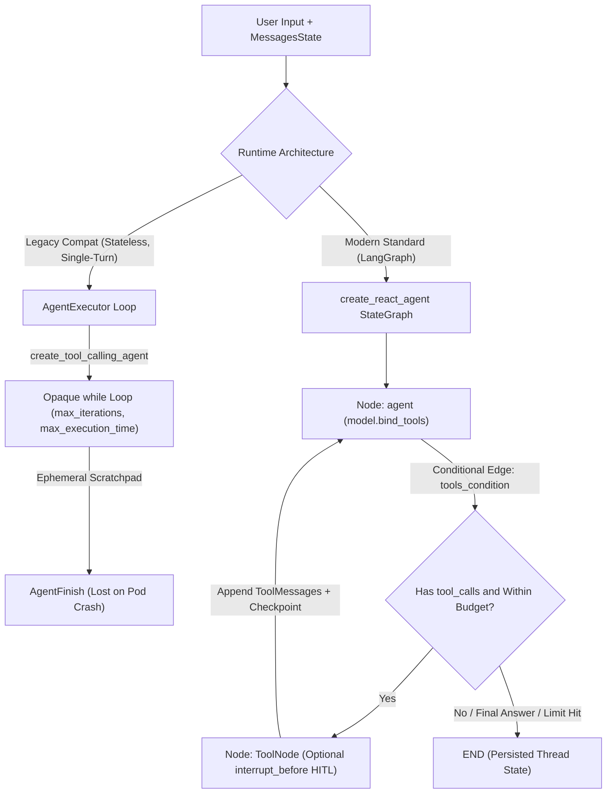
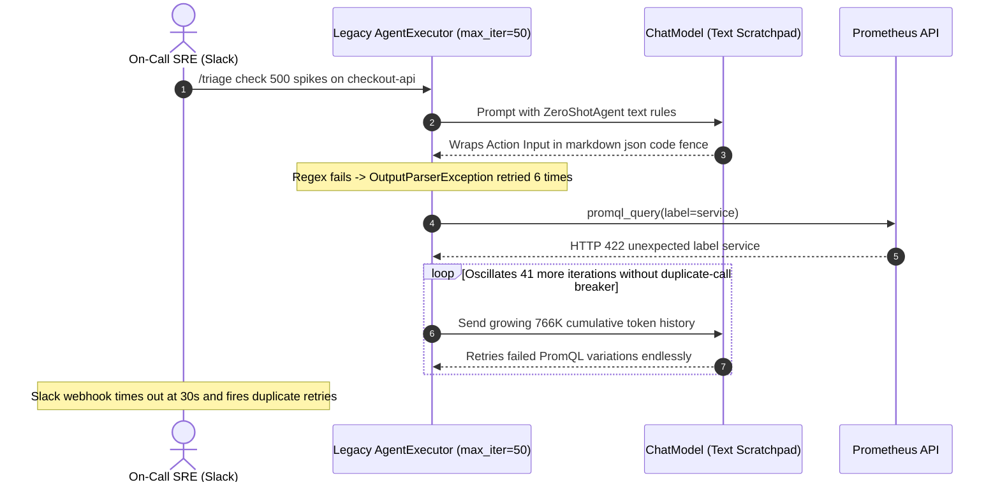

# Module 10: LangChain Agents

> **Prerequisites:** [Module 05: LCEL: The LangChain Expression Language](../05-lcel-the-langchain-expression-language/README.md), [Module 08: Tools and Toolkits](../08-tools-and-toolkits/README.md), [Module 09: Retrievers and Vector Store Integration](../09-retrievers-and-vector-store-integration/README.md), and [Track 10, Module 02: The ReAct Loop](../../10-ai-agents/02-the-react-loop/README.md).  
> **Estimated Reading Time:** 35 minutes  
> **Target Audience:** AI Backend Engineers, Agent Runtime Architects, Reliability & SRE Engineers

> [!TIP]
> **The Golden Rule of LangChain Agents:** Treat `initialize_agent`, `ZeroShotAgent`, and legacy `AgentExecutor` purely as deprecated historical stepping stones (now isolated in `langchain-classic`). Only use `create_tool_calling_agent` + bounded `AgentExecutor` when maintaining simple stateless single-turn tool loops guarded by hard `max_iterations`, `max_execution_time`, and duplicate-call circuit breakers—and migrate directly to **LangGraph (`create_react_agent` or a custom `StateGraph`)** the moment you need thread persistence, streaming sub-step observability, human-in-the-loop interrupts, or deterministic error-recovery routing.

---

## Why This Matters

In Track 10, we implemented the ReAct (`Reason -> Act -> Observe`) loop manually in raw Python. LangChain originally shipped `initialize_agent` and `AgentExecutor` to automate that loop—and accidentally introduced two notorious production traps:

1. **Fragile String-Scratchpad Regex Parsing (`ZeroShotAgent` / `ReActSingleInputOutputParser`):** Early LangChain agents stuffed `agent_scratchpad` text into prompts and forced models to print exact `Thought: / Action: / Action Input:` lines. One stray markdown fence (```` ```json ````) or trailing prose line crashed the regex parser (`OutputParserException`).
2. **Opaque, Ephemeral, Runaway `while` Loops (`AgentExecutor`):** Even after `create_tool_calling_agent` adopted native provider JSON tool calling (`AIMessage.tool_calls`), `AgentExecutor` remained an uncheckpointed black-box `while` loop. It cannot pause cleanly for human approval before destructive writes, cannot resume after a worker restart at step `4`, and—if shipped with high `max_iterations` and no duplicate-call breaker—silently drains tens of dollars on repeated identical tool errors.

Understanding how `create_tool_calling_agent` works internally—and why LangGraph's `create_react_agent` replaces `AgentExecutor`—gives you full operational control over agent reliability, cost, and safety.

---

## 1. From Scratchpad Regex Agents to Native Tool Loops and LangGraph `create_react_agent`

Modern LangChain agents evolved across three clear generations:

1. **Generation 1 (`initialize_agent` / `ZeroShotAgent` — Deprecated):** Single text prompt + `agent_scratchpad` string + fragile regex extraction (`Action: ... Action Input: ...`). High parsing failure rates and incompatible with parallel tool calls.
2. **Generation 2 (`create_tool_calling_agent` + `AgentExecutor` — Legacy-Compat):** Uses `model.bind_tools(tools)` + `MessagesPlaceholder("agent_scratchpad")` so providers return structured `AIMessage.tool_calls` JSON payloads—still executed inside an opaque ephemeral `AgentExecutor` loop (`max_iterations`, `max_execution_time`, `early_stopping_method`).
3. **Generation 3 (`langgraph.prebuilt.create_react_agent` — Modern Standard):** Compiles the identical tool-calling loop into an explicit, durable **LangGraph `StateGraph`** (`agent` node $\leftrightarrow$ `tools` `ToolNode` via `tools_condition`) with built-in checkpointing (`thread_id`), streaming per-node telemetry, and `interrupt_before` human approval gates.



### Quantitative Mechanics: Runaway Cost Amplification & Sequential Step Reliability

- **Quadratic Input Token Growth Over $K$ Agent Steps:** On every agent iteration $k \in \{1, \dots, K\}$, the model must re-read the system prompt ($S$), all bound tool schemas ($M \cdot \tau_{\text{tool}}$), and all prior assistant calls plus tool observations (average $\bar{o}$ tokens per step), while generating $\bar{g}$ output tokens:

$$C_{\text{agent}}(K) = \sum_{k=1}^{K} \Big[ S + M \cdot \tau_{\text{tool}} + (k - 1)\bar{o} \Big] = K(S + M\tau_{\text{tool}}) + \frac{K(K - 1)}{2}\bar{o}$$

At $S + M\tau_{\text{tool}} = 2{,}500$ tokens and $\bar{o} = 600$ tokens per observation, capping `max_iterations = 6` bounds worst-case input consumption to **`24,000` tokens**—whereas an unguarded `max_iterations = 25` loop explodes to **`242,500` input tokens** (`10.1x` higher) on one user query!

- **Exponential Reliability Decay Across $K$ Steps:** If each step's formatting + tool invocation succeeds independently with probability $p \in (0, 1)$, end-to-end completion across a $K$-step trajectory decays geometrically:

$$P_{\text{success}}(K) = p^K$$

With legacy `ZeroShotAgent` text-scratchpad parsing ($p \approx 0.92$), a `6`-step workflow finishes cleanly only $0.92^6 = \mathbf{60.6\%}$ of the time (`12.4%` at `K = 25`). Migrating to native provider `tool_calls` + sanitized `handle_tool_error` recovery ($p \approx 0.992$) elevates `6`-step reliability to $0.992^6 = \mathbf{95.3\%}$.

### Hardening `AgentExecutor` When Maintaining Legacy Code

If an existing service still runs `AgentExecutor`, enforce **five mandatory circuit breakers** immediately:
1. **`max_iterations=6`** (never leave the default `15` uncalibrated; size from p99 task depth + 2).
2. **`max_execution_time=20.0`** (always strictly lower than your API gateway / Slack / HTTP timeout).
3. **`early_stopping_method="generate"`** (or explicit structured fallback instead of opaque silent truncation `"force"`).
4. **`handle_parsing_errors` / `handle_tool_error`** returning sanitized recovery hints rather than crashing or looping blindly on invalid JSON.
5. **Duplicate Tool-Call Circuit Breaker** (via tool wrapper or LangGraph node check) hashing `(tool_name, canonical_args)` to abort repetitive failure oscillations on step `2` instead of step `47`.

---

## 2. Systematic Comparison Matrix: Agent Runtimes in LangChain & LangGraph

| Runtime Pattern | Action Dispatch Format | State & Crash Persistence | Loop & Cost Controls | HITL & Multi-Agent Extensibility | Production Verdict |
| :--- | :--- | :--- | :--- | :--- | :--- |
| **`initialize_agent` / `ZeroShotAgent` (`langchain-classic`)** | Fragile regex over `Thought/Action/Action Input` text | Ephemeral string `agent_scratchpad` | Crude `max_iterations` / `max_execution_time` | None | **Deprecated — Migrate Away Immediately** |
| **`create_tool_calling_agent` + `AgentExecutor`** | Native provider JSON `AIMessage.tool_calls` | Ephemeral in-memory loop (`MessagesPlaceholder`) | `max_iterations`, `max_execution_time`, `early_stopping_method` | Cannot pause mid-loop for human approval; lost on crash | **Legacy-Compat Only (Stateless Short Loops)** |
| **LangGraph `create_react_agent`** | Native provider JSON `AIMessage.tool_calls` via `ToolNode` | Durable `PostgresSaver` / `MemorySaver` (`thread_id`) | `recursion_limit`, token-budget checks, custom stop conditions | Built-in `interrupt_before=["tools"]`, streaming per node, time-travel | **Recommended Default for Single-Agent Services** |
| **Custom LangGraph `StateGraph`** | Explicit typed state nodes + `bind_tools` + deterministic edges | Full versioned graph state + custom reducers | Fine-grained per-edge routing, verification gates, retry counters | Full supervisor/worker routing, parallel branches, subgraphs | **Recommended for Mission-Critical Production Agents** |

---

## 3. Production War Story Post-Mortem: The Unbounded `AgentExecutor` Billing Loop & Scratchpad Crash

| Field | Incident Details |
| :--- | :--- |
| **Severity** | **SEV-1** (Runaway LLM Spend + Webhook Timeout Storm Across Incident Response Bot) |
| **Detection / Resolution Time** | Detected 40 minutes post-deploy via billing anomaly alert & Slack bot retries / Mitigated in 30 minutes by killing pods and deploying `max_iterations=6` + duplicate-call breaker |
| **Impact** | Single Slack slash command burned **\$14.80** across `47` iterations (`~766K` input tokens per attempt $\times$ Slack `3x` timeout retries); bot disabled for `4` hours during live SRE incident |

### What Happened

A DevOps team built a Slack `/triage` assistant using legacy `initialize_agent(..., agent=AgentType.ZERO_SHOT_REACT_DESCRIPTION, max_iterations=50, handle_parsing_errors=True)` wired to a read-only Prometheus PromQL tool (`promql_query`). Notice they omitted `max_execution_time` and added no duplicate-call circuit breaker.

When an SRE ran `/triage check 500 spikes on checkout-api`, two compounding failures triggered:

1. **Text-Scratchpad Regex Thrashing:** On step `1`, the LLM formatted `Action Input` inside triple markdown backticks (```` ```json ... ``` ````). The legacy regex parser threw `OutputParserException`, and `handle_parsing_errors=True` silently fed `"Could not parse LLM output"` back to the model—wasting `6` turns just wrestling text formatting.
2. **Oscillating 47-Step Error Loop + Webhook Storm:** Once the tool finally parsed, Prometheus returned `422: parse error: unexpected label 'service'`. The agent guessed slightly altered label names (`service`, `svc`, `app`, then looped back to `service` repeatedly!) for all `47` remaining iterations. Because total wall time hit `68 seconds`, Slack's `3-second`/`30-second` webhook timed out and automatically retried the exact same event—multiplying the runaway loop across `3` concurrent pods.



### Root Cause Analysis

- Legacy text-scratchpad `ZeroShotAgent` relies on fragile regex parsing instead of provider-enforced JSON `tool_calls`.
- `max_iterations=50` without `max_execution_time`, `max_tokens` ceiling, or duplicate/consecutive-error circuit breaking allowed `47` futile iterations on a single deterministic `422` validation failure.
- Synchronous Slack HTTP endpoint lacked request idempotency (`event_id` deduplication) and immediate `200 OK` ack + background worker dispatch.

### The Fix & Architectural Hardening

- **Migrated to Native Tool Calling / LangGraph `create_react_agent`:** Eliminated regex scratchpads completely; `AIMessage.tool_calls` structured JSON reduced parse failures to near zero.
- **Triple Circuit Breakers:** Configured `recursion_limit=13` (equiv. `<= 6` tool steps), `asyncio.timeout(18.0)`, per-run token budget cap (`35,000` input tokens), and a deterministic **duplicate `(tool, args_hash)` & 3-error-streak breaker** inside the tool node.
- **Idempotent Async Worker Pattern:** Slack webhook acknowledges `200 OK` immediately, deduplicates `event_id` in Redis, and posts the streamed LangGraph trace back asynchronously.

---

## 4. Multi-Language Production Implementation: Hardened Bounded Tool-Calling Agent Loop

Below is a production-hardened **Bounded Tool-Calling Agent Runtime** across **Go**, **TypeScript**, **Python**, and **C#** demonstrating the exact execution mechanics shared by `create_tool_calling_agent` and LangGraph's `create_react_agent` loop: structured tool dispatch, strict `MaxIterations` + deadline timeout + `MaxTotalTokens` budget, and a deterministic **duplicate-call & error-streak circuit breaker** returning graceful fallback summaries.

````carousel

```go
package agentruntime

import (
	"context"
	"crypto/sha256"
	"encoding/hex"
	"encoding/json"
	"fmt"
	"time"
)

type ToolCall struct {
	ID   string
	Name string
	Args map[string]any
}

type ModelTurn struct {
	Content      string
	ToolCalls    []ToolCall
	InputTokens  int
	OutputTokens int
}

type AgentLimits struct {
	MaxIterations    int
	MaxExecutionTime time.Duration
	MaxTotalTokens   int
	MaxErrorStreak   int
}

type AgentOutcome struct {
	Status          string // "FINAL_ANSWER" | "CIRCUIT_BREAKER_DUPLICATE" | "CIRCUIT_BREAKER_ERRORS" | "LIMIT_EXCEEDED"
	Answer          string
	Iterations      int
	TotalTokensUsed int
}

type ChatModel interface {
	Invoke(ctx context.Context, history []map[string]any) (ModelTurn, error)
}

type ToolExecutor func(ctx context.Context, call ToolCall) (output string, isError bool)

func callSignature(call ToolCall) string {
	b, _ := json.Marshal(call.Args)
	sum := sha256.Sum256([]byte(call.Name + ":" + string(b)))
	return hex.EncodeToString(sum[:8])
}

func RunBoundedAgent(
	parentCtx context.Context,
	model ChatModel,
	execTool ToolExecutor,
	userPrompt string,
	limits AgentLimits,
) AgentOutcome {
	ctx, cancel := context.WithTimeout(parentCtx, limits.MaxExecutionTime)
	defer cancel()

	history := []map[string]any{{"role": "user", "content": userPrompt}}
	seenCalls := make(map[string]int)
	totalTokens := 0
	errorStreak := 0

	for step := 1; step <= limits.MaxIterations; step++ {
		if ctx.Err() != nil {
			return AgentOutcome{Status: "TIMEOUT_EXCEEDED", Answer: "Execution deadline reached.", Iterations: step - 1, TotalTokensUsed: totalTokens}
		}

		turn, err := model.Invoke(ctx, history)
		if err != nil {
			return AgentOutcome{Status: "MODEL_ERROR", Answer: fmt.Sprintf("Model failed: %v", err), Iterations: step, TotalTokensUsed: totalTokens}
		}
		totalTokens += turn.InputTokens + turn.OutputTokens

		if len(turn.ToolCalls) == 0 {
			return AgentOutcome{Status: "FINAL_ANSWER", Answer: turn.Content, Iterations: step, TotalTokensUsed: totalTokens}
		}
		if totalTokens > limits.MaxTotalTokens {
			return AgentOutcome{Status: "TOKEN_BUDGET_EXCEEDED", Answer: "Stopped: token budget exhausted.", Iterations: step, TotalTokensUsed: totalTokens}
		}

		history = append(history, map[string]any{"role": "assistant", "tool_calls": turn.ToolCalls})

		for _, tc := range turn.ToolCalls {
			sig := callSignature(tc)
			seenCalls[sig]++
			if seenCalls[sig] >= 2 {
				return AgentOutcome{
					Status:          "CIRCUIT_BREAKER_DUPLICATE",
					Answer:          fmt.Sprintf("Aborted repeated identical call to %s at step %d.", tc.Name, step),
					Iterations:      step,
					TotalTokensUsed: totalTokens,
				}
			}

			out, isErr := execTool(ctx, tc)
			if isErr {
				errorStreak++
			} else {
				errorStreak = 0
			}
			history = append(history, map[string]any{"role": "tool", "tool_call_id": tc.ID, "content": out})

			if errorStreak >= limits.MaxErrorStreak {
				return AgentOutcome{
					Status:          "CIRCUIT_BREAKER_ERRORS",
					Answer:          "Aborted after consecutive tool failures.",
					Iterations:      step,
					TotalTokensUsed: totalTokens,
				}
			}
		}
	}

	return AgentOutcome{Status: "MAX_ITERATIONS_EXCEEDED", Answer: "Stopped at max_iterations cap.", Iterations: limits.MaxIterations, TotalTokensUsed: totalTokens}
}
```

<!-- slide -->

```typescript
import { createHash } from "node:crypto";

export interface AgentToolCall {
  readonly id: string;
  readonly name: string;
  readonly args: Record<string, unknown>;
}

export interface AgentStepTurn {
  readonly content: string;
  readonly toolCalls: readonly AgentToolCall[];
  readonly inputTokens: number;
  readonly outputTokens: number;
}

export interface AgentRunLimits {
  readonly maxIterations: number;
  readonly maxExecutionMs: number;
  readonly maxTotalTokens: number;
  readonly maxConsecutiveErrors: number;
}

export interface AgentRunResult {
  readonly status:
    | "FINAL_ANSWER"
    | "CIRCUIT_BREAKER_DUPLICATE"
    | "CIRCUIT_BREAKER_ERROR_STREAK"
    | "TOKEN_BUDGET_EXCEEDED"
    | "MAX_ITERATIONS_EXCEEDED"
    | "TIMEOUT_EXCEEDED";
  readonly answer: string;
  readonly iterations: number;
  readonly totalTokens: number;
}

function stableCallHash(call: AgentToolCall): string {
  const sortedArgs = Object.keys(call.args)
    .sort()
    .reduce<Record<string, unknown>>((acc, k) => {
      acc[k] = call.args[k];
      return acc;
    }, {});
  return createHash("sha256")
    .update(`${call.name}:${JSON.stringify(sortedArgs)}`)
    .digest("hex")
    .slice(0, 12);
}

export async function runBoundedToolAgent(
  userQuery: string,
  invokeModel: (messages: Array<Record<string, unknown>>, signal: AbortSignal) => Promise<AgentStepTurn>,
  executeTool: (call: AgentToolCall, signal: AbortSignal) => Promise<{ content: string; isError: boolean }>,
  limits: AgentRunLimits,
): Promise<AgentRunResult> {
  const controller = new AbortController();
  const timer = setTimeout(() => controller.abort(), limits.maxExecutionMs);
  const messages: Array<Record<string, unknown>> = [{ role: "user", content: userQuery }];
  const callCounts = new Map<string, number>();

  let totalTokens = 0;
  let errorStreak = 0;

  try {
    for (let step = 1; step <= limits.maxIterations; step += 1) {
      if (controller.signal.aborted) {
        return { status: "TIMEOUT_EXCEEDED", answer: "Execution time budget exceeded.", iterations: step - 1, totalTokens };
      }

      const turn = await invokeModel(messages, controller.signal);
      totalTokens += turn.inputTokens + turn.outputTokens;

      if (turn.toolCalls.length === 0) {
        return { status: "FINAL_ANSWER", answer: turn.content, iterations: step, totalTokens };
      }
      if (totalTokens > limits.maxTotalTokens) {
        return { status: "TOKEN_BUDGET_EXCEEDED", answer: "Token ceiling reached.", iterations: step, totalTokens };
      }

      messages.push({ role: "assistant", tool_calls: turn.toolCalls });

      for (const tc of turn.toolCalls) {
        const sig = stableCallHash(tc);
        const count = (callCounts.get(sig) ?? 0) + 1;
        callCounts.set(sig, count);
        if (count >= 2) {
          return {
            status: "CIRCUIT_BREAKER_DUPLICATE",
            answer: `Aborted duplicate tool call '${tc.name}' on step ${step}.`,
            iterations: step,
            totalTokens,
          };
        }

        const res = await executeTool(tc, controller.signal);
        errorStreak = res.isError ? errorStreak + 1 : 0;
        messages.push({ role: "tool", tool_call_id: tc.id, content: res.content });

        if (errorStreak >= limits.maxConsecutiveErrors) {
          return {
            status: "CIRCUIT_BREAKER_ERROR_STREAK",
            answer: "Aborted after consecutive unrecoverable tool errors.",
            iterations: step,
            totalTokens,
          };
        }
      }
    }

    return {
      status: "MAX_ITERATIONS_EXCEEDED",
      answer: "Agent stopped cleanly at maxIterations cap.",
      iterations: limits.maxIterations,
      totalTokens,
    };
  } finally {
    clearTimeout(timer);
  }
}
```

<!-- slide -->

```python
"""
bounded_agent_loop.py
Hardened native tool-calling agent runtime enforcing LangGraph create_react_agent limits:
  - Structured AIMessage.tool_calls dispatch (zero regex scratchpad parsing)
  - max_iterations + wall-clock timeout + cumulative token cap
  - Duplicate-call and consecutive-error circuit breakers
"""
from dataclasses import dataclass, field
import hashlib
import json
import time
from typing import Any, Callable


@dataclass(frozen=True)
class ToolCall:
    call_id: str
    name: str
    args: dict[str, Any]


@dataclass(frozen=True)
class ModelStepResponse:
    content: str
    tool_calls: tuple[ToolCall, ...] = ()
    input_tokens: int = 0
    output_tokens: int = 0


@dataclass(frozen=True)
class AgentLimits:
    max_iterations: int = 6
    max_execution_seconds: float = 20.0
    max_total_tokens: int = 35_000
    max_error_streak: int = 3


@dataclass(frozen=True)
class AgentOutcome:
    status: str
    answer: str
    iterations: int
    total_tokens: int
    trace: tuple[dict[str, Any], ...] = field(default_factory=tuple)


def _tool_signature(tc: ToolCall) -> str:
    payload = f"{tc.name}:{json.dumps(tc.args, sort_keys=True)}"
    return hashlib.sha256(payload.encode()).hexdigest()[:12]


def run_bounded_agent(
    user_query: str,
    model_fn: Callable[[list[dict[str, Any]]], ModelStepResponse],
    tool_registry: dict[str, Callable[[dict[str, Any]], tuple[str, bool]]],
    limits: AgentLimits = AgentLimits(),
) -> AgentOutcome:
    deadline = time.monotonic() + limits.max_execution_seconds
    messages: list[dict[str, Any]] = [{"role": "user", "content": user_query}]
    seen_calls: dict[str, int] = {}
    trace: list[dict[str, Any]] = []
    total_tokens = 0
    error_streak = 0

    for step in range(1, limits.max_iterations + 1):
        if time.monotonic() >= deadline:
            return AgentOutcome("TIMEOUT_EXCEEDED", "Stopped cleanly at max_execution_seconds.", step - 1, total_tokens, tuple(trace))

        resp = model_fn(messages)
        total_tokens += resp.input_tokens + resp.output_tokens

        if not resp.tool_calls:
            return AgentOutcome("FINAL_ANSWER", resp.content, step, total_tokens, tuple(trace))

        if total_tokens > limits.max_total_tokens:
            return AgentOutcome("TOKEN_BUDGET_EXCEEDED", "Stopped cleanly at token ceiling.", step, total_tokens, tuple(trace))

        messages.append({"role": "assistant", "tool_calls": resp.tool_calls})

        for tc in resp.tool_calls:
            sig = _tool_signature(tc)
            seen_calls[sig] = seen_calls.get(sig, 0) + 1
            if seen_calls[sig] >= 2:
                return AgentOutcome(
                    "CIRCUIT_BREAKER_DUPLICATE_CALL",
                    f"Aborted repeated identical call to {tc.name} at step {step}.",
                    step,
                    total_tokens,
                    tuple(trace),
                )

            fn = tool_registry.get(tc.name)
            if fn is None:
                obs, is_err = f"Unknown tool '{tc.name}'. Choose from {sorted(tool_registry)}.", True
            else:
                obs, is_err = fn(tc.args)

            error_streak = (error_streak + 1) if is_err else 0
            trace.append({"step": step, "tool": tc.name, "is_error": is_err})
            messages.append({"role": "tool", "tool_call_id": tc.call_id, "content": obs})

            if error_streak >= limits.max_error_streak:
                return AgentOutcome(
                    "CIRCUIT_BREAKER_ERROR_STREAK",
                    "Aborted after consecutive tool failures.",
                    step,
                    total_tokens,
                    tuple(trace),
                )

    return AgentOutcome("MAX_ITERATIONS_EXCEEDED", "Stopped at max_iterations ceiling.", limits.max_iterations, total_tokens, tuple(trace))
```

<!-- slide -->

```csharp
using System;
using System.Collections.Generic;
using System.Linq;
using System.Security.Cryptography;
using System.Text;
using System.Text.Json;
using System.Threading;
using System.Threading.Tasks;

namespace GenAI.LangChainAgents;

public sealed record ToolCall(string Id, string Name, IReadOnlyDictionary<string, object?> Args);

public sealed record ModelStepTurn(
    string Content,
    IReadOnlyList<ToolCall> ToolCalls,
    int InputTokens,
    int OutputTokens);

public sealed record AgentLimits(
    int MaxIterations = 6,
    int MaxExecutionSeconds = 20,
    int MaxTotalTokens = 35_000,
    int MaxErrorStreak = 3);

public sealed record AgentOutcome(string Status, string Answer, int Iterations, int TotalTokens);

public static class BoundedAgentRunner
{
    private static string ComputeSignature(ToolCall call)
    {
        var sorted = call.Args.OrderBy(k => k.Key, StringComparer.Ordinal)
            .ToDictionary(k => k.Key, v => v.Value);
        string raw = $"{call.Name}:{JsonSerializer.Serialize(sorted)}";
        byte[] hash = SHA256.HashData(Encoding.UTF8.GetBytes(raw));
        return Convert.ToHexString(hash)[..12];
    }

    public static async Task<AgentOutcome> RunAsync(
        string userPrompt,
        Func<IReadOnlyList<object>, CancellationToken, Task<ModelStepTurn>> invokeModelAsync,
        Func<ToolCall, CancellationToken, Task<(string Output, bool IsError)>> executeToolAsync,
        AgentLimits limits,
        CancellationToken outerToken = default)
    {
        using var timeoutCts = CancellationTokenSource.CreateLinkedTokenSource(outerToken);
        timeoutCts.CancelAfter(TimeSpan.FromSeconds(limits.MaxExecutionSeconds));

        var messages = new List<object> { new { role = "user", content = userPrompt } };
        var seenSignatures = new Dictionary<string, int>(StringComparer.Ordinal);
        int totalTokens = 0;
        int errorStreak = 0;

        for (int step = 1; step <= limits.MaxIterations; step++)
        {
            if (timeoutCts.IsCancellationRequested)
                return new AgentOutcome("TIMEOUT_EXCEEDED", "Execution deadline exceeded.", step - 1, totalTokens);

            ModelStepTurn turn = await invokeModelAsync(messages, timeoutCts.Token);
            totalTokens += turn.InputTokens + turn.OutputTokens;

            if (turn.ToolCalls.Count == 0)
                return new AgentOutcome("FINAL_ANSWER", turn.Content, step, totalTokens);

            if (totalTokens > limits.MaxTotalTokens)
                return new AgentOutcome("TOKEN_BUDGET_EXCEEDED", "Cumulative token cap exceeded.", step, totalTokens);

            messages.Add(new { role = "assistant", tool_calls = turn.ToolCalls });

            foreach (var tc in turn.ToolCalls)
            {
                string sig = ComputeSignature(tc);
                seenSignatures[sig] = seenSignatures.GetValueOrDefault(sig) + 1;
                if (seenSignatures[sig] >= 2)
                {
                    return new AgentOutcome(
                        "CIRCUIT_BREAKER_DUPLICATE",
                        $"Aborted duplicate call to {tc.Name} on step {step}.",
                        step,
                        totalTokens);
                }

                var (output, isError) = await executeToolAsync(tc, timeoutCts.Token);
                errorStreak = isError ? errorStreak + 1 : 0;
                messages.Add(new { role = "tool", tool_call_id = tc.Id, content = output });

                if (errorStreak >= limits.MaxErrorStreak)
                    return new AgentOutcome("CIRCUIT_BREAKER_ERRORS", "Aborted on repeated tool failures.", step, totalTokens);
            }
        }

        return new AgentOutcome("MAX_ITERATIONS_EXCEEDED", "Stopped cleanly at maxIterations.", limits.MaxIterations, totalTokens);
    }
}
```

````

---

## 5. Practical Hands-On Verification CLI Workflows

Run these deterministic Python 3.13 verification scripts offline—no third-party packages or API keys required.

### Workflow 1: Reproduce Legacy Scratchpad Regex Failures vs. Native Structured `tool_calls`

Test how minor formatting variance (markdown fences, trailing prose) breaks `ZeroShotAgent` regex extraction while native structured `tool_calls` executes deterministically:

```bash
python -c '
import json, re

REACT_REGEX = re.compile(r"Action:\s*(.*?)\nAction Input:\s*(.*)$", re.DOTALL)

fragile_outputs = [
    ("Clean v0.1 text", "Thought: I need metrics.\nAction: promql_query\nAction Input: {\"metric\": \"http_500\"}"),
    ("Markdown code fence", "Thought: I need metrics.\nAction: promql_query\nAction Input: ```json\n{\"metric\": \"http_500\"}\n```"),
    ("Trailing commentary", "Thought: checking.\nAction: promql_query\nAction Input: {\"metric\": \"http_500\"}\nI hope this helps!"),
]

for label, raw in fragile_outputs:
    m = REACT_REGEX.search(raw)
    if not m:
        print(f"Legacy ReAct [{label:<20}] -> OutputParserException (no match)")
        continue
    try:
        parsed = json.loads(m.group(2).strip())
        print(f"Legacy ReAct [{label:<20}] -> OK: {parsed}")
    except json.JSONDecodeError as err:
        print(f"Legacy ReAct [{label:<20}] -> OutputParserException: {err}")

native_tool_call = {"id": "call_abc", "name": "promql_query", "args": {"metric": "http_500"}}
t_name = native_tool_call["name"]
t_args = native_tool_call["args"]
print(f"Native tool_calls [Structured]       -> OK: {t_name}({t_args})")
'
```

**Expected Output:**

```text
Legacy ReAct [Clean v0.1 text     ] -> OK: {'metric': 'http_500'}
Legacy ReAct [Markdown code fence ] -> OutputParserException: Expecting value: line 1 column 1 (char 0)
Legacy ReAct [Trailing commentary ] -> OutputParserException: Extra data: line 2 column 1 (char 23)
Native tool_calls [Structured]       -> OK: promql_query({'metric': 'http_500'})
```

### Workflow 2: Benchmark Runaway Legacy Loop vs. Duplicate-Call Circuit Breaker

Simulate a failing PromQL oscillation comparing unguarded `max_iterations=47` against `max_iterations=6` + duplicate-call circuit breaker:

```bash
python -c '
import hashlib, json

def run_agent_sim(max_iterations: int, use_circuit_breaker: bool):
    sys_and_tools_tok = 2500
    obs_tok = 600
    gen_tok = 180
    seen_calls: dict[str, int] = {}
    cum_in = 0
    cum_out = 0
    reason = "MAX_ITERATIONS_EXCEEDED"

    for step in range(1, max_iterations + 1):
        cum_in += sys_and_tools_tok + (step - 1) * obs_tok
        cum_out += gen_tok
        tool_name = "promql_query"
        args = {"query": "rate(http_requests_500[5m])" if step == 1 else "rate(http_500_total[5m])"}
        sig = hashlib.sha256(f"{tool_name}:{json.dumps(args, sort_keys=True)}".encode()).hexdigest()[:12]
        seen_calls[sig] = seen_calls.get(sig, 0) + 1
        if use_circuit_breaker and seen_calls[sig] >= 2:
            reason = f"CIRCUIT_BREAKER_DUPLICATE_CALL (step={step})"
            break
    cost_usd = (cum_in / 1_000_000) * 2.50 + (cum_out / 1_000_000) * 10.00
    return step, cum_in, cum_out, cost_usd, reason

for label, max_it, cb in [("Unguarded Legacy (max_iter=47, no breaker)", 47, False), ("Hardened Agent (max_iter=6, dup breaker)", 6, True)]:
    steps, in_tok, out_tok, usd, reason = run_agent_sim(max_it, cb)
    print(f"{label:<44} | steps={steps:>2} | in_tok={in_tok:>7,} | cost=${usd:.4f} | status={reason}")
'
```

**Expected Output:**

```text
Unguarded Legacy (max_iter=47, no breaker)   | steps=47 | in_tok=766,100 | cost=$1.9998 | status=MAX_ITERATIONS_EXCEEDED
Hardened Agent (max_iter=6, dup breaker)     | steps= 3 | in_tok=  9,300 | cost=$0.0287 | status=CIRCUIT_BREAKER_DUPLICATE_CALL (step=3)
```

Notice how adding a deterministic duplicate-call breaker cut a `766,100`-token runaway down to `9,300` tokens (`~82x` cheaper) in `3` steps!

### Workflow 3: Sweep Multi-Step Token Amplification and Completion Probability ($p^K$)

Verify quadratic token scaling alongside geometric step reliability collapse from `K=2` to `K=25` steps:

```bash
python -c '
sys_tools = 2500
obs = 600
gen = 180
for k in [2, 4, 6, 12, 25]:
    cum_in = k * sys_tools + (k * (k - 1) // 2) * obs
    p_legacy = 0.92 ** k
    p_native = 0.992 ** k
    print(f"K={k:>2} steps | cum_in={cum_in:>7,} tok | P(legacy p=0.92)={p_legacy*100:5.1f}% | P(native p=0.992)={p_native*100:5.1f}%")
'
```

**Expected Output:**

```text
K= 2 steps | cum_in=  5,600 tok | P(legacy p=0.92)= 84.6% | P(native p=0.992)= 98.4%
K= 4 steps | cum_in= 13,600 tok | P(legacy p=0.92)= 71.6% | P(native p=0.992)= 96.8%
K= 6 steps | cum_in= 24,000 tok | P(legacy p=0.92)= 60.6% | P(native p=0.992)= 95.3%
K=12 steps | cum_in= 69,600 tok | P(legacy p=0.92)= 36.8% | P(native p=0.992)= 90.8%
K=25 steps | cum_in=242,500 tok | P(legacy p=0.92)= 12.4% | P(native p=0.992)= 81.8%
```

### Hands-On Exercises

1. **Add Consecutive-Error Breaker to Workflow 2:** Extend `run_agent_sim` so that if a tool returns *distinct* queries that all return HTTP `422` `3` times consecutively (`error_streak == 3`), the circuit breaker halts even when the arguments vary slightly each turn.
2. **Recursion Limit Conversion:** In LangGraph, each tool round-trip executes `2` graph supersteps (`agent -> tools`) plus `1` final `agent -> END` superstep. Write a small formula converting `max_tool_rounds = 6` into LangGraph's `recursion_limit` (`2 * 6 + 1 = 13`).
3. **(Optional — Requires `langgraph` & ChatModel API Key)** Replace a legacy `AgentExecutor` (`create_tool_calling_agent`) with `langgraph.prebuilt.create_react_agent(model, tools, checkpointer=MemorySaver())`, invoke with `{"recursion_limit": 13, "configurable": {"thread_id": "t1"}}`, and inspect step-by-step streaming updates via `.stream(..., stream_mode="updates")`.

### Independent Challenge

A fintech team builds an internal refund-processing agent using `create_tool_calling_agent` + `AgentExecutor(max_iterations=10, return_intermediate_steps=True)`. Product asks for three new production requirements: (1) any refund over `\$250` must pause execution and wait up to `24 hours` for a finance manager's Slack approval before calling `issue_refund`, (2) if the container restarts mid-investigation after step `3`, execution must resume from step `3` without re-calling upstream APIs, and (3) ops needs a clean node-by-node UI timeline. Explain why `AgentExecutor` cannot meet these requirements cleanly and outline the exact migration to LangGraph.

<details><summary>Architectural Discussion</summary>

`AgentExecutor` executes inside a single ephemeral Python `while` loop whose state (`intermediate_steps`) lives solely in process RAM—making it fundamentally incapable of suspending for hours or recovering across pod restarts. Migrate to **LangGraph (`create_react_agent` or an explicit `StateGraph`)** backed by **`PostgresSaver`** (`thread_id`): (1) **Durable Crash Resume:** After every superstep (`agent` or `tools`), `PostgresSaver` atomically persists `MessagesState` + tool outputs to PostgreSQL so a pod restart resumes directly from the latest checkpoint; (2) **24-Hour Human-in-the-Loop Pause:** Add an `interrupt()` gate (or `interrupt_before=["tools"]` conditioned on `amount > 250`) inside the refund branch; execution serializes cleanly, releases the worker thread immediately (`0` blocked RAM), and resumes hours later via `Command(resume={"approved": True})`; and (3) **Node Telemetry:** Streaming with `stream_mode="updates"` or LangSmith renders every state node transition cleanly in the ops UI.

</details>

---

## 6. Common Mistakes & Troubleshooting

- **Shipping `initialize_agent` or `ZeroShotAgent` in new codebases:** Legacy text-scratchpad parsing fails silently on markdown formatting and trailing commentary (`OutputParserException`). Always use native `tool_calls` (`create_react_agent` / `create_tool_calling_agent`).
- **Leaving `AgentExecutor` defaults (`max_iterations=15`, `max_execution_time=None`):** Unbounded wall time hangs client requests indefinitely and triggers upstream webhook retry storms; always set strict `max_iterations` and `max_execution_time < gateway_timeout`.
- **Setting `handle_parsing_errors=True` without duplicate-call detection:** Blindly telling a failing agent `"Could not parse output, try again"` often triggers `10+` identical wasted retries. Pair error recovery with a `(tool_name, args_hash)` repetition circuit breaker.
- **Forcing multi-step approval workflows or branching retries inside `AgentExecutor`:** Attempting to simulate HITL pauses or crash checkpoints inside an opaque `while` loop requires brittle hacks; graduate directly to **LangGraph** ([Module 11](../11-why-langgraph-the-limits-of-chains/README.md)).
- **Binding `20+` tools to a single monolithic ReAct agent:** Tool accuracy drops sharply as candidate tool counts grow; either scope toolkits tightly ([Module 08](../08-tools-and-toolkits/README.md)) or split responsibilities across a LangGraph supervisor/router graph.

---

## 7. Operational Validation Checkpoints & Checkpoint Quiz

### Operational Validation Checkpoints

<details><summary><strong>Checkpoint 1: Diagnosing why a ZeroShotAgent crashes with OutputParserException on GPT-4o</strong></summary>

A legacy agent instantiated with `initialize_agent(tools, llm, agent=AgentType.ZERO_SHOT_REACT_DESCRIPTION)` fails intermittently with `OutputParserException: Could not parse LLM output` whenever the LLM wraps `Action Input` in triple markdown fences or includes polite closing text. Explain the architectural flaw and exact fix.

**Validation:** `ZERO_SHOT_REACT_DESCRIPTION` relies on prompt instructions and brittle regular expressions to scrape `Action:` and `Action Input:` out of unstructured plain text. Any stray markdown block or extra sentence breaks JSON parsing. Fix by migrating away from text-scratchpad agents to native structured tool calling via LangGraph's `create_react_agent(model, tools)` (or `create_tool_calling_agent` if maintaining legacy interfaces), where provider APIs validate `AIMessage.tool_calls` natively.

</details>

<details><summary><strong>Checkpoint 2: Sizing circuit breakers against quadratic agent spend</strong></summary>

An unguarded agent runs `S + M*tau = 3,000` base tokens and `500` tokens per observation (`bar_o = 500`). Compare worst-case input token consumption at `max_iterations = 20` vs. a hardened `max_iterations = 6` cap.

**Validation:** Using $C_{\text{agent}}(K) = K(S + M\tau) + \frac{K(K-1)}{2}\bar{o}$: at $K = 20$, input tokens reach $20(3000) + \frac{20 \times 19}{2}(500) = 60{,}000 + 95{,}000 = \mathbf{155{,}000}$ tokens. At $K = 6$, worst-case input tokens drop to $6(3000) + \frac{6 \times 5}{2}(500) = 18{,}000 + 7{,}500 = \mathbf{25{,}500}$ tokens—cutting worst-case runaway spend by **`6.1x`** even before adding a duplicate-call breaker.

</details>

<details><summary><strong>Checkpoint 3: Choosing between `AgentExecutor` and LangGraph `create_react_agent`</strong></summary>

An engineering lead asks whether to build a new customer-account workflow (requiring `3` API tools, streaming UI progress badges per tool call, and human confirmation before mutating billing plans) on `create_tool_calling_agent + AgentExecutor` or LangGraph `create_react_agent`. Give the concrete recommendation and three technical reasons.

**Validation:** Use **LangGraph (`create_react_agent` or a custom `StateGraph`)**. (1) `AgentExecutor` is legacy-compat (`langchain-classic` trajectory) with no durable state checkpointing if a worker restarts mid-workflow; (2) `AgentExecutor` cannot pause execution at a tool boundary (`interrupt_before=["tools"]` / `interrupt()`) and resume asynchronously after human billing approval; and (3) LangGraph provides clean node-level state updates (`stream_mode="updates"`) for rendering UI tool-progress badges cleanly.

</details>

### Checkpoint Quiz

1. Why do native tool-calling loops (`create_tool_calling_agent` / `create_react_agent`) outperform legacy `ZeroShotAgent` on multi-step reliability ($p^K$)?
2. Which three quantitative limits should guard every production tool-calling agent loop?
3. What causes `AgentExecutor` input token consumption to scale quadratically ($O(K^2)$) across $K$ steps?
4. Why is a duplicate `(tool_name, args_hash)` circuit breaker essential even when `max_iterations=6` is set?
5. Name three production requirements that force migrating from `AgentExecutor` to LangGraph.

<details><summary>Answers</summary>

1. Provider-native `tool_calls` schemas eliminate regex scraping and markdown syntax failures, raising per-step reliability $p$ from `~0.92` (`60.6%` at 6 steps) to `~0.992` (`95.3%` at 6 steps).
2. `max_iterations` (or LangGraph `recursion_limit`), wall-clock deadline (`max_execution_time < gateway_timeout`), and a cumulative token/duplicate-call circuit breaker.
3. Each step $k$ re-sends the system prompt, all tool schemas, and all $(k - 1)$ accumulated observations, adding $\frac{K(K-1)}{2}\bar{o}$ quadratic context growth.
4. Models caught on deterministic `400`/`422` validation errors often emit identical failing calls repeatedly; halting immediately on repetition stops wasted spend at step `2–3` instead of burning all `6` steps.
5. (a) Durable crash recovery / thread persistence (`PostgresSaver`), (b) Asynchronous Human-in-the-Loop (`interrupt` / resume) approvals, and (c) explicit cyclic routing, verification gates, and node-level streaming observability.

</details>

---

## Further Reading & Sources

- [LangChain Python Docs: Agents Concepts](https://python.langchain.com/docs/concepts/agents/) — overview of tool-calling loops and why LangGraph powers modern LangChain agents.
- [LangChain Python Docs: Migrate from `AgentExecutor` to LangGraph](https://python.langchain.com/docs/how_to/migrate_agent/) — official migration guide covering `max_iterations`, timeouts, and `create_react_agent`.
- [LangGraph Docs: `create_react_agent` How-To](https://langchain-ai.github.io/langgraph/how-tos/create-react-agent/) — building durable, interruptible ReAct agents in LangGraph.
- [ReAct: Synergizing Reasoning and Acting in Language Models (Yao et al., 2022)](https://arxiv.org/abs/2210.03629) — foundational paper behind the Thought/Action/Observation loop.
- [Module 11: Why LangGraph: The Limits of Chains](../11-why-langgraph-the-limits-of-chains/README.md) — deep dive into explicit graph state, cycles, persistence, and HITL interrupts.

## Next

[Module 11: Why LangGraph: The Limits of Chains](../11-why-langgraph-the-limits-of-chains/README.md)
