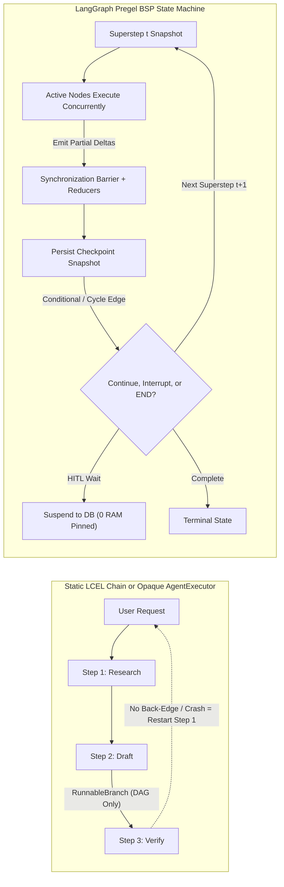
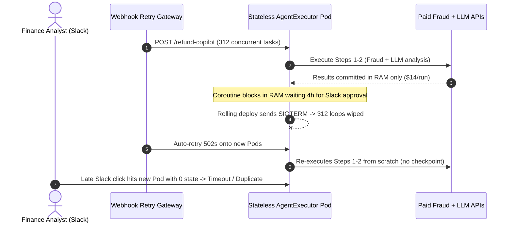

# Module 11: Why LangGraph: The Limits of Chains

> **Prerequisites:** [Module 05: LCEL: The LangChain Expression Language](../05-lcel-the-langchain-expression-language/README.md), [Module 06: Chains](../06-chains/README.md), and [Module 10: LangChain Agents](../10-langchain-agents/README.md).  
> **Estimated Reading Time:** 35 minutes  
> **Target Audience:** AI Backend Engineers, Agentic Platform Architects, Distributed Systems Engineers

> [!TIP]
> **The Golden Rule of Leaving Linear Chains for LangGraph:** Use LCEL `Runnable` chains strictly for **single-pass, stateless, acyclic DAG transforms** where data flows forward (`retrieve -> format -> generate`); the moment your application requires **cyclic self-correction**, **durable pause-and-resume** across human approvals or pod restarts, **granular per-node streaming**, or **deterministic parallel state merging**, lift control flow into a **LangGraph Pregel state machine** while keeping pure LCEL `|` pipes *inside* individual graph nodes.

---

## Why This Matters

In [Module 06: Chains](../06-chains/README.md), LCEL chains (`prompt | model | parser` and `create_retrieval_chain`) give you clean, streamable pipelines in twenty lines of code. Because data moves strictly left-to-right across a **Directed Acyclic Graph (DAG)**, latency is predictable, spans trace cleanly in LangSmith, and every run completes inside a single HTTP request lifecycle.

That illusion breaks the instant product requirements turn **agentic**: *"Draft a SQL migration, execute it against a staging container, feed any Postgres error traceback back to the model up to 4 times, pause for DBA approval via Slack if the query drops a column, and never re-run paid research steps if our Kubernetes pod rolls mid-flight."* Trying to cram loops, mutable scratchpads, and multi-hour waits into `RunnableBranch`, Python recursion inside `RunnableLambda`, or LangChain's legacy `AgentExecutor` (`while True` black-box loop) produces un-resumable memory leaks, race conditions across parallel branches, and runaway API bills. **LangGraph** solves this by replacing ad-hoc pipes and opaque `while` loops with an explicit, checkpointed **Bulk Synchronous Parallel (BSP) state machine** modeled on Google's **Pregel** architecture.

---

## 1. Pregel BSP Execution Semantics & The 5 Structural Walls of Chains

### Acyclic Pipes vs. Pregel Bulk Synchronous Parallel (BSP) Supersteps

Under the hood, LangGraph compiles your workflow into a **Pregel** graph engine (Malewicz et al., *Pregel: A System for Large-Scale Graph Processing*, SIGMOD '10). Instead of executing an opaque `while` loop or a one-way pipe, execution advances in discrete, atomic **supersteps** ($t = 0, 1, 2, \dots$) separated by a strict synchronization barrier:

1. **Plan (Active Node Selection):** Identify every node subscribed to state channels updated during superstep $t - 1$ (or targeted explicitly by `Command`/`Send` edges).
2. **Execute (Isolated Parallel Snapshot):** Every active node in superstep $t$ runs concurrently against the **immutable committed state snapshot** from the end of superstep $t - 1$. Concurrent nodes cannot corrupt each other's reads mid-step.
3. **Update (Barrier Merge & Checkpoint):** At the superstep barrier, all partial state deltas emitted by active nodes are combined atomically through channel **reducers**, persisted as an immutable **checkpoint** row (if a checkpointer is attached), and streamed as incremental events before superstep $t + 1$ begins.



### The 5 Exact Walls Where Linear Chains and `AgentExecutor` Break

| Structural Wall | Why Chains / `AgentExecutor` Fail | How LangGraph BSP Solves It |
| :--- | :--- | :--- |
| **1. The Acyclic DAG Wall** | `RunnableSequence` and `RunnableBranch` forbid backward edges; simulating loops via Python recursion inside `RunnableLambda` hides cycle depth from tracing and breaks `.astream()` control | First-class cyclic edges bounded by superstep counters (`recursion_limit`), conditional edges, and `Command(goto=...)` |
| **2. The Opaque Black-Box Loop Wall** | Legacy `AgentExecutor` embeds a hard-coded `while` loop (`intermediate_steps` list mutation); you cannot enforce custom typed state schemas or multi-actor handoffs cleanly | Explicit `StateGraph` schema separates planner, coder, tool, and critic actors cleanly inside inspectable nodes |
| **3. The Durable Pause-Resume (HITL) Wall** | Blocking an HTTP coroutine in RAM for `4 hours` waiting on manager Slack approval pins worker memory and dies instantly on any container restart or rolling deploy | Superstep barriers serialize state cleanly to Postgres/Redis and suspend with `0` active coroutines (`interrupt`) |
| **4. The Mid-Run Crash Recovery Wall** | If step 4 of a 6-step stateless chain fails on upstream `503` or container OOM, client retries re-run steps 1–3 from scratch, double-paying LLM/API calls | Checkpointed supersteps resume deterministically from step 4 (`thread_id`) without re-executing completed nodes 1–3 |
| **5. The Parallel Merge & Streaming Wall** | Concurrent `RunnableParallel` updates merged ad-hoc overwrite shared keys silently (Last-Write-Wins), and nested loops obscure per-node progress | Pregel barriers merge concurrent deltas via explicit **reducers** and stream granular `updates`, `values`, and token events |

### Quantitative Mechanics: Crash Rework Cost & HITL Memory Lockup

Two simple formulas explain why stateful checkpointed supersteps save real infrastructure budget:

1. **Expected Wasted Rework Under Mid-Run Faults:** Suppose a $K$-step workflow costs $c$ USD per step and experiences a transient crash/timeout at step $f \in \{1, \dots, K\}$ with probability $p_{\text{crash}}$:
   - **Stateless Chain (restarts from step 1):** wastes $f \cdot c$ already-executed spend plus full retry cost $K \cdot c$:

   $$E[\text{Total Cost}_{\text{chain}}] = K \cdot c + p_{\text{crash}} \cdot (f \cdot c)$$

   - **Superstep-Checkpointed Graph (resumes at step $f$):** wastes at most the single interrupted step $1 \cdot c$:

   $$E[\text{Total Cost}_{\text{graph}}] = K \cdot c + p_{\text{crash}} \cdot (1 \cdot c)$$

   Across `1,000` runs of a `6`-step workflow (`c = \$0.12`, crash at step `4`, `p_crash = 0.35`), stateless chains waste **\$165.12** in redundant rework whereas superstep checkpointing wastes only **\$41.28**—a **75.0% rework reduction**.

2. **In-Memory HITL RAM Lockup vs. Checkpointed Suspend:** Holding $R_{\text{pending}}$ human approvals open in memory inside an `asyncio` loop (each frame + context buffer occupying $M_{\text{coro}}$ KB) pins:

$$M_{\text{pinned}} = R_{\text{pending}} \cdot M_{\text{coro}}$$

At `500` pending `4`-hour approvals (`420 KB/coroutine`), workers pin `205.1 MB` of volatile RAM (`0%` crash durability), whereas checkpointed LangGraph threads occupy `0.0 MB` of worker RAM and `~74.2 KB` of durable database rows (`152 bytes/row`).

---

## 2. Systematic Comparison Matrix: Orchestration Models

| Dimension | LCEL `Runnable` DAG | Legacy `AgentExecutor` Loop | LangGraph `StateGraph` (Pregel BSP) |
| :--- | :--- | :--- | :--- |
| **Graph Topology** | Strictly Acyclic DAG | Hard-coded single-agent ReAct loop | Arbitrary Cyclic + Parallel + Subgraph topologies |
| **State Contract** | Implicit dictionary passing (`assign`) | Fixed `input`, `chat_history`, `agent_scratchpad` | Explicit typed `TypedDict`/Pydantic schema + Channel Reducers |
| **Parallel Branch Merging** | Ad-hoc dict merge / overwrite risks | Sequential tool execution (default) | Superstep barrier snapshot + deterministic reducers |
| **Crash Recovery** | None (restart from step 1) | None (in-memory `intermediate_steps` lost) | Superstep checkpoint resume (`thread_id`, `checkpoint_id`) |
| **Human-in-the-Loop** | Must split into disconnected endpoints | Hacky custom callback polling | Native durable `interrupt()` + `Command(resume=...)` |
| **Streaming Granularity** | Final chain output or raw token stream | Legacy callback handlers | Typed modes: `values`, `updates`, `messages`, `custom` |
| **Production Sweet Spot** | Single-pass RAG, prompt formatting, sub-step inside nodes | **Deprecated** (migrate to LangGraph ReAct) | Multi-step agents, self-correction cycles, durable HITL workflows |

---

## 3. Production War Story Post-Mortem: The \$42,000 Stateless Refund Loop & Pod OOM Cascade

| Field | Incident Details |
| :--- | :--- |
| **Severity** | **SEV-1** (Unbounded Duplicate API Re-Execution + Rolling Deploy Outage + Ledger Audit Hold) |
| **Detection / Resolution Time** | Detected 90 minutes into a routine Kubernetes deployment / Mitigated in 2 hours via feature rollback and emergency migration |
| **Impact** | `312` in-flight refund workflows wiped mid-execution; client retries re-ran expensive fraud/LLM steps (`\$14/workflow`); `18` duplicate draft payouts; **\$42,000** wasted compute + manual reconciliation |

### What Happened

A payments team built an automated dispute-refund copilot using `AgentExecutor` wrapped around nested `RunnableBranch` chains: (1) pull order history, (2) score fraud risk via an external credit-bureau enrichment API + frontier reasoning model (`\$14` combined cost per run), (3) pause up to `4 hours` inside an `asyncio.Future` waiting for a finance analyst's Slack webhook approval if `amount > \$500`, and (4) issue the refund.

During afternoon traffic, `312` workflows were parked mid-coroutine waiting for Slack approvals (`~135 MB` pinned per pod plus leaked HTTP connection pools). When CI/CD triggered a normal rolling deployment sending `SIGTERM`:

1. Pods gracefully terminated after the `30s` grace period, killing all `312` in-memory `asyncio` loops mid-execution with **zero persisted state**.
2. Upstream webhook monitors observed `502` / connection-reset failures and triggered automatic exponential-backoff retries.
3. Because the stateless chain had no record that steps 1–2 had already succeeded, all `312` workflows restarted from Step 1, re-running paid credit-bureau lookups and multi-turn LLM evaluations (`312 * \$14 = \$4,368` immediate burst, compounding across `9x` retry cascades during pod thrashing to **\$42,000**). Worse, `18` requests whose Step 4 refund HTTP calls had fired right before `SIGTERM` without durable checkpointing got retried without idempotent state markers.



### Root Cause Analysis

- Long-lived workflow state (`intermediate_steps`, fraud-enrichment results, pending approval token) lived solely in ephemeral process RAM inside `AgentExecutor`'s `while` loop rather than durable superstep checkpoints.
- Control flow coupled synchronous HTTP request lifetime (`30s` Kubernetes pod shutdown window) to multi-hour human decision latency.
- Retrying failed workflows re-executed completed non-idempotent/expensive steps because there was no superstep progress barrier.

### The Fix & Architectural Hardening

- **Migrated Outer Control Flow to LangGraph `StateGraph`:** Replaced `AgentExecutor` + nested `RunnableBranch` with an explicit graph (`enrich_fraud -> assess_risk -> [interrupt_for_human] -> execute_refund`) backed by a Postgres checkpointer (`PostgresSaver`), keeping pure LCEL `prompt | llm.with_structured_output(...)` *inside* `assess_risk`.
- **Zero-RAM Durable Pause:** When `amount > \$500`, the graph hits `interrupt()` after committing superstep `2`; the worker returns `202 Accepted` immediately and frees `100%` of RAM until Slack sends `POST /resume` with `thread_id`.
- **Idempotency + Step Skip:** Re-deliveries or pod crashes resume cleanly at superstep `3` without ever re-invoking paid Step 1–2 APIs.

---

## 4. Multi-Language Production Implementation: From Linear Chain to Checkpointed BSP State Machine

Below is a production-grade **3-step self-correcting verification workflow** (`draft -> verify -> repair` loop, bounded by `max_attempts`, with checkpointed crash-recovery resume and streaming superstep events) implemented across **Go**, **TypeScript** (`@langchain/langgraph`), **Python** (`langgraph` with pure LCEL inside nodes), and **C#**. Notice how Go and C# build the exact same **Pregel BSP superstep barrier + snapshot + checkpoint resume** semantics explicitly so you understand every line of runtime machinery beneath LangGraph!

````carousel

```go
package bspgraph

import (
	"context"
	"encoding/json"
	"errors"
	"fmt"
	"sync"
)

// WorkflowState represents an immutable superstep snapshot.
type WorkflowState struct {
	Task       string   `json:"task"`
	DraftSQL   string   `json:"draft_sql"`
	Errors     []string `json:"errors"`
	Attempts   int      `json:"attempts"`
	Approved   bool     `json:"approved"`
	TraceLog   []string `json:"trace_log"`
}

type Delta struct {
	DraftSQL *string
	Errors   []string
	Attempts int
	Approved *bool
	Trace    []string
}

type Checkpoint struct {
	ThreadID  string
	Superstep int
	NextNode  string
	State     WorkflowState
}

type NodeFunc func(ctx context.Context, s WorkflowState) (Delta, string, error)

// MemorySaver stores committed superstep barriers keyed by threadID.
type MemorySaver struct {
	mu    sync.RWMutex
	store map[string]Checkpoint
}

func NewMemorySaver() *MemorySaver {
	return &MemorySaver{store: make(map[string]Checkpoint)}
}

func (m *MemorySaver) Save(cp Checkpoint) {
	m.mu.Lock()
	defer m.mu.Unlock()
	m.store[cp.ThreadID] = cp
}

func (m *MemorySaver) Load(threadID string) (Checkpoint, bool) {
	m.mu.RLock()
	defer m.mu.RUnlock()
	cp, ok := m.store[threadID]
	return cp, ok
}

// applyBarrier atomically reduces a partial delta onto the committed snapshot.
func applyBarrier(snap WorkflowState, d Delta) WorkflowState {
	next := snap
	if d.DraftSQL != nil {
		next.DraftSQL = *d.DraftSQL
	}
	if d.Errors != nil {
		next.Errors = append([]string(nil), d.Errors...)
	}
	next.Attempts += d.Attempts
	if d.Approved != nil {
		next.Approved = *d.Approved
	}
	// Reducer append preserves prior trace entries without full-state duplication.
	next.TraceLog = append(append([]string(nil), snap.TraceLog...), d.Trace...)
	return next
}

// RunUntilComplete executes Pregel supersteps with mid-run crash resume.
func RunUntilComplete(
	ctx context.Context,
	saver *MemorySaver,
	threadID string,
	initial WorkflowState,
	nodes map[string]NodeFunc,
	maxSupersteps int,
	onEvent func(superstep int, node string, stateJSON string),
) (WorkflowState, error) {
	cp, exists := saver.Load(threadID)
	if !exists {
		cp = Checkpoint{ThreadID: threadID, Superstep: 0, NextNode: "draft", State: initial}
		saver.Save(cp)
	}

	for cp.NextNode != "__end__" {
		if cp.Superstep >= maxSupersteps {
			return cp.State, fmt.Errorf("recursion_limit=%d exceeded", maxSupersteps)
		}
		fn, ok := nodes[cp.NextNode]
		if !ok {
			return cp.State, fmt.Errorf("unknown node %q", cp.NextNode)
		}
		delta, nextNode, err := fn(ctx, cp.State)
		if err != nil {
			// Prior superstep checkpoint stays intact; caller can resume later without re-running earlier nodes.
			return cp.State, fmt.Errorf("superstep=%d node=%s failed: %w", cp.Superstep, cp.NextNode, err)
		}
		cp.State = applyBarrier(cp.State, delta)
		cp.Superstep++
		ranNode := cp.NextNode
		cp.NextNode = nextNode
		saver.Save(cp) // Atomic barrier commit before next superstep

		if onEvent != nil {
			b, _ := json.Marshal(cp.State)
			onEvent(cp.Superstep, ranNode, string(b))
		}
	}
	return cp.State, errors.New("unreachable")[:0] // nil on clean completion
}
```

<!-- slide -->

```typescript
import { Annotation, END, MemorySaver, START, StateGraph } from "@langchain/langgraph";

// 1. Explicit typed state schema with associative reducer for execution logs
const SqlMigrationState = Annotation.Root({
  task: Annotation<string>(),
  draftSql: Annotation<string>({ reducer: (_prev, next) => next, default: () => "" }),
  validationError: Annotation<string | null>({ reducer: (_prev, next) => next, default: () => null }),
  attempts: Annotation<number>({ reducer: (prev, delta) => prev + delta, default: () => 0 }),
  traceLog: Annotation<string[]>({
    reducer: (prev, delta) => [...prev, ...delta],
    default: () => [],
  }),
});

type GraphState = typeof SqlMigrationState.State;

// 2. Nodes encapsulate pure single-pass LCEL logic and return partial deltas only
async function draftSqlNode(state: GraphState) {
  const repaired = state.validationError
    ? "CREATE INDEX CONCURRENTLY idx_orders_user ON orders(user_id);"
    : "CREATE INDEX idx_orders_user ON orders(user_id);";
  return {
    draftSql: repaired,
    attempts: 1,
    traceLog: [`attempt_${state.attempts + 1}:drafted`],
  };
}

async function verifySqlNode(state: GraphState) {
  const missingConcurrently = !state.draftSql.includes("CONCURRENTLY");
  return {
    validationError: missingConcurrently ? "LockTimeoutError: missing CONCURRENTLY" : null,
    traceLog: [missingConcurrently ? "verify:failed_lock_check" : "verify:passed"],
  };
}

function routeAfterVerify(state: GraphState): "draft_sql" | typeof END {
  if (!state.validationError || state.attempts >= 3) {
    return END;
  }
  return "draft_sql"; // Cyclic repair edge (impossible in static LCEL RunnableBranch)
}

export function buildDurableWorkflow() {
  const checkpointer = new MemorySaver();
  return new StateGraph(SqlMigrationState)
    .addNode("draft_sql", draftSqlNode)
    .addNode("verify_sql", verifySqlNode)
    .addEdge(START, "draft_sql")
    .addEdge("draft_sql", "verify_sql")
    .addConditionalEdges("verify_sql", routeAfterVerify, {
      draft_sql: "draft_sql",
      [END]: END,
    })
    .compile({ checkpointer });
}

export async function streamWithResume(threadId: string, task: string) {
  const app = buildDurableWorkflow();
  const config = { configurable: { thread_id: threadId }, recursionLimit: 12 };
  // Stream granular per-superstep node deltas rather than waiting for an opaque while-loop
  for await (const update of await app.stream({ task }, { ...config, streamMode: "updates" })) {
    console.log("Superstep update:", JSON.stringify(update));
  }
  return app.getState(config);
}
```

<!-- slide -->

```python
"""
langgraph_vs_chain.py
Demonstrates lifting cyclic verification + durable checkpointing into LangGraph
while keeping pure LCEL transformation logic inside individual nodes.
"""
from __future__ import annotations

import operator
from typing import Annotated, Literal, TypedDict

from langchain_core.runnables import RunnableConfig, RunnableLambda
from langgraph.checkpoint.memory import MemorySaver
from langgraph.graph import END, START, StateGraph


class MigrationState(TypedDict):
    task: str
    draft_sql: str
    validation_error: str | None
    attempts: int
    trace_log: Annotated[list[str], operator.add]


# Pure LCEL transform encapsulated INSIDE a graph node (never owns loop control)
_draft_lcel = RunnableLambda(
    lambda x: (
        "CREATE INDEX CONCURRENTLY idx_orders_user ON orders(user_id);"
        if x["validation_error"]
        else "CREATE INDEX idx_orders_user ON orders(user_id);"
    )
)


def draft_sql_node(state: MigrationState, config: RunnableConfig) -> dict:
    sql = _draft_lcel.invoke(
        {"task": state["task"], "validation_error": state.get("validation_error")},
        config=config,
    )
    next_attempt = state.get("attempts", 0) + 1
    return {
        "draft_sql": sql,
        "attempts": next_attempt,
        "trace_log": [f"draft_attempt_{next_attempt}"],
    }


def verify_sql_node(state: MigrationState) -> dict:
    if "CONCURRENTLY" not in state["draft_sql"]:
        return {
            "validation_error": "LockCheckError: index build must use CONCURRENTLY",
            "trace_log": ["verify_failed"],
        }
    return {"validation_error": None, "trace_log": ["verify_passed"]}


def after_verify(state: MigrationState) -> Literal["draft_sql", "__end__"]:
    if state["validation_error"] is None or state["attempts"] >= 3:
        return END
    return "draft_sql"


def compile_durable_graph():
    builder = StateGraph(MigrationState)
    builder.add_node("draft_sql", draft_sql_node)
    builder.add_node("verify_sql", verify_sql_node)
    builder.add_edge(START, "draft_sql")
    builder.add_edge("draft_sql", "verify_sql")
    builder.add_conditional_edges(
        "verify_sql",
        after_verify,
        {"draft_sql": "draft_sql", END: END},
    )
    return builder.compile(checkpointer=MemorySaver())


if __name__ == "__main__":
    app = compile_durable_graph()
    cfg = {"configurable": {"thread_id": "mig-104"}, "recursion_limit": 12}
    for event in app.stream({"task": "index orders.user_id", "attempts": 0, "trace_log": []}, cfg, stream_mode="updates"):
        print("Superstep delta:", event)
```

<!-- slide -->

```csharp
using System;
using System.Collections.Concurrent;
using System.Collections.Generic;
using System.Collections.Immutable;
using System.Threading;
using System.Threading.Tasks;

namespace GenAI.LangGraphCore;

public sealed record MigrationState(
    string Task,
    string DraftSql,
    string? ValidationError,
    int Attempts,
    ImmutableList<string> TraceLog);

public sealed record StateDelta(
    string? DraftSql = null,
    string? ValidationError = null,
    bool ClearError = false,
    int AttemptsIncrement = 0,
    IReadOnlyList<string>? TraceEntries = null);

public sealed record CheckpointSnapshot(
    string ThreadId,
    int Superstep,
    string NextNode,
    MigrationState State);

public sealed class InMemoryCheckpointStore
{
    private readonly ConcurrentDictionary<string, CheckpointSnapshot> _store = new();
    public void Save(CheckpointSnapshot snapshot) => _store[snapshot.ThreadId] = snapshot;
    public bool TryLoad(string threadId, out CheckpointSnapshot? snapshot) => _store.TryGetValue(threadId, out snapshot);
}

public static class PregelWorkflowRunner
{
    public static MigrationState ApplyBarrier(MigrationState snapshot, StateDelta delta) => snapshot with
    {
        DraftSql = delta.DraftSql ?? snapshot.DraftSql,
        ValidationError = delta.ClearError ? null : (delta.ValidationError ?? snapshot.ValidationError),
        Attempts = snapshot.Attempts + delta.AttemptsIncrement,
        TraceLog = delta.TraceEntries is null
            ? snapshot.TraceLog
            : snapshot.TraceLog.AddRange(delta.TraceEntries)
    };

    public static async Task<MigrationState> ExecuteWithResumeAsync(
        string threadId,
        MigrationState initialState,
        InMemoryCheckpointStore store,
        IReadOnlyDictionary<string, Func<MigrationState, CancellationToken, Task<(StateDelta Delta, string NextNode)>>> nodes,
        int recursionLimit = 12,
        CancellationToken ct = default)
    {
        if (!store.TryLoad(threadId, out var cp) || cp is null)
        {
            cp = new CheckpointSnapshot(threadId, 0, "draft_sql", initialState);
            store.Save(cp);
        }

        while (!string.Equals(cp.NextNode, "__end__", StringComparison.Ordinal))
        {
            if (cp.Superstep >= recursionLimit)
                throw new InvalidOperationException($"GraphRecursionLimit ({recursionLimit}) reached for thread {threadId}.");

            if (!nodes.TryGetValue(cp.NextNode, out var handler))
                throw new KeyNotFoundException($"Unknown graph node: {cp.NextNode}");

            var (delta, nextNode) = await handler(cp.State, ct);
            var nextState = ApplyBarrier(cp.State, delta);
            cp = new CheckpointSnapshot(threadId, cp.Superstep + 1, nextNode, nextState);
            store.Save(cp); // Commit durable barrier before next superstep
        }

        return cp.State;
    }
}
```

````

---

## 5. Practical Hands-On Verification CLI Workflows

Run these deterministic Python 3.13 verification scripts offline—zero third-party packages or API keys required.

### Workflow 1: Shared Mutable Dict Race (Chain) vs. Pregel BSP Superstep Barrier

Verify how naive parallel dict merging silently drops updates via Last-Write-Wins, whereas a Pregel BSP barrier reads an immutable superstep snapshot and merges deltas atomically:

```bash
python -c '
def naive_parallel_chain():
    state = {"findings": ["init"], "step_count": 0}
    # Both branches read & overwrite mutable keys concurrently
    b1 = {**state, "findings": state["findings"] + ["branch_A: latency_spike"], "step_count": state["step_count"] + 1}
    b2 = {**state, "findings": state["findings"] + ["branch_B: db_lock"], "step_count": state["step_count"] + 1}
    # Last-write-wins merge drops branch_A findings and undercounts steps
    merged = {**state, **b1, **b2}
    return merged

def pregel_bsp_superstep():
    state = {"findings": ["init"], "step_count": 0}
    snapshot = dict(state)  # Immutable view at superstep t=0
    delta_a = {"findings": ["branch_A: latency_spike"], "step_count": 1}
    delta_b = {"findings": ["branch_B: db_lock"], "step_count": 1}
    # Barrier applies channel reducers atomically before superstep t=1
    merged = {
        "findings": snapshot["findings"] + delta_a["findings"] + delta_b["findings"],
        "step_count": snapshot["step_count"] + delta_a["step_count"] + delta_b["step_count"],
    }
    return merged

print("Naive Chain LWW Merge :", naive_parallel_chain())
print("Pregel BSP Barrier    :", pregel_bsp_superstep())
'
```

**Expected Output:**

```text
Naive Chain LWW Merge : {'findings': ['init', 'branch_B: db_lock'], 'step_count': 1}
Pregel BSP Barrier    : {'findings': ['init', 'branch_A: latency_spike', 'branch_B: db_lock'], 'step_count': 2}
```

Observe that `Naive Chain LWW Merge` silently erased `branch_A: latency_spike` and miscounted `step_count` as `1`, whereas `Pregel BSP Barrier` preserved both branches (`step_count=2`).

### Workflow 2: Mid-Run Crash Recovery Benchmark (Stateless Chain vs. Superstep Checkpoint)

Simulate `1,000` runs of a `6`-step workflow (`\$0.12/step`, `35%` transient crash rate at step `4`) comparing full-chain restarts against superstep checkpoint resume:

```bash
python -c '
import random

def simulate(runs=1000, steps=6, step_cost=0.12, fail_step=4, crash_prob=0.35):
    rng = random.Random(42)
    chain_cost = 0.0
    graph_cost = 0.0
    chain_wasted = 0.0
    graph_wasted = 0.0

    for _ in range(runs):
        crashed = rng.random() < crash_prob
        if crashed:
            # Stateless chain pays steps 1..fail_step, dies, then retries 1..steps
            wasted_c = fail_step * step_cost
            chain_wasted += wasted_c
            chain_cost += wasted_c + steps * step_cost
            # Checkpointed graph pays steps 1..fail_step, resumes at fail_step, pays fail_step..steps
            wasted_g = step_cost
            graph_wasted += wasted_g
            graph_cost += steps * step_cost + wasted_g
        else:
            chain_cost += steps * step_cost
            graph_cost += steps * step_cost

    print(f"Runs={runs} | Steps={steps} | CrashRate={crash_prob:.0%} at step {fail_step} | StepCost=${step_cost:.2f}")
    print(f"Stateless Chain  -> Total=${chain_cost:.2f} | WastedRework=${chain_wasted:.2f} | Avg/Run=${chain_cost/runs:.4f}")
    print(f"BSP Checkpointed -> Total=${graph_cost:.2f} | WastedRework=${graph_wasted:.2f} | Avg/Run=${graph_cost/runs:.4f}")
    print(f"Rework Savings   -> {(1 - graph_wasted/chain_wasted)*100:.1f}% reduction in wasted compute")

simulate()
'
```

**Expected Output:**

```text
Runs=1000 | Steps=6 | CrashRate=35% at step 4 | StepCost=$0.12
Stateless Chain  -> Total=$885.12 | WastedRework=$165.12 | Avg/Run=$0.8851
BSP Checkpointed -> Total=$761.28 | WastedRework=$41.28 | Avg/Run=$0.7613
Rework Savings   -> 75.0% reduction in wasted compute
```

### Workflow 3: In-Memory HITL Coroutine Lockup vs. Checkpointed Suspend Footprint

Measure live worker RAM pinned by `500` concurrent `4`-hour human approvals in an in-memory `while` loop versus durable superstep suspension:

```bash
python -c '
import json

def compare_hitl_footprint(pending_approvals=500, avg_wait_hours=4.0, coroutine_ram_kb=420):
    pinned_ram_mb = (pending_approvals * coroutine_ram_kb) / 1024
    sample_checkpoint = {
        "thread_id": "refund-9941",
        "superstep": 3,
        "next_nodes": ["execute_refund"],
        "state": {"order_id": "ORD-8821", "amount_usd": 740.0, "approved": None},
    }
    ckpt_bytes = len(json.dumps(sample_checkpoint).encode("utf-8"))
    total_db_kb = (pending_approvals * ckpt_bytes) / 1024
    print(f"Pending HITL Approvals : {pending_approvals} (avg wait {avg_wait_hours:.1f}h)")
    print(f"In-Memory Chain Workers: {pending_approvals} pinned coroutines | {pinned_ram_mb:.1f} MB live worker RAM | 0% survive pod restart")
    print(f"LangGraph Checkpoint   : 0 pinned coroutines | 0.0 MB worker RAM | {total_db_kb:.1f} KB DB state ({ckpt_bytes} B/row) | 100% durable")

compare_hitl_footprint()
'
```

**Expected Output:**

```text
Pending HITL Approvals : 500 (avg wait 4.0h)
In-Memory Chain Workers: 500 pinned coroutines | 205.1 MB live worker RAM | 0% survive pod restart
LangGraph Checkpoint   : 0 pinned coroutines | 0.0 MB worker RAM | 74.2 KB DB state (152 B/row) | 100% durable
```

### Hands-On Exercises

1. **Extend Workflow 2 to Variable Failure Steps:** Modify `simulate()` so crashes occur uniformly across steps `2..6` (`rng.randint(2, steps)`), and measure how the rework savings gap widens when `steps = 12`.
2. **Add Simulated Crash Resume to a Python Mini-BSP Loop:** Extend Workflow 1 into a 4-superstep loop (`fetch -> analyze -> review -> publish`) that raises `RuntimeError` inside `review` on attempt `#1`, persists the checkpoint dictionary after `analyze`, and verifies attempt `#2` skips `fetch` and `analyze` cleanly.
3. **Optional Live LangGraph Probe (Requires `langgraph` + `langchain-core`):** Run the Python slide in Section 4 (`python langgraph_vs_chain.py`) and inspect every `Superstep delta` printed by `stream_mode="updates"`.

### Independent Challenge

Your platform team maintains two AI workflows: **(A)** a real-time email subject-line classifier (`prompt | model.with_structured_output(Category)` taking `450 ms` p95 with zero human interaction or retries), and **(B)** a multi-agent SOC-2 compliance auditor that inspects `30` Terraform files in parallel, opens Jira tickets, loops up to `3` times with a policy critic, and pauses up to `48 hours` for security lead sign-off before merging PRs. Decide which workflow belongs in pure LCEL versus LangGraph, and explain how the two paradigms compose cleanly in **(B)** without throwing away LCEL entirely.

<details><summary>Architectural Discussion</summary>

Keep **(A)** as a pure stateless LCEL `Runnable` chain (`prompt | llm.with_structured_output(Category)`): wrapping a single-pass `450 ms` classifier inside a checkpointed `StateGraph` adds unnecessary checkpoint serialization latency and schema boilerplate for zero cyclic or durability benefit. Build **(B)** in **LangGraph** because it crosses four structural walls simultaneously: dynamic parallel fan-out (`30` Terraform checks + reducer merging), bounded reflection cycles (`auditor <-> critic` up to `3` loops), mid-run crash durability across long Jira/API calls, and a `48`-hour Human-in-the-Loop sign-off pause (`0` active RAM pinned). Crucially, keep pure LCEL pipes *inside* **(B)**'s individual nodes (`terraform_prompt | model.with_structured_output(FindingList)`)—LangGraph orchestrates the **macro state machine**, while LCEL structures each **micro node transform**.

</details>

---

## 6. Common Mistakes & Troubleshooting

- **Wrapping single-pass linear RAG in a `StateGraph` for hype:** Adding nodes, reducers, and checkpointers to a pure `retrieve -> generate` endpoint adds serialization overhead and complexity with zero upside. Keep linear pipelines in LCEL ([Module 06](../06-chains/README.md)) until you hit cycles, durability, or complex multi-actor branching.
- **Throwing away LCEL inside LangGraph nodes:** Engineers migrating to LangGraph sometimes revert to raw string formatting and manual JSON parsing inside nodes. Keep `prompt | model.with_structured_output(...)` LCEL pipelines *inside* nodes while passing `config: RunnableConfig` through so LangSmith tracing and `.astream()` token callbacks propagate seamlessly.
- **Blocking a graph node with `time.sleep` or webhook polling for HITL:** Waiting inside a node function defeats Pregel checkpoint suspension and pins worker threads just like legacy `AgentExecutor`. Always exit/interrupt at a superstep boundary so the worker frees memory immediately.
- **Migrating `AgentExecutor` without replacing implicit scratchpad mutation:** Simply wrapping an entire `AgentExecutor` inside a single LangGraph node keeps the black-box `while` loop intact—meaning crashes inside the executor still lose mid-loop tool history. Break `agent` and `tools` into explicit graph nodes connected by cyclic edges.

---

## 7. Operational Validation Checkpoints & Checkpoint Quiz

### Operational Validation Checkpoints

<details><summary><strong>Checkpoint 1: Diagnosing why RunnableBranch recursion broke production</strong></summary>

An engineer implemented `"Generate SQL -> Execute -> If Error, Call Self Recursively (max 4)"` by calling a `RunnableLambda` recursively inside an LCEL `RunnableBranch`. Under load, LangSmith traces show deeply nested unreadable spans, crashes restart from attempt `1`, and adding a `2`-hour human approval breaks worker pods. Diagnose why and identify the exact LangGraph replacement mechanism.

**Validation:** LCEL `RunnableBranch` is strictly an **acyclic DAG**; faking cycles via recursive `RunnableLambda` hides loop state inside Python call stacks instead of persisting superstep transitions. When a pod crashes on attempt `3`, all prior SQL errors and generated drafts vanish, forcing full rework. Replacing the recursive lambda with a two-node **LangGraph `StateGraph`** (`draft_sql -> verify_sql -> conditional edge back to draft_sql`) moves iteration state into explicit typed channels and persists every superstep boundary via a checkpointer, enabling both crash resume and zero-RAM HITL interrupts.

</details>

<details><summary><strong>Checkpoint 2: Predicting parallel branch race loss vs. BSP barrier behavior</strong></summary>

Two parallel enrichment branches (`geo_enrich` and `risk_enrich`) run concurrently on the same input state `{"tags": ["init"], "score": 0}`. `geo_enrich` finishes in `80 ms` emitting `tags: ["init", "eu_west"]`, while `risk_enrich` finishes in `140 ms` emitting `tags: ["init", "high_risk"]`. What happens in a naive dict spread merge (`{**b1, **b2}`), and how do Pregel BSP supersteps prevent this?

**Validation:** Naive dict spreading obeys **Last-Write-Wins**: `risk_enrich` (`140 ms`) completely overwrites `"tags"`, silently deleting `"eu_west"`. In LangGraph's Pregel BSP model, both branches read an **immutable snapshot** from superstep $t$, emit only partial **deltas** (`{"tags": ["eu_west"]}` and `{"tags": ["high_risk"]}`), and wait at the **superstep synchronization barrier**, where the channel's explicit **reducer** atomically merges both deltas into `["init", "eu_west", "high_risk"]` before advancing to superstep $t + 1$.

</details>

<details><summary><strong>Checkpoint 3: Justifying checkpointer persistence for multi-step paid tool chains</strong></summary>

A `10`-step research agent calls `\$0.20` worth of paid search and LLM calls per step (`\$2.00/run`), experiencing a `15%` transient container preemption rate around step `7` across `500` daily runs. Quantify the daily rework waste under a stateless `AgentExecutor` vs. a superstep-checkpointed `StateGraph`.

**Validation:** Under a stateless `AgentExecutor`, the `75` preempted runs (`500 * 0.15`) lose steps `1–7` (`7 * \$0.20 = \$1.40` each) and restart from step `1`, wasting `75 * \$1.40 = \$105.00/day` (`\$3,150/month`). Under a superstep-checkpointed `StateGraph`, each preempted run resumes directly at step `7`, re-executing at most `1` interrupted step (`75 * \$0.20 = \$15.00/day`), cutting wasted rework by **85.7%**.

</details>

### Checkpoint Quiz

1. Why does Google's **Pregel Bulk Synchronous Parallel (BSP)** model prevent read/write race conditions between parallel nodes executing within the same superstep?
2. List the **5 structural walls** where linear LCEL chains and `AgentExecutor` loops break down in production.
3. Why is keeping pure LCEL `|` expressions *inside* LangGraph nodes considered best practice rather than an anti-pattern?
4. How does a LangGraph Human-in-the-Loop pause avoid pinning worker RAM during a `4`-hour manager approval wait?
5. When should you **reject** LangGraph and stay on a plain LCEL `RunnableSequence`?

<details><summary>Answers</summary>

1. All nodes activated in superstep $t$ read from an **immutable committed state snapshot** from superstep $t - 1$, emit partial deltas independently, and wait at the **superstep synchronization barrier** where channel reducers merge updates atomically before superstep $t + 1$ reads them.
2. (1) Acyclic DAG topology wall (no back-edges), (2) Opaque `AgentExecutor` black-box loop wall, (3) Durable HITL pause/resume wall, (4) Mid-run crash recovery wall, and (5) Parallel state merging & granular per-node streaming wall.
3. LangGraph manages **macro workflow topology, state reducers, cycles, and checkpoints**, while LCEL inside each node manages **micro single-step LLM transforms** (`prompt | model.with_structured_output(...)`) with clean `.astream()` token forwarding and LangSmith sub-spans.
4. Once the graph commits its superstep checkpoint to persistent storage (e.g., Postgres) and hits an interrupt boundary, the HTTP/worker coroutine exits immediately (`0 MB` live RAM pinned) and resumes cleanly hours later from the saved checkpoint via `thread_id`.
5. When the workflow is a stateless, single-pass, acyclic transform (`input -> retrieve -> generate` or classification) completing in seconds with no feedback loops, human pauses, or expensive mid-run resume requirements.

</details>

---

## Further Reading & Sources

- [LangGraph Official Documentation](https://langchain-ai.github.io/langgraph/) — overview of stateful, cyclic, checkpointed multi-actor agent orchestration built on Pregel BSP semantics.
- [LangGraph Low-Level Concepts (State, Reducers, Pregel Runtime)](https://langchain-ai.github.io/langgraph/concepts/low_level/) — canonical reference for supersteps, synchronization barriers, and state graph compilation.
- [LangGraph.js Official Documentation](https://langchain-ai.github.io/langgraphjs/) — TypeScript/JavaScript `StateGraph`, `Annotation`, and durable streaming APIs.
- [Pregel: A System for Large-Scale Graph Processing (Malewicz et al., SIGMOD 2010)](https://research.google/pubs/pregel-a-system-for-large-scale-graph-processing/) — foundational Google Research paper defining BSP supersteps and barrier synchronization.
- [Module 05: LCEL: The LangChain Expression Language](../05-lcel-the-langchain-expression-language/README.md) — composable `Runnable` pipes and concurrency controls used inside individual LangGraph nodes.
- [Module 06: Chains](../06-chains/README.md) — acyclic DAG chain architectures and where static chains terminate.

## Next

[Module 12: LangGraph: State and Nodes](../12-langgraph-state-and-nodes/README.md)
