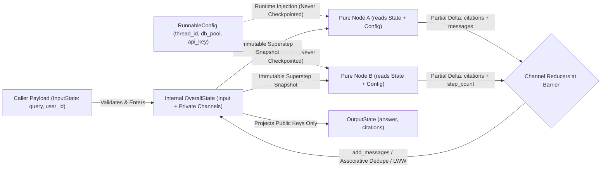
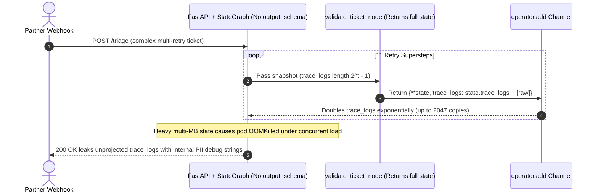

# Module 12: LangGraph: State and Nodes

> **Prerequisites:** [Module 11: Why LangGraph: The Limits of Chains](../11-why-langgraph-the-limits-of-chains/README.md), [Module 02: Models and Messages](../02-models-and-messages/README.md), and [Module 04: Output Parsers](../04-output-parsers/README.md).  
> **Estimated Reading Time:** 40 minutes  
> **Target Audience:** AI Backend Engineers, Agentic Platform Developers, Typed Systems Architects

> [!TIP]
> **The Golden Rule of LangGraph State & Nodes:** Treat graph state strictly as an **immutable, channel-typed message bus**, never as a mutable Python dictionary: annotate every accumulated or concurrently written field with an **associative reducer** (`add_messages`, custom bounded deduplicators), isolate caller inputs and API responses via **`input_schema` / `output_schema`**, write every node as a **pure function returning only partial deltas** (`{"key": delta}`), and pass runtime credentials, DB pools, and budgets exclusively through **`RunnableConfig`**—never serialized state.

---

## Why This Matters

Once you move from linear chains into LangGraph, the single biggest source of subtle production outages is misunderstanding how **state schemas**, **channel reducers**, and **node return values** interact across Pregel supersteps.

Engineers coming from imperative Python routinely write `state["logs"].append("step done")` and `return state` at the end of a node. Inside an `Annotated[list[str], operator.add]` channel, returning the full state re-feeds every historical log entry back through the reducer—causing **exponential $2^t - 1$ list duplication** that OOM-kills pods within a dozen hops. Elsewhere, two parallel branches write to an un-annotated field and crash with `InvalidUpdateError`, API keys stored in `state` leak into Postgres checkpoints, and debug scratchpads spill into public JSON responses because `StateGraph` exposed the entire internal schema directly to HTTP clients. Mastering **state channels, algebraic reducers, `RemoveMessage` pruning, schema boundaries, and `RunnableConfig`** makes your graphs concurrent-safe, memory-bounded, and leak-proof.

---

## 1. State Schemas, Reducers, Schema Isolation & Pure Node Contracts

### Architectural Mental Model: Channels, Reducers & Schema Projection

In LangGraph, a `StateGraph` defines a collection of typed **state channels** alongside optional **input/output schema projections**. Every node executes against a read-only snapshot of the graph's channels plus runtime `RunnableConfig`, and emits only **partial delta dictionaries** to the superstep synchronization barrier:



### Choosing a State Schema: `TypedDict` vs. Pydantic v2 `BaseModel` vs. `dataclass`

| Schema Construct | Runtime Validation | Serialization Overhead | When to Use in Production |
| :--- | :--- | :--- | :--- |
| **`typing.TypedDict`** | Static type checking (`mypy`/`pyright`) only | **Lowest** (zero object instantiation overhead per delta) | **Default production choice** for high-throughput graphs where LLM outputs are already validated by Pydantic inside nodes |
| **Pydantic v2 `BaseModel`** | Validates fields and runs `@field_validator` / coercion at graph input and state transitions | Moderate (model validation per state update; note partial deltas validate against full schema defaults) | External webhook boundaries, strict invariant coercion (`score` clamped `[0, 1]`), nested sub-objects |
| **`@dataclass`** | Default value factories, lightweight attribute syntax | Low | Clean attribute access (`state.query`) when you don't need full Pydantic validator trees |

### Reducers: Overwrite vs. `operator.add` vs. `add_messages` vs. Custom Associative Reducers

Every key in `State` backs a **channel**. If a key has **no `Annotated` reducer**, LangGraph assigns a **Last-Write-Wins (Overwrite)** channel—which forbids two parallel nodes from updating that key in the same superstep (`InvalidUpdateError`). Attaching `Annotated[Type, reducer_fn]` converts that channel into a **BinaryOperatorAggregate** channel executing `new_val = reducer_fn(current_val, delta_val)`:

1. **`operator.add` (Unbounded List Concatenation):** Appends `left + right`, safe for short single-run lists (`errors`, `tool_trace`), **dangerous** for long conversations or when nodes accidentally return full lists (`2^t - 1` explosion) or expect deduplication.
2. **`add_messages` (ID-Indexed Upsert + Tombstones):** LangGraph's canonical message reducer (`from langgraph.graph.message import add_messages`, or `messagesStateReducer` in LangGraph.js):
   - **Append:** Messages with new `id` values are appended to history.
   - **In-Place Upsert:** Returning a message with an *existing* `id` overwrites that exact message instead of duplicating it (essential for updating tool statuses or correcting streamed outputs).
   - **Surgical Deletion (`RemoveMessage`):** Returning `RemoveMessage(id=msg.id)` deletes that specific message by ID.
   - **Full History Reset (`REMOVE_ALL_MESSAGES`):** Returning `RemoveMessage(id=REMOVE_ALL_MESSAGES)` (from `langgraph.graph.message`) clears all prior messages cleanly before injecting a condensed conversation summary!
3. **Algebraic Properties of Parallel-Safe Custom Reducers:** Whenever two or more parallel nodes (or `Send` workers) write to the same channel in a single superstep, the runtime applies your reducer sequentially across worker outputs. To remain immune to network jitter and parallel completion order:
   - **Associativity:** $R(R(a, b), c) = R(a, R(b, c))$
   - **Commutativity (or Canonical Sorting):** $R(a, b) = R(b, a)$ — e.g., merging citations via `sorted(set(left) | set(right))` or bounding a sliding window (`(left + right)[-max_items:]` with deterministic keys) guarantees identical output regardless of whether `worker_a` or `worker_b` finishes first.

### Schema Isolation (`input_schema`, `output_schema`) & Private Node State

Never expose internal scratchpads (`raw_chunks`, `sql_tracebacks`, `internal_confidence`, `pii_redaction_debug`) to external API callers or allow callers to spoof internal flags (`is_admin_approved: True`) in the initial request payload:

- **`input_schema`:** Restricts accepted keys entering `START` (e.g., `query`, `tenant_id`).
- **`output_schema`:** Filters final serialized output leaving `END` (e.g., `answer`, `citations`).
- **Overall / Private State:** Stores all intermediate channels cleanly inside the graph while projecting only `OutputState` to callers.

### Pure Node Contracts & `RunnableConfig` Injection

A graph node has signature `def my_node(state: OverallState, config: RunnableConfig) -> dict[str, Any]`:

- **Never mutate `state` in place** (`state["items"].append(x)` mutates the caller snapshot and fails silently or breaks replay).
- **Return ONLY changed keys (`{"items": [x]}`)**, NEVER `{**state, "items": state["items"] + [x]}`.
- **Put non-serializable or sensitive runtime handles in `RunnableConfig["configurable"]`** (`db_pool`, `http_client`, `api_key`, `max_budget_usd`, `thread_id`). State is checkpointed to Postgres/Redis and traced to LangSmith; `RunnableConfig` is injected per invocation without bloating checkpoints or leaking secrets!

### Quantitative Mechanics: Duplication Explosion & Quadratic History Cost

1. **The Full-State Return `operator.add` Bug:** Suppose a node mistakenly returns `{"logs": state["logs"] + [entry]}` into an `Annotated[list[str], operator.add]` channel. At step $t$, `reducer(L_{t-1}, L_{t-1} + [entry])` produces length:

$$L_t = 2 L_{t-1} + 1 \implies L_t = 2^t - 1$$

At `t = 12` steps, `12` individual log lines explode into **`4,095`** duplicated strings! Returning only the delta `{"logs": [entry]}` keeps length strictly linear ($L_t = t = 12$).

2. **Quadratic Context Cost Without `RemoveMessage` Pruning:** Across $T$ conversational turns starting at system prompt size $S_0$ and adding $\Delta m$ tokens per turn without history trimming, every LLM call re-reads all prior turns:

$$\text{Cumulative Input Tokens}(T) = \sum_{t=1}^{T} (S_0 + t \cdot \Delta m) = T \cdot S_0 + \Delta m \cdot \frac{T(T+1)}{2}$$

At $S_0 = 800$, $\Delta m = 600$, and $T = 30$ turns, an unpruned `add_messages` channel feeds **`303,000`** input tokens, whereas summarizing and clearing stale turns via `RemoveMessage` to cap a `k = 6`-turn window drops cumulative input tokens to **`123,000`**—a **`59.4%` token and cost reduction**.

---

## 2. Systematic Comparison Matrix: Channel Reducers & State Patterns

| Channel Mechanism | Merge Semantics | Supports Deletion / Upsert? | Parallel Branch Safe? | Memory Bound | Ideal Use Case |
| :--- | :--- | :--- | :--- | :--- | :--- |
| **Default (No Reducer)** | Overwrites existing value (`new_val`) | Replace only | **No** (`InvalidUpdateError` on concurrent writes) | $O(1)$ | Scalar flags (`approved`), single-writer `final_answer`, `draft_sql` |
| **`Annotated[list, operator.add]`** | Concatenates `left + right` | **No** (append-only) | Yes (order follows barrier deterministic ordering) | Unbounded $O(T)$ | Short per-run lists where nodes strictly emit `[new_item]` deltas |
| **`Annotated[list, add_messages]`** | ID-keyed append or in-place replacement | **Yes** (`RemoveMessage`, `REMOVE_ALL_MESSAGES`) | Yes (ID-safe merge) | Needs explicit pruning node | Conversational `messages` history & agent tool-call logs |
| **Custom Associative Dedupe Reducer** | Set/ID union + deterministic sort (`sorted(set(a) \| set(b))`) | Custom tombstone / `None` check | **Yes** (order-independent / commutative) | Bounded by unique keys | `citations`, `visited_urls`, `discovered_entities` across parallel `Send` branches |
| **Custom Bounded Window Reducer** | `(left + right)[-N:]` or overwrite cap | Drops oldest beyond `N` | Caution (keep deterministic order) | Strictly **$O(N)$** | Rolling audit logs, latest `k` tool error tracebacks (`N <= 10`) |

---

## 3. Production War Story Post-Mortem: The \$19,000 Exponential `operator.add` OOM & Internal PII Leak

| Field | Incident Details |
| :--- | :--- |
| **Severity** | **SEV-1** (Worker Pod OOM Crash Loop + Internal Debug/PII Schema Exposure in HTTP Responses) |
| **Detection / Resolution Time** | Detected 45 minutes post-deploy via Kubernetes `OOMKilled` alerts and partner API payload audit / Mitigated in 55 minutes |
| **Impact** | `18%` of long multi-step triage workflows OOM-killed (`1.8 GB` serialized state snapshots); internal `redaction_debug_log` lines containing partial SSN strings leaked into `412` public webhook payloads |

### What Happened

A support-triage team defined an agent state with `trace_logs: Annotated[list[str], operator.add]` and `messages: Annotated[list[AnyMessage], add_messages]`. Two mistakes shipped in the same release:

1. **Full-State Return Inside a `10`-Hop Retry Loop:** Inside `validate_ticket_node`, a developer wrote `logs = list(state["trace_logs"]); logs.append(f"raw_payload={raw_ticket}"); return {**state, "trace_logs": logs}` instead of returning a partial delta. Every step through the validation loop doubled `trace_logs` ($2^t - 1$ growth). When a complex ticket looped `11` times across nested retries, `trace_logs` swelled to `2,047` copies of raw ticket payloads (`~140 MB` per thread), causing Postgres checkpointer serialization and worker pods to `OOMKill` at `2 GB` RAM.
2. **Missing `output_schema` Boundary:** Because `StateGraph(TriageState)` omitted `output_schema=PublicTriageResponse`, `graph.invoke(...)` returned the entire `OverallState` dictionary directly to FastAPI's JSON responder—exposing `trace_logs` and raw internal PII-masking diagnostics to external partner webhooks.



### Root Cause Analysis

- Returning `{**state, ...}` into an `operator.add` reducer violated LangGraph's **partial delta node contract**, causing geometric $O(2^t)$ state duplication instead of $O(t)$ growth.
- Neither a sliding-window cap nor `RemoveMessage` pruning existed to bound channel size in long runs.
- `StateGraph` lacked `input_schema` and `output_schema` separation, coupling internal agent scratchpads directly to the public HTTP response contract.

### The Fix & Architectural Hardening

- **Enforced Partial-Delta Returns + Custom Bounded Reducer:** Changed nodes to return `{"trace_logs": [short_event_id]}` exclusively, backed by a custom bounded deduplicating reducer capped at `last 25` entries (`O(1)` memory ceiling).
- **Added Explicit `InputState` / `OutputState` Projections:** Compiled `StateGraph(OverallState, input_schema=TriageInput, output_schema=TriageOutput)` so FastAPI physically cannot receive internal scratchpad keys or debug logs.
- **Moved Runtime Secrets & Redaction Salt to `RunnableConfig`:** Stripped sensitive config handles out of state and passed them through `config={"configurable": {"pii_salt": ..., "db_pool": ...}}`.

---

## 4. Multi-Language Production Implementation: Typed State, Reducers, Pruning & Schema Isolation

Below is a production-hardened implementation demonstrating **`InputState` / `OutputState` isolation**, **`add_messages` ID upsert + `RemoveMessage` pruning**, **associative deduplicating reducers**, **partial delta node returns**, and **`RunnableConfig` injection** across **Go**, **TypeScript** (`@langchain/langgraph`), **Python** (`langgraph`), and **C#**.

````carousel

```go
package stategraph

import (
	"context"
	"sort"
)

const RemoveAllMessages = "__remove_all__"

type Message struct {
	ID      string
	Role    string // "user" | "assistant" | "system" | "remove"
	Content string
}

// InputState restricts what external callers can inject at START.
type InputState struct {
	Query    string
	TenantID string
}

// OutputState projects only safe public fields back from END.
type OutputState struct {
	Answer    string
	Citations []string
}

// OverallState retains internal scratchpad channels isolated from HTTP callers.
type OverallState struct {
	Query         string
	TenantID      string
	Messages      []Message
	Citations     []string
	InternalScore float64
	Answer        string
}

// StateDelta ensures nodes return partial updates rather than mutating full state.
type StateDelta struct {
	Messages      []Message
	Citations     []string
	InternalScore *float64
	Answer        *string
}

// RuntimeConfig is passed via context.Context and never serialized into checkpoints.
type RuntimeConfig struct {
	ThreadID      string
	MaxHistoryLen int
	AuthToken     string
}

// AddMessages performs ID-indexed upsert, surgical deletion, and REMOVE_ALL reset.
func AddMessages(existing, updates []Message) []Message {
	for _, u := range updates {
		if u.Role == "remove" && u.ID == RemoveAllMessages {
			var fresh []Message
			for _, keep := range updates {
				if keep.Role != "remove" {
					fresh = append(fresh, keep)
				}
			}
			return fresh
		}
	}

	out := append([]Message(nil), existing...)
	idxByID := make(map[string]int, len(out))
	for i, m := range out {
		idxByID[m.ID] = i
	}

	tombstones := make(map[string]bool)
	for _, u := range updates {
		if u.Role == "remove" {
			tombstones[u.ID] = true
			continue
		}
		if pos, exists := idxByID[u.ID]; exists {
			out[pos] = u // Upsert in place
		} else {
			idxByID[u.ID] = len(out)
			out = append(out, u)
		}
	}

	var compacted []Message
	for _, m := range out {
		if !tombstones[m.ID] {
			compacted = append(compacted, m)
		}
	}
	return compacted
}

// MergeCitationsAssociative is associative and commutative (safe across parallel branches).
func MergeCitationsAssociative(left, right []string) []string {
	seen := make(map[string]struct{}, len(left)+len(right))
	for _, s := range left {
		seen[s] = struct{}{}
	}
	for _, s := range right {
		seen[s] = struct{}{}
	}
	merged := make([]string, 0, len(seen))
	for s := range seen {
		merged = append(merged, s)
	}
	sort.Strings(merged)
	return merged
}

func ApplyDelta(s OverallState, d StateDelta) OverallState {
	next := s
	if len(d.Messages) > 0 {
		next.Messages = AddMessages(s.Messages, d.Messages)
	}
	if len(d.Citations) > 0 {
		next.Citations = MergeCitationsAssociative(s.Citations, d.Citations)
	}
	if d.InternalScore != nil {
		next.InternalScore = *d.InternalScore
	}
	if d.Answer != nil {
		next.Answer = *d.Answer
	}
	return next
}

func ProjectOutput(s OverallState) OutputState {
	return OutputState{Answer: s.Answer, Citations: append([]string(nil), s.Citations...)}
}

func PruneNode(_ context.Context, s OverallState, cfg RuntimeConfig) StateDelta {
	if len(s.Messages) <= cfg.MaxHistoryLen {
		return StateDelta{}
	}
	cutoff := len(s.Messages) - cfg.MaxHistoryLen
	var removals []Message
	for _, m := range s.Messages[:cutoff] {
		removals = append(removals, Message{ID: m.ID, Role: "remove"})
	}
	return StateDelta{Messages: removals}
}
```

<!-- slide -->

```typescript
import { AIMessage, BaseMessage, RemoveMessage } from "@langchain/core/messages";
import { RunnableConfig } from "@langchain/core/runnables";
import { Annotation, END, START, StateGraph, messagesStateReducer } from "@langchain/langgraph";

// 1. Separate Input, Output, and Private/Overall schemas cleanly
const InputAnnotation = Annotation.Root({
  query: Annotation<string>(),
  tenantId: Annotation<string>(),
});

const OutputAnnotation = Annotation.Root({
  answer: Annotation<string>(),
  citations: Annotation<string[]>({
    reducer: (left, right) => Array.from(new Set([...left, ...right])).sort(),
    default: () => [],
  }),
});

const OverallAnnotation = Annotation.Root({
  ...InputAnnotation.spec,
  ...OutputAnnotation.spec,
  messages: Annotation<BaseMessage[]>({
    reducer: messagesStateReducer, // ID upsert + RemoveMessage support
    default: () => [],
  }),
  internalConfidence: Annotation<number>({
    reducer: (_prev, next) => next,
    default: () => 0,
  }),
});

type OverallState = typeof OverallAnnotation.State;

// 2. Pure node reading runtime secrets/caps from RunnableConfig, returning ONLY delta keys
async function retrieveAndDraftNode(
  state: OverallState,
  config: RunnableConfig,
): Promise<Partial<OverallState>> {
  const maxCitations = Number(config.configurable?.maxCitations ?? 5);
  const docs = ["doc_04", "doc_12"].slice(0, maxCitations);
  return {
    citations: docs,
    internalConfidence: 0.91,
    messages: [new AIMessage({ id: `ai-${state.messages.length + 1}`, content: `Synthesized for ${state.query}` })],
    answer: `Grounded response for tenant ${state.tenantId}.`,
  };
}

// 3. Sliding-window history pruning node using RemoveMessage
async function pruneMessagesNode(
  state: OverallState,
  config: RunnableConfig,
): Promise<Partial<OverallState>> {
  const keepLast = Number(config.configurable?.keepLastMessages ?? 6);
  if (state.messages.length <= keepLast) return {};

  const stale = state.messages
    .slice(0, state.messages.length - keepLast)
    .filter((m): m is BaseMessage & { id: string } => Boolean(m.id))
    .map((m) => new RemoveMessage({ id: m.id }));

  return { messages: stale };
}

export function buildIsolatedStateGraph() {
  return new StateGraph({
    input: InputAnnotation,
    output: OutputAnnotation,
    stateSchema: OverallAnnotation,
  })
    .addNode("draft", retrieveAndDraftNode)
    .addNode("prune", pruneMessagesNode)
    .addEdge(START, "draft")
    .addEdge("draft", "prune")
    .addEdge("prune", END)
    .compile();
}
```

<!-- slide -->

```python
"""
state_and_nodes.py
Production LangGraph schema design: Input/Output schema isolation, associative custom
reducers, add_messages + RemoveMessage pruning, pure partial deltas, and RunnableConfig.
"""
from __future__ import annotations

from typing import Annotated, TypedDict

from langchain_core.messages import AIMessage, AnyMessage, RemoveMessage
from langchain_core.runnables import RunnableConfig
from langgraph.graph import END, START, StateGraph
from langgraph.graph.message import add_messages


def merge_citations_associative(left: list[str], right: list[str]) -> list[str]:
    """Associative, commutative deduplicating reducer safe for parallel branches."""
    return sorted(set(left) | set(right))


def bounded_audit_log(left: list[str], right: list[str]) -> list[str]:
    """Caps rolling audit events to the most recent 20 entries (prevents OOM bloat)."""
    return (left + right)[-20:]


class InputState(TypedDict):
    query: str
    tenant_id: str


class OutputState(TypedDict):
    answer: str
    citations: Annotated[list[str], merge_citations_associative]


class OverallState(InputState, OutputState):
    messages: Annotated[list[AnyMessage], add_messages]
    internal_confidence: float
    audit_events: Annotated[list[str], bounded_audit_log]


def parallel_search_a(state: OverallState, config: RunnableConfig) -> dict:
    # Runtime configuration comes from RunnableConfig, NEVER persisted in state
    top_k = config.get("configurable", {}).get("top_k", 3)
    return {
        "citations": ["doc_12", "doc_04"][:top_k],
        "audit_events": ["search_a_ok"],
    }


def parallel_search_b(state: OverallState, config: RunnableConfig) -> dict:
    return {
        "citations": ["doc_04", "doc_09"],
        "audit_events": ["search_b_ok"],
    }


def synthesize_node(state: OverallState) -> dict:
    cites = ", ".join(state["citations"])
    return {
        "internal_confidence": 0.94,
        "answer": f"Answered '{state['query']}' using [{cites}].",
        "messages": [AIMessage(id="ans-latest", content=f"Citations: {cites}")],
        "audit_events": ["synthesized"],
    }


def prune_history_node(state: OverallState, config: RunnableConfig) -> dict:
    window = config.get("configurable", {}).get("message_window", 6)
    msgs = state.get("messages", [])
    if len(msgs) <= window:
        return {}
    removals = [RemoveMessage(id=m.id) for m in msgs[:-window] if m.id is not None]
    return {"messages": removals, "audit_events": [f"pruned_{len(removals)}"]}


def compile_isolated_graph():
    builder = StateGraph(
        OverallState,
        input_schema=InputState,
        output_schema=OutputState,
    )
    builder.add_node("search_a", parallel_search_a)
    builder.add_node("search_b", parallel_search_b)
    builder.add_node("synthesize", synthesize_node)
    builder.add_node("prune", prune_history_node)

    builder.add_edge(START, "search_a")
    builder.add_edge(START, "search_b")
    builder.add_edge(["search_a", "search_b"], "synthesize")
    builder.add_edge("synthesize", "prune")
    builder.add_edge("prune", END)
    return builder.compile()
```

<!-- slide -->

```csharp
using System;
using System.Collections.Generic;
using System.Collections.Immutable;
using System.Linq;

namespace GenAI.LangGraphState;

public sealed record ChatMessage(string Id, string Role, string Content, bool IsRemoval = false);

public sealed record InputSchema(string Query, string TenantId);

public sealed record OutputSchema(string Answer, ImmutableSortedSet<string> Citations);

public sealed record OverallState(
    string Query,
    string TenantId,
    ImmutableList<ChatMessage> Messages,
    ImmutableSortedSet<string> Citations,
    ImmutableList<string> AuditEvents,
    double InternalConfidence,
    string Answer);

public sealed record StateDelta(
    IReadOnlyList<ChatMessage>? Messages = null,
    IReadOnlyList<string>? Citations = null,
    IReadOnlyList<string>? AuditEvents = null,
    double? InternalConfidence = null,
    string? Answer = null);

public sealed record RunnableConfig(string ThreadId, int MessageWindow = 6, int TopK = 3);

public static class StateReducers
{
    public const string RemoveAllMessagesId = "__remove_all__";

    public static ImmutableList<ChatMessage> AddMessages(
        ImmutableList<ChatMessage> existing,
        IReadOnlyList<ChatMessage> delta)
    {
        if (delta.Any(m => m.IsRemoval && m.Id == RemoveAllMessagesId))
        {
            return delta.Where(m => !m.IsRemoval).ToImmutableList();
        }

        var working = existing.ToList();
        var indexById = new Dictionary<string, int>(StringComparer.Ordinal);
        for (int i = 0; i < working.Count; i++) indexById[working[i].Id] = i;

        var tombstones = new HashSet<string>(StringComparer.Ordinal);
        foreach (var msg in delta)
        {
            if (msg.IsRemoval)
            {
                tombstones.Add(msg.Id);
                continue;
            }
            if (indexById.TryGetValue(msg.Id, out int idx))
            {
                working[idx] = msg; // ID-indexed upsert
            }
            else
            {
                indexById[msg.Id] = working.Count;
                working.Add(msg);
            }
        }

        return working.Where(m => !tombstones.Contains(m.Id)).ToImmutableList();
    }

    public static ImmutableList<string> BoundedAppend(
        ImmutableList<string> existing,
        IReadOnlyList<string> delta,
        int maxItems = 20)
    {
        var combined = existing.AddRange(delta);
        return combined.Count <= maxItems
            ? combined
            : combined.Skip(combined.Count - maxItems).ToImmutableList();
    }

    public static OverallState Reduce(OverallState current, StateDelta delta) => current with
    {
        Messages = delta.Messages is null ? current.Messages : AddMessages(current.Messages, delta.Messages),
        Citations = delta.Citations is null ? current.Citations : current.Citations.Union(delta.Citations),
        AuditEvents = delta.AuditEvents is null ? current.AuditEvents : BoundedAppend(current.AuditEvents, delta.AuditEvents),
        InternalConfidence = delta.InternalConfidence ?? current.InternalConfidence,
        Answer = delta.Answer ?? current.Answer
    };

    public static OutputSchema ProjectOutput(OverallState state) => new(state.Answer, state.Citations);
}
```

````

---

## 5. Practical Hands-On Verification CLI Workflows

Run these deterministic Python 3.13 verification scripts offline—zero third-party packages or API keys required.

### Workflow 1: Reproduce the Full-State Return $2^t - 1$ Duplication Bug vs. Partial Delta Return

Verify why returning `state["logs"] + [new_entry]` into an `operator.add` reducer blows up exponentially while pure partial deltas grow strictly linearly:

```bash
python -c '
def apply_add_reducer(existing, update):
    return existing + update

def run_simulation(steps=12, return_full_state=True):
    state = {"logs": []}
    for step in range(1, steps + 1):
        new_entry = f"step_{step}"
        if return_full_state:
            # ANTI-PATTERN: returning state["logs"] + [new_entry] into operator.add
            delta = {"logs": state["logs"] + [new_entry]}
        else:
            # CORRECT PURE NODE: return only the incremental delta
            delta = {"logs": [new_entry]}
        state["logs"] = apply_add_reducer(state["logs"], delta["logs"])
    return len(state["logs"])

for s in [1, 4, 8, 12]:
    bad_len = run_simulation(steps=s, return_full_state=True)
    good_len = run_simulation(steps=s, return_full_state=False)
    print(f"steps={s:2d} | full_state_return_len={bad_len:5d} (2^{s}-1) | partial_delta_len={good_len:2d}")
'
```

**Expected Output:**

```text
steps= 1 | full_state_return_len=    1 (2^1-1) | partial_delta_len= 1
steps= 4 | full_state_return_len=   15 (2^4-1) | partial_delta_len= 4
steps= 8 | full_state_return_len=  255 (2^8-1) | partial_delta_len= 8
steps=12 | full_state_return_len= 4095 (2^12-1) | partial_delta_len=12
```

### Workflow 2: ID-Indexed `add_messages` Upsert, `RemoveMessage` Pruning & Token Cost Audit

Verify how `add_messages` upserts by ID, deletes via `RemoveMessage`, resets via `REMOVE_ALL_MESSAGES`, and cuts 30-turn cumulative input token cost by `59.4%`:

```bash
python -c '
from dataclasses import dataclass

REMOVE_ALL = "__remove_all__"

@dataclass(frozen=True)
class Msg:
    id: str
    role: str
    content: str

@dataclass(frozen=True)
class RemoveMessage:
    id: str

def add_messages(left, right):
    if any(isinstance(m, RemoveMessage) and m.id == REMOVE_ALL for m in right):
        kept = [m for m in right if not isinstance(m, RemoveMessage)]
        return kept
    merged = list(left)
    idx_by_id = {m.id: i for i, m in enumerate(merged)}
    for item in right:
        if isinstance(item, RemoveMessage):
            if item.id in idx_by_id:
                merged[idx_by_id[item.id]] = None
            continue
        if item.id in idx_by_id and merged[idx_by_id[item.id]] is not None:
            merged[idx_by_id[item.id]] = item  # In-place upsert by message ID
        else:
            idx_by_id[item.id] = len(merged)
            merged.append(item)
    return [m for m in merged if m is not None]

history = []
history = add_messages(history, [Msg("m1", "user", "Check invoice 42"), Msg("m2", "ai", "Drafting...")])
history = add_messages(history, [Msg("m2", "ai", "Invoice 42 is PAID ($190)."), Msg("m3", "user", "Email receipt")])
history = add_messages(history, [RemoveMessage("m1"), Msg("m4", "ai", "Receipt queued.")])
print("After upsert + RemoveMessage(m1):", [(m.id, m.content) for m in history])

history = add_messages(history, [RemoveMessage(REMOVE_ALL), Msg("m5", "system", "Summary: INV-42 paid & emailed.")])
print("After REMOVE_ALL + summary      :", [(m.id, m.content) for m in history])

# Token accumulation across 30 turns (S0=800, delta=600)
turns, s0, delta_tok, window_k = 30, 800, 600, 6
unpruned_tokens = sum(s0 + t * delta_tok for t in range(1, turns + 1))
pruned_tokens = sum(s0 + min(t, window_k) * delta_tok for t in range(1, turns + 1))
print(f"30-turn cumulative tokens | Unpruned={unpruned_tokens:,} | Windowed(k={window_k})={pruned_tokens:,} | Saved={(1 - pruned_tokens/unpruned_tokens)*100:.1f}%")
'
```

**Expected Output:**

```text
After upsert + RemoveMessage(m1): [('m2', 'Invoice 42 is PAID ($190).'), ('m3', 'Email receipt'), ('m4', 'Receipt queued.')]
After REMOVE_ALL + summary      : [('m5', 'Summary: INV-42 paid & emailed.')]
30-turn cumulative tokens | Unpruned=303,000 | Windowed(k=6)=123,000 | Saved=59.4%
```

### Workflow 3: Parallel Branch Determinism (LWW Crash vs. Naive Add vs. Associative Dedupe)

Verify how parallel worker completion order (`A -> B` vs. `B -> A`) crashes un-annotated channels, introduces duplicates and order drift under naive `operator.add`, and becomes `100%` deterministic under an associative, commutative deduplicating reducer:

```bash
python -c '
def run_parallel_merge(order, mode):
    updates = {
        "worker_a": {"citations": ["doc_12", "doc_04"], "answer_draft": "Draft A"},
        "worker_b": {"citations": ["doc_04", "doc_09"], "answer_draft": "Draft B"},
    }
    state = {"citations": [], "answer_draft": ""}
    for name in order:
        delta = updates[name]
        if mode == "lww_unannotated":
            if state["answer_draft"] != "":
                raise ValueError("InvalidUpdateError: concurrent overwrite on unannotated key answer_draft")
            state["answer_draft"] = delta["answer_draft"]
        elif mode == "naive_add":
            state["citations"] = state["citations"] + delta["citations"]
        elif mode == "associative_dedup":
            state["citations"] = sorted(set(state["citations"]) | set(delta["citations"]))
    return state["citations"]

for mode in ["lww_unannotated", "naive_add", "associative_dedup"]:
    try:
        r_ab = run_parallel_merge(["worker_a", "worker_b"], mode)
        r_ba = run_parallel_merge(["worker_b", "worker_a"], mode)
        print(f"{mode:<18} | A->B={r_ab} | B->A={r_ba} | deterministic={r_ab == r_ba}")
    except ValueError as err:
        print(f"{mode:<18} | CRASHED -> {err}")
'
```

**Expected Output:**

```text
lww_unannotated    | CRASHED -> InvalidUpdateError: concurrent overwrite on unannotated key answer_draft
naive_add          | A->B=['doc_12', 'doc_04', 'doc_04', 'doc_09'] | B->A=['doc_04', 'doc_09', 'doc_12', 'doc_04'] | deterministic=False
associative_dedup  | A->B=['doc_04', 'doc_09', 'doc_12'] | B->A=['doc_04', 'doc_09', 'doc_12'] | deterministic=True
```

### Hands-On Exercises

1. **Build a Bounded Priority-Score Custom Reducer:** Write a Python custom reducer `merge_findings(left: list[dict], right: list[dict]) -> list[dict]` that deduplicates findings by `finding_id`, keeps the higher `confidence` on conflict, sorts descending by `confidence`, and caps at top `10` findings. Verify commutativity (`R(A, B) == R(B, A)`).
2. **Test `RemoveMessage` Orphan Tool-Call Safety:** Extend Workflow 2 so deleting an `AIMessage` that triggered a `ToolMessage` also deletes its paired `ToolMessage` (OpenAI/Anthropic APIs reject orphaned `tool` messages missing their preceding `tool_calls` message with `400 BadRequest`).
3. **Optional Live LangGraph Schema Probe (Requires `langgraph`):** Invoke the Python slide's `compile_isolated_graph()` with `{"query": "SLA", "tenant_id": "t1", "internal_confidence": 0.99}` and confirm `internal_confidence` is stripped from both `input_schema` and final `output_schema` response keys.

### Independent Challenge

A team builds a parallel competitive-intelligence graph: three nodes (`scrape_pricing`, `scrape_news`, `scrape_docs`) run simultaneously from `START` and return `{"findings": [...], "last_updated_by": "node_name", "api_key": config_key}`. Within two days in production: (1) every run throws `InvalidUpdateError` on `last_updated_by`, (2) `findings` duplicates entries whenever two scrapers find the same pricing page, and (3) security audits flag plaintext third-party scraper API keys persisted inside Postgres checkpoint rows. Diagnose all three bugs and design the exact state schema, reducers, and config separation to eliminate them.

<details><summary>Architectural Discussion</summary>

1. **`InvalidUpdateError` on `last_updated_by`:** Un-annotated fields use Last-Write-Wins, which rejects concurrent writes from `scrape_pricing`, `scrape_news`, and `scrape_docs` within the same superstep. Either drop `last_updated_by` into an `Annotated[list[str], merge_contributors]` reducer (e.g., `sorted(set(left) | set(right))`) or replace it with a per-source dictionary reducer `{**left, **right}`.
2. **Duplicate `findings` across parallel scrapers:** `operator.add` blindly concatenates overlapping results (`len = A + B`). Replace it with an associative, commutative deduplicating reducer keyed by canonical URL/finding ID (`{item["url"]: item for item in left + right}`).
3. **API Keys in Checkpoints:** Credentials must NEVER live inside `OverallState`. Remove `api_key` from the state schema entirely and read it at node execution time from `config["configurable"]["scraper_api_key"]` (or inject an HTTP client singleton via `RunnableConfig`), keeping checkpoints credential-free and exposing only safe fields via `output_schema`.

</details>

---

## 6. Common Mistakes & Troubleshooting

- **Returning `{**state, ...}` from a node with `Annotated` reducers:** Returning full state lists into `operator.add` multiplies list length exponentially ($2^t - 1$) across loops. Always return minimal partial deltas containing *only* new items (`{"logs": ["step_x"]}`).
- **Mutating `state["items"].append(...)` in place:** In-place mutation corrupts the superstep snapshot across concurrent sibling nodes, fails to trigger channel updates reliably, and breaks time-travel checkpoint replay. Treat `state` inputs as strictly read-only.
- **Forgetting orphaned `ToolMessage` pairs when pruning with `RemoveMessage`:** Deleting an `AIMessage` (`tool_calls=[...]`) while leaving its child `ToolMessage` in history causes LLM provider `400` errors on the next turn. Always prune complete `AIMessage + ToolMessage` interaction blocks atomically.
- **Putting DB connections, clients, or API keys in `State`:** Anything in `State` must survive JSON/msgpack checkpoint serialization and gets logged to tracing dashboards. Inject non-serializable or secret dependencies through `RunnableConfig["configurable"]`.
- **Omission of `input_schema` / `output_schema` on public API graphs:** Exposing `OverallState` directly lets untrusted callers inject private internal flags (`approved=True`) and leaks internal chain-of-thought or debug channels into HTTP responses.

---

## 7. Operational Validation Checkpoints & Checkpoint Quiz

### Operational Validation Checkpoints

<details><summary><strong>Checkpoint 1: Diagnosing sudden state explosion inside a 10-step agent loop</strong></summary>

A `10`-iteration research loop tracks `visited_urls: Annotated[list[str], operator.add]`. Each iteration visits `1` new URL, yet at step `10` the checkpoint contains `1,023` URLs and crashes Postgres serialization. Identify the exact bug in the node code and its one-line fix.

**Validation:** $1,023 = 2^{10} - 1$, the exact signature of **returning full state (`visited_urls = state["visited_urls"] + [new_url]`) into an `operator.add` channel**. Because `operator.add` concatenates `existing + returned`, each node return doubles existing entries plus `1`. Fix the node to return **only the incremental delta** `{"visited_urls": [new_url]}` (and upgrade the reducer to `lambda l, r: sorted(set(l) | set(r))` for deduplication).

</details>

<details><summary><strong>Checkpoint 2: Resolving InvalidUpdateError when fanning out two parallel nodes</strong></summary>

After adding a second parallel retrieval edge from `START` (`START -> vector_search` and `START -> bm25_search`), the graph crashes at runtime with `InvalidUpdateError: At key 'status', can receive only one value per step`. Why did it pass sequentially before, and what are the two valid architectural fixes?

**Validation:** Previously, `vector_search` and `bm25_search` ran in separate supersteps, so the un-annotated Last-Write-Wins `status` key received one write per superstep. Running them in parallel places both writes inside the **same superstep synchronization barrier**, which forbids ambiguous simultaneous LWW overwrites. Fix by either (1) attaching an explicit associative reducer (`Annotated[list[str], operator.add]` or dict merge) to `status`, or (2) splitting into distinct channel keys (`vector_status`, `bm25_status`) if both nodes shouldn't share one channel.

</details>

<details><summary><strong>Checkpoint 3: Preventing PII & secret leakage at graph API boundaries</strong></summary>

Security testing reveals that sending `{"query": "reset password", "bypass_auth": true}` in the API payload sets `state["bypass_auth"] = True` inside a `StateGraph(AgentState)`, and the final HTTP response leaks `state["internal_sql_rows"]`. Explain how LangGraph schema isolation blocks both vulnerabilities without rewriting node logic.

**Validation:** Define a minimal `InputState(TypedDict)` containing only `{"query": str}` and an `OutputState(TypedDict)` containing only `{"answer": str}`, then pass `StateGraph(OverallState, input_schema=InputState, output_schema=OutputState)`. LangGraph strips unpermitted keys like `bypass_auth` before entering `START`, keeps `internal_sql_rows` strictly inside `OverallState` during execution, and projects only `OutputState` keys at `END`.

</details>

### Checkpoint Quiz

1. Why do `TypedDict` state schemas outperform Pydantic `BaseModel` schemas in high-throughput inner graph loops, and when is Pydantic still preferred?
2. What distinguishes `add_messages` from `operator.add` when managing message lists?
3. What happens when a node emits `RemoveMessage(id=REMOVE_ALL_MESSAGES)` alongside a new `SystemMessage` summary?
4. Name the two algebraic properties that make a custom reducer immune to parallel worker completion order.
5. Where should database connection pools, tenant credentials, and per-request rate limits live instead of `OverallState`?

<details><summary>Answers</summary>

1. `TypedDict` creates zero runtime instantiation or field-validation overhead on every partial node delta (`dict` merges directly at C-speed), making it ideal for hot inner loops; Pydantic `BaseModel` is preferred when strict runtime coercion or field validators are needed at external schema boundaries.
2. `operator.add` blindly appends `left + right` and cannot modify or remove existing entries; `add_messages` performs **ID-indexed upserts** (replacing matching `id` messages in place) and supports **surgical deletion (`RemoveMessage`)** and full resets (`REMOVE_ALL_MESSAGES`).
3. `add_messages` clears all previously accumulated messages in the channel and keeps only the newly provided summary message(s), preventing quadratic token growth across long conversations.
4. **Associativity** ($R(R(a, b), c) = R(a, R(b, c))$) and **commutativity** ($R(a, b) = R(b, a)$, e.g., set union or deterministic ID-keyed sorting).
5. Inside **`RunnableConfig["configurable"]`**, which is injected as the second node parameter (`config: RunnableConfig`) at runtime without ever serializing secrets or live sockets into persistent checkpoints.

</details>

---

## Further Reading & Sources

- [LangGraph Low-Level Concepts: State, Schemas, Reducers & Private State](https://langchain-ai.github.io/langgraph/concepts/low_level/) — official reference for `StateGraph`, `Annotated` reducers, `input_schema`/`output_schema`, and `RunnableConfig`.
- [LangGraph How-To: Manage Conversation History & RemoveMessage](https://langchain-ai.github.io/langgraph/how-tos/memory/delete-messages/) — official guide for `add_messages`, `RemoveMessage`, and `REMOVE_ALL_MESSAGES`.
- [LangGraph.js Annotation & Reducers Guide](https://langchain-ai.github.io/langgraphjs/concepts/low_level/) — TypeScript `Annotation.Root`, `messagesStateReducer`, and schema separation.
- [Module 11: Why LangGraph: The Limits of Chains](../11-why-langgraph-the-limits-of-chains/README.md) — Pregel BSP superstep barrier mechanics underlying state merging.
- [Module 13: LangGraph: Edges and Conditional Routing](../13-langgraph-edges-and-conditional-routing/README.md) — combining dynamic routing (`Command`, `Send`) cleanly with state updates.

## Next

[Module 13: LangGraph: Edges and Conditional Routing](../13-langgraph-edges-and-conditional-routing/README.md)
