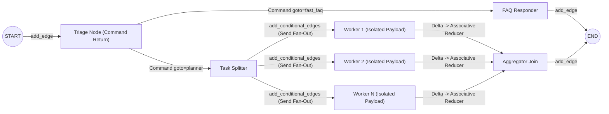
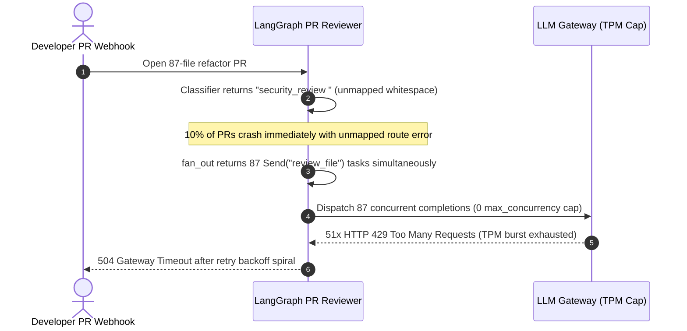

# Module 13: LangGraph: Edges and Conditional Routing

> **Prerequisites:** [Module 11: Why LangGraph: The Limits of Chains](../11-why-langgraph-the-limits-of-chains/README.md) and [Module 12: LangGraph: State and Nodes](../12-langgraph-state-and-nodes/README.md).  
> **Estimated Reading Time:** 40 minutes  
> **Target Audience:** AI Backend Engineers, Agentic Workflow Architects, Distributed Systems Developers

> [!TIP]
> **The Golden Rule of LangGraph Routing:** Treat graph control flow as a **statically inspectable, compile-time-verified state transition table**: enforce explicit **`path_map`** validation on every `add_conditional_edges` router (never route directly on unvalidated LLM strings), use **`Command(goto=..., update=...)`** with `Literal[...]` return annotations whenever a node must mutate state and route atomically without duplicating decision logic, and pair **`Send(node, payload)`** dynamic map-reduce fan-out with an associative reducer plus `max_concurrency` rate-limit caps.

---

## Why This Matters

Once your state schema and nodes are pure, control flow determines whether your agent routes predictably under load or collapses in production. Three routing bugs cause the vast majority of LangGraph runtime incidents:

1. **Unmapped LLM Routing Strings:** An LLM classifier outputs `"billing_team "` (trailing whitespace) or invents `"escalate_vip"`, and without a strict `path_map` and safe fallback, `add_conditional_edges` crashes mid-execution with `KeyError` / `ValueError`.
2. **State-vs-Router Logic Drift:** A node writes `"is_high_risk": True` using threshold `>= 0.85`, while a separate downstream `router_fn` reads `"risk_score"` using stale threshold `> 0.70`—silently sending risky actions down the auto-approve path.
3. **Unbounded Dynamic Fan-Out Storms:** When a runtime planner splits a PR or document into `87` subtasks via `Send`, firing all `87` parallel worker supersteps simultaneously without `max_concurrency` saturates provider TPM/RPM quotas, triggering cascading `429 Too Many Requests` retries and gateway timeouts.

Understanding **Normal Edges**, **Conditional Edges (`path_map`)**, the **`Command` API**, and the **`Send` API** eliminates all three failure classes cleanly.

---

## 1. The 4 Routing Primitives: Normal Edges, Conditional Edges, `Command`, and `Send`

### Architectural Mental Model: Static Edges vs. Atomic `Command` vs. Dynamic `Send`



### Primitive 1: Normal Edges (`add_edge`) & Multi-Source Fan-In Joins

Normal edges define unconditional deterministic transitions:

- `builder.add_edge(START, "triage")` sets the graph entry point.
- `builder.add_edge("gather", END)` marks completion.
- **Synchronized Fan-In (`add_edge(["search_a", "search_b"], "synthesize")`):** When a downstream node joins multiple upstream branches, LangGraph waits at the superstep barrier until all declared upstream edges finish before activating `"synthesize"`, preventing premature execution on half-gathered state.

### Primitive 2: Conditional Edges (`add_conditional_edges`) & Mandatory `path_map` Validation

`builder.add_conditional_edges(source, router_fn, path_map)` calls `router_fn(state)` *after* `source` commits its barrier delta, mapping the returned key to one or more downstream nodes:

- **Pure Router Rule:** `router_fn` receives read-only state and **must never mutate state or make LLM calls unless strictly designed as a lightweight classifier** (and even then, prefer an explicit node returning `Command` or structured state so LangSmith traces and checkpoints capture the classification decision!).
- **Deterministic vs. LLM-Backed Routers:** Deterministic routers inspect state flags (`if state["confidence"] >= 0.85: return "auto"`). LLM semantic routers MUST use `model.with_structured_output(RouteDecision)` constrained by `Literal[...]` plus defensive `.strip().lower()` normalization and a safe fallback key (`"escalate"`).
- **Why `path_map` is Non-Negotiable:** Passing `path_map={"billing": "billing_node", "faq": "faq_node", "escalate": "human_node", "done": END}` guarantees two safety properties: (1) LangGraph verifies at **`.compile()` time** that every target node actually exists in the graph, and (2) Mermaid/Studio graph visualizers render the exact outgoing topology instead of opaque dashed mystery edges. Returning a `list[str]` of `path_map` keys (`["search_a", "search_b"]`) triggers static multi-branch parallel fan-out.

### Primitive 3: The `Command` API (`Command(goto=..., update=...)`)

In classic LangGraph, a node updated state (`return {"route": "human"}`) and a separate conditional edge re-read `"route"` to jump. That split caused duplicated branching logic and state-vs-router drift.

**`Command`** (`from langgraph.types import Command`, or `new Command({ update, goto })` in LangGraph.js) lets a node perform **atomic state mutation AND dynamic routing in one return object**:

- **Zero Redundant State Flags:** You no longer pollute `OverallState` with ephemeral `"next_step"` routing keys.
- **Mandatory `Literal[...]` Return Type Hint:** Annotate Python nodes as `def triage(state: State) -> Command[Literal["worker", "human", "__end__"]]:` (or pass `{ ends: ["worker", "human", END] }` in TypeScript `addNode`). Without `Literal[...]` / `ends`, LangGraph's compiler cannot know what targets `Command.goto` might pick, leaving graph visualizations blind!
- **Cross-Subgraph Jumps & Resumes:** `Command(goto="parent_node", graph=Command.PARENT, update={...})` jumps out of nested subgraphs cleanly, and `Command(resume=approval_payload)` resumes durable `interrupt()` pauses (covered in [Module 16](../16-human-in-the-loop-with-langgraph/README.md)).
- **Important Conflict Rule:** If a node returns `Command(goto="B")` AND also has a normal `add_edge("A", "C")`, **both** `"B"` and `"C"` run! When using `Command` from node `A`, omit redundant normal outgoing edges from `A`.

### Primitive 4: The `Send` API (`Send(node, payload)`) for Dynamic Map-Reduce

What when a research or extraction workflow does not know how many parallel branches it needs until runtime (e.g., splitting an arbitrary PDF into $N$ sections or generating $N$ search sub-queries)? Static `add_edge` cannot express dynamic $N$-way fan-out.

**`Send(node_name, worker_payload)`** returned as a list `[Send("analyze_section", {"section": s}) for s in state["sections"]]` from a conditional routing function solves this cleanly:

1. **Dynamic Same-Superstep Spawning:** Every `Send` spawns an independent parallel execution of `"analyze_section"` inside the next superstep.
2. **Private Isolated Worker Payloads:** Each `Send` passes a custom `WorkerState` dict (`{"section": s}`) directly to that worker instance, keeping worker-specific inputs out of shared `OverallState`.
3. **Mandatory Associative Reducer Gathering:** All $N$ workers write their partial deltas (`{"section_summaries": [summary]}`) back to `OverallState` at the superstep barrier. Without an `Annotated[..., operator.add]` or associative deduplicating reducer on `section_summaries`, parallel workers crash immediately with `InvalidUpdateError`.
4. **Always Bound Fan-Out Concurrency:** Returning `80` `Send` tasks executes up to `80` simultaneous LLM requests unless capped via `config={"max_concurrency": M}` (plus chunk batching when $N \gg M$).

### Quantitative Mechanics: Dynamic `Send` Latency & Rate-Limit Bounds

Given $N$ dynamically generated `Send` workers, concurrency ceiling $M$, wave execution latency $L_{\text{wave}}(M)$ (governed by the tail latency of $M$ concurrent calls), and gather/reduce step latency $L_{\text{reduce}}$:

$$L_{\text{Send}}(N, M) = \left\lceil \frac{N}{M} \right\rceil \cdot L_{\text{wave}}(M) + L_{\text{reduce}}$$

To avoid `429 Too Many Requests` retry storms when each worker averages $\text{tok}_{\text{worker}}$ tokens over $L_{\text{sec}}$ seconds against provider quotas $(\text{RPM}_{\text{quota}}, \text{TPM}_{\text{quota}})$:

$$M \le \min\left(\left\lfloor \frac{\text{RPM}_{\text{quota}} \cdot L_{\text{sec}}}{60} \right\rfloor, \; \left\lfloor \frac{\text{TPM}_{\text{quota}} \cdot L_{\text{sec}}}{60 \cdot \text{tok}_{\text{worker}}} \right\rfloor\right)$$

For example, `N = 24` workers (`400 ms` each, `RPM_burst = 12/wave`): firing `M = 24` triggers `12` HTTP `429` errors (`+1,200 ms` backoff -> `1,850 ms` total), whereas capping `M = 12` completes `2` clean waves with **`0` `429` errors in `1,050 ms`** (`43%` faster than unbounded bursting and `9.4x` faster than sequential `M = 1` at `9,850 ms`).

---

## 2. Systematic Comparison Matrix: Routing Primitives

| Primitive | Decision Timing | Mutates State Atomically? | Supports Dynamic $N$ Fan-Out? | Compile-Time Visibility | Best Production Fit |
| :--- | :--- | :--- | :--- | :--- | :--- |
| **`add_edge(A, B)`** | Static (compile time) | No | No (fixed 1:1 or fan-in join) | Native static edge | Fixed pipeline hops (`START -> fetch`, `["a", "b"] -> join`, `final -> END`) |
| **`add_conditional_edges(src, fn, path_map)`** | Runtime post-node barrier | **No** (read-only router) | Static multi-target `list[str]` only (unless returning `Send`) | Guaranteed via explicit **`path_map`** | Pure routing off existing state (`tools_condition`, confidence gate, strict enum router) |
| **`Command(update=..., goto=...)`** | Runtime inside node | **Yes** (single atomic return) | Yes (can return list of `Send` or target nodes) | Requires `Command[Literal[...]]` / `ends` hint | Multi-agent handoffs, threshold+mutation steps, subgraph parent jumps, HITL resume |
| **`Send(node, payload)`** | Runtime inside conditional edge (or `Command.goto`) | Payload injection per worker | **Yes** ($N$ dynamic parallel workers) | Target `"node"` validated at compile | Map-reduce over variable lists (multi-doc extraction, sub-query search, PR file review) |

---

## 3. Production War Story Post-Mortem: The Unbounded `Send` 429 Storm & Unmapped Router Crash

| Field | Incident Details |
| :--- | :--- |
| **Severity** | **SEV-2** (Batch PR Review Pipeline Exhaustion + 10% Runtime Routing Exceptions) |
| **Detection / Resolution Time** | Detected 25 minutes after large monorepo PR merge burst / Mitigated in 40 minutes via `max_concurrency` cap + `path_map` enum fix |
| **Impact** | `87`-file monorepo PR triggered `87` concurrent `Send` calls, tripping OpenAI Tier-3 TPM/RPM limits (`51` `429` errors, gateway `60s` timeout); unmapped LLM string `"security_review "` crashed surviving runs |

### What Happened

An automated engineering PR-review graph routed incoming pull requests through an LLM classifier (`add_conditional_edges("classify", llm_route_fn)` without `path_map` or `Literal` enforcement) into a dynamic `Send("review_file", {"diff": d})` map-reduce step:

1. **Unbounded `Send` Fan-Out:** Most PRs touched `3–8` files, so the graph worked smoothly in staging. When a platform engineer renamed a shared interface touching `87` files, `fan_out_files` returned `87` simultaneous `Send` objects with **no `max_concurrency` limit**. All `87` workers hit the LLM provider in `< 200 ms`, saturating the team's `60,000 TPM` burst quota, causing `51` `429` retry storms that exceeded the `60s` webhook SLA.
2. **Unmapped Router Crash:** On `10%` of PRs where the classifier ran, the prompt instructed *"Return billing, docs, or security_review"*. Whenever the LLM emitted `"security_review "` (trailing space) or `"security"`, `llm_route_fn` returned that raw string directly without `path_map` normalization—raising an unhandled runtime node-lookup failure.



### Root Cause Analysis

- `fan_out_files` assumed small PR sizes and issued unbounded `Send` tasks without `config={"max_concurrency": 8}` or pre-batching large file sets into groups.
- `add_conditional_edges` omitted a strict `path_map`, and the router relied on raw text extraction instead of `with_structured_output(Literal[...])` with normalized fallback.

### The Fix & Architectural Hardening

- **Added Strict `path_map` + `Literal` Structured Routing:** Replaced raw text routing with a `Command[Literal["review_fanout", "docs_node", "escalate"]]` node backed by Pydantic `Literal` schema + fallback `"escalate"`.
- **Bounded `Send` Concurrency & Pre-Batching:** Set `config={"max_concurrency": 8}` on `.invoke`/`.ainvoke`, and added a pre-check batching `> 25` tiny diffs into `5`-file bundles so peak worker count stays bounded while preserving associative deduplicating reduction.

---

## 4. Multi-Language Production Implementation: Static Guards, `Command` Handoffs & Bounded `Send` Map-Reduce

Below is a complete multi-primitive routing architecture combining **`add_edge`**, **validated `path_map` conditional edges**, **`Command` atomic update + jump**, and **bounded `Send` dynamic map-reduce** across **Go**, **TypeScript** (`@langchain/langgraph`), **Python** (`langgraph`), and **C#**.

````carousel

```go
package routing

import (
	"context"
	"fmt"
	"sort"
	"strings"
	"sync"
)

const EndNode = "__end__"

type ReviewFinding struct {
	File    string
	Summary string
}

type OverallState struct {
	PRTitle     string
	ChangedFiles []string
	Category    string
	Findings    []ReviewFinding
	FinalReport string
}

// Command atomically specifies partial state updates plus explicit destination(s).
type Command struct {
	Goto      string
	Findings  []ReviewFinding
	Report    *string
	Category  *string
}

// CompilePathMap validates all conditional targets against registered nodes before runtime.
func CompilePathMap(registeredNodes map[string]bool, pathMap map[string]string) error {
	for label, target := range pathMap {
		if target != EndNode && !registeredNodes[target] {
			return fmt.Errorf("compile error: path_map[%q] -> unknown node %q", label, target)
		}
	}
	return nil
}

// SafeRoute normalizes untrusted model labels against a validated path_map with fallback.
func SafeRoute(rawLabel string, pathMap map[string]string, fallbackKey string) string {
	norm := strings.TrimSpace(strings.ToLower(rawLabel))
	if target, ok := pathMap[norm]; ok {
		return target
	}
	return pathMap[fallbackKey]
}

// TriageWithCommand mutates category AND routes atomically without duplicating edge checks.
func TriageWithCommand(s OverallState) Command {
	if len(s.ChangedFiles) == 0 {
		msg := "Empty PR: skipped review."
		return Command{Goto: EndNode, Report: &msg}
	}
	cat := "code_fanout"
	return Command{Goto: "dispatch_files", Category: &cat}
}

// ExecuteBoundedSend runs N dynamic worker payloads capped at maxConcurrency via semaphore.
func ExecuteBoundedSend(
	ctx context.Context,
	files []string,
	maxConcurrency int,
	workerFn func(context.Context, string) (ReviewFinding, error),
) ([]ReviewFinding, error) {
	if maxConcurrency <= 0 {
		maxConcurrency = 1
	}
	sem := make(chan struct{}, maxConcurrency)
	results := make([]ReviewFinding, len(files))
	errs := make([]error, len(files))
	var wg sync.WaitGroup

	for i, file := range files {
		wg.Add(1)
		go func(idx int, path string) {
			defer wg.Done()
			sem <- struct{}{}        // Acquire concurrency slot
			defer func() { <-sem }() // Release slot deterministically
			results[idx], errs[idx] = workerFn(ctx, path)
		}(i, file)
	}
	wg.Wait()

	for _, err := range errs {
		if err != nil {
			return nil, err
		}
	}
	// Deterministic associative sort by File so parallel timing never changes order.
	sort.Slice(results, func(i, j int) bool { return results[i].File < results[j].File })
	return results, nil
}
```

<!-- slide -->

```typescript
import { Annotation, Command, END, Send, START, StateGraph } from "@langchain/langgraph";

interface FileFinding {
  file: string;
  summary: string;
}

const ReviewState = Annotation.Root({
  prTitle: Annotation<string>(),
  changedFiles: Annotation<string[]>(),
  routeReason: Annotation<string>(),
  findings: Annotation<FileFinding[]>({
    // Associative deterministic reducer by filename
    reducer: (prev, next) =>
      [...prev, ...next].sort((a, b) => a.file.localeCompare(b.file)),
    default: () => [],
  }),
  finalReport: Annotation<string>({ reducer: (_p, n) => n, default: () => "" }),
});

type GraphState = typeof ReviewState.State;
type WorkerInput = { file: string };

// 1. Atomic Command node: updates state AND jumps dynamically with explicit `ends` metadata
async function triageNode(state: GraphState) {
  if (state.changedFiles.length === 0) {
    return new Command({
      update: { routeReason: "empty_pr", finalReport: "No changed files to review." },
      goto: END,
    });
  }
  return new Command({
    update: { routeReason: `fanout_${state.changedFiles.length}_files` },
    goto: "fanout_gate",
  });
}

// 2. Dynamic Send fan-out spawning isolated WorkerInput payloads
function dispatchWorkers(state: GraphState): Send[] {
  return state.changedFiles.map((file) => new Send("review_file", { file }));
}

async function reviewFileWorker(input: WorkerInput): Promise<Partial<GraphState>> {
  return {
    findings: [{ file: input.file, summary: `Checked ${input.file}: 0 critical issues` }],
  };
}

async function reduceReportNode(state: GraphState): Promise<Partial<GraphState>> {
  const lines = state.findings.map((f) => `- ${f.file}: ${f.summary}`).join("\n");
  return { finalReport: `PR '${state.prTitle}' (${state.routeReason}):\n${lines}` };
}

export function buildRoutingGraph() {
  return new StateGraph(ReviewState)
    .addNode("triage", triageNode, { ends: ["fanout_gate", END] })
    .addNode("fanout_gate", async () => ({}))
    .addNode("review_file", reviewFileWorker)
    .addNode("reduce_report", reduceReportNode)
    .addEdge(START, "triage")
    .addConditionalEdges("fanout_gate", dispatchWorkers, ["review_file"])
    .addEdge("review_file", "reduce_report")
    .addEdge("reduce_report", END)
    .compile();
}
// Invoke safely with bounded concurrency: await app.invoke(input, { maxConcurrency: 6 });
```

<!-- slide -->

```python
"""
edges_command_send.py
Demonstrates compile-time path_map validation, atomic Command[Literal[...]] routing,
and bounded dynamic Send map-reduce fan-out with isolated WorkerState.
"""
from __future__ import annotations

import operator
from typing import Annotated, Literal, TypedDict

from langgraph.graph import END, START, StateGraph
from langgraph.types import Command, Send


class FileFinding(TypedDict):
    file: str
    summary: str


def merge_findings_sorted(left: list[FileFinding], right: list[FileFinding]) -> list[FileFinding]:
    """Deterministic associative reducer independent of parallel worker completion order."""
    by_file = {item["file"]: item for item in left + right}
    return [by_file[k] for k in sorted(by_file)]


class OverallState(TypedDict):
    pr_title: str
    changed_files: list[str]
    intent_label: str
    findings: Annotated[list[FileFinding], merge_findings_sorted]
    final_report: str


class WorkerPayload(TypedDict):
    """Private payload injected per Send worker (never pollutes OverallState)."""
    file: str


def triage_with_command(state: OverallState) -> Command[Literal["fanout_gate", "docs_fastpath", "__end__"]]:
    files = state.get("changed_files", [])
    if not files:
        return Command(
            update={"intent_label": "empty", "final_report": "No changed files."},
            goto=END,
        )
    if all(f.endswith(".md") for f in files):
        return Command(update={"intent_label": "docs_only"}, goto="docs_fastpath")
    return Command(update={"intent_label": "code_review"}, goto="fanout_gate")


def docs_fastpath_node(state: OverallState) -> dict:
    return {"final_report": f"Docs-only PR '{state['pr_title']}' auto-approved ({len(state['changed_files'])} md files)."}


def fanout_gate_node(state: OverallState) -> dict:
    return {}


def route_to_workers(state: OverallState) -> list[Send]:
    # Dynamically spawn N workers in the next superstep (bounded at invoke via max_concurrency)
    return [Send("review_file_worker", {"file": path}) for path in state["changed_files"]]


def review_file_worker(payload: WorkerPayload) -> dict:
    return {
        "findings": [{"file": payload["file"], "summary": f"AST+lint clean on {payload['file']}"}],
    }


def aggregate_report_node(state: OverallState) -> dict:
    lines = "\n".join(f"- {item['file']}: {item['summary']}" for item in state["findings"])
    return {"final_report": f"PR '{state['pr_title']}' [{state['intent_label']}]:\n{lines}"}


def build_router_graph():
    builder = StateGraph(OverallState)
    builder.add_node("triage", triage_with_command)
    builder.add_node("docs_fastpath", docs_fastpath_node)
    builder.add_node("fanout_gate", fanout_gate_node)
    builder.add_node("review_file_worker", review_file_worker)
    builder.add_node("aggregate_report", aggregate_report_node)

    builder.add_edge(START, "triage")
    builder.add_edge("docs_fastpath", END)
    builder.add_conditional_edges("fanout_gate", route_to_workers, ["review_file_worker"])
    builder.add_edge("review_file_worker", "aggregate_report")
    builder.add_edge("aggregate_report", END)
    return builder.compile()


if __name__ == "__main__":
    app = build_router_graph()
    out = app.invoke(
        {"pr_title": "Add auth guard", "changed_files": ["auth.py", "tests/test_auth.py"], "findings": []},
        config={"max_concurrency": 6},
    )
    print(out["final_report"])
```

<!-- slide -->

```csharp
using System;
using System.Collections.Generic;
using System.Collections.Immutable;
using System.Linq;
using System.Threading;
using System.Threading.Tasks;

namespace GenAI.LangGraphRouting;

public sealed record FileFinding(string File, string Summary);

public sealed record GraphCommand<TState>(
    string Goto,
    Func<TState, TState> ApplyUpdate);

public sealed record SendTask<TPayload>(string TargetNode, TPayload Payload);

public static class RoutingEngine
{
    public const string End = "__end__";

    public static void ValidatePathMap(
        IReadOnlySet<string> registeredNodes,
        IReadOnlyDictionary<string, string> pathMap)
    {
        foreach (var (label, target) in pathMap)
        {
            if (!string.Equals(target, End, StringComparison.Ordinal) && !registeredNodes.Contains(target))
            {
                throw new InvalidOperationException(
                    $"Compile-time path_map validation failed: label '{label}' points to unknown node '{target}'.");
            }
        }
    }

    public static string SafeResolveRoute(
        string rawModelRoute,
        IReadOnlyDictionary<string, string> pathMap,
        string fallbackLabel)
    {
        var normalized = rawModelRoute.Trim().ToLowerInvariant();
        return pathMap.TryGetValue(normalized, out var target)
            ? target
            : pathMap[fallbackLabel];
    }

    public static async Task<ImmutableList<FileFinding>> ExecuteBoundedSendAsync(
        IEnumerable<SendTask<string>> tasks,
        Func<string, CancellationToken, Task<FileFinding>> worker,
        int maxConcurrency = 6,
        CancellationToken ct = default)
    {
        using var gate = new SemaphoreSlim(Math.Max(1, maxConcurrency));
        var running = tasks.Select(async task =>
        {
            await gate.WaitAsync(ct);
            try
            {
                return await worker(task.Payload, ct);
            }
            finally
            {
                gate.Release();
            }
        });

        var completed = await Task.WhenAll(running);
        // Associative sorted gather ensures deterministic output regardless of task completion timing
        return completed.OrderBy(f => f.File, StringComparer.Ordinal).ToImmutableList();
    }
}
```

````

---

## 5. Practical Hands-On Verification CLI Workflows

Run these deterministic Python 3.13 verification scripts offline—zero third-party packages or API keys required.

### Workflow 1: Compile-Time `path_map` Validation & LLM Router Fuzz Probe

Verify how compile-time `path_map` checking catches typos early and normalized routing + safe fallback prevent runtime crashes on dirty LLM outputs:

```bash
python -c '
VALID_NODES = {"billing_node", "faq_node", "escalate_human", "__end__"}

def compile_conditional_edge(source, path_map):
    for label, target in path_map.items():
        if target not in VALID_NODES:
            raise ValueError(f"CompileError at edge {source}->{label}: unknown node {target}")
    return path_map

path_map = compile_conditional_edge(
    "classifier",
    {"billing": "billing_node", "faq": "faq_node", "escalate": "escalate_human", "done": "__end__"},
)

def route_with_guard(raw_llm_label, path_map):
    normalized = raw_llm_label.strip().lower()
    if normalized in path_map:
        return path_map[normalized], "EXACT_MAP"
    return path_map["escalate"], "SAFE_FALLBACK"

for raw_output in ["billing", "faq", "security_review ", "unknown_intent"]:
    try:
        _ = {"billing": "billing_node", "faq": "faq_node"}[raw_output]
        unguarded = "OK"
    except KeyError:
        unguarded = "RUNTIME_CRASH(KeyError)"
    target, mode = route_with_guard(raw_output, path_map)
    print(f"raw={raw_output!r:<18} | unguarded={unguarded:<23} | guarded->{target} ({mode})")
'
```

**Expected Output:**

```text
raw='billing'          | unguarded=OK                      | guarded->billing_node (EXACT_MAP)
raw='faq'              | unguarded=OK                      | guarded->faq_node (EXACT_MAP)
raw='security_review ' | unguarded=RUNTIME_CRASH(KeyError) | guarded->escalate_human (SAFE_FALLBACK)
raw='unknown_intent'   | unguarded=RUNTIME_CRASH(KeyError) | guarded->escalate_human (SAFE_FALLBACK)
```

### Workflow 2: `Command(update, goto)` Atomic Transition vs. Split Node/Edge State Drift

Demonstrate how refactoring a confidence threshold in a node while forgetting its downstream `router_fn` causes silent state-vs-routing drift at `conf=0.78`, and how atomic `Command` eliminates drift completely:

```bash
python -c '
from dataclasses import dataclass

@dataclass(frozen=True)
class Command:
    update: dict
    goto: str

def split_node_antipattern(state):
    # Engineer refactored node threshold to >= 0.85, forgot downstream router uses > 0.70!
    auto_approve = state["confidence"] >= 0.85
    return {"auto_approved": auto_approve, "status": "checked"}

def stale_downstream_router(state):
    return "payout" if state["confidence"] > 0.70 else "manual_review"

def command_atomic_node(state):
    if state["confidence"] >= 0.85:
        return Command(update={"auto_approved": True, "status": "approved"}, goto="payout")
    return Command(update={"auto_approved": False, "status": "queued_review"}, goto="manual_review")

for conf in [0.92, 0.78, 0.50]:
    s = {"confidence": conf}
    split_state = {**s, **split_node_antipattern(s)}
    split_route = stale_downstream_router(split_state)
    cmd = command_atomic_node(s)
    drift = split_state["auto_approved"] != (split_route == "payout")
    sa = split_state["auto_approved"]
    ca = cmd.update["auto_approved"]
    print(f"conf={conf:.2f} | Split(approved={sa}, route={split_route}, DRIFT={drift}) | Command(approved={ca}, goto={cmd.goto})")
'
```

**Expected Output:**

```text
conf=0.92 | Split(approved=True, route=payout, DRIFT=False) | Command(approved=True, goto=payout)
conf=0.78 | Split(approved=False, route=payout, DRIFT=True) | Command(approved=False, goto=manual_review)
conf=0.50 | Split(approved=False, route=manual_review, DRIFT=False) | Command(approved=False, goto=manual_review)
```

### Workflow 3: Dynamic `Send` Map-Reduce Concurrency Sweep & `429` Rate-Limit Simulator

Sweep `max_concurrency` (`24`, `12`, `6`, `1`) across `N = 24` dynamic `Send` tasks (`400 ms/worker`, `12` burst RPM limit) to locate the exact zero-`429` latency optimum:

```bash
python -c '
import math

def simulate_send_fanout(num_tasks=24, max_concurrency=6, rpm_capacity=12, worker_ms=400, reduce_ms=250):
    waves = math.ceil(num_tasks / max_concurrency)
    http_429_errors = 0
    total_ms = 0
    for w in range(waves):
        batch = min(max_concurrency, num_tasks - w * max_concurrency)
        if batch > rpm_capacity:
            http_429_errors += (batch - rpm_capacity)
            total_ms += worker_ms + 1200
        else:
            total_ms += worker_ms
    total_ms += reduce_ms
    summaries = [f"task_{i:02d}_ok" for i in range(num_tasks)]
    print(f"N={num_tasks} Send workers | max_concurrency={max_concurrency:2d} | waves={waves:2d} | 429s={http_429_errors:2d} | total_latency={total_ms:5d} ms | reduced_items={len(summaries)}")

for cap in [24, 12, 6, 1]:
    simulate_send_fanout(num_tasks=24, max_concurrency=cap, rpm_capacity=12)
'
```

**Expected Output:**

```text
N=24 Send workers | max_concurrency=24 | waves= 1 | 429s=12 | total_latency= 1850 ms | reduced_items=24
N=24 Send workers | max_concurrency=12 | waves= 2 | 429s= 0 | total_latency= 1050 ms | reduced_items=24
N=24 Send workers | max_concurrency= 6 | waves= 4 | 429s= 0 | total_latency= 1850 ms | reduced_items=24
N=24 Send workers | max_concurrency= 1 | waves=24 | 429s= 0 | total_latency= 9850 ms | reduced_items=24
```

### Hands-On Exercises

1. **Catch Broken `path_map` at Compile Time:** Add `"fraud": "fraud_review_node"` into `path_map` in Workflow 1 without adding `"fraud_review_node"` to `VALID_NODES`, confirming `compile_conditional_edge` catches the typo immediately rather than during live traffic.
2. **Pre-Batch Large `Send` Payloads:** Extend Workflow 3 so whenever `num_tasks > 30`, a chunker groups tasks into batches of `3` before returning `Send`, shrinking `90` individual LLM calls to `30` batched `Send` workers (`max_concurrency=6`).
3. **Optional Live LangGraph `Command` & `Send` Probe (Requires `langgraph`):** Run `python edges_command_send.py` from Section 4 with `changed_files=["README.md", "docs/api.md"]` vs. `["a.py", "b.py", "c.py"]` and confirm docs-only PRs take `docs_fastpath` while Python PRs fan out cleanly across workers.

### Independent Challenge

A financial compliance agent contains a parent supervisor graph and a nested `kyc_subgraph`. Inside `kyc_subgraph`, a verification node discovers that a customer's passport failed OCR (`"needs_manual_id"`), which must update `"kyc_status": "escalated"` on the *parent* state and immediately route execution to the parent graph's `"human_compliance_desk"` node. Explain why ordinary `add_conditional_edges` inside `kyc_subgraph` cannot jump directly to `"human_compliance_desk"`, and specify the exact `Command` signature (`goto`, `update`, `graph`) plus return type annotation required.

<details><summary>Architectural Discussion</summary>

`add_conditional_edges` inside `kyc_subgraph` is scoped strictly to node names registered within `kyc_subgraph`; referencing `"human_compliance_desk"` there raises a compile-time unknown-node error. Instead, write the subgraph node to return **`Command(goto="human_compliance_desk", update={"kyc_status": "escalated"}, graph=Command.PARENT)`** (annotated cleanly or paired with parent-graph routing knowledge), and ensure `kyc_status` exists on the shared parent schema (with an appropriate reducer if concurrent branches run). Specifying `graph=Command.PARENT` instructs Pregel to bubble the state update and transition directly up to the parent graph's superstep scheduler, jumping straight into `"human_compliance_desk"` without adding clumsy wrapper exit-code flags onto every intermediate subgraph boundary.

</details>

---

## 6. Common Mistakes & Troubleshooting

- **Combining `Command(goto="B")` with `add_edge("A", "C")` on the same source node `A`:** Normal edges execute *in addition to* `Command.goto`, accidentally activating both `"B"` and `"C"` in parallel. Remove outgoing `add_edge` definitions when node `A` controls its own transitions via `Command`.
- **Omitting `Literal[...]` return annotations (Python) or `ends` (TypeScript) on `Command` nodes:** Without `-> Command[Literal["node_b", "__end__"]]`, `get_graph().draw_mermaid()` cannot discover outgoing paths and compile-time target checks cannot verify node names.
- **Using `Send` without an associative reducer on the output channel:** Fanning out `N >= 2` workers that return `{"results": [val]}` onto a default Last-Write-Wins key immediately crashes at the barrier with `InvalidUpdateError`. Always declare `Annotated[list[...], operator.add]` or an associative deduplicating reducer.
- **Passing raw unvalidated LLM strings to `add_conditional_edges` without `path_map`:** Minor casing or trailing whitespace (`"FAQ\n"`) crashes graph routing mid-run. Pair `with_structured_output(Literal[...])` with explicit `path_map` and a safe fallback branch.
- **Mutating state inside a `router_fn`:** Conditional edge functions are not tracked as checkpointed state producers—returning updates or mutating `state` inside `router_fn` silently fails to persist across restarts. Keep routing functions strictly read-only, or move state mutation + routing together inside a node returning `Command`.

---

## 7. Operational Validation Checkpoints & Checkpoint Quiz

### Operational Validation Checkpoints

<details><summary><strong>Checkpoint 1: Fixing InvalidUpdateError during dynamic Send map-reduce</strong></summary>

An engineer adds `return [Send("summarize_doc", {"doc": d}) for d in state["docs"]]` to summarize `12` uploaded PDFs in parallel. Each worker returns `{"summaries": [summary]}`. Works cleanly when `len(docs) == 1`, but throws `InvalidUpdateError` whenever `len(docs) >= 2`. Identify the exact defect and fix.

**Validation:** When `len(docs) == 1`, only a single worker writes to `"summaries"` per superstep, masking the missing reducer. When `len(docs) >= 2`, `Send` executes multiple `"summarize_doc"` workers in the **same superstep**, triggering concurrent writes to `"summaries"` which crashes an un-annotated Last-Write-Wins channel. Fix by annotating `"summaries"` in `OverallState` with an associative reducer (`Annotated[list[str], operator.add]` or a deterministic sorted deduplicating reducer).

</details>

<details><summary><strong>Checkpoint 2: Eliminating duplicated conditional logic with Command</strong></summary>

A code reviewer flags a graph where `fraud_check_node` evaluates five business rules to compute `state["decision"]`, and downstream `route_after_fraud` re-implements subtle threshold checks over `state["score"]` and `state["country"]`. Two weeks later, a threshold change in `fraud_check_node` breaks routing. How does `Command` permanently prevent this class of bug?

**Validation:** Refactor `fraud_check_node` to return **`Command(update={"decision": ..., "fraud_reason": ...}, goto=target_node)`** annotated with `-> Command[Literal["approve", "manual_review", "block"]]`, and delete `route_after_fraud` and `add_conditional_edges`. Because state mutation and next-node selection happen atomically in one single source of truth inside `fraud_check_node`, threshold edits can never desynchronize from routing logic.

</details>

<details><summary><strong>Checkpoint 3: Tuning Send fan-out against provider TPM/RPM limits</strong></summary>

A `Send` workflow fans out `N = 30` parallel extraction calls (`1,500` tokens each, `500 ms` average latency) against an LLM tier capped at `18,000` tokens per second burst (`10` concurrent requests max before `429`). Without capping `max_concurrency`, `20` workers hit `429` retries (`+1.5s` each). Calculate the optimal `max_concurrency` and resulting clean execution latency (`L_reduce = 300 ms`).

**Validation:** Both the concurrency cap (`10` requests) and token burst (`18,000 / 1,500 = 12`) constrain safe `M <= 10`. Setting `config={"max_concurrency": 10}` executes `ceil(30 / 10) = 3` clean parallel waves with `0` `429` retries: $L_{\text{Send}} = 3 \times 500\text{ ms} + 300\text{ ms} = 1,800\text{ ms}$ total (`10x` faster than sequential `15,300 ms` without tripping rate limits).

</details>

### Checkpoint Quiz

1. Why must you attach `path_map` to `add_conditional_edges` even when `router_fn` already returns exact node name strings?
2. What happens if a node `A` returns `Command(goto="B")` while the graph still defines `builder.add_edge("A", "C")`?
3. Explain the difference between `Send` worker input schemas and `OverallState`.
4. Why is `-> Command[Literal["node_x", "__end__"]]` type annotation required on Python nodes returning `Command`?
5. What happens when `builder.add_edge(["branch_1", "branch_2"], "join")` is used after two parallel branches?

<details><summary>Answers</summary>

1. Explicit `path_map` enables **compile-time verification** that all destination nodes exist, restricts runtime routing strictly to mapped targets (catching raw LLM typos before node dispatch), and lets static graph visualizers render outgoing conditional edges accurately.
2. Normal edges are additive: LangGraph schedules **both** `"B"` (from `Command.goto`) **and** `"C"` (from `add_edge`) in the next superstep. Omit outgoing `add_edge` calls on nodes using `Command` unless intentional parallel fan-out is desired.
3. Each `Send("worker", payload)` passes a custom private `WorkerPayload` dictionary exclusively to that single worker instance without storing `N` temporary per-task inputs inside `OverallState`; workers only write merged results back via `OverallState` reducers.
4. Because `Command.goto` happens dynamically inside Python code, LangGraph inspects the `Literal[...]` generic parameter at graph build/compile time to validate targets and generate accurate Mermaid/Studio diagrams.
5. LangGraph treats `"join"` as a **fan-in synchronization join**, waiting until both `"branch_1"` and `"branch_2"` complete and merge their barrier deltas before activating `"join"`.

</details>

---

## Further Reading & Sources

- [LangGraph Low-Level Concepts: Edges, Command & Send APIs](https://langchain-ai.github.io/langgraph/concepts/low_level/) — canonical documentation for `add_conditional_edges`, `path_map`, `Command`, and `Send`.
- [LangGraph How-To: Map-Reduce Branches with Send](https://langchain-ai.github.io/langgraph/how-tos/map-reduce/) — official pattern for dynamic `Send` worker fan-out and reducer gathering.
- [LangGraph How-To: Combine Control Flow and State Updates with Command](https://langchain-ai.github.io/langgraph/how-tos/command/) — `Command(goto=..., update=...)`, `Literal` hints, and `Command.PARENT` subgraph handoffs.
- [LangGraph.js Graph API: Conditional Edges, Command & Send](https://langchain-ai.github.io/langgraphjs/concepts/low_level/) — TypeScript routing primitives and `ends` compilation metadata.
- [Module 12: LangGraph: State and Nodes](../12-langgraph-state-and-nodes/README.md) — associative reducers required by parallel edges and `Send` workers.
- [Module 14: LangGraph: Cycles and Loops](../14-langgraph-cycles-and-loops/README.md) — bounding conditional loops with `recursion_limit`, `RemainingSteps`, and oscillation detection.

## Next

[Module 14: LangGraph: Cycles and Loops](../14-langgraph-cycles-and-loops/README.md)
