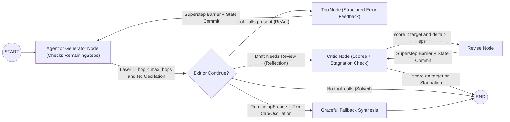
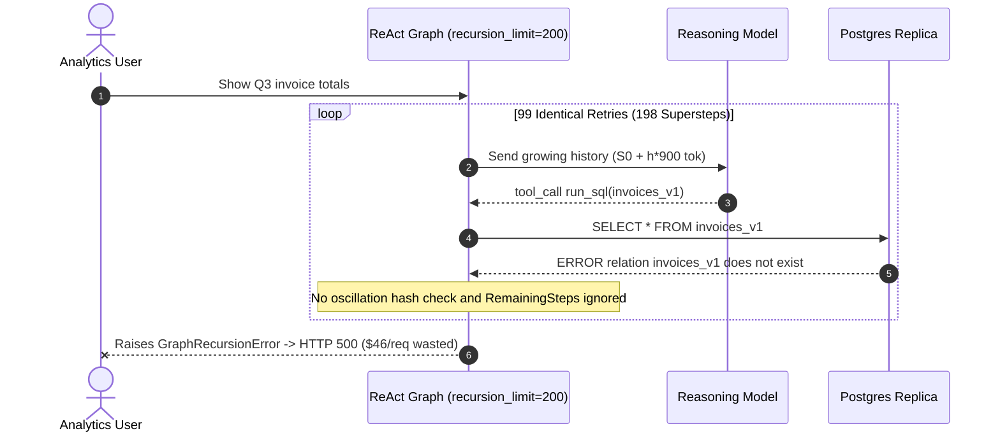

# Module 14: LangGraph: Cycles and Loops

> **Prerequisites:** [Module 11: Why LangGraph: The Limits of Chains](../11-why-langgraph-the-limits-of-chains/README.md), [Module 12: LangGraph: State and Nodes](../12-langgraph-state-and-nodes/README.md), and [Module 13: LangGraph: Edges and Conditional Routing](../13-langgraph-edges-and-conditional-routing/README.md).  
> **Estimated Reading Time:** 40 minutes  
> **Target Audience:** AI Backend Engineers, Agent Reliability Engineers, Autonomous Systems Architects

> [!TIP]
> **The Golden Rule of Bounded Cyclic Graphs:** Every cycle in LangGraph must enforce a **three-layer termination defense**: (1) an explicit **in-state hop counter** (`step_count < max_steps`) paired with `RemainingSteps` so the agent synthesizes a graceful partial answer *before* hitting the ceiling, (2) **semantic oscillation and stagnation detection** (halting identical repeating tool calls or plateauing critic scores immediately), and (3) a workload-calibrated **`recursion_limit`** (`config={"recursion_limit": R}`) wrapped in a `try/except GraphRecursionError` checkpoint fallback—never crank `recursion_limit` up to `200` to mask a broken loop.

---

## Why This Matters

Cyclic feedback loops are the exact superpower that separates true agents from static pipelines: an agent calls a SQL tool, reads `"column created_date does not exist"`, inspects the schema, and repairs its query (`ReAct`, Yao et al., `arXiv:2210.03629`); or a generator drafts code, receives failing `pytest` tracebacks from a critic node, and iterates until tests pass (`Reflexion`, Shinn et al., `arXiv:2303.11366`).

Without strict loop engineering, however, cycles turn minor tool glitches into **quadratic-cost infinite loops**: an LLM stubbornly calls `run_sql("SELECT * FROM invoices_v1")` `25` times in a row until LangGraph throws `GraphRecursionError`, crashing your FastAPI endpoint with `500 Internal Server Error` and returning zero useful output after burning `\$0.85` per user request. Worse yet, raising `recursion_limit=200` to "silence the error" turns a weekend schema glitch into a **\$68,000** token spiral. Mastering **Pregel superstep barrier safety, `R_min` calibration, `RemainingSteps`, oscillation hashing, and graceful `GraphRecursionError` degradation** lets you ship autonomous cycles with hard reliability guarantees.

---

## 1. Bounded Cyclic Topologies, Pregel Safety & The 3-Layer Termination Guard

### Architectural Mental Model: ReAct Loops, Critique-Revise Cycles & 3-Layer Defense



### How Pregel Superstep Barriers Prevent Cyclic Race Conditions

Even when a graph loops back onto itself (`agent -> tools -> agent`), Pregel **never executes a loop body concurrently with its own previous iteration**:

- Iteration `1` of `agent` runs in superstep $s$, commits its `AIMessage(tool_calls=[...])` delta at the barrier, and schedules `tools`.
- `tools` runs in superstep $s + 1$, executes requested tools (in parallel if multiple tool calls exist), commits `ToolMessage` deltas at the barrier, and re-schedules `agent`.
- Iteration `2` of `agent` runs in superstep $s + 2$ reading the **committed post-tool snapshot** from $s + 1$.

Because `recursion_limit` (default `25`) counts **supersteps**, *not* user-facing loop iterations, a single ReAct hop (`agent -> tools`) consumes **`2` supersteps**, and a 3-node reflection cycle consumes **`3` supersteps** per pass!

### Exact Formula for `recursion_limit` Calibration ($R_{\min}$)

For a cyclic workflow containing $P$ initial setup nodes, a cycle of $K$ nodes per iteration bounded to at most $M_{\max}$ iterations, and $Q$ exit/finalization nodes (plus `1` superstep margin):

$$R_{\min} = P + (K \cdot M_{\max}) + Q + 1$$

- **2-Node ReAct Loop (`agent <-> tools`, $P=0, K=2, Q=1$):** Allowing up to $M_{\max} = 5$ tool calls requires `R_min = 0 + (2 * 5) + 1 + 1 = 12` supersteps (`config={"recursion_limit": 12}`).
- **Generate-Critique-Revise Loop (`generate -> critique -> revise -> critique`, $P=1, K=2, Q=1$):** Allowing up to $M_{\max} = 4$ revision rounds requires `R_min = 1 + (2 * 4) + 1 + 1 = 11` supersteps.

### The 3-Layer Termination Defense

1. **Layer 1 — In-State Hop Counter + `RemainingSteps` Managed Channel:**
   - Track explicit `step_count` (or `revision_count`) in state and check `step_count < max_steps` inside conditional routing.
   - Even stronger: declare `remaining_steps: RemainingSteps` (`from langgraph.managed import RemainingSteps`) in your Python `State` schema. LangGraph automatically injects `recursion_limit - current_superstep` on every node call. Checking `if state["remaining_steps"] <= 2:` inside the agent node lets it **skip further tool calls and synthesize a clean best-effort response** *before* `GraphRecursionError` ever raises!
2. **Layer 2 — Semantic Oscillation & Stagnation Detection:**
   - **ReAct Action-Hash Loop Breaker:** Compute a canonical SHA-256 signature of `(tool_name, json.dumps(args, sort_keys=True))`. If the agent proposes an identical failing tool call already seen in `seen_action_hashes`, force-route immediately to `graceful_fallback` with an explanation rather than wasting `20` more hops!
   - **Reflection Stagnation Early-Stop:** Track `prev_score` and `curr_score` in `Generate -> Critique -> Revise`. If $q_t - q_{t-1} < \epsilon$ (e.g., `+0.02 < 0.03`), stop revising early—burning extra LLM calls on plateaued drafts only risks degradation and wasted latency.
3. **Layer 3 — Hard `recursion_limit` + `try/except GraphRecursionError` Checkpoint Recovery:**
   - Always pass an explicit workload-appropriate `config={"recursion_limit": R}` (e.g., `12–24`) rather than blindly relying on `25` or raising to `200`.
   - Wrap `.invoke()` / `.ainvoke()` at the service boundary in `try ... except GraphRecursionError:`. When triggered, read the **last valid checkpoint** (`app.get_state(config).values`) and return a structured `200`/`206` degraded payload (`"status": "budget_exhausted"`, partial findings) instead of a `500` HTTP error.

### Tool Execution Error Feedback (`ToolNode` Rule)

Never let deterministic tool validation errors (`SyntaxError`, `404 Not Found`, missing column) raise uncaught exceptions inside a tool function—doing so crashes the superstep before the agent can self-correct. Catch tool errors and return `ToolMessage(content="ERROR: column 'created_date' missing; valid columns: [created_at, user_id]", status="error", tool_call_id=...)` so the LLM repairs its next call cleanly (bounded by Layer 2 if it repeats the exact broken call!).

### Quantitative Mechanics: Why Cycle Spend Scales Quadratically $O(H^2)$

Because conversational/tool history appends $\Delta c$ tokens every cycle hop starting from base prompt $S_0$, input token consumption across $H$ hops grows **quadratically**, not linearly:

$$C_{\text{cycle}}(H) = p_{\text{in}} \cdot \sum_{h=0}^{H-1} (S_0 + h \cdot \Delta c) + p_{\text{out}} \cdot H \cdot O_{\text{hop}}$$

At $S_0 = 2,000$ tokens, $\Delta c = 900$ tokens/hop, $O_{\text{hop}} = 220$ output tokens (`\$2.50/1M` input, `\$10.00/1M` output):
- `H = 4` hops (bounded): `13,400` input tokens -> **\$0.0423/run**
- `H = 25` hops (unprotected default loop): `320,000` input tokens -> **\$0.8550/run** (`20.2x` cost!)
- `H = 200` hops ("bumped `recursion_limit=402`"): `18,310,000` input tokens -> **\$46.22/run** (`1,092x` cost!)

---

## 2. Systematic Comparison Matrix: Loop Termination Strategies

| Guard Mechanism | Catches Infinite Loops? | Catches Early Action Oscillation? | Preserves Partial User Answer? | Worst-Case Cost (`H` Hops) | Production Readiness |
| :--- | :--- | :--- | :--- | :--- | :--- |
| **Unbounded `while True` / High `recursion_limit=200`** | No / Far too late | No | No (crash / timeout) | **\$46.22+** ($O(H^2)$) | **Never ship** |
| **Default `recursion_limit=25` Only** | Yes (hard abort at 25 supersteps) | No (wastes all `25` supersteps) | **No** (throws unhandled `GraphRecursionError`) | `\$0.40–\$0.85` | Prototype only |
| **In-State `max_hops` Counter Only** | Yes | No (still wastes up to `max_hops`) | Yes (routes to fallback node) | Bounded $O(M_{\max}^2)$ | Basic baseline |
| **3-Layer Defense (`max_hops` + `RemainingSteps` + Hash Oscillation + `GraphRecursionError` Catch)** | **Yes (deterministic)** | **Yes (halts at hop `2`)** | **Yes (synthesizes best-effort + checkpoint fallback)** | Minimal (`\$0.02–\$0.05`) | **Production Standard** |

---

## 3. Production War Story Post-Mortem: The \$68,000 `recursion_limit=200` Retry Spiral

| Field | Incident Details |
| :--- | :--- |
| **Severity** | **SEV-1** (Runaway LLM Token Billing Spike + Postgres Read-Replica Connection Exhaustion) |
| **Detection / Resolution Time** | Detected Monday morning via cloud billing anomaly alert / Mitigated in 30 minutes (limit reverted + emergency cycle breaker deployed) |
| **Impact** | `1,400` weekend queries spun `~198` supersteps each; `~277,000` failed SQL tool calls; **\$68,000** unexpected weekend LLM spend; Postgres replica saturated at `100%` connections |

### What Happened

An internal analytics copilot used a LangGraph ReAct loop (`agent <-> tools`). During staging testing, complex multi-join questions occasionally hit LangGraph's default `GraphRecursionError` (`recursion_limit=25`). Rather than checking superstep math or adding a graceful exit node, an engineer patched `config={"recursion_limit": 200}` straight into production.

Friday evening, an upstream ETL team renamed `invoices_v1` to `invoices_v2`. When weekend users queried billing dashboards:

1. The agent called `run_sql("SELECT * FROM invoices_v1")`.
2. The SQL tool caught the Postgres exception and returned `"ERROR: relation invoices_v1 does not exist"`—without listing available tables or enforcing an oscillation breaker.
3. Because the prompt emphasized *"Keep trying SQL queries until you retrieve invoice totals"*, the LLM repeatedly invoked the **exact same `SELECT * FROM invoices_v1` call** `99` times in a row (`198` supersteps per query) across `1,400` queries before hitting `recursion_limit=200` and crashing with `500 Internal Server Error`. Every hop appended another `~900`-token `AIMessage + ToolMessage` pair, pushing total input consumption past **`25 billion` tokens** (`\$68,000`)!



### Root Cause Analysis

- Treating `GraphRecursionError` as an annoyance and bumping `recursion_limit` to `200` amplified quadratic $O(H^2)$ token cost by over `50x`.
- The graph lacked **canonical tool-call oscillation detection**, allowing identical failing calls to loop unchecked.
- No `RemainingSteps` check or `try/except GraphRecursionError` handler existed to degrade gracefully and recover partial results.

### The Fix & Architectural Hardening

- **Calibrated `recursion_limit=14` (`R_min` for `max_hops=5`) + `RemainingSteps` Check:** Agent checks `remaining_steps <= 2` or `step_count >= 5` and synthesizes a clean `"Could not verify table schema; partial context..."` answer cleanly.
- **Canonical Action-Hash Oscillation Guard:** Any repeat of `(tool_name, sorted_args)` immediately trips the circuit breaker into graceful fallback (`2` supersteps wasted max instead of `198`).
- **Actionable Structured Tool Errors + API Boundary Fallback:** `run_sql` includes schema hints (`valid tables: [invoices_v2, ...]`) on `UndefinedTable`, and FastAPI wraps `ainvoke()` in `except GraphRecursionError` recovering the latest checkpoint state (`HTTP 200` partial status).

---

## 4. Multi-Language Production Implementation: 3-Layer Bounded ReAct & Reflection Cycles

Below is a production-hardened **3-Layer Bounded ReAct Cycle** featuring **hop caps**, **`RemainingSteps` soft-landing**, **canonical SHA-256 tool-call oscillation breaking**, and **`GraphRecursionError` checkpoint recovery** across **Go**, **TypeScript** (`@langchain/langgraph`), **Python** (`langgraph`), and **C#**.

````carousel

```go
package cycles

import (
	"context"
	"crypto/sha256"
	"encoding/hex"
	"encoding/json"
	"errors"
	"fmt"
)

var ErrGraphRecursionLimit = errors.New("GRAPH_RECURSION_LIMIT")

type ToolCall struct {
	ID   string
	Name string
	Args map[string]any
}

type CyclicState struct {
	Query           string
	Findings        []string
	SeenActionHashes map[string]bool
	HopCount        int
	MaxHops         int
	PendingCalls    []ToolCall
	FinalAnswer     string
	Status          string // "solved" | "oscillation_stopped" | "graceful_partial"
}

// CanonicalSignature hashes tool name + deterministic JSON args to catch exact repeats.
func CanonicalSignature(call ToolCall) string {
	b, _ := json.Marshal(call.Args) // Go encoding/json sorts map keys deterministically
	sum := sha256.Sum256([]byte(call.Name + ":" + string(b)))
	return hex.EncodeToString(sum[:6])
}

// RunBoundedReAct enforces Layer 1 (HopCount + RemainingSteps), Layer 2 (Oscillation Hash),
// and Layer 3 (RecursionLimit catch returning partial checkpointed findings).
func RunBoundedReAct(
	ctx context.Context,
	state CyclicState,
	recursionLimit int,
	decideNext func(context.Context, CyclicState, int) ([]ToolCall, string, error),
	execTool func(context.Context, ToolCall) string,
) (CyclicState, error) {
	if state.SeenActionHashes == nil {
		state.SeenActionHashes = make(map[string]bool)
	}
	lastCheckpoint := state

	for superstep := 1; superstep <= recursionLimit; superstep++ {
		remainingSteps := recursionLimit - superstep
		// Layer 1: Soft-landing BEFORE hitting GraphRecursionError
		if remainingSteps <= 2 || state.HopCount >= state.MaxHops {
			state.Status = "graceful_partial"
			state.FinalAnswer = fmt.Sprintf("Budget reached (%d hops). Findings: %v", state.HopCount, state.Findings)
			return state, nil
		}

		calls, directAnswer, err := decideNext(ctx, state, remainingSteps)
		if err != nil {
			return lastCheckpoint, err
		}
		if len(calls) == 0 {
			state.Status = "solved"
			state.FinalAnswer = directAnswer
			return state, nil
		}

		// Layer 2: Halt immediately on identical repeating tool invocation
		for _, c := range calls {
			sig := CanonicalSignature(c)
			if state.SeenActionHashes[sig] {
				state.Status = "oscillation_stopped"
				state.FinalAnswer = fmt.Sprintf("Halted repeated call %s (%s). Findings: %v", c.Name, sig, state.Findings)
				return state, nil
			}
			state.SeenActionHashes[sig] = true
		}

		// Superstep +1: Execute tools and feed structured findings/errors back into state
		superstep++
		if superstep > recursionLimit {
			break
		}
		for _, c := range calls {
			state.Findings = append(state.Findings, execTool(ctx, c))
		}
		state.HopCount++
		lastCheckpoint = state
	}

	// Layer 3: Graceful checkpoint fallback instead of crashing caller with 500
	lastCheckpoint.Status = "graceful_partial"
	lastCheckpoint.FinalAnswer = fmt.Sprintf("Recovered from %v. Findings: %v", ErrGraphRecursionLimit, lastCheckpoint.Findings)
	return lastCheckpoint, nil
}
```

<!-- slide -->

```typescript
import { createHash } from "node:crypto";
import { AIMessage, BaseMessage, ToolMessage } from "@langchain/core/messages";
import { Annotation, END, GraphRecursionError, MemorySaver, START, StateGraph } from "@langchain/langgraph";

const CyclicAgentState = Annotation.Root({
  messages: Annotation<BaseMessage[]>({ reducer: (a, b) => [...a, ...b], default: () => [] }),
  hopCount: Annotation<number>({ reducer: (a, b) => a + b, default: () => 0 }),
  seenSignatures: Annotation<string[]>({
    reducer: (a, b) => Array.from(new Set([...a, ...b])),
    default: () => [],
  }),
  oscillationDetected: Annotation<boolean>({ reducer: (_a, b) => b, default: () => false }),
  finalStatus: Annotation<string>({ reducer: (_a, b) => b, default: () => "running" }),
});

type AgentState = typeof CyclicAgentState.State;

function canonicalToolSig(name: string, args: Record<string, unknown>): string {
  const sorted = Object.keys(args).sort().reduce<Record<string, unknown>>((acc, k) => {
    acc[k] = args[k];
    return acc;
  }, {});
  return createHash("sha256").update(`${name}:${JSON.stringify(sorted)}`).digest("hex").slice(0, 12);
}

async function agentNode(state: AgentState): Promise<Partial<AgentState>> {
  // Layer 1: Enforce explicit hop ceiling inside node before triggering another tool cycle
  if (state.hopCount >= 5) {
    return {
      finalStatus: "graceful_partial_hop_cap",
      messages: [new AIMessage("Max tool hops reached; returning verified partial findings.")],
    };
  }
  const plannedCall = { id: `tc-${state.hopCount}`, name: "run_sql", args: { sql: "SELECT 1" } };
  const sig = canonicalToolSig(plannedCall.name, plannedCall.args);

  // Layer 2: Break exact action oscillation cleanly
  if (state.seenSignatures.includes(sig)) {
    return {
      oscillationDetected: true,
      finalStatus: "oscillation_stopped",
      messages: [new AIMessage(`Aborted duplicate tool loop (${sig}); returning partial answer.`)],
    };
  }

  return {
    seenSignatures: [sig],
    messages: [new AIMessage({ content: "", tool_calls: [plannedCall] })],
  };
}

async function toolsNode(state: AgentState): Promise<Partial<AgentState>> {
  const last = state.messages[state.messages.length - 1] as AIMessage;
  const results = (last.tool_calls ?? []).map(
    (tc) => new ToolMessage({ tool_call_id: tc.id ?? "unknown", content: "ERROR: hint try invoices_v2" }),
  );
  return { messages: results, hopCount: 1 };
}

function routeCycle(state: AgentState): "tools" | typeof END {
  if (state.oscillationDetected || state.hopCount >= 5) return END;
  const last = state.messages[state.messages.length - 1];
  if (last instanceof AIMessage && (last.tool_calls?.length ?? 0) > 0) {
    return "tools";
  }
  return END;
}

export async function invokeWithGracefulFallback(threadId: string) {
  const checkpointer = new MemorySaver();
  const app = new StateGraph(CyclicAgentState)
    .addNode("agent", agentNode)
    .addNode("tools", toolsNode)
    .addEdge(START, "agent")
    .addConditionalEdges("agent", routeCycle, { tools: "tools", [END]: END })
    .addEdge("tools", "agent")
    .compile({ checkpointer });

  const config = { configurable: { thread_id: threadId }, recursionLimit: 12 };
  try {
    return await app.invoke({ messages: [] }, config);
  } catch (err) {
    if (err instanceof GraphRecursionError) {
      // Layer 3: Recover latest committed checkpoint rather than crashing the HTTP API
      const snap = await app.getState(config);
      return { ...snap.values, finalStatus: "recovered_from_recursion_limit" };
    }
    throw err;
  }
}
```

<!-- slide -->

```python
"""
bounded_cycles.py
Production ReAct cycle combining RemainingSteps soft landing, canonical SHA-256
oscillation detection, structured ToolMessage error feedback, and GraphRecursionError fallback.
"""
from __future__ import annotations

import hashlib
import json
import operator
from typing import Annotated, Literal, TypedDict

from langchain_core.messages import AIMessage, AnyMessage, ToolMessage
from langgraph.checkpoint.memory import MemorySaver
from langgraph.errors import GraphRecursionError
from langgraph.graph import END, START, StateGraph
from langgraph.graph.message import add_messages
from langgraph.managed import RemainingSteps


def merge_sigs(left: list[str], right: list[str]) -> list[str]:
    return sorted(set(left) | set(right))


class BoundedAgentState(TypedDict):
    messages: Annotated[list[AnyMessage], add_messages]
    hop_count: Annotated[int, operator.add]
    seen_action_sigs: Annotated[list[str], merge_sigs]
    remaining_steps: RemainingSteps  # Auto-tracks (recursion_limit - current_superstep)
    halt_reason: str | None


def canonical_action_sig(tool_name: str, args: dict) -> str:
    payload = json.dumps({"tool": tool_name, "args": args}, sort_keys=True)
    return hashlib.sha256(payload.encode("utf-8")).hexdigest()[:12]


def agent_node(state: BoundedAgentState) -> dict:
    # Layer 1: Graceful synthesis BEFORE framework raises GraphRecursionError
    if state["remaining_steps"] <= 2 or state.get("hop_count", 0) >= 5:
        return {
            "halt_reason": "step_budget_soft_landing",
            "messages": [AIMessage(content="Reached step budget; synthesizing best-effort answer from gathered tool results.")],
        }

    # Simulated planned tool call (replace with model.bind_tools(...).invoke(state["messages"]))
    tool_call = {"id": f"call_{state.get('hop_count', 0)}", "name": "query_sql", "args": {"table": "invoices_v1"}}
    sig = canonical_action_sig(tool_call["name"], tool_call["args"])

    # Layer 2: Oscillation guard breaks identical repeating calls immediately
    if sig in state.get("seen_action_sigs", []):
        return {
            "halt_reason": f"oscillation_detected:{sig}",
            "messages": [AIMessage(content="Detected repeated failing tool action; halting cycle safely.")],
        }

    return {
        "seen_action_sigs": [sig],
        "messages": [AIMessage(content="", tool_calls=[tool_call])],
    }


def safe_tools_node(state: BoundedAgentState) -> dict:
    last = state["messages"][-1]
    tool_msgs = []
    for tc in getattr(last, "tool_calls", []):
        # Never raise unhandled exceptions; return actionable structured error ToolMessage
        tool_msgs.append(
            ToolMessage(
                tool_call_id=tc["id"],
                content=f"ERROR: table '{tc['args'].get('table')}' missing. Hint: query 'invoices_v2'.",
                status="error",
            )
        )
    return {"messages": tool_msgs, "hop_count": 1}


def route_after_agent(state: BoundedAgentState) -> Literal["tools", "__end__"]:
    if state.get("halt_reason"):
        return END
    last = state["messages"][-1]
    if isinstance(last, AIMessage) and getattr(last, "tool_calls", None):
        return "tools"
    return END


def build_bounded_agent():
    builder = StateGraph(BoundedAgentState)
    builder.add_node("agent", agent_node)
    builder.add_node("tools", safe_tools_node)
    builder.add_edge(START, "agent")
    builder.add_conditional_edges("agent", route_after_agent, {"tools": "tools", END: END})
    builder.add_edge("tools", "agent")
    return builder.compile(checkpointer=MemorySaver())


def invoke_with_graceful_degradation(query_msg: AnyMessage, thread_id: str) -> dict:
    app = build_bounded_agent()
    # Calibrated via R_min = P(0) + K(2) * M_max(5) + Q(1) + 1 = 12
    config = {"configurable": {"thread_id": thread_id}, "recursion_limit": 12}
    try:
        result = app.invoke({"messages": [query_msg], "hop_count": 0, "seen_action_sigs": [], "halt_reason": None}, config)
        return {"status": "ok", "halt_reason": result.get("halt_reason"), "answer": result["messages"][-1].content}
    except GraphRecursionError:
        # Layer 3: Fetch last valid checkpoint instead of returning 500 Internal Server Error
        snapshot = app.get_state(config)
        return {
            "status": "degraded_recursion_limit",
            "hops_completed": snapshot.values.get("hop_count", 0),
            "answer": "Task exceeded execution budget; returning latest verified state.",
        }
```

<!-- slide -->

```csharp
using System;
using System.Collections.Generic;
using System.Collections.Immutable;
using System.Security.Cryptography;
using System.Text;
using System.Text.Json;
using System.Threading;
using System.Threading.Tasks;

namespace GenAI.LangGraphCycles;

public sealed class GraphRecursionException : Exception
{
    public GraphRecursionException(int limit)
        : base($"Graph recursion limit of {limit} supersteps exceeded without reaching END.") { }
}

public sealed record ToolInvocation(string CallId, string ToolName, IReadOnlyDictionary<string, string> Args);

public sealed record BoundedCycleState(
    int HopCount,
    int MaxHops,
    ImmutableHashSet<string> SeenActionHashes,
    ImmutableList<string> Findings,
    string Status,
    string FinalResponse);

public static class BoundedCycleExecutor
{
    public static string ComputeCanonicalHash(ToolInvocation call)
    {
        var ordered = new SortedDictionary<string, string>(call.Args, StringComparer.Ordinal);
        var json = JsonSerializer.Serialize(new { tool = call.ToolName, args = ordered });
        var bytes = SHA256.HashData(Encoding.UTF8.GetBytes(json));
        return Convert.ToHexString(bytes)[..12].ToLowerInvariant();
    }

    public static async Task<BoundedCycleState> RunReActWithThreeGuardsAsync(
        BoundedCycleState initial,
        int recursionLimit,
        Func<BoundedCycleState, int, CancellationToken, Task<(ToolInvocation? NextTool, string? Answer)>> agentStep,
        Func<ToolInvocation, CancellationToken, Task<string>> safeToolExec,
        CancellationToken ct = default)
    {
        var state = initial;
        var lastCommittedCheckpoint = state;

        try
        {
            for (int superstep = 1; superstep <= recursionLimit; superstep++)
            {
                int remainingSteps = recursionLimit - superstep;
                // Layer 1: RemainingSteps + HopCount soft exit
                if (remainingSteps <= 2 || state.HopCount >= state.MaxHops)
                {
                    return state with
                    {
                        Status = "graceful_partial",
                        FinalResponse = $"Step cap reached ({state.HopCount} hops). Findings: {string.Join("; ", state.Findings)}"
                    };
                }

                var (nextTool, directAnswer) = await agentStep(state, remainingSteps, ct);
                if (nextTool is null)
                {
                    return state with { Status = "solved", FinalResponse = directAnswer ?? string.Empty };
                }

                // Layer 2: Canonical action hash prevents repeating identical failing calls
                var sig = ComputeCanonicalHash(nextTool);
                if (state.SeenActionHashes.Contains(sig))
                {
                    return state with
                    {
                        Status = "oscillation_stopped",
                        FinalResponse = $"Aborted duplicate call {nextTool.ToolName} ({sig}). Findings: {string.Join("; ", state.Findings)}"
                    };
                }

                superstep++;
                if (superstep > recursionLimit) throw new GraphRecursionException(recursionLimit);

                var observation = await safeToolExec(nextTool, ct);
                state = state with
                {
                    HopCount = state.HopCount + 1,
                    SeenActionHashes = state.SeenActionHashes.Add(sig),
                    Findings = state.Findings.Add(observation)
                };
                lastCommittedCheckpoint = state;
            }

            throw new GraphRecursionException(recursionLimit);
        }
        catch (GraphRecursionException)
        {
            // Layer 3: Graceful degradation from latest committed superstep checkpoint
            return lastCommittedCheckpoint with
            {
                Status = "degraded_recursion_limit",
                FinalResponse = $"Recovered cleanly after limit ({lastCommittedCheckpoint.Findings.Count} verified findings)."
            };
        }
    }
}
```

````

---

## 5. Practical Hands-On Verification CLI Workflows

Run these deterministic Python 3.13 verification scripts offline—zero third-party packages or API keys required.

### Workflow 1: Quadratic $O(H^2)$ Cycle Spend Blowup & Exact `R_min` Calibration

Compute cumulative input/output tokens, USD spend, and minimum `recursion_limit` ($R_{\min}$) for both a 2-node ReAct loop and a 3-node reflection cycle across `H = 4, 8, 25, 100, 200` hops:

```bash
python -c '
def cycle_cost(hops, s0=2000, delta_c=900, out_tok=220, in_price_per_m=2.50, out_price_per_m=10.00):
    total_in = sum(s0 + h * delta_c for h in range(hops))
    total_out = hops * out_tok
    usd = (total_in / 1_000_000) * in_price_per_m + (total_out / 1_000_000) * out_price_per_m
    return total_in, total_out, usd

for hops in [4, 8, 25, 100, 200]:
    tin, tout, usd = cycle_cost(hops)
    # 2-node ReAct loop (agent + tools) needs P=0 + 2*hops + 1 exit + 1 margin
    r_min_react = 2 * hops + 2
    # 3-node Planner-Draft-Critique loop needs P=0 + 3*hops + 1 exit + 1 margin
    r_min_reflect = 3 * hops + 2
    print(f"hops={hops:3d} | in_tok={tin:10,d} | out_tok={tout:6,d} | cost=${usd:7.4f} | R_min(ReAct)={r_min_react:3d} | R_min(Reflect)={r_min_reflect:3d}")
'
```

**Expected Output:**

```text
hops=  4 | in_tok=    13,400 | out_tok=   880 | cost=$ 0.0423 | R_min(ReAct)= 10 | R_min(Reflect)= 14
hops=  8 | in_tok=    41,200 | out_tok= 1,760 | cost=$ 0.1206 | R_min(ReAct)= 18 | R_min(Reflect)= 26
hops= 25 | in_tok=   320,000 | out_tok= 5,500 | cost=$ 0.8550 | R_min(ReAct)= 52 | R_min(Reflect)= 77
hops=100 | in_tok= 4,655,000 | out_tok=22,000 | cost=$11.8575 | R_min(ReAct)=202 | R_min(Reflect)=302
hops=200 | in_tok=18,310,000 | out_tok=44,000 | cost=$46.2150 | R_min(ReAct)=402 | R_min(Reflect)=602
```

### Workflow 2: 3-Layer Cycle Guard Simulation (Converge vs. Oscillate vs. Soft Landing)

Verify how canonical SHA-256 oscillation detection halts repeating tool loops at superstep `3` and `RemainingSteps <= 2` triggers a graceful partial synthesis before `GraphRecursionError` ever fires:

```bash
python -c '
import hashlib, json

class GraphRecursionError(RuntimeError):
    pass

def action_signature(tool_name, args):
    canon = json.dumps({"tool": tool_name, "args": args}, sort_keys=True)
    return hashlib.sha256(canon.encode()).hexdigest()[:12]

def run_bounded_react(scenario, recursion_limit=12, max_hops=5):
    seen_sigs = set()
    hop = 0
    superstep = 0
    findings = []

    while True:
        superstep += 1
        remaining_steps = recursion_limit - superstep
        if remaining_steps < 0:
            raise GraphRecursionError(f"Recursion limit of {recursion_limit} reached without hitting stop condition")

        # Layer 1 & 3: RemainingSteps soft exit BEFORE framework raises GraphRecursionError
        if remaining_steps <= 2 or hop >= max_hops:
            return f"GRACEFUL_PARTIAL(superstep={superstep}, hops={hop}, findings={len(findings)})"

        if scenario == "converges":
            if hop == 0:
                call = ("run_sql", {"sql": "SELECT count(*) FROM invoices_v1"})
            elif hop == 1:
                call = ("run_sql", {"sql": "SELECT count(*) FROM invoices_v2"})
            else:
                return f"SOLVED(superstep={superstep}, hops={hop}, answer=1420)"
        elif scenario == "oscillates":
            call = ("run_sql", {"sql": "SELECT * FROM invoices_v1"})
        else:
            call = ("search_kb", {"page": hop + 1})

        sig = action_signature(call[0], call[1])
        # Layer 2: Oscillation detection halts identical retry immediately
        if sig in seen_sigs:
            return f"OSCILLATION_STOP(superstep={superstep}, hops={hop}, dup_sig={sig})"
        seen_sigs.add(sig)

        superstep += 1
        if recursion_limit - superstep < 0:
            raise GraphRecursionError(f"Recursion limit of {recursion_limit} reached inside tools")
        hop += 1
        findings.append(f"{call[0]}@{hop}")

for name in ["converges", "oscillates", "slow_drift"]:
    print(f"{name:<11} -> {run_bounded_react(name, recursion_limit=12, max_hops=5)}")
'
```

**Expected Output:**

```text
converges   -> SOLVED(superstep=5, hops=2, answer=1420)
oscillates  -> OSCILLATION_STOP(superstep=3, hops=1, dup_sig=b82c03e49db6)
slow_drift  -> GRACEFUL_PARTIAL(superstep=11, hops=5, findings=5)
```

### Workflow 3: Generate-Critique-Revise Convergence & Stagnation Early-Stop

Verify how a reflection loop exits cleanly on target quality (`score >= 0.90`), stops early on critic score plateau (`delta < 0.03`), and caps at `max_revisions = 4`:

```bash
python -c '
def run_reflection_loop(scores, target_score=0.90, max_revisions=4, min_delta=0.03):
    prev_score = None
    for rev in range(len(scores)):
        score = scores[rev]
        # 1 Generate + 1 Critique initially (2 supersteps), then +2 per Revise->Critique hop
        supersteps = 2 + 2 * rev
        if score >= target_score:
            return f"ACCEPTED at rev={rev} (score={score:.2f}, supersteps={supersteps})"
        if prev_score is not None and (score - prev_score) < min_delta:
            return f"STAGNATION_STOP at rev={rev} (delta={score - prev_score:+.2f} < {min_delta:.2f}, supersteps={supersteps})"
        if rev >= max_revisions:
            return f"MAX_REVISIONS_BEST at rev={rev} (score={score:.2f}, supersteps={supersteps})"
        prev_score = score
    return "DONE"

cases = [
    ("Clean convergence", [0.62, 0.79, 0.92, 0.95]),
    ("Critic plateau",    [0.70, 0.72, 0.73, 0.74]),
    ("Max revision cap",  [0.50, 0.61, 0.72, 0.80, 0.86]),
]
for label, trace in cases:
    print(f"{label:<18} | scores={trace} -> {run_reflection_loop(trace)}")
'
```

**Expected Output:**

```text
Clean convergence  | scores=[0.62, 0.79, 0.92, 0.95] -> ACCEPTED at rev=2 (score=0.92, supersteps=6)
Critic plateau     | scores=[0.7, 0.72, 0.73, 0.74] -> STAGNATION_STOP at rev=1 (delta=+0.02 < 0.03, supersteps=4)
Max revision cap   | scores=[0.5, 0.61, 0.72, 0.8, 0.86] -> MAX_REVISIONS_BEST at rev=4 (score=0.86, supersteps=10)
```

### Hands-On Exercises

1. **Test 2-Cycle Ping-Pong Oscillation:** Extend Workflow 2's oscillation detector from exact single-call repeats (`A -> A`) to detect `A -> B -> A -> B` two-step ping-pong oscillation across a sliding window of the last `4` action signatures.
2. **Test `RemainingSteps` Trigger Independently of `max_hops`:** Run Workflow 2 with `max_hops=20` and `recursion_limit=10`, confirming `remaining_steps <= 2` intercepts execution cleanly at `superstep=9` (`GRACEFUL_PARTIAL`) instead of letting `GraphRecursionError` fire!
3. **Optional Live LangGraph Cycle Probe (Requires `langgraph`):** Execute the Python slide (`bounded_cycles.py`) and inspect how `RemainingSteps` decrements by `2` every `agent -> tools -> agent` cycle before `halt_reason` halts cleanly.

### Independent Challenge

A coding-assistant graph runs `plan (1 node) -> write_patch -> run_tests -> reflect_on_error -> write_patch` up to `max_revisions = 4`, then exits through `open_pr (1 node)` to `END`. Currently, engineers left `recursion_limit` at LangGraph's default `25`, and two bugs emerged in staging: (a) whenever `run_tests` fails `4` times on an external flaky container timeout, the loop runs all `4` revisions uselessly before failing, and (b) adding a pre-step `"fetch_repo"` and post-step `"notify_slack"` caused `GraphRecursionError` right before `"open_pr"` on `4`-revision runs. Calculate the exact new `R_min` and design the oscillation/infrastructure guard that prevents flaky timeouts from wasting `4` full LLM revision cycles.

<details><summary>Architectural Discussion</summary>

1. **Exact `R_min` Calculation:** Initially, `plan (1)` + `write_patch` + `run_tests` = `3` supersteps before the first loop edge, plus `4` cycles of `reflect_on_error -> write_patch -> run_tests` ($K = 3$ nodes/cycle $\times 4 = 12$), plus `open_pr (1)` = `16` supersteps. Adding `"fetch_repo"`, `"notify_slack"`, and a `2`-node security scan pushed setup/teardown up—even more critically, if a graph uses `plan -> [write, lint]` or `M_max = 6`, $P + K \cdot M_{\max} + Q + 1$ exceeds `25` easily (`2 + 3*7 + 2 + 1 = 26 > 25`)! Always compute $R_{\min} = P + (K \cdot M_{\max}) + Q + 1$ explicitly (here $P=2$ (`fetch_repo`, `plan`), initial `write+tests` = `2`, $K=3$, $M_{\max}=4$, $Q=2$ (`open_pr`, `notify_slack`), plus `1` margin -> `2 + 2 + 12 + 2 + 1 = 19` minimum, or `28` if `M_max=7`).
2. **Preventing Flaky Infrastructure Loops:** Separate **transient infrastructure failures** (`TimeoutError`, `503 Service Unavailable`) from **semantic code failures** (`AssertionError`). Retry transient test-runner failures locally with bounded backoff inside `run_tests`, and if the container remains unreachable, emit `error_type="infra_unavailable"` routing straight to an abort/human node (`END`) rather than wasting `4` LLM `reflect_on_error -> write_patch` cycles rewriting valid code!

</details>

---

## 6. Common Mistakes & Troubleshooting

- **Confusing "loop iterations" with Pregel "supersteps" when sizing `recursion_limit`:** A `3`-node reflection loop running `8` revisions consumes `25+` supersteps and crashes at default `recursion_limit=25`. Always size via $R_{\min} = P + (K \cdot M_{\max}) + Q + 1$.
- **Bumping `recursion_limit` to `100–500` instead of diagnosing why the cycle didn't converge:** Raising the ceiling amplifies quadratic $O(H^2)$ token bills into thousands of dollars when an agent gets stuck repeating broken tool calls.
- **Letting tool exceptions crash out of `tools_node` instead of returning `ToolMessage`:** An uncaught `ValueError` or SQL error kills the entire graph mid-run instead of giving the LLM a chance to inspect the traceback and repair its arguments on the next hop.
- **Handling `max_hops` only by raising `GraphRecursionError`:** Letting `GraphRecursionError` bubble directly into FastAPI causes `500` errors and discards gathered research. Pair `RemainingSteps` soft-exit inside the agent node with a `try/except GraphRecursionError` checkpoint recovery handler at the API boundary.
- **Ignoring `A -> B -> A -> B` oscillation loops in multi-tool agents:** Checking only `last_call == current_call` catches single-tool repeats (`A -> A`), while a rolling `seen_action_sigs` set over canonical `(tool_name, sorted_args)` catches both immediate repeats and alternating multi-tool oscillation.

---

## 7. Operational Validation Checkpoints & Checkpoint Quiz

### Operational Validation Checkpoints

<details><summary><strong>Checkpoint 1: Sizing recursion_limit correctly for a multi-node reflection cycle</strong></summary>

A graph starts with `ingest` (`1` node), enters a `3`-node loop (`draft -> critique -> revise`) allowed up to `M_max = 6` cycles, and finishes through `format_output -> publish` (`2` nodes). Using the default `recursion_limit=25`, runs needing `6` cycles crash on `publish`. Show the exact $R_{\min}$ arithmetic explaining why `25` failed and what minimum limit fixes it.

**Validation:** Setup nodes $P = 1$ (`ingest`) + initial `draft -> critique` (`2` supersteps) + $6$ full cycles (`revise -> draft -> critique`, $K = 3$, $3 \times 6 = 18$) + exit nodes $Q = 2$ (`format_output`, `publish`) + $1$ margin gives $1 + 2 + 18 + 2 + 1 = 24$ (or `26–28` if `draft -> critique -> revise` runs `6` complete cycles *after* initial entry). With `M_max = 7` or any extra verification edge, superstep `25` fires right before `publish`. Setting `config={"recursion_limit": R_min}` calibrated strictly from $P + K \cdot M_{\max} + Q + 1$ with a `RemainingSteps <= 2` check prevents mid-teardown crashes.

</details>

<details><summary><strong>Checkpoint 2: Stopping an identical failing SQL tool loop at hop 2 instead of hop 25</strong></summary>

An analytics ReAct agent encounters an unindexed view error and keeps calling `execute_sql({"query": "SELECT * FROM legacy_orders"})` identically until `GraphRecursionError` kills the request. Explain how canonical action-hash oscillation detection intercepts this on the second attempt and why argument sorting matters.

**Validation:** Before executing `tools`, hash `(tool_name, json.dumps(args, sort_keys=True))` and check membership in `seen_action_sigs` (persisted via a set-union reducer in state). Attempt `#1` records the hash (`b82c...`) and returns the SQL error `ToolMessage`. When the LLM proposes the identical `execute_sql` call on Attempt `#2`, its hash matches `seen_action_sigs`, tripping the circuit breaker immediately into graceful fallback (`2` supersteps total instead of `50`). `sort_keys=True` ensures `{"a": 1, "b": 2}` and `{"b": 2, "a": 1}` hash identically.

</details>

<details><summary><strong>Checkpoint 3: Recovering gracefully when GraphRecursionError still triggers</strong></summary>

Even with an in-state `max_hops` check, a coding bug in a conditional router skips the hop increment on one branch, causing `GraphRecursionError` in production. How do you ensure the HTTP gateway returns a helpful `200`/`206` partial response rather than a `500` stack trace?

**Validation:** Attach a checkpointer to the compiled `StateGraph`, wrap `.invoke()` / `.ainvoke()` at the service boundary in `try ... except GraphRecursionError:`, and inside the handler call `snapshot = app.get_state(config)`. Because Pregel committed every prior superstep atomically to the checkpointer before the runaway superstep failed, `snapshot.values` contains all verified partial findings and messages, allowing the API to return a clean degraded payload (`status="partial_budget_reached"`).

</details>

### Checkpoint Quiz

1. Why does LangGraph's `recursion_limit` count **supersteps** rather than high-level "loop iterations"?
2. Why does total token spend across an unbounded agent loop scale **quadratically ($O(H^2)$)** rather than linearly ($O(H)$)?
3. How does `RemainingSteps` (`langgraph.managed.RemainingSteps`) improve user experience compared to catching `GraphRecursionError` alone?
4. What two criteria should halt a `Generate -> Critique -> Revise` reflection loop early before `max_revisions` is reached?
5. Why should tool nodes return structured `ToolMessage(status="error")` strings instead of raising uncaught Python exceptions when an LLM passes bad tool arguments?

<details><summary>Answers</summary>

1. LangGraph executes inside a **Pregel BSP runtime** where every node activation in a graph path (`agent`, `tools`, `critic`, `revise`) advances one discrete superstep barrier; a single ReAct hop (`agent -> tools`) consumes `2` supersteps, and a `3`-node loop consumes `3` supersteps per iteration.
2. Each hop appends new `AIMessage` + `ToolMessage` context ($\Delta c$ tokens) onto the conversation history, forcing every subsequent LLM call $h$ to re-process the entire growing prefix $S_0 + h \cdot \Delta c$, yielding $\sum_{h=0}^{H-1}(S_0 + h\Delta c) = O(H^2)$ total input tokens.
3. `RemainingSteps` is visible *inside* the agent node prior to failure (`remaining_steps <= 2`), allowing the LLM itself to synthesize a coherent natural-language summary of partial findings and transition cleanly to `END` rather than stopping abruptly at an arbitrary midpoint.
4. (1) **Target quality met** (`quality_score >= target_score`), and (2) **score stagnation / plateau** ($\Delta q = q_t - q_{t-1} < \epsilon$), where further revisions yield negligible improvement.
5. Returning a structured `ToolMessage` feeds the exact validation error back into the next superstep's `agent` snapshot so the LLM can inspect the message and repair its arguments on the next cycle instead of crashing the entire graph execution.

</details>

---

## Further Reading & Sources

- [LangGraph Low-Level Concepts: Recursion Limit & Managed Values](https://langchain-ai.github.io/langgraph/concepts/low_level/) — official specification for superstep counting, `recursion_limit`, and `RemainingSteps`.
- [LangGraph How-To: Force Break / Handle GraphRecursionError](https://langchain-ai.github.io/langgraph/how-tos/recursion-limit/) — official patterns for setting `recursion_limit`, using `RemainingSteps`, and graceful fallback.
- [ReAct: Synergizing Reasoning and Acting in Language Models (Yao et al., 2022)](https://arxiv.org/abs/2210.03629) — foundational paper behind the `Thought -> Action -> Observation` cyclic agent loop.
- [Reflexion: Language Agents with Verbal Reinforcement Learning (Shinn et al., 2023)](https://arxiv.org/abs/2303.11366) — self-reflection and iterative critique-revise cyclic architectures.
- [Module 13: LangGraph: Edges and Conditional Routing](../13-langgraph-edges-and-conditional-routing/README.md) — `add_conditional_edges`, `Command`, and `Send` routing mechanics driving cycles.
- [Module 15: Checkpointing and Persistence](../15-checkpointing-and-persistence/README.md) — durable thread storage powering crash recovery and time-travel inspection.

## Next

[Module 15: Checkpointing and Persistence](../15-checkpointing-and-persistence/README.md)
