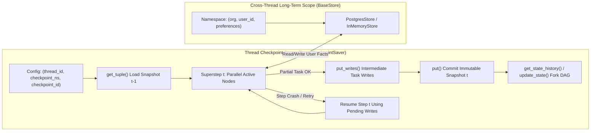
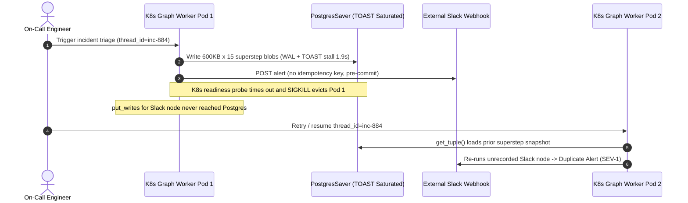

# Module 15: Checkpointing and Persistence

> **Prerequisites:** [Module 12: LangGraph: State and Nodes](../12-langgraph-state-and-nodes/README.md), [Module 13: LangGraph: Edges and Conditional Routing](../13-langgraph-edges-and-conditional-routing/README.md), [Module 14: LangGraph: Cycles and Loops](../14-langgraph-cycles-and-loops/README.md), and [Module 07: Memory in LangChain](../07-memory-in-langchain/README.md).  
> **Estimated Reading Time:** 35 minutes  
> **Target Audience:** AI Backend Engineers, Distributed Systems Architects, Platform Reliability Engineers

> [!TIP]
> **The Golden Rule of LangGraph Checkpointing:** **Treat `MemorySaver` (`InMemorySaver`) strictly as an ephemeral unit-test mock—never as production infrastructure.** Production graphs persist every Pregel superstep boundary through a durable `BaseCheckpointSaver` (`PostgresSaver` / `AsyncPostgresSaver`) addressed by `(thread_id, checkpoint_ns, checkpoint_id)`, keep external side effects outside or idempotent across task replay, and strictly separate **short-term thread checkpoints** (`Checkpointer`) from **cross-thread long-term memory** (`BaseStore`).

---

## Why This Matters

In local notebooks, compiling a `StateGraph` without persistence—or passing `InMemorySaver()`—feels effortless. Your 6-node research or incident-response graph finishes in a single Python process, holds the full message history in RAM, and answers follow-up prompts within seconds.

In a real multi-pod Kubernetes deployment, that stateless or RAM-bound setup breaks under everyday infrastructure churn. Rolling deploys, spot-instance preemptions, pod OOM kills, and multi-hour workflows spanning several HTTP requests wipe out in-memory checkpoints instantly. Worse, if a graph runs `10,000` multi-step workflows per day at `\$0.14` each and crashes inside superstep 4 of 6 without granular intermediate persistence (`put_writes`), restarting from step 0 doubles LLM spend and risks re-executing already-completed tool mutations. Mastering LangGraph's Pregel checkpoint coordinates, pending-write fault recovery, time-travel DAG forking, and `BaseStore` separation turns fragile single-process scripts into crash-resilient state machines.

---

## 1. Checkpointer Architecture & Pregel Superstep Mechanics

LangGraph compiles every `StateGraph` into a **Pregel-inspired bulk-synchronous parallel runtime**. Execution advances in discrete **supersteps**: at the start of superstep $t$, active nodes read immutable channel values from the previous snapshot, execute concurrently, emit channel updates via `writes`, and commit a brand-new checkpoint snapshot at the superstep barrier before superstep $t+1$ begins.



### The `BaseCheckpointSaver` Coordinate & Storage Contract

Every built-in and custom backend (`InMemorySaver`, `SqliteSaver`, `PostgresSaver`, `AsyncPostgresSaver`) subclasses `BaseCheckpointSaver` from `langgraph-checkpoint` and indexes snapshots via a three-part coordinate tuple:

1. **`thread_id`**: The logical conversation, ticket, or workflow execution identifier (e.g., `"inc-4091"`). All sequential turns and crash recoveries for that workflow share one `thread_id`.
2. **`checkpoint_ns`**: Hierarchical graph namespace (`""` for the root graph; `"triage_subgraph:task_uuid"` for nested compiled subgraphs) so parent and child graph states never collide.
3. **`checkpoint_id`**: A monotonically ordered identifier (UUIDv6) for a single superstep snapshot, linked back to `parent_checkpoint_id`. Together, `(checkpoint_id, parent_checkpoint_id)` form an **immutable append-only DAG** supporting exact history replay and counterfactual branching.

`BaseCheckpointSaver` requires implementing five core operations (plus async `a*` variants for `AsyncPostgresSaver`):

- **`put(config, checkpoint, metadata, new_versions)`**: Atomically writes the serialized superstep snapshot (`channel_values`, `channel_versions`, `versions_seen`) at a superstep boundary.
- **`put_writes(config, writes, task_id)`**: Persists **intermediate writes** produced by individual nodes *during* a superstep before all sibling nodes finish.
- **`get_tuple(config)`**: Returns a `CheckpointTuple(config, checkpoint, metadata, parent_config, pending_writes)` for the latest snapshot—or an exact `checkpoint_id` when replaying/forking.
- **`list(config, filter=..., before=..., limit=...)`**: Streams checkpoint lineage for `get_state_history()`.
- **`delete_thread(thread_id)`**: Purges all checkpoints and pending writes for a thread to enforce GDPR/retention compliance.

### Superstep Fault Tolerance & `put_writes` Replay Semantics

Consider Superstep 2 fanning out across three parallel nodes: `fetch_metrics`, `fetch_logs`, and `fetch_billing`. Suppose `fetch_metrics` and `fetch_logs` succeed in `180 ms` and commit their channel outputs via `put_writes()`, whereas `fetch_billing` hits a transient `HTTP 503` timeout and aborts Superstep 2 before the final `put()` barrier commits.

When an operator or worker retries `graph.invoke(None, config)` with the same `thread_id`:

- LangGraph calls `get_tuple()` and recovers both the Superstep 1 snapshot **and** the persisted `pending_writes` from `fetch_metrics` and `fetch_logs`.
- Completed nodes (`fetch_metrics`, `fetch_logs`) are **not re-invoked**—their outputs already reside in `pending_writes`.
- Only the failed node (`fetch_billing`) executes. Once it succeeds, all three writes merge cleanly and `put()` commits Superstep 2.
- **Crucial Idempotency Caveat:** If `fetch_billing` sent a non-idempotent POST request *and crashed before returning*, `pending_writes` has no entry for `fetch_billing`, so resume re-runs `fetch_billing` from its first line. Any mutating external call inside a node MUST either carry a deterministic idempotency key derived from `(thread_id, checkpoint_id, task_id)` or be wrapped in a LangGraph `@task` / separate node boundary.

### State Inspection (`get_state`, `get_state_history`) & Time-Travel Forking (`update_state`)

Checkpointing turns opaque agent runs into inspectable, branchable timelines:

- **`graph.get_state(config)`**: Returns the latest `StateSnapshot(values, next, config, metadata, created_at, parent_config, tasks)`, showing exact channel values and which node(s) are queued in `.next`.
- **`graph.get_state_history(config)`**: Iterates reverse-chronologically through every superstep snapshot from current down to `__start__`.
- **`fork_cfg = graph.update_state(past_snapshot.config, values={"hypothesis": "conn_pool_exhaustion"}, as_node="diagnose")`**: Creates a **new** `checkpoint_id` whose `parent_checkpoint_id` points back to `past_snapshot.config` without overwriting the original timeline! Passing `fork_cfg` to `graph.invoke(None, fork_cfg)` explores the alternate branch cleanly from that exact node onward.

### Short-Term Checkpoints vs. Long-Term Cross-Thread `BaseStore`

Do not abuse a single `thread_id` forever to remember user preferences across separate conversations. LangGraph separates memory into two orthogonal persistence primitives:

- **Thread Checkpointer (`BaseCheckpointSaver`):** Scoped strictly to one `thread_id`. Holds working messages, loop counters, intermediate tool outputs, and active interrupt state.
- **Cross-Thread Memory Store (`BaseStore` — `InMemoryStore`, `PostgresStore`):** A persistent key-value + optional vector-indexed document store partitioned by hierarchical namespace tuples such as `("org", tenant_id, "user", user_id, "preferences")` or `("episodic", "runbooks")`. Any thread for that user can read/write long-term facts via `(store: BaseStore)` injection inside nodes without inflating every thread's checkpoint state.

### Quantitative Checkpointer Storage, Serialization & Retention Math

Before deploying `PostgresSaver` under production load, calculate exact per-thread bloat and database sizing:

1. **Quadratic State-Growth Trap (`operator.add`):** If a graph appends a constant $\Delta m$ KB per superstep (e.g., verbose raw retrieved documents or unpruned tool logs) into an append-only list across $N$ supersteps, each checkpoint stores the *entire cumulative list*, making total bytes written for one thread grow quadratically:

$$S_{\text{unbounded}}(N) = \sum_{i=1}^{N} i \cdot \Delta m = \frac{N(N + 1)}{2}\,\Delta m$$

   Bounding conversation history to a sliding window of $k$ recent turns (via `RemoveMessage` or a bounded reducer) and storing large blobs by URI rather than inline bytes converts storage to linear bounded growth:

$$S_{\text{bounded}}(N, k) = \sum_{i=1}^{N} \min(i, k)\,\Delta m$$

2. **Monthly Database Storage Footprint:** Given $R$ new threads per day, retention TTL of $T_{\text{ret}}$ days, average thread checkpoint size $S_{\text{thread}}$ (including `pending_writes` and metadata), and PostgreSQL B-tree/TOAST index overhead factor $f_{\text{idx}} \approx 0.25$:

$$M_{\text{DB}} = R \cdot T_{\text{ret}} \cdot S_{\text{thread}} \cdot (1 + f_{\text{idx}})$$

3. **Superstep Commit Latency Overhead:** Every superstep barrier adds serialization, network round-trip, and WAL fsync latency:

$$L_{\text{ckpt}} = L_{\text{msgpack}}(S_{\text{state}}) + L_{\text{PG\_RTT}} + L_{\text{WAL\_fsync}}$$

   Keeping individual state snapshots under `100 KB` (by offloading raw PDFs/logs to object storage and persisting only URIs/hashes in `State`) prevents PostgreSQL TOAST compression stalls from inflating $L_{\text{ckpt}}$ above `5–15 ms`.

---

## 2. Systematic Comparison Matrix: Persistence Backends & `BaseStore`

| Dimension | `InMemorySaver` (`MemorySaver`) | `SqliteSaver` / `AsyncSqliteSaver` | `PostgresSaver` / `AsyncPostgresSaver` | `PostgresStore` (`BaseStore`) |
| :--- | :--- | :--- | :--- | :--- |
| **Persistence Scope** | Process RAM only (lost on restart) | Local file / embedded WAL SQLite | Shared relational PostgreSQL cluster | Cross-thread namespaced KV + pgvector |
| **Multi-Pod Concurrency** | None (single process isolated) | Single-host file lock contention | Full ACID MVCC across horizontally scaled pods | Full ACID cross-thread concurrent access |
| **Fault Recovery (`put_writes`)** | In-process retry only | Survives local process restart | Survives pod eviction, deploy, and node failure | N/A (stores semantic/episodic items, not step DAGs) |
| **Serialization Security** | Python object refs in RAM | `JsonPlusSerializer` (`msgpack`) | `msgpack` + `LANGGRAPH_STRICT_MSGPACK=true` | JSONB document + optional embedding vector |
| **Query & Retention Control** | Manual clear only | Manual SQL `DELETE` / file rotation | Indexed `thread_id` queries + TTL cron cleanup | Namespace prefix scan + semantic similarity search |
| **Production Fit** | Unit tests & local prototyping only | Single-node CLI tools & edge agents | **Standard multi-pod production checkpointer** | **Standard cross-thread user/org memory** |

---

## 3. Production War Story Post-Mortem: The \$42,000 Postgres Checkpointer TOAST Bloat & Pod-Eviction Storm

| Field | Incident Details |
| :--- | :--- |
| **Severity** | **SEV-1** (Database IOPS Saturation, Cascading Pod Evictions, Duplicate External Alerts) |
| **Detection / Resolution Time** | Detected 36 hours after rollout via RDS Storage/WAL alarm / Mitigated in 2.5 hours (URI offloading + `autocommit=True` pool fix + nightly thread TTL purge) |
| **Impact** | **\$42,000** emergency RDS IOPS/storage overage + SLA credits; p99 superstep latency spiked from `18 ms` to `1,940 ms`; `410` duplicate Slack escalation alerts emitted during crash replays |

### What Happened

An internal developer-platform team migrated a 12-node incident-triage LangGraph workflow from staging (`InMemorySaver`) to production (`PostgresSaver`) on Kubernetes. Three compounding mistakes bypassed code review:

1. **Inline Blob State Anti-Pattern:** Each log-retrieval node appended `600 KB` of raw JSON Kubernetes logs directly into `state["evidence_logs"]` using an unbounded `operator.add` reducer across up to `18` loop iterations.
2. **Pool Misconfiguration & Missing `LANGGRAPH_STRICT_MSGPACK`:** A manually constructed `psycopg` connection pool lacked `autocommit=True` and `row_factory=dict_row`, causing `.setup()` migrations to stall and connection recycling to drop dirty transactions under load.
3. **Zero TTL Cleanup & Non-Idempotent Webhook Node:** Checkpoints accumulated indefinitely (`2.8 TB` in 36 hours via PostgreSQL TOAST table bloat), saturating disk IOPS. When checkpoint commits exceeded readiness probe timeouts (`2s`), Kubernetes evicted pods mid-superstep. Upon restart on healthy pods, an un-keyed `post_slack_alert` node crashed *after* hitting Slack's webhook API and *before* `put_writes` committed—causing the resumed worker to re-fire duplicate alerts.



### Root Cause Analysis

- Storing raw `600 KB` evidence payloads inside an `operator.add` list caused quadratic $O(N^2)$ checkpoint serialization and forced PostgreSQL into heavy out-of-line TOAST writes on every superstep.
- Omitting `delete_thread` / TTL partitioning left historical checkpoints unpruned, exhausting RDS provisioned IOPS.
- Performing an un-keyed external HTTP mutation before `put_writes` committed violated superstep replay idempotency.

### Architectural Hardening & Verified Fix

- **Pass References, Not Blobs:** Wrote raw logs to S3/GCS and stored only lightweight pointers `{"s3_uri": "...", "sha256": "...", "summary": "..."}` in graph `State`, shrinking average checkpoint payloads from `9.2 MB` to `14 KB`.
- **Bounded Sliding Reducers + TTL Pruning:** Added a custom reducer keeping the most recent `8` messages/evidence records and scheduled a daily partition drop / `delete_thread` sweep for threads older than `30` days.
- **Hardened `AsyncPostgresSaver` + `LANGGRAPH_STRICT_MSGPACK=true`:** Configured `AsyncConnectionPool(..., kwargs={"autocommit": True, "row_factory": dict_row})`, enabled strict msgpack allowlisting, and seeded every external mutation with `idempotency_key = sha256(thread_id, checkpoint_id, task_id)`.

---

## 4. Multi-Language Production Implementation: Checkpointer + Pending-Writes + Time-Travel + `BaseStore`

The 4-language implementation carousel below shows production-grade persistence patterns: **Go** (durable checkpoint + pending-write superstep recovery), **TypeScript** (Postgres checkpointer configuration + `updateState` fork lineage), **Python** (real LangGraph `AsyncPostgresSaver` + `PostgresStore` + URI-referenced state + strict msgpack setup), and **C#** (thread checkpoint tuple + cross-thread store separation).

````carousel

```go
package persistence

import (
	"context"
	"crypto/sha256"
	"encoding/hex"
	"encoding/json"
	"errors"
	"fmt"
	"sync"
)

type CheckpointCoord struct {
	ThreadID     string
	CheckpointNS string
	CheckpointID string
}

type CheckpointRecord struct {
	Coord    CheckpointCoord
	ParentID string
	Step     int
	State    map[string]any
}

type PendingWrite struct {
	TaskID  string
	Channel string
	Value   any
}

type CheckpointStore interface {
	Put(ctx context.Context, rec CheckpointRecord) error
	PutWrites(ctx context.Context, coord CheckpointCoord, taskID, channel string, val any) error
	GetLatest(ctx context.Context, threadID, ns string) (*CheckpointRecord, []PendingWrite, error)
	ForkState(ctx context.Context, base CheckpointCoord, newID string, patch map[string]any) (CheckpointRecord, error)
}

type InMemoryDurableMock struct {
	mu          sync.RWMutex
	checkpoints map[string][]CheckpointRecord
	writes      map[string][]PendingWrite
}

func NewInMemoryDurableMock() *InMemoryDurableMock {
	return &InMemoryDurableMock{
		checkpoints: make(map[string][]CheckpointRecord),
		writes:      make(map[string][]PendingWrite),
	}
}

func threadKey(threadID, ns string) string { return threadID + "::" + ns }
func writeKey(c CheckpointCoord) string    { return c.ThreadID + "::" + c.CheckpointNS + "::" + c.CheckpointID }

func (m *InMemoryDurableMock) Put(_ context.Context, rec CheckpointRecord) error {
	if rec.Coord.ThreadID == "" || rec.Coord.CheckpointID == "" {
		return errors.New("thread_id and checkpoint_id are required")
	}
	m.mu.Lock()
	defer m.mu.Unlock()
	k := threadKey(rec.Coord.ThreadID, rec.Coord.CheckpointNS)
	m.checkpoints[k] = append(m.checkpoints[k], rec)
	return nil
}

func (m *InMemoryDurableMock) PutWrites(_ context.Context, coord CheckpointCoord, taskID, channel string, val any) error {
	m.mu.Lock()
	defer m.mu.Unlock()
	wk := writeKey(coord)
	m.writes[wk] = append(m.writes[wk], PendingWrite{TaskID: taskID, Channel: channel, Value: val})
	return nil
}

func (m *InMemoryDurableMock) GetLatest(_ context.Context, threadID, ns string) (*CheckpointRecord, []PendingWrite, error) {
	m.mu.RLock()
	defer m.mu.RUnlock()
	list := m.checkpoints[threadKey(threadID, ns)]
	if len(list) == 0 {
		return nil, nil, fmt.Errorf("no checkpoints for thread=%s", threadID)
	}
	latest := list[len(list)-1]
	pending := append([]PendingWrite(nil), m.writes[writeKey(latest.Coord)]...)
	return &latest, pending, nil
}

// ForkState clones an immutable past checkpoint and applies patch into a new branch checkpoint_id.
func (m *InMemoryDurableMock) ForkState(_ context.Context, base CheckpointCoord, newID string, patch map[string]any) (CheckpointRecord, error) {
	m.mu.Lock()
	defer m.mu.Unlock()
	k := threadKey(base.ThreadID, base.CheckpointNS)
	for _, rec := range m.checkpoints[k] {
		if rec.Coord.CheckpointID == base.CheckpointID {
			cloned := make(map[string]any, len(rec.State)+len(patch))
			for key, v := range rec.State {
				cloned[key] = v
			}
			for key, v := range patch {
				cloned[key] = v
			}
			fork := CheckpointRecord{
				Coord:    CheckpointCoord{ThreadID: base.ThreadID, CheckpointNS: base.CheckpointNS, CheckpointID: newID},
				ParentID: base.CheckpointID,
				Step:     rec.Step + 1,
				State:    cloned,
			}
			m.checkpoints[k] = append(m.checkpoints[k], fork)
			return fork, nil
		}
	}
	return CheckpointRecord{}, fmt.Errorf("base checkpoint_id=%s not found", base.CheckpointID)
}

// TaskIdempotencyKey binds external side effects to the exact superstep coordinate.
func TaskIdempotencyKey(coord CheckpointCoord, taskID string, payload any) string {
	raw, _ := json.Marshal(payload)
	sum := sha256.Sum256([]byte(fmt.Sprintf("%s|%s|%s|%s|%s",
		coord.ThreadID, coord.CheckpointNS, coord.CheckpointID, taskID, string(raw))))
	return hex.EncodeToString(sum[:8])
}
```

<!-- slide -->

```typescript
import { createHash } from "node:crypto";

export interface CheckpointCoord {
  readonly threadId: string;
  readonly checkpointNs: string;
  readonly checkpointId: string;
}

export interface Snapshot<TState> {
  readonly coord: CheckpointCoord;
  readonly parentCheckpointId: string | null;
  readonly step: number;
  readonly state: Readonly<TState>;
  readonly nextNodes: readonly string[];
}

export interface StoreItem<TValue = Record<string, unknown>> {
  readonly namespace: readonly string[];
  readonly key: string;
  readonly value: TValue;
}

export interface DurableCheckpointBackend<TState extends Record<string, unknown>> {
  put(snapshot: Snapshot<TState>): Promise<void>;
  putWrites(coord: CheckpointCoord, taskId: string, channel: string, value: unknown): Promise<void>;
  getTuple(threadId: string, checkpointNs?: string, checkpointId?: string): Promise<{
    snapshot: Snapshot<TState>;
    pendingWrites: ReadonlyMap<string, unknown>;
  } | null>;
  updateStateFork(baseCoord: CheckpointCoord, newCheckpointId: string, patch: Partial<TState>, asNode: string): Promise<CheckpointCoord>;
}

/**
 * Enforces bounded checkpoint payload size before persisting a superstep.
 * Rejects oversized inline blobs so Postgres TOAST tables never saturate.
 */
export function assertBoundedCheckpointPayload(state: unknown, maxBytes = 131_072): number {
  const bytes = Buffer.byteLength(JSON.stringify(state), "utf8");
  if (bytes > maxBytes) {
    throw new Error(
      `Checkpoint payload (${bytes} B) exceeds limit (${maxBytes} B). Offload raw blobs to object storage and store URI references in State.`
    );
  }
  return bytes;
}

/**
 * Builds deterministic cross-thread BaseStore namespace keys while separating
 * durable user memory from short-term thread execution checkpoints.
 */
export function buildStoreItem<TValue>(
  tenantId: string,
  userId: string,
  category: "preferences" | "runbooks",
  key: string,
  value: TValue
): StoreItem<TValue> {
  return {
    namespace: ["org", tenantId, "user", userId, category],
    key,
    value,
  };
}

export function superstepIdempotencyKey(coord: CheckpointCoord, taskId: string): string {
  return createHash("sha256")
    .update(`${coord.threadId}:${coord.checkpointNs}:${coord.checkpointId}:${taskId}`)
    .digest("hex")
    .slice(0, 16);
}
```

<!-- slide -->

```python
"""
prod_langgraph_persistence.py
Production-hardened LangGraph PostgresSaver + PostgresStore + Time-Travel configuration.
Requires: pip install langgraph langgraph-checkpoint-postgres psycopg[binary,pool]
"""
import hashlib
import os
from typing import Annotated, TypedDict
from psycopg.rows import dict_row
from psycopg_pool import AsyncConnectionPool

# Enforce strict msgpack deserialization in production before loading checkpointer
os.environ.setdefault("LANGGRAPH_STRICT_MSGPACK", "true")


def keep_bounded_window(existing: list[str], incoming: list[str], max_items: int = 8) -> list[str]:
    """Bounded reducer preventing O(N^2) checkpoint state bloat over long loops."""
    merged = [*existing, *incoming]
    return merged[-max_items:]


class IncidentState(TypedDict):
    incident_id: str
    log_uri: str  # Pass S3/GCS URI references, NEVER 5 MB raw log dumps
    findings: Annotated[list[str], keep_bounded_window]
    recommended_action: str


def build_task_idempotency_key(thread_id: str, checkpoint_id: str, task_id: str) -> str:
    """Guarantees external writes inside a node survive superstep crash replay safely."""
    raw = f"{thread_id}|{checkpoint_id}|{task_id}".encode("utf-8")
    return hashlib.sha256(raw).hexdigest()[:16]


async def create_production_persistence(db_uri: str):
    """
    Initializes AsyncPostgresSaver + AsyncPostgresStore over a shared psycopg pool.
    CRITICAL: autocommit=True and row_factory=dict_row are mandatory for PostgresSaver.setup().
    """
    from langgraph.checkpoint.postgres.aio import AsyncPostgresSaver
    from langgraph.store.postgres.aio import AsyncPostgresStore

    pool = AsyncConnectionPool(
        conninfo=db_uri,
        max_size=20,
        kwargs={"autocommit": True, "prepare_threshold": 0, "row_factory": dict_row},
        open=False,
    )
    await pool.open()

    checkpointer = AsyncPostgresSaver(pool)
    store = AsyncPostgresStore(pool)
    await checkpointer.setup()
    await store.setup()
    return pool, checkpointer, store


async def time_travel_fork_example(graph, thread_id: str, target_checkpoint_id: str) -> dict:
    """
    Inspects thread history, forks from a specific past checkpoint_id without mutating
    history in place, and resumes execution along the new counterfactual branch.
    """
    past_cfg = {
        "configurable": {
            "thread_id": thread_id,
            "checkpoint_ns": "",
            "checkpoint_id": target_checkpoint_id,
        }
    }
    fork_cfg = await graph.aupdate_state(
        past_cfg,
        values={"recommended_action": "increase_pgbouncer_pool_to_200"},
        as_node="diagnose_node",
    )
    return await graph.ainvoke(None, fork_cfg)
```

<!-- slide -->

```csharp
using System;
using System.Collections.Concurrent;
using System.Collections.Generic;
using System.Linq;
using System.Security.Cryptography;
using System.Text;

namespace GenAI.LangGraphPersistence;

public sealed record CheckpointCoordinate(string ThreadId, string CheckpointNs, string CheckpointId);

public sealed record StateSnapshot(
    CheckpointCoordinate Coord,
    string? ParentCheckpointId,
    int Step,
    IReadOnlyDictionary<string, string> Channels);

public sealed class ThreadCheckpointerAndStore
{
    private readonly ConcurrentDictionary<string, List<StateSnapshot>> _threads = new();
    private readonly ConcurrentDictionary<string, Dictionary<string, string>> _pendingWrites = new();
    private readonly ConcurrentDictionary<string, string> _crossThreadStore = new();

    private static string ThreadKey(string threadId, string ns) => $"{threadId}::{ns}";
    private static string StepKey(CheckpointCoordinate c) => $"{c.ThreadId}::{c.CheckpointNs}::{c.CheckpointId}";

    public void PutCheckpoint(StateSnapshot snapshot)
    {
        var list = _threads.GetOrAdd(ThreadKey(snapshot.Coord.ThreadId, snapshot.Coord.CheckpointNs), _ => new());
        lock (list) { list.Add(snapshot); }
    }

    // Persists intermediate superstep node outputs so sibling retries do not re-execute completed tasks.
    public void PutPendingWrite(CheckpointCoordinate coord, string taskId, string serializedPayload)
    {
        var map = _pendingWrites.GetOrAdd(StepKey(coord), _ => new());
        lock (map) { map[taskId] = serializedPayload; }
    }

    public bool TryGetPendingWrite(CheckpointCoordinate coord, string taskId, out string payload)
    {
        if (_pendingWrites.TryGetValue(StepKey(coord), out var map))
        {
            lock (map) { return map.TryGetValue(taskId, out payload!); }
        }
        payload = string.Empty;
        return false;
    }

    public StateSnapshot ForkFromCheckpoint(CheckpointCoordinate baseCoord, string newId, string key, string overrideVal)
    {
        var list = _threads[ThreadKey(baseCoord.ThreadId, baseCoord.CheckpointNs)];
        lock (list)
        {
            var baseSnap = list.First(s => s.Coord.CheckpointId == baseCoord.CheckpointId);
            var nextChannels = new Dictionary<string, string>(baseSnap.Channels) { [key] = overrideVal };
            var fork = new StateSnapshot(
                baseCoord with { CheckpointId = newId },
                ParentCheckpointId: baseCoord.CheckpointId,
                Step: baseSnap.Step + 1,
                Channels: nextChannels);
            list.Add(fork);
            return fork;
        }
    }

    // Cross-thread BaseStore semantic/episodic namespace lookup independent of thread_id.
    public void PutStoreItem(string namespacePath, string itemKey, string jsonValue) =>
        _crossThreadStore[$"{namespacePath}::{itemKey}"] = jsonValue;

    public string? GetStoreItem(string namespacePath, string itemKey) =>
        _crossThreadStore.TryGetValue($"{namespacePath}::{itemKey}", out var val) ? val : null;

    public static string DeterministicStepKey(CheckpointCoordinate c, string taskId)
    {
        byte[] hash = SHA256.HashData(Encoding.UTF8.GetBytes($"{c.ThreadId}|{c.CheckpointNs}|{c.CheckpointId}|{taskId}"));
        return Convert.ToHexString(hash)[..16].ToLowerInvariant();
    }
}
```

````

---

## 5. Practical Hands-On Verification CLI Workflows

Run these deterministic Python 3.13 verification scripts offline—using only the Python standard library (`sqlite3`, `json`) with zero cloud credentials required.

### Workflow 1: Superstep Partial-Failure Replay (`put_writes` Recovery)

Simulate a parallel 3-node fan-out inside one Pregel superstep (`fetch_metrics`, `fetch_logs`, `fetch_billing`). Crash `fetch_billing` with a `503` timeout, resume on the same `(thread_id, checkpoint_id)`, and prove that completed nodes skip re-execution via `pending_writes` while only `fetch_billing` retries:

```bash
python -c '
import sqlite3, json

conn = sqlite3.connect(":memory:")
conn.execute("CREATE TABLE ckpt (thread_id TEXT, ns TEXT, ckpt_id TEXT, parent_id TEXT, step INT, state_json TEXT, PRIMARY KEY (thread_id, ns, ckpt_id))")
conn.execute("CREATE TABLE pending_writes (thread_id TEXT, ckpt_id TEXT, task_id TEXT, channel TEXT, val_json TEXT, PRIMARY KEY (thread_id, ckpt_id, task_id, channel))")

calls = {"fetch_metrics": 0, "fetch_logs": 0, "fetch_billing": 0}
fail_billing_once = True

def run_superstep(thread_id, ckpt_id):
    global fail_billing_once
    cached = dict(conn.execute("SELECT task_id, val_json FROM pending_writes WHERE thread_id=? AND ckpt_id=?", (thread_id, ckpt_id)).fetchall())
    results = {}
    for task_id in ("fetch_metrics", "fetch_logs", "fetch_billing"):
        if task_id in cached:
            results[task_id] = json.loads(cached[task_id])
            print(f"  [REPLAY_SKIP] {task_id} loaded from pending_writes (0 re-execution)")
            continue
        calls[task_id] += 1
        if task_id == "fetch_billing" and fail_billing_once:
            fail_billing_once = False
            raise RuntimeError("503 Billing API timeout")
        payload = {task_id: f"ok_call_{calls[task_id]}"}
        conn.execute("INSERT OR REPLACE INTO pending_writes VALUES (?,?,?,?,?)", (thread_id, ckpt_id, task_id, "findings", json.dumps(payload)))
        results[task_id] = payload
        print(f"  [EXECUTED]    {task_id} -> committed to pending_writes")
    return results

print("Attempt 1 (before crash):")
try:
    run_superstep("inc-4091", "ckpt-002")
except RuntimeError as exc:
    print(f"  [CRASH]       {exc}")

print("Attempt 2 (resumed from ckpt-002):")
out = run_superstep("inc-4091", "ckpt-002")
print(f"Final call counts: {calls}")
print(f"Merged channels  : {sorted(out.keys())}")
'
```

**Expected Output:**

```text
Attempt 1 (before crash):
  [EXECUTED]    fetch_metrics -> committed to pending_writes
  [EXECUTED]    fetch_logs -> committed to pending_writes
  [CRASH]       503 Billing API timeout
Attempt 2 (resumed from ckpt-002):
  [REPLAY_SKIP] fetch_metrics loaded from pending_writes (0 re-execution)
  [REPLAY_SKIP] fetch_logs loaded from pending_writes (0 re-execution)
  [EXECUTED]    fetch_billing -> committed to pending_writes
Final call counts: {'fetch_metrics': 1, 'fetch_logs': 1, 'fetch_billing': 2}
Merged channels  : ['fetch_billing', 'fetch_logs', 'fetch_metrics']
```

### Workflow 2: Time-Travel State History & Branching Fork (`update_state`)

Verify how `update_state()` at an earlier `checkpoint_id` creates a branching child node (`parent_checkpoint_id` pointing back to `step=1`) while keeping the original `step=2` branch intact:

```bash
python -c '
history = [
    {"step": 0, "ckpt_id": "0195a000-0000", "parent": None, "as_node": "__start__", "state": {"query": "DB latency spike", "env": "prod"}},
    {"step": 1, "ckpt_id": "0195a000-0001", "parent": "0195a000-0000", "as_node": "diagnose", "state": {"query": "DB latency spike", "env": "prod", "hypothesis": "missing_index"}},
    {"step": 2, "ckpt_id": "0195a000-0002", "parent": "0195a000-0001", "as_node": "recommend", "state": {"query": "DB latency spike", "env": "prod", "hypothesis": "missing_index", "action": "add_btree_idx"}},
]

def update_state_fork(base_ckpt_id, patch, as_node):
    base = next(h for h in history if h["ckpt_id"] == base_ckpt_id)
    new_state = {**base["state"], **patch}
    fork_id = f"{base_ckpt_id}-fork1"
    history.append({"step": base["step"] + 1, "ckpt_id": fork_id, "parent": base_ckpt_id, "as_node": as_node, "state": new_state})
    return fork_id

fork_id = update_state_fork("0195a000-0001", {"hypothesis": "conn_pool_exhaustion"}, as_node="diagnose_override")
fork_base = next(h for h in history if h["ckpt_id"] == fork_id)
history.append({"step": 3, "ckpt_id": f"{fork_id}-step3", "parent": fork_id, "as_node": "recommend", "state": {**fork_base["state"], "action": "raise_pgbouncer_pool"}})

print("Checkpoint Lineage (Reverse Chronological):")
for h in reversed(history):
    step, cid, par, node = h["step"], h["ckpt_id"], str(h["parent"]), h["as_node"]
    action = h["state"].get("action", "-")
    print(f"  step={step} id={cid:<26} parent={par:<20} node={node:<18} action={action}")
'
```

**Expected Output:**

```text
Checkpoint Lineage (Reverse Chronological):
  step=3 id=0195a000-0001-fork1-step3  parent=0195a000-0001-fork1  node=recommend          action=raise_pgbouncer_pool
  step=2 id=0195a000-0001-fork1        parent=0195a000-0001        node=diagnose_override  action=-
  step=2 id=0195a000-0002              parent=0195a000-0001        node=recommend          action=add_btree_idx
  step=1 id=0195a000-0001              parent=0195a000-0000        node=diagnose           action=-
  step=0 id=0195a000-0000              parent=None                 node=__start__          action=-
```

### Workflow 3: Quadratic State-Growth & Monthly Postgres Sizing Sweep

Quantify the exact PostgreSQL storage explosion caused by unbounded append-only reducers versus a bounded `k=6` sliding window across `50,000` threads/day (`30`-day retention):

```bash
python -c '
def storage_projection(steps=25, delta_kb=4.0, threads_per_day=50_000, retention_days=30, idx_overhead=0.25):
    unbounded_kb = sum((i + 1) * delta_kb for i in range(steps))
    bounded_window_kb = sum(min(i + 1, 6) * delta_kb for i in range(steps))
    unbounded_gb = (unbounded_kb * threads_per_day * retention_days * (1 + idx_overhead)) / (1024 * 1024)
    bounded_gb = (bounded_window_kb * threads_per_day * retention_days * (1 + idx_overhead)) / (1024 * 1024)
    print(f"Steps={steps} | Delta={delta_kb:.1f}KB/turn | Traffic={threads_per_day:,}/day | TTL={retention_days}d")
    print(f"  Unbounded append-only : {unbounded_kb:,.1f} KB/thread -> {unbounded_gb:,.1f} GB/month")
    print(f"  Bounded window (k=6)  : {bounded_window_kb:,.1f} KB/thread -> {bounded_gb:,.1f} GB/month ({unbounded_gb / bounded_gb:.2f}x smaller)")

for n in (10, 25, 60):
    storage_projection(steps=n)
'
```

**Expected Output:**

```text
Steps=10 | Delta=4.0KB/turn | Traffic=50,000/day | TTL=30d
  Unbounded append-only : 220.0 KB/thread -> 393.4 GB/month
  Bounded window (k=6)  : 180.0 KB/thread -> 321.9 GB/month (1.22x smaller)
Steps=25 | Delta=4.0KB/turn | Traffic=50,000/day | TTL=30d
  Unbounded append-only : 1,300.0 KB/thread -> 2,324.6 GB/month
  Bounded window (k=6)  : 540.0 KB/thread -> 965.6 GB/month (2.41x smaller)
Steps=60 | Delta=4.0KB/turn | Traffic=50,000/day | TTL=30d
  Unbounded append-only : 7,320.0 KB/thread -> 13,089.2 GB/month
  Bounded window (k=6)  : 1,380.0 KB/thread -> 2,467.6 GB/month (5.30x smaller)
```

### Hands-On Exercises

1. **Extend `put_writes` Idempotency:** Modify Workflow 1 so `fetch_billing` makes an external API call that fails *after* incrementing an external side-effect counter on attempt 1. Add a deterministic `idempotency_key` deduplication table keyed by `(thread_id, ckpt_id, task_id)` and verify that resuming leaves `external_billing_charges == 1`.
2. **Thread Purge & `BaseStore` Separation:** Extend Workflow 1 with a `long_term_store` SQLite table (`namespace, key, val_json`) and run `DELETE FROM ckpt WHERE thread_id=?` (`delete_thread`) after completion—proving thread checkpoints purge cleanly while cross-thread user preferences in `BaseStore` persist.
3. **Optional Live Postgres Verification (Requires Docker/Postgres):** Start PostgreSQL locally, install `langgraph-checkpoint-postgres`, instantiate `PostgresSaver.from_conn_string(...)`, run `.setup()`, and inspect the generated `checkpoints` and `checkpoint_writes` tables via `psql \d+`.

### Independent Challenge

Your team operates a multi-tenant AI legal-contract analyzer on LangGraph (`100,000` threads/month, up to `35` supersteps per contract, `2 MB` PDFs extracted per run). Engineers currently keep `raw_pdf_text` and `extracted_clauses` inside `State` with `operator.add`, use `SqliteSaver` on an ephemeral Kubernetes pod disk, and overwrite user preferences inside `thread_id = f"user_{user_id}"` across all contracts. Diagnose the **four fatal architectural flaws** in this design and specify the exact refactored persistence schema.

<details><summary>Architectural Discussion</summary>

1. **Ephemeral `SqliteSaver` on K8s Pod Disk:** Pod restarts or horizontal scaling across replicas lose or split SQLite files; replace with `AsyncPostgresSaver` backed by managed PostgreSQL (`autocommit=True`, `row_factory=dict_row`, `LANGGRAPH_STRICT_MSGPACK=true`).
2. **2 MB Raw Text in `State` (`operator.add`):** Triggers quadratic $O(N^2)$ serialization bloat and PostgreSQL TOAST stalls; offload raw PDF text to S3/GCS, store lightweight URI/hash pointers in `State`, and bound message/clause lists via sliding reducers.
3. **Single Permanent `thread_id` Per User:** Coupling all contracts under `user_{user_id}` conflates isolated workflow execution history with user preferences, causes unbounded message context accumulation, and breaks per-contract concurrency; assign a unique `thread_id` per contract workflow (`contract_{doc_id}_{run_uuid}`) and move cross-thread preferences to `PostgresStore` under namespace `("tenant", tenant_id, "user", user_id)`.
4. **Missing Retention TTL:** Add a scheduled `delete_thread` / partition purge policy for completed thread checkpoints while retaining lightweight cross-thread facts in `BaseStore`.

</details>

---

## 6. Common Mistakes & Troubleshooting

- **Shipping `MemorySaver` (`InMemorySaver`) behind a multi-worker `uvicorn` or Kubernetes Deployment:** Worker 1 saves checkpoint state in local RAM; the next HTTP request hits Worker 2, which returns empty history (`next = ()`) or crashes with missing context. Use `PostgresSaver` / `AsyncPostgresSaver` anywhere processes scale beyond 1 worker.
- **Passing a manual `psycopg` pool without `autocommit=True` and `row_factory=dict_row`:** Causes `.setup()` DDL migrations to roll back silently or fail row attribute lookups when `PostgresSaver` reads tuples.
- **Leaving `LANGGRAPH_STRICT_MSGPACK` unset in multi-tenant production:** Without strict deserialization allowlisting, compromised database rows could deserialize arbitrary Python classes; set `LANGGRAPH_STRICT_MSGPACK=true` in production.
- **Calling `update_state()` expecting an in-place edit:** `update_state()` always appends a **new** `checkpoint_id` linked to `parent_checkpoint_id`. Capture and pass the returned `fork_config` when invoking the resumed branch, or you will accidentally resume the old unedited tip.

---

## 7. Operational Validation Checkpoints & Checkpoint Quiz

### Operational Validation Checkpoints

<details><summary><strong>Checkpoint 1: Diagnosing why parallel nodes skipped vs. re-executed after pod crash</strong></summary>

A graph superstep fans out to `search_crm`, `search_erp`, and `score_risk`. `search_crm` and `search_erp` finish, then an OOM kill crashes the pod inside `score_risk`. When another pod resumes the same `thread_id`, why do `search_crm` and `search_erp` show zero execution latency while `score_risk` runs again?

**Validation:** LangGraph persists individual completed node outputs as `pending_writes` via `put_writes(config, writes, task_id)` immediately as each task in a superstep completes. On resume, `get_tuple()` loads both the prior checkpoint and `pending_writes`, reapplying cached outputs for `search_crm` and `search_erp` without re-invoking them while re-running only the uncommitted `score_risk` node.

</details>

<details><summary><strong>Checkpoint 2: Sizing and securing `PostgresSaver` against TOAST stalls and unbounded growth</strong></summary>

Over 60 supersteps, a graph appends `10 KB` of raw retrieved chunks per step into `State` at `20,000` threads/day (`30`-day TTL). Explain why database storage surges past `2.5 TB` and what two changes cut it by `> 6x`.

**Validation:** Unbounded append-only lists produce $\frac{60 \times 61}{2} \times 10\text{ KB} = 18.3\text{ MB}$ of cumulative checkpoint writes per thread ($\approx 11\text{ TB}$/month before compression/index overhead!). Fixing this requires (1) offloading raw retrieved payloads to object storage and keeping only URI pointers + bounded sliding-window reducers (e.g., `k = 6`), and (2) enforcing automated `delete_thread` / partition TTL pruning for expired workflows.

</details>

<details><summary><strong>Checkpoint 3: Separating `BaseCheckpointSaver` from `BaseStore` in multi-session assistants</strong></summary>

An assistant needs to (a) resume an interrupted refund approval workflow after a 3-hour pause, and (b) remember that `"user_99"` prefers concise bulleted summaries across all future support tickets. Which persistence primitive owns (a) vs. (b), and why?

**Validation:** (a) belongs in `BaseCheckpointSaver` (`PostgresSaver`) keyed by that ticket's unique `(thread_id, checkpoint_ns, checkpoint_id)` because it tracks single-workflow supersteps and active interrupts. (b) belongs in `BaseStore` (`PostgresStore`) under namespace `("users", "user_99", "preferences")` so every future independent `thread_id` reads user preferences without dragging past ticket transcripts along.

</details>

### Checkpoint Quiz

1. What are the three coordinate fields in a LangGraph checkpointer `configurable` tuple, and what role does each play?
2. How does `put_writes()` prevent redundant LLM or API spend when one parallel node in a superstep crashes?
3. What does `graph.update_state(past_config, values=..., as_node=...)` create under the hood—an in-place mutation or a new branch?
4. Why must manually constructed `psycopg` pools passed to `PostgresSaver` set `autocommit=True` and `row_factory=dict_row`?
5. When should data live in `BaseStore` instead of `State` inside `BaseCheckpointSaver`?

<details><summary>Answers</summary>

1. `thread_id` (isolates the workflow/conversation instance), `checkpoint_ns` (isolates root graph vs. nested subgraphs), and `checkpoint_id` (identifies an exact superstep snapshot in the thread's immutable DAG).
2. `put_writes()` commits completed task channel writes for a superstep before all sibling tasks finish; on resume, LangGraph replays those persisted writes instead of re-executing finished sibling nodes.
3. It appends a brand-new `checkpoint_id` whose `parent_checkpoint_id` points back to `past_config`, creating an immutable time-travel fork while preserving the original timeline.
4. `PostgresSaver.setup()` relies on `autocommit=True` to commit schema DDL immediately, and queries expect dictionary-keyed rows via `dict_row`.
5. Whenever data represents cross-thread long-term user preferences, organizational runbooks, or episodic facts shared across separate independent `thread_id` runs rather than transient single-workflow state.

</details>

---

## Further Reading & Sources

- [LangGraph Official Docs: Persistence (`BaseCheckpointSaver`, `PostgresSaver`, `BaseStore`)](https://docs.langchain.com/oss/python/langgraph/persistence) — official specification for thread checkpointers, superstep fault tolerance, time-travel, and cross-thread stores.
- [Module 12: LangGraph: State and Nodes](../12-langgraph-state-and-nodes/README.md) & [Module 14: LangGraph: Cycles and Loops](../14-langgraph-cycles-and-loops/README.md) — channel reducers and bounded superstep iteration patterns.
- [Track 10, Module 13: Human-in-the-Loop Patterns](../../10-ai-agents/13-human-in-the-loop-patterns/README.md) — distributed checkpoint-backed state machines across worker restarts.

## Next

[Module 16: Human-in-the-Loop With LangGraph](../16-human-in-the-loop-with-langgraph/README.md)
