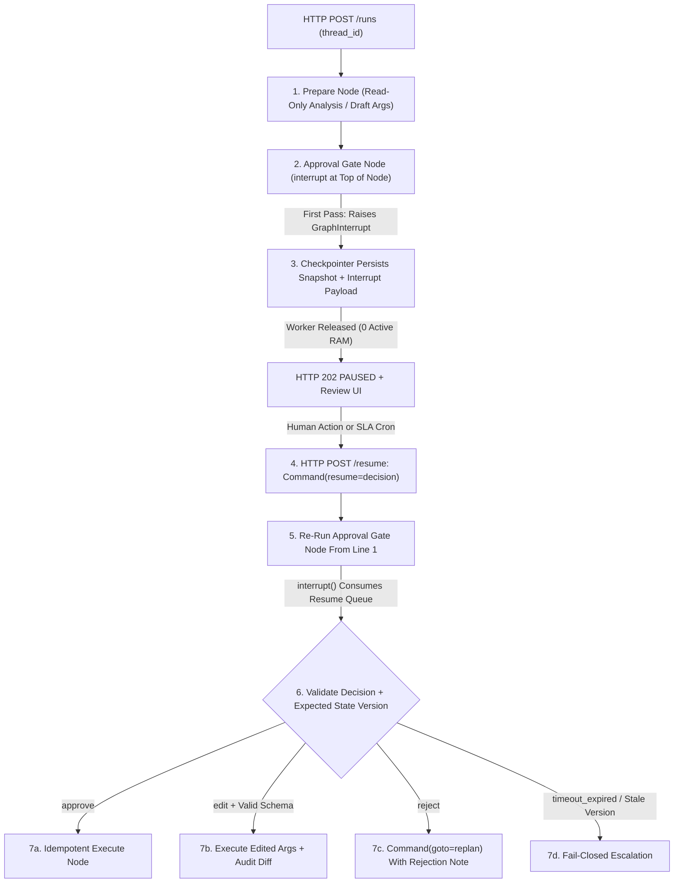
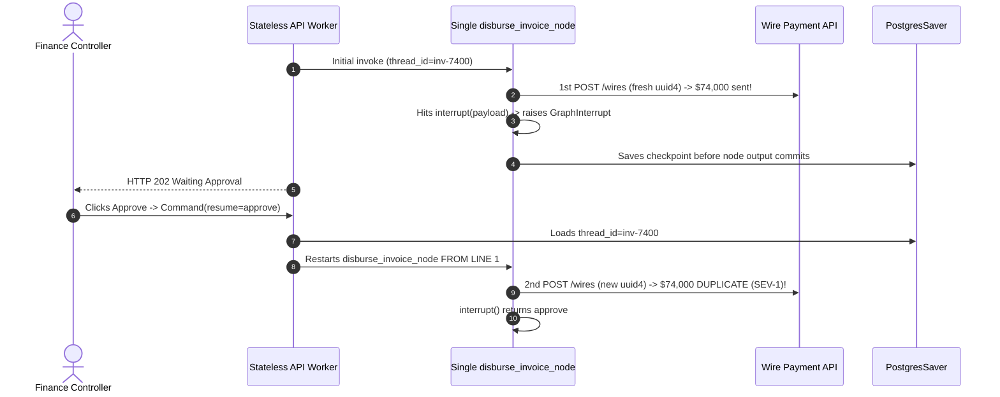

# Module 16: Human-in-the-Loop With LangGraph

> **Prerequisites:** [Module 15: Checkpointing and Persistence](../15-checkpointing-and-persistence/README.md) and [Track 10, Module 13: Human-in-the-Loop Patterns](../../10-ai-agents/13-human-in-the-loop-patterns/README.md).  
> **Estimated Reading Time:** 35 minutes  
> **Target Audience:** AI Backend Engineers, Distributed Workflow Architects, Security & Compliance Engineers

> [!TIP]
> **The Golden Rule of LangGraph HITL:** **Use dynamic `interrupt(payload)` + `Command(resume=value)` backed by a durable checkpointer—and NEVER place a non-idempotent side effect *before* `interrupt()` inside the same node.** Because resuming an interrupted graph re-executes the enclosing node **from its first line**, any unguarded API call, ledger debit, or Slack notification placed above `interrupt()` runs **twice** unless split into separate nodes or guarded by an idempotent task boundary.

---

## Why This Matters

Beginners implement Human-in-the-Loop (`HITL`) with `input("Approve? (y/n): ")` or by blocking an HTTP/SSE request socket until a reviewer clicks a dashboard button. In production backends, reverse proxies drop idle connections at `60` seconds, Kubernetes pods cycle during deploys, and holding `10,000` concurrent suspended workflows in blocked Python worker threads (`64 MB` each) consumes `625 GB` of active RAM.

LangGraph's `interrupt()` + `Command(resume=...)` turns approval gates into **zero-RAM suspended checkpoints**: a worker serializes the node pause state into Postgres (`12 KB`) and exits cleanly (`HTTP 202 PAUSED`), allowing hours or days later for any stateless API worker to load `thread_id` and resume execution safely. Yet one subtle runtime mechanic trips up even experienced engineers: **node re-execution on resume**. Understanding exactly how `interrupt()` pauses, restarts from the top of the node, handles `approve`/`edit`/`reject` payloads, and enforces SLA timeouts prevents costly duplicate-execution outages.

---

## 1. Dynamic `interrupt()` vs. Static Breakpoints & Node Replay Mechanics

In older LangGraph versions, engineers configured static breakpoints at compile time (`compile(checkpointer=db, interrupt_before=["execute_tool"])`). Static breakpoints pause unconditionally before entering a node—even on safe read-only calls—cannot emit dynamic context computed inside the node, and require cumbersome `update_state` + `invoke(None)` gymnastics to pass human feedback back in.

Modern LangGraph replaces static breakpoints with the dynamic **`interrupt(value)`** function and **`Command(resume=...)`** primitive:



### Line-by-Line Replay Semantics: Why Pre-`interrupt()` Writes Execute Twice

Tracing the exact runtime lifecycle inside a paused node reveals the #1 production footgun:

1. **Pass 1 (Initial Execution):** Execution enters `payout_node(state)`. Any line placed *above* `decision = interrupt(payload)` runs immediately. When Python hits `interrupt(payload)`, LangGraph raises an internal `GraphInterrupt` signal, writes the JSON-serializable `payload` into the checkpoint's pending interrupt record, and halts the superstep cleanly without committing `payout_node` outputs.
2. **Wait Window:** The worker returns control to the caller (`snapshot.tasks[0].interrupts` exposes the exact `payload`). Zero threads or sockets remain open.
3. **Pass 2 (`Command(resume="approve")`):** When `graph.invoke(Command(resume="approve"), config)` arrives—potentially hours later on a completely different Kubernetes pod—LangGraph loads the checkpoint for `thread_id` and **restarts `payout_node(state)` from line 1**.
4. **Trap Triggered:** Every statement *above* `interrupt(...)` runs **a second time**. When execution reaches `interrupt(...)`, LangGraph checks its matched resume value list, sees `"approve"`, and returns `"approve"` immediately instead of pausing again.

**The Two Non-Negotiable Safety Architectures:**
- **Pattern A — Clean Node Splitting (Recommended):** Isolate read/preparation logic into `prepare_node`, place `interrupt(payload)` as the **first executable statement** of `approval_gate_node`, and route approved execution into a downstream `execute_node` via conditional edge or `Command(goto="execute_node")`. Replaying `approval_gate_node` executes zero side effects!
- **Pattern B — LangGraph Functional `@task` Wrapping:** If a side effect *must* precede `interrupt()` inside an `@entrypoint` functional workflow, wrap it in a `@task` so LangGraph caches the completed task result in `put_writes` and skips re-execution during node replay.

### Matching Multiple & Parallel `interrupt()` Calls

- **Sequential Interrupts in One Node:** If a single node calls `interrupt()` twice sequentially (e.g., step-up MFA check followed by budget confirmation), LangGraph resolves them by positional index across resume invocations.
- **Parallel Fan-Out Interrupts (`Send`):** If parallel `Send` branches each call `interrupt()`, positional matching becomes ambiguous. Inspect `snapshot.tasks` to read each branch's unique `interrupt_id` and pass a map: `Command(resume={interrupt_id_a: "approve", interrupt_id_b: "reject"})`.

### Production Approval Workflows: `approve`, `edit`, `reject`, RBAC & SLA Timeouts

A production `Command(resume=...)` handler must support four explicit outcomes rather than a brittle boolean:

1. **`approve`:** Verify reviewer RBAC authorization + optimistic concurrency check (`proposed_resource_version == current_resource_version`) before executing the exact proposed tool call with its precomputed `idempotency_key`.
2. **`edit`:** Allow the reviewer to adjust parameters (e.g., lowering `scale_replicas` from `30` to `6`), **re-validate** the edited arguments against the tool's strict Pydantic/JSON Schema bounds (humans make typos too!), and log `(original_args, edited_args, reviewer_id)`.
3. **`reject`:** Inject a structured rejection reason (`ToolMessage` or `feedback` state update) and route via `Command(goto="replan_node", update={"rejection_reason": ...})` so the agent proposes a safer alternative rather than crashing the thread.
4. **`timeout_expired` (Fail-Closed SLA):** Store `expires_at_epoch` inside the interrupt payload. A background SLA reaper polls expired paused threads and invokes `Command(resume={"decision": "timeout_expired"})`, routing to fail-closed escalation (`abort` + page on-call)—**never fail-open**.

### Quantitative HITL Capacity & Concurrency Math

1. **Worker RAM Exhaustion vs. Checkpointed Wait Capacity:** Holding $N_{\text{pending}}$ paused workflows in blocked threads with $M_{\text{worker}}$ MB per stack/interpreter slot vs. persisting checkpoints of $S_{\text{ckpt}}$ KB in Postgres:

$$M_{\text{RAM\_blocked}} = N_{\text{pending}} \cdot M_{\text{worker}}, \qquad M_{\text{DB\_HITL}} = N_{\text{pending}} \cdot S_{\text{ckpt}}$$

   At `10,000` concurrent pending approvals (`64 MB` worker slot vs. `12 KB` Postgres row), blocking threads requires `625 GB` of RAM (crashing the cluster), whereas checkpointed `interrupt()` uses `0 MB` of active worker RAM and just `117.2 MB` on Postgres disk.

2. **SLA Breach & Stale-State Drift Probability:** Given human review latency $T_{\text{human}}$ and background mutation rate $\lambda_{\text{mut}}$ on the target infrastructure object (e.g., someone else already scaled the cluster during a 3-hour delay):

$$\mathbb{P}(\text{Stale Drift}) = 1 - e^{-\lambda_{\text{mut}} \cdot T_{\text{human}}}$$

   Always embed `expected_version` inside the interrupt payload and reject execution if `current_version != expected_version` on resume.

---

## 2. Systematic Comparison Matrix: HITL Suspension Mechanisms

| Mechanism | Suspension Boundary | Dynamic Payload to UI | Worker Resource Usage | Node Replay Behavior | Production Verdict |
| :--- | :--- | :--- | :--- | :--- | :--- |
| **Blocking `input()` / Long Poll** | Mid-function stack frame | Terminal/socket only | Holds full thread/RAM (`~64 MB`/wait) | N/A (dies on pod restart) | **Unusable in distributed prod** |
| **Static `interrupt_before` / `after`** | Fixed node edges at compile time | None (caller must inspect state manually) | `0` worker RAM (uses checkpointer) | Enters target node cleanly on `invoke(None)` | Legacy debugging only; awkward conditional logic |
| **Dynamic `interrupt()` + `Command(resume)`** | Any conditional branch inside node | Arbitrary JSON (`diff`, `risk_score`, `expires_at`) | `0` worker RAM (uses checkpointer) | **Re-runs enclosing node from line 1** | **Production standard** (with split nodes or `@task`) |

---

## 3. Production War Story Post-Mortem: The \$74,000 Double-Wire-Transfer Node-Replay Bug

| Field | Incident Details |
| :--- | :--- |
| **Severity** | **SEV-1** (Duplicate Treasury Disbursement & Emergency Freeze) |
| **Detection / Resolution Time** | Detected in 18 minutes via bank settlement webhook alert / Mitigated in 90 minutes (bank recall + graph split-node refactor + idempotency key fix) |
| **Impact** | **\$74,000** duplicate wire transfer triggered on a single human approval click; automated treasury agent suspended for 24 hours |

### What Happened

An internal AP automation team built a single `disburse_invoice_node(state)` to pay verified vendor invoices above `\$10,000`. Inside that one node, the engineer placed two lines *above* `interrupt()`:

1. `create_ledger_debit_and_wire_prep(invoice_id, amount)` (which generated a fresh random `uuid4()` transaction reference and dispatched the banking API hold/transfer call without checking a persistent ledger), and
2. `notify_slack_finance(invoice_id)`.

Right below those calls sat `decision = interrupt({"invoice_id": invoice_id, "amount": 74000})`.

When the controller clicked **Approve** in the web portal, the API worker invoked `graph.invoke(Command(resume="approve"), config)`. LangGraph loaded the checkpoint and restarted `disburse_invoice_node` from line 1—generating a **brand-new `uuid4()`**, firing a second `\$74,000` wire call and a second Slack notification before `interrupt()` returned `"approve"`.



### Root Cause Analysis

- Non-idempotent banking API calls and Slack messages were placed **before** `interrupt()` inside the same node, directly colliding with LangGraph's restart-from-top replay rule.
- Transaction reference keys were generated with non-deterministic `uuid.uuid4()` per invocation instead of deterministic `sha256(thread_id, invoice_id, step)` idempotency keys persisted prior to external calls.

### Architectural Hardening & Verified Fix

- **Split-Node Architecture:** Separated `validate_invoice_node` (read-only) -> `approval_gate_node` (calls `interrupt()` on line 1 with zero preceding side effects) -> `execute_wire_node` (runs *only* post-approval).
- **Deterministic Idempotency Key:** Derived `wire_idempotency_key = sha256(f"{thread_id}|{invoice_id}")` inside `validate_invoice_node` and passed it to the banking API's `Idempotency-Key` header.

---

## 4. Multi-Language Production Implementation: Replay-Safe HITL Gate (`approve` / `edit` / `reject` / `timeout`)

The 4-language implementation carousel below shows production HITL orchestration patterns across **Go**, **TypeScript**, **Python** (using real LangGraph `interrupt`, `Command`, `StateGraph`, and split-node isolation), and **C#**.

````carousel

```go
package hitlgate

import (
	"errors"
	"fmt"
	"time"
)

type DecisionKind string

const (
	DecisionApprove        DecisionKind = "approve"
	DecisionEdit           DecisionKind = "edit"
	DecisionReject         DecisionKind = "reject"
	DecisionTimeoutExpired DecisionKind = "timeout_expired"
)

type PendingProposal struct {
	ThreadID        string
	CheckpointID    string
	ToolName        string
	ProposedArgs    map[string]int
	ExpectedVersion int
	ExpiresAtUnix   int64
}

type ResumeCommand struct {
	Decision   DecisionKind
	ReviewerID string
	EditedArgs map[string]int
	Reason     string
}

type GateOutcome struct {
	RouteTo      string
	FinalArgs    map[string]int
	AuditSummary string
}

// EvaluateResume enforces split-node post-interrupt validation: RBAC, SLA deadline,
// optimistic concurrency version check, and strict schema validation on human edits.
func EvaluateResume(prop PendingProposal, cmd ResumeCommand, currentVersion, maxAllowedReplicas int, nowUnix int64) (GateOutcome, error) {
	if cmd.ReviewerID == "" && cmd.Decision != DecisionTimeoutExpired {
		return GateOutcome{}, errors.New("reviewer_id is required")
	}
	if nowUnix > prop.ExpiresAtUnix || cmd.Decision == DecisionTimeoutExpired {
		return GateOutcome{
			RouteTo:      "escalate_timeout",
			AuditSummary: fmt.Sprintf("thread=%s fail-closed SLA timeout", prop.ThreadID),
		}, nil
	}
	if prop.ExpectedVersion != currentVersion {
		return GateOutcome{
			RouteTo:      "abort_stale_drift",
			AuditSummary: fmt.Sprintf("stale resource version: proposed=%d current=%d", prop.ExpectedVersion, currentVersion),
		}, nil
	}

	switch cmd.Decision {
	case DecisionApprove:
		return GateOutcome{
			RouteTo:      "execute_mutation",
			FinalArgs:    prop.ProposedArgs,
			AuditSummary: fmt.Sprintf("approved by %s", cmd.ReviewerID),
		}, nil
	case DecisionEdit:
		replicas, ok := cmd.EditedArgs["replicas"]
		if !ok || replicas < 1 || replicas > maxAllowedReplicas {
			return GateOutcome{}, fmt.Errorf("edited replicas=%d violates [1..%d]", replicas, maxAllowedReplicas)
		}
		return GateOutcome{
			RouteTo:      "execute_mutation",
			FinalArgs:    cmd.EditedArgs,
			AuditSummary: fmt.Sprintf("edited by %s -> replicas=%d", cmd.ReviewerID, replicas),
		}, nil
	case DecisionReject:
		return GateOutcome{
			RouteTo:      "replan_node",
			AuditSummary: fmt.Sprintf("rejected by %s: %s", cmd.ReviewerID, cmd.Reason),
		}, nil
	default:
		return GateOutcome{}, fmt.Errorf("unsupported decision: %s", cmd.Decision)
	}
}

func DefaultDeadline(ttl time.Duration) int64 { return time.Now().Add(ttl).Unix() }
```

<!-- slide -->

```typescript
export type HitlDecision = "approve" | "edit" | "reject" | "timeout_expired";

export interface InterruptPayload {
  readonly threadId: string;
  readonly toolName: "scale_deployment" | "rollback_release";
  readonly proposedReplicas: number;
  readonly expectedResourceVersion: number;
  readonly expiresAtMs: number;
}

export interface CommandResume {
  readonly decision: HitlDecision;
  readonly reviewerId: string;
  readonly editedReplicas?: number;
  readonly rejectionNote?: string;
}

export type ResumeTransition =
  | { readonly nextNode: "execute_mutation"; readonly replicas: number; readonly audit: string }
  | { readonly nextNode: "replan_node"; readonly feedback: string }
  | { readonly nextNode: "fail_closed_escalate"; readonly reason: string };

/**
 * Isolated post-interrupt gate resolver. Runs AFTER interrupt() returns Command(resume),
 * guaranteeing side effects execute downstream only after version, schema, and SLA checks pass.
 */
export function resolveHitlGate(
  interruptPayload: InterruptPayload,
  resume: CommandResume,
  liveResourceVersion: number,
  maxReplicaCap = 12,
  nowMs = Date.now()
): ResumeTransition {
  if (nowMs > interruptPayload.expiresAtMs || resume.decision === "timeout_expired") {
    return {
      nextNode: "fail_closed_escalate",
      reason: `SLA expired for thread=${interruptPayload.threadId}; failing closed.`,
    };
  }

  if (interruptPayload.expectedResourceVersion !== liveResourceVersion) {
    return {
      nextNode: "fail_closed_escalate",
      reason: `Stale state drift: proposed v${interruptPayload.expectedResourceVersion} != live v${liveResourceVersion}`,
    };
  }

  if (resume.decision === "approve") {
    return {
      nextNode: "execute_mutation",
      replicas: interruptPayload.proposedReplicas,
      audit: `Approved original replicas=${interruptPayload.proposedReplicas} by ${resume.reviewerId}`,
    };
  }

  if (resume.decision === "edit") {
    const edited = resume.editedReplicas;
    if (edited === undefined || !Number.isInteger(edited) || edited < 1 || edited > maxReplicaCap) {
      throw new RangeError(`Human edit rejected: replicas=${edited} outside [1, ${maxReplicaCap}]`);
    }
    return {
      nextNode: "execute_mutation",
      replicas: edited,
      audit: `Edited ${interruptPayload.proposedReplicas} -> ${edited} by ${resume.reviewerId}`,
    };
  }

  return {
    nextNode: "replan_node",
    feedback: resume.rejectionNote ?? `Rejected by ${resume.reviewerId}; propose lower-blast-radius plan.`,
  };
}
```

<!-- slide -->

```python
"""
hitl_split_node_langgraph.py
Replay-safe LangGraph interrupt() + Command(resume=...) split-node implementation.
Requires: pip install langgraph
"""
import hashlib
import time
from typing import Literal, TypedDict
from langgraph.graph import END, START, StateGraph
from langgraph.types import Command, interrupt


class ScaleChangeState(TypedDict):
    service: str
    proposed_replicas: int
    expected_version: int
    idempotency_key: str
    reviewer_note: str
    status: str


def prepare_proposal_node(state: ScaleChangeState) -> dict:
    """Read-only prep node: computes deterministic idempotency key BEFORE the interrupt gate."""
    raw = f"{state['service']}|{state['expected_version']}|{state['proposed_replicas']}".encode("utf-8")
    return {"idempotency_key": hashlib.sha256(raw).hexdigest()[:16]}


def approval_gate_node(
    state: ScaleChangeState,
) -> Command[Literal["execute_scale_node", "replan_node", "abort_node"]]:
    """
    CRITICAL: Zero side effects precede interrupt(). When Command(resume=...) restarts
    this node from line 1, nothing mutates before interrupt() consumes the resume payload.
    """
    decision_payload = interrupt({
        "question": f"Scale {state['service']} to {state['proposed_replicas']} replicas?",
        "expected_version": state["expected_version"],
        "idempotency_key": state["idempotency_key"],
        "expires_at": int(time.time()) + 3600,
    })

    action = decision_payload.get("decision", "timeout_expired")
    if action == "approve":
        return Command(goto="execute_scale_node", update={"status": "APPROVED"})

    if action == "edit":
        edited = int(decision_payload["replicas"])
        if not 1 <= edited <= 12:
            return Command(goto="abort_node", update={"status": f"INVALID_EDIT:{edited}"})
        return Command(
            goto="execute_scale_node",
            update={"proposed_replicas": edited, "status": "EDITED_AND_APPROVED"},
        )

    if action == "reject":
        return Command(
            goto="replan_node",
            update={"reviewer_note": decision_payload.get("reason", "Rejected"), "status": "REJECTED"},
        )

    return Command(goto="abort_node", update={"status": "FAIL_CLOSED_SLA_TIMEOUT"})


def execute_scale_node(state: ScaleChangeState) -> dict:
    """Runs ONLY downstream after gate approval, passing deterministic idempotency_key."""
    return {"status": f"APPLIED:{state['proposed_replicas']}@{state['idempotency_key']}"}


def replan_node(state: ScaleChangeState) -> dict:
    return {"proposed_replicas": max(1, state["proposed_replicas"] // 2), "status": "REPLANNED"}


def abort_node(state: ScaleChangeState) -> dict:
    return {"status": f"ABORTED:{state['status']}"}


def build_hitl_graph(checkpointer):
    builder = StateGraph(ScaleChangeState)
    builder.add_node("prepare_proposal_node", prepare_proposal_node)
    builder.add_node("approval_gate_node", approval_gate_node)
    builder.add_node("execute_scale_node", execute_scale_node)
    builder.add_node("replan_node", replan_node)
    builder.add_node("abort_node", abort_node)

    builder.add_edge(START, "prepare_proposal_node")
    builder.add_edge("prepare_proposal_node", "approval_gate_node")
    builder.add_edge("replan_node", "approval_gate_node")
    builder.add_edge("execute_scale_node", END)
    builder.add_edge("abort_node", END)
    return builder.compile(checkpointer=checkpointer)
```

<!-- slide -->

```csharp
using System;

namespace GenAI.LangGraphHitl;

public enum ReviewDecision { Approve, Edit, Reject, TimeoutExpired }

public sealed record InterruptRequest(
    string ThreadId,
    string ActionName,
    int ProposedReplicas,
    int ExpectedVersion,
    DateTimeOffset ExpiresAtUtc);

public sealed record ResumeInput(
    ReviewDecision Decision,
    string ReviewerId,
    int? EditedReplicas = null,
    string? RejectionReason = null);

public sealed record GateRoutingResult(string NextNode, int EffectiveReplicas, string OutcomeStatus);

public static class HitlApprovalGate
{
    // Pure routing gate executed on resume; mutations run strictly in a downstream node.
    public static GateRoutingResult Evaluate(
        InterruptRequest request,
        ResumeInput resume,
        int currentVersion,
        int maxReplicas = 12,
        DateTimeOffset? nowUtc = null)
    {
        var clock = nowUtc ?? DateTimeOffset.UtcNow;
        if (clock > request.ExpiresAtUtc || resume.Decision == ReviewDecision.TimeoutExpired)
            return new GateRoutingResult("abort_node", 0, "FAIL_CLOSED_SLA_TIMEOUT");

        if (request.ExpectedVersion != currentVersion)
            return new GateRoutingResult("abort_node", 0, $"ABORT_STALE_VERSION:{request.ExpectedVersion}!={currentVersion}");

        return resume.Decision switch
        {
            ReviewDecision.Approve =>
                new GateRoutingResult("execute_node", request.ProposedReplicas, $"APPROVED_BY:{resume.ReviewerId}"),
            ReviewDecision.Edit when resume.EditedReplicas is >= 1 and var r && r <= maxReplicas =>
                new GateRoutingResult("execute_node", r, $"EDITED_BY:{resume.ReviewerId}"),
            ReviewDecision.Edit =>
                throw new ArgumentOutOfRangeException(nameof(resume.EditedReplicas), "Edited replicas violate safety ceiling."),
            ReviewDecision.Reject =>
                new GateRoutingResult("replan_node", 0, $"REJECTED:{resume.RejectionReason ?? "unspecified"}"),
            _ => new GateRoutingResult("abort_node", 0, "FAIL_CLOSED_UNKNOWN_DECISION")
        };
    }
}
```

````

---

## 5. Practical Hands-On Verification CLI Workflows

Run these deterministic Python 3.13 verification scripts offline using only standard library modules (`sqlite3`, `json`).

### Workflow 1: Reproduce and Fix the Pre-`interrupt()` Double-Execution Bug

Simulate LangGraph's exact node-restart replay mechanics (`GraphInterrupt` + `resume_queue`). Observe `ledger_debits == 2` when a side effect sits *before* `interrupt()`, then confirm `ledger_debits == 1` with the hardened split-node pattern:

```bash
python -c '
class GraphInterrupt(Exception):
    def __init__(self, payload):
        self.payload = payload

resume_queue = []
ledger_debits = 0

def interrupt(payload):
    if resume_queue:
        return resume_queue.pop(0)
    raise GraphInterrupt(payload)

def buggy_payout_node(state):
    global ledger_debits
    # BUG: Non-idempotent side effect placed BEFORE interrupt()!
    ledger_debits += 1
    decision = interrupt({"action": "wire_transfer", "amount": state["amount"]})
    return {"status": decision, "debits": ledger_debits}

print("--- Buggy Single-Node Pattern ---")
try:
    buggy_payout_node({"amount": 74000})
except GraphInterrupt as pause:
    print(f"Paused with payload : {pause.payload} | debits_so_far={ledger_debits}")

resume_queue.append("approve")
res = buggy_payout_node({"amount": 74000})
print(f"Resumed outcome     : {res} <-- DUPLICATE SIDE EFFECT!")

# Hardened Split-Node Pattern: prepare -> approval_gate (interrupt at top) -> execute
ledger_debits = 0
def gate_node(state):
    decision = interrupt({"action": "wire_transfer", "amount": state["amount"]})
    return {"decision": decision}

def execute_node(state):
    global ledger_debits
    if state["decision"] == "approve":
        ledger_debits += 1
        return {"status": "disbursed", "debits": ledger_debits}
    return {"status": "aborted", "debits": ledger_debits}

print("--- Hardened Split-Node Pattern ---")
try:
    gate_node({"amount": 74000})
except GraphInterrupt as pause:
    print(f"Paused at gate      : {pause.payload} | debits_so_far={ledger_debits}")

resume_queue.append("approve")
gate_out = gate_node({"amount": 74000})
exec_out = execute_node({"amount": 74000, **gate_out})
print(f"Resumed outcome     : {exec_out} <-- EXACTLY ONCE!")
'
```

**Expected Output:**

```text
--- Buggy Single-Node Pattern ---
Paused with payload : {'action': 'wire_transfer', 'amount': 74000} | debits_so_far=1
Resumed outcome     : {'status': 'approve', 'debits': 2} <-- DUPLICATE SIDE EFFECT!
--- Hardened Split-Node Pattern ---
Paused at gate      : {'action': 'wire_transfer', 'amount': 74000} | debits_so_far=0
Resumed outcome     : {'status': 'disbursed', 'debits': 1} <-- EXACTLY ONCE!
```

### Workflow 2: Stateless HTTP-Boundary `approve` / `edit` / `reject` / `timeout_expired` Resume Cycle

Verify stateless pause-and-resume persistence across separate `http_start` and `http_resume` requests keyed by `thread_id`, including schema bounds validation on human edits and fail-closed SLA timeout handling:

```bash
python -c '
import sqlite3, json

db = sqlite3.connect(":memory:")
db.execute("CREATE TABLE hitl_threads (thread_id TEXT PRIMARY KEY, state_json TEXT, status TEXT)")

def http_start(thread_id, proposed_replicas):
    state = {"replicas": proposed_replicas, "max_allowed": 12, "status": "PAUSED_HITL", "attempts": 1}
    db.execute("INSERT OR REPLACE INTO hitl_threads VALUES (?,?,?)", (thread_id, json.dumps(state), "PAUSED_HITL"))
    return {"http_status": 202, "thread_id": thread_id, "interrupt": {"tool": "scale_k8s", "replicas": proposed_replicas}}

def http_resume(thread_id, command_resume):
    row = db.execute("SELECT state_json FROM hitl_threads WHERE thread_id=?", (thread_id,)).fetchone()
    state = json.loads(row[0])
    decision = command_resume["decision"]
    if decision == "approve":
        replicas = state["replicas"]
        state["status"] = f"EXECUTED(replicas={replicas})"
    elif decision == "edit":
        edited = command_resume["args"]["replicas"]
        if not (1 <= edited <= state["max_allowed"]):
            limit = state["max_allowed"]
            state["status"] = f"REJECTED_SCHEMA(replicas={edited} exceeds max={limit})"
        else:
            state["replicas"] = edited
            state["status"] = f"EXECUTED_EDITED(replicas={edited})"
    elif decision == "reject":
        state["status"] = "ROUTED_TO_REPLAN"
    else:
        state["status"] = "FAIL_CLOSED_TIMEOUT_ESCALATED"
    db.execute("UPDATE hitl_threads SET state_json=?, status=? WHERE thread_id=?", (json.dumps(state), state["status"], thread_id))
    return state["status"]

for tid, cmd in [
    ("t-approve", {"decision": "approve"}),
    ("t-edit-ok", {"decision": "edit", "args": {"replicas": 6}}),
    ("t-edit-bad", {"decision": "edit", "args": {"replicas": 50}}),
    ("t-reject", {"decision": "reject"}),
    ("t-sla-exp", {"decision": "timeout_expired"}),
]:
    p = http_start(tid, 10)
    st = p["http_status"]
    dec = cmd["decision"]
    final = http_resume(tid, cmd)
    print(f"{tid:<11} | start={st} -> resume={dec:<15} -> {final}")
'
```

**Expected Output:**

```text
t-approve   | start=202 -> resume=approve         -> EXECUTED(replicas=10)
t-edit-ok   | start=202 -> resume=edit            -> EXECUTED_EDITED(replicas=6)
t-edit-bad  | start=202 -> resume=edit            -> REJECTED_SCHEMA(replicas=50 exceeds max=12)
t-reject    | start=202 -> resume=reject          -> ROUTED_TO_REPLAN
t-sla-exp   | start=202 -> resume=timeout_expired -> FAIL_CLOSED_TIMEOUT_ESCALATED
```

### Workflow 3: Worker RAM Savings & Optimistic Stale-State Drift Guard

Compare active worker RAM consumption at `10,000` concurrent pauses against checkpointed `interrupt()`, and confirm stale-state protection when a cluster version mutates while waiting on approval:

```bash
python -c '
def compare_hitl_capacity(pending_approvals=10_000, blocked_worker_mb=64.0, checkpoint_kb=12.0):
    ram_gb = (pending_approvals * blocked_worker_mb) / 1024
    db_mb = (pending_approvals * checkpoint_kb) / 1024
    print(f"Pending HITL approvals={pending_approvals:,}:")
    print(f"  Blocking thread pool : {ram_gb:,.1f} GB active worker RAM (exhausts fleet)")
    print(f"  Checkpointed interrupt: {db_mb:,.1f} MB Postgres disk + 0 MB active worker RAM")

def verify_stale_state(proposed_version, current_version):
    if proposed_version != current_version:
        return f"ABORT_STALE_DRIFT(proposed_v={proposed_version} != current_v={current_version})"
    return f"COMMIT_OK(version={current_version})"

compare_hitl_capacity()
print("Drift Check (unchanged):", verify_stale_state(proposed_version=7, current_version=7))
print("Drift Check (mutated)  :", verify_stale_state(proposed_version=7, current_version=9))
'
```

**Expected Output:**

```text
Pending HITL approvals=10,000:
  Blocking thread pool : 625.0 GB active worker RAM (exhausts fleet)
  Checkpointed interrupt: 117.2 MB Postgres disk + 0 MB active worker RAM
Drift Check (unchanged): COMMIT_OK(version=7)
Drift Check (mutated)  : ABORT_STALE_DRIFT(proposed_v=7 != current_v=9)
```

### Hands-On Exercises

1. **Idempotent `@task` Wrapper Simulation:** Refactor `buggy_payout_node` in Workflow 1 *without* splitting into two nodes by caching `create_ledger_debit` inside a `completed_tasks` dictionary keyed by `(thread_id, step_id, task_name)`, proving `ledger_debits == 1` upon `Command(resume="approve")`.
2. **Parallel `Send` Interrupt Map:** Extend Workflow 2 so a single thread pauses on two parallel `Send` subtasks (`interrupt_id_db`, `interrupt_id_cache`), requiring a dict resume payload `{interrupt_id_db: "approve", interrupt_id_cache: "reject"}` to resolve selectively.
3. **Optional Live LangGraph Probe (`pip install langgraph`):** Run the Python carousel's `build_hitl_graph(InMemorySaver())` locally, inspect `graph.get_state(config).tasks[0].interrupts`, then resume with `Command(resume={"decision": "edit", "replicas": 5})` and verify final state.

### Independent Challenge

A compliance team requires **2-of-2 dual human approval** (both an Engineering Lead and a Security Officer) before an incident-remediation LangGraph workflow deletes an S3 bucket backup, with a strict **4-hour SLA** (fail-closed if either reviewer rejects or expires). Additionally, the proposal generator node uses an expensive frontier model (`\$0.09` per call) before reaching the gate. Design the node topology, interrupt payload/resume dictionary structure, SLA reaper behavior, and idempotency guarantees so the expensive LLM never re-runs on resume and no single reviewer can approve twice.

<details><summary>Architectural Discussion</summary>

1. **Split Expensive LLM Proposal From Gate:** Place the frontier LLM proposal call in `draft_remediation_node`, commit its output to State, and transition into a separate `dual_approval_gate_node` containing `interrupt()`. When either reviewer submits `Command(resume=...)`, only `dual_approval_gate_node` replays—zero redundant `\$0.09` LLM calls execute!
2. **Distinct `reviewer_id` & Sequential/Parallel Interrupts:** Maintain `approvals: dict[str, str]` keyed by `role` (`"eng_lead"`, `"sec_officer"`). Validate `reviewer_id` RBAC role and reject duplicate self-approvals (`eng_lead_id != sec_officer_id`) inside the gate node; if only 1 approval has arrived, call `interrupt()` again for the remaining role or emit two parallel `interrupt_id` tokens resolved by ID map.
3. **4-Hour Fail-Closed SLA Reaper:** Store `expires_at` inside the interrupt payload and index paused threads in Postgres (`status='PAUSED_HITL'`, `expires_at`). A cron worker queries expired rows and resumes them with `Command(resume={"decision": "timeout_expired"})`, routing cleanly to `abort_and_page_node`.

</details>

---

## 6. Common Mistakes & Troubleshooting

- **Placing LLM calls, DB writes, or notifications *above* `interrupt()` in the same node:** Every statement above `interrupt()` re-runs from scratch when `Command(resume=...)` resumes the node. Move prep into a prior node or wrap pre-interrupt calls in `@task`.
- **Resuming with `graph.invoke({"approved": True}, config)` instead of `Command(resume=...)`:** Passing a normal dict after an interrupt starts a new superstep input rather than delivering the resume value to the suspended `interrupt()` call, leaving the workflow confused or overwritten.
- **Skipping schema validation on human `edit` payloads:** Reviewers accidentally typing `500` instead of `50` replicas can cause worse outages than an unassisted LLM. Validate `edit` payloads through the exact same Pydantic/JSON Schema validator used for model outputs.
- **Calling `interrupt()` without configuring a `checkpointer` and `thread_id`:** `interrupt()` immediately raises a `ValueError` or `RuntimeError` because LangGraph cannot freeze and address suspended node tasks without persistence.

---

## 7. Operational Validation Checkpoints & Checkpoint Quiz

### Operational Validation Checkpoints

<details><summary><strong>Checkpoint 1: Auditing a double-execution bug on `Command(resume=...)`</strong></summary>

An engineer places `send_customer_email(state["email"])` on line 3 of `refund_gate_node`, followed by `decision = interrupt({"amount": 250})` on line 4. Why does every approved customer receive **two** identical emails?

**Validation:** On initial execution, lines 1–3 send Email #1, and line 4 suspends at `interrupt()`. When `Command(resume="approve")` resumes the checkpointed node, LangGraph restarts `refund_gate_node` from line 1—executing `send_customer_email()` a **second time** before `interrupt()` returns `"approve"`. Fix by moving `send_customer_email()` into a downstream post-approval node (or wrapping it in an idempotent `@task`).

</details>

<details><summary><strong>Checkpoint 2: Handling an operator `reject` without crashing the agent loop</strong></summary>

A human reviewer clicks **Reject** (`"Too risky during peak traffic; try read-only diagnostics instead"`) on a proposed `restart_pod` mutation. How should the gate route execution?

**Validation:** Rather than throwing an unhandled exception, the gate node returns `Command(goto="replan_node", update={"feedback": rejection_reason, "last_action_rejected": True})` (or injects a synthetic `ToolMessage` with the rejection reason), allowing the agent graph to synthesize a safe fallback or explain the rejection cleanly.

</details>

<details><summary><strong>Checkpoint 3: Preventing stale-state execution after multi-hour human delays</strong></summary>

At 10:00 AM, an agent proposes scaling `payments-api` from `4` to `8` replicas (`config_version=12`) and pauses via `interrupt()`. At 1:30 PM, an SRE manually scales `payments-api` to `16` replicas (`config_version=13`), and at 2:00 PM a manager clicks **Approve** on the 10:00 AM alert. How do you stop the agent from accidentally downsizing production by `50%`?

**Validation:** Embed `expected_version=12` inside both the interrupt payload and graph state. On resume in the gate/execute boundary, check `expected_version == fetch_live_version("payments-api")`. Seeing `12 != 13`, abort fail-closed (`ABORT_STALE_DRIFT`) and prompt re-triage against live state.

</details>

### Checkpoint Quiz

1. How does dynamic `interrupt(payload)` differ from legacy `interrupt_before=["node_x"]`?
2. What exact runtime control flow occurs inside a node when `graph.invoke(Command(resume=val), config)` runs?
3. Why is holding an open HTTP thread or `input()` loop fatal at `10,000` concurrent HITL workflows?
4. When multiple parallel `Send` branches each trigger `interrupt()`, how must `Command(resume=...)` target them?
5. What should happen when an SLA deadline expires on a `HIGH_RISK` pending approval—fail-open or fail-closed?

<details><summary>Answers</summary>

1. Static `interrupt_before` pauses unconditionally at node boundaries without emitting custom payloads; dynamic `interrupt(payload)` evaluates conditions at runtime anywhere inside a node, surfaces structured JSON payloads to UIs, and captures resume values directly as its return value.
2. LangGraph reloads the saved checkpoint for `thread_id` and re-runs the paused node **from line 1**; when execution reaches `interrupt()`, it consumes the matching resume value from `Command(resume=val)` instead of pausing again.
3. Holding `10,000` worker contexts (`~64 MB` each) consumes `~625 GB` of active RAM and drops state on pod restarts/proxy timeouts, whereas checkpointed `interrupt()` releases workers immediately (`0` active RAM, `~117 MB` DB disk).
4. Pass a dictionary mapping each branch's unique `interrupt_id` to its specific resume decision (`Command(resume={id_a: "approve", id_b: "reject"})`).
5. Always **fail-closed**: an automated SLA reaper resumes the thread with `timeout_expired`, aborting the unapproved mutation and escalating to on-call alerts.

</details>

---

## Further Reading & Sources

- [LangGraph Official Docs: Interrupts & Human-in-the-Loop](https://docs.langchain.com/oss/python/langgraph/interrupts) — canonical specification for `interrupt()`, `Command(resume=...)`, node re-execution safety, and parallel interrupt mapping.
- [LangGraph Official Docs: Persistence](https://docs.langchain.com/oss/python/langgraph/persistence) — checkpointer mechanics underlying durable pause/resume across HTTP boundaries.
- [Track 10, Module 13: Human-in-the-Loop Patterns](../../10-ai-agents/13-human-in-the-loop-patterns/README.md) — RBAC intersection, payload hashing, and fail-closed SLA contracts.

## Next

[Module 17: LangSmith for Tracing and Debugging](../17-langsmith-for-tracing-and-debugging/README.md)
