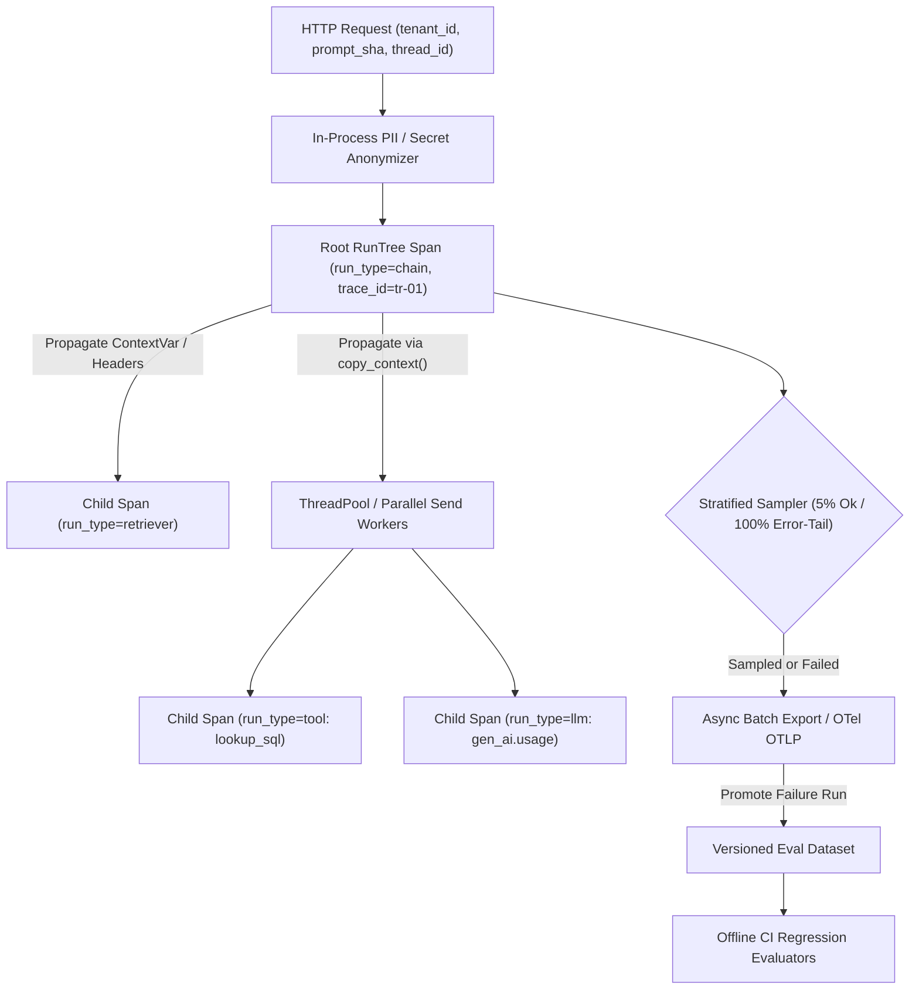
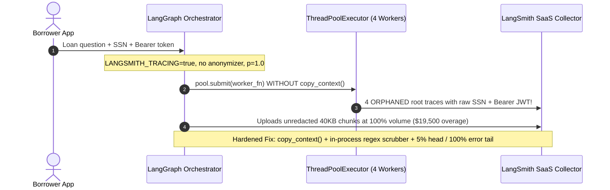

# Module 17: LangSmith for Tracing and Debugging

> **Prerequisites:** [Module 15: Checkpointing and Persistence](../15-checkpointing-and-persistence/README.md), [Module 16: Human-in-the-Loop With LangGraph](../16-human-in-the-loop-with-langgraph/README.md), and [Track 10, Module 15: Agent Failure Modes and Debugging](../../10-ai-agents/15-agent-failure-modes-and-debugging/README.md).  
> **Estimated Reading Time:** 35 minutes  
> **Target Audience:** AI Backend Engineers, Production Reliability Engineers (SRE), Observability & Evaluation Architects

> [!TIP]
> **The Golden Rule of LLM Observability:** **Never debug production agents from flat `stdout` logs or ship `100%` unredacted traces.** Instrument every graph, retriever, LLM, and tool boundary inside a hierarchical `RunTree` carrying correlation metadata (`tenant_id`, `prompt_sha`, `thread_id`, `env`), explicitly propagate context across thread pools and async boundaries, execute client-side PII/secret anonymization hooks (`hide_inputs` / scrubbers) *before* spans leave your process, use error-tail sampling to prevent trace bill explosions, and promote failing production runs straight into versioned regression datasets.

---

## Why This Matters

Standard backend APM tools tell you an endpoint returned `HTTP 200` in `4.8` seconds—yet give zero visibility into *why* your RAG agent returned a fabricated refund rule after retrieving zero matching chunks, burning `18,000` tokens across `5` retry loops, and formatting stale prompt template `v1.8` instead of `v2.1`.

At the same time, flipping `LANGSMITH_TRACING=true` naively in production triggers three immediate operational problems:
1. **Orphaned Spans:** Calling `ThreadPoolExecutor` or multiprocessing workers drops Python `ContextVar` state, fracturing one request into six disconnected root traces.
2. **PII & Secret Exposure:** Raw user SSNs, emails, Bearer JWTs, and downstream API keys inside tool inputs stream verbatim into external telemetry storage.
3. **Observability Invoice Shock:** Tracing `100%` of `40 KB` RAG retrieval payloads across `30` req/s can cost more per month than the LLM tokens themselves.

Mastering `RunTree` hierarchies, context propagation, in-process anonymizers, sampling economics, and production-to-dataset evaluation closes the loop between live traffic and deterministic CI quality gates.

---

## 1. Distributed Trace Hierarchy, Context Propagation & Evaluation Flywheel

LangSmith models every request as a **Trace** (identified by `trace_id`) containing a rooted tree of **Runs** (`RunTree` nodes), ordered chronologically via `(trace_id, parent_run_id, dotted_order)` and typed by semantic role (`chain`, `llm`, `retriever`, `tool`, `prompt`, `parser`):



### Zero-Code Env Tracing vs. `@traceable` vs. Explicit `RunTree` & OpenTelemetry

Choose the instrumentation tier matching how much of your stack uses LangChain/LangGraph versus custom backend services:

1. **Zero-Code Environment Tracing (LangChain / LangGraph Native):** Setting `LANGSMITH_TRACING=true`, `LANGSMITH_API_KEY`, and `LANGSMITH_PROJECT="prod-incident-copilot"` activates global callbacks across every `Runnable`, `ChatModel`, and `StateGraph` superstep—capturing graph node transitions, `thread_id`, token counts, and TTFT automatically.
2. **`@traceable` Decorator (Arbitrary Python / TypeScript Helpers):** Wrap non-LangChain logic (custom SQL lookups, BM25 fusion rankers, raw `openai`/`anthropic` SDK calls) with `@traceable(run_type="retriever" | "tool" | "llm" | "chain", tags=[...], metadata={...})`. Python `@traceable` relies on `contextvars.ContextVar` to attach child runs automatically to the active parent trace.
3. **Explicit `RunTree` & Cross-Boundary Header Propagation:** Whenever execution leaves the current thread or process—via `ThreadPoolExecutor`, Celery queues, or Go/C# microservices—`ContextVar` does **not** cross thread/network boundaries automatically:
   - **Inside Python Thread Pools:** Wrap worker submission with `contextvars.copy_context().run(worker_fn, ...)` or pass `parent_run.create_child(...)` explicitly.
   - **Across Microservice HTTP / Queue Boundaries:** Serialize `headers = run_tree.to_headers()` (`langsmith-trace`, `baggage`) into outbound HTTP headers and rehydrate on the receiving worker with `RunTree.from_headers(headers)`.
4. **OpenTelemetry GenAI Interoperability (`/otel`):** For polyglot stacks (Go gateway -> Python LangGraph worker -> C# billing service), emit standard OpenTelemetry `gen_ai.*` attributes (`gen_ai.system`, `gen_ai.request.model`, `gen_ai.usage.input_tokens`) over OTLP to unify infrastructure APM and LLM reasoning inside one distributed trace.

### Structured Metadata, Correlation Tags & Client-Side PII/Secret Redaction

Flat logs fail when debugging multi-tenant releases. Attach immutable slicing keys to every root invocation (`config={"tags": ["env:prod"], "metadata": {...}}`):

- **Required Metadata Keys:** `tenant_id`, `thread_id`, `prompt_sha` (Git/registry hash of exact system prompt), `graph_version`, and `model_tier`. Searching `metadata.prompt_sha == "a91f0c"` immediately isolates regressions introduced by a specific prompt commit.
- **In-Process PII & Secret Anonymization:** Never rely on post-ingestion deletion after raw credentials leave your VPC. Configure either:
  - Total suppression (`LANGSMITH_HIDE_INPUTS=true`, `LANGSMITH_HIDE_OUTPUTS=true`, or `Client(hide_inputs=True, hide_outputs=True)`) for strictly regulated payloads, OR
  - Regex/key-based anonymizers (`create_anonymizer` / custom `hide_inputs=scrubber_fn`) that replace `sk-...` API keys, `Bearer ...` JWTs, emails, and SSNs **in memory** before serialization and batch transmission.

### Offline & Online Evaluation Flywheel (Closing the Production Loop)

Tracing alone is passive observability; pairing traces with **Evaluations** prevents bugs from recurring:

1. **Production-to-Dataset Promotion:** Filter failing production traces (e.g., `"feedback_score == 0"` or `"latency > 8s"`), scrub PII, and promote `(inputs, reference_outputs)` directly into a versioned **Eval Dataset**.
2. **Offline CI Evaluators:** Before deploying a prompt or model swap, run the dataset through:
   - *Deterministic Code Evaluators:* JSON schema validity, tool-call argument bounds, zero banned/hallucinated citations, latency/token budget adherence.
   - *LLM-as-a-Judge Evaluators:* Semantic groundedness and policy compliance with calibrated rubrics.
3. **Online Production Evaluators:** Run lightweight asynchronous evaluators on a `2%–5%` live trace sample to track production drift continuously and page engineers if faithfulness drops below threshold.

### Quantitative Trace Volume & Sampling Economics

Calculate trace ingestion volume and spend before enabling production tracing globally. Given request rate $Q$ (req/s), average spans per trace $K_{\text{spans}}$, average serialized payload bytes per span $\bar{B}_{\text{span}}$, healthy traffic sampling rate $p_{\text{ok}} \in [0, 1]$, error/slow-tail rate $r_{\text{err}}$ captured at `100%`, and `2,592,000` seconds per 30-day month:

$$N_{\text{ingested}} = Q \cdot 2{,}592{,}000 \cdot \left[\, p_{\text{ok}}(1 - r_{\text{err}}) + 1.0 \cdot r_{\text{err}} \,\right]$$

$$V_{\text{monthly\_GB}} = \frac{N_{\text{ingested}} \cdot K_{\text{spans}} \cdot \bar{B}_{\text{span}}}{10^9}, \qquad C_{\text{trace}} = \frac{N_{\text{ingested}}}{1{,}000} \cdot c_{\text{1k}}$$

At `30` req/s (`77.76M` traces/month), `8` spans/trace, and `6 KB`/span raw unredacted RAG chunks, `100%` tracing ingests `3,822 GB`/month (`\$194,400`/month at `\$2.50`/1k traces). Combining chunk payload truncation (`2 KB`/span) with **`5%` healthy head sampling + `100%` error-tail capture** (`r_err = 0.04`) drops monthly ingestion to `6.84M` traces (`112.1 GB`)—cutting observability spend by **`91.2%`** while retaining **`100%` of failing runs** for debugging and dataset promotion.

---

## 2. Systematic Comparison Matrix: Observability Approaches

| Capability | Unstructured `stdout` Logs | Standard HTTP APM (Prometheus / OTel HTTP) | LangSmith `RunTree` + Eval Flywheel |
| :--- | :--- | :--- | :--- |
| **Multi-Step Graph / Agent Tree** | Flat interleaved text lines | HTTP boundary spans only (blind inside loops) | Nested `chain -> retriever -> llm -> tool` DAG |
| **Token, Cache & Cost Attribution** | Manual regex parsing if logged | Requires custom OTel `gen_ai.*` metrics | Automatic per-span `input`/`output`/`cached` tokens & USD |
| **Thread-Pool & Async Correlation** | Broken unless thread-local log ID injected | Explicit W3C `traceparent` forwarding | `copy_context()` + `to_headers()`/`from_headers()` + OTLP |
| **Client-Side PII Redaction** | Ad-hoc log filters | Custom collector processors | Built-in `hide_inputs`/`hide_outputs` & anonymizer hooks |
| **Regression Testing Integration** | None | None | 1-click trace-to-dataset promotion + offline/online evals |

---

## 3. Production War Story Post-Mortem: Orphaned Thread-Pool Spans, PII Leak & \$19,500 Trace Bill Shock

| Field | Incident Details |
| :--- | :--- |
| **Severity** | **SEV-2** (Compliance Security Violation + Observability Budget Overrun) |
| **Detection / Resolution Time** | Detected 9 days post-launch during monthly InfoSec log audit & billing spike / Mitigated in 4 hours (client anonymizer + `copy_context()` + `5%` sampling) |
| **Impact** | **\$19,500** unexpected monthly trace/retention bill; `0%` trace correlation across parallel retrieval steps (`6` orphaned root traces per request); raw customer SSNs and Bearer JWTs exposed in trace viewer |

### What Happened

A fintech lending assistant enabled `LANGSMITH_TRACING=true` across production Kubernetes pods right before a marketing spike. Three oversights occurred simultaneously:

1. **Dropped `ContextVar` Across Parallel Thread Pool:** The retriever node used `ThreadPoolExecutor(max_workers=4)` to query credit bureaus, policy docs, and transaction SQL concurrently without copying Python `contextvars`. Every parallel tool call spawned an orphaned top-level trace, making root-cause debugging impossible.
2. **Unredacted Payloads (`hide_inputs` Omitted):** Customer KYC payloads containing emails, SSNs, and upstream `Bearer eyJ...` tokens flowed verbatim into serialized `RunTree` inputs.
3. **`100%` Raw Sampling (`40 KB` Chunks):** Every healthy `200 OK` request uploaded full `40 KB` retrieved PDF passages at `100%` volume.



### Root Cause Analysis

- `concurrent.futures.ThreadPoolExecutor` spawns OS worker threads with empty `ContextVar` state unless explicitly forwarded via `contextvars.copy_context().run`.
- Relying on default `LANGSMITH_TRACING=true` without `hide_inputs` / anonymizer hooks or sampling rules exposed regulated PII and multiplied ingestion cost.

### Architectural Hardening & Verified Fix

- **Context Propagation:** Wrapped all parallel thread-pool dispatches in `contextvars.copy_context().run(...)` and propagated `RunTree.to_headers()` across microservice HTTP calls.
- **In-Process Anonymizer + Metadata Discipline:** Attached a recursive scrubber masking `sk-...`, `Bearer ...`, emails, and SSNs inside `Client(hide_inputs=..., hide_outputs=...)` before serialization, while slicing spans via `metadata={"tenant_id": ..., "prompt_sha": ..., "thread_id": ...}`.
- **Stratified Tail Sampling:** Switched healthy runs to `5%` head sampling (`LANGSMITH_TRACING_SAMPLING_RATE=0.05` / custom sampler) while forcing `100%` export on exceptions and latency outliers (`> 4s`), then promoted scrubbed error runs into CI regression datasets.

---

## 4. Multi-Language Production Implementation: Context-Propagated `RunTree` + PII Scrubber + Tail Sampler

The 4-language implementation carousel below shows production observability patterns across **Go** (W3C/LangSmith header propagation + PII scrubber), **TypeScript** (`traceable`/RunTree correlation + anonymizer hook + dataset promotion), **Python** (real LangSmith `Client` anonymizer + `@traceable` + `ThreadPoolExecutor` `copy_context()` + `evaluate()`), and **C#** (OTel `gen_ai.*` `ActivitySource` + regex scrubber + tail sampler).

````carousel

```go
package observability

import (
	"context"
	"crypto/rand"
	"encoding/hex"
	"regexp"
	"strings"
)

type SpanMetadata struct {
	TraceID     string
	SpanID      string
	ParentID    string
	RunType     string // "chain" | "retriever" | "llm" | "tool"
	TenantID    string
	PromptSHA   string
	ThreadID    string
	IsError     bool
	LatencyMs   int64
}

var (
	reAPIKey = regexp.MustCompile(`sk-[A-Za-z0-9_-]{10,}`)
	reBearer = regexp.MustCompile(`Bearer\s+[A-Za-z0-9._-]+`)
	reEmail  = regexp.MustCompile(`[A-Za-z0-9._%+-]+@[A-Za-z0-9.-]+\.[A-Za-z]{2,}`)
)

type ctxKey struct{}

// ScrubSensitiveText strips secrets and PII in-process BEFORE any span leaves the host.
func ScrubSensitiveText(raw string) string {
	s := reAPIKey.ReplaceAllString(raw, "[REDACTED_API_KEY]")
	s = reBearer.ReplaceAllString(s, "Bearer [REDACTED_JWT]")
	s = reEmail.ReplaceAllString(s, "[REDACTED_EMAIL]")
	return s
}

func WithParentSpan(ctx context.Context, meta SpanMetadata) context.Context {
	return context.WithValue(ctx, ctxKey{}, meta)
}

// StartChildSpan propagates trace_id and parent_id explicitly across goroutines and HTTP calls.
func StartChildSpan(ctx context.Context, runType, name string) (context.Context, SpanMetadata) {
	parent, ok := ctx.Value(ctxKey{}).(SpanMetadata)
	childID := randomHex(8)
	traceID := childID
	parentID := ""
	if ok {
		traceID = parent.TraceID
		parentID = parent.SpanID
	}
	child := SpanMetadata{
		TraceID:   traceID,
		SpanID:    childID,
		ParentID:  parentID,
		RunType:   runType,
		TenantID:  parent.TenantID,
		PromptSHA: parent.PromptSHA,
		ThreadID:  parent.ThreadID,
	}
	return WithParentSpan(ctx, child), child
}

// ShouldExportTailSample captures 100% of errors/slow runs and pOk fraction of healthy traffic.
func ShouldExportTailSample(meta SpanMetadata, slowThresholdMs int64, pOk float64, bucket01 float64) bool {
	if meta.IsError || meta.LatencyMs >= slowThresholdMs {
		return true
	}
	return bucket01 < pOk
}

func FormatTraceHeader(meta SpanMetadata) string {
	return strings.Join([]string{meta.TraceID, meta.SpanID, meta.PromptSHA}, ";")
}

func randomHex(n int) string {
	b := make([]byte, n)
	_, _ = rand.Read(b)
	return hex.EncodeToString(b)
}
```

<!-- slide -->

```typescript
export type RunType = "chain" | "retriever" | "llm" | "tool";

export interface TraceEnvelope {
  readonly traceId: string;
  readonly runId: string;
  readonly parentRunId: string | null;
  readonly dottedOrder: string;
  readonly runType: RunType;
  readonly metadata: Readonly<{
    tenantId: string;
    promptSha: string;
    threadId: string;
    env: "prod" | "staging";
  }>;
}

const REDACT_RULES: ReadonlyArray<readonly [RegExp, string]> = [
  [/sk-[A-Za-z0-9_-]{10,}/g, "[REDACTED_API_KEY]"],
  [/Bearer\s+[A-Za-z0-9._-]+/g, "Bearer [REDACTED_JWT]"],
  [/[A-Za-z0-9._%+-]+@[A-Za-z0-9.-]+\.[A-Za-z]{2,}/g, "[REDACTED_EMAIL]"],
  [/\b\d{3}-\d{2}-\d{4}\b/g, "[REDACTED_SSN]"],
];

export function anonymizeTracePayload<T>(payload: T): T {
  if (typeof payload === "string") {
    let scrubbed = payload;
    for (const [pattern, replacement] of REDACT_RULES) {
      scrubbed = scrubbed.replace(pattern, replacement);
    }
    return scrubbed as unknown as T;
  }
  if (Array.isArray(payload)) {
    return payload.map((item) => anonymizeTracePayload(item)) as unknown as T;
  }
  if (payload !== null && typeof payload === "object") {
    const out: Record<string, unknown> = {};
    for (const [k, v] of Object.entries(payload)) {
      out[k] = anonymizeTracePayload(v);
    }
    return out as T;
  }
  return payload;
}

export function createChildSpan(
  parent: TraceEnvelope,
  childRunId: string,
  runType: RunType,
  timestampIso: string
): TraceEnvelope {
  return {
    traceId: parent.traceId,
    runId: childRunId,
    parentRunId: parent.runId,
    dottedOrder: `${parent.dottedOrder}.${timestampIso}${childRunId}`,
    runType,
    metadata: parent.metadata,
  };
}

export function serializeTraceHeaders(env: TraceEnvelope): Record<string, string> {
  return {
    "langsmith-trace": env.dottedOrder,
    "x-correlation-tenant": env.metadata.tenantId,
    "x-prompt-sha": env.metadata.promptSha,
  };
}
```

<!-- slide -->

```python
"""
langsmith_prod_tracing.py
Production LangSmith Client anonymization, ThreadPool context propagation, and dataset evals.
Requires: pip install langsmith
"""
import concurrent.futures
import contextvars
import re
from typing import Any

REDACTION_RULES = [
    (re.compile(r"sk-[A-Za-z0-9_-]{10,}"), "[REDACTED_API_KEY]"),
    (re.compile(r"Bearer\s+[A-Za-z0-9._-]+"), "Bearer [REDACTED_JWT]"),
    (re.compile(r"[A-Za-z0-9._%+-]+@[A-Za-z0-9.-]+\.[A-Za-z]{2,}"), "[REDACTED_EMAIL]"),
    (re.compile(r"\b\d{3}-\d{2}-\d{4}\b"), "[REDACTED_SSN]"),
]


def scrub_pii(data: Any) -> Any:
    """In-process recursive redactor executed via LangSmith hide_inputs / hide_outputs."""
    if isinstance(data, str):
        text = data
        for pattern, replacement in REDACTION_RULES:
            text = pattern.sub(replacement, text)
        return text
    if isinstance(data, dict):
        return {k: scrub_pii(v) for k, v in data.items()}
    if isinstance(data, list):
        return [scrub_pii(item) for item in data]
    return data


def build_hardened_langsmith_client():
    from langsmith import Client

    # Scrubs sensitive tokens BEFORE payloads leave the application process
    return Client(hide_inputs=scrub_pii, hide_outputs=scrub_pii)


def fanout_with_trace_context(tasks: list[tuple[Any, tuple[Any, ...]]]) -> list[Any]:
    """
    Propagates Python ContextVars (including active LangSmith @traceable parent span)
    across ThreadPoolExecutor worker threads so child runs never orphan.
    """
    results = []
    with concurrent.futures.ThreadPoolExecutor(max_workers=4) as pool:
        futures = [
            pool.submit(contextvars.copy_context().run, fn, *args)
            for fn, args in tasks
        ]
        for fut in futures:
            results.append(fut.result())
    return results


def promote_failure_to_dataset(client, dataset_name: str, sanitized_inputs: dict, expected: dict) -> None:
    """Turns a scrubbed failing production run into a permanent regression example."""
    dataset = (
        client.read_dataset(dataset_name=dataset_name)
        if client.has_dataset(dataset_name=dataset_name)
        else client.create_dataset(dataset_name=dataset_name)
    )
    client.create_example(inputs=sanitized_inputs, outputs=expected, dataset_id=dataset.id)
```

<!-- slide -->

```csharp
using System;
using System.Collections.Generic;
using System.Diagnostics;
using System.Text.RegularExpressions;

namespace GenAI.LangSmithObservability;

public static partial class GenAiTelemetry
{
    // Emits OpenTelemetry GenAI semantic conventions compatible with LangSmith OTLP (/otel)
    public static readonly ActivitySource Source = new("GenAI.AgentRuntime", "2.0.0");

    [GeneratedRegex(@"sk-[A-Za-z0-9_-]{10,}")]
    private static partial Regex ApiKeyRegex();

    [GeneratedRegex(@"Bearer\s+[A-Za-z0-9._-]+")]
    private static partial Regex JwtRegex();

    [GeneratedRegex(@"[A-Za-z0-9._%+-]+@[A-Za-z0-9.-]+\.[A-Za-z]{2,}")]
    private static partial Regex EmailRegex();

    public static string RedactSensitive(string input)
    {
        var s = ApiKeyRegex().Replace(input, "[REDACTED_API_KEY]");
        s = JwtRegex().Replace(s, "Bearer [REDACTED_JWT]");
        return EmailRegex().Replace(s, "[REDACTED_EMAIL]");
    }

    public static Activity? StartGenAiSpan(
        string spanName,
        string runType,
        string tenantId,
        string promptSha,
        string threadId,
        string rawPayload)
    {
        var activity = Source.StartActivity(spanName, ActivityKind.Client);
        if (activity is null) return null;

        activity.SetTag("langsmith.span.kind", runType);
        activity.SetTag("gen_ai.system", "openai");
        activity.SetTag("tenant_id", tenantId);
        activity.SetTag("prompt_sha", promptSha);
        activity.SetTag("thread_id", threadId);
        activity.SetTag("input.sanitized", RedactSensitive(rawPayload));
        return activity;
    }

    public static bool ShouldCaptureTrace(bool hasError, double latencyMs, double slowThresholdMs, double sampleRate) =>
        hasError || latencyMs >= slowThresholdMs || Random.Shared.NextDouble() < sampleRate;
}
```

````

---

## 5. Practical Hands-On Verification CLI Workflows

Run these deterministic Python 3.13 verification scripts offline using only the Python standard library (`contextvars`, `concurrent.futures`, `re`, `json`).

### Workflow 1: Thread-Pool Context Propagation (`Broken` vs. `copy_context()`)

Observe how `ThreadPoolExecutor.submit()` orphans parallel child spans into three disconnected traces when `ContextVar` is omitted, versus unifying all three child spans under `"tr-root-001"` via `contextvars.copy_context().run()`:

```bash
python -c '
import contextvars, concurrent.futures

current_trace = contextvars.ContextVar("current_trace", default=None)
spans = []

def worker_task(name):
    parent = current_trace.get()
    trace_id = parent["trace_id"] if parent else f"orphan_root_{name}"
    parent_id = parent["span_id"] if parent else None
    spans.append((trace_id, parent_id, name))

with concurrent.futures.ThreadPoolExecutor(max_workers=3) as pool:
    token = current_trace.set({"trace_id": "tr-root-001", "span_id": "sp-0"})
    try:
        futs_broken = [pool.submit(worker_task, f"broken_{i}") for i in range(3)]
        for f in futs_broken:
            f.result()
        broken_traces = sorted({s[0] for s in spans})
        spans.clear()

        futs_fixed = [pool.submit(contextvars.copy_context().run, worker_task, f"fixed_{i}") for i in range(3)]
        for f in futs_fixed:
            f.result()
        fixed_traces = sorted({s[0] for s in spans})
    finally:
        current_trace.reset(token)

parented_ok = all(s[1] == "sp-0" for s in spans)
print(f"Broken pool unique trace_ids ({len(broken_traces)}): {broken_traces}")
print(f"Fixed pool unique trace_ids  ({len(fixed_traces)}): {fixed_traces}")
print(f"Unified child spans parented : {parented_ok} (count={len(spans)})")
'
```

**Expected Output:**

```text
Broken pool unique trace_ids (3): ['orphan_root_broken_0', 'orphan_root_broken_1', 'orphan_root_broken_2']
Fixed pool unique trace_ids  (1): ['tr-root-001']
Unified child spans parented : True (count=3)
```

### Workflow 2: In-Process PII/Secret Redaction & Production-to-Dataset Regression Check

Verify that an anonymizer hook scrubs emails, SSNs, Bearer JWTs, and `sk-...` API keys *before* JSON serialization (`Leaked raw secrets : 0`), then promote the sanitized failure into an offline regression dataset comparing `v1` vs. `v2`:

```bash
python -c '
import re, json

PATTERNS = [
    (re.compile(r"sk-[A-Za-z0-9_-]{10,}"), "[REDACTED_API_KEY]"),
    (re.compile(r"Bearer\s+[A-Za-z0-9._-]+"), "Bearer [REDACTED_JWT]"),
    (re.compile(r"[A-Za-z0-9._%+-]+@[A-Za-z0-9.-]+\.[A-Za-z]{2,}"), "[REDACTED_EMAIL]"),
    (re.compile(r"\b\d{3}-\d{2}-\d{4}\b"), "[REDACTED_SSN]"),
]

def scrub(obj):
    if isinstance(obj, str):
        out = obj
        for pat, repl in PATTERNS:
            out = pat.sub(repl, out)
        return out
    if isinstance(obj, dict):
        return {k: scrub(v) for k, v in obj.items()}
    if isinstance(obj, list):
        return [scrub(x) for x in obj]
    return obj

raw_span = {
    "inputs": {"user_email": "alice@corp.io", "ssn": "123-45-6789", "auth": "Bearer eyJhbGciOiJIUzI1NiJ9.abc"},
    "outputs": {"error": "401 using key sk-proj-99887766554433", "answer": "Refund denied"},
    "metadata": {"tenant_id": "acme", "prompt_sha": "a91f0c"},
}

sanitized = scrub(raw_span)
serialized = json.dumps(sanitized)
leaks = [tok for tok in ("alice@corp.io", "123-45-6789", "eyJhbGci", "sk-proj-") if tok in serialized]
print(f"Leaked raw secrets : {len(leaks)}")
print(f"Sanitized payload  : {serialized}")

dataset = [{"inputs": sanitized["inputs"], "expected_status": "abstain_401"}]
def eval_model(model_fn):
    return sum(1 for row in dataset if model_fn(row["inputs"]) == row["expected_status"]) / len(dataset)

v1_rate = eval_model(lambda x: "hallucinate_ok")
v2_rate = eval_model(lambda x: "abstain_401")
print(f"Offline Regression Pass Rate -> v1={v1_rate:.0%} | v2={v2_rate:.0%}")
'
```

**Expected Output:**

```text
Leaked raw secrets : 0
Sanitized payload  : {"inputs": {"user_email": "[REDACTED_EMAIL]", "ssn": "[REDACTED_SSN]", "auth": "Bearer [REDACTED_JWT]"}, "outputs": {"error": "401 using key [REDACTED_API_KEY]", "answer": "Refund denied"}, "metadata": {"tenant_id": "acme", "prompt_sha": "a91f0c"}}
Offline Regression Pass Rate -> v1=0% | v2=100%
```

### Workflow 3: Trace Ingestion Volume & Stratified Error-Tail Sampling Cost Sweep

Quantify monthly trace volume, GB ingested, and projected trace billing at `30` req/s (`8` spans/trace, `4%` error rate) across `100%` raw capture vs. `5%`/`10%` head sampling + `100%` error tail + span payload capping:

```bash
python -c '
def trace_cost_model(qps=30, spans_per_trace=8, kb_per_span=6.0, err_rate=0.04, p_ok=1.0, price_per_1k=2.50):
    monthly_traces = qps * 2_592_000
    sampled_frac = p_ok * (1 - err_rate) + 1.0 * err_rate
    ingested_traces = monthly_traces * sampled_frac
    monthly_gb = (ingested_traces * spans_per_trace * kb_per_span * 1024) / 1e9
    monthly_usd = (ingested_traces / 1000.0) * price_per_1k
    return ingested_traces, monthly_gb, monthly_usd

for label, p_ok, kb in [
    ("100% Unredacted Raw", 1.00, 6.0),
    ("10% Head + 100% Err + Chunk Cap", 0.10, 2.0),
    ("5% Head  + 100% Err + Chunk Cap", 0.05, 2.0),
]:
    n, gb, usd = trace_cost_model(p_ok=p_ok, kb_per_span=kb)
    print(f"{label:<32} | traces={n/1e6:>5.2f}M/mo | volume={gb:>6.1f} GB | est_cost=${usd:,.2f}/mo")
'
```

**Expected Output:**

```text
100% Unredacted Raw              | traces=77.76M/mo | volume=3822.1 GB | est_cost=$194,400.00/mo
10% Head + 100% Err + Chunk Cap  | traces=10.58M/mo | volume= 173.3 GB | est_cost=$26,438.40/mo
5% Head  + 100% Err + Chunk Cap  | traces= 6.84M/mo | volume= 112.1 GB | est_cost=$17,107.20/mo
```

### Hands-On Exercises

1. **Cross-Service `RunTree` Header Propagation:** Extend Workflow 1 so the parent span serializes a header string `"tr-root-001;sp-0;a91f0c"` across a simulated HTTP queue boundary, and the receiving worker parses `trace_id`, `parent_id`, and `prompt_sha` without sharing Python memory.
2. **Add Credit-Card & AWS Access-Key Scrubbers:** Extend Workflow 2's `PATTERNS` list to scrub AWS keys (`AKIA[0-9A-Z]{16}`) and 16-digit PANs, and verify `0` leaked tokens across nested `list[dict]` tool outputs.
3. **Optional Live LangSmith Run Probe (`LANGSMITH_API_KEY` required):** Configure `Client(hide_inputs=scrub_pii, hide_outputs=scrub_pii)` and `@traceable(run_type="chain", metadata={"prompt_sha": "local-dev"})`, run a two-step helper, and verify the nested tree renders under one `trace_id` with redacted inputs in the LangSmith UI.

### Independent Challenge

Your organization runs a hybrid stack: a **Go** API gateway invokes a **Python** LangGraph retrieval-and-triage service, which spawns **4 parallel `asyncio` / thread-pool workers** calling internal billing and Kubernetes APIs. After deploying a prompt change (`v2.4`), `1.8%` of enterprise tenant requests hallucinate outdated limits. Currently, engineering has only raw `stdout` JSON logs, zero span parenting across the Go-to-Python boundary or Python thread pool, raw JWT headers showing up in debug output, and no regression dataset. Design the unified OpenTelemetry + LangSmith instrumentation, metadata taxonomy, PII scrubbing boundary, sampling policy, and CI evaluation pipeline.

<details><summary>Architectural Discussion</summary>

1. **End-to-End Trace Correlation:** Have the Go gateway start the root OTel span (`traceparent` / `langsmith-trace` header) and forward it over HTTP to Python; inside Python, hydrate the parent context via `RunTree.from_headers()` (or OTel propagator) and wrap all thread-pool submissions in `contextvars.copy_context().run(...)` so all `4` parallel tool spans nest cleanly under one `trace_id`.
2. **Metadata Slicing & In-Process Scrubbing:** Attach `tenant_id`, `prompt_sha`, `graph_version`, and `thread_id` on every invocation; register an in-process anonymizer (`hide_inputs`/`hide_outputs`) stripping JWTs, API keys, and PII prior to OTLP/LangSmith export.
3. **Tail Sampling & Regression Flywheel:** Export `5%` of healthy runs and `100%` of error/high-latency/negative-feedback runs; promote scrubbed `v2.4` hallucination traces into a CI Eval Dataset gated by deterministic schema/grounding evaluators and LLM-as-a-judge checks before promoting prompt `v2.5`.

</details>

---

## 6. Common Mistakes & Troubleshooting

- **Assuming `ThreadPoolExecutor` or `multiprocessing` preserves `@traceable` parent spans automatically:** Python `ContextVar` values are thread-local per execution context; always wrap pool tasks in `contextvars.copy_context().run(...)` or pass explicit `RunTree` headers/children.
- **Debugging multi-tenant regressions without `prompt_sha` or `tenant_id` in trace metadata:** Without explicit version tags, traces from old and new pods blend together in dashboards, making A/B comparison impossible.
- **Logging raw `40 KB` retrieved document arrays inside spans at `100%` sampling:** Explodes ingestion costs and slows down batch flush queues; truncate or hash oversized evidence payloads in span attributes and apply head + error-tail sampling.
- **Relying solely on server-side PII masking rules:** Always redact API keys, JWTs, SSNs, and customer emails inside your own VPC process (`hide_inputs`/`hide_outputs` anonymizer) before data ever traverses the network.

---

## 7. Operational Validation Checkpoints & Checkpoint Quiz

### Operational Validation Checkpoints

<details><summary><strong>Checkpoint 1: Fixing fractured orphaned traces from parallel RAG workers</strong></summary>

A LangGraph retriever node uses `ThreadPoolExecutor` to fetch from BM25, pgvector, and SQL concurrently. In LangSmith, each request generates **4 separate top-level traces** instead of 1 unified trace tree. Diagnose and fix.

**Validation:** `ThreadPoolExecutor` worker threads do not inherit the calling thread's `contextvars.ContextVar` automatically, so `@traceable` functions inside workers find no active parent `RunTree` and create orphaned roots. Fix by submitting via `pool.submit(contextvars.copy_context().run, worker_fn, ...)` (or passing explicit `RunTree` children/headers).

</details>

<details><summary><strong>Checkpoint 2: Preventing secret leakage before telemetry exits the application VPC</strong></summary>

Security flags that tool spans in LangSmith contain downstream `Bearer eyJ...` authorization headers and user emails. How do you guarantee zero raw credentials leave the Python backend without disabling tracing?

**Validation:** Configure an in-process recursive anonymizer (`Client(hide_inputs=scrub_pii, hide_outputs=scrub_pii)` or `create_anonymizer` patterns) matching API keys, Bearer JWTs, emails, and SSNs—or set `LANGSMITH_HIDE_INPUTS=true` / `LANGSMITH_HIDE_OUTPUTS=true` for zero-payload metadata-only tracing. Because the hook executes client-side before serialization, raw secrets never cross the network.

</details>

<details><summary><strong>Checkpoint 3: Closing the loop from a failing production trace to CI regression prevention</strong></summary>

An engineer identifies a production trace where the agent failed to abstain on an out-of-policy refund (`prompt_sha="v2.4"`). What exact workflow guarantees this failure cannot silently reappear in `v2.5`?

**Validation:** Scrub any PII from the failing trace's inputs, promote the `(inputs, expected_abstain_output)` pair into a versioned LangSmith Evaluation Dataset, attach deterministic code evaluators (e.g., `status == "abstain"`) plus an LLM-as-a-judge rubric, and block merging `v2.5` in CI unless dataset pass rate meets the release gate.

</details>

### Checkpoint Quiz

1. What are the core fields linking spans into one hierarchical LangSmith `RunTree`?
2. Why do `@traceable` functions inside `ThreadPoolExecutor` orphan unless handled explicitly, and what fixes it?
3. What is the security difference between client-side `hide_inputs=scrub_pii` versus dashboard-side filtering?
4. Why does `5%` healthy head sampling + `100%` error-tail sampling drastically outperform `100%` uniform tracing in production?
5. Contrast **offline evaluation** and **online evaluation** in LangSmith.

<details><summary>Answers</summary>

1. `trace_id` (shared across the entire request), `run_id` (unique per span), `parent_run_id` (links child to parent), `dotted_order` (deterministic execution ordering), and `run_type` (`chain`, `llm`, `retriever`, `tool`).
2. `ThreadPoolExecutor` workers start with clean thread-local `ContextVar` state; wrapping task execution in `contextvars.copy_context().run(...)` or passing `RunTree.to_headers()` preserves the parent span link.
3. Client-side anonymization executes in-process *before* trace payloads leave your VPC, preventing raw secrets/PII from ever touching external storage; dashboard filtering only hides already-ingested raw data.
4. Healthy `200 OK` runs consume `~95%` of trace volume and bill while adding minimal diagnostic value; sampling `5%` of healthy baselines and `100%` of errors/slow tails reduces trace cost by `>90%` while capturing every actionable failure.
5. **Offline evaluation** tests candidate prompts/models before deployment against curated versioned datasets (including promoted production failures) using deterministic + LLM-judge evaluators; **online evaluation** scores sampled live production traffic asynchronously to detect real-time drift.

</details>

---

## Further Reading & Sources

- [LangSmith Official Docs: Trace With LangSmith (`@traceable`, `RunTree`, Context Propagation & OTel)](https://docs.langchain.com/langsmith/trace-with-langsmith) — official guide for Python/TS tracing, context forwarding, PII anonymization (`hide_inputs`/`hide_outputs`), and `/otel` ingestion.
- [LangSmith Official Docs: Evaluation (Offline Datasets & Online Monitoring)](https://docs.langchain.com/langsmith/evaluation) — official specification for code evaluators, LLM-as-a-judge, and production-to-dataset workflows.
- [OpenTelemetry Semantic Conventions for Generative AI (`gen_ai.*`)](https://opentelemetry.io/docs/specs/semconv/gen-ai/) — vendor-neutral telemetry schema for polyglot LLM and agent spans.
- [Track 10, Module 15: Agent Failure Modes and Debugging](../../10-ai-agents/15-agent-failure-modes-and-debugging/README.md) — deterministic replay bisection and golden regression promotion patterns.

## Next

[Module 18: Capstone Project](../18-capstone-project/README.md)
