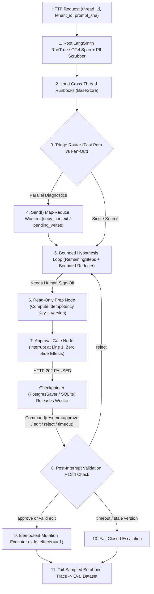
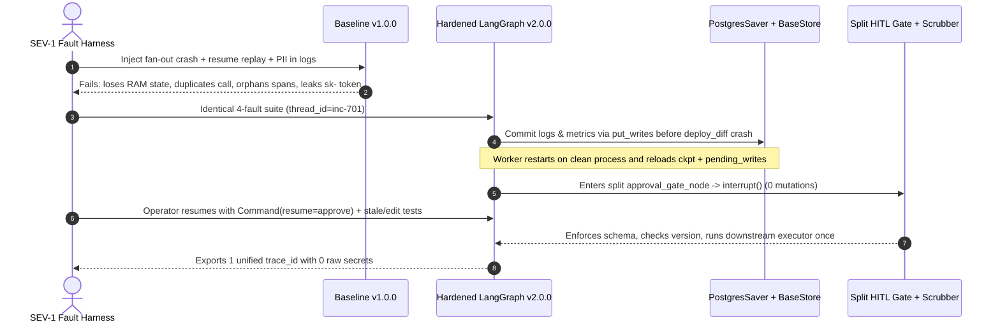

# Module 18: Capstone Project

> **Prerequisites:** Track 11 Modules 00–17 (especially [Module 12: LangGraph: State and Nodes](../12-langgraph-state-and-nodes/README.md), [Module 13: LangGraph: Edges and Conditional Routing](../13-langgraph-edges-and-conditional-routing/README.md), [Module 14: LangGraph: Cycles and Loops](../14-langgraph-cycles-and-loops/README.md), [Module 15: Checkpointing and Persistence](../15-checkpointing-and-persistence/README.md), [Module 16: Human-in-the-Loop With LangGraph](../16-human-in-the-loop-with-langgraph/README.md), and [Module 17: LangSmith for Tracing and Debugging](../17-langsmith-for-tracing-and-debugging/README.md)).  
> **Estimated Reading Time:** 25 minutes (Specification) / 6–8 hours (Implementation, Fault Injection & Evaluation)  
> **Target Audience:** AI Backend Engineers, Agent Platform Architects, Distributed Systems Engineers

> [!TIP]
> **The Golden Rule of the LangChain & LangGraph Capstone:** Production LangGraph systems earn trust only when **every durability, safety, and observability invariant holds across crashes, replays, and parallel fan-outs**: typed `StateGraph` channels with bounded reducers, `BaseCheckpointSaver` persistence (`PostgresSaver` or durable SQLite WAL) paired with cross-thread `BaseStore` recall, replay-safe `interrupt()` + `Command(resume=...)` human gates, context-propagated `RunTree` / OTel spans scrubbed of PII before export, and automated regression datasets. **No pre-solved codebase or dataset is provided here:** you must author both **Baseline Ephemeral Chain/Graph (`v1.0.0`)** and **Hardened Persistent LangGraph Runtime (`v2.0.0`)** from scratch, inject simultaneous crash-resume faults, and report empirical metrics in `EVAL_REPORT.md`.

---

## 1. Problem Statement & End-to-End Architecture

Across Modules 00–17, you studied LangChain's composable primitives (`ChatModels`, structured outputs, LCEL chains, tools, retrievers) alongside LangGraph's stateful execution runtime (`StateGraph`, custom reducers, bounded cycles, `Send` map-reduce fan-out, `BaseCheckpointSaver` / `BaseStore`, dynamic `interrupt()` / `Command(resume=...)`, and LangSmith tracing/evaluation).

Your capstone challenge is to unify those primitives into one **Durable, Persistently Checkpointed Enterprise Incident-Response & Change-Control LangGraph Platform** for a realistic backend domain—such as:

- **Enterprise Kubernetes Incident-Triage & Remediation Graph:** Fans out parallel diagnostic `Send` workers across logs, metrics, and recent deploy diffs; iterates through a bounded hypothesis-refinement loop; recalls past remediation runbooks from cross-thread `BaseStore`; suspends via `interrupt()` before executing `HIGH_RISK` infrastructure changes (`scale_deployment`, `rollback_release`, `flush_cache`); and persists crash-resilient checkpoints across worker restarts.
- **FinOps & Cloud Change-Management Copilot:** Investigates billing anomalies in parallel across cloud accounts; validates remediation plans against Pydantic schemas; enforces `approve` / `edit` / `reject` / SLA-timeout human sign-offs with optimistic resource-version checks; and exports PII-redacted LangSmith `RunTree` traces into offline CI datasets.
- **Automated Security Vulnerability Patch Orchestrator:** Analyzes CVE advisories, inspects repo SBOMs in parallel, drafts bounded remediation PR plans, pauses at `interrupt()` for security-officer review, and supports `update_state` time-travel debugging when a patch path fails validation.

Regardless of domain, **you must engineer the complete `v1.0.0` vs. `v2.0.0` system, curate a stratified evaluation suite (`>= 45` tasks), run the mandatory SEV-1 Crash-Resume Drill, and publish honest metrics in `EVAL_REPORT.md`.**

### Target Production Runtime Architecture



---

## 2. Requirements Specification & Design Matrices

### Functional Requirements (FR)

- **FR-1 (`v1.0.0` Baseline vs. `v2.0.0` Typed `StateGraph` & Reducers):**
  - **`v1.0.0` Baseline:** Linear LCEL chain or uncheckpointed `InMemorySaver` graph with unbounded append-only message state, no parallel `Send` fan-out, no `BaseStore`, no `interrupt()` gate, and raw unredacted tracing.
  - **`v2.0.0` Hardened Graph:** Strongly typed `StateGraph` (Pydantic / `TypedDict`) using custom bounded sliding-window reducers (`max_items` cap) + URI-by-reference offloading for large logs (`<= 256 KB` per checkpoint), parallel `Send` diagnostic fan-out, and explicit bounded cycle guard (`max_iterations` / `RemainingSteps`).
- **FR-2 (Durable `BaseCheckpointSaver` + Cross-Thread `BaseStore` + Time-Travel):**
  - Implement or configure durable persistence (`PostgresSaver` / `AsyncPostgresSaver`, or a SQLite WAL `BaseCheckpointSaver` locally) indexed by `(thread_id, checkpoint_ns, checkpoint_id)` supporting `put_writes` superstep partial-task recovery.
  - Separate thread workflow state (`Checkpointer`) from cross-thread organizational runbooks/preferences (`BaseStore` namespaces `("org", tenant_id, "runbooks")`).
  - Provide a time-travel CLI command (`fork --thread-id <id> --checkpoint-id <cid> --patch <json>`) that calls `update_state()` to branch from a historical snapshot without mutating past checkpoints.
- **FR-3 (Replay-Safe `interrupt()` + `Command(resume=...)` HITL Gate):**
  - Isolate read-only proposal preparation from `approval_gate_node` (`interrupt(payload)` at line 1) and downstream `execute_node` so `Command(resume=...)` replaying the gate node executes **zero** duplicate side effects.
  - Support all four resume paths across HTTP/CLI boundaries (`thread_id`): `approve`, `edit` (strictly schema-validated), `reject` (routed cleanly back to replan), and `timeout_expired` (fail-closed SLA reaper), plus optimistic `expected_version` stale-drift validation.
- **FR-4 (Context-Propagated `RunTree` / OTel Spans + PII Scrubber + Sampling):**
  - Instrument the graph with hierarchical LangSmith `@traceable` / `RunTree` or OpenTelemetry `gen_ai.*` spans propagating `trace_id` cleanly across all parallel `Send` workers (`copy_context()` / trace headers) with `tenant_id`, `prompt_sha`, and `thread_id` metadata.
  - Execute an in-process PII/secret redactor (`hide_inputs`/`hide_outputs` hook) stripping API keys (`sk-...`), Bearer JWTs, emails, and SSNs before span export, alongside head + error-tail sampling.
- **FR-5 (Stratified Benchmark & Production-to-Dataset Regression Suite):**
  - Curate at least **45 total scenarios** partitioned into `dev` (`>= 15`), `held_out` (`>= 18`), and `adversarial_faults` (`>= 12`), promote failing `v1.0.0` runs into an offline evaluation dataset, and run paired deterministic + LLM-judge evaluators comparing `v1.0.0` vs. `v2.0.0`.

### Non-Functional Requirements (NFR)

- **NFR-1 (Exact-Once Side-Effect Guarantee):** Record `0` duplicate mutating tool calls across mid-superstep worker `SIGKILL` crashes and `Command(resume=...)` node replays (`executions == 1`).
- **NFR-2 (Unified Observability & Zero Secret Leakage):** Record `1` unified `trace_id` per multi-worker request (`0` orphaned spans) and `0` leaked raw secret tokens in exported trace payloads.
- **NFR-3 (Bounded State & Guaranteed Termination):** Enforce `<= 256 KB` max serialized checkpoint payload per superstep (offloading raw logs to URI storage) and `0` infinite loops across `adversarial_faults`.
- **NFR-4 (Empirical Honesty):** Report real measured `v1.0.0` vs. `v2.0.0` task completion rate, checkpoint write latency (`p50`/`p95`), crash-recovery pass rate, trace volume savings, and remaining failure modes in `EVAL_REPORT.md`.

### Technology & Implementation Choices Matrix

| Runtime Layer | Production / Hosted Option | Local / Self-Hosted Option | Required Engineering Proof |
| :--- | :--- | :--- | :--- |
| **Graph & Chain Runtime** | LangGraph + LangChain (`ChatOpenAI` / `ChatAnthropic`, `temp=0`) | LangGraph + local Ollama / vLLM / deterministic test stub (`temp=0`) | Typed `StateGraph`, custom bounded reducer, `Send` fan-out, cycle cap |
| **Checkpointer & `BaseStore`** | `AsyncPostgresSaver` (`LANGGRAPH_STRICT_MSGPACK=true`) + `AsyncPostgresStore` | `SqliteSaver` WAL + persistent local `BaseStore` table | Survives worker kill mid-superstep (`put_writes`) + `update_state` fork |
| **HITL Pause / Resume** | HTTP `POST /runs` (`202 PAUSED`) + `POST /resume` + SLA cron worker | Stateless CLI `start` -> process exit -> `resume --decision ...` | Split-node / `@task` isolation (`side_effects == 1`) + drift guard |
| **Tracing & Eval Harness** | LangSmith (`Client(hide_inputs=scrub)` + Evaluation Datasets) | Local JSONL `RunTree` + OTel collector + offline dataset runner | `1` unified `trace_id` across `Send`, `0` raw PII leaks, `v1` vs `v2` eval table |

### Deliverable & Empirical Evidence Matrix

| Deliverable | Required Artifact | Acceptance Proof |
| :--- | :--- | :--- |
| **1. Persistent LangGraph Runtime** | Source code (`v1.0.0` & `v2.0.0`) + unit tests | Proves bounded reducers, `Send` fan-out, cycle limits, and cross-thread `BaseStore` isolation |
| **2. Crash-Safe Checkpointer & HITL CLI/API** | `PostgresSaver` / `SqliteSaver` wiring + `resume` & `fork` commands | Proves mid-fan-out `put_writes` skip, `Command(resume)` exact-once mutation, and time-travel fork |
| **3. SEV-1 4-Fault Drill Traces** | Archived JSONL / trace exports comparing `v1.0.0` vs. `v2.0.0` | Proves `0` duplicate executions, `0` stale-version commits, `0` orphaned spans, `0` PII leaks |
| **4. Evaluation Report & Regression Dataset** | `EVAL_REPORT.md` + scrubbed regression dataset JSON/LangSmith link | Paired `v1.0.0` vs. `v2.0.0` metrics across `>= 45` tasks + candid residual error breakdown |

---

## 3. Production SEV-1 Failure Drill (Mandatory Crash-Resume & Trace Drill)

Execute this **simultaneous 4-fault SEV-1 drill** against both **`v1.0.0`** and **`v2.0.0`** and archive the exact logs:

1. **Fault A (Worker `SIGKILL` Mid-`Send` Fan-Out):** Fan out `3` parallel diagnostic workers (`logs`, `metrics`, `deploy_diff`). Let `logs` and `metrics` succeed, then inject a crash / timeout inside `deploy_diff`. Resume `thread_id` on a fresh process and verify `v2.0.0` recovers `logs` and `metrics` from `put_writes` (`calls == 1`) without re-running them while completing `deploy_diff`.
2. **Fault B (`Command(resume=approve)` Replay Idempotency):** Pause at `approval_gate_node` via `interrupt()` for a mutating `scale_deployment` action, kill the worker process, start a new worker, and invoke `Command(resume={"decision": "approve"})`. Verify `v2.0.0` executes the mutation **exactly once** (`executions == 1`) while ensuring any pre-gate preparation ran zero duplicate side effects.
3. **Fault C (Stale Resource Drift & Invalid Human Edit):** First submit an out-of-bounds edit (`replicas = 99` when cap is `12`); assert schema rejection without mutating infra. Then increment the underlying resource version (`v4 -> v5`) while paused and submit `approve`; assert `v2.0.0` aborts fail-closed (`ABORT_STALE_DRIFT`).
4. **Fault D (Secret Injection Across Parallel `Send` Workers):** Embed `Bearer eyJabc.123` and `sk-prod-99887766` inside synthetic pod logs fetched inside parallel `Send` threads. Verify exported traces show **`1` unified `trace_id`** (zero orphaned worker traces) and **`0` leaked raw secret strings**.



---

## 4. Multi-Language Starter Harness (`TODO` Scaffolds — Not a Full Solution)

Use the starter scaffold in your chosen language below to standardize `(thread_id, checkpoint_ns, checkpoint_id)` coordinates, deterministic superstep idempotency keys, in-process secret redaction, and span contracts. **Implement all `TODO` `StateGraph` nodes, reducers, `BaseCheckpointSaver` / `BaseStore` persistence, `interrupt()` / `Command(resume)` routing, context propagation, and evaluation pipelines yourself.**

````carousel

```go
package langgraphcapstone

import (
	"context"
	"crypto/sha256"
	"encoding/hex"
	"encoding/json"
	"fmt"
	"regexp"
)

type CheckpointCoord struct {
	ThreadID     string
	CheckpointNS string
	CheckpointID string
}

type HitlDecision string

const (
	Approve        HitlDecision = "approve"
	Edit           HitlDecision = "edit"
	Reject         HitlDecision = "reject"
	TimeoutExpired HitlDecision = "timeout_expired"
)

var secretPattern = regexp.MustCompile(`(sk-[A-Za-z0-9_-]{8,}|Bearer\s+[A-Za-z0-9._-]+)`)

// SuperstepIdempotencyKey binds mutating executions to a unique thread/checkpoint/action tuple.
func SuperstepIdempotencyKey(coord CheckpointCoord, action string, args map[string]any) string {
	canon, _ := json.Marshal(args)
	sum := sha256.Sum256([]byte(fmt.Sprintf("%s|%s|%s|%s|%s",
		coord.ThreadID, coord.CheckpointNS, coord.CheckpointID, action, string(canon))))
	return hex.EncodeToString(sum[:8])
}

func ScrubTelemetryString(raw string) string {
	return secretPattern.ReplaceAllString(raw, "[REDACTED]")
}

// TODO: Implement CheckpointSaver (Put, PutWrites, GetTuple, UpdateStateFork) backed by Postgres/SQLite
// TODO: Implement CrossThreadBaseStore for org/tenant runbook persistence
// TODO: Implement ParallelSendFanOutWithPendingWrites(ctx, coord, workers)
// TODO: Implement SplitHitlApprovalGate(coord, decision, expectedVersion, maxReplicas)
// TODO: Implement ContextPropagatedTraceAndDatasetEval(ctx, benchmarkTasks)
```

<!-- slide -->

```typescript
import { createHash } from "node:crypto";

export interface CheckpointCoord {
  readonly threadId: string;
  readonly checkpointNs: string;
  readonly checkpointId: string;
}

export interface HitlResumePayload {
  readonly decision: "approve" | "edit" | "reject" | "timeout_expired";
  readonly reviewerId: string;
  readonly editedArgs?: Record<string, unknown>;
  readonly expectedVersion: number;
}

export interface TraceContext {
  readonly traceId: string;
  readonly spanId: string;
  readonly tenantId: string;
  readonly promptSha: string;
}

export function superstepIdempotencyKey(
  coord: CheckpointCoord,
  action: string,
  args: Record<string, unknown>
): string {
  const sorted = JSON.stringify(args, Object.keys(args).sort());
  return createHash("sha256")
    .update(`${coord.threadId}|${coord.checkpointNs}|${coord.checkpointId}|${action}|${sorted}`)
    .digest("hex")
    .slice(0, 16);
}

export function scrubSecrets(text: string): string {
  return text.replace(/(sk-[A-Za-z0-9_-]{8,}|Bearer\s+[A-Za-z0-9._-]+)/g, "[REDACTED]");
}

// TODO: Implement StateGraph with bounded sliding-window reducers and Send() fan-out
// TODO: Implement PostgresSaver / SqliteSaver persistence + BaseStore cross-thread memory
// TODO: Implement replay-safe interrupt() + Command(resume) split-node approval gate
// TODO: Implement RunTree header propagation across parallel workers + tail sampling
// TODO: Implement offline dataset evaluator comparing v1.0.0 vs v2.0.0
```

<!-- slide -->

```python
"""
Starter scaffold for Track 11 Capstone (implement TODO LangGraph/LangSmith stages yourself).
"""
from dataclasses import dataclass
import hashlib
import json
import re
from typing import Any

SECRET_RE = re.compile(r"(sk-[A-Za-z0-9_-]{8,}|Bearer\s+[A-Za-z0-9._-]+)")


@dataclass(frozen=True)
class CheckpointCoord:
    thread_id: str
    checkpoint_ns: str
    checkpoint_id: str


@dataclass(frozen=True)
class IncidentProposal:
    action: str
    args: dict[str, Any]
    expected_version: int
    log_uri: str


def superstep_idempotency_key(coord: CheckpointCoord, action: str, args: dict[str, Any]) -> str:
    canon = json.dumps(args, sort_keys=True, separators=(",", ":"))
    raw = f"{coord.thread_id}|{coord.checkpoint_ns}|{coord.checkpoint_id}|{action}|{canon}"
    return hashlib.sha256(raw.encode("utf-8")).hexdigest()[:16]


def scrub_sensitive_text(text: str) -> str:
    return SECRET_RE.sub("[REDACTED]", text)


# TODO: Implement IncidentState with bounded sliding reducer + URI-only log fields
# TODO: Implement PostgresSaver / SqliteSaver checkpointer + BaseStore runbook lookup
# TODO: Implement Send() parallel triage workers + bounded diagnostic cycle graph
# TODO: Implement split-node interrupt() + Command(resume=...) gate (approve/edit/reject/timeout)
# TODO: Implement ThreadPool copy_context() + LangSmith hide_inputs anonymizer + eval runner
```

<!-- slide -->

```csharp
using System;
using System.Collections.Generic;
using System.Security.Cryptography;
using System.Text;
using System.Text.Json;
using System.Text.RegularExpressions;

namespace GenAI.LangGraphCapstone;

public sealed record CheckpointCoord(string ThreadId, string CheckpointNs, string CheckpointId);

public sealed record HitlResumeCommand(
    string Decision,
    string ReviewerId,
    int ExpectedVersion,
    IReadOnlyDictionary<string, object?>? EditedArgs = null);

public static partial class CapstoneScaffold
{
    [GeneratedRegex(@"(sk-[A-Za-z0-9_-]{8,}|Bearer\s+[A-Za-z0-9._-]+)")]
    private static partial Regex SecretPattern();

    public static string SuperstepIdempotencyKey(
        CheckpointCoord coord,
        string action,
        IReadOnlyDictionary<string, object?> args)
    {
        var sorted = new SortedDictionary<string, object?>(args, StringComparer.Ordinal);
        string body = JsonSerializer.Serialize(sorted);
        string raw = $"{coord.ThreadId}|{coord.CheckpointNs}|{coord.CheckpointId}|{action}|{body}";
        return Convert.ToHexString(SHA256.HashData(Encoding.UTF8.GetBytes(raw)))[..16].ToLowerInvariant();
    }

    public static string ScrubSensitiveText(string payload) =>
        SecretPattern().Replace(payload, "[REDACTED]");

    // TODO: Implement CheckpointSaver (put, put_writes, get_tuple, fork) + BaseStore
    // TODO: Implement parallel Send fan-out + bounded cycle state graph
    // TODO: Implement split-node interrupt() + Command(resume) gate with stale drift check
    // TODO: Implement OTel gen_ai.* span propagation + in-process PII scrubber
    // TODO: Implement paired v1.0.0 vs v2.0.0 offline benchmark harness
}
```

````

---

## 5. Automated Acceptance Verification CLI Checks

Before submitting or reviewing your capstone implementation, run automated smoke checks modeled on these two offline Python 3.13 contract tests against your persistence store, HITL idempotency ledger, and scrubbed telemetry exports.

### Acceptance Check 1: Checkpoint Tuple Integrity, Cross-Thread `BaseStore` & Replay-Safe `interrupt()` Idempotency

Verify that `(thread_id, checkpoint_ns, checkpoint_id)` coordinates persist cleanly, `BaseStore` resolves cross-thread runbooks independently, and replaying `Command(resume=...)` produces `executions == 1`:

```bash
python -c '
import sqlite3, json, hashlib

conn = sqlite3.connect(":memory:")
conn.execute("CREATE TABLE checkpoints (thread_id TEXT, checkpoint_ns TEXT, checkpoint_id TEXT, state_json TEXT, PRIMARY KEY (thread_id, checkpoint_ns, checkpoint_id))")
conn.execute("CREATE TABLE store (ns TEXT, k TEXT, val_json TEXT, PRIMARY KEY (ns, k))")

conn.execute("INSERT INTO store VALUES (?,?,?)", ("org:acme:runbooks", "db_pool", json.dumps({"max_conns": 200})))
conn.execute("INSERT INTO checkpoints VALUES (?,?,?,?)", ("inc-701", "", "0195b-001", json.dumps({"action": "scale_pool", "version": 4})))

executed_keys = set()
mutations = 0
def execute_once(thread_id, ckpt_id, action, args):
    global mutations
    key = hashlib.sha256(f"{thread_id}|{ckpt_id}|{action}|{json.dumps(args, sort_keys=True)}".encode()).hexdigest()[:16]
    if key in executed_keys:
        return key, False
    executed_keys.add(key)
    mutations += 1
    return key, True

k1, first = execute_once("inc-701", "0195b-001", "scale_pool", {"max_conns": 200})
k2, second = execute_once("inc-701", "0195b-001", "scale_pool", {"max_conns": 200})

runbook = json.loads(conn.execute("SELECT val_json FROM store WHERE ns=? AND k=?", ("org:acme:runbooks", "db_pool")).fetchone()[0])
ckpt_state = json.loads(conn.execute("SELECT state_json FROM checkpoints WHERE thread_id=? AND checkpoint_ns=?", ("inc-701", "")).fetchone()[0])

ckpt_valid = ckpt_state["action"] == "scale_pool"
store_ok = runbook["max_conns"] == 200
print(f"Checkpoint Tuple Valid     : {ckpt_valid}")
print(f"Cross-Thread Store Recall  : {store_ok}")
print(f"Replay-Safe Mutation Count : {mutations} (first={first}, retry={second}, key={k1})")
'
```

**Expected Output:**

```text
Checkpoint Tuple Valid     : True
Cross-Thread Store Recall  : True
Replay-Safe Mutation Count : 1 (first=True, retry=False, key=777f54003b3d3b5e)
```

### Acceptance Check 2: Unified `Send` Worker `trace_id`, Zero Secret Leakage & Bounded Checkpoint Size

Verify that parallel diagnostic workers share exactly `1` `trace_id`, in-process redaction eliminates all Bearer/API key tokens before export, and serialized checkpoint payloads remain well below the `262,144`-byte (`256 KB`) ceiling:

```bash
python -c '
import contextvars, concurrent.futures, re, json

trace_ctx = contextvars.ContextVar("trace_ctx", default=None)
scrub_pat = re.compile(r"(sk-[A-Za-z0-9_-]{8,}|Bearer\s+[A-Za-z0-9._-]+)")
collected = []

def run_fanout_worker(worker_id, raw_log):
    ctx = trace_ctx.get()
    redacted = scrub_pat.sub("[REDACTED]", raw_log)
    collected.append({"trace_id": ctx["trace_id"], "parent_id": ctx["span_id"], "worker": worker_id, "log": redacted})

token = trace_ctx.set({"trace_id": "tr-cap-900", "span_id": "sp-fanout"})
try:
    with concurrent.futures.ThreadPoolExecutor(max_workers=2) as pool:
        f1 = pool.submit(contextvars.copy_context().run, run_fanout_worker, "logs", "Bearer eyJabc.123 error")
        f2 = pool.submit(contextvars.copy_context().run, run_fanout_worker, "metrics", "auth key sk-prod-99887766 failed")
        f1.result()
        f2.result()
finally:
    trace_ctx.reset(token)

serialized = json.dumps(collected)
unique_traces = {item["trace_id"] for item in collected}
leaked = ("eyJabc" in serialized) or ("sk-prod-99887766" in serialized)
ckpt_bytes = len(serialized.encode("utf-8"))

print(f"Unified Fan-Out Trace IDs  : {len(unique_traces)} ({next(iter(unique_traces))})")
print(f"Raw Secret Leakage         : {leaked}")
print(f"Bounded Checkpoint Payload : {ckpt_bytes} bytes <= 262144 ({ckpt_bytes <= 262144})")
'
```

**Expected Output:**

```text
Unified Fan-Out Trace IDs  : 1 (tr-cap-900)
Raw Secret Leakage         : False
Bounded Checkpoint Payload : 211 bytes <= 262144 (True)
```

---

## 6. Milestone Checklist, Evaluation Rubric & Design Hints

### Milestone Execution Checklist

- [ ] **Milestone 1 — Typed `StateGraph`, Bounded Reducers & Stratified Benchmark:** Build `v1.0.0` (linear/ephemeral) and `v2.0.0` (`StateGraph` + `Send` parallel diagnostics + bounded cycle limits + URI-offloaded logs) alongside `>= 45` benchmark tasks (`dev >= 15`, `held_out >= 18`, `adversarial_faults >= 12`).
- [ ] **Milestone 2 — Durable Checkpointer, `BaseStore` & Time-Travel CLI:** Wire `PostgresSaver` / `SqliteSaver` (`(thread_id, checkpoint_ns, checkpoint_id)`), cross-thread `BaseStore` runbooks, `put_writes` partial superstep recovery, and a working `update_state` time-travel fork command.
- [ ] **Milestone 3 — Replay-Safe `interrupt()` HITL Gate:** Implement split-node (or `@task`) `interrupt()` + `Command(resume=...)` supporting `approve`, `edit` (schema-validated), `reject` (replan), fail-closed SLA timeout, and `expected_version` drift detection.
- [ ] **Milestone 4 — Context-Propagated Tracing, PII Scrubber & Dataset Evals:** Propagate `trace_id` across all parallel `Send`/thread-pool workers, scrub secrets in-process before export, configure head + error-tail sampling, and promote failing `v1.0.0` runs into an offline CI dataset.
- [ ] **Milestone 5 — SEV-1 4-Fault Drill & `EVAL_REPORT.md`:** Run Faults A–D against `v1.0.0` and `v2.0.0`, archive trace/checkpoint evidence, and publish honest paired metrics in `EVAL_REPORT.md`.

### Grading & Self-Evaluation Rubric (100 Points)

| Category | Weight | Criteria for Full Credit |
| :--- | :--- | :--- |
| **Typed Graph, Reducers & Bounded Fan-Out** | 20 pts | Clean `StateGraph`, bounded sliding-window reducers, URI blob discipline (`<= 256 KB`), `Send` fan-out, cycle cap |
| **Checkpointing, `put_writes`, `BaseStore` & Forking** | 20 pts | Survives mid-superstep `SIGKILL` without repeating completed `Send` siblings; `BaseStore` separation; `update_state` fork |
| **Replay-Safe `interrupt()` & `Command(resume)`** | 25 pts | Zero duplicate mutations on resume (`side_effects == 1`); `approve`/`edit`/`reject`/SLA timeout + stale-version drift guard |
| **Context-Propagated Tracing & PII Scrubber** | 15 pts | `1` unified `trace_id` across parallel workers; `0` leaked raw secrets (`sk-`, JWT, email); stratified sampling math |
| **SEV-1 Drill, Dataset Evals & Empirical Honesty** | 20 pts | Reproducible `v1.0.0` vs. `v2.0.0` drill logs across `>= 45` tasks + candid `EVAL_REPORT.md` documenting latency/storage costs |

<details><summary>Architectural Design Hints (Without Spoilers)</summary>

1. **Test Mid-Superstep Crash Recovery With Deterministic Fault Injection:** Add a test toggle crashing exactly one `Send` branch before returning so you can verify `put_writes` skips re-running healthy sibling branches on resume.
2. **Audit `approval_gate_node` Line by Line:** Confirm zero network calls, zero Slack webhooks, and zero DB inserts appear *above* `interrupt(...)` inside the gate node; put preparation in an upstream node and execution in a downstream node.
3. **Measure Checkpoint Payload Growth Across 20+ Turns:** Log `len(msgpack_or_json_bytes)` at every superstep so you verify bounded reducers hold checkpoint growth flat rather than quadratic.

</details>

<details><summary>Common Capstone Pitfalls to Avoid</summary>

1. **Using `InMemorySaver` in `v2.0.0` and calling it "persistent":** As soon as you exit the Python/Node process between `interrupt()` and `Command(resume=...)`, `InMemorySaver` wipes all state. Test true cross-process persistence (`PostgresSaver` or disk SQLite WAL).
2. **Storing `5 MB` pod log dumps inside `State`:** Serializing megabytes of text on every superstep turns Postgres checkpointer writes into multi-second bottlenecks. Write raw logs to blob storage/files and store `{uri, sha256, excerpt}` in `State`.
3. **Leaving `ThreadPoolExecutor` / async fan-out unwrapped in tracing:** Unwrapped worker threads orphan child spans into separate root traces. Wrap tasks with `copy_context().run(...)` or explicit `RunTree.to_headers()` propagation.
4. **Hiding `v2.0.0` checkpointer latency overhead in `EVAL_REPORT.md`:** Production engineering rewards transparent trade-off accounting (`+12 ms` per superstep for Postgres durability + PII scrubbing vs. `+35%` reliability and `0` duplicate mutations).

</details>

---

## 7. Operational Validation Checkpoints

<details><summary><strong>Checkpoint 1: Proving `put_writes` partial recovery during a mid-fan-out worker crash</strong></summary>

During Fault A, `logs` (`400 ms`) and `metrics` (`350 ms`) complete before `deploy_diff` crashes with `SIGKILL`. How do your `v2.0.0` checkpoint logs verify that resuming `thread_id` does not re-invoke `logs` or `metrics`?

**Validation:** Your checkpoint query (`pending_writes`) shows committed task outputs for `logs` and `metrics` under the interrupted superstep `checkpoint_id`. On resume in a fresh process, execution counters for `logs` and `metrics` remain `1`, only `deploy_diff` runs, and the superstep barrier commits cleanly once all three writes merge.

</details>

<details><summary><strong>Checkpoint 2: Guaranteeing `side_effects == 1` when `Command(resume=approve)` replays the gate node</strong></summary>

LangGraph always restarts the node calling `interrupt()` from line 1 upon `Command(resume=...)`. How does your `v2.0.0` topology guarantee zero duplicate infrastructure mutations even if an operator clicks Approve twice or a worker restarts mid-resume?

**Validation:** First, `approval_gate_node` executes **zero** side effects above `interrupt()` (strict split-node isolation), so replaying the gate is completely pure. Second, `execute_node` runs only downstream after gate routing passes schema and `expected_version` checks, keyed by a deterministic `superstep_idempotency_key` deduplicating accidental double-clicks or network retries (`side_effects == 1`).

</details>

<details><summary><strong>Checkpoint 3: Auditing unified trace correlation, zero PII leaks, and empirical evaluation trade-offs</strong></summary>

In Fault D + your `held_out` benchmark, `v2.0.0` achieves `93%` task completion (`+29` percentage points over `v1.0.0`), `1` unified `trace_id` per run, and `0` raw leaked `sk-` / Bearer tokens, while adding `+22 ms` per superstep for Postgres checkpointing and regex scrubbing. How should `EVAL_REPORT.md` present these numbers?

**Validation:** Report the `+22 ms` superstep persistence/scrubbing latency candidly alongside the `93%` pass rate, `0` duplicate mutations, `0` orphaned fan-out spans, `0` leaked secrets, checkpoint size distribution (`p95 <= 64 KB`), and exact root-cause breakdown of the remaining `7%` task failures promoted into your regression dataset.

</details>

---

## Further Reading & Sources

- [LangGraph Official Docs: Persistence](https://docs.langchain.com/oss/python/langgraph/persistence) — `BaseCheckpointSaver`, `PostgresSaver`, `put_writes`, time-travel `update_state`, and `BaseStore`.
- [LangGraph Official Docs: Interrupts](https://docs.langchain.com/oss/python/langgraph/interrupts) — `interrupt()`, `Command(resume=...)`, and replay-safe node patterns.
- [LangSmith Official Docs: Tracing & Evaluation](https://docs.langchain.com/langsmith/trace-with-langsmith) & [LangSmith Evaluation](https://docs.langchain.com/langsmith/evaluation) — `RunTree` propagation, `hide_inputs`/`hide_outputs` anonymization, and offline/online regression evaluation.
- [OpenTelemetry GenAI Semantic Conventions](https://opentelemetry.io/docs/specs/semconv/gen-ai/) — standardized `gen_ai.*` span attributes for distributed LLM observability.

## Next

[Track 12: Module 00 — When One Agent Isn't Enough](../../12-agent-orchestration-and-multi-agent-systems/00-when-one-agent-isnt-enough/README.md)
