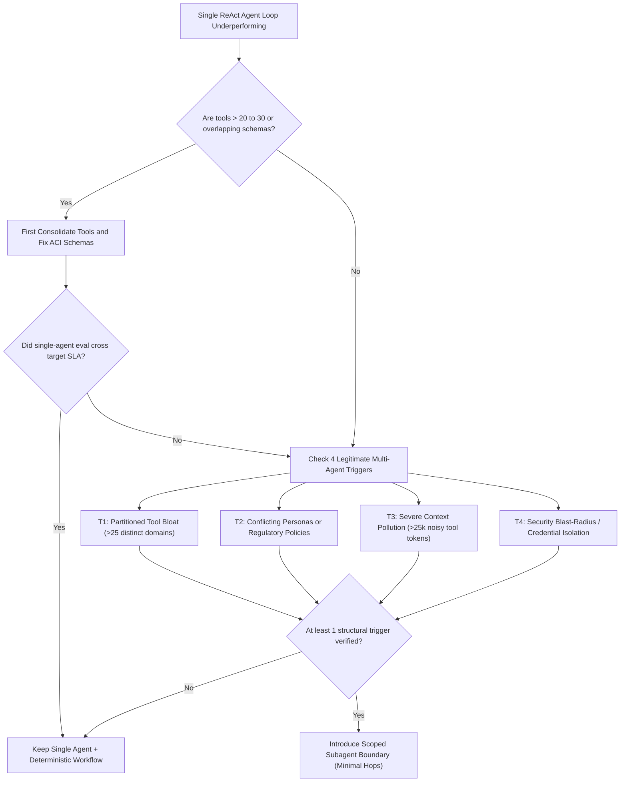
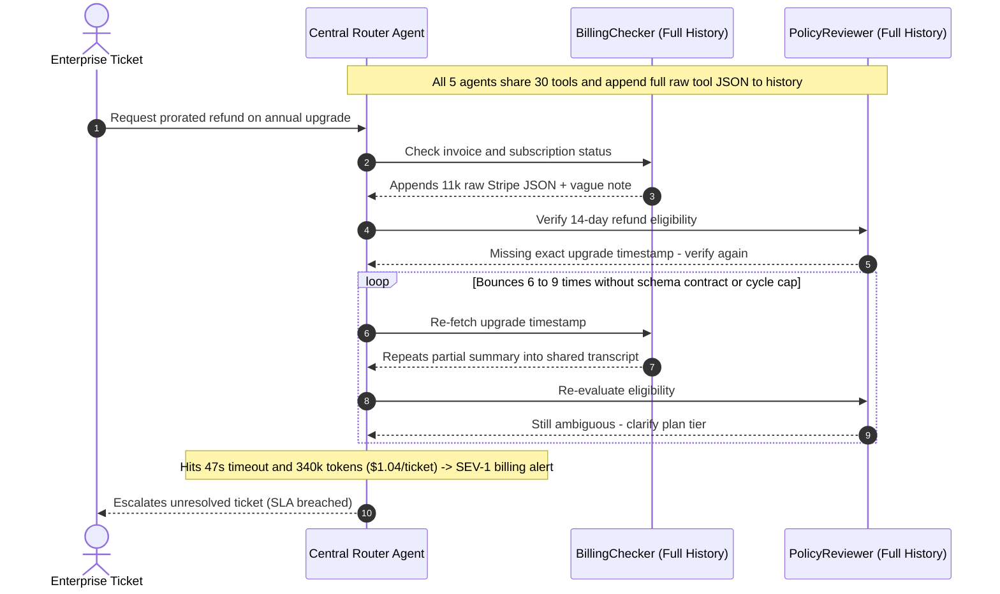

# Module 00: When One Agent Isn't Enough

> **Prerequisites:** [Track 10, Module 03: Building a ReAct Agent From Scratch](../../10-ai-agents/03-building-a-react-agent-from-scratch/README.md), [Track 10, Module 15: Agent Failure Modes and Debugging](../../10-ai-agents/15-agent-failure-modes-and-debugging/README.md), and [Track 10, Module 16: Cost and Latency Control in Agents](../../10-ai-agents/16-cost-and-latency-control-in-agents/README.md).  
> **Estimated Reading Time:** 35 minutes  
> **Target Audience:** AI Backend Engineers, Staff Distributed Systems Architects, Agent Platform Engineers

> [!TIP]
> **The Golden Rule of Multi-Agent Discipline:** Exhaust single-agent optimization—tighter Agent-Computer Interfaces (ACIs), structured outputs, deterministic workflows, and prompt caching—**before** spawning a second agent. Every additional agent boundary multiplies coordination surface, compounds failure probabilities ($P_{\text{MAS}} = \prod p_i$), and duplicates prefill context across hops; split only when tool bloat, policy/persona conflict, context pollution, or security blast-radius boundaries make a single loop structurally unsafe or ineffective.

---

## Why This Matters

Modern agent frameworks make spawning a five-agent team look deceptively cheap: define `"Researcher"`, `"Planner"`, `"Analyst"`, `"Reviewer"`, and `"Writer"` in twenty lines of Python, hit run, and watch transcripts scroll by in a terminal. In early demos, that choreography feels impressive.

In production, premature multi-agent architectures regularly perform **worse** than a single disciplined loop—often at `4x–10x` the token spend and `3x–5x` the p95 latency. Empirically, Cemri et al. (*Why Do Multi-Agent LLM Systems Fail?*, `arXiv:2503.13657`) analyzed over `1,600` execution traces across `7` popular multi-agent frameworks (the **MAST** taxonomy) and identified `14` distinct failure modes across three clusters: **Specification and System Design** (~`41.8%` of failures), **Inter-Agent Misalignment** (~`36.9%`), and **Task Verification and Termination** (~`21.3%`). Notice that nearly `80%` of production multi-agent failures come not from weak foundation models, but from the coordination seams introduced by splitting one loop into many.

Similarly, Anthropic's engineering guidance (*Building Effective Agents*) advises starting with the simplest composable pattern possible—usually a single well-tooled agent or deterministic workflow—and introducing multi-agent boundaries only when measurable single-agent bottlenecks appear. This module gives you the **empirical split gate**, quantitative compounding math, and defensive architectural analysis to know exactly when one agent stops scaling and how to split safely when it does.

---

## 1. The 4 Legitimate Triggers vs. Premature Multi-Agent Proliferation

Before introducing a second LLM loop, diagnose *why* your single agent is failing. Most apparent "reasoning failures" inside single agents turn out to be **tool-schema clutter** or **missing deterministic workflow structure** rather than an inherent inability of one context window to solve the problem.



### The 4 Structural Triggers That Justify Multi-Agent Decomposition

1. **Irreducible Tool Bloat (`> 20–30` Overlapping Schemas):**
   Every tool definition consumes `150–400` permanent input tokens in the system prefix (`35` tools = `5,250–14,000` tokens re-prefilled on *every* turn). Worse, when a single agent holds `30+` semantically overlapping actions (`fetch_customer_billing`, `lookup_stripe_invoice`, `get_account_ledger`), tool-selection accuracy degrades sharply. *Rule of thumb:* first merge redundant tools into fewer, clean **Agent-Computer Interfaces** (`arXiv:2405.15793`). Split into domain agents only when unrelated domains genuinely require `> 20–25` distinct non-collapsible tools.
2. **Role, Persona, and Policy Conflict:**
   Asking one system prompt to be simultaneously *"maximally empathetic and generous in customer retention"* AND *"strictly adversarial in fraud & compliance audit"* creates instruction interference inside the same attention context. Separating an empathetic Frontline Triage agent from a strict, read-only Compliance Verifier enforces clean policy boundaries without prompt-priority bleed.
3. **Cross-Domain Context Pollution (`Lost-in-the-Middle`):**
   An investigation that reads `15` raw log files, `8` web pages, or `12` SQL result tables quickly accumulates `30,000–80,000` tokens of ephemeral scratchpad noise. Even when within nominal context limits, attention recall degrades in the middle of long noisy trajectories (`arXiv:2307.03172`), causing the agent to forget constraints stated at turn `0`. Offloading noisy inspection to an ephemeral subagent that returns a `400`-token structured summary keeps the primary agent's context razor-sharp.
4. **Security Blast-Radius & Least-Privilege Credential Isolation:**
   Never run untrusted external data ingestion (scraping arbitrary web pages, reading external customer emails, parsing third-party PDFs) inside the same privilege boundary that holds `POST /refunds`, `DELETE /users`, or production SQL write credentials. Indirect prompt injection inside an external document can hijack a single monolithic agent into calling destructive tools. Splitting an **untrusted read-only reader subagent** (zero write tools, strict JSON schema output) from a **privileged deterministic/scoped executor** contains blast radius architecturally.

### Quantitative Mechanics: Reliability Compounding, Context Amplification & Latency

Adding agents imposes three deterministic mathematical penalties that every backend architect must compute up front:

- **Sequential Reliability Compounding:** Consider a chain of $N$ sequential inter-agent stages where agent $i$ completes its local task accurately with probability $p_i$ and the handoff boundary between agent $i$ and $i+1$ preserves schema/intent without information loss with probability $c_{i,i+1}$:

$$P_{\text{MAS}} = \prod_{i=1}^{N} p_i \cdot \prod_{i=1}^{N-1} c_{i,i+1}$$

Even if every specialist achieves $p_i = 0.92$ and every handoff loses information only `5%` of the time ($c = 0.95$), a `5`-agent chain collapses to $0.92^5 \cdot 0.95^4 \approx 0.537$ (`53.7%` end-to-end success)—far worse than a single tightened loop at `88%`.

- **Inter-Agent Context Duplication & Token Amplification:** Suppose a workflow spans $k$ agents, each executing $m_i$ turns while reading system prompt $S_i$, tool schema block $T_i$, shared conversation history $H_{\text{shared}, i}$, and turn observations $\Delta_{i,j}$. Total cost scales as:

$$C_{\text{total}} = \sum_{i=1}^{k} \sum_{t=1}^{m_i} \left( S_i + T_i + H_{\text{shared}, i} + \sum_{j < t} \Delta_{i,j} \right) \cdot r_{\text{in}} + O_{\text{total}} \cdot r_{\text{out}}$$

When `4` agents naively inherit full shared history (`H_shared`) and `3` turns each, re-prefilling duplicated prefix/history tokens routinely amplifies total input tokens by **`4x–8x`** compared to a single agent—even if total output tokens stay similar.

- **Sequential Hop Latency Tax:** Unless agents execute strictly in parallel, total wall-clock latency accumulates every LLM Time-to-First-Token ($L_{\text{TTFT}}$), decode ($L_{\text{decode}}$), tool RTT ($L_{\text{tool}}$), and serialization/routing handoff overhead ($L_{\text{handoff}}$):

$$L_{\text{seq}} = \sum_{i=1}^{k} \left( L_{\text{TTFT}, i} + L_{\text{decode}, i} + L_{\text{tool}, i} + L_{\text{handoff}, i} \right)$$

---

## 2. Systematic Comparison Matrix: Single Agent + Workflows vs. Multi-Agent Systems

| Architectural Dimension | Tight Single Agent + Deterministic Workflow | Multi-Agent System (Scoped Subagents) | Engineering Trade-Off |
| :--- | :--- | :--- | :--- |
| **Tool Surface Area** | `<= 12–15` consolidated ACI tools | `4–8` domain-scoped tools per agent | Single agent degrades past ~`20–30` overlapping tools |
| **Context Hygiene** | Linear single thread; requires explicit compaction | Isolated subagent scratchpads emit concise deltas | Multi-agent avoids `40k+` raw noise polluting root reasoning |
| **Failure Surface** | Single-loop tool/termination errors | All single-loop risks + **14 MAST modes** (`arXiv:2503.13657`) | Inter-agent misalignment adds ~`37%` new coordination bugs |
| **End-to-End Reliability** | Governed by single trajectory $p_{\text{single}}$ | Compounded $P_{\text{MAS}} = \prod p_i \cdot \prod c_{i,i+1}$ | Sequential multi-agent drops reliability unless stages parallelize or self-verify |
| **Security Blast Radius** | Shared credential & prompt-injection domain | Separate read-only ingestion vs privileged executor | Mandatory split when processing untrusted external content alongside writes |
| **Latency Profile** | Minimum round-trips (`1–4` turns typical) | Higher sequential floor; faster **only** via parallel fan-out | Never split sequential chains expecting lower latency |
| **Token Cost Multiplier** | `1.0x` baseline (maximizes KV prefix cache hits) | `1.5x–2.5x` (scoped deltas) up to `5x–10x` (naive full history) | Naive history passing destroys prompt caching and explodes spend |
| **Debuggability & Replay** | Single linear trace + deterministic step replay | Distributed trace trees, partial state forks, timing skew | Multi-agent requires correlation IDs and strict handoff contracts |

---

## 3. Production War Story Post-Mortem: The \$62,000 Five-Agent Triage Cascade

| Field | Incident Details |
| :--- | :--- |
| **Severity** | **SEV-1** (Runaway Inference Spend & Enterprise Support SLA Degradation) |
| **Detection / Resolution Time** | Detected `48` hours post-deploy via cloud billing spike alert / Mitigated in `4` hours via feature flag rollback to single-agent v1 + emergency architecture collapse |
| **Impact** | **\$62,000** unexpected weekend LLM spend (`13x` baseline per ticket); ticket auto-resolution dropped from `86%` to `58%`; `19%` of enterprise tickets breached `15s` p95 response SLA |

### What Happened

A SaaS support platform operated a stable single-agent triage bot achieving `86%` accurate resolution at `\$0.08` per ticket and `4.2s` p95 latency. Seeking higher accuracy on complex refund disputes, the team replaced it with a five-agent architecture (`Router -> KnowledgeResearcher -> BillingChecker -> PolicyReviewer -> ResponseWriter`) modeled on a generic role-playing template.

To "avoid losing context," every agent received the **entire shared message history** plus all `30` company tools. Within hours of production rollout, two MAST failure modes collided on edge-case refund tickets:

1. **Inter-Agent Misalignment (`Information Withholding` & `Role Ambiguity`):** `BillingChecker` retrieved raw `40`-line Stripe JSON payloads but summarized `"Customer upgraded mid-cycle"` without quoting the prorated invoice timestamp. `PolicyReviewer` refused approval and asked `BillingChecker` to re-verify.
2. **Unbounded Ping-Pong & Context Amplification:** Because `Router` had no pair-transition cap and no strict handoff schema, `PolicyReviewer`, `BillingChecker`, and `KnowledgeResearcher` bounced vague clarification messages back and forth an average of **`18` hops** per disputed ticket—re-prefilling `340,000` input tokens per ticket (`\$1.04`/ticket, `47s` p95 latency) before hitting step timeouts and returning raw apology fallbacks.



### Root Cause Analysis

- **Zero Legitimate Split Trigger on `Router/Researcher/Writer`:** `ResponseWriter` and `KnowledgeResearcher` shared non-conflicting instructions and used `< 10` total core tools; splitting them added pure latency and handoff entropy.
- **Full-Transcript Sharing & Unscoped Tools:** Giving every specialist `30` tools and full raw JSON logs triggered quadratic prefill bloat and MAST *Inter-Agent Misalignment*.
- **No Reliability/Cost Pre-Flight Gate:** The team shipped `5` sequential hops without modeling $P_{\text{MAS}}$ compounding or bounding hop transitions.

### The Fix & Architectural Hardening

- **Collapsed 5 Agents Back to 1 Primary Loop + 1 Scoped Audit Call:** Restored a deterministic intake router (`0` LLM hops via metadata tags) feeding **one** primary triage agent consolidated down to `7` crisp ACI tools (`86%` -> `91%` resolution!).
- **Strict Blast-Radius Split Only for High-Value Refunds (`> \$500`):** Retained a single read-only **Compliance Gate** subcall that receives a `350`-token structured claim packet (zero raw JSON spam) and returns a strict `approved | rejected | escalate_human` enum.
- **Result:** Ticket cost dropped from `\$1.04` to `\$0.06` (`17x` reduction), p95 latency stabilized at `3.1s`, and resolution accuracy climbed to `91%`.

---

## 4. Multi-Language Production Implementation: Single-vs-Multi-Agent Split Gate & Cost/Reliability Analyzer

Before writing multi-agent orchestration code, production platform teams run an automated **Decomposition Readiness Gate** in CI or architecture reviews. Below is a complete implementation across **Go**, **TypeScript**, **Python**, and **C#** that enforces the 4 structural triggers and computes compounded reliability $P_{\text{MAS}}$ and context-duplication cost amplification.

````carousel

```go
package agentgate

import (
	"fmt"
	"math"
)

type DecisionVerdict string

const (
	VerdictKeepSingle     DecisionVerdict = "KEEP_SINGLE_AGENT"
	VerdictRefactorFirst  DecisionVerdict = "REFACTOR_ACI_OR_WORKFLOW_FIRST"
	VerdictSplitScoped    DecisionVerdict = "SPLIT_SCOPED_SUBAGENTS"
)

type WorkloadSpec struct {
	Name                     string
	ToolCount                int
	HasConflictingPolicies   bool
	MaxContextNoiseTokens    int
	RequiresBlastRadiusSplit bool
	SingleAgentSuccessRate   float64
	ProposedHops             int
	PerAgentReliability      float64
	HandoffAlignmentRate     float64
	SharedHistoryTokens      int
	ScopedDeltaTokens        int
}

type GateAssessment struct {
	Verdict               DecisionVerdict
	Triggers              []string
	CompoundedMASProb     float64
	ReliabilityDelta      float64
	NaiveTokenAmpFactor   float64
	ScopedTokenAmpFactor  float64
	RecommendationSummary string
}

func EvaluateSplitGate(spec WorkloadSpec) GateAssessment {
	if spec.ProposedHops < 1 {
		spec.ProposedHops = 1
	}
	var triggers []string
	if spec.ToolCount > 24 {
		triggers = append(triggers, fmt.Sprintf("tool_bloat(%d>24)", spec.ToolCount))
	}
	if spec.HasConflictingPolicies {
		triggers = append(triggers, "role_or_policy_conflict")
	}
	if spec.MaxContextNoiseTokens > 25000 {
		triggers = append(triggers, fmt.Sprintf("context_pollution(%d_tokens)", spec.MaxContextNoiseTokens))
	}
	if spec.RequiresBlastRadiusSplit {
		triggers = append(triggers, "blast_radius_credential_isolation")
	}

	pMAS := math.Pow(spec.PerAgentReliability, float64(spec.ProposedHops)) *
		math.Pow(spec.HandoffAlignmentRate, float64(spec.ProposedHops-1))
	delta := pMAS - spec.SingleAgentSuccessRate

	baseTokens := math.Max(1, float64(spec.SharedHistoryTokens))
	naiveAmp := float64(spec.ProposedHops) * (1.0 + 0.35*float64(spec.ProposedHops-1))
	scopedAmp := (baseTokens + float64(spec.ProposedHops*spec.ScopedDeltaTokens)) / baseTokens

	var verdict DecisionVerdict
	var summary string
	switch {
	case len(triggers) == 0 && spec.SingleAgentSuccessRate >= 0.85:
		verdict = VerdictKeepSingle
		summary = "Zero structural triggers; keep single loop and optimize prompt/caching."
	case spec.RequiresBlastRadiusSplit || len(triggers) >= 2:
		verdict = VerdictSplitScoped
		summary = "Isolate credential/context boundaries with scoped delta handoffs."
	case spec.ToolCount > 24 && !spec.HasConflictingPolicies && !spec.RequiresBlastRadiusSplit:
		verdict = VerdictRefactorFirst
		summary = "Consolidate overlapping tools (ACI) and deterministic workflow edges before splitting."
	default:
		verdict = VerdictRefactorFirst
		summary = "Tighten single-agent evals and context compaction prior to adding hops."
	}

	return GateAssessment{
		Verdict:               verdict,
		Triggers:              triggers,
		CompoundedMASProb:     pMAS,
		ReliabilityDelta:      delta,
		NaiveTokenAmpFactor:   naiveAmp,
		ScopedTokenAmpFactor:  scopedAmp,
		RecommendationSummary: summary,
	}
}
```

<!-- slide -->

```typescript
export type DecisionVerdict =
  | "KEEP_SINGLE_AGENT"
  | "REFACTOR_ACI_OR_WORKFLOW_FIRST"
  | "SPLIT_SCOPED_SUBAGENTS";

export interface WorkloadSpec {
  readonly name: string;
  readonly toolCount: number;
  readonly hasConflictingPolicies: boolean;
  readonly maxContextNoiseTokens: number;
  readonly requiresBlastRadiusSplit: boolean;
  readonly singleAgentSuccessRate: number;
  readonly proposedHops: number;
  readonly perAgentReliability: number;
  readonly handoffAlignmentRate: number;
  readonly sharedHistoryTokens: number;
  readonly scopedDeltaTokens: number;
}

export interface GateAssessment {
  readonly verdict: DecisionVerdict;
  readonly triggers: readonly string[];
  readonly compoundedMasProb: number;
  readonly reliabilityDelta: number;
  readonly naiveTokenAmpFactor: number;
  readonly scopedTokenAmpFactor: number;
  readonly summary: string;
}

export function evaluateSplitGate(spec: WorkloadSpec): GateAssessment {
  const hops = Math.max(1, spec.proposedHops);
  const triggers: string[] = [];

  if (spec.toolCount > 24) {
    triggers.push(`tool_bloat(${spec.toolCount}>24)`);
  }
  if (spec.hasConflictingPolicies) {
    triggers.push("role_or_policy_conflict");
  }
  if (spec.maxContextNoiseTokens > 25_000) {
    triggers.push(`context_pollution(${spec.maxContextNoiseTokens}_tokens)`);
  }
  if (spec.requiresBlastRadiusSplit) {
    triggers.push("blast_radius_credential_isolation");
  }

  const compoundedMasProb =
    Math.pow(spec.perAgentReliability, hops) *
    Math.pow(spec.handoffAlignmentRate, hops - 1);
  const reliabilityDelta = compoundedMasProb - spec.singleAgentSuccessRate;

  const baseTokens = Math.max(1, spec.sharedHistoryTokens);
  const naiveTokenAmpFactor = hops * (1 + 0.35 * (hops - 1));
  const scopedTokenAmpFactor =
    (baseTokens + hops * spec.scopedDeltaTokens) / baseTokens;

  let verdict: DecisionVerdict;
  let summary: string;

  if (triggers.length === 0 && spec.singleAgentSuccessRate >= 0.85) {
    verdict = "KEEP_SINGLE_AGENT";
    summary = "No structural split trigger detected; optimize single agent.";
  } else if (spec.requiresBlastRadiusSplit || triggers.length >= 2) {
    verdict = "SPLIT_SCOPED_SUBAGENTS";
    summary = "Split along strict security/context boundaries with delta handoffs.";
  } else {
    verdict = "REFACTOR_ACI_OR_WORKFLOW_FIRST";
    summary = "Consolidate tools and add deterministic workflow routing before multi-agent.";
  }

  return {
    verdict,
    triggers,
    compoundedMasProb,
    reliabilityDelta,
    naiveTokenAmpFactor,
    scopedTokenAmpFactor,
    summary,
  };
}
```

<!-- slide -->

```python
"""
split_gate_analyzer.py
Production architectural gate quantifying whether a workload justifies multi-agent decomposition.
"""
from dataclasses import dataclass
from typing import Literal

Verdict = Literal[
    "KEEP_SINGLE_AGENT",
    "REFACTOR_ACI_OR_WORKFLOW_FIRST",
    "SPLIT_SCOPED_SUBAGENTS",
]


@dataclass(frozen=True)
class WorkloadSpec:
    name: str
    tool_count: int
    has_conflicting_policies: bool
    max_context_noise_tokens: int
    requires_blast_radius_split: bool
    single_agent_success_rate: float
    proposed_hops: int = 3
    per_agent_reliability: float = 0.92
    handoff_alignment_rate: float = 0.95
    shared_history_tokens: int = 6_000
    scoped_delta_tokens: int = 900


@dataclass(frozen=True)
class GateAssessment:
    verdict: Verdict
    triggers: tuple[str, ...]
    compounded_mas_prob: float
    reliability_delta: float
    naive_token_amp_factor: float
    scoped_token_amp_factor: float
    summary: str


def evaluate_split_gate(spec: WorkloadSpec) -> GateAssessment:
    hops = max(1, spec.proposed_hops)
    triggers: list[str] = []

    if spec.tool_count > 24:
        triggers.append(f"tool_bloat({spec.tool_count}>24)")
    if spec.has_conflicting_policies:
        triggers.append("role_or_policy_conflict")
    if spec.max_context_noise_tokens > 25_000:
        triggers.append(f"context_pollution({spec.max_context_noise_tokens}_tokens)")
    if spec.requires_blast_radius_split:
        triggers.append("blast_radius_credential_isolation")

    p_mas = (spec.per_agent_reliability ** hops) * (spec.handoff_alignment_rate ** (hops - 1))
    delta = p_mas - spec.single_agent_success_rate

    base = max(1, spec.shared_history_tokens)
    naive_amp = hops * (1.0 + 0.35 * (hops - 1))
    scoped_amp = (base + hops * spec.scoped_delta_tokens) / base

    if not triggers and spec.single_agent_success_rate >= 0.85:
        verdict: Verdict = "KEEP_SINGLE_AGENT"
        summary = "No structural trigger; keep single loop and rely on prompt caching."
    elif spec.requires_blast_radius_split or len(triggers) >= 2:
        verdict = "SPLIT_SCOPED_SUBAGENTS"
        summary = "Split strictly along security/context seams using scoped delta handoffs."
    else:
        verdict = "REFACTOR_ACI_OR_WORKFLOW_FIRST"
        summary = "Collapse overlapping tools and enforce deterministic workflow steps first."

    return GateAssessment(
        verdict=verdict,
        triggers=tuple(triggers),
        compounded_mas_prob=round(p_mas, 4),
        reliability_delta=round(delta, 4),
        naive_token_amp_factor=round(naive_amp, 2),
        scoped_token_amp_factor=round(scoped_amp, 2),
        summary=summary,
    )
```

<!-- slide -->

```csharp
using System;
using System.Collections.Generic;

namespace GenAI.MultiAgentGate;

public enum DecisionVerdict
{
    KeepSingleAgent,
    RefactorAciOrWorkflowFirst,
    SplitScopedSubagents
}

public sealed record WorkloadSpec(
    string Name,
    int ToolCount,
    bool HasConflictingPolicies,
    int MaxContextNoiseTokens,
    bool RequiresBlastRadiusSplit,
    double SingleAgentSuccessRate,
    int ProposedHops = 3,
    double PerAgentReliability = 0.92,
    double HandoffAlignmentRate = 0.95,
    int SharedHistoryTokens = 6000,
    int ScopedDeltaTokens = 900);

public sealed record GateAssessment(
    DecisionVerdict Verdict,
    IReadOnlyList<string> Triggers,
    double CompoundedMasProb,
    double ReliabilityDelta,
    double NaiveTokenAmpFactor,
    double ScopedTokenAmpFactor,
    string Summary);

public static class SplitGateEvaluator
{
    public static GateAssessment Evaluate(WorkloadSpec spec)
    {
        int hops = Math.Max(1, spec.ProposedHops);
        var triggers = new List<string>();

        if (spec.ToolCount > 24)
            triggers.Add($"tool_bloat({spec.ToolCount}>24)");
        if (spec.HasConflictingPolicies)
            triggers.Add("role_or_policy_conflict");
        if (spec.MaxContextNoiseTokens > 25000)
            triggers.Add($"context_pollution({spec.MaxContextNoiseTokens}_tokens)");
        if (spec.RequiresBlastRadiusSplit)
            triggers.Add("blast_radius_credential_isolation");

        double pMas = Math.Pow(spec.PerAgentReliability, hops)
                    * Math.Pow(spec.HandoffAlignmentRate, hops - 1);
        double delta = pMas - spec.SingleAgentSuccessRate;

        double baseTokens = Math.Max(1, spec.SharedHistoryTokens);
        double naiveAmp = hops * (1.0 + 0.35 * (hops - 1));
        double scopedAmp = (baseTokens + hops * spec.ScopedDeltaTokens) / baseTokens;

        DecisionVerdict verdict;
        string summary;

        if (triggers.Count == 0 && spec.SingleAgentSuccessRate >= 0.85)
        {
            verdict = DecisionVerdict.KeepSingleAgent;
            summary = "No structural trigger detected; optimize single agent first.";
        }
        else if (spec.RequiresBlastRadiusSplit || triggers.Count >= 2)
        {
            verdict = DecisionVerdict.SplitScopedSubagents;
            summary = "Isolate security/context boundaries with scoped delta handoffs.";
        }
        else
        {
            verdict = DecisionVerdict.RefactorAciOrWorkflowFirst;
            summary = "Consolidate overlapping tools and use deterministic workflow edges first.";
        }

        return new GateAssessment(
            verdict,
            triggers,
            Math.Round(pMas, 4),
            Math.Round(delta, 4),
            Math.Round(naiveAmp, 2),
            Math.Round(scopedAmp, 2),
            summary);
    }
}
```

````

---

## 5. Practical Hands-On Verification CLI Workflows

Run these offline Python 3.13 verification scripts directly in your terminal—zero external packages or API keys required.

### Workflow 1: Compounding Multi-Agent Reliability Sweep

Quantify $P_{\text{MAS}} = p^N \cdot c^{N-1}$ across `1..6` sequential inter-agent hops against an `88%` single-agent baseline:

```bash
python -c '
def compound_success(hops, p_agent=0.92, c_handoff=0.95):
    return (p_agent ** hops) * (c_handoff ** max(0, hops - 1))

single_baseline = 0.88
print(f"Single-Agent Tight Loop Baseline: p={single_baseline:.3f} (88.0%)")
for n in [1, 2, 3, 4, 5, 6]:
    p_mas = compound_success(n)
    delta = p_mas - single_baseline
    print(f"hops={n} (p={0.92:.2f}, c={0.95:.2f}) -> P_MAS={p_mas:.3f} ({p_mas*100:5.1f}%) | vs single: {delta:+.3f}")
'
```

**Expected Output:**

```text
Single-Agent Tight Loop Baseline: p=0.880 (88.0%)
hops=1 (p=0.92, c=0.95) -> P_MAS=0.920 ( 92.0%) | vs single: +0.040
hops=2 (p=0.92, c=0.95) -> P_MAS=0.804 ( 80.4%) | vs single: -0.076
hops=3 (p=0.92, c=0.95) -> P_MAS=0.703 ( 70.3%) | vs single: -0.177
hops=4 (p=0.92, c=0.95) -> P_MAS=0.614 ( 61.4%) | vs single: -0.266
hops=5 (p=0.92, c=0.95) -> P_MAS=0.537 ( 53.7%) | vs single: -0.343
hops=6 (p=0.92, c=0.95) -> P_MAS=0.469 ( 46.9%) | vs single: -0.411
```

Notice how adding a 5-agent sequential pipeline drops end-to-end reliability to `53.7%` (`-34.3` percentage points vs the `88%` single-agent loop) unless parallelized or guarded by deterministic verification.

### Workflow 2: Inter-Agent Context Duplication & Token Amplification Profiler

Compare total input/output tokens and inference spend (`\$3.00/1M` input, `\$15.00/1M` output) across a single agent, a naive full-history 4-agent team, and a context-scoped 4-agent team:

```bash
python -c '
def simulate_spend(mode, turns=3, agents=4, sys_tok=900, tool_tok=1800, hist_tok=6000, delta_tok=750, out_tok=450):
    in_price = 3.00 / 1_000_000
    out_price = 15.00 / 1_000_000
    total_in = 0
    total_out = 0
    if mode == "single":
        for t in range(turns):
            total_in += sys_tok + tool_tok + hist_tok + t * delta_tok
            total_out += out_tok
    elif mode == "naive_mas_full_history":
        for a in range(agents):
            for t in range(turns):
                shared = hist_tok + a * (turns * delta_tok)
                total_in += sys_tok + tool_tok + shared + t * delta_tok
                total_out += out_tok
    elif mode == "scoped_mas_deltas":
        for a in range(agents):
            scoped_tools = tool_tok // agents
            scoped_hist = 1200 + a * 400
            for t in range(turns):
                total_in += sys_tok + scoped_tools + scoped_hist + t * 350
                total_out += out_tok // 2
    cost = total_in * in_price + total_out * out_price
    return total_in, total_out, cost

base_in, base_out, base_cost = simulate_spend("single")
for m in ["single", "naive_mas_full_history", "scoped_mas_deltas"]:
    ti, to, c = simulate_spend(m)
    print(f"{m:<24} | in_tok={ti:>7,} | out_tok={to:>5,} | cost=${c:.4f} | ratio={c/base_cost:.2f}x")
'
```

**Expected Output:**

```text
single                   | in_tok= 28,350 | out_tok=1,350 | cost=$0.1053 | ratio=1.00x
naive_mas_full_history   | in_tok=153,900 | out_tok=5,400 | cost=$0.5427 | ratio=5.15x
scoped_mas_deltas        | in_tok= 42,000 | out_tok=2,700 | cost=$0.1665 | ratio=1.58x
```

Full-history sharing across `4` agents blows cost up **`5.15x`** (`\$0.5427` vs `\$0.1053`), whereas scoped deltas keep the multi-agent overhead down to `1.58x`.

### Workflow 3: Empirical Decomposition Readiness Gate Across 5 Real Workloads

Run the architectural split gate across five representative backend systems:

```bash
python -c '
def evaluate_split_gate(name, tools, conflict, noise_tok, sec_isolation, single_p):
    reasons = []
    if tools > 24:
        reasons.append(f"tool_bloat({tools}>24)")
    if conflict:
        reasons.append("policy_conflict")
    if noise_tok > 25000:
        reasons.append(f"context_pollution({noise_tok}tok)")
    if sec_isolation:
        reasons.append("blast_radius_isolation")

    if len(reasons) == 0 and single_p >= 0.85:
        verdict = "KEEP_SINGLE_AGENT"
    elif "blast_radius_isolation" in reasons or len(reasons) >= 2:
        verdict = "SPLIT_SCOPED_SUBAGENTS"
    elif tools > 24 and single_p < 0.85:
        verdict = "REFACTOR_ACI_OR_WORKFLOW_FIRST"
    else:
        verdict = "REFACTOR_SINGLE_LOOP"
    fallback = ["none"]
    print(f"{name:<32} -> {verdict:<30} | triggers={reasons if reasons else fallback}")

cases = [
    ("FAQ + Order Lookup Bot", 6, False, 4000, False, 0.91),
    ("Bloated CRM Assistant", 34, False, 9000, False, 0.72),
    ("Web Research + SQL Refund Exec", 11, True, 42000, True, 0.79),
    ("Multi-Repo Security Auditor", 14, False, 58000, True, 0.74),
    ("Invoice Extraction Pipeline", 4, False, 3500, False, 0.94),
]
for c in cases:
    evaluate_split_gate(*c)
'
```

**Expected Output:**

```text
FAQ + Order Lookup Bot           -> KEEP_SINGLE_AGENT              | triggers=['none']
Bloated CRM Assistant            -> REFACTOR_ACI_OR_WORKFLOW_FIRST | triggers=['tool_bloat(34>24)']
Web Research + SQL Refund Exec   -> SPLIT_SCOPED_SUBAGENTS         | triggers=['policy_conflict', 'context_pollution(42000tok)', 'blast_radius_isolation']
Multi-Repo Security Auditor      -> SPLIT_SCOPED_SUBAGENTS         | triggers=['context_pollution(58000tok)', 'blast_radius_isolation']
Invoice Extraction Pipeline      -> KEEP_SINGLE_AGENT              | triggers=['none']
```

### Hands-On Exercises

1. **Prompt-Cache Sensitivity Audit:** Extend Workflow 2 by modeling a `75%` prompt-cache discount on repeated prefix tokens (`sys_tok + tool_tok`) for the `single` agent vs `0%` prefix hits on a naive multi-agent chain that mutates system prompts per hop. Observe how the effective cost ratio widens past `8x`.
2. **Tool Consolidation Before Splitting:** Take the `"Bloated CRM Assistant"` (`34` tools) from Workflow 3 and group `18` redundant CRUD endpoints (`get_user_by_email`, `get_user_by_id`, `search_user_name`) into `3` parameterized ACI tools. Verify how dropping `tool_count` from `34` to `19` moves the verdict back toward single-agent operation.
3. **Optional Live API Ablation (Requires API Key):** Construct a single-agent prompt with `25` noisy mock tool definitions vs a `5`-tool split domain subagent on `10` realistic multi-step test cases using the OpenAI or Anthropic SDK (`temperature=0`), and log exact tool-call precision and total tokens.

### Independent Challenge

A healthcare operations team wants to automate prior-authorization packet assembly. The agent must (a) parse unstructured scanned fax OCR dumps (`45k` tokens per patient folder containing potential untrusted text from third-party PDFs), (b) retrieve hospital EHR policies (`6` read-only tools), and (c) submit final authorization claims to an external payer API (`2` write/mutate tools requiring strict HIPAA audit logs). An engineer proposes building a 6-agent pipeline: `Intake -> OCRCleaner -> PolicyMatcher -> DraftWriter -> ClinicalReviewer -> Submitter`, passing full `45k` OCR text across all 6 agents. Critique this proposal quantitatively and design the minimal safe architecture.

<details><summary>Architectural Discussion</summary>

Passing `45k` raw OCR text through `6` sequential agents triggers catastrophic context duplication (`~270k+` re-prefilled tokens) and compounds reliability down to roughly `0.92^6 * 0.95^5 ≈ 0.469` (`46.9%`). However, keeping *everything* in one monolithic agent violates **Trigger #3 (Context Pollution)** and **Trigger #4 (Blast-Radius Isolation)** because untrusted external fax PDFs sit directly alongside external payer write tools.

The optimal architecture uses **exactly two agent boundaries** separated by deterministic code:
1. **Untrusted Read-Only Extraction Subagent (Zero Write Tools):** Processes the `45k`-token fax OCR in an isolated context and emits a schema-validated `~600`-token `PatientClinicalPacket` (dropping raw OCR noise).
2. **Deterministic Policy Check + Scoped Authorizer Agent:** Receives *only* the validated `600`-token packet + `6` EHR read tools to verify criteria; final payer `POST` happens only after deterministic schema checks (and human sign-off for edge flags), reducing cost by `> 80%` and isolating blast radius cleanly.

</details>

---

## 6. Common Mistakes & Troubleshooting

- **Splitting purely along "human org-chart roles" (`Planner`, `Writer`, `Reviewer`, `QA`):** Human teams split roles because human working memory and typing speed are slow. LLMs incur **zero typing speedup** from splitting a coherent reasoning task into separate prompts—instead, every split degrades context continuity and adds MAST misalignment seams.
- **Sharing raw conversation history & full tool sets across every agent:** Passing `messages[]` verbatim to all specialists triggers quadratic token growth, destroys prompt prefix cache reuse, and re-introduces tool bloat. Always pass scoped task briefs and domain-partitioned tools.
- **Confusing *multi-agent* with *multi-step deterministic workflows*:** A 3-step `Classify -> Extract JSON -> Verify with Rules -> Generate` pipeline can run inside standard application code calling `1` LLM with structured outputs (`Track 10, Module 01`). Do not wrap simple workflow stages in autonomous agent personas.
- **Ignoring interface failure rate $c_{i,i+1}$ in SLA modeling:** Teams benchmark each agent in isolation (`93%` pass rate) and assume the pipeline hits `93%`. In practice, subtle omissions across `4` handoffs drop end-to-end completion below `65%`.

---

## 7. Operational Validation Checkpoints & Checkpoint Quiz

### Operational Validation Checkpoints

<details><summary><strong>Checkpoint 1: Diagnosing why a 4-agent team failed at lower accuracy than 1 agent</strong></summary>

A backend team upgrades a single `85%`-accurate customer research agent into a 4-agent chain (`Decomposer -> Searcher -> FactChecker -> Synthesizer`), keeping the exact same underlying model. End-to-end task accuracy falls to `64%` and p95 latency triples. What two mathematical/empirical forces explain this regression?

**Validation:** First, **sequential reliability compounding** ($P_{\text{MAS}} = \prod_{i=1}^4 p_i \cdot \prod_{i=1}^3 c_{i,i+1}$): even if each specialist hits `91%` individually and handoffs succeed `95%` of the time, $0.91^4 \cdot 0.95^3 \approx 0.588$ (`58.8%`). Second, **MAST Inter-Agent Misalignment** (`arXiv:2503.13657`, ~`36.9%` of MAS failures): `Searcher` withholds subtle edge-case caveats when summarizing for `FactChecker`, and `FactChecker` performs shallow verification before `Synthesizer` runs. Latency triples because all 4 stages execute sequentially with fresh TTFT/decode overhead per hop.

</details>

<details><summary><strong>Checkpoint 2: Choosing ACI refactor vs. security-boundary agent split</strong></summary>

An internal DevOps bot currently holds `32` Kubernetes, Terraform, Slack, and PagerDuty tools in one loop (`71%` tool-selection accuracy) and regularly ingests external public GitHub issues before running production cluster commands. Should you keep one agent, consolidate tools only, or introduce a multi-agent boundary?

**Validation:** You need **both** ACI consolidation and a **security blast-radius split**. First, consolidate redundant read/list tools (e.g., merging 8 separate `k8s_get_*` tools into `k8s_inspect(resource_type)`). Second, because external GitHub issues are **untrusted external text** capable of indirect prompt injection, split a **read-only Untrusted Triage Subagent** (zero cluster write credentials) from a **privileged Execution Agent** behind schema validation and policy gates (**Trigger #4: Blast-Radius Isolation**).

</details>

<details><summary><strong>Checkpoint 3: Auditing a silent 6x token bill increase after adding subagents</strong></summary>

After splitting a `2`-turn single agent into `3` collaborating agents (`3` turns each), monthly input token usage jumps `6.2x` even though final answers are the exact same length. Where did the extra input tokens come from?

**Validation:** Every turn of every agent re-prefills its full context window: $C_{\text{in}} = \sum_i \sum_t (S_i + T_i + H_{\text{shared}, i} + \sum_{j<t} \Delta_{i,j})$. Because the `3` agents each ran `3` turns (`9` LLM calls vs `2` originally) and likely inherited the shared history $H_{\text{shared}}$ plus overlapping tool schemas, the team re-billed the entire prefix/history `9` times instead of `2`—and broke prompt KV-cache hits across distinct agent system prompts.

</details>

### Checkpoint Quiz

1. According to Cemri et al. (`arXiv:2503.13657`), what are the three top-level categories in the MAST failure taxonomy, and roughly what share of failures arise from specification design and inter-agent misalignment combined?
2. List the **4 structural triggers** that genuinely justify splitting a single agent into multiple agents.
3. If a sequential `4`-agent pipeline has per-agent accuracy $p = 0.90$ and inter-agent handoff fidelity $c = 0.95$, what is its theoretical end-to-end reliability $P_{\text{MAS}}$?
4. Why is placing an external email/web parser in the same agent loop as `execute_wire_transfer()` an architectural vulnerability even if prompt-engineering instructions say *"ignore malicious instructions"*?
5. Why should a team consolidate overlapping tools (ACI design) *before* splitting a single agent that holds `30` tools?

<details><summary>Answers</summary>

1. The three MAST categories are **Specification and System Design** (~`41.8%`), **Inter-Agent Misalignment** (~`36.9%`), and **Task Verification and Termination** (~`21.3%`). Combined, design specification errors and inter-agent misalignment account for nearly `78.7%` of all observed MAS failures.
2. (1) Irreducible tool bloat (`> 20–30` non-collapsible schemas degrading selection), (2) Conflicting roles/personas/policies inside one system prompt, (3) Severe context pollution (`Lost-in-the-Middle` from `30k+` tokens of noisy observations), and (4) Blast-radius / least-privilege credential isolation between untrusted inputs and privileged writes.
3. $P_{\text{MAS}} = 0.90^4 \cdot 0.95^3 = 0.6561 \cdot 0.857375 \approx 0.5625$ (`56.3%`).
4. System-prompt admonitions are probabilistic, not security boundaries. Indirect prompt injection inside an untrusted email/webpage shares the exact token stream as instructions, allowing an attacker to invoke `execute_wire_transfer()` directly if that credential lives in the same agent boundary.
5. Many apparent "multi-domain" tool sets are simply bloated CRUD wrappers that collapse cleanly from `30` tools down to `8–10` well-typed ACI tools, preserving `1` loop, higher reliability, lower latency, and full prompt-cache efficiency without multi-agent overhead.

</details>

---

## Further Reading & Sources

- [Why Do Multi-Agent LLM Systems Fail? (Cemri et al., 2025)](https://arxiv.org/abs/2503.13657) — empirical MAST taxonomy analyzing `1,600+` multi-agent execution traces across `7` frameworks.
- [Anthropic Engineering: Building Effective Agents](https://www.anthropic.com/engineering/building-effective-agents) — authoritative guidance on starting with single augmented LLMs and deterministic workflows before multi-agent orchestration.
- [Lost in the Middle: How Language Models Use Long Contexts (Liu et al., 2023)](https://arxiv.org/abs/2307.03172) — empirical foundation explaining context-pollution recall decay inside bloated single-agent loops.
- [SWE-agent: Agent-Computer Interfaces Enable Automated Software Engineering (Yang et al., 2024)](https://arxiv.org/abs/2405.15793) — principles for consolidating and hardening tool interfaces before splitting agents.
- [Track 10, Module 16: Cost and Latency Control in Agents](../../10-ai-agents/16-cost-and-latency-control-in-agents/README.md) — prompt caching, token budgets, and single-agent latency baselines.

## Next

[Module 01: Multi-Agent Topologies Overview](../01-multi-agent-topologies-overview/README.md)
