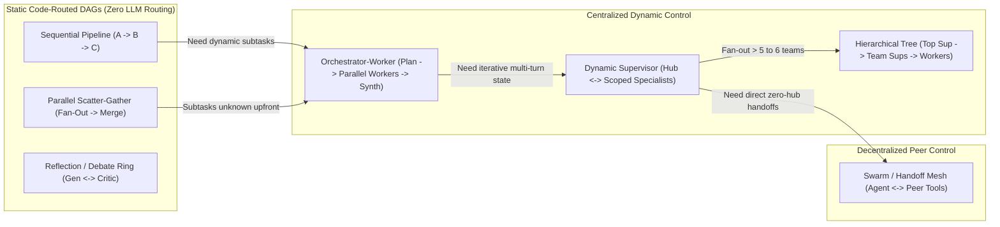
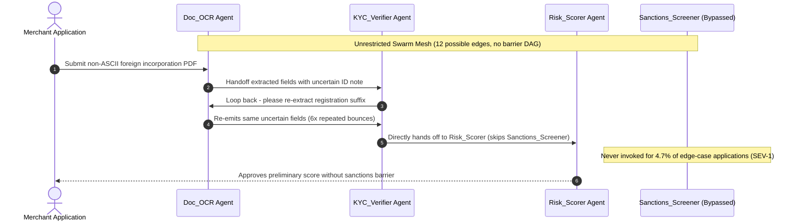

# Module 01: Multi-Agent Topologies Overview

> **Prerequisites:** [Module 00: When One Agent Isn't Enough](../00-when-one-agent-isnt-enough/README.md), [Track 11, Module 12: LangGraph: State and Nodes](../../11-langchain-and-langgraph/12-langgraph-state-and-nodes/README.md), and [Track 11, Module 13: LangGraph: Edges and Conditional Routing](../../11-langchain-and-langgraph/13-langgraph-edges-and-conditional-routing/README.md).  
> **Estimated Reading Time:** 35 minutes  
> **Target Audience:** AI Backend Engineers, Agent Orchestration Architects, Distributed Systems Engineers

> [!TIP]
> **The Golden Rule of Topology Selection:** Always adopt the topology with the **minimum routing freedom** your problem requires—and strictly separate your **Control Plane** (who executes next and under what hop/cost budget) from your **Data Plane** (what artifacts flow between nodes). Every unnecessary edge in a multi-agent graph turns a deterministic state machine into a non-reproducible token storm.

---

## Why This Matters

Once [Module 00](../00-when-one-agent-isnt-enough/README.md) proves a workload genuinely requires multiple isolated agent contexts or privilege domains, the single highest-leverage architectural choice you make is **topology**: the directed graph of who can invoke whom, who sees what data, and who owns termination.

Teams routinely treat all multi-agent architectures as interchangeable—wiring a fixed three-stage compliance check as a free-form peer-to-peer Swarm, or using a Dynamic Supervisor for tasks whose decomposition could run once in parallel. Every topology embeds hard trade-offs across **routing determinacy**, **asymptotic hop count**, **coupling surface**, and **critical-path latency**. Selecting an overly dynamic topology introduces non-deterministic audit trails, quadratic routing token overhead, and infinite handoff loops; selecting an overly rigid topology stalls dynamic problems or forces sequential bottlenecks. This module maps the **7 canonical multi-agent topologies** as concrete distributed state machines so you can match graph structure precisely to workload constraints.

---

## 1. The 7 Canonical Topologies & Control Plane vs. Data Plane Mechanics

Multi-agent topologies sit along a strict spectrum of **routing freedom**—from deterministic code-driven DAGs (`0` LLM routing calls) to centrally planned fan-out, iterative hub-and-spoke supervision, and decentralized peer handoffs:



### Control Plane vs. Data Plane Separation

Every multi-agent graph actually contains **two distinct networks** overlaid on the same nodes:

1. **Control Plane (Routing & Termination):** Determines *which node executes next*, checks hop/recursion caps, enforces pair-transition limits, and handles timeouts/escalations. Control decisions should inspect **lightweight routing metadata** (typed status enums, artifact pointers, unresolved task lists)—never `30KB` raw payloads.
2. **Data Plane (Artifacts & Evidence):** Carries scoped inputs, retrieved documents, SQL result files, code diffs, and verified summaries between workers and shared state stores/blackboards.

When teams **conflate the two planes**—forcing a Supervisor or Swarm router to ingest raw `8KB–30KB` worker tool logs inside every routing prompt—routing prefill scales quadratically $O(d^2)$ across rounds and triggers attention distraction (`Lost-in-the-Middle`). Separating data storage (passing typed artifact IDs or distilled `200`-token summaries on the control plane) keeps routing fast, cheap, and accurate.

### Quantitative Bounds Across the 7 Topologies

Let $k$ denote active subtasks/specialists, $d$ denote iterative rounds/depth, $h$ denote hierarchy height, $L_i$ denote single-agent execution time, and $L_{\text{route}}$ denote a central router LLM step:

- **1. Sequential Pipeline (`A -> B -> C`):**
  - *Hops / Routing LLM Calls:* $k$ hops, **`0` LLM routing calls** (deterministic code edges).
  - *Critical-Path Latency:* $L = \sum_{i=1}^{k} L_i$.
  - *Coupling Surface:* $O(k)$ adjacent pairs ($k - 1$ edges). Optimal when stages have strict causal dependencies and predictable sequence.
- **2. Parallel Scatter-Gather (Fixed Fan-Out + Code/LLM Merge):**
  - *Hops / Routing LLM Calls:* `2` logical stages (`fan-out` + `merge`), **`0` LLM routing calls**.
  - *Critical-Path Latency:* $L = \max_{i \in \{1..k\}} L_i + L_{\text{merge}}$. Optimal when subtasks are known statically at compile time (e.g., KYC + Sanctions + Fraud checks).
- **3. Orchestrator-Worker (Dynamic Plan -> Ephemeral Parallel Workers -> Synth):**
  - *Hops / Routing LLM Calls:* `3` logical stages (`plan -> parallel workers -> synth`), **`1` dynamic planner call**.
  - *Critical-Path Latency:* $L = L_{\text{orch}} + \max_{i \in \{1..k\}} L_{w_i} + L_{\text{synth}}$. Covered deeply in [Module 02](../02-the-orchestrator-worker-pattern/README.md).
- **4. Dynamic Supervisor (Central Stateful Hub <-> Domain Specialists):**
  - *Hops / Routing LLM Calls:* $2d + 1$ hops (each worker returns to the hub), $d + 1$ LLM routing calls.
  - *Critical-Path Latency:* $L = \sum_{t=1}^{d} (L_{\text{sup}, t} + L_{w_t}) + L_{\text{sup,final}}$. Covered deeply in [Module 03](../03-the-supervisor-pattern/README.md).
- **5. Hierarchical Tree (Root Supervisor -> Mid-Tier Team Supervisors -> Leaf Workers):**
  - *Hops / Routing LLM Calls:* Scales as $O(h \cdot d_{\text{local}})$ hops, capping per-supervisor branching factor at $b \le 5$ (or `5–6` specialists) so no single router suffers tool/agent-selection bloat.
  - *Coupling Surface:* $O(b \cdot h)$ cleanly isolated subtrees. Covered in [Module 04](../04-hierarchical-agent-teams/README.md).
- **6. Decentralized Swarm / Peer Handoff Mesh:**
  - *Hops / Routing LLM Calls:* $d$ direct hops (eliminates hub round-trip latency when Agent A hands directly to Agent B), $d$ peer routing decisions.
  - *Coupling Surface:* Worst-case **$O(N^2)$** ($N(N-1)$ directed peer handoff edges if unrestricted!). High non-determinism and ping-pong risk unless explicitly edge-pruned. Covered in [Module 05](../05-swarm-and-handoff-patterns/README.md).
- **7. Reflection / Debate Ring (`Generator <-> Critic`):**
  - *Hops / Routing LLM Calls:* $2r$ hops across $r$ bounded critique rounds; routing is typically deterministic (`Critic -> Generator` until `PASS` or `r == r_max`).
  - *Critical-Path Latency:* $L = \sum_{j=1}^{r} (L_{\text{gen}, j} + L_{\text{crit}, j})$. Optimal when iterative quality verification justifies `2x–4x` latency.

---

## 2. Systematic Comparison Matrix: The 7 Canonical Multi-Agent Topologies

| Topology | Control Mechanism | Routing Determinacy | Hops & Routing LLM Overhead | Coupling Surface | Context Isolation | Best Production Workload | Primary Anti-Pattern |
| :--- | :--- | :--- | :--- | :--- | :--- | :--- | :--- |
| **Sequential Pipeline** | Static code DAG edges | **100% Deterministic** | $k$ hops, `0` LLM routes | $O(k)$ linear | High (explicit stage schemas) | Predictable multi-stage transforms (`Parse -> Enrich -> Verify`) | Wrapping `3` fixed steps inside an LLM Supervisor |
| **Parallel Scatter-Gather** | Static fan-out + barrier merge | **100% Deterministic** | `2` stages, `0` LLM routes | $O(k)$ star | Very High (zero cross-worker chatter) | Independent fixed checks (`KYC + Sanctions + Credit`) | Running independent checks sequentially |
| **Orchestrator-Worker** | `1` dynamic planner + static fan-out/synth | **Semi-Deterministic** (DAG generated once) | `3` stages, `1` planner LLM call | $O(k)$ bounded | Very High (ephemeral `TaskBrief` isolation) | Dynamic unpredictable subtasks (`Multi-file PR`, `Deep Research`) | Unbounded fan-out (`N > 10`) causing `429` storms |
| **Dynamic Supervisor** | Stateful central hub (`Command(goto)`) | **Adaptive / Stateful** | $2d + 1$ hops, $d + 1$ LLM routes | $O(k)$ hub-and-spoke | Medium–High (requires scoped `HandoffDelta`) | Iterative reactive workflows (`Support Triage`, `Incident RCA`) | Returning raw `20k` tool logs to Supervisor |
| **Hierarchical Tree** | Multi-tier Supervisors (`Team Leads`) | **Adaptive / Partitioned** | $O(h \cdot d_{\text{local}})$ hops | $O(b \cdot h)$ tree | Very High (subteam boundary encapsulation) | Large org-scale systems (`10–30+` specialists) | Using 3 tree layers for only `4` total workers |
| **Decentralized Swarm** | Peer-to-peer handoff tool calls | **Low / Emergent** | $d$ direct hops, $d$ peer routes | Up to $O(N^2)$ mesh | Low (often shares active conversation thread) | Conversational customer concierge transitions (`Sales -> Tech`) | Unrestricted all-to-all edges on regulated pipelines |
| **Reflection / Debate Ring** | Fixed `Generator <-> Critic` loop + `r_max` | **High** (bounded loop predicate) | $2r$ hops, `0` external routes | $O(1)$ pair/ring | Medium (critic sees artifact + rubric only) | High-stakes code gen, SQL verification, policy audit | Missing convergence check / `r_max` infinite self-edit |

---

## 3. Production War Story Post-Mortem: The Swarm-on-a-Pipeline Compliance Outage

| Field | Incident Details |
| :--- | :--- |
| **Severity** | **SEV-1** (Regulatory Check Bypass Risk & Audit-Trail Replay Failure) |
| **Detection / Resolution Time** | Detected during SOC-2 / Fintech pre-audit trace sampling `6` days post-launch / Mitigated in `5` hours (feature halted, `1,940` onboardings manually reconciled, topology rebuilt) |
| **Impact** | **\$45,000** weekend engineering remediation + compliance manual review; `4.7%` of edge-case applications skipped mandatory sanctions screening or looped `14+` hops (`6.8x` token overrun) |

### What Happened

A fintech onboarding team needed four specialized steps for international merchant applications: `Doc_OCR` (extract passport/incorporation fields), `KYC_Verifier`, `Sanctions_Screener`, and `Risk_Scorer`. Inspired by conversational swarm demos, the engineers wired all four agents as a **Decentralized Peer-to-Peer Swarm** where every agent held handoff tools to call any of the other three (`N*(N-1) = 12` unrestricted transitions) over a shared message thread.

When foreign corporate filings contained non-ASCII characters or missing registration suffixes:

1. **Skipped Mandatory Barrier:** `Doc_OCR` emitted an ambiguous note (`"Registration ID uncertain, low risk vendor"`), prompting `KYC_Verifier` to hand off *directly* to `Risk_Scorer`—completely bypassing `Sanctions_Screener`!
2. **Peer Ping-Pong Loop:** On other edge cases, `KYC_Verifier` handed back to `Doc_OCR` (`"re-read passport line 2"`), which handed back to `KYC_Verifier` `7` times (`14` hops), inflating onboarding cost `6.8x` before timing out.
3. **Audit Non-Determinism:** Regulators required deterministic proof that every merchant passed `Sanctions_Screener` prior to `Risk_Scorer`. The swarm graph offered zero structural guarantee.



### Root Cause Analysis

- **Topology Mismatch (Swarm on a Fixed Regulatory Pipeline):** `Doc_OCR -> (KYC || Sanctions) -> Risk_Scorer` had a **100% predictable dependency DAG**. Giving LLM agents free peer-to-peer routing freedom turned a deterministic security barrier into a probabilistic prompt suggestion.
- **Excessive Coupling Density (`1.0` Mesh):** All `12` pairwise transitions were enabled when only `4` directed edges were legally valid.
- **Conflated Control and Data Planes:** Raw multi-page OCR dumps floated through every peer handoff, confusing routing decisions.

### The Fix & Architectural Hardening

- **Replaced Swarm Mesh with Deterministic Sequential + Parallel Scatter-Gather DAG:**
  - Stage 1: `Doc_OCR` outputs a strict JSON schema (`RegistrationPacket`).
  - Stage 2 (Parallel Scatter-Gather Barrier): Deterministic code runs `KYC_Verifier` AND `Sanctions_Screener` concurrently (`L = max(L_KYC, L_Sanc)`).
  - Stage 3 (Deterministic Gate): Code verifies `kyc.ok and sanctions.clear` before invoking `Risk_Scorer`.
- **Result:** **`0`** LLM routing calls, `100%` reproducible compliance audit trails, `0` skipped sanctions checks, and `61%` lower p95 latency (`2.9s` vs `7.4s` swarm average).

---

## 4. Multi-Language Production Implementation: Topology Policy & Graph Audit Engine

Production agent platforms validate agent graphs *before deployment* using static topology analyzers. Below is a complete **Topology Graph Auditor** across **Go**, **TypeScript**, **Python**, and **C#** that inspects node/edge definitions, computes coupling density $\frac{|E|}{V(V-1)}$, detects unguarded cyclic back-edges or excessive swarm fan-out, and verifies control-plane data isolation.

````carousel

```go
package topologyaudit

import "fmt"

type TopologyKind string

const (
	TopoSequential   TopologyKind = "SEQUENTIAL_PIPELINE"
	TopoScatter      TopologyKind = "PARALLEL_SCATTER_GATHER"
	TopoOrchestrator TopologyKind = "ORCHESTRATOR_WORKER"
	TopoSupervisor   TopologyKind = "DYNAMIC_SUPERVISOR"
	TopoHierarchical TopologyKind = "HIERARCHICAL_TREE"
	TopoSwarm        TopologyKind = "DECENTRALIZED_SWARM"
	TopoReflection   TopologyKind = "REFLECTION_RING"
)

type EdgeSpec struct {
	From string
	To   string
}

type TopologySpec struct {
	Name                   string
	Kind                   TopologyKind
	Agents                 []string
	Edges                  []EdgeSpec
	HasCycleGuard          bool
	MaxIterations          int
	SeparatesDataPlane     bool
	PredictableSubtasks    bool
	RequiresAuditDeterminism bool
}

type AuditReport struct {
	Approved        bool
	CouplingDensity float64
	Violations      []string
	RecommendedKind TopologyKind
}

func AuditTopology(spec TopologySpec) AuditReport {
	n := len(spec.Agents)
	density := 0.0
	if n > 1 {
		density = float64(len(spec.Edges)) / float64(n*(n-1))
	}

	var violations []string
	if spec.PredictableSubtasks && (spec.Kind == TopoSwarm || spec.Kind == TopoSupervisor) {
		violations = append(violations, "over_dynamic_topology: predictable DAG should not use Supervisor/Swarm")
	}
	if spec.RequiresAuditDeterminism && spec.Kind == TopoSwarm {
		violations = append(violations, "audit_policy_violation: unrestricted Swarm lacks deterministic barriers")
	}
	if !spec.SeparatesDataPlane && (spec.Kind == TopoSupervisor || spec.Kind == TopoHierarchical || spec.Kind == TopoSwarm) {
		violations = append(violations, "control_data_conflation: dynamic routers must pass artifact refs/deltas, not raw logs")
	}

	hasBackEdge := hasCycle(spec.Agents, spec.Edges)
	if hasBackEdge && (!spec.HasCycleGuard || spec.MaxIterations <= 0) {
		violations = append(violations, "unguarded_cycle: cyclic graph missing cycle guard or bounded max_iterations")
	}
	if spec.Kind == TopoSwarm && density > 0.50 {
		violations = append(violations, fmt.Sprintf("excessive_swarm_coupling: density=%.2f exceeds 0.50 cap", density))
	}
	if spec.Kind == TopoSupervisor && n > 7 {
		violations = append(violations, fmt.Sprintf("flat_supervisor_bloat: %d agents exceeds 7; split into Hierarchical Tree", n))
	}

	rec := spec.Kind
	if spec.PredictableSubtasks {
		rec = TopoScatter
	} else if spec.RequiresAuditDeterminism && spec.Kind == TopoSwarm {
		rec = TopoSupervisor
	} else if n > 7 && spec.Kind == TopoSupervisor {
		rec = TopoHierarchical
	}

	return AuditReport{
		Approved:        len(violations) == 0,
		CouplingDensity: density,
		Violations:      violations,
		RecommendedKind: rec,
	}
}

func hasCycle(nodes []string, edges []EdgeSpec) bool {
	adj := make(map[string][]string, len(nodes))
	for _, e := range edges {
		adj[e.From] = append(adj[e.From], e.To)
	}
	state := make(map[string]int, len(nodes)) // 0=unvisited, 1=visiting, 2=done
	var dfs func(string) bool
	dfs = func(u string) bool {
		state[u] = 1
		for _, v := range adj[u] {
			if state[v] == 1 {
				return true
			}
			if state[v] == 0 && dfs(v) {
				return true
			}
		}
		state[u] = 2
		return false
	}
	for _, n := range nodes {
		if state[n] == 0 && dfs(n) {
			return true
		}
	}
	return false
}
```

<!-- slide -->

```typescript
export type TopologyKind =
  | "SEQUENTIAL_PIPELINE"
  | "PARALLEL_SCATTER_GATHER"
  | "ORCHESTRATOR_WORKER"
  | "DYNAMIC_SUPERVISOR"
  | "HIERARCHICAL_TREE"
  | "DECENTRALIZED_SWARM"
  | "REFLECTION_RING";

export interface EdgeSpec {
  readonly from: string;
  readonly to: string;
}

export interface TopologySpec {
  readonly name: string;
  readonly kind: TopologyKind;
  readonly agents: readonly string[];
  readonly edges: readonly EdgeSpec[];
  readonly hasCycleGuard: boolean;
  readonly maxIterations: number;
  readonly separatesDataPlane: boolean;
  readonly predictableSubtasks: boolean;
  readonly requiresAuditDeterminism: boolean;
}

export interface AuditReport {
  readonly approved: boolean;
  readonly couplingDensity: number;
  readonly violations: readonly string[];
  readonly recommendedKind: TopologyKind;
}

function detectCycle(nodes: readonly string[], edges: readonly EdgeSpec[]): boolean {
  const adj = new Map<string, string[]>();
  for (const e of edges) {
    const list = adj.get(e.from) ?? [];
    list.push(e.to);
    adj.set(e.from, list);
  }
  const color = new Map<string, number>();
  const dfs = (u: string): boolean => {
    color.set(u, 1);
    for (const v of adj.get(u) ?? []) {
      const c = color.get(v) ?? 0;
      if (c === 1 || (c === 0 && dfs(v))) return true;
    }
    color.set(u, 2);
    return false;
  };
  return nodes.some((n) => (color.get(n) ?? 0) === 0 && dfs(n));
}

export function auditTopology(spec: TopologySpec): AuditReport {
  const n = spec.agents.length;
  const couplingDensity = n > 1 ? spec.edges.length / (n * (n - 1)) : 0;
  const violations: string[] = [];

  if (spec.predictableSubtasks && (spec.kind === "DECENTRALIZED_SWARM" || spec.kind === "DYNAMIC_SUPERVISOR")) {
    violations.push("over_dynamic_topology: predictable workflow should use Sequential or Scatter-Gather");
  }
  if (spec.requiresAuditDeterminism && spec.kind === "DECENTRALIZED_SWARM") {
    violations.push("audit_policy_violation: Swarm cannot guarantee deterministic stage barriers");
  }
  if (!spec.separatesDataPlane && ["DYNAMIC_SUPERVISOR", "HIERARCHICAL_TREE", "DECENTRALIZED_SWARM"].includes(spec.kind)) {
    violations.push("control_data_conflation: dynamic control plane must use scoped refs/deltas");
  }
  if (detectCycle(spec.agents, spec.edges) && (!spec.hasCycleGuard || spec.maxIterations <= 0)) {
    violations.push("unguarded_cycle: graph contains cycle without cycle guard or maxIterations > 0");
  }
  if (spec.kind === "DECENTRALIZED_SWARM" && couplingDensity > 0.5) {
    violations.push(`excessive_swarm_coupling: density=${couplingDensity.toFixed(2)} > 0.50`);
  }
  if (spec.kind === "DYNAMIC_SUPERVISOR" && n > 7) {
    violations.push(`flat_supervisor_bloat: ${n} nodes > 7; partition into Hierarchical Tree`);
  }

  let recommendedKind: TopologyKind = spec.kind;
  if (spec.predictableSubtasks) recommendedKind = "PARALLEL_SCATTER_GATHER";
  else if (spec.requiresAuditDeterminism && spec.kind === "DECENTRALIZED_SWARM") recommendedKind = "DYNAMIC_SUPERVISOR";
  else if (n > 7 && spec.kind === "DYNAMIC_SUPERVISOR") recommendedKind = "HIERARCHICAL_TREE";

  return {
    approved: violations.length === 0,
    couplingDensity: Number(couplingDensity.toFixed(3)),
    violations,
    recommendedKind,
  };
}
```

<!-- slide -->

```python
"""
topology_auditor.py
Static topology policy validator checking coupling density, unguarded cycles, and control/data plane hygiene.
"""
from dataclasses import dataclass
from typing import Literal

TopologyKind = Literal[
    "SEQUENTIAL_PIPELINE",
    "PARALLEL_SCATTER_GATHER",
    "ORCHESTRATOR_WORKER",
    "DYNAMIC_SUPERVISOR",
    "HIERARCHICAL_TREE",
    "DECENTRALIZED_SWARM",
    "REFLECTION_RING",
]


@dataclass(frozen=True)
class TopologySpec:
    name: str
    kind: TopologyKind
    agents: tuple[str, ...]
    edges: tuple[tuple[str, str], ...]
    has_cycle_guard: bool
    max_iterations: int
    separates_data_plane: bool
    predictable_subtasks: bool
    requires_audit_determinism: bool


@dataclass(frozen=True)
class AuditReport:
    approved: bool
    coupling_density: float
    violations: tuple[str, ...]
    recommended_kind: TopologyKind


def _has_cycle(nodes: tuple[str, ...], edges: tuple[tuple[str, str], ...]) -> bool:
    adj: dict[str, list[str]] = {n: [] for n in nodes}
    for src, dst in edges:
        adj.setdefault(src, []).append(dst)
    color: dict[str, int] = {}

    def dfs(u: str) -> bool:
        color[u] = 1
        for v in adj.get(u, ()):
            c = color.get(v, 0)
            if c == 1 or (c == 0 and dfs(v)):
                return True
        color[u] = 2
        return False

    return any(color.get(n, 0) == 0 and dfs(n) for n in nodes)


def audit_topology(spec: TopologySpec) -> AuditReport:
    n = len(spec.agents)
    density = len(spec.edges) / (n * (n - 1)) if n > 1 else 0.0
    violations: list[str] = []

    if spec.predictable_subtasks and spec.kind in ("DECENTRALIZED_SWARM", "DYNAMIC_SUPERVISOR"):
        violations.append("over_dynamic_topology: predictable DAG should use Sequential or Scatter-Gather")
    if spec.requires_audit_determinism and spec.kind == "DECENTRALIZED_SWARM":
        violations.append("audit_policy_violation: Swarm lacks deterministic compliance barriers")
    if not spec.separates_data_plane and spec.kind in ("DYNAMIC_SUPERVISOR", "HIERARCHICAL_TREE", "DECENTRALIZED_SWARM"):
        violations.append("control_data_conflation: router must pass typed refs/deltas, not raw logs")
    if _has_cycle(spec.agents, spec.edges) and (not spec.has_cycle_guard or spec.max_iterations <= 0):
        violations.append("unguarded_cycle: cycle detected without cycle guard and positive max_iterations")
    if spec.kind == "DECENTRALIZED_SWARM" and density > 0.50:
        violations.append(f"excessive_swarm_coupling: density={density:.2f} exceeds 0.50 cap")
    if spec.kind == "DYNAMIC_SUPERVISOR" and n > 7:
        violations.append(f"flat_supervisor_bloat: {n} agents > 7; split into Hierarchical Tree")

    rec: TopologyKind = spec.kind
    if spec.predictable_subtasks:
        rec = "PARALLEL_SCATTER_GATHER"
    elif spec.requires_audit_determinism and spec.kind == "DECENTRALIZED_SWARM":
        rec = "DYNAMIC_SUPERVISOR"
    elif n > 7 and spec.kind == "DYNAMIC_SUPERVISOR":
        rec = "HIERARCHICAL_TREE"

    return AuditReport(
        approved=len(violations) == 0,
        coupling_density=round(density, 3),
        violations=tuple(violations),
        recommended_kind=rec,
    )
```

<!-- slide -->

```csharp
using System;
using System.Collections.Generic;
using System.Linq;

namespace GenAI.TopologyAudit;

public enum TopologyKind
{
    SequentialPipeline,
    ParallelScatterGather,
    OrchestratorWorker,
    DynamicSupervisor,
    HierarchicalTree,
    DecentralizedSwarm,
    ReflectionRing
}

public sealed record TopologySpec(
    string Name,
    TopologyKind Kind,
    IReadOnlyList<string> Agents,
    IReadOnlyList<(string From, string To)> Edges,
    bool HasCycleGuard,
    int MaxIterations,
    bool SeparatesDataPlane,
    bool PredictableSubtasks,
    bool RequiresAuditDeterminism);

public sealed record AuditReport(
    bool Approved,
    double CouplingDensity,
    IReadOnlyList<string> Violations,
    TopologyKind RecommendedKind);

public static class TopologyAuditor
{
    public static AuditReport Audit(TopologySpec spec)
    {
        int n = spec.Agents.Count;
        double density = n > 1 ? (double)spec.Edges.Count / (n * (n - 1)) : 0.0;
        var violations = new List<string>();

        if (spec.PredictableSubtasks &&
            (spec.Kind == TopologyKind.DecentralizedSwarm || spec.Kind == TopologyKind.DynamicSupervisor))
        {
            violations.Add("over_dynamic_topology: predictable DAG should use Sequential or Scatter-Gather.");
        }
        if (spec.RequiresAuditDeterminism && spec.Kind == TopologyKind.DecentralizedSwarm)
        {
            violations.Add("audit_policy_violation: Swarm cannot guarantee deterministic stage barriers.");
        }
        if (!spec.SeparatesDataPlane &&
            (spec.Kind == TopologyKind.DynamicSupervisor || spec.Kind == TopologyKind.HierarchicalTree || spec.Kind == TopologyKind.DecentralizedSwarm))
        {
            violations.Add("control_data_conflation: dynamic routers must pass typed refs/deltas, not raw logs.");
        }
        if (HasCycle(spec.Agents, spec.Edges) && (!spec.HasCycleGuard || spec.MaxIterations <= 0))
        {
            violations.Add("unguarded_cycle: cycle present without cycle guard and positive MaxIterations.");
        }
        if (spec.Kind == TopologyKind.DecentralizedSwarm && density > 0.50)
        {
            violations.Add($"excessive_swarm_coupling: density={density:F2} exceeds 0.50.");
        }
        if (spec.Kind == TopologyKind.DynamicSupervisor && n > 7)
        {
            violations.Add($"flat_supervisor_bloat: {n} nodes exceeds 7; split into Hierarchical Tree.");
        }

        TopologyKind rec = spec.Kind;
        if (spec.PredictableSubtasks) rec = TopologyKind.ParallelScatterGather;
        else if (spec.RequiresAuditDeterminism && spec.Kind == TopologyKind.DecentralizedSwarm) rec = TopologyKind.DynamicSupervisor;
        else if (n > 7 && spec.Kind == TopologyKind.DynamicSupervisor) rec = TopologyKind.HierarchicalTree;

        return new AuditReport(violations.Count == 0, Math.Round(density, 3), violations, rec);
    }

    private static bool HasCycle(IReadOnlyList<string> nodes, IReadOnlyList<(string From, string To)> edges)
    {
        var adj = nodes.ToDictionary(n => n, _ => new List<string>());
        foreach (var (from, to) in edges)
        {
            if (!adj.TryGetValue(from, out var list))
                adj[from] = list = new List<string>();
            list.Add(to);
        }
        var state = new Dictionary<string, int>();
        bool Dfs(string u)
        {
            state[u] = 1;
            foreach (var v in adj.GetValueOrDefault(u) ?? Enumerable.Empty<string>())
            {
                int c = state.GetValueOrDefault(v, 0);
                if (c == 1 || (c == 0 && Dfs(v))) return true;
            }
            state[u] = 2;
            return false;
        }
        return nodes.Any(n => state.GetValueOrDefault(n, 0) == 0 && Dfs(n));
    }
}
```

````

---

## 5. Practical Hands-On Verification CLI Workflows

Run these offline Python 3.13 verification scripts directly in your terminal—zero external packages or API keys required.

### Workflow 1: Topology Hop Count, Routing Overhead & Critical-Path Latency Sweep

Compare asymptotic hops, LLM routing calls, critical-path wall-clock latency, and coupling surface across all `7` canonical topologies (`k = 4` tasks, `depth = 3`, `height = 2`):

```bash
python -c '
def topology_metrics(name, k_tasks=4, depth=3, height=2, l_agent=1.4, l_route=0.55):
    if name == "Sequential Pipeline":
        hops = k_tasks
        route_calls = 0
        crit_s = k_tasks * l_agent
        edges_formula = f"O(k)={k_tasks - 1}"
    elif name == "Parallel Scatter-Gather":
        hops = 2
        route_calls = 0
        crit_s = l_agent + 0.4
        edges_formula = f"O(k)={k_tasks * 2}"
    elif name == "Orchestrator-Worker":
        hops = 3
        route_calls = 1
        crit_s = l_route + l_agent + 0.7
        edges_formula = f"O(k)={k_tasks * 2}"
    elif name == "Dynamic Supervisor":
        hops = 2 * depth + 1
        route_calls = depth + 1
        crit_s = depth * (l_route + l_agent) + l_route
        edges_formula = f"O(k)={k_tasks * 2}"
    elif name == "Hierarchical Tree":
        hops = 2 * height * depth + 1
        route_calls = height * depth + 1
        crit_s = height * depth * (l_route + l_agent) + l_route
        edges_formula = f"O(b*h)={k_tasks * height}"
    elif name == "Decentralized Swarm":
        hops = depth
        route_calls = depth
        crit_s = depth * (l_agent + 0.25)
        edges_formula = f"O(N^2)={k_tasks * (k_tasks - 1)}"
    else:
        hops = 2 * depth
        route_calls = 0
        crit_s = depth * (l_agent + 0.9)
        edges_formula = "O(1)=2"
    print(f"{name:<24} | hops={hops:>2} | route_llms={route_calls:>2} | crit_latency={crit_s:5.2f}s | coupling={edges_formula}")

for topo in [
    "Sequential Pipeline",
    "Parallel Scatter-Gather",
    "Orchestrator-Worker",
    "Dynamic Supervisor",
    "Hierarchical Tree",
    "Decentralized Swarm",
    "Reflection Ring",
]:
    topology_metrics(topo)
'
```

**Expected Output:**

```text
Sequential Pipeline      | hops= 4 | route_llms= 0 | crit_latency= 5.60s | coupling=O(k)=3
Parallel Scatter-Gather  | hops= 2 | route_llms= 0 | crit_latency= 1.80s | coupling=O(k)=8
Orchestrator-Worker      | hops= 3 | route_llms= 1 | crit_latency= 2.65s | coupling=O(k)=8
Dynamic Supervisor       | hops= 7 | route_llms= 4 | crit_latency= 6.40s | coupling=O(k)=8
Hierarchical Tree        | hops=13 | route_llms= 7 | crit_latency=12.25s | coupling=O(b*h)=8
Decentralized Swarm      | hops= 3 | route_llms= 3 | crit_latency= 4.95s | coupling=O(N^2)=12
Reflection Ring          | hops= 6 | route_llms= 0 | crit_latency= 6.90s | coupling=O(1)=2
```

Notice why **Parallel Scatter-Gather** (`1.80s`, `0` routing LLM calls) and **Orchestrator-Worker** (`2.65s`, `1` planner call) dominate latency-sensitive workloads, whereas **Dynamic Supervisor** (`6.40s`, `4` routing calls) trades latency for reactive multi-turn statefulness.

### Workflow 2: Control-Plane vs. Data-Plane Separation Cost Benchmark

Measure router input token bloat across `4` decision rounds when raw `6.5k`-token worker payloads leak onto the control plane versus passing `180`-token typed artifact pointers:

```bash
python -c '
def routing_plane_audit(mode, rounds=4, raw_payload_tok=6500, typed_ref_tok=180, router_sys=600):
    total_router_in = 0
    for r in range(1, rounds + 1):
        if mode == "conflated_control_data":
            total_router_in += router_sys + r * raw_payload_tok
        else:
            total_router_in += router_sys + r * typed_ref_tok
    cost = (total_router_in / 1_000_000) * 3.00
    print(f"{mode:<24} | rounds={rounds} | router_in_tok={total_router_in:>6,} | routing_cost=${cost:.4f}")

routing_plane_audit("conflated_control_data")
routing_plane_audit("separated_data_plane")
'
```

**Expected Output:**

```text
conflated_control_data   | rounds=4 | router_in_tok=67,400 | routing_cost=$0.2022
separated_data_plane     | rounds=4 | router_in_tok= 4,200 | routing_cost=$0.0126
```

Separating data artifacts from the control plane slashes routing prefill tokens by **`93.8%`** (`4,200` vs `67,400` tokens) across just four rounds.

### Workflow 3: Deterministic Workload-to-Topology Selector

Evaluate five real production workloads against predictability, parallelism, iteration, fan-out scale, and audit determinism constraints:

```bash
python -c '
def select_topology(name, predictable_dag, needs_parallel, iterative_feedback, team_count, audit_strict):
    if predictable_dag and not iterative_feedback:
        topo = "Parallel Scatter-Gather" if needs_parallel else "Sequential Pipeline"
    elif not predictable_dag and not iterative_feedback and needs_parallel:
        topo = "Orchestrator-Worker"
    elif team_count > 6:
        topo = "Hierarchical Tree"
    elif audit_strict:
        topo = "Dynamic Supervisor"
    elif iterative_feedback and not needs_parallel:
        topo = "Reflection Ring"
    else:
        topo = "Decentralized Swarm (Bounded)"
    print(f"{name:<32} -> {topo}")

workloads = [
    ("Fixed KYC + Sanctions Checks", True, True, False, 3, True),
    ("Dynamic Multi-File Migration", False, True, False, 5, True),
    ("Iterative Billing + Tax Triage", False, False, True, 3, True),
    ("12-Domain Enterprise Ops Copilot", False, True, True, 12, True),
    ("Code Draft + Unit Test Critique", True, False, True, 2, False),
]
for w in workloads:
    select_topology(*w)
'
```

**Expected Output:**

```text
Fixed KYC + Sanctions Checks     -> Parallel Scatter-Gather
Dynamic Multi-File Migration     -> Orchestrator-Worker
Iterative Billing + Tax Triage   -> Dynamic Supervisor
12-Domain Enterprise Ops Copilot -> Hierarchical Tree
Code Draft + Unit Test Critique  -> Reflection Ring
```

### Hands-On Exercises

1. **Cycle Detection Drill:** Copy the Python `topology_auditor.py` snippet and construct an explicit `4`-node Decentralized Swarm graph (`A <-> B`, `B <-> C`, `C <-> D`) with `has_cycle_guard=False`. Verify that `audit_topology` rejects it with both `unguarded_cycle` and `excessive_swarm_coupling` warnings unless pruned and guarded.
2. **Latency Breakeven Calculation:** Modify Workflow 1 so `l_agent = 3.0s` and `l_route = 0.8s`. Calculate the exact critical-path speedup of switching from a `4`-stage Sequential Pipeline (`12.0s`) to an Orchestrator-Worker (`1` planner + `4` parallel workers + `1` synth).
3. **Optional Live Routing Overhead Probe (Requires API Key):** Instrument a LangGraph `StateGraph` with `2` dummy nodes (`researcher`, `summarizer`) and run the exact same `3`-step query as (a) static edges vs (b) LLM conditional supervisor routing, logging exact wall-clock RTT difference.

### Independent Challenge

An airline disruption platform wants an automated rebooking system with `4` specialized domains: `FlightInventory` (reads live seat availability), `LoyaltyRules` (computes status upgrade eligibility), `HotelVoucher` (issues meal/hotel credits via write API), and `PassengerComms` (drafts and sends SMS/email updates). Some disruptions need only `FlightInventory`, while severe multi-leg cancellations require alternating checks between `FlightInventory`, `LoyaltyRules`, and `HotelVoucher` before `PassengerComms` fires at the very end. Which topology fits best, which edges **must** be hard-coded vs dynamic, and how do you separate Control Plane from Data Plane?

<details><summary>Architectural Discussion</summary>

A pure **Sequential** or **Orchestrator-Worker** topology fails because rebooking rules depend iteratively on live seat inventory and loyalty tiers (finding no business-class seats triggers economy + hotel voucher fallback). Conversely, an unrestricted **Decentralized Swarm** risks `PassengerComms` firing prematurely *before* `HotelVoucher` settles, or `FlightInventory <-> LoyaltyRules` looping indefinitely.

The ideal topology is a **Hybrid Dynamic Supervisor + Deterministic Final Barrier**:
- A stateful **Rebooking Supervisor** dynamically iterates across `{FlightInventory, LoyaltyRules, HotelVoucher}` (bounded by `max_pair_hops=2`, `max_turns=6`) using typed `Command(goto=...)` transitions.
- **Data Plane Separation:** Raw seat-map JSON (`15KB`) stays in an external state store keyed by `itinerary_ref`; the Supervisor control plane sees only `{status, seat_confirmed, voucher_id, missing_fields}`.
- **Deterministic Final Gate:** Only after deterministic code verifies `itinerary_confirmed == True` and policy invariants pass does a static code edge invoke `PassengerComms` once—preventing premature or duplicate customer notifications.

</details>

---

## 6. Common Mistakes & Troubleshooting

- **Using a Dynamic Supervisor when subtasks are statically predictable:** Paying `d + 1` extra LLM routing calls on a fixed 3-step pipeline (`Extract -> Validate -> Format`) burns `40%–65%` extra cost and latency for zero flexibility gain. Always downgrade predictable graphs to Sequential or Scatter-Gather DAGs.
- **Exposing `N(N-1)` all-to-all Swarm edges in production:** Every extra directed peer edge expands testing combinatorics quadratically and creates subtle compliance bypass paths. Prune Swarm graphs to explicit state-machine allowlists (`A -> {B, C}`, never `A -> D`).
- **Building a 3-tier Hierarchical Tree for 4–5 agents:** Hierarchy adds `2` extra supervisor hops per leaf execution. Keep a flat Dynamic Supervisor until fan-out genuinely exceeds `5–7` specialists.
- **Embedding full tool logs inside routing state:** Letting routing LLMs read raw scraped HTML or multi-page SQL dumps turns the control plane into an expensive, noisy scratchpad. Route on typed status structs and store heavy artifacts out-of-band.

---

## 7. Operational Validation Checkpoints & Checkpoint Quiz

### Operational Validation Checkpoints

<details><summary><strong>Checkpoint 1: Identifying Control-Plane vs. Data-Plane Conflation</strong></summary>

A Dynamic Supervisor managing `3` research specialists costs `\$0.48` per query and makes erratic routing choices by round `4`, even though each specialist's final answer is only `200` words. Inspection reveals each specialist appends `8,000` tokens of raw search API JSON onto the shared `messages` array read by the Supervisor. Diagnose the failure and specify the exact fix.

**Validation:** The system **conflates the Data Plane and Control Plane**. Across `4` rounds, the Supervisor repeatedly pre-fills cumulative `8,000`-token raw JSON blobs (`~80,000` wasted routing tokens) while Lost-in-the-Middle attention dilution degrades routing accuracy. Fix by isolating worker tool traces inside worker-local subgraphs, writing raw search payloads to an out-of-band artifact store (`artifact_id`), and passing only a structured `<= 250`-token `HandoffDelta` back to the Supervisor's control state.

</details>

<details><summary><strong>Checkpoint 2: Replacing an over-dynamic Swarm with deterministic compliance barriers</strong></summary>

An insurance claims workflow (`OCR_Parser`, `Fraud_Detector`, `Coverage_Assessor`, `Payout_Approver`) runs as an unrestricted Swarm. In `3%` of claims, `OCR_Parser` routes straight to `Payout_Approver`, skipping `Fraud_Detector`. How do you eliminate the bypass structurally rather than tweaking prompts?

**Validation:** Do **not** patch with `"ALWAYS remember to call Fraud_Detector"` prompt rules—LLM compliance under edge inputs remains probabilistic. Because the mandatory stage ordering is predictable (`OCR_Parser -> parallel(Fraud_Detector, Coverage_Assessor) -> deterministic_gate -> Payout_Approver`), replace the Swarm with a **Sequential + Parallel Scatter-Gather DAG** enforced in application/graph code so `Payout_Approver` is unreachable unless both parallel outputs pass deterministic barrier validation.

</details>

<details><summary><strong>Checkpoint 3: Scaling past flat Supervisor agent-selection degradation</strong></summary>

A single enterprise Supervisor manages `11` specialist agents across HR, Finance, IT, and Legal. Tool/handoff selection accuracy drops to `72%` and the Supervisor frequently routes IT VPN tickets to Legal. Which topology fixes this and why?

**Validation:** Switch to a **Hierarchical Tree** (Root Supervisor -> `4` Domain Team Supervisors: `HR_Lead`, `Finance_Lead`, `IT_Lead`, `Legal_Lead` -> `2–3` leaf specialists each). This caps branching factor $b \le 4$ at every decision node, eliminates cross-domain agent confusion inside the Root Supervisor's prompt, and isolates domain tool schemas cleanly.

</details>

### Checkpoint Quiz

1. What is the fundamental difference between the **Control Plane** and the **Data Plane** in a multi-agent topology?
2. Which of the 7 topologies requires **`0` LLM routing calls** while achieving $L = \max_i L_i + L_{\text{merge}}$ critical-path latency?
3. Why does an unrestricted $N$-agent **Decentralized Swarm** create an $O(N^2)$ coupling surface compared to an $O(k)$ **Dynamic Supervisor**?
4. When should you migrate from a flat **Dynamic Supervisor** to a **Hierarchical Tree**, and what penalty do you pay when you migrate too early?
5. Contrast **Orchestrator-Worker** vs. **Dynamic Supervisor** in terms of subtask predictability and worker lifespan.

<details><summary>Answers</summary>

1. The **Control Plane** handles routing decisions, hop budgets, cycle detection, and termination using compact metadata/status schemas; the **Data Plane** transports heavy evidence, tool outputs, and domain artifacts between execution nodes.
2. **Parallel Scatter-Gather** executes statically defined independent branches concurrently and merges via deterministic code or a single join step, avoiding dynamic LLM routing overhead completely.
3. In a flat Dynamic Supervisor, edges exist only between the central hub and each specialist ($2N$ hub-spoke edges). In an unrestricted Swarm, any specialist can hand off directly to any peer, exposing up to $N(N-1)$ directed transitions—multiplying cycle combinations and verification difficulty.
4. Migrate when fan-out exceeds `~5–7` specialists (or crosses distinct organizational policy domains) and flat Supervisor routing accuracy drops. Migrating too early (e.g., for `3–4` agents) adds extra intermediate supervisor hops, inflating latency and compounding error probabilities unnecessarily.
5. **Orchestrator-Worker** decomposes unpredictable subtasks **once** up front and dispatches **ephemeral, stateless** parallel workers before synthesizing; **Dynamic Supervisor** manages **stateful, iterative** multi-turn loops where later routing choices react dynamically to intermediate worker artifacts.

</details>

---

## Further Reading & Sources

- [LangGraph Concepts: Multi-Agent Systems](https://langchain-ai.github.io/langgraph/concepts/multi_agent/) — authoritative reference contrasting Supervisor, Swarm, Hierarchical, and Network topologies.
- [Anthropic Engineering: Building Effective Agents](https://www.anthropic.com/engineering/building-effective-agents) — canonical definitions for Prompt Chaining, Parallelization, Orchestrator-Workers, and Evaluator-Optimizer patterns.
- [OpenAI Docs: Agents Guide](https://platform.openai.com/docs/guides/agents) — official guidance on single-agent orchestration, handoffs, and multi-agent routing tradeoffs.
- [Why Do Multi-Agent LLM Systems Fail? (Cemri et al., 2025)](https://arxiv.org/abs/2503.13657) — empirical MAST failure modes caused by over-coupled, under-specified topologies.
- [Module 00: When One Agent Isn't Enough](../00-when-one-agent-isnt-enough/README.md) — split-readiness criteria and compounding reliability foundations.

## Next

[Module 02: The Orchestrator-Worker Pattern](../02-the-orchestrator-worker-pattern/README.md)
