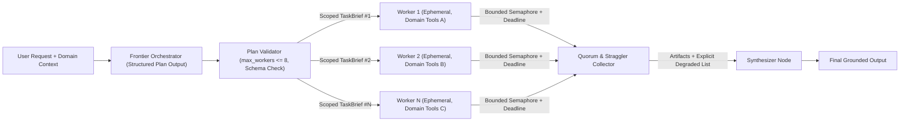
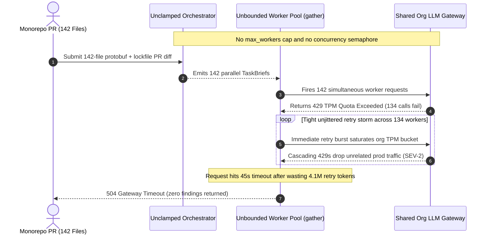

# Module 02: The Orchestrator-Worker Pattern

> **Prerequisites:** [Module 01: Multi-Agent Topologies Overview](../01-multi-agent-topologies-overview/README.md), [Track 10, Module 08: Planning: Task Decomposition](../../10-ai-agents/08-planning-task-decomposition/README.md), and [Track 10, Module 04: Tools: Definition and Schemas](../../10-ai-agents/04-tools-definition-and-schemas/README.md).  
> **Estimated Reading Time:** 40 minutes  
> **Target Audience:** AI Backend Engineers, Distributed Systems Engineers, Agent Platform Teams

> [!TIP]
> **The Golden Rule of Orchestrator-Workers:** Workers must be **ephemeral, stateless, and context-isolated**—receiving only the self-contained `TaskBrief` slice they need, never the full conversation thread or sibling outputs—while the Orchestrator emits a **schema-validated execution plan** clamped by hard fan-out limits, concurrency semaphores, per-worker deadlines, and explicit quorum degradation policies.

---

## Why This Matters

Static parallelization (`Parallel Scatter-Gather`) works brilliantly when subtasks are fixed at compile time—for example, always running `KYC`, `Sanctions`, and `CreditCheck` in parallel on every onboarding form. Yet many high-value backend tasks resist static fan-out because **you cannot predict the subtasks in advance**:

- **Cross-Repository Code Migration / Security Audits:** Changing an authentication primitive across a monorepo might touch `2` files in one PR or `18` services in another; the files and required checks depend entirely on the incoming diff.
- **Deep Multi-Source Research:** Investigating a competitive pricing dispute might require `3` targeted financial filings searches on one ticker and `7` regulatory/litigation queries on another.

As highlighted in Anthropic's *Building Effective Agents* and LangGraph's `Send`-based Map-Reduce architecture, the **Orchestrator-Worker** pattern solves this dynamically: a frontier **Orchestrator** analyzes the input, synthesizes a typed list of independent subtasks, fans them out concurrently to narrow-scope **Workers**, and passes all verified artifacts to a **Synthesizer**. Without strict fan-out caps, context isolation, and straggler quorum handling, however, dynamic fan-out turns directly into burst `429` rate-limit cascades and `10x` latency tails.

---

## 1. Core Mechanics: Dynamic Decomposition, Context Isolation & Quorum Synthesis

The Orchestrator-Worker lifecycle separates **planning**, **isolated parallel execution**, and **reconciliation** into distinct architectural boundaries:



### Four Non-Negotiable Engineering Invariants

1. **Schema-Validated Dynamic Decomposition (`OrchestrationPlan`):**
   The Orchestrator emits a strict JSON Schema (`strict: true` / Pydantic) array of `TaskBrief` objects—never prose bullet lists parsed by regex. Each `TaskBrief` must carry a deterministic `task_id`, `worker_kind`, `objective`, explicit `scoped_inputs`, `success_criteria`, and `max_steps` so workers never hallucinate missing context (**MAST Specification & Misalignment prevention**, `arXiv:2503.13657`).
2. **Strict Worker Context Isolation:**
   Workers execute inside **fresh ephemeral threads** initialized solely with `[worker_system_prompt, TaskBrief(i)]`. They never see the root user's full multi-turn chat log, irrelevant tools from other domains, or sibling worker scratchpads. This yields `70%–90%` prefill savings per worker and prevents cross-task hallucination bleeding.
3. **Hard Fan-Out Clamping & Bounded Concurrency Semaphores:**
   Never run unbounded `asyncio.gather(*[run(t) for t in plan.tasks])` directly on LLM-generated arrays! If an Orchestrator emits `40` subtasks, firing `40` concurrent multi-turn agents saturates upstream Tokens-Per-Minute (`TPM`) quotas immediately. Clamp `len(tasks) <= max_workers` (coalescing excess items into cohesive shards during planning) and guard execution behind a bounded concurrency semaphore (e.g., `max_in_flight = 4–6`).
4. **Per-Worker Deadlines & Quorum Degradation:**
   Because parallel execution waits on the slowest worker, one stalled downstream API turns a `1.8s` fan-out into an `18s` tail spike. Enforce a hard per-worker timeout $T_{\text{worker}}$ alongside an explicit failure policy:
   - `ALL_REQUIRED` (transactional code edits—fail cleanly if any worker misses deadline).
   - `QUORUM_REQUIRED` (research/triage—proceed once $\lceil \rho \cdot N \rceil$ workers succeed, passing explicit `timed_out_tasks` metadata to the Synthesizer so it reports partial gaps honestly rather than fabricating missing facts).

### Quantitative Mechanics: Critical-Path Latency & Token Budget

- **Critical-Path Latency with Straggler Bounding:** Assuming `1` planning call, bounded parallel worker waves with deadline $T_{\text{worker}}$, and `1` synthesis call:

$$L_{\text{OW}} = L_{\text{orch}}(Q) + \min\left(T_{\text{worker}}, \max_{i \in \{1..N\}} L_{w_i}\right) + L_{\text{synth}}\left(\sum_{i=1}^{N_{\text{ok}}} |R_i|\right)$$

When concurrency is capped by semaphore width $M < N$, waves scale wall-clock worker time by approximately $\lceil N / M \rceil \cdot \bar{L}_w$, trading peak burst latency for `0%` `429` rate-limit retries.

- **Worst-Case Token Budget Bound:** Enforcing `max_workers` ($N_{\max}$) and per-worker artifact truncation ($R_{\max}$) makes worst-case request cost deterministic prior to execution:

$$B_{\text{total}} \le B_{\text{orch}} + \sum_{i=1}^{N_{\max}} B_{w_i,\max} + B_{\text{synth}}\left(N_{\max} \cdot R_{\max}\right)$$

---

## 2. Systematic Comparison Matrix: Static Parallelism vs. Orchestrator-Worker vs. Dynamic Supervisor

| Dimension | Parallel Scatter-Gather | Orchestrator-Worker | Dynamic Supervisor |
| :--- | :--- | :--- | :--- |
| **Subtask Predictability** | Fixed at compile time | Dynamic per input (`1` planning step) | Dynamic across multi-turn steps |
| **Worker Lifespan** | Ephemeral parallel branches | Ephemeral, stateless `TaskBrief` runs | Stateful specialists across turns |
| **Inter-Worker Visibility** | None (isolated branches) | None (isolated until Synthesizer merges) | Mediated via Supervisor ledger |
| **LLM Routing Calls** | `0` (static code fan-out) | `1` Orchestrator + `1` Synthesizer | `d + 1` iterative Supervisor calls |
| **Critical-Path Latency** | $\max_i L_i + L_{\text{merge}}$ | $L_{\text{orch}} + \max_i L_{w_i} + L_{\text{synth}}$ | $\sum_{t=1}^{d} (L_{\text{sup},t} + L_{w_t}) + L_{\text{sup}}$ |
| **Burst `429` Risk** | Predictable (`k` fixed) | **High** if `N` is unclamped/unbounded | Low (sequential turn-by-turn default) |
| **Partial Failure Handling** | Static quorum / retry | Explicit quorum + `degraded_tasks` report | Supervisor dynamically re-routes/retries |
| **Best Production Fit** | Fixed KYC/Sanctions/Fraud | Multi-file PR review, multi-source research | Reactive troubleshooting, incident triage |

---

## 3. Production War Story Post-Mortem: The Unbounded Fan-Out `429` Rate-Limit Cascade

| Field | Incident Details |
| :--- | :--- |
| **Severity** | **SEV-2** (Org-Wide LLM Quota Exhaustion & `22`-Minute Cascading Outage) |
| **Detection / Resolution Time** | Triggered PagerDuty `429` error-budget alarm within `90` seconds / Mitigated in `22` minutes by killing in-flight workers and deploying `max_workers` cap |
| **Impact** | `68%` failure rate across unrelated production AI endpoints sharing the same org TPM quota; `4.1M` tokens burned in unjittered retries; affected PR review bot disabled for `3` hours |

### What Happened

A developer productivity team shipped an **Orchestrator-Worker PR Security Reviewer**. The Orchestrator inspected a pull request diff and generated one worker `TaskBrief` per modified file, which the backend dispatched simultaneously via `asyncio.gather` with an aggressive `5`-attempt retry wrapper.

During standard `3–6` file feature PRs, the bot completed in `4.1s` and engineers loved it. Then a platform engineer merged a dependency upgrade + protobuf regeneration PR touching **`142` files**:

1. **Unclamped Fan-Out Explosion:** The Orchestrator dutifully emitted `142` worker tasks (`142` parallel `TaskBrief` prompts).
2. **TPM Saturation & Retry Amplification:** Launching `142` multi-turn workers concurrently instantly exceeded the organization's `2M` Tokens-Per-Minute (`TPM`) cap. Upstream APIs returned `429 Too Many Requests` to `94%` of calls.
3. **Thundering Herd Self-DoS:** Because the retry helper lacked jitter and shared concurrency limits, all `134` failed workers hammered the API simultaneously every `1.0s`, starving *other* customer-facing chatbots sharing the API key until global request timeouts killed the job after burning `4.1M` retry tokens.



### Root Cause Analysis

- **No Planning Cardinality Cap:** The Orchestrator prompt allowed arbitrary `1:1` file-to-worker mapping without an enforced `max_workers` ceiling or file-sharding instruction.
- **Missing Concurrency Semaphore & Dedicated Quota Pool:** Unbounded `gather` exposed upstream APIs directly to LLM-chosen burst sizes, and batch CI workloads shared the same TPM quota as interactive production endpoints.
- **Zero Quorum / Partial Synthesis:** Even if `120` files succeeded and `2` timed out, `ALL_REQUIRED` discarded all `120` completed security audits.

### The Fix & Architectural Hardening

- **Plan Validation & Sharding (`max_workers = 8`):** Configured the Orchestrator schema to emit at most `8` logical security workstreams (grouping generated/lockfile diffs into one deterministic static-check batch and sharding remaining files by service boundary).
- **Semaphore + Per-Worker Deadline + Quorum (`semaphore = 4`, `T_worker = 12s`, `quorum = 0.75`):** Bounded concurrent in-flight workers to `4`, moved CI bots to an isolated API quota tier with jittered backoff, and allowed the Synthesizer to emit partial findings clearly flagging any `timed_out_tasks`.

---

## 4. Multi-Language Production Implementation: Bounded Concurrent Orchestrator-Worker Engine

Below is a complete, defensive **Orchestrator-Worker Dispatcher** across **Go**, **TypeScript**, **Python**, and **C#** enforcing schema validation, `max_workers` fan-out clamping, context-isolated `TaskBrief` execution, bounded concurrency semaphores, per-worker deadlines, and explicit quorum/degraded-task reporting to the Synthesizer.

````carousel

```go
package orchestratorworker

import (
	"context"
	"errors"
	"fmt"
	"math"
	"sync"
	"time"
)

type TaskBrief struct {
	TaskID      string
	WorkerKind  string
	Objective   string
	ScopedInput string // Strictly isolated slice; zero sibling noise or global history
}

type OrchestrationPlan struct {
	Tasks []TaskBrief
}

type WorkerOutcome struct {
	TaskID   string
	Status   string // "SUCCEEDED" | "TIMED_OUT" | "FAILED"
	Artifact string
	Err      string
}

type SynthesisInput struct {
	Succeeded     []WorkerOutcome
	DegradedTasks []WorkerOutcome
	QuorumMet     bool
}

type WorkerFunc func(ctx context.Context, brief TaskBrief) (string, error)

func ExecuteBoundedPlan(
	ctx context.Context,
	plan OrchestrationPlan,
	runWorker WorkerFunc,
	maxWorkers int,
	maxConcurrency int,
	workerTimeout time.Duration,
	minQuorumRatio float64,
) (SynthesisInput, error) {
	if len(plan.Tasks) == 0 {
		return SynthesisInput{}, errors.New("orchestration plan contains zero tasks")
	}
	if len(plan.Tasks) > maxWorkers {
		return SynthesisInput{}, fmt.Errorf("plan rejected: %d tasks exceeds maxWorkers=%d", len(plan.Tasks), maxWorkers)
	}

	seenIDs := make(map[string]struct{}, len(plan.Tasks))
	for _, t := range plan.Tasks {
		if t.TaskID == "" || t.ScopedInput == "" {
			return SynthesisInput{}, errors.New("invalid TaskBrief: TaskID and ScopedInput are required")
		}
		if _, dup := seenIDs[t.TaskID]; dup {
			return SynthesisInput{}, fmt.Errorf("duplicate TaskID: %s", t.TaskID)
		}
		seenIDs[t.TaskID] = struct{}{}
	}

	sem := make(chan struct{}, maxConcurrency)
	results := make([]WorkerOutcome, len(plan.Tasks))
	var wg sync.WaitGroup

	for i, brief := range plan.Tasks {
		wg.Add(1)
		go func(idx int, b TaskBrief) {
			defer wg.Done()
			select {
			case sem <- struct{}{}:
				defer func() { <-sem }()
			case <-ctx.Done():
				results[idx] = WorkerOutcome{TaskID: b.TaskID, Status: "TIMED_OUT", Err: ctx.Err().Error()}
				return
			}

			wCtx, cancel := context.WithTimeout(ctx, workerTimeout)
			defer cancel()

			artifact, err := runWorker(wCtx, b)
			if err != nil {
				status := "FAILED"
				if errors.Is(err, context.DeadlineExceeded) || errors.Is(wCtx.Err(), context.DeadlineExceeded) {
					status = "TIMED_OUT"
				}
				results[idx] = WorkerOutcome{TaskID: b.TaskID, Status: status, Err: err.Error()}
				return
			}
			results[idx] = WorkerOutcome{TaskID: b.TaskID, Status: "SUCCEEDED", Artifact: artifact}
		}(i, brief)
	}
	wg.Wait()

	var ok, degraded []WorkerOutcome
	for _, r := range results {
		if r.Status == "SUCCEEDED" {
			ok = append(ok, r)
		} else {
			degraded = append(degraded, r)
		}
	}
	needed := int(math.Ceil(float64(len(plan.Tasks)) * minQuorumRatio))
	return SynthesisInput{
		Succeeded:     ok,
		DegradedTasks: degraded,
		QuorumMet:     len(ok) >= needed,
	}, nil
}
```

<!-- slide -->

```typescript
export interface TaskBrief {
  readonly taskId: string;
  readonly workerKind: string;
  readonly objective: string;
  readonly scopedInput: string; // Context-isolated payload only
}

export interface WorkerOutcome {
  readonly taskId: string;
  readonly status: "SUCCEEDED" | "TIMED_OUT" | "FAILED";
  readonly artifact?: string;
  readonly error?: string;
}

export interface SynthesisInput {
  readonly succeeded: readonly WorkerOutcome[];
  readonly degradedTasks: readonly WorkerOutcome[];
  readonly quorumMet: boolean;
}

export type WorkerRunner = (brief: TaskBrief, signal: AbortSignal) => Promise<string>;

async function runWithTimeout(
  brief: TaskBrief,
  runner: WorkerRunner,
  timeoutMs: number,
): Promise<WorkerOutcome> {
  const controller = new AbortController();
  const timer = setTimeout(() => controller.abort(), timeoutMs);
  try {
    const artifact = await runner(brief, controller.signal);
    return { taskId: brief.taskId, status: "SUCCEEDED", artifact };
  } catch (err) {
    const timedOut = controller.signal.aborted;
    return {
      taskId: brief.taskId,
      status: timedOut ? "TIMED_OUT" : "FAILED",
      error: err instanceof Error ? err.message : String(err),
    };
  } finally {
    clearTimeout(timer);
  }
}

export async function executeBoundedPlan(
  tasks: readonly TaskBrief[],
  runner: WorkerRunner,
  options: { maxWorkers: number; maxConcurrency: number; workerTimeoutMs: number; minQuorumRatio: number },
): Promise<SynthesisInput> {
  if (tasks.length === 0) throw new Error("Plan must contain at least one TaskBrief");
  if (tasks.length > options.maxWorkers) {
    throw new RangeError(`Plan rejected: ${tasks.length} tasks exceeds maxWorkers=${options.maxWorkers}`);
  }
  const seen = new Set<string>();
  for (const t of tasks) {
    if (!t.taskId || !t.scopedInput.trim()) throw new Error("Invalid TaskBrief: missing taskId or scopedInput");
    if (seen.has(t.taskId)) throw new Error(`Duplicate taskId: ${t.taskId}`);
    seen.add(t.taskId);
  }

  const outcomes: WorkerOutcome[] = new Array(tasks.length);
  let cursor = 0;

  async function workerLoop(): Promise<void> {
    while (cursor < tasks.length) {
      const idx = cursor++;
      outcomes[idx] = await runWithTimeout(tasks[idx], runner, options.workerTimeoutMs);
    }
  }

  const poolSize = Math.min(options.maxConcurrency, tasks.length);
  await Promise.all(Array.from({ length: poolSize }, () => workerLoop()));

  const succeeded = outcomes.filter((o) => o.status === "SUCCEEDED");
  const degradedTasks = outcomes.filter((o) => o.status !== "SUCCEEDED");
  const minNeeded = Math.ceil(tasks.length * options.minQuorumRatio);

  return {
    succeeded,
    degradedTasks,
    quorumMet: succeeded.length >= minNeeded,
  };
}
```

<!-- slide -->

```python
"""
orchestrator_worker_engine.py
Bounded, context-isolated Orchestrator-Worker execution engine with concurrency caps and quorum degradation.
"""
import asyncio
from dataclasses import dataclass
import math
from typing import Awaitable, Callable, Literal


@dataclass(frozen=True)
class TaskBrief:
    task_id: str
    worker_kind: str
    objective: str
    scoped_input: str  # Isolated slice only; excludes global thread and sibling context


@dataclass(frozen=True)
class WorkerOutcome:
    task_id: str
    status: Literal["SUCCEEDED", "TIMED_OUT", "FAILED"]
    artifact: str = ""
    error: str = ""


@dataclass(frozen=True)
class SynthesisInput:
    succeeded: tuple[WorkerOutcome, ...]
    degraded_tasks: tuple[WorkerOutcome, ...]
    quorum_met: bool


async def execute_bounded_plan(
    tasks: list[TaskBrief],
    run_worker: Callable[[TaskBrief], Awaitable[str]],
    max_workers: int = 8,
    max_concurrency: int = 4,
    worker_timeout_s: float = 12.0,
    min_quorum_ratio: float = 0.75,
) -> SynthesisInput:
    if not tasks:
        raise ValueError("OrchestrationPlan cannot be empty")
    if len(tasks) > max_workers:
        raise ValueError(f"Plan rejected: {len(tasks)} tasks exceeds max_workers={max_workers}")

    seen_ids: set[str] = set()
    for t in tasks:
        if not t.task_id or not t.scoped_input.strip():
            raise ValueError("TaskBrief requires non-empty task_id and scoped_input")
        if t.task_id in seen_ids:
            raise ValueError(f"Duplicate task_id in plan: {t.task_id}")
        seen_ids.add(t.task_id)

    sem = asyncio.Semaphore(max_concurrency)

    async def _run_one(brief: TaskBrief) -> WorkerOutcome:
        async with sem:
            try:
                artifact = await asyncio.wait_for(run_worker(brief), timeout=worker_timeout_s)
                return WorkerOutcome(task_id=brief.task_id, status="SUCCEEDED", artifact=artifact)
            except TimeoutError:
                return WorkerOutcome(task_id=brief.task_id, status="TIMED_OUT", error=f"exceeded {worker_timeout_s}s")
            except Exception as exc:
                return WorkerOutcome(task_id=brief.task_id, status="FAILED", error=str(exc))

    outcomes = await asyncio.gather(*(_run_one(t) for t in tasks))
    succeeded = tuple(o for o in outcomes if o.status == "SUCCEEDED")
    degraded = tuple(o for o in outcomes if o.status != "SUCCEEDED")
    needed = math.ceil(len(tasks) * min_quorum_ratio)

    return SynthesisInput(
        succeeded=succeeded,
        degraded_tasks=degraded,
        quorum_met=len(succeeded) >= needed,
    )
```

<!-- slide -->

```csharp
using System;
using System.Collections.Generic;
using System.Linq;
using System.Threading;
using System.Threading.Tasks;

namespace GenAI.OrchestratorWorker;

public sealed record TaskBrief(
    string TaskId,
    string WorkerKind,
    string Objective,
    string ScopedInput); // Context-isolated slice only

public sealed record WorkerOutcome(
    string TaskId,
    string Status, // "SUCCEEDED" | "TIMED_OUT" | "FAILED"
    string? Artifact = null,
    string? Error = null);

public sealed record SynthesisInput(
    IReadOnlyList<WorkerOutcome> Succeeded,
    IReadOnlyList<WorkerOutcome> DegradedTasks,
    bool QuorumMet);

public static class BoundedOrchestratorDispatcher
{
    public static async Task<SynthesisInput> ExecutePlanAsync(
        IReadOnlyList<TaskBrief> tasks,
        Func<TaskBrief, CancellationToken, Task<string>> runWorkerAsync,
        int maxWorkers = 8,
        int maxConcurrency = 4,
        TimeSpan? workerTimeout = null,
        double minQuorumRatio = 0.75,
        CancellationToken outerToken = default)
    {
        if (tasks.Count == 0)
            throw new ArgumentException("Orchestration plan must contain at least one TaskBrief.");
        if (tasks.Count > maxWorkers)
            throw new ArgumentException($"Plan rejected: {tasks.Count} tasks exceeds maxWorkers={maxWorkers}.");

        var seen = new HashSet<string>(StringComparer.Ordinal);
        foreach (var t in tasks)
        {
            if (string.IsNullOrWhiteSpace(t.TaskId) || string.IsNullOrWhiteSpace(t.ScopedInput))
                throw new ArgumentException("TaskBrief requires non-empty TaskId and ScopedInput.");
            if (!seen.Add(t.TaskId))
                throw new ArgumentException($"Duplicate TaskId: {t.TaskId}");
        }

        var timeout = workerTimeout ?? TimeSpan.FromSeconds(12);
        using var sem = new SemaphoreSlim(maxConcurrency, maxConcurrency);
        var outcomes = new WorkerOutcome[tasks.Count];

        await Task.WhenAll(tasks.Select(async (brief, index) =>
        {
            await sem.WaitAsync(outerToken).ConfigureAwait(false);
            try
            {
                using var cts = CancellationTokenSource.CreateLinkedTokenSource(outerToken);
                cts.CancelAfter(timeout);
                string artifact = await runWorkerAsync(brief, cts.Token).ConfigureAwait(false);
                outcomes[index] = new WorkerOutcome(brief.TaskId, "SUCCEEDED", Artifact: artifact);
            }
            catch (OperationCanceledException) when (!outerToken.IsCancellationRequested)
            {
                outcomes[index] = new WorkerOutcome(brief.TaskId, "TIMED_OUT", Error: $"Exceeded {timeout.TotalSeconds:F1}s");
            }
            catch (Exception ex)
            {
                outcomes[index] = new WorkerOutcome(brief.TaskId, "FAILED", Error: ex.Message);
            }
            finally
            {
                sem.Release();
            }
        })).ConfigureAwait(false);

        var ok = outcomes.Where(o => o.Status == "SUCCEEDED").ToArray();
        var degraded = outcomes.Where(o => o.Status != "SUCCEEDED").ToArray();
        int minNeeded = (int)Math.Ceiling(tasks.Count * minQuorumRatio);

        return new SynthesisInput(ok, degraded, ok.Length >= minNeeded);
    }
}
```

````

---

## 5. Practical Hands-On Verification CLI Workflows

Run these offline Python 3.13 verification scripts directly in your terminal—zero external dependencies or API keys required.

### Workflow 1: Critical-Path Latency & Straggler Quorum Simulator

Compare wall-clock latency under `ALL_REQUIRED` versus a `QUORUM=0.75` + `timeout=2.50s` policy when one of six workers stalls at `11.4s`:

```bash
python -c '
def simulate_quorum(latencies_s, l_orch=0.85, l_synth=0.75, timeout_s=2.50, quorum_ratio=0.75):
    total_tasks = len(latencies_s)
    min_needed = int((total_tasks * quorum_ratio) + 0.9999)

    all_req_wall = l_orch + max(latencies_s) + l_synth

    completed = sorted(t for t in latencies_s if t <= timeout_s)
    timed_out = [t for t in latencies_s if t > timeout_s]
    quorum_met = len(completed) >= min_needed
    quorum_worker_wall = max(completed) if len(completed) == total_tasks else timeout_s
    quorum_wall = l_orch + quorum_worker_wall + l_synth

    print(f"Worker durations (s): {latencies_s}")
    print(f"ALL_REQUIRED policy  -> wall={all_req_wall:.2f}s | completed={total_tasks}/{total_tasks} (blocked by {max(latencies_s):.1f}s straggler)")
    print(f"QUORUM({quorum_ratio:.2f}, T={timeout_s:.2f}s) -> wall={quorum_wall:.2f}s | completed={len(completed)}/{total_tasks} (need {min_needed}) | quorum_met={quorum_met} | timed_out={len(timed_out)}")

simulate_quorum([1.15, 1.38, 1.62, 1.88, 2.15, 11.40])
'
```

**Expected Output:**

```text
Worker durations (s): [1.15, 1.38, 1.62, 1.88, 2.15, 11.4]
ALL_REQUIRED policy  -> wall=13.00s | completed=6/6 (blocked by 11.4s straggler)
QUORUM(0.75, T=2.50s) -> wall=4.10s | completed=5/6 (need 5) | quorum_met=True | timed_out=1
```

Enforcing a `2.50s` worker deadline with a `75%` quorum cuts end-to-end latency from `13.00s` down to **`4.10s`** (`3.17x` faster) while explicitly flagging the single timed-out shard for the Synthesizer.

### Workflow 2: Worker Context Isolation Prefill Reduction Profiler

Measure total worker prefill tokens across `6` workers (`3` tool turns each) when workers inherit full root conversation history (`16.5k` tokens) and all schemas (`3.4k` tokens) versus isolated `TaskBrief` slices (`950` + `650` tokens):

```bash
python -c '
def measure_isolation_savings(n_workers=6, root_history_tok=16500, worker_brief_tok=950, worker_tools_tok=650, all_tools_tok=3400, turns_per_worker=3, worker_obs_tok=800):
    leaked_in = 0
    isolated_in = 0
    for _ in range(n_workers):
        for t in range(turns_per_worker):
            leaked_in += root_history_tok + all_tools_tok + worker_brief_tok + t * worker_obs_tok
            isolated_in += worker_tools_tok + worker_brief_tok + t * worker_obs_tok
    saved_pct = (1.0 - isolated_in / leaked_in) * 100.0
    print(f"Workers={n_workers}, Turns/Worker={turns_per_worker}")
    print(f"Shared Full-History Workers : {leaked_in:>7,} input tokens (${leaked_in * 3.0 / 1_000_000:.4f})")
    print(f"Context-Isolated TaskBriefs : {isolated_in:>7,} input tokens (${isolated_in * 3.0 / 1_000_000:.4f})")
    print(f"Prefill Reduction           : {saved_pct:.1f}%")

measure_isolation_savings()
'
```

**Expected Output:**

```text
Workers=6, Turns/Worker=3
Shared Full-History Workers : 389,700 input tokens ($1.1691)
Context-Isolated TaskBriefs :  43,200 input tokens ($0.1296)
Prefill Reduction           : 88.9%
```

Context isolation cuts worker prefill spend by **`88.9%`** (`\$0.1296` vs `\$1.1691`) per execution while protecting each worker from cross-domain distraction.

### Workflow 3: Fan-Out Clamping & Semaphore `429` Burst Prevention

Simulate an Orchestrator proposing `48` tasks against a `6`-concurrent TPM ceiling with unbounded burst dispatch versus `max_workers=8` + `concurrency_cap=4`:

```bash
python -c '
def dispatch_sim(proposed_tasks, max_workers_cap, concurrency_cap, rpm_bucket=6):
    accepted = min(proposed_tasks, max_workers_cap)
    deferred = max(0, proposed_tasks - accepted)
    waves = (accepted + concurrency_cap - 1) // concurrency_cap
    rate_limit_429s = 0
    for _ in range(waves):
        in_flight = min(concurrency_cap, accepted)
        if in_flight > rpm_bucket:
            rate_limit_429s += (in_flight - rpm_bucket)
        accepted -= in_flight
    accepted_total = min(proposed_tasks, max_workers_cap)
    print(f"proposed={proposed_tasks:>3} | cap_workers={max_workers_cap:>3} | sem={concurrency_cap:>3} -> dispatched={accepted_total:>3}, batched_or_deferred={deferred:>3}, waves={waves:>2}, 429_errors={rate_limit_429s:>3}")

dispatch_sim(proposed_tasks=48, max_workers_cap=48, concurrency_cap=48)
dispatch_sim(proposed_tasks=48, max_workers_cap=8, concurrency_cap=4)
'
```

**Expected Output:**

```text
proposed= 48 | cap_workers= 48 | sem= 48 -> dispatched= 48, batched_or_deferred=  0, waves= 1, 429_errors= 42
proposed= 48 | cap_workers=  8 | sem=  4 -> dispatched=  8, batched_or_deferred= 40, waves= 2, 429_errors=  0
```

### Hands-On Exercises

1. **Test Plan Validation & Sharding Fallback:** Using the Python `orchestrator_worker_engine.py` code above, test an invalid plan containing duplicate `task_id` values and a `12`-task plan against `max_workers=8`. Implement a pre-dispatch `shard_tasks(tasks, max_workers=8)` helper that coalesces small homogeneous briefs before raising errors.
2. **Degraded Synthesis Guard:** Modify `SynthesisInput` handling so the Synthesizer receives an explicit `<degraded_tasks>` block listing timed-out `task_id`s and verify your prompt explicitly instructs the Synthesizer to disclose gaps instead of guessing.
3. **Optional Live API Map-Reduce Run (Requires API Key):** Implement an Orchestrator emitting structured JSON (`OrchestrationPlan`) with `strict: true` for *"Compare caching architectures across Redis, Memcached, and DragonflyDB"*, dispatch `3` context-isolated `asyncio` workers, and log individual vs total wall-clock timings.

### Independent Challenge

A competitive intelligence platform runs an Orchestrator-Worker deep-research job that decomposes any market query into `4–10` company research workers (`SEC_Filing_Worker`, `News_Worker`, `Pricing_Worker`), then synthesizes an executive memo. Recently, two issues emerged: (a) when `SEC_Filing_Worker` fails due to a rate-limited SEC EDGAR endpoint, the Synthesizer quietly fills in last year's revenue figures from parametric memory without telling the user; and (b) because the Orchestrator passes the entire `22k`-token user dossier to every worker, costs doubled while workers started citing irrelevant competitor footnotes from the dossier. Design the exact architectural fixes for both issues.

<details><summary>Architectural Discussion</summary>

1. **Preventing Silent Parametric Fallback on Partial Failure (Issue a):**
   - Separate critical vs non-critical tasks in the `TaskBrief` schema (`criticality: "REQUIRED" | "OPTIONAL"`).
   - If `SEC_Filing_Worker` times out or fails, the Quorum Collector passes `degraded_tasks: [{ task_id, status: "TIMED_OUT", reason: "SEC EDGAR 503" }]` to the Synthesizer inside delimited `<missing_coverage>` tags.
   - Instruct the Synthesizer with a hard abstention invariant: **never estimate or recall financial numbers not present in `<succeeded_artifacts>`; output `DATA_UNAVAILABLE [task_id]` for missing sections**, or reject synthesis entirely if a `REQUIRED` financial source failed.
2. **Eliminating Cross-Worker Context Contamination (Issue b):**
   - Enforce **strict `TaskBrief` projection**: the Orchestrator extracts *only* `{ company_name, ticker, fiscal_year, specific_question }` (`~120` tokens) per worker instead of forwarding the `22k`-token user dossier.
   - Give each worker only its domain-specific tools (e.g., `SEC_Filing_Worker` holds only `edgar_fetch`, not news or pricing search). This cuts worker prefill tokens by `> 85%` and guarantees sibling/dossier footnotes never contaminate individual findings.

</details>

---

## 6. Common Mistakes & Troubleshooting

- **Using Orchestrator-Worker when subtasks strictly depend on each other sequentially:** If Worker B needs Worker A's output to know what to query, `Plan -> Parallel Fan-Out` fails on round 1. Use a Sequential Pipeline or Dynamic Supervisor instead.
- **Letting the Orchestrator describe tasks in free-form Markdown instead of strict JSON Schema:** Regex/bullet parsing breaks randomly under complex queries and causes ambiguous worker prompts (**MAST Specification errors**). Always enforce `strict: true` structured outputs with explicit `task_id`, `worker_kind`, `objective`, and `scoped_input`.
- **Sharing one mutable state array directly across parallel workers:** Concurrent writes or full-history reading creates race bugs and `5x–10x` prefill waste. Keep worker state immutable and scoped, collecting return values into an indexed outcome array before synthesis.
- **Retrying `429` bursts without jitter or concurrency caps:** Multiplying `N` parallel workers by `5` immediate retries multiplies burst load `5x`. Always pair bounded semaphores with exponential backoff + full jitter (`Track 10, Module 06`).

---

## 7. Operational Validation Checkpoints & Checkpoint Quiz

### Operational Validation Checkpoints

<details><summary><strong>Checkpoint 1: Diagnosing why parallel workers returned cross-contaminated findings</strong></summary>

An Orchestrator splits a `3`-vendor RFP comparison across `3` parallel workers. Worker #2 (`Vendor B Pricing`) accidentally includes pricing tiers belonging to Vendor A in its summary. Inspection shows each worker was initialized with the entire `14,000`-token root RFP conversation thread plus a `"focus on Vendor B"` footer. What invariant was violated?

**Validation:** **Worker Context Isolation** was violated. Passing the full root conversation containing Vendor A's raw quotes inside Worker #2's prompt caused attention spillover (`Lost-in-the-Middle` + cross-context confusion). Fix by transforming the Orchestrator into a strict projection boundary: pass each worker **only** its isolated `TaskBrief` (`vendor="Vendor B"`, relevant document IDs, narrow prompt) in a clean zero-history thread.

</details>

<details><summary><strong>Checkpoint 2: Bounding a sudden 40-task fan-out spike</strong></summary>

During a large incident investigation, an Orchestrator emits `40` parallel worker tasks, tripping an upstream `429` rate limit and exceeding the request timeout. How should you bound both the planning layer and the runtime dispatcher?

**Validation:** Apply defense-in-depth at **both** layers: (1) **Planning Layer:** clamp `len(tasks) <= max_workers` (e.g., `8`) in schema validation and instruct the Orchestrator to shard/batch related sub-targets when scope exceeds `8` items; (2) **Runtime Dispatcher:** wrap worker execution in a bounded concurrency semaphore (e.g., `max_concurrency = 4`), per-worker deadlines (`worker_timeout_s`), and a quorum threshold (`min_quorum_ratio = 0.75`) so slow stragglers cannot abort completed findings.

</details>

<details><summary><strong>Checkpoint 3: Auditing latency expectations of Orchestrator-Worker vs. Sequential Chain</strong></summary>

A `5`-task research workflow takes `11.0s` sequentially (`2.2s` per worker). After converting to Orchestrator-Worker (`L_orch = 0.9s`, `L_synth = 0.8s`), wall-clock time drops to `4.1s`—except on `5%` of requests where latency still hits `14.5s`. Why do those `5%` tail spikes occur, and how do you cap them?

**Validation:** Because parallel critical-path latency obeys $L_{\text{OW}} = L_{\text{orch}} + \max_i L_{w_i} + L_{\text{synth}}$, the `5%` tail occurs whenever **a single straggler worker** hits a slow upstream retry (`~12.8s`), blocking the barrier merge for all four fast peers! Cap the tail by setting a hard per-worker timeout ($T_{\text{worker}} = 3.5\text{s}$) coupled with a `QUORUM` policy (`4/5` completed) that proceeds to synthesis with an explicit degraded-task annotation.

</details>

### Checkpoint Quiz

1. What distinguishes the **Orchestrator-Worker** pattern from static **Parallel Scatter-Gather**?
2. Write the critical-path latency formula $L_{\text{OW}}$ for an Orchestrator-Worker workflow bounded by a per-worker timeout $T_{\text{worker}}$.
3. Why must workers inside an Orchestrator-Worker architecture remain **ephemeral and context-isolated**?
4. When a worker times out under a `QUORUM` policy, what critical metadata must the Collector pass to the **Synthesizer**?
5. Name two safeguards required to prevent an Orchestrator-Worker pipeline from triggering `429 Too Many Requests` outages on large inputs.

<details><summary>Answers</summary>

1. In **Parallel Scatter-Gather**, the exact number and shape of parallel branches are hardcoded in application code; in **Orchestrator-Worker**, an LLM dynamically determines *how many* subtasks exist and *what each must inspect* based on the incoming input.
2. $L_{\text{OW}} = L_{\text{orch}}(Q) + \min\left(T_{\text{worker}}, \max_{i \in \{1..N\}} L_{w_i}\right) + L_{\text{synth}}\left(\sum_{i=1}^{N_{\text{ok}}} |R_i|\right)$.
3. Passing the full root conversation or sibling scratchpads wastes `70%–90%` on redundant prefill tokens and causes cross-task hallucination/context pollution. Ephemeral `TaskBrief` slices isolate each worker's reasoning and tool scope cleanly.
4. It must pass the explicit list of `degraded_tasks` (`task_id`, failure reason / `TIMED_OUT`) alongside succeeded artifacts, paired with strict instructions not to hallucinate or interpolate missing facts from parametric memory.
5. (1) **Schema-level fan-out clamping** (`max_workers` cap + sharding instruction in the Orchestrator), and (2) **Runtime bounded concurrency semaphores** (`max_concurrency`) paired with jittered exponential backoff on transient failures.

</details>

---

## Further Reading & Sources

- [Anthropic Engineering: Building Effective Agents](https://www.anthropic.com/engineering/building-effective-agents) — canonical formulation of the Orchestrator-Workers workflow vs static parallelization.
- [LangGraph How-To: Map-Reduce Branches with Send](https://langchain-ai.github.io/langgraph/how-tos/map-reduce/) — dynamic `Send` worker fan-out, worker state isolation, and reducer gathering.
- [OpenAI Docs: Structured Outputs Guide](https://platform.openai.com/docs/guides/structured-outputs) — enforcing strict JSON Schemas for `OrchestrationPlan` emissions.
- [Why Do Multi-Agent LLM Systems Fail? (Cemri et al., 2025)](https://arxiv.org/abs/2503.13657) — empirical justification for strict task specification contracts between planner and workers.
- [Module 01: Multi-Agent Topologies Overview](../01-multi-agent-topologies-overview/README.md) — broader topology trade-offs and control/data plane boundaries.

## Next

[Module 03: The Supervisor Pattern](../03-the-supervisor-pattern/README.md)
