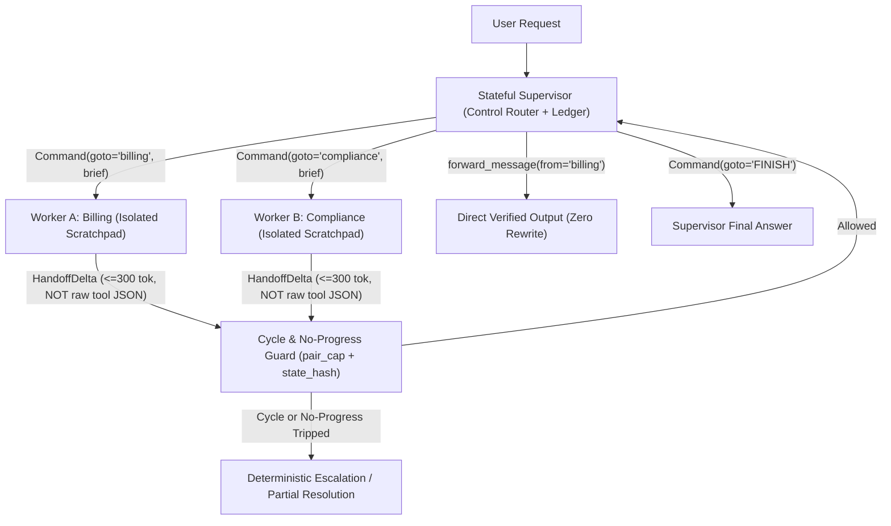
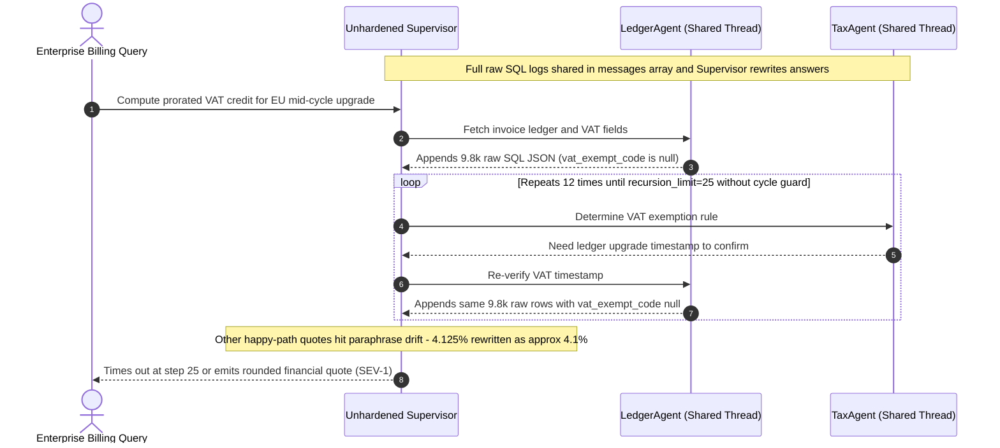

# Module 03: The Supervisor Pattern

> **Prerequisites:** [Module 02: The Orchestrator-Worker Pattern](../02-the-orchestrator-worker-pattern/README.md), [Track 11, Module 14: LangGraph: Cycles and Loops](../../11-langchain-and-langgraph/14-langgraph-cycles-and-loops/README.md), and [Track 11, Module 15: Checkpointing and Persistence](../../11-langchain-and-langgraph/15-checkpointing-and-persistence/README.md).  
> **Estimated Reading Time:** 40 minutes  
> **Target Audience:** AI Backend Engineers, Stateful Agent Systems Engineers, LangGraph Practitioners

> [!TIP]
> **The Golden Rule of the Supervisor Pattern:** A Supervisor is a **stateful dynamic router, not a transcript echo chamber**. Route exclusively via schema-enforced control primitives (`Command(goto=...)` or strict enum tool calls—never regex over prose), return **distilled `handoff_message` deltas** rather than raw worker tool spam, enforce `(pair, progress_hash)` ping-pong cycle caps, and use direct response forwarding (`forward_message`) so the Supervisor never corrupts or re-decodes verified specialist payloads.

---

## Why This Matters

The **Orchestrator-Worker** pattern ([Module 02](../02-the-orchestrator-worker-pattern/README.md)) excels when a task decomposes in one planning pass into parallel independent slices. Many real enterprise workflows, however, are **stateful, iterative, and reactive**: you cannot plan step `3` until you inspect what step `2` uncovered.

In an incident-response triage system, finding an expired TLS certificate in `LogsAgent` forces a follow-up check in `InfraAgent`, whose Terraform drift triggers a rollback policy check in `ChangeAuditAgent` before deciding whether to ask `InfraAgent` for one final verification or terminate (`FINISH`). The **Supervisor Pattern** models this using a **long-lived stateful hub** managing specialized domain workers across iterative turns.

Left unhardened, naive Supervisors suffer three crippling production failures: (1) **brittle routing parsers** breaking whenever an LLM outputs conversational filler around a worker name, (2) **quadratic context bloat** ($O(d^2)$) as raw worker tool logs pile onto a shared transcript read on every Supervisor hop, and (3) **ping-pong thrashing** where two specialists bounce unresolved subtasks past `25+` steps while burning tokens—or where the Supervisor subtly alters exact figures while paraphrasing a worker's final answer.

---

## 1. Supervisor Mechanics: Structured Routing, Scoped Handoffs, Cycle Guards & Direct Forwarding

In a production Supervisor graph, every worker runs inside its own **isolated private scratchpad**, communicates back to the Supervisor via compact **distilled deltas**, and obeys strict deterministic routing and cycle guards:



### Four Core Engineering Mechanisms

1. **Schema-Enforced Control Routing (`Command(goto=...)` vs. Fragile Regex Parsing):**
   - *Anti-Pattern:* Prompting `"Output NEXT_AGENT: <name>"` and splitting strings in Python. The moment an LLM writes `"I will delegate to billing_agent next."`, string parsers crash or trigger unintended `FINISH` fallbacks.
   - *Production Pattern:* Bind routing to a **typed control decision**—either a strict structured output enum (`Literal["billing", "compliance", "FINISH"]` paired with a targeted `handoff_instruction`) or LangGraph's atomic `Command(goto=..., update=...)` primitive, which encapsulates both the state delta and next-node pointer in one validated operation.
2. **Handoff Message Scoping (`handoff_message` Deltas vs. Raw Worker Tool Spam):**
   - *The Quadratic Trap:* If a worker executes `4` SQL/API tool calls producing `5,200` tokens of raw JSON observations and appends its *entire* internal message array back to the shared Supervisor thread, the Supervisor re-prefills cumulative raw spam on every subsequent round:

$$T_{\text{raw}}(d) = \sum_{t=1}^{d} \left( T_0 + t \cdot T_{\text{tool\_spam}} \right) = d \cdot T_0 + \frac{d(d+1)}{2} T_{\text{tool\_spam}} = O(d^2)$$

   - *Production Pattern:* Keep worker tool calls inside a **worker-local scratchpad** and project only a concise **`HandoffDelta`** (`summary`, `verified_facts`, `artifact_ref`, `open_blockers`, `<= 300` tokens) into the Supervisor's ledger. Total Supervisor prefill drops from $O(d^2)$ raw spam to compact $O(d \cdot T_{\Delta})$ (`80%–90%` token savings across `4–8` rounds).
3. **Ping-Pong Loop & Zero-Progress Cycle Guards:**
   - Relying solely on a global `recursion_limit = 25` is an expensive emergency brake—two disagreeing workers (`TaxAgent <-> LedgerAgent`) can ping-pong `12` times before halting.
   - Enforce two deterministic runtime invariants on every return hop:
     - **Pair-Transition Cap:** Track `pair_counts[(last_worker, next_worker)]` and trip if any directed transition repeats `> max_pair_hops` (typically `2`).
     - **No-Progress Fingerprint Breaker:** Hash the `(worker, unresolved_blocker, artifact_keys)` state delta; if the exact blocker repeats without producing new facts/artifacts, break out immediately to deterministic escalation or `partial_resolution`.
4. **Direct vs. Supervisor-Mediated Response Streaming (`forward_message`):**
   - When a specialist worker (e.g., `BillingAgent` or `SQLReporter`) has already produced the exact, formatted answer requested by the user, forcing the Supervisor LLM to read it and **rewrite/paraphrase** it wastes `+1` full LLM decode latency ($L_{\text{TTFT}} + L_{\text{decode}}$), doubles output tokens, and risks subtly rounding numbers (`"4.125%"` -> `"about 4.1%"`) or dropping disclaimers.
   - Using LangGraph's `create_forward_message_tool` (`forward_message(from_agent="billing")`), the Supervisor invokes a `~18`-token tool call that **forwards the worker's verified artifact directly to the caller** verbatim with zero rewrite drift.

---

## 2. Systematic Comparison Matrix: Orchestrator-Worker vs. Naive vs. Hardened Supervisor

| Dimension | Orchestrator-Worker ([Module 02](../02-the-orchestrator-worker-pattern/README.md)) | Naive Shared-Transcript Supervisor | Hardened `Command` + `HandoffDelta` Supervisor |
| :--- | :--- | :--- | :--- |
| **Control Flow** | One-shot plan -> parallel workers -> synth | Regex/string-parsed hub loop | Typed `Command(goto=...)` / strict enum routing |
| **Worker Statefulness** | Ephemeral, stateless one-shot runs | Shared global `messages[]` dump | Isolated worker scratchpad + durable ledger state |
| **Supervisor Prefill Scaling** | $O(1)$ planner + $O(N)$ final synth | **$O(d^2)$** quadratic raw tool-spam growth | **$O(d)$** compact `HandoffDelta` ledger |
| **Routing Overhead** | `1` planner LLM call total | `d + 1` bloated Supervisor calls | `d + 1` fast, low-token Supervisor calls |
| **Final Answer Integrity** | Rewritten by Synthesizer | Rewritten/paraphrased by Supervisor | Verbatim **`forward_message` bypass** when ready |
| **Ping-Pong Vulnerability** | None (acyclic fan-out DAG) | High (`25+` step bounce loops) | Hard-capped via `(pair_cap, progress_hash)` guards |
| **Best Production Fit** | Unpredictable parallel slices (`Deep Research`) | Prototype demos only (unsafe in prod) | Iterative multi-turn triage (`Support`, `FinOps`, `RCA`) |

---

## 3. Production War Story Post-Mortem: The Billing-Compliance Ping-Pong & Paraphrase Incident

| Field | Incident Details |
| :--- | :--- |
| **Severity** | **SEV-1** (Incorrect Financial Credit Quotes & Unbounded Loop Timeouts) |
| **Detection / Resolution Time** | Flagged `11` hours post-deploy by automated billing reconciliation diffs / Mitigated in `3` hours (disabled Supervisor rewrite + deployed cycle guard & delta scoping) |
| **Impact** | **\$28,500** misquoted enterprise prorated credit adjustments (`4.125%` paraphrased to `~4.1%` / rounded amounts); `9.4%` of cross-border VAT queries timed out after `25`-step ping-pong loops |

### What Happened

A global SaaS billing platform deployed a **Dynamic Supervisor** managing two specialists (`TaxAgent` and `LedgerAgent`) to calculate mid-cycle enterprise credit adjustments. Both workers appended their full SQL query outputs and tool calls into one shared `messages[]` array, and the Supervisor summarized the final answer in natural language before emailing the customer quote.

Two independent defects hit production simultaneously on cross-border EU VAT upgrades:

1. **Ping-Pong & Context Explosion (`MAST Step Repetition`):** When a customer lacked a legacy `vat_exempt_code` in PostgreSQL, `LedgerAgent` dumped `9,800` tokens of raw table rows and reported `"VAT status missing"`. The Supervisor routed to `TaxAgent` (`"Determine VAT rule"`), which needed the billing timestamp from `LedgerAgent` and routed back. Without a pair-transition cap or state-progress hash, the Supervisor ping-ponged `TaxAgent <-> LedgerAgent` across all `25` allowed steps—growing context past `120k` tokens per ticket before aborting.
2. **Supervisor Paraphrase Drift:** On *successful* calculations where `LedgerAgent` computed an exact `"4.125% prorated credit (\$1,482.37)"`, the Supervisor rewrote it for tone into `"an approximate 4.1% credit of \$1,482"`, violating financial disclosure precision and triggering automated audit alerts!



### Root Cause Analysis

- **Shared Raw Transcript:** Passing worker tool internals back into Supervisor state blew up token latency and buried the missing-field blocker inside `10k+` tokens of SQL JSON.
- **No `(pair, progress_hash)` Cycle Guard:** Relying solely on `recursion_limit = 25` allowed `20+` wasted hops whenever no new facts emerged.
- **Forced Supervisor Rewrite:** Letting the Supervisor regenerate financial numbers instead of using `forward_message` introduced avoidable latency (`+980ms`) and precision loss.

### The Fix & Architectural Hardening

- **Worker Scratchpad Isolation + `HandoffDelta`:** Kept raw SQL queries local to each worker subgraph, emitting strictly typed `<= 250`-token `HandoffDelta` objects (`facts`, `missing_fields`, `final_payload`).
- **Two-Layer Cycle Breaker (`max_pair_hops = 2`, `no_progress_breaker`):** Immediately halted execution and escalated cleanly to billing ops on step `3` whenever `missing_vat` repeated unchanged.
- **Enabled `forward_message` Fast-Path:** Equipped the Supervisor with a `forward_message(from_agent)` action so exact `LedgerAgent` financial quotes streamed verbatim directly to customers (`0` rounding drift, `-980ms` final hop latency).

---

## 4. Multi-Language Production Implementation: Hardened Stateful Supervisor Loop

Below is a complete, production-hardened **Stateful Supervisor Runtime** across **Go**, **TypeScript**, **Python**, and **C#** demonstrating schema-enforced `Command` routing, isolated worker scratchpads returning distilled `HandoffDelta` objects, `(pair_counts, seen_hashes)` ping-pong breakers, and verbatim `forward_message` direct output bypassing.

````carousel

```go
package supervisor

import (
	"crypto/sha256"
	"encoding/hex"
	"fmt"
)

type RouteTarget string

const (
	TargetFinish RouteTarget = "FINISH"
)

type SupervisorCommand struct {
	Goto             RouteTarget
	HandoffBrief     string
	ForwardFromAgent string // Non-empty triggers verbatim forward_message bypass
}

type HandoffDelta struct {
	AgentName      string
	Summary        string // Compact <=300 tok delta; raw tool logs stay inside worker
	ArtifactKey    string
	VerbatimAnswer string // Candidate payload for zero-rewrite forward_message
	StateSignature string
}

type SupervisorOutcome struct {
	FinalResponse string
	ForwardedFrom string
	HaltReason    string
	StepsTaken    int
}

type WorkerExec func(brief string) HandoffDelta
type RouterFunc func(userQuery string, ledger []HandoffDelta, lastWorker string) SupervisorCommand
type SynthFunc func(userQuery string, ledger []HandoffDelta) string

func RunHardenedSupervisor(
	userQuery string,
	workers map[string]WorkerExec,
	route RouterFunc,
	synthesize SynthFunc,
	maxSteps int,
	maxPairHops int,
) SupervisorOutcome {
	var ledger []HandoffDelta
	artifactsByAgent := make(map[string]HandoffDelta)
	pairCounts := make(map[string]int)
	seenSignatures := make(map[string]bool)
	lastWorker := "supervisor"

	for step := 1; step <= maxSteps; step++ {
		cmd := route(userQuery, ledger, lastWorker)

		if cmd.ForwardFromAgent != "" {
			if d, ok := artifactsByAgent[cmd.ForwardFromAgent]; ok && d.VerbatimAnswer != "" {
				return SupervisorOutcome{
					FinalResponse: d.VerbatimAnswer,
					ForwardedFrom: cmd.ForwardFromAgent,
					HaltReason:    "forward_message_bypass",
					StepsTaken:    step,
				}
			}
		}
		if cmd.Goto == TargetFinish {
			return SupervisorOutcome{
				FinalResponse: synthesize(userQuery, ledger),
				HaltReason:    "supervisor_finish",
				StepsTaken:    step,
			}
		}

		execFn, exists := workers[string(cmd.Goto)]
		if !exists {
			return SupervisorOutcome{
				FinalResponse: "Escalated: unknown worker target requested by router.",
				HaltReason:    fmt.Sprintf("invalid_target(%s)", cmd.Goto),
				StepsTaken:    step,
			}
		}

		pairKey := lastWorker + "->" + string(cmd.Goto)
		pairCounts[pairKey]++
		if pairCounts[pairKey] > maxPairHops {
			return SupervisorOutcome{
				FinalResponse: synthesize(userQuery, ledger),
				HaltReason:    fmt.Sprintf("cycle_guard_tripped(%s)", pairKey),
				StepsTaken:    step,
			}
		}

		delta := execFn(cmd.HandoffBrief)
		sigHash := hashSignature(delta.AgentName + ":" + delta.StateSignature)
		if seenSignatures[sigHash] {
			return SupervisorOutcome{
				FinalResponse: synthesize(userQuery, ledger),
				HaltReason:    fmt.Sprintf("no_progress_breaker(%s)", delta.AgentName),
				StepsTaken:    step,
			}
		}
		seenSignatures[sigHash] = true
		ledger = append(ledger, delta)
		artifactsByAgent[delta.AgentName] = delta
		lastWorker = delta.AgentName
	}

	return SupervisorOutcome{
		FinalResponse: synthesize(userQuery, ledger),
		HaltReason:    "max_steps_reached",
		StepsTaken:    maxSteps,
	}
}

func hashSignature(s string) string {
	sum := sha256.Sum256([]byte(s))
	return hex.EncodeToString(sum[:8])
}
```

<!-- slide -->

```typescript
export interface HandoffDelta {
  readonly agentName: string;
  readonly summary: string; // Compact distilled delta; worker tool logs remain local
  readonly artifactKey: string;
  readonly verbatimAnswer?: string;
  readonly stateSignature: string;
}

export interface SupervisorCommand {
  readonly goto: string; // Worker name or "FINISH"
  readonly handoffBrief: string;
  readonly forwardFromAgent?: string; // Triggers zero-rewrite direct output
}

export interface SupervisorOutcome {
  readonly finalResponse: string;
  readonly forwardedFrom?: string;
  readonly haltReason: string;
  readonly stepsTaken: number;
}

export function runHardenedSupervisor(
  userQuery: string,
  workers: Record<string, (brief: string) => HandoffDelta>,
  decideRoute: (query: string, ledger: readonly HandoffDelta[], lastWorker: string) => SupervisorCommand,
  synthesize: (query: string, ledger: readonly HandoffDelta[]) => string,
  options: { maxSteps: number; maxPairHops: number } = { maxSteps: 12, maxPairHops: 2 },
): SupervisorOutcome {
  const ledger: HandoffDelta[] = [];
  const latestByAgent = new Map<string, HandoffDelta>();
  const pairCounts = new Map<string, number>();
  const seenSignatures = new Set<string>();
  let lastWorker = "supervisor";

  for (let step = 1; step <= options.maxSteps; step += 1) {
    const cmd = decideRoute(userQuery, ledger, lastWorker);

    if (cmd.forwardFromAgent) {
      const candidate = latestByAgent.get(cmd.forwardFromAgent);
      if (candidate?.verbatimAnswer) {
        return {
          finalResponse: candidate.verbatimAnswer,
          forwardedFrom: cmd.forwardFromAgent,
          haltReason: "forward_message_bypass",
          stepsTaken: step,
        };
      }
    }

    if (cmd.goto === "FINISH") {
      return {
        finalResponse: synthesize(userQuery, ledger),
        haltReason: "supervisor_finish",
        stepsTaken: step,
      };
    }

    const workerFn = workers[cmd.goto];
    if (!workerFn) {
      return {
        finalResponse: `Escalated: invalid target '${cmd.goto}'`,
        haltReason: `invalid_target(${cmd.goto})`,
        stepsTaken: step,
      };
    }

    const pairKey = `${lastWorker}->${cmd.goto}`;
    const count = (pairCounts.get(pairKey) ?? 0) + 1;
    pairCounts.set(pairKey, count);
    if (count > options.maxPairHops) {
      return {
        finalResponse: synthesize(userQuery, ledger),
        haltReason: `cycle_guard_tripped(${pairKey})`,
        stepsTaken: step,
      };
    }

    const delta = workerFn(cmd.handoffBrief);
    const sig = `${delta.agentName}:${delta.stateSignature}`;
    if (seenSignatures.has(sig)) {
      return {
        finalResponse: synthesize(userQuery, ledger),
        haltReason: `no_progress_breaker(${sig})`,
        stepsTaken: step,
      };
    }
    seenSignatures.add(sig);
    ledger.push(delta);
    latestByAgent.set(delta.agentName, delta);
    lastWorker = delta.agentName;
  }

  return {
    finalResponse: synthesize(userQuery, ledger),
    haltReason: "max_steps_reached",
    stepsTaken: options.maxSteps,
  };
}
```

<!-- slide -->

```python
"""
hardened_supervisor.py
Stateful Supervisor with typed Command routing, distilled HandoffDelta ledger,
ping-pong + no-progress cycle breakers, and verbatim forward_message bypass.
"""
from dataclasses import dataclass
from typing import Callable, Optional


@dataclass(frozen=True)
class HandoffDelta:
    agent_name: str
    summary: str  # Distilled <=300-token summary; raw tool scratchpad stays private
    artifact_key: str
    state_signature: str
    verbatim_answer: Optional[str] = None


@dataclass(frozen=True)
class SupervisorCommand:
    goto: str  # Specialist name or "FINISH"
    handoff_brief: str
    forward_from_agent: Optional[str] = None


@dataclass(frozen=True)
class SupervisorOutcome:
    final_response: str
    halt_reason: str
    steps_taken: int
    forwarded_from: Optional[str] = None


def run_hardened_supervisor(
    user_query: str,
    workers: dict[str, Callable[[str], HandoffDelta]],
    decide_route: Callable[[str, list[HandoffDelta], str], SupervisorCommand],
    synthesize: Callable[[str, list[HandoffDelta]], str],
    max_steps: int = 12,
    max_pair_hops: int = 2,
) -> SupervisorOutcome:
    ledger: list[HandoffDelta] = []
    latest_by_agent: dict[str, HandoffDelta] = {}
    pair_counts: dict[tuple[str, str], int] = {}
    seen_signatures: set[str] = set()
    last_worker = "supervisor"

    for step in range(1, max_steps + 1):
        cmd = decide_route(user_query, ledger, last_worker)

        if cmd.forward_from_agent:
            artifact = latest_by_agent.get(cmd.forward_from_agent)
            if artifact and artifact.verbatim_answer:
                return SupervisorOutcome(
                    final_response=artifact.verbatim_answer,
                    halt_reason="forward_message_bypass",
                    steps_taken=step,
                    forwarded_from=cmd.forward_from_agent,
                )

        if cmd.goto == "FINISH":
            return SupervisorOutcome(
                final_response=synthesize(user_query, ledger),
                halt_reason="supervisor_finish",
                steps_taken=step,
            )

        if cmd.goto not in workers:
            return SupervisorOutcome(
                final_response=f"Escalated: unknown worker '{cmd.goto}'",
                halt_reason=f"invalid_target({cmd.goto})",
                steps_taken=step,
            )

        pair = (last_worker, cmd.goto)
        pair_counts[pair] = pair_counts.get(pair, 0) + 1
        if pair_counts[pair] > max_pair_hops:
            return SupervisorOutcome(
                final_response=synthesize(user_query, ledger),
                halt_reason=f"cycle_guard_tripped({pair[0]}->{pair[1]})",
                steps_taken=step,
            )

        delta = workers[cmd.goto](cmd.handoff_brief)
        sig = f"{delta.agent_name}:{delta.state_signature}"
        if sig in seen_signatures:
            return SupervisorOutcome(
                final_response=synthesize(user_query, ledger),
                halt_reason=f"no_progress_breaker({sig})",
                steps_taken=step,
            )
        seen_signatures.add(sig)
        ledger.append(delta)
        latest_by_agent[delta.agent_name] = delta
        last_worker = delta.agent_name

    return SupervisorOutcome(
        final_response=synthesize(user_query, ledger),
        halt_reason="max_steps_reached",
        steps_taken=max_steps,
    )
```

<!-- slide -->

```csharp
using System;
using System.Collections.Generic;

namespace GenAI.Supervisor;

public sealed record HandoffDelta(
    string AgentName,
    string Summary,
    string ArtifactKey,
    string StateSignature,
    string? VerbatimAnswer = null);

public sealed record SupervisorCommand(
    string Goto,
    string HandoffBrief,
    string? ForwardFromAgent = null);

public sealed record SupervisorOutcome(
    string FinalResponse,
    string HaltReason,
    int StepsTaken,
    string? ForwardedFrom = null);

public static class HardenedSupervisorEngine
{
    public static SupervisorOutcome Run(
        string userQuery,
        IReadOnlyDictionary<string, Func<string, HandoffDelta>> workers,
        Func<string, IReadOnlyList<HandoffDelta>, string, SupervisorCommand> decideRoute,
        Func<string, IReadOnlyList<HandoffDelta>, string> synthesize,
        int maxSteps = 12,
        int maxPairHops = 2)
    {
        var ledger = new List<HandoffDelta>();
        var latestByAgent = new Dictionary<string, HandoffDelta>(StringComparer.Ordinal);
        var pairCounts = new Dictionary<(string, string), int>();
        var seenSignatures = new HashSet<string>(StringComparer.Ordinal);
        string lastWorker = "supervisor";

        for (int step = 1; step <= maxSteps; step++)
        {
            var cmd = decideRoute(userQuery, ledger, lastWorker);

            if (!string.IsNullOrEmpty(cmd.ForwardFromAgent) &&
                latestByAgent.TryGetValue(cmd.ForwardFromAgent, out var candidate) &&
                !string.IsNullOrEmpty(candidate.VerbatimAnswer))
            {
                return new SupervisorOutcome(
                    candidate.VerbatimAnswer,
                    "forward_message_bypass",
                    step,
                    cmd.ForwardFromAgent);
            }

            if (string.Equals(cmd.Goto, "FINISH", StringComparison.Ordinal))
            {
                return new SupervisorOutcome(synthesize(userQuery, ledger), "supervisor_finish", step);
            }

            if (!workers.TryGetValue(cmd.Goto, out var workerFn))
            {
                return new SupervisorOutcome(
                    $"Escalated: invalid worker '{cmd.Goto}'.",
                    $"invalid_target({cmd.Goto})",
                    step);
            }

            var pair = (lastWorker, cmd.Goto);
            int count = pairCounts.GetValueOrDefault(pair, 0) + 1;
            pairCounts[pair] = count;
            if (count > maxPairHops)
            {
                return new SupervisorOutcome(
                    synthesize(userQuery, ledger),
                    $"cycle_guard_tripped({pair.Item1}->{pair.Item2})",
                    step);
            }

            var delta = workerFn(cmd.HandoffBrief);
            string sig = $"{delta.AgentName}:{delta.StateSignature}";
            if (!seenSignatures.Add(sig))
            {
                return new SupervisorOutcome(
                    synthesize(userQuery, ledger),
                    $"no_progress_breaker({sig})",
                    step);
            }

            ledger.Add(delta);
            latestByAgent[delta.AgentName] = delta;
            lastWorker = delta.AgentName;
        }

        return new SupervisorOutcome(synthesize(userQuery, ledger), "max_steps_reached", maxSteps);
    }
}
```

````

---

## 5. Practical Hands-On Verification CLI Workflows

Run these offline Python 3.13 verification scripts directly in your terminal—zero third-party packages or API keys required.

### Workflow 1: Quadratic Supervisor Context Bloat vs. Scoped `HandoffDelta` Benchmark

Quantify cumulative Supervisor input prefill tokens and cost across `2`, `4`, `6`, and `8` iterative rounds when raw worker tool logs (`5.2k` tokens/round) leak into the Supervisor versus scoped `280`-token `HandoffDelta` objects:

```bash
python -c '
def supervisor_prefill_sweep(rounds, base_tok=1400, raw_tool_tok=5200, delta_tok=280):
    raw_total = 0
    scoped_total = 0
    raw_ctx = base_tok
    scoped_ctx = base_tok
    for _ in range(1, rounds + 1):
        raw_ctx += raw_tool_tok
        scoped_ctx += delta_tok
        raw_total += raw_ctx
        scoped_total += scoped_ctx
    raw_cost = (raw_total / 1_000_000) * 3.00
    scoped_cost = (scoped_total / 1_000_000) * 3.00
    print(f"rounds={rounds} | raw_spam_in={raw_total:>7,} tok (${raw_cost:.4f}) | scoped_delta_in={scoped_total:>6,} tok (${scoped_cost:.4f}) | savings={(1 - scoped_total/raw_total)*100:.1f}%")

for d in [2, 4, 6, 8]:
    supervisor_prefill_sweep(d)
'
```

**Expected Output:**

```text
rounds=2 | raw_spam_in= 18,400 tok ($0.0552) | scoped_delta_in= 3,640 tok ($0.0109) | savings=80.2%
rounds=4 | raw_spam_in= 57,600 tok ($0.1728) | scoped_delta_in= 8,400 tok ($0.0252) | savings=85.4%
rounds=6 | raw_spam_in=117,600 tok ($0.3528) | scoped_delta_in=14,280 tok ($0.0428) | savings=87.9%
rounds=8 | raw_spam_in=198,400 tok ($0.5952) | scoped_delta_in=21,280 tok ($0.0638) | savings=89.3%
```

At `8` rounds, unscoped tool sharing inflates Supervisor prefill to **`198,400` tokens** (`\$0.5952`), whereas distilled `HandoffDelta`s cut input tokens by **`89.3%`** (`21,280` tokens).

### Workflow 2: Ping-Pong Cycle Guard & Zero-Progress Breaker Test Harness

Verify both protective breakers on a stuck `tax_agent <-> ledger_agent` disagreement—one repeating an identical `missing_vat` state (`no_progress_breaker`) and one slightly rephrasing prompts each hop (`cycle_guard_tripped`):

```bash
python -c '
def run_supervisor_loop(scenario, use_cycle_guard, max_steps=25, max_pair_hops=2):
    pair_counts = {}
    seen_hashes = set()
    curr = "tax_agent"
    steps = 0
    reason = "recursion_limit_hit"
    for step in range(1, max_steps + 1):
        steps = step
        nxt = "ledger_agent" if curr == "tax_agent" else "tax_agent"
        pair = (curr, nxt)
        pair_counts[pair] = pair_counts.get(pair, 0) + 1
        artifact_hash = f"{nxt}:missing_vat" if scenario == "identical_stall" else f"{nxt}:rephrase_{step}"
        if use_cycle_guard:
            if artifact_hash in seen_hashes:
                reason = f"no_progress_breaker({artifact_hash})"
                break
            if pair_counts[pair] > max_pair_hops:
                reason = f"cycle_guard_tripped(pair={pair}, count={pair_counts[pair]})"
                break
        seen_hashes.add(artifact_hash)
        curr = nxt
    mode_lbl = "guarded" if use_cycle_guard else "unguarded"
    tag = f"{scenario}/{mode_lbl}"
    print(f"{tag:<26} | stopped_at_step={steps:>2} | reason={reason}")

run_supervisor_loop("identical_stall", False)
run_supervisor_loop("identical_stall", True)
run_supervisor_loop("rephrased_pingpong", True)
'
```

**Expected Output:**

```text
identical_stall/unguarded  | stopped_at_step=25 | reason=recursion_limit_hit
identical_stall/guarded    | stopped_at_step= 3 | reason=no_progress_breaker(ledger_agent:missing_vat)
rephrased_pingpong/guarded | stopped_at_step= 5 | reason=cycle_guard_tripped(pair=('tax_agent', 'ledger_agent'), count=3)
```

Notice why *both* checks matter: `no_progress_breaker` aborts identical stalls immediately at step `3`, while `max_pair_hops=2` catches rephrased ping-pong loops at step `5` instead of wasting all `25` steps.

### Workflow 3: `forward_message` Direct-Bypass vs. Supervisor Paraphrase Integrity Audit

Compare wall-clock latency, Supervisor output token spend, and numeric accuracy when paraphrasing an exact financial quote versus forwarding it directly:

```bash
python -c '
def audit_forward_message(payload, use_forward_tool):
    worker_latency_ms = 820
    if use_forward_tool:
        router_tool_ms = 140
        rewrite_out_tok = 18
        delivered = payload
        mode = "forward_message_bypass"
        total_ms = worker_latency_ms + router_tool_ms
    else:
        rewrite_ms = 980
        rewrite_out_tok = 145
        delivered = payload.replace("4.125%", "approx 4.1%").replace("$1,482.37", "$1,482")
        mode = "supervisor_paraphrase"
        total_ms = worker_latency_ms + rewrite_ms
    exact_match = (delivered == payload)
    print(f"{mode:<22} | total_ms={total_ms:>4} ms | sup_out_tok={rewrite_out_tok:>3} | exact_integrity={exact_match} | output={delivered}")

canonical = "Invoice #9921: prorated credit = 4.125% ($1,482.37)"
audit_forward_message(canonical, False)
audit_forward_message(canonical, True)
'
```

**Expected Output:**

```text
supervisor_paraphrase  | total_ms=1800 ms | sup_out_tok=145 | exact_integrity=False | output=Invoice #9921: prorated credit = approx 4.1% ($1,482)
forward_message_bypass | total_ms= 960 ms | sup_out_tok= 18 | exact_integrity=True | output=Invoice #9921: prorated credit = 4.125% ($1,482.37)
```

Enabling `forward_message` eliminates numeric distortion (`exact_integrity=True`), slashes final-hop output tokens by `8x` (`18` vs `145`), and cuts total latency nearly in half (`960 ms` vs `1800 ms`).

### Hands-On Exercises

1. **Full-Loop Python Integration Test:** Copy `hardened_supervisor.py` from Section 4 and wire two mock workers (`billing_agent`, `tax_agent`) plus a deterministic router closure that bounces between them on an unresolvable query. Confirm `cycle_guard_tripped` triggers cleanly before `max_steps=12` is exhausted.
2. **HandoffDelta Truncation Guard:** Add a strict validator in `run_hardened_supervisor` that rejects or truncates any worker `summary` exceeding `1,200` characters (`~300` tokens) and logs a telemetry metric (`delta_overflow_count`), preventing accidental raw log leaks onto the Supervisor control plane.
3. **Optional Live LangGraph `create_supervisor` Probe (Requires API Key):** Using `langgraph-supervisor` and `create_forward_message_tool(supervisor_name="supervisor")`, build a `2`-worker (`math_expert`, `policy_writer`) graph and compare final token counts and latency with `forward_message` enabled vs disabled.

### Independent Challenge

A technical support Supervisor orchestrates three domain agents: `LogsAgent` (searches `50MB` cluster logs), `DocsAgent` (searches engineering runbooks), and `SlackNotifier` (posts final incident summary to `#ops-incidents`). During testing, you observe three symptoms: (a) on `25%` of incidents, the Supervisor gets stuck toggling between `LogsAgent` and `DocsAgent` until hitting step `20`; (b) `LogsAgent` returns `15,000` tokens of raw stack traces to the Supervisor thread; and (c) when `DocsAgent` produces a clean `6`-step remediation checklist, the Supervisor rewrites it and accidentally omits step `4` (`drain node before reboot`). Redesign the state contract, routing mechanism, and output pipeline to fix all three defects.

<details><summary>Architectural Discussion</summary>

1. **Fixing Raw Stack-Trace Pollution (`b`):** Isolate `LogsAgent` inside a private subgraph state (`LogsInternalState`). Write the full stack-trace excerpt to an external artifact key (`logs://inc-441/trace.txt`) and emit only a bounded `HandoffDelta` (`<= 250` tokens containing `error_code`, `pod_name`, `summary`, `artifact_key`).
2. **Breaking `LogsAgent <-> DocsAgent` Loops (`a`):** Replace natural-language routing with a typed `SupervisorCommand` schema (`goto`, `handoff_brief`), track directed pair transitions (`max_pair_hops = 2`), and hash `(agent, state_signature)` so identical blocker findings trip the `no_progress_breaker` immediately and trigger deterministic escalation (`"Need human SRE on-call"`).
3. **Preserving the `6`-Step Remediation Checklist (`c`):** Equip the Supervisor with `forward_message(from_agent="DocsAgent")` so once `DocsAgent` validates its runbook checklist, the Supervisor forwards the canonical steps verbatim to `SlackNotifier` / caller without LLM paraphrasing—eliminating omitted step `4` and halving final-turn latency.

</details>

---

## 6. Common Mistakes & Troubleshooting

- **Parsing next-worker names out of free-form Supervisor text (`"Next I'll call..."`):** Conversational variation breaks string/regex extraction silently. Always bind routing to structured tool calls, strict JSON enum outputs, or `Command(goto=...)`.
- **Dumping full `tool_call` / `tool_result` histories back to the Supervisor:** Every round re-prefills previous workers' raw JSON payloads (`O(d^2)` token explosion) and triggers attention decay. Isolate tool scratchpads inside workers and pass back compact `HandoffDelta` summaries.
- **Relying exclusively on `recursion_limit = 25` to stop infinite loops:** Two workers arguing across `25` turns waste `10x` budget before crashing. Add explicit `(last_worker, next_worker)` pair caps (`max_pair_hops <= 2`) and state-progress hash breakers.
- **Allowing the Supervisor to rewrite structured/high-precision worker outputs:** Paraphrasing tables, code snippets, invoice figures, or compliance text wastes tokens and silently introduces hallucinated rounding errors. Use `forward_message` whenever a specialist already holds the verified final deliverable.

---

## 7. Operational Validation Checkpoints & Checkpoint Quiz

### Operational Validation Checkpoints

<details><summary><strong>Checkpoint 1: Diagnosing quadratic token growth inside a multi-turn Supervisor</strong></summary>

A `3`-worker Supervisor (`max_steps = 10`) averages `\$0.05` on `2`-step queries, yet jumps to `\$0.58` on `8`-step queries (`11.6x` cost for `4x` steps). Why did cost scale quadratically rather than linearly?

**Validation:** Workers were appending full raw tool observations (`~5k` tokens/round) onto the shared Supervisor message thread. Across $d = 8$ rounds, total Supervisor prefill follows $\sum_{t=1}^8 t \cdot T_{\text{raw}} = \frac{8 \cdot 9}{2} T_{\text{raw}} = 36 \cdot T_{\text{raw}}$ instead of $3 \cdot T_{\text{raw}}$ at $d = 2$ (`12x` raw prefill factor!). Fix by keeping worker tool logs inside worker-local subgraphs and returning compact `<= 300`-token `HandoffDelta` objects.

</details>

<details><summary><strong>Checkpoint 2: Why `recursion_limit` alone fails to protect production Supervisors</strong></summary>

An operations team sets `recursion_limit = 25` on their LangGraph Supervisor, confident loops are capped. In production, two specialists ping-pong on missing customer IDs for `24` steps before aborting, hitting `38s` p95 latency and returning zero helpful context. What two missing controls explain this?

**Validation:** They lacked (1) a **no-progress state-hash breaker** (which detects on step `3` that the exact same `missing_customer_id` blocker repeated without new facts) and (2) a **directed pair-transition cap** (`max_pair_hops = 2`), which halts `Worker A <-> Worker B` oscillation after `2` round trips and triggers a clean `partial_resolution` synthesis or human escalation.

</details>

<details><summary><strong>Checkpoint 3: Preventing subtle data corruption during Supervisor finalization</strong></summary>

A `SQLAnalyst` worker queries Postgres and emits an exact Markdown table with `14` decimal currency rows (`\$1,482.37`, `4.125%`). Occasionally, the final response shown to the user swaps two digits or rounds `4.125%` to `4.1%`. How do you eliminate this bug with zero prompt engineering?

**Validation:** Enable **`forward_message` direct bypassing** (`create_forward_message_tool` in `langgraph-supervisor`). Instead of forcing the Supervisor LLM to re-decode `SQLAnalyst`'s entire table token-by-token (`+1s` latency and probabilistic transcription risk), the Supervisor emits a tiny tool call instructing the runtime to forward `SQLAnalyst`'s canonical message directly to the user verbatim.

</details>

### Checkpoint Quiz

1. Why is `Command(goto=..., update=...)` (or strict structured enum routing) strictly superior to parsing `"NEXT: agent_name"` out of Supervisor text?
2. Derive why sharing raw worker tool outputs across `d` Supervisor rounds produces $O(d^2)$ token cost growth, and how `handoff_message` deltas mitigate it.
3. Explain the difference between a **pair-transition cap** (`max_pair_hops`) and a **no-progress state-signature breaker**. Why do production Supervisors need both?
4. What two concrete benefits does `create_forward_message_tool` (`forward_message`) provide over standard Supervisor-mediated summarization?
5. When should you prefer the **Supervisor Pattern** over **Orchestrator-Worker** ([Module 02](../02-the-orchestrator-worker-pattern/README.md))?

<details><summary>Answers</summary>

1. `Command(goto=..., update=...)` / strict structured schemas enforce type-checked node names and atomic state updates at the API boundary, eliminating brittle regex failures when an LLM adds conversational prose or typos.
2. Each round $t$ appends $T_{\text{raw}}$ tokens onto the shared thread, so the Supervisor re-prefills $\sum_{t=1}^{d} t \cdot T_{\text{raw}} = \frac{d(d+1)}{2} T_{\text{raw}} = O(d^2)$ tokens across the run. Replacing raw tool traces with distilled `<= 300`-token `HandoffDelta`s keeps Supervisor context lean, cutting cumulative prefill tokens by `80%–90%`.
3. A **no-progress breaker** halts immediately when identical blockers/artifacts repeat unchanged, whereas a **pair-transition cap** catches semantic loops where workers slightly rephrase identical arguments (`rephrase_1`, `rephrase_2`) while bouncing between the same pair of specialists.
4. (1) **Zero paraphrase/transcription corruption** on exact tables, quotes, code, or numbers, and (2) **Lower final-hop latency and token spend** by bypassing redundant Supervisor text regeneration.
5. Choose the **Supervisor Pattern** when tasks require **iterative, reactive state**—where the choice of next specialist depends dynamically on intermediate discoveries across multiple turns—whereas **Orchestrator-Worker** fits single-pass dynamic decomposition into independent parallel subtasks.

</details>

---

## Further Reading & Sources

- [LangGraph Concepts: Multi-Agent Supervisor & `Command`](https://langchain-ai.github.io/langgraph/concepts/multi_agent/) — authoritative reference on `Command(goto=...)`, state isolation, and dynamic Supervisor routing.
- [LangGraph How-To: Combine Control Flow and State Updates with Command](https://langchain-ai.github.io/langgraph/how-tos/command/) — official specification for `Command(goto=..., update=...)`, `Literal` routing bounds, and subgraph handoffs.
- [Anthropic Engineering: Building Effective Agents](https://www.anthropic.com/engineering/building-effective-agents) — foundational guardrails for bounded loops, tool clarity, and controlled handoffs.
- [Why Do Multi-Agent LLM Systems Fail? (Cemri et al., 2025)](https://arxiv.org/abs/2503.13657) — empirical MAST taxonomy covering step-repetition loops and inter-agent misalignment.
- [Module 02: The Orchestrator-Worker Pattern](../02-the-orchestrator-worker-pattern/README.md) — non-iterative parallel task-decomposition baseline.

## Next

[Module 04: Hierarchical Agent Teams](../04-hierarchical-agent-teams/README.md)
