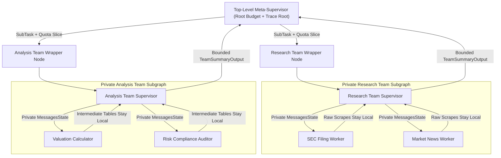
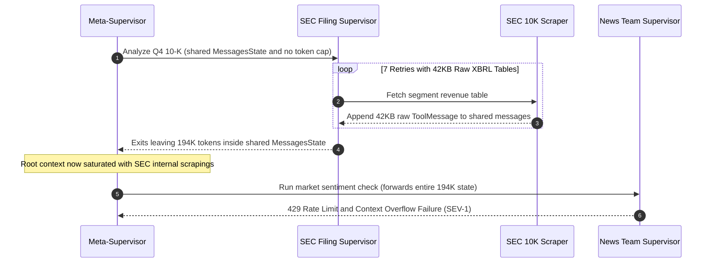

# Module 04: Hierarchical Agent Teams

> **Prerequisites:** [Module 03: The Supervisor Pattern](../03-the-supervisor-pattern/README.md), [Module 02: The Orchestrator-Worker Pattern](../02-the-orchestrator-worker-pattern/README.md), and [Track 11, Module 12: LangGraph State and Nodes](../../11-langchain-and-langgraph/12-langgraph-state-and-nodes/README.md).  
> **Estimated Reading Time:** 35 minutes  
> **Target Audience:** AI Systems Architects, Multi-Agent Platform Engineers, Staff Backend Developers

> [!TIP]
> **The Golden Rule of Hierarchical Agent Teams:** Treat every sub-team as an **encapsulated microservice with a private internal state schema, a compact exported summary contract, and a pre-sliced resource quota**: never expose raw worker `MessagesState` scratchpads upward to the meta-supervisor, and never delegate without subtracting `max_tokens`, `max_steps`, and deadline budgets monotonically down the tree.

---

## Why This Matters

A single flat supervisor works reliably when coordinating `3` to `5` domain specialists. Beyond roughly `6` to `8` worker tools, flat supervision hits a sharp cognitive and systems wall: **tool-selection crowding** degrades router accuracy as worker descriptions grow past `4K` tokens, unrelated worker outputs collide in one global `MessagesState` transcript, and a single research sub-task executing `8` web scrapes floods the context window of every downstream writer or reviewer.

**Hierarchical Agent Teams** solve flat routing saturation by composing **nested subgraphs**—a `Top-Level Meta-Supervisor` delegates high-level objectives to autonomous `Mid-Level Team Supervisors`, each orchestrating `2` to `5` `Leaf Worker Agents`. Yet naive tree composition introduces four severe production hazards: upward context explosion across shared state keys, runaway recursive budget multiplication, orphaned observability spans across subgraph boundaries, and multiplicative end-to-end reliability decay ($P_{\text{tree}} = p^{N_{\text{nodes}}}$).

---

## 1. Hierarchical Subgraph Composition & Budget Mechanics

In production orchestration frameworks such as **LangGraph** (`StateGraph` composition) and hierarchical **AutoGen** workflows (`arXiv:2308.08155`), each team is compiled as an independent graph node invoked by a parent meta-graph.



### State Isolation: Shared-Key Subgraphs vs. Wrapper Contracts

When integrating a compiled subgraph into a parent graph, engineers choose between two state-sharing contracts:

1. **Shared-Key Direct Composition (High Contamination Risk):** The parent graph and every sub-team share the exact same `messages` reducer key. Whenever a leaf scraper appends `14` `ToolMessage` payloads (`35 KB` of raw HTML or JSON tables), those messages land directly inside the meta-supervisor's message history—forcing every sibling team and the root router to re-prefill irrelevant intermediate tool traces.
2. **Private Team State + Wrapper Projection (Production Standard):** Each team subgraph owns a private `TeamInternalState` (`internal_messages`, `scratchpad`, `local_steps`). A lightweight **boundary wrapper node** transforms the parent's `TeamTaskInput` into the child's private state, runs the sub-team inside strict quota bounds, discards internal monologue at exit, and projects only a schema-validated `TeamSummaryOutput` (`status`, `executive_summary`, `artifact_refs`, `tokens_spent`, `steps_used`) back into parent state.

### Quantitative Mechanics: Tree Overhead, Budget Conservation, and Reliability Collapse

Three mathematical invariants govern deep hierarchical agent trees:

- **Total LLM Routing Overhead:** In a balanced $b$-ary hierarchy of depth $D$ where each supervisor takes $c_{\text{sup}}$ routing calls per delegated sub-task and each leaf runs $w_{\text{leaf}}$ worker calls, the total LLM invocations scale exponentially with branching factor $b$ and depth $D$:

$$N_{\text{calls}} = \sum_{\ell=0}^{D-1} b^{\ell} c_{\text{sup}} + b^D w_{\text{leaf}}$$

Because every extra tier adds mandatory supervisor hops ($b^{\ell} c_{\text{sup}}$), **flatter 2-tier trees (`Depth <= 2`) outperform 4-tier hierarchies** unless tool count strictly exceeds `15–20` distinct leaf workers.

- **Monotonic Distributed Budget Delegation:** When a root request carries total allowance $(B_{\text{root}}, S_{\text{root}})$ tokens and steps, the meta-supervisor must reserve headroom $(b_{\text{reserve}}, s_{\text{meta}})$ for its own synthesis and enforce strict quota conservation across all $k$ delegated teams:

$$\sum_{i=1}^{k} b_i + b_{\text{reserve}} \le B_{\text{root}}, \qquad \sum_{i=1}^{k} s_i + s_{\text{meta}} \le S_{\text{root}}$$

Inside team $i$, the mid-level supervisor subtracts its own routing tokens before dispatching leaf workers—ensuring no sub-team can ever exhaust the root request budget silently.

- **Deep-Tree Reliability & Critical-Path Latency Bounds:** Suppose every agent hop along a sequential critical path of $N_{\text{nodes}}$ invocations succeeds independently with probability $p$ (where $1 - p$ captures JSON schema violations, rate-limit errors, or tool failures) without local team-level checkpoint retry boundaries. End-to-end tree completion probability decays geometrically:

$$P_{\text{tree}} = p^{N_{\text{nodes}}}, \qquad L_{\text{tree}} = \sum_{\ell=0}^{D} L_{\text{sup},\ell} + \max_{j \in \text{parallel\_teams}} L_{\text{team},j}$$

Even at a respectable `p = 0.96` per-node reliability, a shallow `3`-node supervisor succeeds `88.47%` of runs, whereas an unguarded `18`-node hierarchical traversal collapses to $0.96^{18} = 47.96\%$ success! Per-team retry loops, deterministic schema validation, and shallow depths (`D <= 2`) are non-negotiable.

### Trace Span Propagation Across Subgraph Boundaries

Stripping `internal_messages` at the team boundary protects context windows—but it must **never erase observability**. Every wrapper invocation must mint a child span linked to the caller's W3C-style trace context (`trace_id`, `parent_span_id`, `span_id`, `team_name`, `quota_allocated`) so OpenTelemetry or LangSmith traces render full nested flamegraphs from root decision down to leaf tool call while keeping LLM prompt payloads isolated.

### Reference Boundary Contract Specification

| Field | Direction | Constraint / Invariant | Purpose |
| :--- | :--- | :--- | :--- |
| `trace_id` / `parent_span_id` | Parent $\rightarrow$ Child | Non-empty UUID / span ID | Preserves distributed flamegraph lineage across subgraphs |
| `token_budget` / `step_budget` | Parent $\rightarrow$ Child | Strictly $\le$ remaining root quota minus reserve | Prevents runaway sub-team spend or infinite cycles |
| `deadline_ms` | Parent $\rightarrow$ Child | `child_deadline <= parent_deadline - synthesis_margin` | Stops zombie child threads after caller HTTP timeout |
| `executive_summary` | Child $\rightarrow$ Parent | Bounded (e.g., $\le 400$ tokens) | Prevents raw worker scrapes from polluting root context |
| `artifact_refs` | Child $\rightarrow$ Parent | Immutable object store / blob URIs (`s3://`, `mem://`) | Passes large payloads by reference instead of prompt bloat |
| `tokens_spent` / `steps_used` | Child $\rightarrow$ Parent | Actual metered counts returned on exit or error | Updates root monotonic budget ledger accurately |

---

## 2. Systematic Comparison Matrix: Flat vs. Shared-Key vs. Isolated Hierarchical Teams

| Dimension | Flat Single Supervisor | Shared-Key Nested Subgraphs | Isolated-Contract Hierarchical Teams |
| :--- | :--- | :--- | :--- |
| **Worker Scaling Ceiling** | `5–8` workers before tool-choice crowding | `15–25` workers across teams | `25+` workers cleanly partitioned by domain |
| **Context Isolation** | Low (single global `MessagesState`) | Low (`messages` key leaks raw worker tool calls upward) | High (private `TeamInternalState`, bounded summary export) |
| **Budget Enforcement** | Global `recursion_limit` only | Shared counter easily overrun by retries | Monotonic tree quota slicing (`b_i`, `s_i`, `deadline_ms`) |
| **Fault Blast Radius** | Global transcript stalls all workers | Corrupted tool output poisons parent graph | Contained inside sub-team wrapper with fallback output |
| **Observability Lineage** | Single flat trace | Nested runs, noisy duplicate context spans | Clean parent-child spans + separated token telemetry |
| **Latency Overhead** | Low (`1` router hop per worker turn) | High (multi-hop routing + huge prefills) | Moderate (extra team hop offset by smaller prefills) |

---

## 3. Production War Story Post-Mortem: The \$64,000 Recursive Research-Team Context Avalanche

| Field | Incident Details |
| :--- | :--- |
| **Severity** | **SEV-1** (Unbounded Token Spend Spike, Cascading `429` Quota Exhaustion, Service Degradation) |
| **Detection / Resolution Time** | Detected after `11` hours via cloud billing anomaly alert / Mitigated in `45` minutes by deploying emergency budget caps and state isolation |
| **Impact** | **\$64,000** in wasted weekend LLM API spend across `310` batch diligence jobs; `41%` job failure rate from `128K`/`200K` context overflow and rate-limit timeouts |

### What Happened

An institutional equity-research platform shipped a 3-tier hierarchical agent team (`Meta-Supervisor -> SEC_Filing_Team + News_Team -> 6 Scraping Workers`) over LangGraph using **shared `MessagesState` keys** and **no per-team token budget slicing** (only a global `recursion_limit=60`).

When a batch job processed quarterly filings over the weekend, an `SEC_10K_Worker` repeatedly queried poorly formatted XBRL tables (`42 KB` raw JSON per call) across `7` local retries. Because the `SEC_Filing_Team` subgraph wrote directly to the parent's `messages` list, all `14` giant `AIMessage` + `ToolMessage` turns (`~194K` tokens) surfaced directly to the `Meta-Supervisor`, which then forwarded that entire `194K`-token transcript into `News_Team` and `Memo_Writer_Team`—multiplying prompt prefill cost across every single downstream agent step.



### Root Cause Analysis

- **Shared State Leakage:** Using a shared `messages` key exposed internal team debugging turns (`ToolMessage` dumps) to sibling teams and the top-level meta-supervisor.
- **No Monotonic Budget Slicing:** A global step limit (`60`) did not bound token volume; `7` tool loops inside one worker blew past `190K` tokens before the root meta-supervisor realized a budget disaster was unfolding.
- **Pass-by-Value Raw Blobs:** Large `42 KB` scrapes lived inline inside prompt history rather than external object storage referenced by compact IDs.

### The Fix & Architectural Hardening

- **Private Subgraph State + Wrapper Projection:** Moved every team onto an isolated `TeamInternalState` (`internal_messages`) and forced the boundary wrapper to emit a `<= 350`-token `TeamSummaryOutput` plus external `artifact_refs`.
- **Monotonic Quota Ledger:** Added strict `BudgetQuota` slicing so `Meta-Supervisor` reserved `2,000` synthesis tokens and granted each team hard `token_budget` and `step_budget` ceilings enforced before every worker LLM call.
- **Trace Span Linking:** Propagated `(trace_id, parent_span_id)` through the boundary context so engineers retained full worker-level debugging in telemetry without polluting prompts.

---

## 4. Multi-Language Production Implementation: Isolated Hierarchical Team Runner

Below is a production-hardened **Hierarchical Team Boundary Runner** across **Go**, **TypeScript**, **Python**, and **C#**. Every implementation enforces: (1) monotonic `BudgetQuota` slicing with parent reserve, (2) private team `internalMessages` isolation with bounded summary export, and (3) explicit `TraceSpan` propagation across subgraph boundaries.

````carousel

```go
package hierarchy

import (
	"context"
	"errors"
	"fmt"
	"time"
)

type TraceSpan struct {
	TraceID      string
	ParentSpanID string
	SpanID       string
}

type BudgetQuota struct {
	MaxTokens   int
	MaxSteps    int
	SpentTokens int
	SpentSteps  int
	Deadline    time.Time
}

func (b *BudgetQuota) CarveChild(tokens, steps, reserveTokens, reserveSteps int, teamDeadline time.Duration) (*BudgetQuota, error) {
	availTok := b.MaxTokens - b.SpentTokens - reserveTokens
	availStp := b.MaxSteps - b.SpentSteps - reserveSteps
	if tokens <= 0 || tokens > availTok || steps <= 0 || steps > availStp {
		return nil, fmt.Errorf("quota exceeded: requested (%d tok, %d steps), available (%d tok, %d steps)", tokens, steps, availTok, availStp)
	}
	childDeadline := time.Now().Add(teamDeadline)
	if !b.Deadline.IsZero() && childDeadline.After(b.Deadline) {
		childDeadline = b.Deadline
	}
	b.SpentTokens += tokens
	b.SpentSteps += steps
	return &BudgetQuota{MaxTokens: tokens, MaxSteps: steps, Deadline: childDeadline}, nil
}

type TeamTaskInput struct {
	Goal  string
	Trace TraceSpan
	Quota *BudgetQuota
}

type TeamSummaryOutput struct {
	TeamName         string
	Status           string
	ExecutiveSummary string
	ArtifactRefs     []string
	TokensSpent      int
	StepsUsed        int
	ChildSpanID      string
}

type PrivateTeamState struct {
	InternalMessages []string // Never leaked back to Meta-Supervisor
	LocalSteps       int
	LocalTokens      int
}

// RunTeamSubgraph isolates worker transcripts inside PrivateTeamState and exports only a bounded summary.
func RunTeamSubgraph(ctx context.Context, teamName string, in TeamTaskInput, maxSummaryChars int) (TeamSummaryOutput, error) {
	if in.Quota == nil {
		return TeamSummaryOutput{}, errors.New("missing delegated budget quota")
	}
	childCtx, cancel := context.WithDeadline(ctx, in.Quota.Deadline)
	defer cancel()

	childSpan := TraceSpan{
		TraceID:      in.Trace.TraceID,
		ParentSpanID: in.Trace.SpanID,
		SpanID:       fmt.Sprintf("%s-span-%d", teamName, time.Now().UnixNano()%10000),
	}

	privateState := PrivateTeamState{
		InternalMessages: []string{"[system] private team scratchpad for: " + in.Goal},
	}

	// Simulated bounded team supervisor -> worker execution
	for step := 1; step <= 2; step++ {
		if err := childCtx.Err(); err != nil {
			return TeamSummaryOutput{TeamName: teamName, Status: "TIMEOUT", ChildSpanID: childSpan.SpanID}, err
		}
		if privateState.LocalSteps+1 > in.Quota.MaxSteps || privateState.LocalTokens+650 > in.Quota.MaxTokens {
			return TeamSummaryOutput{TeamName: teamName, Status: "BUDGET_STOP", TokensSpent: privateState.LocalTokens, StepsUsed: privateState.LocalSteps, ChildSpanID: childSpan.SpanID}, nil
		}
		privateState.InternalMessages = append(privateState.InternalMessages, fmt.Sprintf("[worker-%d] raw 40KB dump stored externally", step))
		privateState.LocalSteps++
		privateState.LocalTokens += 650
	}

	summary := fmt.Sprintf("[%s span=%s] Verified goal %q via %d private worker turns.", teamName, childSpan.SpanID, in.Goal, privateState.LocalSteps)
	if len(summary) > maxSummaryChars {
		summary = summary[:maxSummaryChars]
	}

	return TeamSummaryOutput{
		TeamName:         teamName,
		Status:           "COMPLETED",
		ExecutiveSummary: summary,
		ArtifactRefs:     []string{"s3://agent-artifacts/" + childSpan.TraceID + "/" + teamName + ".json"},
		TokensSpent:      privateState.LocalTokens,
		StepsUsed:        privateState.LocalSteps,
		ChildSpanID:      childSpan.SpanID,
	}, nil
}
```

<!-- slide -->

```typescript
export interface TraceSpan {
  readonly traceId: string;
  readonly parentSpanId: string;
  readonly spanId: string;
}

export interface TeamSummaryOutput {
  readonly teamName: string;
  readonly status: "COMPLETED" | "BUDGET_STOP" | "TIMEOUT";
  readonly executiveSummary: string;
  readonly artifactRefs: readonly string[];
  readonly tokensSpent: number;
  readonly stepsUsed: number;
  readonly childSpanId: string;
}

export class MonotonicBudgetLedger {
  private spentTokens = 0;
  private spentSteps = 0;

  constructor(
    public readonly maxTokens: number,
    public readonly maxSteps: number,
    public readonly deadlineMs: number,
  ) {}

  carveChild(
    tokens: number,
    steps: number,
    reserveTokens = 1000,
    reserveSteps = 2,
  ): MonotonicBudgetLedger {
    const availTok = this.maxTokens - this.spentTokens - reserveTokens;
    const availStp = this.maxSteps - this.spentSteps - reserveSteps;
    if (tokens <= 0 || tokens > availTok || steps <= 0 || steps > availStp) {
      throw new Error(
        `QUOTA_EXCEEDED: requested (${tokens} tok, ${steps} steps), available (${availTok} tok, ${availStp} steps)`,
      );
    }
    this.spentTokens += tokens;
    this.spentSteps += steps;
    return new MonotonicBudgetLedger(tokens, steps, this.deadlineMs);
  }

  get remainingTokens(): number {
    return this.maxTokens - this.spentTokens;
  }
}

interface PrivateTeamState {
  internalMessages: string[];
  localSteps: number;
  localTokens: number;
}

export async function runIsolatedTeamSubgraph(
  teamName: string,
  goal: string,
  parentTrace: TraceSpan,
  teamQuota: MonotonicBudgetLedger,
  maxSummaryChars = 320,
): Promise<TeamSummaryOutput> {
  const childSpan: TraceSpan = {
    traceId: parentTrace.traceId,
    parentSpanId: parentTrace.spanId,
    spanId: `${teamName}-${Math.floor(Math.random() * 9000 + 1000)}`,
  };

  // Private state stays encapsulated inside this wrapper call
  const privateState: PrivateTeamState = {
    internalMessages: [`[private-system] Execute ${goal}`],
    localSteps: 0,
    localTokens: 0,
  };

  for (let step = 1; step <= 2; step += 1) {
    if (Date.now() > teamQuota.deadlineMs) {
      return {
        teamName,
        status: "TIMEOUT",
        executiveSummary: `${teamName} aborted cleanly at deadline.`,
        artifactRefs: [],
        tokensSpent: privateState.localTokens,
        stepsUsed: privateState.localSteps,
        childSpanId: childSpan.spanId,
      };
    }
    if (privateState.localSteps + 1 > teamQuota.maxSteps || privateState.localTokens + 700 > teamQuota.maxTokens) {
      break;
    }
    privateState.internalMessages.push(`[worker-${step}] internal raw scrape saved to artifact store`);
    privateState.localSteps += 1;
    privateState.localTokens += 700;
  }

  const rawSummary = `${teamName} completed ${privateState.localSteps} private steps for "${goal}".`;
  return {
    teamName,
    status: "COMPLETED",
    executiveSummary: rawSummary.slice(0, maxSummaryChars),
    artifactRefs: [`mem://artifacts/${childSpan.traceId}/${teamName}.json`],
    tokensSpent: privateState.localTokens,
    stepsUsed: privateState.localSteps,
    childSpanId: childSpan.spanId,
  };
}
```

<!-- slide -->

```python
"""
hierarchical_team_runner.py
Enforces private TeamInternalState isolation, monotonic BudgetQuota carving,
bounded summary export, and parent-child TraceSpan lineage.
"""
from dataclasses import dataclass, field
import time
from typing import Callable


@dataclass(frozen=True)
class TraceSpan:
    trace_id: str
    parent_span_id: str
    span_id: str


@dataclass
class BudgetQuota:
    max_tokens: int
    max_steps: int
    deadline_epoch_s: float
    spent_tokens: int = 0
    spent_steps: int = 0

    def carve_child(
        self,
        tokens: int,
        steps: int,
        reserve_tokens: int = 1000,
        reserve_steps: int = 2,
    ) -> "BudgetQuota":
        avail_tok = self.max_tokens - self.spent_tokens - reserve_tokens
        avail_stp = self.max_steps - self.spent_steps - reserve_steps
        if tokens <= 0 or tokens > avail_tok or steps <= 0 or steps > avail_stp:
            raise ValueError(
                f"QUOTA_EXCEEDED: requested ({tokens} tok, {steps} steps), "
                f"available ({avail_tok} tok, {avail_stp} steps)"
            )
        self.spent_tokens += tokens
        self.spent_steps += steps
        return BudgetQuota(
            max_tokens=tokens,
            max_steps=steps,
            deadline_epoch_s=self.deadline_epoch_s,
        )


@dataclass
class TeamInternalState:
    """Private subgraph state: NEVER merged back into Meta-Supervisor MessagesState."""
    internal_messages: list[str] = field(default_factory=list)
    steps_used: int = 0
    tokens_spent: int = 0


@dataclass(frozen=True)
class TeamSummaryOutput:
    team_name: str
    status: str
    executive_summary: str
    artifact_refs: tuple[str, ...]
    tokens_spent: int
    steps_used: int
    child_span: TraceSpan


def run_team_wrapper(
    team_name: str,
    goal: str,
    parent_trace: TraceSpan,
    child_quota: BudgetQuota,
    worker_fn: Callable[[str], tuple[str, int]],
    max_summary_chars: int = 350,
) -> TeamSummaryOutput:
    child_span = TraceSpan(
        trace_id=parent_trace.trace_id,
        parent_span_id=parent_trace.span_id,
        span_id=f"{team_name}-span-{int(time.time() * 1000) % 100000}",
    )
    private_state = TeamInternalState(internal_messages=[f"[team-sys] {goal}"])

    for turn in range(1, child_quota.max_steps + 1):
        if time.time() > child_quota.deadline_epoch_s:
            return TeamSummaryOutput(
                team_name=team_name,
                status="TIMEOUT",
                executive_summary="Sub-team aborted at parent deadline.",
                artifact_refs=(),
                tokens_spent=private_state.tokens_spent,
                steps_used=private_state.steps_used,
                child_span=child_span,
            )
        raw_out, step_tokens = worker_fn(f"{goal} [step={turn}]")
        if private_state.tokens_spent + step_tokens > child_quota.max_tokens:
            return TeamSummaryOutput(
                team_name=team_name,
                status="BUDGET_STOP",
                executive_summary=f"Halted cleanly before step {turn} quota breach.",
                artifact_refs=(),
                tokens_spent=private_state.tokens_spent,
                steps_used=private_state.steps_used,
                child_span=child_span,
            )
        private_state.internal_messages.append(raw_out)
        private_state.steps_used += 1
        private_state.tokens_spent += step_tokens
        if turn >= 2:
            break

    compact_summary = f"{team_name}: synthesized {private_state.steps_used} worker steps for '{goal}'."
    return TeamSummaryOutput(
        team_name=team_name,
        status="COMPLETED",
        executive_summary=compact_summary[:max_summary_chars],
        artifact_refs=(f"s3://artifacts/{child_span.trace_id}/{team_name}.json",),
        tokens_spent=private_state.tokens_spent,
        steps_used=private_state.steps_used,
        child_span=child_span,
    )
```

<!-- slide -->

```csharp
using System;
using System.Collections.Generic;

namespace GenAI.Hierarchy;

public sealed record TraceSpan(string TraceId, string ParentSpanId, string SpanId);

public sealed record TeamSummaryOutput(
    string TeamName,
    string Status,
    string ExecutiveSummary,
    IReadOnlyList<string> ArtifactRefs,
    int TokensSpent,
    int StepsUsed,
    TraceSpan ChildSpan);

public sealed class BudgetQuota
{
    public int MaxTokens { get; }
    public int MaxSteps { get; }
    public DateTimeOffset DeadlineUtc { get; }
    public int SpentTokens { get; private set; }
    public int SpentSteps { get; private set; }

    public BudgetQuota(int maxTokens, int maxSteps, DateTimeOffset deadlineUtc)
    {
        MaxTokens = maxTokens;
        MaxSteps = maxSteps;
        DeadlineUtc = deadlineUtc;
    }

    public BudgetQuota CarveChild(int tokens, int steps, int reserveTokens = 1000, int reserveSteps = 2)
    {
        int availTok = MaxTokens - SpentTokens - reserveTokens;
        int availStp = MaxSteps - SpentSteps - reserveSteps;
        if (tokens <= 0 || tokens > availTok || steps <= 0 || steps > availStp)
        {
            throw new InvalidOperationException(
                $"QUOTA_EXCEEDED: requested ({tokens} tok, {steps} steps), available ({availTok} tok, {availStp} steps).");
        }
        SpentTokens += tokens;
        SpentSteps += steps;
        return new BudgetQuota(tokens, steps, DeadlineUtc);
    }
}

public static class HierarchicalTeamRunner
{
    public static TeamSummaryOutput ExecuteIsolatedTeam(
        string teamName,
        string goal,
        TraceSpan parentTrace,
        BudgetQuota childQuota,
        int maxSummaryChars = 320)
    {
        var childSpan = new TraceSpan(
            parentTrace.TraceId,
            parentTrace.SpanId,
            $"{teamName}-{Guid.NewGuid().ToString("N")[..8]}");

        // Private internal transcript never escapes this method scope
        var internalMessages = new List<string> { $"[private] Goal: {goal}" };
        int localTokens = 0;
        int localSteps = 0;

        for (int step = 1; step <= Math.Min(2, childQuota.MaxSteps); step++)
        {
            if (DateTimeOffset.UtcNow > childQuota.DeadlineUtc)
            {
                return new TeamSummaryOutput(teamName, "TIMEOUT", "Aborted at deadline.", Array.Empty<string>(), localTokens, localSteps, childSpan);
            }
            const int stepCost = 680;
            if (localTokens + stepCost > childQuota.MaxTokens)
            {
                return new TeamSummaryOutput(teamName, "BUDGET_STOP", "Stopped before token overrun.", Array.Empty<string>(), localTokens, localSteps, childSpan);
            }
            internalMessages.Add($"[worker-{step}] raw payload written externally");
            localSteps++;
            localTokens += stepCost;
        }

        string summary = $"{teamName} finished {localSteps} private worker turns for '{goal}'.";
        if (summary.Length > maxSummaryChars) summary = summary[..maxSummaryChars];

        return new TeamSummaryOutput(
            TeamName: teamName,
            Status: "COMPLETED",
            ExecutiveSummary: summary,
            ArtifactRefs: new[] { $"s3://artifacts/{childSpan.TraceId}/{teamName}.json" },
            TokensSpent: localTokens,
            StepsUsed: localSteps,
            ChildSpan: childSpan);
    }
}
```

````

---

## 5. Practical Hands-On Verification CLI Workflows

Run these deterministic Python 3.13 verification scripts offline—no third-party packages or API keys required.

### Workflow 1: Measure Parent Context Bloat (Shared `MessagesState` vs. Isolated Subgraph Export)

Quantify how fast a Meta-Supervisor's context explodes across `3` delegated sub-teams when internal worker transcripts leak upward versus exporting a bounded `220`-token summary contract:

```bash
python -c '
def simulate_context_growth(num_teams=3, workers_per_team=3, worker_msg_tokens=450, sup_tokens=180, summary_tokens=220):
    shared_parent_tokens = 400
    isolated_parent_tokens = 400
    print(f"Initial meta-supervisor context: {shared_parent_tokens} tokens\n")
    for t in range(1, num_teams + 1):
        team_internal = sup_tokens + workers_per_team * (worker_msg_tokens + sup_tokens)
        shared_parent_tokens += team_internal
        isolated_parent_tokens += summary_tokens
        print(f"After Team {t}: shared_messages={shared_parent_tokens:>5,} tok | isolated_contract={isolated_parent_tokens:>5,} tok | reduction={shared_parent_tokens / isolated_parent_tokens:.2f}x")

simulate_context_growth()
'
```

**Expected Output:**

```text
Initial meta-supervisor context: 400 tokens

After Team 1: shared_messages=2,470 tok | isolated_contract=  620 tok | reduction=3.98x
After Team 2: shared_messages=4,540 tok | isolated_contract=  840 tok | reduction=5.40x
After Team 3: shared_messages=6,610 tok | isolated_contract=1,060 tok | reduction=6.24x
```

### Workflow 2: Verify Monotonic Hierarchical Budget Slicing & Reserve Protection

Verify that a root `24,000`-token / `20`-step budget enforces a `1,000`-token / `2`-step synthesis reserve and blocks any over-subscribed child team delegation:

```bash
python -c '
from dataclasses import dataclass

@dataclass
class BudgetQuota:
    max_tokens: int
    max_steps: int
    spent_tokens: int = 0
    spent_steps: int = 0

    def carve_child(self, child_tokens: int, child_steps: int, reserve_tokens: int = 1000, reserve_steps: int = 2):
        avail_tok = self.max_tokens - self.spent_tokens - reserve_tokens
        avail_stp = self.max_steps - self.spent_steps - reserve_steps
        if child_tokens > avail_tok or child_steps > avail_stp:
            raise ValueError(f"QUOTA_EXCEEDED: requested ({child_tokens} tok, {child_steps} steps), available after reserve ({avail_tok} tok, {avail_stp} steps)")
        self.spent_tokens += child_tokens
        self.spent_steps += child_steps
        return BudgetQuota(max_tokens=child_tokens, max_steps=child_steps)

root = BudgetQuota(max_tokens=24000, max_steps=20)
for name, req_tok, req_stp in [("research_team", 9000, 7), ("analysis_team", 8000, 6), ("writing_team", 7500, 6)]:
    try:
        sub = root.carve_child(req_tok, req_stp)
        print(f"GRANTED {name:<14} -> {sub.max_tokens:,} tok / {sub.max_steps} steps | root_committed={root.spent_tokens:,}/{root.max_tokens:,}")
    except ValueError as err:
        print(f"BLOCKED {name:<14} -> {err}")
'
```

**Expected Output:**

```text
GRANTED research_team  -> 9,000 tok / 7 steps | root_committed=9,000/24,000
GRANTED analysis_team  -> 8,000 tok / 6 steps | root_committed=17,000/24,000
BLOCKED writing_team   -> QUOTA_EXCEEDED: requested (7500 tok, 6 steps), available after reserve (6000 tok, 5 steps)
```

### Workflow 3: Deep-Tree Reliability Collapse ($P_{\text{tree}} = p^{N_{\text{nodes}}}$) & Serial Latency Sweep

Compute end-to-end success probabilities and serial critical-path latency across `3` to `25` sequential node hops without per-team retry isolation:

```bash
python -c '
def reliability_and_latency(depth_nodes, per_node_p, hop_ms=850):
    print("N_nodes | p=0.990  | p=0.960  | p=0.920  | serial_ms")
    print("-" * 55)
    for n in depth_nodes:
        probs = [p ** n * 100 for p in per_node_p]
        print(f"{n:>7} | {probs[0]:>6.2f}%  | {probs[1]:>6.2f}%  | {probs[2]:>6.2f}%  | {n * hop_ms:>6,} ms")

reliability_and_latency([3, 6, 12, 18, 25], [0.99, 0.96, 0.92])
'
```

**Expected Output:**

```text
N_nodes | p=0.990  | p=0.960  | p=0.920  | serial_ms
-------------------------------------------------------
      3 |  97.03%  |  88.47%  |  77.87%  |  2,550 ms
      6 |  94.15%  |  78.28%  |  60.64%  |  5,100 ms
     12 |  88.64%  |  61.27%  |  36.77%  | 10,200 ms
     18 |  83.45%  |  47.96%  |  22.29%  | 15,300 ms
     25 |  77.78%  |  36.04%  |  12.44%  | 21,250 ms
```

### Hands-On Exercises

1. **Refund Unused Child Budget:** Extend Workflow 2's `BudgetQuota` with a `reclaim_unused(child: BudgetQuota)` method so when `research_team` finishes using only `4,200` of its `9,000` granted tokens, the `4,800` unspent tokens return to `root`—allowing `writing_team` to proceed.
2. **Enforce Trace Context Propagation:** Modify the Python `run_team_wrapper` implementation in Section 4 so every internal worker message log automatically embeds `(trace_id, parent_span_id, span_id)` and verify that none of the internal log lines appear inside `TeamSummaryOutput.executive_summary`.
3. **Optional Live LangGraph Subgraph Probe (Requires API Key & `langgraph`):** Wire two small compiled `StateGraph` instances (a `ResearchTeam` and `WritingTeam`) into a parent `StateGraph` using wrapper functions with separate `TypedDict` schemas, then inspect your LangSmith or OpenTelemetry trace tree to verify child spans nest cleanly under the wrapper node.

### Independent Challenge

A cybersecurity vendor builds a 4-tier hierarchical SOC triage tree (`Root CISO Supervisor -> Threat Intel / Endpoint / Cloud Teams -> Sub-Team Leads -> 14 Tool Workers`) using shared `MessagesState` keys, no budget carving, and sequential team execution (`22` node hops on average). Over the first month, end-to-end automated triage succeeds on only `39%` of alerts, p95 latency hits `44 seconds`, and average alert cost climbs from `\$0.18` to `\$1.90`. Diagnose the three structural root causes and redesign the hierarchy to restore `>92%` completion reliability and `<10 seconds` latency without sacrificing tool coverage.

<details><summary>Architectural Discussion</summary>

1. **Collapse excessive depth (`4` tiers $\rightarrow$ `2` tiers):** `22` sequential node hops at `p ≈ 0.96` predict $0.96^{22} = 40.7\%$ reliability and `~18.7s+` pure hop latency before heavy scrapes. Merging redundant `Sub-Team Leads` into `3` flat `Mid-Level Team Supervisors` cuts the critical path to `6–8` hops (`0.96^6 = 78.3%`), and adding per-team bounded retries raises effective team reliability above `0.985` ($0.985^4 = 94.1\%$).
2. **Replace shared `MessagesState` with private team schemas + `TeamSummaryOutput`:** Eliminating upward `ToolMessage` leakage removes `6x` redundant prompt prefill tokens (`\$1.90 -> ~\$0.30`) and stops context-overflow crashes.
3. **Run independent teams concurrently + enforce `BudgetQuota` slicing:** Dispatching `Threat Intel`, `Endpoint`, and `Cloud` subgraphs in parallel replaces $\sum L_{\text{team}}$ with $\max L_{\text{team}}$ plus monotonic token/deadline ceilings per team.

</details>

---

## 6. Common Mistakes & Troubleshooting

- **Connecting subgraphs via shared `messages` keys when workers call verbose tools:** If a leaf worker returns raw HTML, SQL rows, or search dumps into a shared `messages` channel, every higher-level supervisor and sibling team re-reads and pays for those tokens on every turn. Always wrap sub-teams behind private state projections.
- **Passing `recursion_limit` down unchanged without slicing:** Giving a `Meta-Supervisor` `max_steps = 25` and letting each of `3` sub-teams run `max_steps = 25` internally allows up to `75+` LLM turns silently. Carve explicit `BudgetQuota` slices with a reserved parent margin.
- **Over-nesting beyond 2–3 hierarchy levels:** Adding a `Department Lead -> Team Lead -> Sub-Team Lead` adds pure routing tax ($c_{\text{sup}}$ LLM calls) and compounds $p^{N_{\text{nodes}}}$ failure collapse. Only split into a new tier when a supervisor exceeds `6–8` tools.
- **Dropping trace headers when mapping state at subgraph boundaries:** Writing a clean wrapper function that constructs a fresh `dict` for the child graph often discards `trace_id` or `parent_span_id`, splitting one user request into disconnected orphan traces in observability dashboards.

---

## 7. Operational Validation Checkpoints & Checkpoint Quiz

### Operational Validation Checkpoints

<details><summary><strong>Checkpoint 1: Diagnosing why a 3-team hierarchy runs out of tokens on Team #3</strong></summary>

A `Meta-Supervisor` has a `20,000`-token cap for a request and delegates sequentially to `ResearchTeam`, `FinanceTeam`, and `WriterTeam` without per-team quotas. `ResearchTeam` silently consumes `18,400` tokens across `5` scrape retries, causing `WriterTeam` to fail mid-sentence. What invariant was violated?

**Validation:** **Monotonic Distributed Budget Delegation** was violated. Without carving explicit child `BudgetQuota` slices (`b_1 + b_2 + b_3 + b_reserve <= B_root`), `ResearchTeam` consumed `92%` of the global allowance. Enforcing `carve_child()` caps `ResearchTeam` (e.g., at `7,000` tokens) so `FinanceTeam` and `WriterTeam` retain guaranteed quotas plus synthesis reserve.

</details>

<details><summary><strong>Checkpoint 2: Why adding a 4th hierarchy layer lowered overall completion rate</strong></summary>

An engineering team refactored a `6`-hop `2`-tier supervisor (`p = 0.96` per hop) into a `15`-hop `4`-tier hierarchy to make prompts "cleaner," and observed end-to-end completion fall from `~78%` to `~54%`. Explain mathematically why this happened.

**Validation:** By the multiplicative deep-tree reliability bound $P_{\text{tree}} = p^{N_{\text{nodes}}}$, increasing sequential critical-path hops from `6` to `15` dropped completion from $0.96^6 = 78.28\%$ to $0.96^{15} = 54.21\%$ while more than doubling supervisor routing latency. Recovery requires flattening unnecessary tiers and adding local retry/fallback gates inside each sub-team wrapper.

</details>

<details><summary><strong>Checkpoint 3: Auditing trace loss across isolated subgraph wrappers</strong></summary>

After migrating sub-teams to private `TeamInternalState` schemas, token costs dropped `5.8x`, but SREs can no longer correlate slow leaf worker tool calls back to the originating `Meta-Supervisor` request ID in logs. What was omitted at the boundary?

**Validation:** **Distributed Trace Span Propagation** (`trace_id`, `parent_span_id`, `span_id`) was omitted from the boundary input contract (`TeamTaskInput`). Isolating LLM message state must strip noisy `internal_messages` while explicitly forwarding trace metadata and OpenTelemetry context headers into the child graph's runtime config.

</details>

### Checkpoint Quiz

1. Why does a flat supervisor begin losing routing accuracy once it manages more than `6–8` worker tools?
2. What is the key difference between **Shared-Key Subgraphs** and **Isolated-Contract Wrapper Subgraphs**?
3. Write the two conservation equations governing monotonic hierarchical budget delegation across $k$ sub-teams.
4. Given $p = 0.95$ per node along a `12`-node critical path with no local retries, what is $P_{\text{tree}}$?
5. How should a sub-team pass a `150 KB` scraped SEC filing back to a parent graph without bloating prompt context?

<details><summary>Answers</summary>

1. Tool-selection crowding: long system prompts filled with `8+` overlapping tool schemas dilute attention, inflate prefill latency, and raise misrouting rates.
2. Shared-key subgraphs read/write directly to parent state channels (leaking internal worker `ToolMessage` transcripts upward), whereas isolated-contract wrappers run private internal state and export only a bounded `TeamSummaryOutput`.
3. $\sum_{i=1}^{k} b_i + b_{\text{reserve}} \le B_{\text{root}}$ and $\sum_{i=1}^{k} s_i + s_{\text{meta}} \le S_{\text{root}}$.
4. $P_{\text{tree}} = 0.95^{12} \approx 54.04\%$.
5. Persist the raw payload in external object/artifact storage (`S3`, Redis, or artifact store) and return only a compact URI reference inside `artifact_refs` alongside a `<= 400`-token `executive_summary`.

</details>

---

## Further Reading & Sources

- [LangGraph How-To: Use Subgraphs](https://langchain-ai.github.io/langgraph/how-tos/subgraph/) — official documentation on composing shared-key vs. isolated-state subgraphs inside parent graphs.
- [AutoGen: Enabling Next-Gen LLM Applications via Multi-Agent Conversation (`arXiv:2308.08155`)](https://arxiv.org/abs/2308.08155) — foundational research introducing nested conversation patterns and hierarchical agent delegation.
- [Anthropic Engineering: Building Effective Agents](https://www.anthropic.com/engineering/building-effective-agents) — practitioner guidance on keeping orchestration layers minimal and bounded before scaling depth.
- [Module 03: The Supervisor Pattern](../03-the-supervisor-pattern/README.md) — baseline single-tier supervisor design and routing limitations.

## Next

[Module 05: Swarm and Handoff Patterns](../05-swarm-and-handoff-patterns/README.md)
