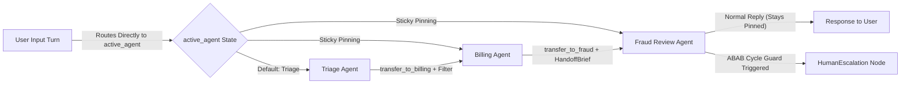
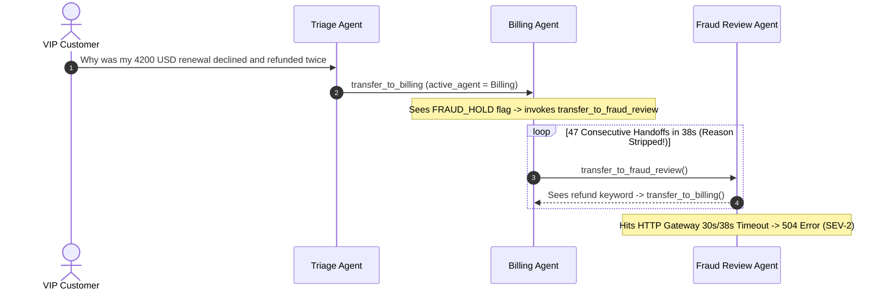

# Module 05: Swarm and Handoff Patterns

> **Prerequisites:** [Module 04: Hierarchical Agent Teams](../04-hierarchical-agent-teams/README.md), [Module 03: The Supervisor Pattern](../03-the-supervisor-pattern/README.md), and [Track 10, Module 07: The Agent Loop — Termination and Limits](../../10-ai-agents/07-the-agent-loop-termination-and-limits/README.md).  
> **Estimated Reading Time:** 32 minutes  
> **Target Audience:** AI Backend Engineers, Conversational Agent Architects, Multi-Agent Runtime Developers

> [!TIP]
> **The Golden Rule of Swarm & Handoff Systems:** Make every peer-to-peer handoff an **explicit state transition guarded by `active_agent` stickiness, valid `tool_call`/`tool_result` pairing, an outbound context filter, and an `ABAB` cycle breaker**: never leak internal agent scratchpads across handoffs, and never allow two specialists to ping-pong `transfer_to_*` tools inside the same turn.

---

## Why This Matters

In a centralized hub-and-spoke supervisor, *every* user message pays an orchestration tax (`User -> Supervisor -> BillingAgent -> Supervisor -> BillingAgent`). Even when a customer stays on a billing inquiry for `6` consecutive turns, every follow-up bounces back through the central router—adding `6` extra LLM inference calls (`+600–1,400 ms` per turn) and re-evaluating routing prompts that already have an obvious answer. Worse, when `BillingAgent` realizes halfway through a turn that `TechSupport` is needed, a rigid supervisor forces `BillingAgent` to return control to the hub before the hub guesses the next specialist.

**Swarm and Handoff Patterns**—popularized by OpenAI's Swarm / **OpenAI Agents SDK** (`handoffs`) and **`langgraph-swarm`**—eliminate the central router bottleneck. Whichever specialist is currently `active_agent` owns the conversation across turns until it explicitly invokes a `transfer_to_<target_agent>()` tool to pass control directly to a peer. Yet removing the hub trades orchestration overhead for three dangerous failure modes: mutual-recursion handoff ping-pong loops (`Agent A -> Agent B -> Agent A`), broken chat-completion histories (`400 BadRequestError` from unpaired tool calls), and cross-agent instruction or PII leakage.

---

## 1. Decentralized Handoff Mechanics & Loop Prevention

In both the OpenAI Agents SDK and LangGraph Swarm, a multi-agent swarm operates as a **decentralized state machine** keyed by `active_agent`:



### How `transfer_to_<agent>()` Works on the Wire

Under the hood, a handoff is **not magic teleportation**—it is a standard LLM tool call intercepted by the runtime loop:

1. **Tool Declaration:** Each specialist receives tool schemas for only its allowed transfer targets (e.g., `transfer_to_billing(handoff_reason, verified_account_id)`).
2. **State Update + Synthetic Tool Result:** When `TriageAgent` emits `tool_call(id="call_42", name="transfer_to_billing")`, the runtime updates `active_agent = "BillingAgent"` (in LangGraph Swarm via `Command(goto="BillingAgent", update={"active_agent": "BillingAgent", ...})`) **and immediately appends a synthetic `ToolMessage(tool_call_id="call_42", content="Transferred to BillingAgent")`** before invoking `BillingAgent`.
3. **Why Synthetic `ToolMessage` Matters:** OpenAI, Anthropic, and Gemini chat APIs strictly reject any message array where an `assistant` message with `tool_calls` is not immediately followed by matching `tool` role responses. Dropping the `tool_call` or forgetting the synthetic `ToolMessage` triggers deterministic `400 BadRequestError` crashes on the receiving agent's very first inference call.

### Quantitative Mechanics: Sticky Turn Latency & Token Savings

Suppose a customer session spans $T$ user turns requiring $H$ inter-agent transitions ($H \ll T$ when conversations cluster by topic). Compare a hub-and-spoke supervisor ($c_{\text{hub}}$ cost/latency per routing hop + $c_{\text{spec}}$ per specialist response) against a sticky swarm:

$$C_{\text{supervisor}}(T) = T \cdot (c_{\text{hub}} + c_{\text{spec}}), \qquad C_{\text{swarm}}(T, H) = T \cdot c_{\text{spec}} + H \cdot c_{\text{handoff\_overhead}}$$

$$\text{Saved Calls} = T - H \quad (\text{when } H \le T), \qquad \text{Savings Ratio} = 1 - \frac{C_{\text{swarm}}(T, H)}{C_{\text{supervisor}}(T)}$$

In an `8`-turn support chat with `3` department shifts ($T = 8, H = 3$), a sticky swarm eliminates `5` pure router LLM calls (`~31%` fewer total LLM calls and `~4.0 seconds` less cumulative wall-clock latency), because `active_agent` answers follow-up turns directly without re-entering triage.

### Context Continuity vs. Filtering Sensitive Internal Scratchpads

Passing raw unedited message history during a handoff creates two hazards:

- **Persona & Tool Confusion:** `BillingAgent` saw SQL debug dumps and billing-only instructions; feeding raw internal tool traces to `RefundsAgent` bloats context and tricks `RefundsAgent` into hallucinating tools it does not own.
- **Internal Scratchpad / Policy Leakage:** If `FraudReviewAgent` wrote `[INTERNAL_SCRATCHPAD: fraud_risk=0.88, block_reason=velocity_spike]` into assistant text or tool logs, transferring that verbatim to a customer-facing `SupportAgent` risks leaking internal anti-fraud thresholds directly to an attacker!

Production handoff pipelines enforce an **`InputFilter`** (`handoff_input_filter` in OpenAI Agents SDK / custom state mapper in LangGraph) offering three tiers:

1. **`FullHistory`:** Safe only for trusted internal sub-agents sharing identical ACL boundaries.
2. **`ToolScrubAndRedact`:** Strips intermediate `tool_call`/`tool_result` debug pairs and regex-scrubs `[INTERNAL_SCRATCHPAD]` blocks while keeping user messages intact.
3. **`StructuredHandoffBrief`:** Replaces noisy multi-turn history with a concise user transcript + typed `HandoffBrief(source_agent, reason, verified_entities)`.

### Preventing Mutual-Recursion Handoff Ping-Pong Loops (`A -> B -> A`)

Without graph-level cycle guards, decentralized prompts easily collide (`BillingAgent`: *"If fraud flags exist, transfer to FraudReview"* vs. `FraudReview`: *"If refund requested, transfer to BillingAgent"*). Enforce **three deterministic loop breakers**:

1. **Per-Turn Handoff Cap (`max_handoffs_per_turn <= 3`):** Hard cap on consecutive transfers before yielding a user response.
2. **Visited-Agent / `ABAB` Cycle Detector:** Track `visited_agents_this_turn`. Attempting to hand off back to an agent already visited within the *same* user turn (`A -> B -> A`) triggers immediate diversion to `HumanEscalation` or a deterministic fallback reply—never another `transfer_to_*` call.
3. **Transfer Exclusion Filtering:** Dynamically hide `transfer_to_<agent>` from the tool list for any agent already present in `visited_agents_this_turn`, making cycles structurally impossible for the LLM to emit!

---

## 2. Systematic Comparison Matrix: Hub Supervisor vs. OpenAI Agents Handoffs vs. LangGraph Swarm

| Dimension | Hub-and-Spoke Supervisor | OpenAI Agents SDK (`handoffs`) | LangGraph Swarm (`active_agent` + `Command`) |
| :--- | :--- | :--- | :--- |
| **Routing Authority** | Central LLM router on every turn | Active specialist via `handoff()` tool | Active specialist node via `Command(goto=...)` |
| **Sticky Multi-Turn Support** | None (re-enters hub every turn) | Session-backed (`active_agent` runner or triage entry) | Native persistent `active_agent` channel in checkpointer |
| **Context Filtering Hook** | Central prompt slicing | Built-in `input_filter` callback on `Handoff` | Custom wrapper / reducer inside handoff tool node |
| **Tool-Pairing Safety** | Managed per worker invocation | SDK automatically injects tool-call handoff confirmation | Custom tool must emit `ToolMessage(tool_call_id=...)` |
| **Ping-Pong Loop Control** | Central router tracks step count | `max_turns` cap + custom `is_enabled` filter | `visited_in_turn` state check + `recursion_limit` |
| **Best Fit** | Strict compliance checkpoints & global plans | Dynamic customer triage & rapid tool-to-agent routing | Stateful multi-turn customer support & durable checkpoints |

---

## 3. Production War Story Post-Mortem: The Infinite Refunds-vs-Fraud Handoff Ping-Pong

| Field | Incident Details |
| :--- | :--- |
| **Severity** | **SEV-2** (Customer-Facing `504 Gateway Timeout`, `1.4M` Wasted Tokens, Rate-Limit Cascading Error) |
| **Detection / Resolution Time** | Detected in `19` minutes via API `504` spike & token-per-request alert / Mitigated in `35` minutes via `visited_in_turn` cycle breaker |
| **Impact** | `180` concurrent VIP support sessions timed out after `38–45` seconds; `1.4M` redundant prompt tokens billed during an upstream payment-gateway incident |

### What Happened

A fintech support platform deployed a 3-agent Swarm (`TriageAgent`, `BillingAgent`, `FraudReviewAgent`) configured with `max_turns=50` and a custom context filter that stripped tool arguments on transfer to "save tokens."

During a payment-processor outage, a customer asked: *"Why was my \$4,200 card renewal declined and refunded twice?"* `TriageAgent` routed to `BillingAgent`. Seeing a `FRAUD_HOLD` API flag alongside a refund dispute, `BillingAgent` called `transfer_to_fraud_review()`. Because the input filter stripped the transfer reason, `FraudReviewAgent` saw only `"refunded twice"` and followed its system prompt (*"Refund disputes belong to Billing"*), calling `transfer_to_billing()`. The two specialists bounced `47` consecutive handoffs in `38` seconds until the HTTP gateway snapped with `504`.



### Root Cause Analysis

- **Stripped Handoff Reason:** Dropping `handoff_reason` during context filtering deprived `FraudReviewAgent` of *why* `BillingAgent` transferred the ticket, triggering deterministic reversal back to `BillingAgent`.
- **Missing Cycle Guard & Oversized `max_turns`:** Setting `max_turns=50` without tracking `visited_agents_this_turn` allowed `47` intra-turn agent switches without user input.
- **Overlapping Unconditional Transfer Prompts:** Both specialists held symmetric `"if X, transfer"` rules without precedence hierarchy.

### The Fix & Architectural Hardening

- **Typed `HandoffBrief` Preservation:** Preserved structured `{source_agent, reason, verified_flags}` across every handoff while scrubbing only raw `[INTERNAL_SCRATCHPAD]` debug blocks.
- **Deterministic `ABAB` Cycle Breaker + `max_handoffs_per_turn=3`:** Dynamically disabled `transfer_to_<visited>` tools for agents already visited in the current turn and escalated any repeated edge immediately to `HumanEscalation`.
- **Precedence Rule:** Established strict escalation authority (`Billing -> FraudReview` is one-way during an active `FRAUD_HOLD`; `FraudReview` cannot bounce back without clearing the hold).

---

## 4. Multi-Language Production Implementation: Loop-Safe Sticky Swarm Router

Below is a production-ready **Swarm & Handoff Router** across **Go**, **TypeScript**, **Python**, and **C#**. Each implementation enforces: (1) persistent `active_agent` routing without a central hub, (2) synthetic `ToolResult` message pairing on every handoff, (3) `InputFilter` scrubbing of internal scratchpads + injection of a typed `HandoffBrief`, and (4) deterministic `ABAB` cycle breaking.

````carousel

```go
package swarm

import (
	"errors"
	"fmt"
	"regexp"
	"strings"
)

type Message struct {
	Role       string // "user" | "assistant" | "tool" | "system"
	Agent      string
	Content    string
	ToolCallID string
	ToolName   string
}

type HandoffDecision struct {
	TargetAgent string
	Reason      string
}

type SwarmState struct {
	ActiveAgent     string
	History         []Message
	VisitedInTurn   map[string]bool
	HandoffsInTurn  int
	MaxHandoffsTurn int
}

var scratchpadPattern = regexp.MustCompile(`\[INTERNAL_SCRATCHPAD:[^\]]*\]\s*`)

// FilterContextForHandoff strips internal scratchpads and raw tool debug dumps while appending a typed HandoffBrief.
func FilterContextForHandoff(history []Message, fromAgent, toAgent, reason string) []Message {
	cleaned := make([]Message, 0, len(history)+1)
	for _, m := range history {
		if m.Role == "tool" && m.ToolName != "" && !strings.HasPrefix(m.ToolName, "transfer_to_") {
			continue // Drop noisy raw DB/tool outputs across agent trust boundaries
		}
		cleanContent := scratchpadPattern.ReplaceAllString(m.Content, "")
		m.Content = cleanContent
		cleaned = append(cleaned, m)
	}
	cleaned = append(cleaned, Message{
		Role:    "system",
		Agent:   toAgent,
		Content: fmt.Sprintf("HANDOFF_BRIEF source=%s target=%s reason=%q", fromAgent, toAgent, reason),
	})
	return cleaned
}

// ExecuteHandoff enforces cycle detection, max handoffs, and paired assistant(tool_call)->tool(result) invariants.
func (s *SwarmState) ExecuteHandoff(decision HandoffDecision, callID string) error {
	if s.VisitedInTurn == nil {
		s.VisitedInTurn = map[string]bool{s.ActiveAgent: true}
	}
	if s.HandoffsInTurn >= s.MaxHandoffsTurn {
		s.ActiveAgent = "HumanEscalation"
		return errors.New("max_handoffs_per_turn exceeded; escalated to HumanEscalation")
	}
	if s.VisitedInTurn[decision.TargetAgent] {
		s.ActiveAgent = "HumanEscalation"
		return fmt.Errorf("ABAB cycle detected (%s -> %s); escalated to HumanEscalation", s.ActiveAgent, decision.TargetAgent)
	}

	from := s.ActiveAgent
	s.History = append(s.History,
		Message{Role: "assistant", Agent: from, ToolCallID: callID, ToolName: "transfer_to_" + decision.TargetAgent},
		Message{Role: "tool", Agent: from, ToolCallID: callID, ToolName: "transfer_to_" + decision.TargetAgent, Content: "Transferred to " + decision.TargetAgent},
	)
	s.History = FilterContextForHandoff(s.History, from, decision.TargetAgent, decision.Reason)
	s.VisitedInTurn[decision.TargetAgent] = true
	s.HandoffsInTurn++
	s.ActiveAgent = decision.TargetAgent
	return nil
}
```

<!-- slide -->

```typescript
export interface SwarmMessage {
  readonly role: "user" | "assistant" | "tool" | "system";
  readonly agent?: string;
  readonly content: string;
  readonly toolCallId?: string;
  readonly toolName?: string;
}

export interface SwarmSessionState {
  activeAgent: string;
  history: SwarmMessage[];
  visitedInTurn: Set<string>;
  handoffsInTurn: number;
  readonly maxHandoffsPerTurn: number;
}

const SCRATCHPAD_RE = /\[INTERNAL_SCRATCHPAD:[^\]]*\]\s*/g;

export function applyHandoffInputFilter(
  messages: readonly SwarmMessage[],
  fromAgent: string,
  toAgent: string,
  reason: string,
): SwarmMessage[] {
  const sanitized: SwarmMessage[] = [];
  for (const msg of messages) {
    if (msg.role === "tool" && msg.toolName && !msg.toolName.startsWith("transfer_to_")) {
      continue; // Omit raw worker tool traces from peer context
    }
    sanitized.push({
      ...msg,
      content: msg.content.replace(SCRATCHPAD_RE, ""),
    });
  }
  sanitized.push({
    role: "system",
    agent: toAgent,
    content: `HANDOFF_BRIEF from=${fromAgent} to=${toAgent} reason=${JSON.stringify(reason)}`,
  });
  return sanitized;
}

export function performSwarmHandoff(
  state: SwarmSessionState,
  targetAgent: string,
  reason: string,
  toolCallId: string,
): { escalated: boolean; reason: string } {
  state.visitedInTurn.add(state.activeAgent);

  if (state.handoffsInTurn >= state.maxHandoffsPerTurn) {
    state.activeAgent = "HumanEscalation";
    return { escalated: true, reason: `Exceeded maxHandoffsPerTurn=${state.maxHandoffsPerTurn}` };
  }
  if (state.visitedInTurn.has(targetAgent)) {
    const prev = state.activeAgent;
    state.activeAgent = "HumanEscalation";
    return { escalated: true, reason: `Cycle detected (${prev} -> ${targetAgent})` };
  }

  const fromAgent = state.activeAgent;
  const toolName = `transfer_to_${targetAgent}`;

  // Maintain strict assistant(tool_call) -> tool(tool_result) API parity
  state.history.push(
    { role: "assistant", agent: fromAgent, content: "", toolCallId, toolName },
    { role: "tool", agent: fromAgent, content: `Transferred to ${targetAgent}`, toolCallId, toolName },
  );
  state.history = applyHandoffInputFilter(state.history, fromAgent, targetAgent, reason);
  state.visitedInTurn.add(targetAgent);
  state.handoffsInTurn += 1;
  state.activeAgent = targetAgent;
  return { escalated: false, reason: "ok" };
}
```

<!-- slide -->

```python
"""
swarm_handoff_router.py
Sticky active_agent Swarm router with ABAB cycle breaking, valid ToolMessage
pairing, and outbound scratchpad scrubbing.
"""
from dataclasses import dataclass, field
import re


SCRATCHPAD_RE = re.compile(r"\[INTERNAL_SCRATCHPAD:[^\]]*\]\s*")


@dataclass(frozen=True)
class SwarmMessage:
    role: str  # "user" | "assistant" | "tool" | "system"
    content: str
    agent: str = ""
    tool_call_id: str = ""
    tool_name: str = ""


@dataclass
class SwarmState:
    active_agent: str = "TriageAgent"
    max_handoffs_per_turn: int = 3
    history: list[SwarmMessage] = field(default_factory=list)
    visited_in_turn: set[str] = field(default_factory=set)
    handoffs_in_turn: int = 0

    def start_new_user_turn(self, user_text: str) -> None:
        self.history.append(SwarmMessage(role="user", content=user_text))
        self.visited_in_turn = {self.active_agent}
        self.handoffs_in_turn = 0


def filter_handoff_context(
    history: list[SwarmMessage],
    source_agent: str,
    target_agent: str,
    reason: str,
) -> list[SwarmMessage]:
    cleaned: list[SwarmMessage] = []
    for msg in history:
        if msg.role == "tool" and msg.tool_name and not msg.tool_name.startswith("transfer_to_"):
            continue
        scrubbed = SCRATCHPAD_RE.sub("", msg.content)
        cleaned.append(
            SwarmMessage(
                role=msg.role,
                content=scrubbed,
                agent=msg.agent,
                tool_call_id=msg.tool_call_id,
                tool_name=msg.tool_name,
            )
        )
    cleaned.append(
        SwarmMessage(
            role="system",
            agent=target_agent,
            content=f"HANDOFF_BRIEF from={source_agent} to={target_agent} reason={reason!r}",
        )
    )
    return cleaned


def execute_handoff(
    state: SwarmState,
    target_agent: str,
    reason: str,
    call_id: str,
) -> str:
    state.visited_in_turn.add(state.active_agent)
    if state.handoffs_in_turn >= state.max_handoffs_per_turn:
        state.active_agent = "HumanEscalation"
        return "ESCALATED_MAX_HANDOFFS"
    if target_agent in state.visited_in_turn:
        state.active_agent = "HumanEscalation"
        return "ESCALATED_CYCLE_DETECTED"

    source_agent = state.active_agent
    tool_name = f"transfer_to_{target_agent}"
    # Pair assistant tool_call and synthetic ToolMessage before context handoff
    state.history.append(
        SwarmMessage(role="assistant", agent=source_agent, content="", tool_call_id=call_id, tool_name=tool_name)
    )
    state.history.append(
        SwarmMessage(role="tool", agent=source_agent, content=f"Transferred to {target_agent}", tool_call_id=call_id, tool_name=tool_name)
    )
    state.history = filter_handoff_context(state.history, source_agent, target_agent, reason)
    state.visited_in_turn.add(target_agent)
    state.handoffs_in_turn += 1
    state.active_agent = target_agent
    return "HANDOFF_OK"
```

<!-- slide -->

```csharp
using System;
using System.Collections.Generic;
using System.Text.RegularExpressions;

namespace GenAI.Swarm;

public sealed record SwarmMessage(
    string Role,
    string Content,
    string? Agent = null,
    string? ToolCallId = null,
    string? ToolName = null);

public sealed class SwarmRouterState
{
    private static readonly Regex ScratchpadRegex = new(@"\[INTERNAL_SCRATCHPAD:[^\]]*\]\s*", RegexOptions.Compiled);

    public string ActiveAgent { get; private set; } = "TriageAgent";
    public int MaxHandoffsPerTurn { get; }
    public List<SwarmMessage> History { get; private set; } = new();
    private readonly HashSet<string> _visitedInTurn = new(StringComparer.Ordinal);
    private int _handoffsInTurn;

    public SwarmRouterState(int maxHandoffsPerTurn = 3)
    {
        MaxHandoffsPerTurn = maxHandoffsPerTurn;
    }

    public void BeginUserTurn(string userPrompt)
    {
        History.Add(new SwarmMessage("user", userPrompt));
        _visitedInTurn.Clear();
        _visitedInTurn.Add(ActiveAgent);
        _handoffsInTurn = 0;
    }

    public string TransferTo(string targetAgent, string reason, string callId)
    {
        _visitedInTurn.Add(ActiveAgent);
        if (_handoffsInTurn >= MaxHandoffsPerTurn)
        {
            ActiveAgent = "HumanEscalation";
            return "ESCALATED_MAX_HANDOFFS";
        }
        if (_visitedInTurn.Contains(targetAgent))
        {
            ActiveAgent = "HumanEscalation";
            return "ESCALATED_ABAB_CYCLE";
        }

        string source = ActiveAgent;
        string toolName = $"transfer_to_{targetAgent}";

        History.Add(new SwarmMessage("assistant", string.Empty, source, callId, toolName));
        History.Add(new SwarmMessage("tool", $"Transferred to {targetAgent}", source, callId, toolName));
        History = SanitizeContext(History, source, targetAgent, reason);

        _visitedInTurn.Add(targetAgent);
        _handoffsInTurn++;
        ActiveAgent = targetAgent;
        return "HANDOFF_OK";
    }

    private static List<SwarmMessage> SanitizeContext(
        IReadOnlyList<SwarmMessage> raw,
        string sourceAgent,
        string targetAgent,
        string reason)
    {
        var cleaned = new List<SwarmMessage>(raw.Count + 1);
        foreach (var msg in raw)
        {
            if (msg.Role == "tool" && msg.ToolName is not null && !msg.ToolName.StartsWith("transfer_to_", StringComparison.Ordinal))
            {
                continue;
            }
            cleaned.Add(msg with { Content = ScratchpadRegex.Replace(msg.Content, string.Empty) });
        }
        cleaned.Add(new SwarmMessage("system", $"HANDOFF_BRIEF from={sourceAgent} to={targetAgent} reason={reason}", targetAgent));
        return cleaned;
    }
}
```

````

---

## 5. Practical Hands-On Verification CLI Workflows

Run these deterministic Python 3.13 verification scripts offline—no third-party packages or API keys required.

### Workflow 1: Measure Sticky `active_agent` Swarm vs. Hub Supervisor Call & Latency Savings

Simulate an `8`-turn customer session clustering across `BillingAgent` and `TechSupport` (`3` total handoffs), comparing central supervisor routing against sticky swarm pinning:

```bash
python -c '
def simulate_session(turns, sup_ms=650, spec_ms=900, sup_tok=550, spec_tok=1200):
    sup_calls = len(turns) * 2
    sup_latency = len(turns) * (sup_ms + spec_ms)
    sup_tokens = len(turns) * (sup_tok + spec_tok)

    active = "TriageAgent"
    swarm_calls = 0
    swarm_latency = 0
    swarm_tokens = 0
    handoffs = 0
    for idx, needed_agent in enumerate(turns, 1):
        if needed_agent != active:
            handoffs += 1
            swarm_calls += 2
            swarm_latency += int(spec_ms * 1.45)
            swarm_tokens += spec_tok + 420
            active = needed_agent
        else:
            swarm_calls += 1
            swarm_latency += spec_ms
            swarm_tokens += spec_tok
        print(f"Turn {idx} [{needed_agent:<13}] -> active_agent={active:<13} | cum_swarm_calls={swarm_calls:>2} vs hub_calls={idx*2:>2}")

    print(f"\nSummary (8 turns, {handoffs} handoffs):")
    print(f"  Hub Supervisor : {sup_calls:>2} calls | {sup_latency:>6,} ms | {sup_tokens:>6,} tokens")
    print(f"  Sticky Swarm   : {swarm_calls:>2} calls | {swarm_latency:>6,} ms | {swarm_tokens:>6,} tokens")
    print(f"  Savings        : {sup_calls - swarm_calls:>2} calls | {sup_latency - swarm_latency:>6,} ms | {sup_tokens - swarm_tokens:>6,} tokens")

turns = ["BillingAgent", "BillingAgent", "BillingAgent", "TechSupport", "TechSupport", "TechSupport", "TechSupport", "BillingAgent"]
simulate_session(turns)
'
```

**Expected Output:**

```text
Turn 1 [BillingAgent ] -> active_agent=BillingAgent  | cum_swarm_calls= 2 vs hub_calls= 2
Turn 2 [BillingAgent ] -> active_agent=BillingAgent  | cum_swarm_calls= 3 vs hub_calls= 4
Turn 3 [BillingAgent ] -> active_agent=BillingAgent  | cum_swarm_calls= 4 vs hub_calls= 6
Turn 4 [TechSupport  ] -> active_agent=TechSupport   | cum_swarm_calls= 6 vs hub_calls= 8
Turn 5 [TechSupport  ] -> active_agent=TechSupport   | cum_swarm_calls= 7 vs hub_calls=10
Turn 6 [TechSupport  ] -> active_agent=TechSupport   | cum_swarm_calls= 8 vs hub_calls=12
Turn 7 [TechSupport  ] -> active_agent=TechSupport   | cum_swarm_calls= 9 vs hub_calls=14
Turn 8 [BillingAgent ] -> active_agent=BillingAgent  | cum_swarm_calls=11 vs hub_calls=16

Summary (8 turns, 3 handoffs):
  Hub Supervisor : 16 calls | 12,400 ms | 14,000 tokens
  Sticky Swarm   : 11 calls |  8,415 ms | 10,860 tokens
  Savings        :  5 calls |  3,985 ms |  3,140 tokens
```

### Workflow 2: Verify `ABAB` Ping-Pong Cycle Breaker & Tool-Call Parity

Contrast an unguarded `BillingAgent <-> FraudReview` ping-pong loop against a guarded `ABAB` cycle breaker while asserting strict `tool_call_id` parity on every transfer:

```bash
python -c '
def run_handoff_chain(use_cycle_breaker: bool, max_handoffs: int = 5):
    routing_rules = {
        "TriageAgent": "BillingAgent",
        "BillingAgent": "FraudReview",
        "FraudReview": "BillingAgent",
    }
    history = [{"role": "user", "content": "Why was my card refund flagged?"}]
    active = "TriageAgent"
    visited_edges = set()
    handoffs = 0

    for step in range(1, max_handoffs + 2):
        nxt = routing_rules.get(active)
        if not nxt:
            break
        edge = (active, nxt)
        if use_cycle_breaker and (edge in visited_edges or nxt in {e[0] for e in visited_edges}):
            print(f"[BREAKER] Step {step}: cycle detected ({active} -> {nxt}); escalating to HumanEscalation")
            active = "HumanEscalation"
            break
        if handoffs >= max_handoffs:
            print(f"[CAP] Step {step}: hit max_handoffs={max_handoffs}; aborting loop")
            break
        visited_edges.add(edge)
        call_id = f"call_{step}"
        history.append({"role": "assistant", "agent": active, "tool_call_id": call_id, "tool": f"transfer_to_{nxt}"})
        history.append({"role": "tool", "tool_call_id": call_id, "content": f"Transferred to {nxt}"})
        handoffs += 1
        print(f"  Hop {handoffs}: {active} -> {nxt} (paired {call_id})")
        active = nxt

    call_ids = [m["tool_call_id"] for m in history if m["role"] == "assistant"]
    res_ids = [m["tool_call_id"] for m in history if m["role"] == "tool"]
    assert call_ids == res_ids, "Unpaired tool_call_id detected!"
    print(f"  Final agent={active} | total_handoffs={handoffs} | tool_pairing_valid={call_ids == res_ids}\n")

print("=== Mode A: Unguarded Ping-Pong ===")
run_handoff_chain(use_cycle_breaker=False, max_handoffs=5)
print("=== Mode B: Guarded ABAB Cycle Breaker ===")
run_handoff_chain(use_cycle_breaker=True, max_handoffs=5)
'
```

**Expected Output:**

```text
=== Mode A: Unguarded Ping-Pong ===
  Hop 1: TriageAgent -> BillingAgent (paired call_1)
  Hop 2: BillingAgent -> FraudReview (paired call_2)
  Hop 3: FraudReview -> BillingAgent (paired call_3)
  Hop 4: BillingAgent -> FraudReview (paired call_4)
  Hop 5: FraudReview -> BillingAgent (paired call_5)
[CAP] Step 6: hit max_handoffs=5; aborting loop
  Final agent=BillingAgent | total_handoffs=5 | tool_pairing_valid=True

=== Mode B: Guarded ABAB Cycle Breaker ===
  Hop 1: TriageAgent -> BillingAgent (paired call_1)
  Hop 2: BillingAgent -> FraudReview (paired call_2)
[BREAKER] Step 3: cycle detected (FraudReview -> BillingAgent); escalating to HumanEscalation
  Final agent=HumanEscalation | total_handoffs=2 | tool_pairing_valid=True
```

### Workflow 3: Audit Handoff Context Filtering & Scratchpad Scrubbing

Verify that `[INTERNAL_SCRATCHPAD]` policy notes and raw `sql_dump` tool payloads are scrubbed before handing off to `RefundsAgent`, leaving a clean user transcript plus typed `HANDOFF_BRIEF`:

```bash
python -c '
import re

raw_messages = [
    {"role": "user", "content": "My invoice INV-8841 shows a duplicate charge of 299 USD."},
    {"role": "assistant", "agent": "BillingAgent", "content": "[INTERNAL_SCRATCHPAD: fraud_risk=0.82, vip_tier=platinum, secret_rule=do_not_reveal_threshold] Checking ledger."},
    {"role": "tool", "tool": "sql_dump", "content": "RAW_SQL_DUMP_ROW_1..40: account_pin=9921 internal_margin=0.41 status=duplicate"},
    {"role": "assistant", "agent": "BillingAgent", "content": "I confirmed invoice INV-8841 has a duplicate charge and am transferring you to Refunds."},
]

def sanitize_for_handoff(messages, source_agent, target_agent, summary):
    cleaned = []
    leaked_tokens_removed = 0
    for m in messages:
        if m["role"] == "tool":
            leaked_tokens_removed += len(m["content"].split())
            continue
        text = re.sub(r"\[INTERNAL_SCRATCHPAD:[^\]]*\]\s*", "", m["content"])
        if text != m["content"]:
            leaked_tokens_removed += len(m["content"].split()) - len(text.split())
        cleaned.append({"role": m["role"], "content": text})
    cleaned.append({"role": "system", "content": f"HANDOFF_BRIEF from {source_agent} to {target_agent}: {summary}"})
    return cleaned, leaked_tokens_removed

filtered, removed = sanitize_for_handoff(
    raw_messages,
    "BillingAgent",
    "RefundsAgent",
    "Customer reports duplicate 299 USD charge on INV-8841; ledger confirmed duplicate."
)
print(f"Filtered messages: {len(filtered)} (dropped/scrubbed {removed} internal tokens)")
for idx, msg in enumerate(filtered, 1):
    role = msg["role"]
    content = msg["content"]
    print(f"  {idx}. [{role}] {content}")
has_leak = any("INTERNAL_SCRATCHPAD" in m["content"] or "account_pin" in m["content"] for m in filtered)
print(f"Scratchpad/PII leak detected: {has_leak}")
'
```

**Expected Output:**

```text
Filtered messages: 4 (dropped/scrubbed 8 internal tokens)
  1. [user] My invoice INV-8841 shows a duplicate charge of 299 USD.
  2. [assistant] Checking ledger.
  3. [assistant] I confirmed invoice INV-8841 has a duplicate charge and am transferring you to Refunds.
  4. [system] HANDOFF_BRIEF from BillingAgent to RefundsAgent: Customer reports duplicate 299 USD charge on INV-8841; ledger confirmed duplicate.
Scratchpad/PII leak detected: False
```

### Hands-On Exercises

1. **Dynamic Tool Exclusion:** Modify Workflow 2 so each agent's available `transfer_to_*` tool list filters out any agent in `visited_agents_this_turn`, confirming `FraudReview` cannot even propose `transfer_to_BillingAgent` once `BillingAgent` transferred to it.
2. **Preserve Handoff Tool Calls While Stripping Debug Tools:** In Workflow 3, add a paired `transfer_to_RefundsAgent` `assistant`/`tool` turn to `raw_messages` and ensure `sanitize_for_handoff` preserves that transfer pair while still stripping `sql_dump`.
3. **Optional Live OpenAI Agents SDK Probe (Requires API Key & `openai-agents`):** Define a `TriageAgent` and `BillingAgent` connected via `handoff(billing_agent, input_filter=...)`, send two follow-up billing turns, and verify `last_agent` stays `BillingAgent` without re-invoking `TriageAgent`.

### Independent Challenge

A travel-concierge swarm connects `FlightAgent`, `HotelAgent`, and `LoyaltyPointsAgent` over a shared thread. Whenever a traveler asks *"Apply my 40,000 loyalty points to both my delayed flight rebooking and tonight's hotel extension"*, `FlightAgent` transfers to `LoyaltyPointsAgent`, which applies points to the flight, sees `"hotel extension"`, transfers to `HotelAgent`, which notices `"points balance"` and transfers back to `LoyaltyPointsAgent`. Explain why a pure Swarm fails on *simultaneous multi-domain* turns and redesign the routing rule cleanly.

<details><summary>Architectural Discussion</summary>

1. **Recognize when Swarm loses to a Plan-and-Execute / Orchestrator:** Pure peer-to-peer handoffs excel when turns are **sequentially localized** (`active_agent` handles a sub-conversation before handing off). A single prompt requiring coordinated mutations across *multiple* specialists simultaneously (`Flight + Hotel + Loyalty`) belongs in a **Parallel Pipeline** or **Orchestrator-Worker** sub-workflow rather than linear peer relay.
2. **Prevent Ping-Pong on Mixed Intents:** Keep `visited_in_turn` protection (`Loyalty -> Hotel` cannot bounce back to `Loyalty`), or let `TriageAgent` split multi-intent queries into sub-tasks via an orchestrator node before dropping into sticky `active_agent` mode for follow-up Q&A.

</details>

---

## 6. Common Mistakes & Troubleshooting

- **Stripping `ToolMessage` records without stripping the parent `assistant.tool_calls`:** Removing `role="tool"` entries during an input filter while leaving the matching `tool_call_id` inside the `assistant` turn guarantees an immediate `400 BadRequestError` from OpenAI/Anthropic APIs. Always strip **matched pairs** or emit a synthetic transfer `ToolMessage`.
- **Sharing raw system prompts or internal fraud flags across agent handoffs:** Forwarding internal agent system notes or `[INTERNAL_SCRATCHPAD]` markers causes the receiving specialist to act on foreign tool rules or accidentally disclose internal scoring policies to the end user.
- **Using Swarm when every user turn touches multiple unrelated domains:** If users jump rapidly across `3+` specialists on nearly every message ($H \approx T$), Swarm loses its sticky-turn advantage and degenerates into noisy multi-hop bouncing; use a central supervisor or parallel pipeline instead.
- **Relying only on `max_turns = 25` to stop loops:** Allowing `25` silent intra-turn transfers still wastes `20+` seconds and tens of thousands of tokens before crashing. Enforce `max_handoffs_per_turn <= 3` plus `ABAB` cycle breaking.

---

## 7. Operational Validation Checkpoints & Checkpoint Quiz

### Operational Validation Checkpoints

<details><summary><strong>Checkpoint 1: Debugging a 400 BadRequestError immediately after a handoff</strong></summary>

A newly added `handoff_input_filter` filters out all `role="tool"` messages to save tokens before invoking `RefundsAgent`. Every handoff now throws `400: An assistant message with 'tool_calls' must be followed by tool messages responding to each 'tool_call_id'`. Why did this happen?

**Validation:** `TriageAgent` initiated the handoff by emitting an `assistant` message containing `tool_calls: [transfer_to_RefundsAgent]`. The filter deleted the matching `role="tool"` confirmation message while leaving the `assistant` `tool_calls` array intact. Fix by either preserving paired handoff `ToolMessage` confirmations or stripping *both* the `assistant.tool_calls` entry and its `ToolMessage` together when converting history into a `HandoffBrief`.

</details>

<details><summary><strong>Checkpoint 2: Breaking a subtle 3-agent handoff triangle (`A -> B -> C -> A`)</strong></summary>

Engineering added a `last_agent != target_agent` check (blocking `A -> B -> A` immediate reversals), yet QA found a `3`-agent triangle (`Triage -> Billing -> Fraud -> Triage -> Billing -> ...`) that still runs until `max_turns` expires. What minimal data structure closes all `N`-agent cycles?

**Validation:** Checking only `target != prev_agent` catches 2-cycles (`ABAB`) but misses 3-cycles (`ABCABC`). Maintaining a per-turn `visited_in_turn: set[str]` across the entire turn—and routing any attempt where `target_agent in visited_in_turn` (or hitting `max_handoffs_per_turn`) directly to `HumanEscalation`—provably terminates all arbitrary-length cycles within $|V|$ hops.

</details>

<details><summary><strong>Checkpoint 3: Auditing cross-turn stickiness in multi-turn chat</strong></summary>

Users report that after `TriageAgent` transfers them to `TechSupport`, their very next follow-up question (*"How do I reset my API key?"*) unexpectedly routes back through `TriageAgent`, adding `+800 ms` per turn. What runtime state was not persisted?

**Validation:** `active_agent` was reset to `"TriageAgent"` at the start of every new HTTP request instead of being persisted in the session checkpointer/database (`SwarmState.active_agent`). Persisting `active_agent` per `thread_id` allows subsequent user messages to enter `TechSupport` directly until a new handoff occurs.

</details>

### Checkpoint Quiz

1. How does a Swarm pattern eliminate central supervisor inference calls on multi-turn specialist conversations?
2. What happens on OpenAI/Anthropic APIs if `Agent A` emits `transfer_to_B` (`tool_call_id="c1"`) and the runtime switches to `Agent B` without appending a matching `ToolMessage`?
3. Name two risks of passing raw unedited `MessagesState` across a peer-to-peer handoff.
4. Why is `target != previous_agent` insufficient as a cycle breaker, and what replaces it?
5. When is a centralized supervisor or parallel pipeline strictly preferable to a peer-to-peer Swarm?

<details><summary>Answers</summary>

1. By persisting `active_agent` across user turns so incoming follow-up messages route directly to the currently pinned specialist without re-invoking a central triage router.
2. The provider returns `400 BadRequestError` because every `assistant` message carrying `tool_calls` must be followed by corresponding `tool` result messages before another turn can proceed.
3. (a) Leaking private `[INTERNAL_SCRATCHPAD]`/policy scores or PII to downstream customer-facing agents, and (b) confusing the receiving specialist with foreign tool call traces and bloated context tokens.
4. `target != previous_agent` fails to catch `3+`-agent loops (`A -> B -> C -> A`); tracking `visited_in_turn: set[str]` plus `max_handoffs_per_turn` blocks cycles of any length.
5. When a single user prompt requires coordinated parallel execution across multiple independent specialists simultaneously, or when compliance requires a central audit node on every transition.

</details>

---

## Further Reading & Sources

- [OpenAI Agents SDK Documentation: Handoffs](https://openai.github.io/openai-agents-python/handoffs/) — official design spec for `handoff()`, `input_filter`, and structured handoff inputs.
- [GitHub: `langchain-ai/langgraph-swarm-py`](https://github.com/langchain-ai/langgraph-swarm-py) — LangGraph Swarm implementation demonstrating persistent `active_agent` state and `Command` transfers.
- [GitHub: `openai/swarm`](https://github.com/openai/swarm) — OpenAI's reference lightweight educational swarm/handoff runtime.
- [Module 04: Hierarchical Agent Teams](../04-hierarchical-agent-teams/README.md) — contrasting hierarchical team trees against flat peer-to-peer handoff networks.

## Next

[Module 06: Sequential and Parallel Pipelines](../06-sequential-and-parallel-pipelines/README.md)
