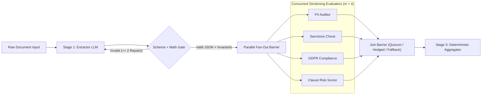
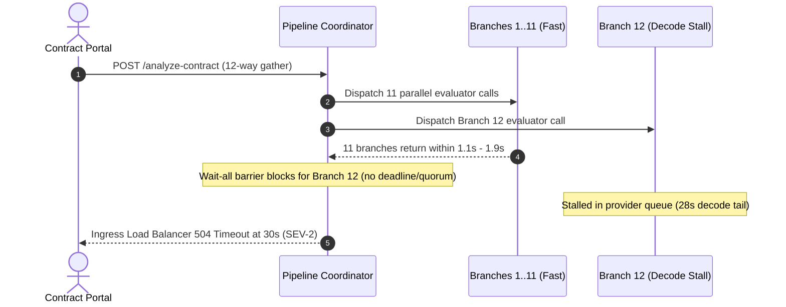

# Module 06: Sequential and Parallel Pipelines

> **Prerequisites:** [Module 01: Multi-Agent Topologies Overview](../01-multi-agent-topologies-overview/README.md), [Module 05: Swarm and Handoff Patterns](../05-swarm-and-handoff-patterns/README.md), and [Track 11, Module 13: LangGraph Edges and Conditional Routing](../../11-langchain-and-langgraph/13-langgraph-edges-and-conditional-routing/README.md).  
> **Estimated Reading Time:** 32 minutes  
> **Target Audience:** AI Systems Architects, Backend Pipeline Engineers, High-Throughput LLM Infrastructure Developers

> [!TIP]
> **The Golden Rule of Sequential and Parallel Pipelines:** Never burn autonomous agent reasoning loops on workflows whose step topology is already known at design time: wire **deterministic assembly-line DAGs** separated by **programmatic schema validation gates** sequentially, and bound every parallel fan-out with **explicit join-barrier failure policies, hedged straggler requests, and hard deadlines**.

---

## Why This Matters

Engineering teams routinely wrap rigid enterprise processes—such as `Extract Invoice -> Verify Tax Rules -> Compute Ledger Entry` or `Run 5 Guardrail Checks -> Aggregate Risk Score`—inside free-form multi-agent supervisor loops. When the task graph is static and well-defined, giving LLMs autonomous routing control buys zero architectural flexibility while creating three predictable production failures: wasted router inference calls (`2x–4x` token inflation), non-deterministic stage skipping, and uncalibrated tail latency.

Following Anthropic's *Building Effective Agents* taxonomy, **deterministic workflows** (`Prompt Chaining` with gates and `Parallelization` via sectioning/voting) outperform autonomous agents whenever paths are statically enumerable. Yet replacing loops with static DAGs exposes two sharp backend engineering traps: **silent schema drift cascading across unvalidated sequential stages**, and **order-statistic tail-latency amplification** ($E[\max_{i=1..m} X_i]$) across concurrent parallel LLM fan-outs.

---

## 1. Deterministic Pipeline Mechanics: Gates, Join Barriers, and Tail-Latency Bounds

Production multi-agent pipelines combine two structural primitives inside a directed acyclic graph (DAG): **contract-gated sequential chains** and **policy-governed scatter-gather barriers**.



### Sequential Contract Validation Gates (`Stage k -> Gate -> Stage k+1`)

Passing raw, unchecked Stage-$k$ text directly into Stage-$(k+1)$ causes **compounding semantic corruption**: if Stage `1` hallucinates a malformed tax field or line-item total (`sum(items) = 200 != total = 999`), Stage `2` smoothly calculates downstream accounting against corrupt numbers.

A **programmatic gate** placed between every sequential stage enforces:

1. **Syntactic & Type Contract:** Strict JSON Schema / Pydantic parsing (`invoice_id: str`, `items: list[LineItem]`).
2. **Deterministic Domain Invariants:** Pure code assertions that LLMs frequently violate (e.g., `sum(item.usd) == declared_total`, valid ISO-4217 currency codes, grounded source IDs).
3. **Bounded Repair Loop ($r_{\max} \le 2$):** On gate rejection, inject the exact validation error message back into Stage $k$ for at most `2` repair passes before halting cleanly or routing to dead-letter review.

### Parallel Fan-Out & Join-Barrier Partial-Failure Policies

When splitting independent subtasks across $m$ concurrent model calls (**sectioning**) or running $m$ redundant calls for consensus (**voting**), a **scatter-gather join barrier** must explicitly specify one of three partial-failure policies:

| Policy | Semantics | Latency Bound | Best Production Use Case |
| :--- | :--- | :--- | :--- |
| **`fail_fast`** | Cancel all sibling branches immediately if any mandatory branch errors or times out | $\min(T_{\text{deadline}}, t_{\text{first\_err}})$ | Financial ledger writes or safety-critical gates requiring `100%` branch completion |
| **`best_effort_quorum`** | Proceed as soon as $q$ of $m$ valid branches return (canceling slow stragglers) | $X_{(q:m)}$ (the $q$-th order statistic) | Multi-reviewer voting ($3$ of $5$) or redundant risk scoring where $q < m$ preserves accuracy |
| **`fallback_tier`** | Substitute a fast deterministic heuristic or lightweight cached tier for any branch missing $T_{\text{deadline}}$ | Capped strictly at $T_{\text{deadline}}$ | User-facing latency SLAs (`<= 1.5s`) requiring complete output vectors under upstream jitter |

### Quantitative Mechanics: Amdahl's Law & Tail-Latency Amplification

Parallelizing an LLM workflow obeys two competing distributed-systems laws:

- **Amdahl's Law Speedup Ceiling:** If a pipeline has serial fraction $s \in (0, 1)$ (schema parsing, prompt templating, final aggregation) and parallelizable fraction $1 - s$ split evenly across $m$ concurrent branches, theoretical speedup cannot exceed:

$$S(m) = \frac{1}{s + \frac{1 - s}{m}}$$

Even with $m \to \infty$, a pipeline whose sequential validation and final synthesis occupy $s = 0.25$ of baseline latency caps at $4.0\times$ total speedup.

- **Tail-Latency Amplification in Parallel Fan-Outs:** Because LLM inference latency $X_i$ is heavy-tailed (driven by decode token variance, KV-cache preemption, and provider queuing), waiting for **all $m$ branches** turns the barrier wait time into the maximum order statistic (Dean & Barroso, *"The Tail at Scale"*):

$$L_{\text{barrier}} = \max_{i=1..m} X_i, \qquad P(L_{\text{barrier}} \le t) = \left( F_X(t) \right)^m, \qquad P(\text{at least 1 tail } > t_p) = 1 - p^m$$

Consider concrete production numbers: if a single LLM call has $p_{50} = 1.1\text{ s}$ and $p_{95} = 2.8\text{ s}$, fanning out $m = 16$ independent calls with a wait-for-all join barrier yields a $1 - 0.95^{16} = 56.0\%$ chance that **more than half of all requests wait past $p_{95}$**, dragging median request latency up toward `2.8s` and `p99` past `6.6s`!

Two backend techniques neutralize tail amplification:

1. **Hedged Requests:** If an individual branch has not responded by $t_{\text{hedge}}$ (typically $\approx 1.5\times p_{50}$ or local $p_{90}$), dispatch a secondary backup request and take `min(primary, backup)` while canceling the slower flight on receipt.
2. **Quorum / Straggler Cutoff ($q < m$):** Completing at $q = m - 2$ cancels the slowest $2$ tail stragglers immediately once quorum satisfies confidence criteria.

---

## 2. Systematic Comparison Matrix: Pipeline Patterns vs. Autonomous Agents

| Dimension | Autonomous Agent Loop | Sequential Gated DAG | Parallel Fan-Out (`fail_fast`) | Parallel Quorum + Hedged Fan-Out |
| :--- | :--- | :--- | :--- | :--- |
| **Execution Determinism** | Low (LLM picks next node) | High (static topological edges) | High (fixed scatter-gather graph) | High (fixed topology + bounded quorum) |
| **Wall-Clock Latency** | High (serial decision hops) | Sum of stage latencies $\sum L_k$ | Dominated by $\max_{i=1..m} X_i$ | Bounded by $X_{(q:m)}$ or $t_{\text{hedge}} + \Delta$ |
| **Cost Multiplier** | High (router overhead per turn) | Minimal (`1` call per stage + rare repair) | $m\times$ concurrent branch tokens | $m\times$ plus small `~5–10%` hedge traffic |
| **Partial Failure Handling** | Ad-hoc retries or loop abort | Local gate catch + bounded repair | Entire fan-out aborts on `1` failure | Graceful survival up to $m - q$ failures |
| **Validation Surface** | End-of-run checks | Strict contract gate at every edge | Post-join schema check | Per-branch schema validation before vote |
| **Ideal Workload** | Open-ended research/debugging | Extract $\to$ Validate $\to$ Transform | Atomic all-or-nothing multi-check | Low-SLA sectioning, guardrails, voting |

---

## 3. Production War Story Post-Mortem: The 12-Way Parallel Compliance Fan-Out Frozen at p99

| Field | Incident Details |
| :--- | :--- |
| **Severity** | **SEV-2** (Gateway `504` Timeouts Under Peak Load, `3x` API Saturation from Client Retries) |
| **Detection / Resolution Time** | Detected in `22` minutes via p99 latency breach alert / Mitigated in `50` minutes with `quorum(10/12)` + hedged straggler cutoff |
| **Impact** | `11.4%` of enterprise contract uploads exceeded `30s` gateway timeout during morning peak; `46%` degraded past `5s` SLA |

### What Happened

A legal-tech team replaced a `5`-step serial contract-analysis chain with a `12`-branch parallel `asyncio.gather()` fan-out evaluating `12` independent compliance clauses simultaneously. Under normal off-peak traffic, individual LLM calls had `p50 = 1.4s`, `p95 = 4.8s`, and `p99 = 28.0s`.

During the `09:00` enterprise upload spike, `asyncio.gather()` waited unconditionally for all `12` branches with no per-branch timeout (`fail_fast` implicit on exception, infinite hang on slow stream) and no hedged retries. Mathematically, `1 - 0.99^12 = 11.4%` of all `12`-way requests hit at least one `28s` decode straggler, snapping the `30s` ingress load balancer. Automated frontend retries immediately tripled concurrency against the saturated model provider, worsening queue wait times across all tenants.



### Root Cause Analysis

- **Wait-All Tail Amplification:** Measuring single-call `p95` (`4.8s`) hid the `12`-way order statistic reality where almost half of runs waited on at least one `p95+` tail.
- **Missing Per-Branch Deadlines & Straggler Mitigation:** `asyncio.gather()` lacked a `1.8s` hedge trigger and lacked a `fallback_tier` / `quorum` barrier cutoff.
- **Unbounded Client Retry Storm:** Gateway `504` responses triggered client retries while orphaned LLM branches continued running on the backend.

### The Fix & Architectural Hardening

- **Hedged Request @ `2.2s` + `fallback_tier` Deadline (`4.5s`):** Any branch silent at `2.2s` triggered a backup call to a secondary regional deployment, canceling the slower flight immediately on first valid JSON return.
- **`quorum(10/12)` with Explicit `degraded_branches` Audit:** Non-critical advisory clauses fell back cleanly to a fast deterministic regex/classifier tier past `4.5s`, bringing `p99` end-to-end latency down from `29s` to `4.6s`.
- **Per-Stage Schema Gate:** Added strict JSON parsing and risk-score bounds (`0.0 <= score <= 1.0`) before the aggregator accepted any branch output.

---

## 4. Multi-Language Production Implementation: Gated Sequential & Policy-Bounded Parallel Engine

Below is a production **Sequential + Parallel Pipeline Engine** across **Go**, **TypeScript**, **Python**, and **C#**. Every slide implements: (1) a sequential contract gate with bounded repair retries, (2) concurrent scatter-gather fan-out with `fail_fast`, `best_effort_quorum`, and `fallback_tier` policies, and (3) hedged straggler invocation with deterministic cancellation.

````carousel

```go
package pipeline

import (
	"context"
	"errors"
	"fmt"
	"sync"
	"time"
)

type JoinPolicy string

const (
	PolicyFailFast JoinPolicy = "fail_fast"
	PolicyQuorum   JoinPolicy = "best_effort_quorum"
	PolicyFallback JoinPolicy = "fallback_tier"
)

type BranchResult struct {
	Name     string
	Score    float64
	Degraded bool
	Err      error
}

type StagePayload struct {
	InvoiceID     string
	ItemTotal     int
	DeclaredTotal int
}

// RunSequentialGate enforces deterministic schema/math invariants with bounded repair attempts.
func RunSequentialGate(fetchStage func(attempt int) StagePayload, maxRepairs int) (StagePayload, error) {
	for attempt := 0; attempt <= maxRepairs; attempt++ {
		out := fetchStage(attempt)
		if out.InvoiceID != "" && out.ItemTotal == out.DeclaredTotal {
			return out, nil
		}
	}
	return StagePayload{}, fmt.Errorf("contract gate failed after %d repairs", maxRepairs)
}

// RunHedgedBranch fires a backup request after hedgeAfter and cancels whichever finishes second.
func RunHedgedBranch(
	ctx context.Context,
	name string,
	hedgeAfter time.Duration,
	fn func(context.Context) (float64, error),
) BranchResult {
	branchCtx, cancel := context.WithCancel(ctx)
	defer cancel()

	ch := make(chan BranchResult, 2)
	launch := func() {
		score, err := fn(branchCtx)
		select {
		case ch <- BranchResult{Name: name, Score: score, Err: err}:
		case <-branchCtx.Done():
		}
	}

	go launch()
	hedgeTimer := time.NewTimer(hedgeAfter)
	defer hedgeTimer.Stop()

	hedged := false
	for {
		select {
		case res := <-ch:
			if res.Err == nil || hedged {
				return res
			}
			hedged = true
			go launch()
		case <-hedgeTimer.C:
			if !hedged {
				hedged = true
				go launch()
			}
		case <-ctx.Done():
			return BranchResult{Name: name, Err: ctx.Err()}
		}
	}
}

// ScatterGatherBarrier executes parallel branches under fail_fast, quorum, or fallback_tier policies.
func ScatterGatherBarrier(
	parent context.Context,
	branches []string,
	policy JoinPolicy,
	quorum int,
	deadline time.Duration,
	hedgeAfter time.Duration,
	worker func(context.Context, string) (float64, error),
) ([]BranchResult, error) {
	ctx, cancel := context.WithTimeout(parent, deadline)
	defer cancel()

	resultsCh := make(chan BranchResult, len(branches))
	var wg sync.WaitGroup
	for _, b := range branches {
		wg.Add(1)
		go func(branchName string) {
			defer wg.Done()
			resultsCh <- RunHedgedBranch(ctx, branchName, hedgeAfter, func(c context.Context) (float64, error) {
				return worker(c, branchName)
			})
		}(b)
	}
	go func() {
		wg.Wait()
		close(resultsCh)
	}()

	var valid []BranchResult
	seen := make(map[string]bool, len(branches))
	for res := range resultsCh {
		seen[res.Name] = true
		if res.Err == nil {
			valid = append(valid, res)
			if policy == PolicyQuorum && len(valid) >= quorum {
				cancel() // Cancel remaining stragglers cleanly
				return valid, nil
			}
			continue
		}
		if policy == PolicyFailFast {
			cancel()
			return nil, fmt.Errorf("fail_fast aborted on branch %s: %w", res.Name, res.Err)
		}
	}

	if policy == PolicyQuorum && len(valid) < quorum {
		return nil, errors.New("quorum_failed: insufficient valid branches before deadline")
	}
	if policy == PolicyFallback {
		for _, b := range branches {
			if !seen[b] {
				valid = append(valid, BranchResult{Name: b, Score: 0.5, Degraded: true})
			}
		}
	}
	return valid, nil
}
```

<!-- slide -->

```typescript
export type JoinPolicy = "fail_fast" | "best_effort_quorum" | "fallback_tier";

export interface BranchOutcome {
  readonly name: string;
  readonly score: number;
  readonly degraded: boolean;
}

export interface InvoiceStage {
  readonly invoiceId: string;
  readonly lineItemsSum: number;
  readonly declaredTotal: number;
}

export function runContractGate(
  extractor: (attempt: number) => InvoiceStage,
  maxRepairs = 2,
): InvoiceStage {
  for (let attempt = 0; attempt <= maxRepairs; attempt += 1) {
    const candidate = extractor(attempt);
    if (candidate.invoiceId.length > 0 && candidate.lineItemsSum === candidate.declaredTotal) {
      return candidate;
    }
  }
  throw new Error(`Contract gate rejected output after ${maxRepairs} repair attempts`);
}

async function runHedgedBranch(
  name: string,
  hedgeAfterMs: number,
  signal: AbortSignal,
  fn: (branchSignal: AbortSignal) => Promise<number>,
): Promise<BranchOutcome> {
  const localCtrl = new AbortController();
  const onParentAbort = () => localCtrl.abort();
  signal.addEventListener("abort", onParentAbort, { once: true });

  const startCall = () => fn(localCtrl.signal);
  try {
    const primary = startCall();
    const hedgePromise = new Promise<number>((resolve, reject) => {
      const timer = setTimeout(() => {
        if (!localCtrl.signal.aborted) {
          startCall().then(resolve, reject);
        }
      }, hedgeAfterMs);
      localCtrl.signal.addEventListener("abort", () => clearTimeout(timer), { once: true });
    });

    const score = await Promise.any([primary, hedgePromise]);
    localCtrl.abort(); // Cancel slower in-flight attempt
    return { name, score, degraded: false };
  } finally {
    signal.removeEventListener("abort", onParentAbort);
  }
}

export async function parallelScatterGather(
  branches: readonly string[],
  policy: JoinPolicy,
  options: { quorum: number; deadlineMs: number; hedgeAfterMs: number },
  worker: (name: string, signal: AbortSignal) => Promise<number>,
): Promise<BranchOutcome[]> {
  const controller = new AbortController();
  const timeout = setTimeout(() => controller.abort(), options.deadlineMs);

  const valid: BranchOutcome[] = [];
  let abortedReason: Error | null = null;

  try {
    await new Promise<void>((resolve, reject) => {
      let settled = 0;
      for (const name of branches) {
        runHedgedBranch(name, options.hedgeAfterMs, controller.signal, (sig) => worker(name, sig))
          .then((outcome) => {
            valid.push(outcome);
            if (policy === "best_effort_quorum" && valid.length >= options.quorum) {
              controller.abort();
              resolve();
            }
          })
          .catch((err: unknown) => {
            if (policy === "fail_fast" && !abortedReason) {
              abortedReason = err instanceof Error ? err : new Error(String(err));
              controller.abort();
              reject(abortedReason);
            }
          })
          .finally(() => {
            settled += 1;
            if (settled === branches.length) resolve();
          });
      }
    });
  } finally {
    clearTimeout(timeout);
  }

  if (policy === "best_effort_quorum" && valid.length < options.quorum) {
    throw new Error(`QUORUM_FAILED: got ${valid.length}/${options.quorum}`);
  }
  if (policy === "fallback_tier") {
    const present = new Set(valid.map((v) => v.name));
    for (const name of branches) {
      if (!present.has(name)) {
        valid.push({ name, score: 0.5, degraded: true });
      }
    }
  }
  return valid;
}
```

<!-- slide -->

```python
"""
pipeline_engine.py
Deterministic sequential contract gate + parallel scatter-gather barrier
supporting fail_fast, best_effort_quorum, fallback_tier, and hedged stragglers.
"""
import asyncio
from dataclasses import dataclass
from typing import Awaitable, Callable, Literal


JoinPolicy = Literal["fail_fast", "best_effort_quorum", "fallback_tier"]


@dataclass(frozen=True)
class BranchOutcome:
    name: str
    score: float
    degraded: bool = False


def run_sequential_contract_gate(
    stage_fn: Callable[[int], dict],
    max_repairs: int = 2,
) -> dict:
    for attempt in range(max_repairs + 1):
        payload = stage_fn(attempt)
        items = payload.get("items") or []
        calc_sum = sum(item["usd"] for item in items)
        if payload.get("invoice_id") and calc_sum == payload.get("declared_total"):
            return payload
    raise ValueError(f"Sequential contract gate failed after {max_repairs} repairs")


async def run_hedged_call(
    name: str,
    worker: Callable[[str], Awaitable[float]],
    hedge_after_s: float,
) -> BranchOutcome:
    primary = asyncio.create_task(worker(name))
    done, _ = await asyncio.wait({primary}, timeout=hedge_after_s)
    if primary in done:
        return BranchOutcome(name=name, score=primary.result())

    # Primary became a straggler: fire backup hedged request and race both
    backup = asyncio.create_task(worker(name))
    finished, pending = await asyncio.wait({primary, backup}, return_when=asyncio.FIRST_COMPLETED)
    winner = next(iter(finished))
    for p in pending:
        p.cancel()
    return BranchOutcome(name=name, score=winner.result())


async def parallel_join_barrier(
    branches: list[str],
    worker: Callable[[str], Awaitable[float]],
    policy: JoinPolicy,
    deadline_s: float,
    quorum: int = 3,
    hedge_after_s: float = 1.5,
) -> list[BranchOutcome]:
    tasks = {
        asyncio.create_task(run_hedged_call(name, worker, hedge_after_s)): name
        for name in branches
    }
    valid: list[BranchOutcome] = []
    pending = set(tasks.keys())
    loop = asyncio.get_running_loop()
    end_at = loop.time() + deadline_s

    try:
        while pending:
            remaining = max(0.0, end_at - loop.time())
            if remaining == 0.0:
                break
            done, pending = await asyncio.wait(
                pending, timeout=remaining, return_when=asyncio.FIRST_COMPLETED
            )
            if not done:
                break
            for finished in done:
                bname = tasks[finished]
                try:
                    valid.append(finished.result())
                except Exception as exc:
                    if policy == "fail_fast":
                        raise RuntimeError(f"fail_fast aborted on {bname}: {exc}") from exc
            if policy == "best_effort_quorum" and len(valid) >= quorum:
                break
    finally:
        for t in pending:
            t.cancel()

    if policy == "best_effort_quorum" and len(valid) < quorum:
        raise RuntimeError(f"QUORUM_FAILED: {len(valid)}/{quorum} valid branches")

    if policy == "fallback_tier":
        seen = {v.name for v in valid}
        for name in branches:
            if name not in seen:
                valid.append(BranchOutcome(name=name, score=0.50, degraded=True))
    return valid
```

<!-- slide -->

```csharp
using System;
using System.Collections.Generic;
using System.Linq;
using System.Threading;
using System.Threading.Tasks;

namespace GenAI.Pipelines;

public enum JoinPolicy { FailFast, BestEffortQuorum, FallbackTier }

public sealed record BranchOutcome(string Name, double Score, bool Degraded = false);

public sealed record InvoicePayload(string InvoiceId, int LineSumUsd, int DeclaredTotalUsd);

public static class PipelineEngine
{
    public static InvoicePayload RunSequentialGate(Func<int, InvoicePayload> stageFn, int maxRepairs = 2)
    {
        for (int attempt = 0; attempt <= maxRepairs; attempt++)
        {
            var data = stageFn(attempt);
            if (!string.IsNullOrEmpty(data.InvoiceId) && data.LineSumUsd == data.DeclaredTotalUsd)
                return data;
        }
        throw new InvalidOperationException($"Sequential contract gate rejected output after {maxRepairs} repairs.");
    }

    private static async Task<BranchOutcome> RunHedgedAsync(
        string name,
        TimeSpan hedgeAfter,
        Func<string, CancellationToken, Task<double>> worker,
        CancellationToken ct)
    {
        using var localCts = CancellationTokenSource.CreateLinkedTokenSource(ct);
        var primary = worker(name, localCts.Token);
        var delayTask = Task.Delay(hedgeAfter, localCts.Token);

        var first = await Task.WhenAny(primary, delayTask).ConfigureAwait(false);
        if (first == primary)
        {
            double score = await primary.ConfigureAwait(false);
            localCts.Cancel();
            return new BranchOutcome(name, score);
        }

        var backup = worker(name, localCts.Token);
        var winner = await Task.WhenAny(primary, backup).ConfigureAwait(false);
        double winningScore = await winner.ConfigureAwait(false);
        localCts.Cancel();
        return new BranchOutcome(name, winningScore);
    }

    public static async Task<IReadOnlyList<BranchOutcome>> ScatterGatherAsync(
        IReadOnlyList<string> branches,
        JoinPolicy policy,
        TimeSpan deadline,
        TimeSpan hedgeAfter,
        Func<string, CancellationToken, Task<double>> worker,
        int quorum = 3,
        CancellationToken outerCt = default)
    {
        using var cts = CancellationTokenSource.CreateLinkedTokenSource(outerCt);
        cts.CancelAfter(deadline);

        var inFlight = branches.ToDictionary(
            b => RunHedgedAsync(b, hedgeAfter, worker, cts.Token),
            b => b);

        var valid = new List<BranchOutcome>();
        while (inFlight.Count > 0)
        {
            var finished = await Task.WhenAny(inFlight.Keys).ConfigureAwait(false);
            string bName = inFlight[finished];
            inFlight.Remove(finished);

            try
            {
                valid.Add(await finished.ConfigureAwait(false));
                if (policy == JoinPolicy.BestEffortQuorum && valid.Count >= quorum)
                {
                    cts.Cancel();
                    break;
                }
            }
            catch (Exception ex) when (policy != JoinPolicy.FailFast)
            {
                _ = ex; // Recorded in telemetry; tolerated under quorum/fallback
            }
            catch (Exception ex)
            {
                cts.Cancel();
                throw new InvalidOperationException($"FailFast aborted on branch {bName}.", ex);
            }
        }

        if (policy == JoinPolicy.BestEffortQuorum && valid.Count < quorum)
            throw new TimeoutException($"Quorum failed: {valid.Count}/{quorum} valid branches.");

        if (policy == JoinPolicy.FallbackTier)
        {
            var seen = new HashSet<string>(valid.Select(v => v.Name), StringComparer.Ordinal);
            foreach (var b in branches)
            {
                if (!seen.Contains(b))
                    valid.Add(new BranchOutcome(b, 0.50, Degraded: true));
            }
        }
        return valid;
    }
}
```

````

---

## 5. Practical Hands-On Verification CLI Workflows

Run these deterministic Python 3.13 verification scripts offline—no third-party packages or API keys required.

### Workflow 1: Sequential Contract Validation Gate vs. Unchecked Cascading Drift

Observe how an un-gated sequential pipeline silently carries a corrupted `declared_total=999` into tax calculation (`99.9`), whereas a schema + math invariant gate catches and repairs the error within `1` retry:

```bash
python -c '
def stage1_extract(attempt: int):
    if attempt == 0:
        return {"invoice_id": "INV-402", "items": [{"sku": "A1", "usd": 120}, {"sku": "B2", "usd": 80}], "declared_total": 999}
    return {"invoice_id": "INV-402", "items": [{"sku": "A1", "usd": 120}, {"sku": "B2", "usd": 80}], "declared_total": 200}

def validate_contract(payload: dict):
    if not isinstance(payload.get("invoice_id"), str) or not payload.get("items"):
        return False, "Missing invoice_id or items"
    calc = sum(item["usd"] for item in payload["items"])
    declared = payload.get("declared_total")
    if calc != declared:
        return False, f"Total mismatch: sum(items)={calc} != declared_total={declared}"
    return True, "ok"

def run_pipeline(with_gate: bool, max_repairs: int = 2):
    data = stage1_extract(0)
    repairs = 0
    if with_gate:
        while repairs <= max_repairs:
            ok, reason = validate_contract(data)
            if ok:
                break
            repairs += 1
            print(f"  [GATE] Rejected attempt {repairs-1}: {reason} -> triggering repair")
            data = stage1_extract(repairs)
    total = data["declared_total"]
    tax = round(total * 0.10, 2)
    print(f"with_gate={str(with_gate):<5} | repairs={repairs} | ledger_total={total} | tax={tax}")

print("=== Ungated vs Gated Sequential Pipeline ===")
run_pipeline(with_gate=False)
run_pipeline(with_gate=True)
'
```

**Expected Output:**

```text
=== Ungated vs Gated Sequential Pipeline ===
with_gate=False | repairs=0 | ledger_total=999 | tax=99.9
  [GATE] Rejected attempt 0: Total mismatch: sum(items)=200 != declared_total=999 -> triggering repair
with_gate=True  | repairs=1 | ledger_total=200 | tax=20.0
```

### Workflow 2: Monte Carlo Parallel Tail-Latency Amplification ($m = 1 \to 16$) & Hedged Mitigation

Simulate `2,000` trials of heavy-tailed log-normal LLM latencies (`p50 ≈ 1.1s`) across `m = 1, 4, 8, 16` concurrent branches, comparing `wait_all` against `quorum` ($q = m - 2$) and `hedged` (`hedge_at_ms = 1800`):

```bash
python -c '
import math, random

def percentile(sorted_vals, pct):
    idx = min(len(sorted_vals) - 1, int(math.ceil(pct * len(sorted_vals))) - 1)
    return sorted_vals[idx]

def sample_llm_ms(rng):
    return math.exp(math.log(1100.0) + rng.gauss(0.0, 0.55))

def simulate_fanout(m, trials=2000, hedge_at_ms=1800.0):
    rng = random.Random(42)
    wait_all, quorum_vals, hedged_vals = [], [], []
    q = max(1, m - 2) if m >= 4 else m
    for _ in range(trials):
        latencies = sorted(sample_llm_ms(rng) for _ in range(m))
        wait_all.append(latencies[-1])
        quorum_vals.append(latencies[q - 1])
        hedged = []
        for x in latencies:
            if x > hedge_at_ms:
                backup = hedge_at_ms + sample_llm_ms(rng)
                hedged.append(min(x, backup))
            else:
                hedged.append(x)
        hedged_vals.append(max(hedged))
    for label, arr in [("wait_all", wait_all), ("quorum", quorum_vals), ("hedged_all", hedged_vals)]:
        arr.sort()
        if label == "wait_all":
            wa_p50, wa_p95, wa_p99 = percentile(arr, 0.50), percentile(arr, 0.95), percentile(arr, 0.99)
        elif label == "quorum":
            q_p95 = percentile(arr, 0.95)
        else:
            h_p95, h_p99 = percentile(arr, 0.95), percentile(arr, 0.99)
    print(f"m={m:>2} (q={q:>2}) | wait_all p50={wa_p50:>5.0f}ms p95={wa_p95:>5.0f}ms p99={wa_p99:>5.0f}ms | quorum p95={q_p95:>5.0f}ms | hedged p95={h_p95:>5.0f}ms p99={h_p99:>5.0f}ms")

for branches in [1, 4, 8, 16]:
    simulate_fanout(branches)
'
```

**Expected Output:**

```text
m= 1 (q= 1) | wait_all p50= 1099ms p95= 2802ms p99= 4061ms | quorum p95= 2802ms | hedged p95= 2506ms p99= 3223ms
m= 4 (q= 2) | wait_all p50= 1876ms p95= 3786ms p99= 5359ms | quorum p95= 1595ms | hedged p95= 3058ms p99= 3738ms
m= 8 (q= 6) | wait_all p50= 2371ms p95= 4229ms p99= 5724ms | quorum p95= 2173ms | hedged p95= 3252ms p99= 3889ms
m=16 (q=14) | wait_all p50= 2816ms p95= 4894ms p99= 6661ms | quorum p95= 2660ms | hedged p95= 3534ms p99= 4199ms
```

Notice how scaling from `m=1` to `m=16` pushes `wait_all p50` from `1,099 ms` to `2,816 ms` (`2.56x` slower median!) and `p99` to `6,661 ms`—while `quorum (14/16)` drops `p95` by `45.6%` (`4,894 ms -> 2,660 ms`) and `hedged_all` cuts `p99` by `37.0%` (`6,661 ms -> 4,199 ms`) without dropping any branch!

### Workflow 3: Join-Barrier Partial-Failure Policy Matrix (`fail_fast` vs. `quorum` vs. `fallback_tier`)

Test how all three join-barrier policies react when `clause_risk` times out at `3,200 ms` (`> deadline_ms=1500`) and `pricing_check` returns `HTTP_503`:

```bash
python -c '
branches = [
    ("pii_check", 420, "OK", 0.05),
    ("sanctions_check", 680, "OK", 0.10),
    ("clause_risk", 3200, "TIMEOUT", None),
    ("gdpr_check", 510, "OK", 0.15),
    ("pricing_check", 290, "HTTP_503", None),
]

def join_barrier(policy: str, deadline_ms: int = 1500, quorum_q: int = 3):
    valid, degraded = [], []
    max_wait = 0
    for name, ms, status, score in branches:
        if status == "OK" and ms <= deadline_ms:
            valid.append((name, score))
            max_wait = max(max_wait, ms)
        elif policy == "fail_fast":
            return f"{policy:<19} -> ABORTED (branch={name}, err={status}) at {min(ms, deadline_ms)}ms"
        elif policy == "fallback_tier":
            degraded.append((name, 0.50))
            max_wait = max(max_wait, deadline_ms)
    if policy == "best_effort_quorum":
        if len(valid) < quorum_q:
            return f"{policy:<19} -> QUORUM_FAILED ({len(valid)}/{len(branches)} < {quorum_q})"
        avg = sum(s for _, s in valid) / len(valid)
        return f"{policy:<19} -> SUCCEEDED ({len(valid)}/{len(branches)} valid, avg_risk={avg:.2f}, wait={max_wait}ms)"
    all_scores = valid + degraded
    avg = sum(s for _, s in all_scores) / len(all_scores)
    return f"{policy:<19} -> DEGRADED_OK ({len(valid)} live + {len(degraded)} fallback, avg_risk={avg:.2f}, wait={max_wait}ms)"

for pol in ["fail_fast", "best_effort_quorum", "fallback_tier"]:
    print(join_barrier(pol))
'
```

**Expected Output:**

```text
fail_fast           -> ABORTED (branch=clause_risk, err=TIMEOUT) at 1500ms
best_effort_quorum  -> SUCCEEDED (3/5 valid, avg_risk=0.10, wait=680ms)
fallback_tier       -> DEGRADED_OK (3 live + 2 fallback, avg_risk=0.26, wait=1500ms)
```

### Hands-On Exercises

1. **Compute Hedged Traffic Overhead:** Extend Workflow 2 to track the fraction of primary calls exceeding `hedge_at_ms = 1800` and verify that hedging adds `< 18%` extra API traffic while saving `2.4+ seconds` at `p99` when `m=16`.
2. **Enforce Mandatory Critical Branches Inside Quorum:** Modify Workflow 3 so `"sanctions_check"` is marked `mandatory=True`: `best_effort_quorum` must require `len(valid) >= 3` **and** all mandatory branches present before succeeding.
3. **Optional Live LangGraph Parallel Branching Probe (Requires API Key & `langgraph`):** Implement a `StateGraph` using `Send` or parallel fan-out edges (`START -> [pii, sanctions, gdpr] -> join_node`) with a shared `Annotated[list, operator.add]` reducer, and measure `max(branch_ms)` vs. serial `sum(branch_ms)`.

### Independent Challenge

A resume-screening SaaS runs an autonomous ReAct agent that calls `parse_resume`, `check_work_history`, `score_skills`, `detect_plagiarism`, and `write_summary` one by one (`9` LLM orchestration calls, `11.2s` p50 latency, `\$0.045`/resume). The team asks you to convert this into a hybrid sequential + parallel pipeline with `< 3.5s` p95 latency and `100%` JSON schema compliance even when `detect_plagiarism` experiences transient `503` spikes. Sketch the exact DAG, gates, and join policy.

<details><summary>Architectural Discussion</summary>

1. **Replace autonomous routing with a 3-phase hybrid DAG:**
   - **Stage 1 (Sequential + Contract Gate):** `parse_resume` extracts structured candidate JSON, immediately validated by a deterministic schema gate (`email`, `years_exp >= 0`, non-empty `skills`) with `<= 1` bounded repair.
   - **Stage 2 (Parallel Fan-Out with `fallback_tier`):** Run `check_work_history`, `score_skills`, and `detect_plagiarism` concurrently (`m = 3`) with `deadline = 2.0s` and `hedge_after = 1.2s`. Mark `detect_plagiarism` non-blocking under `fallback_tier` (`plagiarism_status = "UNVERIFIED_TIMEOUT"` on `503` or deadline expiry) while requiring the other two branches.
   - **Stage 3 (Deterministic/LLM Summary):** Combine validated JSON + Stage 2 scores into final summary, cutting LLM round-trips from `9` to `3` serial wall-clock hops (`~2.8s` p95) and trimming orchestrator tokens by `>60%`.

</details>

---

## 6. Common Mistakes & Troubleshooting

- **Using autonomous ReAct loops for fixed multi-step pipelines:** Letting a supervisor LLM decide `"Next, call Stage 2"` on a deterministic linear workflow wastes tokens, inflates latency, and risks accidental stage skips. Wire deterministic DAG edges in code instead.
- **Chaining `Stage 1 -> Stage 2` without deterministic schema/math gates:** LLMs frequently emit valid JSON containing subtly broken math or empty required arrays. Validate invariants programmatically *between* every sequential stage before downstream stages amplify the defect.
- **Calling `Promise.all` / `asyncio.gather` without per-branch deadlines or straggler hedging:** Waiting unconditionally for $m$ parallel LLM calls transforms single-call `p95` tail spikes into the everyday `p50` norm and stalls behind single slow streams. Always enforce `deadline`, `quorum`, or `hedged` cancellation.
- **Forgetting to cancel losing hedged or post-quorum tasks:** Leaving slow sibling coroutines/requests running after a `best_effort_quorum` barrier finishes leaks GPU/API concurrency and continues burning tokens after the response returned. Always pass `AbortSignal` / `context.Context` / `Task.cancel()`.

---

## 7. Operational Validation Checkpoints & Checkpoint Quiz

### Operational Validation Checkpoints

<details><summary><strong>Checkpoint 1: Diagnosing why parallelizing 10 checks made p50 latency worse</strong></summary>

A team parallelized `10` independent moderation prompts (`single_call p50 = 900 ms`, `p95 = 3.1 s`), expecting `p50` end-to-end latency to stay around `900 ms`. Instead, production `p50` jumped to `1.9 s` and `p95` hit `4.5 s`. Why?

**Validation:** An unguarded `wait_all` barrier waits for $L_{\text{barrier}} = \max_{i=1..10} X_i$. Even when each call's median is `900 ms`, the probability that all `10` finish below `900 ms` simultaneously is $0.50^{10} = 0.098\%$, and the probability at least one exceeds `p95` (`3.1s`) is $1 - 0.95^{10} = 40.1\%$. Adding hedged requests at `1.3s` or relaxing non-critical checks to `quorum(8/10)` eliminates order-statistic tail drag.

</details>

<details><summary><strong>Checkpoint 2: Auditing silent numeric corruption across a 4-stage pipeline</strong></summary>

An invoice-processing pipeline passes Stage `1` extracted JSON into Stage `2` (`TaxClassifier`) and Stage `3` (`LedgerPoster`). `5%` of ledger entries record impossible tax totals even though JSON syntax never throws `JSONDecodeError`. What gate is missing?

**Validation:** Only a **syntactic JSON parse** ran; a **semantic invariant gate** (`abs(sum(line_items) - declared_total) < 0.01`, positive quantities, valid tax rates) was missing between Stage `1` and Stage `2`. Adding a deterministic assertion + bounded repair loop (`max_repairs = 2`) blocks corrupt extractions before Stage `2` computes tax on hallucinated numbers.

</details>

<details><summary><strong>Checkpoint 3: Choosing the right join policy for mixed-criticality branches</strong></summary>

A checkout risk pipeline fans out to `sanctions_list` (regulatory requirement) and `tone_sentiment` (advisory UX tag). Using `fail_fast` across both causes checkout outage whenever `tone_sentiment` returns `503`. How should the join policy be configured?

**Validation:** Split branches by criticality rather than applying one uniform `fail_fast` policy: enforce `mandatory=True` (`fail_fast`) strictly on `sanctions_list`, and wrap `tone_sentiment` under `fallback_tier` (`degraded=True`, neutral default) with a strict `800 ms` deadline so an advisory service outage never breaks regulated checkout availability.

</details>

### Checkpoint Quiz

1. When does a deterministic Sequential/Parallel DAG outperform an autonomous multi-agent loop?
2. What three checks belong inside a sequential **Contract Validation Gate** between Stage $k$ and Stage $k+1$?
3. According to Amdahl's Law, if `20%` of a pipeline's runtime is strictly serial (`parse + gate + synthesize`), what is the maximum theoretical speedup regardless of how many parallel branches $m$ you add?
4. If single LLM calls have $p_{95} = 2.8\text{ s}$, what fraction of `12`-branch `wait_all` fan-outs experience at least one tail event $> 2.8\text{ s}$?
5. Contrast `best_effort_quorum` vs. `fallback_tier` when `1` of `5` branches times out past `deadline_ms`.

<details><summary>Answers</summary>

1. Whenever the execution steps and dependencies are statically known at design time—eliminating unnecessary router LLM hops, token waste, and non-deterministic ordering.
2. (a) Strict structural schema validation (types/required fields), (b) deterministic domain invariant checks (sums, ID existence, valid enums), and (c) bounded repair retries ($r_{\max} \le 2$) with structured error feedback.
3. $S_{\max} = \frac{1}{s} = \frac{1}{0.20} = 5.0\times$.
4. $1 - 0.95^{12} \approx 45.96\%$ of requests.
5. `best_effort_quorum` succeeds as soon as $q \le 4$ valid branches complete and cancels the slow straggler without substituting fake values; `fallback_tier` waits up to `deadline_ms` and substitutes a deterministic default/cached output (`degraded=True`) for the timed-out branch so downstream consumers still receive all `5` vector slots.

</details>

---

## Further Reading & Sources

- [Anthropic Engineering: Building Effective Agents](https://www.anthropic.com/engineering/building-effective-agents) — authoritative blueprint contrasting Prompt Chaining (with gates) and Parallelization (Sectioning & Voting) against autonomous agents.
- [The Tail at Scale (Dean & Barroso, Google Research / CACM 2013)](https://research.google/pubs/pub40801/) — classic distributed systems analysis of fan-out tail-latency amplification and hedged requests.
- [LangGraph How-To: Use Subgraphs & Branching](https://langchain-ai.github.io/langgraph/how-tos/subgraph/) — composing deterministic nodes and parallel branches inside stateful DAGs.
- [Module 05: Swarm and Handoff Patterns](../05-swarm-and-handoff-patterns/README.md) — contrasting dynamic peer routing with static pipeline topologies.

## Next

[Module 07: Inter-Agent Communication](../07-inter-agent-communication/README.md)
