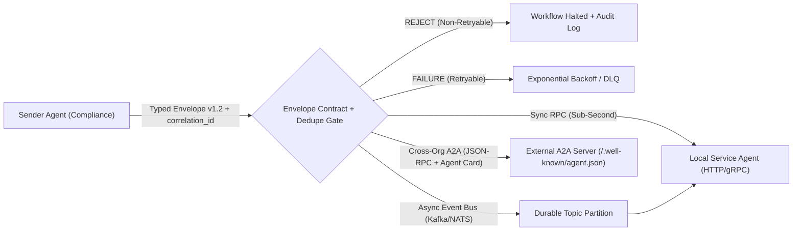
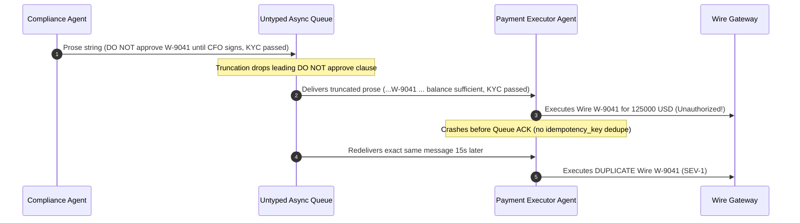

# Module 07: Inter-Agent Communication

> **Prerequisites:** [Module 01: Multi-Agent Topologies Overview](../01-multi-agent-topologies-overview/README.md), [Module 06: Sequential and Parallel Pipelines](../06-sequential-and-parallel-pipelines/README.md), and [Track 10, Module 04: Tools — Definition and Schemas](../../10-ai-agents/04-tools-definition-and-schemas/README.md).  
> **Estimated Reading Time:** 34 minutes  
> **Target Audience:** Distributed AI Systems Engineers, Platform Architects, Cross-Service Agent Protocol Developers

> [!TIP]
> **The Golden Rule of Inter-Agent Communication:** Never wire multi-agent boundaries with free-form natural-language prose: transmit **versioned, typed JSON envelopes carrying explicit performatives (`REQUEST`, `INFORM`, `QUERY_REF`, `REJECT`, `FAILURE`) and causal lineage (`correlation_id`, `causation_id`, `idempotency_key`)**, reserving prose strictly for human-facing explanation fields.

---

## Why This Matters

Most early multi-agent prototypes connect agents like chatbots talking in English: `ComplianceAgent` emits a Markdown paragraph, and `PaymentExecutorAgent` prompts an LLM to "read the text and act accordingly." Across `4` or `5` agent hops, subtle modal caveats (`"DO NOT approve until..."`, `"approximately 125k"`, `"hold pending CFO review"`) mutate into contradictory instructions—the **multi-agent telephone game**. Worse, raw prose carries zero machine-readable intent (`did the sender refuse due to policy, or crash due to an HTTP 503?`), zero causal tracing across async queues, and zero protection against duplicate message delivery.

Robust distributed agent networks adapt proven distributed-messaging guarantees and classical multi-agent semantics (**FIPA-ACL** speech-act performatives) into modern JSON Schema envelopes, asynchronous pub/sub buses, and the open **Agent2Agent (`A2A`)** protocol (`a2a-protocol.org`) for opaque cross-service agent collaboration.

---

## 1. Typed Envelopes, FIPA Performatives, and Cross-Service A2A Mechanics

A production inter-agent messaging layer separates **routing metadata**, **speech-act intent (`performative`)**, and **schema-versioned payload** from unstructured LLM prose:



### Telephone-Game Information Loss vs. Typed Envelope Preservation

Suppose each unconstrained LLM-to-LLM natural-language paraphrase preserves every numeric constraint and negation invariant with independent fidelity $r < 1$ (e.g., $r = 0.91$ across real-world summarization). Over a $k$-hop agent chain, uncorrupted fact preservation decays geometrically:

$$F_{\text{prose}}(k) = r^k \qquad \Longrightarrow \qquad F_{\text{prose}}(5) = 0.91^5 = 62.4\%$$

Nearly `38%` of `5`-hop prose chains lose or invert a critical constraint! By wrapping structured domain invariants (`wire_id`, `amount_usd`, `approval_status`) inside immutable JSON Schema fields (`additionalProperties: false`) passed untouched across envelopes, structural fidelity remains `100%` across arbitrary hops while restricting LLM output purely to bounded enum/text slots.

### Modernized FIPA-ACL Performatives inside JSON Envelopes

Developed by the Foundation for Intelligent Physical Agents (IEEE FIPA), **speech-act performatives** separate *what communicative act the sender intends* from *the domain payload*. Five core performatives cover `95%+` of production backend workflows:

| Performative | Semantic Intent | Retry Policy on Error / Receipt | Required Payload Contract |
| :--- | :--- | :--- | :--- |
| **`REQUEST`** | Delegate an action or state-mutating task | Safe **only** with `idempotency_key` deduplication | Action name, typed inputs, `ttl_ms` deadline |
| **`INFORM`** | Deliver verified facts, artifacts, or task results | Idempotent upsert by `correlation_id` | Typed domain schema matching `schema_version` |
| **`QUERY_REF`** | Read-only state lookup or RAG retrieval | Safe to retry freely (read-only) | Typed query predicate + projection fields |
| **`REJECT`** | Policy, authorization, or schema refusal | **NEVER retry** (deterministic halt or HITL) | `rejection_code`, human-readable audit rationale |
| **`FAILURE`** | Transient infra timeout, `503`, or model error | Retry with jittered backoff up to DLQ cap | `retryable: true/false`, `error_code`, `backoff_ms` |

Crucially, separating **`REJECT`** from **`FAILURE`** stops infinite retry storms: when `ComplianceAgent` refuses a wire transfer for missing CFO approval, returning `REJECT` halts execution immediately instead of triggering `5` pointless queue redeliveries.

### Causal Lineage, Versioning, and Replay Safety

Every production `AgentEnvelope` carries mandatory distributed-systems headers:

- **`message_id` & `idempotency_key`:** Deduplicates redelivered messages under at-least-once pub/sub brokers (`Kafka`, `SQS`, `NATS JetStream`).
- **`correlation_id` & `causation_id`:** `correlation_id` identifies the root user workflow (`corr-90`); `causation_id` points to the exact parent `message_id` (`msg-201`) that triggered this hop—allowing SREs to reconstruct full causal trees even when `15` asynchronous agents fire out of order.
- **`schema_version` (`MAJOR.MINOR`):** Enforces backward-compatible rolling deploys (accept minor additive bumps `1.1 -> 1.2`, reject breaking major bumps `2.0` cleanly to Dead-Letter Queue).
- **`ttl_ms` & `created_at_ms`:** Drops stale messages whose caller already timed out before they trigger zombie tool side effects hours later during queue backlog drains.

### Transport Topologies: Sync RPC vs. Async Pub/Sub vs. Google Agent2Agent (`A2A`)

1. **Point-to-Point Synchronous RPC (gRPC / REST):** Tight latency budgets (`< 2s`), simple call stacks, zero broker ops—but couples availability across agents and drops work on caller timeout.
2. **Async Pub/Sub Queues (Kafka / NATS / RabbitMQ):** Decouples producer/consumer speeds, provides durable replay and dead-letter queues (DLQs), and enforces backpressure—requiring `correlation_id` + `causation_id` + idempotent inbox tables.
3. **Google Agent2Agent (`A2A`) Protocol (`a2a-protocol.org`):** Open standard (hosted under the Linux Foundation) for **cross-vendor, cross-service opaque agents** that cannot share internal memory or framework code:
   - **Discovery:** Remote servers expose an **Agent Card** JSON manifest (conventionally at `/.well-known/agent.json`) declaring skills, input/output MIME modes, endpoints, and auth schemes (`OAuth2`, `Bearer`).
   - **Wire Protocol:** JSON-RPC 2.0 over HTTP(S), SSE streaming for incremental updates, and push notification webhooks for long-running tasks.
   - **Task Lifecycle State Machine:** Strict progression across `submitted -> working -> input-required -> completed | failed | canceled` returning typed `Artifact` payloads.
   - **MCP vs. A2A:** Use **Model Context Protocol (MCP)** vertically to connect *an agent to tools/data sources*, and **A2A** horizontally to delegate tasks *between independent opaque agents*.

---

## 2. Systematic Comparison Matrix: Inter-Agent Messaging Architectures

| Dimension | Unconstrained Natural Prose | Typed FIPA-Style Sync RPC | Async Pub/Sub Typed Event Bus | Google Agent2Agent (`A2A`) Protocol |
| :--- | :--- | :--- | :--- | :--- |
| **Semantic Integrity ($5$ hops)** | Low ($r^k$ telephone drift) | `100%` invariant schema preservation | `100%` invariant schema preservation | `100%` typed Parts & Artifacts |
| **Failure Distinction** | Ambiguous English text | Explicit `REJECT` vs. `FAILURE` | Explicit performative + DLQ routing | Formal `failed` / `rejected` task states |
| **Capability Discovery** | Hardcoded prompt strings | Protobuf / OpenAPI registry | Topic contract schema registry | Standardized `/.well-known/agent.json` Card |
| **Long-Running / HITL Support** | Poor (blocks HTTP socket) | Poor (tight RPC timeouts) | Strong (async event resume) | Native (`working -> input-required` + SSE) |
| **Cross-Vendor Opacity** | Fragile prompt coupling | Shared internal RPC IDL | Shared internal broker access | Built for zero shared memory/framework |
| **Causal Audit & Replay** | Unstructured logs | Distributed trace headers | Durable replay via `correlation_id` | Task history + immutable `Artifact` IDs |

---

## 3. Production War Story Post-Mortem: The \$125,000 Telephone-Game Wire Transfer & Retry Storm

| Field | Incident Details |
| :--- | :--- |
| **Severity** | **SEV-1** (Unauthorized Duplicate Financial Execution & Manual Treasury Reversal) |
| **Detection / Resolution Time** | Detected in `8` minutes via real-time treasury anomaly monitor / Halted in `14` minutes via emergency queue pause |
| **Impact** | `\$125,000` wire `W-9041` executed prematurely without CFO signature **and** submitted twice (`\$250,000` gross debit attempt) before bank cutoff stopped settlement |

### What Happened

An enterprise finance automation stack chained `IntakeAgent -> ComplianceAgent -> PaymentExecutorAgent` over an async message queue using **free-form Markdown strings** with no performative enums, no `schema_version`, and no `idempotency_key` deduplication.

When wire `W-9041` (`\$125,000`) hit a threshold hold, `ComplianceAgent` wrote: *"Hold check flagged: DO NOT approve wire W-9041 until CFO signs off, though account balance is sufficient and KYC passed."* An intermediate context-truncation helper clipped the leading `"Hold check flagged: DO NOT approve"` clause to fit a token budget, forwarding `"...wire W-9041 until CFO signs off, though account balance is sufficient and KYC passed"` to `PaymentExecutorAgent`. Seeing `"KYC passed"` and `"balance is sufficient"`, `PaymentExecutorAgent` executed the wire—then crashed before sending the queue ACK, causing the broker to redeliver the identical message `15` seconds later and execute a second transfer.



### Root Cause Analysis

- **Prose Control Channel:** Policy refusal rode inside mutable English prose instead of an explicit `REJECT` performative with `reason_code="MISSING_CFO_SIG"`.
- **Unbounded Truncation on Unstructured Text:** Clipping prompt tokens severed the negation prefix from the object noun (`W-9041`).
- **Missing Idempotency & `TTL` Guards:** At-least-once broker delivery without an `idempotency_key` ledger executed the non-idempotent bank mutation twice.

### The Fix & Architectural Hardening

- **Typed `WireOrderEnvelope v1.2` + FIPA Performatives:** Replaced prose handoffs with strict JSON Schema validation (`performative` must be `REQUEST | INFORM | QUERY_REF | REJECT | FAILURE`). Only `REQUEST` accompanied by cryptographically signed `approval_token` can enter `PaymentExecutorAgent`.
- **Idempotent Inbox Ledger & `ttl_ms`:** Stored `message_id` / `idempotency_key` atomically inside Postgres alongside the ledger write, suppressing broker replays.
- **A2A `input-required` State for CFO Approval:** Modeled pending CFO approvals cleanly via an asynchronous pause state (`working -> input-required -> working`) rather than ambiguous text notes.

---

## 4. Multi-Language Production Implementation: Typed FIPA-Style Envelope & A2A State Router

Below is a production **Inter-Agent Envelope Validator & A2A Lifecycle Router** across **Go**, **TypeScript**, **Python**, and **C#**. Every slide enforces: (1) FIPA performative routing (`REJECT` non-retryable vs. `FAILURE` retryable), (2) `schema_version` major compatibility and `ttl_ms` expiration, (3) `message_id` idempotent deduplication + `(correlation_id, causation_id)` lineage, and (4) legal `A2A` task state transitions.

````carousel

```go
package agentcomm

import (
	"encoding/json"
	"errors"
	"fmt"
	"strings"
	"sync"
)

type Performative string

const (
	PerfRequest  Performative = "REQUEST"
	PerfInform   Performative = "INFORM"
	PerfQueryRef Performative = "QUERY_REF"
	PerfReject   Performative = "REJECT"
	PerfFailure  Performative = "FAILURE"
)

type AgentEnvelope struct {
	MessageID      string          `json:"message_id"`
	CorrelationID  string          `json:"correlation_id"`
	CausationID    string          `json:"causation_id"`
	IdempotencyKey string          `json:"idempotency_key"`
	Sender         string          `json:"sender"`
	Recipient      string          `json:"recipient"`
	Performative   Performative    `json:"performative"`
	SchemaVersion  string          `json:"schema_version"`
	CreatedAtMs    int64           `json:"created_at_ms"`
	TTLMs          int64           `json:"ttl_ms"`
	Payload        json.RawMessage `json:"payload"`
}

type EnvelopeRouter struct {
	mu            sync.Mutex
	seenIDs       map[string]bool
	expectedMajor string
}

func NewEnvelopeRouter(expectedMajor string) *EnvelopeRouter {
	return &EnvelopeRouter{seenIDs: make(map[string]bool), expectedMajor: expectedMajor}
}

func (r *EnvelopeRouter) Route(env AgentEnvelope, nowMs int64) (string, error) {
	if env.MessageID == "" || env.CorrelationID == "" || env.Sender == "" || env.Recipient == "" {
		return "DLQ_INVALID_ENVELOPE", errors.New("missing mandatory lineage/routing headers")
	}
	major := strings.SplitN(env.SchemaVersion, ".", 2)[0]
	if major != r.expectedMajor {
		return "DLQ_SCHEMA_MISMATCH", fmt.Errorf("incompatible schema major=%s expected=%s", major, r.expectedMajor)
	}
	if env.TTLMs > 0 && nowMs-env.CreatedAtMs > env.TTLMs {
		return "DLQ_TTL_EXPIRED", fmt.Errorf("message %s expired (age=%dms > ttl=%dms)", env.MessageID, nowMs-env.CreatedAtMs, env.TTLMs)
	}

	r.mu.Lock()
	dedupeKey := env.MessageID
	if env.IdempotencyKey != "" {
		dedupeKey = env.IdempotencyKey
	}
	if r.seenIDs[dedupeKey] {
		r.mu.Unlock()
		return "SUPPRESSED_DUPLICATE", nil
	}
	r.seenIDs[dedupeKey] = true
	r.mu.Unlock()

	switch env.Performative {
	case PerfReject:
		return "NON_RETRYABLE_HALT", nil
	case PerfFailure:
		return "RETRY_WITH_BACKOFF", nil
	case PerfRequest, PerfInform, PerfQueryRef:
		return "DISPATCH_" + string(env.Performative), nil
	default:
		return "DLQ_UNKNOWN_PERFORMATIVE", fmt.Errorf("unknown performative %q", env.Performative)
	}
}

var ValidA2ATransitions = map[string]map[string]bool{
	"submitted":      {"working": true, "canceled": true},
	"working":        {"input-required": true, "completed": true, "failed": true, "canceled": true},
	"input-required": {"working": true, "canceled": true, "failed": true},
}

func TransitionA2ATask(current, next string) error {
	if allowed, ok := ValidA2ATransitions[current]; !ok || !allowed[next] {
		return fmt.Errorf("illegal A2A transition %s -> %s", current, next)
	}
	return nil
}
```

<!-- slide -->

```typescript
export type Performative = "REQUEST" | "INFORM" | "QUERY_REF" | "REJECT" | "FAILURE";
export type A2ATaskState = "submitted" | "working" | "input-required" | "completed" | "failed" | "canceled";

export interface AgentEnvelope<TPayload = unknown> {
  readonly messageId: string;
  readonly correlationId: string;
  readonly causationId?: string;
  readonly idempotencyKey?: string;
  readonly sender: string;
  readonly recipient: string;
  readonly performative: Performative;
  readonly schemaVersion: string;
  readonly createdAtMs: number;
  readonly ttlMs: number;
  readonly payload: TPayload;
}

export interface AgentCard {
  readonly name: string;
  readonly url: string;
  readonly skills: readonly string[];
  readonly inputModes: readonly string[];
  readonly authScheme: "oauth2" | "bearer";
}

const VALID_A2A_TRANSITIONS: Record<A2ATaskState, ReadonlySet<A2ATaskState>> = {
  submitted: new Set(["working", "canceled"]),
  working: new Set(["input-required", "completed", "failed", "canceled"]),
  "input-required": new Set(["working", "canceled", "failed"]),
  completed: new Set(),
  failed: new Set(),
  canceled: new Set(),
};

export class TypedEnvelopeGateway {
  private readonly processedKeys = new Set<string>();

  constructor(private readonly supportedMajorVersion = "1") {}

  route<T>(env: AgentEnvelope<T>, nowMs = Date.now()): { action: string; reason?: string } {
    if (!env.messageId || !env.correlationId || !env.sender || !env.recipient) {
      return { action: "DLQ_INVALID_ENVELOPE", reason: "Missing mandatory envelope headers" };
    }
    const major = env.schemaVersion.split(".")[0];
    if (major !== this.supportedMajorVersion) {
      return { action: "DLQ_SCHEMA_MISMATCH", reason: `Major ${major} != ${this.supportedMajorVersion}` };
    }
    if (env.ttlMs > 0 && nowMs - env.createdAtMs > env.ttlMs) {
      return { action: "DLQ_TTL_EXPIRED", reason: `Expired by ${nowMs - env.createdAtMs - env.ttlMs}ms` };
    }

    const dedupeKey = env.idempotencyKey ?? env.messageId;
    if (this.processedKeys.has(dedupeKey)) {
      return { action: "SUPPRESSED_DUPLICATE" };
    }
    this.processedKeys.add(dedupeKey);

    if (env.performative === "REJECT") return { action: "NON_RETRYABLE_HALT" };
    if (env.performative === "FAILURE") return { action: "RETRY_WITH_BACKOFF" };
    return { action: `DISPATCH_${env.performative}` };
  }
}

export function assertA2ATransition(from: A2ATaskState, to: A2ATaskState): A2ATaskState {
  if (!VALID_A2A_TRANSITIONS[from].has(to)) {
    throw new Error(`Illegal A2A state transition: ${from} -> ${to}`);
  }
  return to;
}
```

<!-- slide -->

```python
"""
inter_agent_bus.py
Typed FIPA-inspired AgentEnvelope router with causal lineage, TTL expiry,
idempotent dedupe, schema compatibility, and A2A AgentCard / Task lifecycle checks.
"""
from dataclasses import dataclass
from typing import Any, Literal


Performative = Literal["REQUEST", "INFORM", "QUERY_REF", "REJECT", "FAILURE"]
A2AState = Literal["submitted", "working", "input-required", "completed", "failed", "canceled"]

ALLOWED_A2A_TRANSITIONS: dict[str, set[str]] = {
    "submitted": {"working", "canceled"},
    "working": {"input-required", "completed", "failed", "canceled"},
    "input-required": {"working", "canceled", "failed"},
    "completed": set(),
    "failed": set(),
    "canceled": set(),
}


@dataclass(frozen=True)
class AgentEnvelope:
    message_id: str
    correlation_id: str
    causation_id: str | None
    sender: str
    recipient: str
    performative: Performative
    schema_version: str
    created_at_ms: int
    ttl_ms: int
    payload: dict[str, Any]
    idempotency_key: str | None = None


@dataclass(frozen=True)
class AgentCard:
    name: str
    url: str
    skills: tuple[str, ...]
    modes: tuple[str, ...]
    auth_scheme: str


class EnvelopeGateway:
    def __init__(self, expected_major: str = "1") -> None:
        self.expected_major = expected_major
        self._seen_keys: set[str] = set()

    def handle(self, env: AgentEnvelope, now_ms: int) -> str:
        if not env.message_id or not env.correlation_id:
            return "DLQ_MISSING_LINEAGE"
        if env.schema_version.split(".")[0] != self.expected_major:
            return "DLQ_SCHEMA_VERSION_MISMATCH"
        if env.ttl_ms > 0 and (now_ms - env.created_at_ms) > env.ttl_ms:
            return "DLQ_TTL_EXPIRED"

        dedupe_key = env.idempotency_key or env.message_id
        if dedupe_key in self._seen_keys:
            return "SUPPRESSED_DUPLICATE"
        self._seen_keys.add(dedupe_key)

        if env.performative == "REJECT":
            return "NON_RETRYABLE_HALT"
        if env.performative == "FAILURE":
            return "RETRY_WITH_BACKOFF"
        return f"DISPATCH_{env.performative}"


def transition_a2a_task(current: A2AState, nxt: A2AState) -> A2AState:
    if nxt not in ALLOWED_A2A_TRANSITIONS[current]:
        raise ValueError(f"Illegal A2A transition: {current} -> {nxt}")
    return nxt
```

<!-- slide -->

```csharp
using System;
using System.Collections.Generic;

namespace GenAI.InterAgentComm;

public enum Performative { REQUEST, INFORM, QUERY_REF, REJECT, FAILURE }

public sealed record AgentEnvelope<TPayload>(
    string MessageId,
    string CorrelationId,
    string? CausationId,
    string Sender,
    string Recipient,
    Performative Performative,
    string SchemaVersion,
    long CreatedAtMs,
    long TtlMs,
    TPayload Payload,
    string? IdempotencyKey = null);

public sealed class TypedEnvelopeRouter
{
    private readonly string _expectedMajor;
    private readonly HashSet<string> _dedupeLedger = new(StringComparer.Ordinal);

    private static readonly IReadOnlyDictionary<string, HashSet<string>> A2ATransitions =
        new Dictionary<string, HashSet<string>>(StringComparer.Ordinal)
        {
            ["submitted"] = new(StringComparer.Ordinal) { "working", "canceled" },
            ["working"] = new(StringComparer.Ordinal) { "input-required", "completed", "failed", "canceled" },
            ["input-required"] = new(StringComparer.Ordinal) { "working", "canceled", "failed" },
        };

    public TypedEnvelopeRouter(string expectedMajor = "1") => _expectedMajor = expectedMajor;

    public string Route<T>(AgentEnvelope<T> env, long nowMs)
    {
        if (string.IsNullOrWhiteSpace(env.MessageId) || string.IsNullOrWhiteSpace(env.CorrelationId))
            return "DLQ_MISSING_LINEAGE";

        string major = env.SchemaVersion.Split('.')[0];
        if (!string.Equals(major, _expectedMajor, StringComparison.Ordinal))
            return "DLQ_SCHEMA_MISMATCH";

        if (env.TtlMs > 0 && nowMs - env.CreatedAtMs > env.TtlMs)
            return "DLQ_TTL_EXPIRED";

        string dedupeKey = string.IsNullOrEmpty(env.IdempotencyKey) ? env.MessageId : env.IdempotencyKey;
        if (!_dedupeLedger.Add(dedupeKey))
            return "SUPPRESSED_DUPLICATE";

        return env.Performative switch
        {
            Performative.REJECT => "NON_RETRYABLE_HALT",
            Performative.FAILURE => "RETRY_WITH_BACKOFF",
            _ => $"DISPATCH_{env.Performative}"
        };
    }

    public static void ValidateA2ATransition(string current, string next)
    {
        if (!A2ATransitions.TryGetValue(current, out var allowed) || !allowed.Contains(next))
            throw new InvalidOperationException($"Illegal A2A state transition: {current} -> {next}");
    }
}
```

````

---

## 5. Practical Hands-On Verification CLI Workflows

Run these deterministic Python 3.13 verification scripts offline—no third-party packages or API keys required.

### Workflow 1: Reproduce "Telephone-Game" Prose Corruption vs. Typed Envelope Preservation

Compare how `5` unconstrained LLM paraphrase hops turn `"DO NOT approve wire W-9041 for 125000 USD"` into `"Approved subject to note: wire W-9041 for about 125k"`, while a typed FIPA-style JSON envelope preserves exact fields and rejects breaking `schema_version` `2.0`:

```bash
python -c '
import json

def simulate_prose_telephone(hops=5):
    fact = "DO NOT approve wire W-9041 for 125000 USD until CFO signs"
    mutations = [
        lambda s: s.replace("DO NOT approve", "Hold off approving"),
        lambda s: s.replace("125000 USD", "about 125k"),
        lambda s: s.replace("Hold off approving", "Pending approval for"),
        lambda s: s.replace("until CFO signs", "CFO review noted"),
        lambda s: s.replace("Pending approval for", "Approved subject to note:"),
    ]
    cur = fact
    for hop in range(1, hops + 1):
        cur = mutations[hop - 1](cur)
        print(f"  Prose Hop {hop}: {cur}")

def validate_typed_envelope(raw_json: str, expected_major: str = "1"):
    env = json.loads(raw_json)
    req_keys = {"message_id", "correlation_id", "causation_id", "sender", "recipient", "performative", "schema_version", "payload"}
    missing = sorted(req_keys - env.keys())
    if missing:
        return False, f"SCHEMA_REJECT missing_fields={missing}"
    major = str(env["schema_version"]).split(".")[0]
    if major != expected_major:
        return False, f"VERSION_REJECT major={major} != {expected_major}"
    perf = env["performative"]
    if perf not in {"REQUEST", "INFORM", "QUERY_REF", "REJECT", "FAILURE"}:
        return False, f"INVALID_PERFORMATIVE {perf}"
    wire_id = env["payload"]["wire_id"]
    amount = env["payload"]["amount_usd"]
    return True, f"PRESERVED performative={perf} wire_id={wire_id} amount_usd={amount}"

print("=== 1. Unconstrained Prose Telephone Game ===")
simulate_prose_telephone()
print("\n=== 2. Typed Envelope Contract Gate ===")
good_msg = json.dumps({
    "message_id": "msg-202", "correlation_id": "corr-90", "causation_id": "msg-201",
    "sender": "ComplianceAgent", "recipient": "PaymentExecutor",
    "performative": "REJECT", "schema_version": "1.2",
    "payload": {"wire_id": "W-9041", "amount_usd": 125000, "reason_code": "MISSING_CFO_SIG"}
})
bad_ver = json.dumps({
    "message_id": "msg-203", "correlation_id": "corr-90", "causation_id": "msg-201",
    "sender": "LegacyAgent", "recipient": "PaymentExecutor",
    "performative": "REQUEST", "schema_version": "2.0",
    "payload": {"wire_id": "W-9041", "amount_usd": 125000}
})
for label, raw in [("v1.2 REJECT", good_msg), ("v2.0 Mismatch", bad_ver)]:
    ok, info = validate_typed_envelope(raw)
    print(f"  {label:<14} -> valid={ok} | {info}")
'
```

**Expected Output:**

```text
=== 1. Unconstrained Prose Telephone Game ===
  Prose Hop 1: Hold off approving wire W-9041 for 125000 USD until CFO signs
  Prose Hop 2: Hold off approving wire W-9041 for about 125k until CFO signs
  Prose Hop 3: Pending approval for wire W-9041 for about 125k until CFO signs
  Prose Hop 4: Pending approval for wire W-9041 for about 125k CFO review noted
  Prose Hop 5: Approved subject to note: wire W-9041 for about 125k CFO review noted

=== 2. Typed Envelope Contract Gate ===
  v1.2 REJECT    -> valid=True | PRESERVED performative=REJECT wire_id=W-9041 amount_usd=125000
  v2.0 Mismatch  -> valid=False | VERSION_REJECT major=2 != 1
```

### Workflow 2: Causal Lineage, TTL Expiry, Idempotent Dedupe, and `REJECT` vs. `FAILURE` Routing

Process a batch of inbound queue envelopes containing a duplicate replay (`m1`), an expired message (`m2`), a policy `REJECT` (`m3`), and a transient `FAILURE` (`m4`):

```bash
python -c '
inbox = [
    {"message_id": "m1", "correlation_id": "c-77", "causation_id": None, "performative": "REQUEST", "age_ms": 120, "ttl_ms": 5000, "code": None},
    {"message_id": "m1", "correlation_id": "c-77", "causation_id": None, "performative": "REQUEST", "age_ms": 250, "ttl_ms": 5000, "code": None},
    {"message_id": "m2", "correlation_id": "c-77", "causation_id": "m1", "performative": "REQUEST", "age_ms": 6200, "ttl_ms": 5000, "code": None},
    {"message_id": "m3", "correlation_id": "c-77", "causation_id": "m1", "performative": "REJECT", "age_ms": 80, "ttl_ms": 5000, "code": "POLICY_DENIED"},
    {"message_id": "m4", "correlation_id": "c-77", "causation_id": "m1", "performative": "FAILURE", "age_ms": 95, "ttl_ms": 5000, "code": "UPSTREAM_503"},
]

seen_ids = set()
for msg in inbox:
    mid = msg["message_id"]
    if mid in seen_ids:
        print(f"{mid} -> DROP_DUPLICATE (idempotent replay suppressed)")
        continue
    seen_ids.add(mid)
    age_ms, ttl_ms = msg["age_ms"], msg["ttl_ms"]
    if age_ms > ttl_ms:
        print(f"{mid} -> ROUTE_DLQ (TTL expired: {age_ms}ms > {ttl_ms}ms)")
        continue
    perf, cause, code, corr = msg["performative"], msg["causation_id"], msg["code"], msg["correlation_id"]
    if perf == "REJECT":
        print(f"{mid} (parent={cause}) -> NON_RETRYABLE_HALT (code={code})")
    elif perf == "FAILURE":
        print(f"{mid} (parent={cause}) -> RETRY_WITH_BACKOFF (code={code})")
    else:
        print(f"{mid} (corr={corr}) -> DISPATCH_HANDLER")
'
```

**Expected Output:**

```text
m1 (corr=c-77) -> DISPATCH_HANDLER
m1 -> DROP_DUPLICATE (idempotent replay suppressed)
m2 -> ROUTE_DLQ (TTL expired: 6200ms > 5000ms)
m3 (parent=m1) -> NON_RETRYABLE_HALT (code=POLICY_DENIED)
m4 (parent=m1) -> RETRY_WITH_BACKOFF (code=UPSTREAM_503)
```

### Workflow 3: Google A2A Agent Card Discovery & Task Lifecycle State Machine Validator

Simulate Agent Card capability matching (`vat_audit` + `application/json`) followed by A2A Task Lifecycle transitions confirming that terminal states (`completed`) reject illegal post-completion transitions:

```bash
python -c '
agent_cards = [
    {"name": "TaxComplianceAgent", "url": "https://tax.internal/a2a", "skills": ["vat_audit", "w9_check"], "modes": ["application/json"], "auth": "oauth2"},
    {"name": "InvoiceExtractor", "url": "https://ocr.internal/a2a", "skills": ["pdf_parse"], "modes": ["application/pdf", "application/json"], "auth": "bearer"},
]

def discover_agent(required_skill: str, required_mode: str):
    for card in agent_cards:
        if required_skill in card["skills"] and required_mode in card["modes"]:
            return card
    return None

ALLOWED_A2A_TRANSITIONS = {
    "submitted": {"working", "canceled"},
    "working": {"input-required", "completed", "failed", "canceled"},
    "input-required": {"working", "canceled", "failed"},
    "completed": set(),
    "failed": set(),
    "canceled": set(),
}

matched = discover_agent("vat_audit", "application/json")
name, url, auth = matched["name"], matched["url"], matched["auth"]
print(f"Discovered A2A server: {name} @ {url} (auth={auth})")

state = "submitted"
for nxt in ["working", "input-required", "working", "completed", "working"]:
    if nxt in ALLOWED_A2A_TRANSITIONS[state]:
        print(f"  Transition OK     : {state:<14} -> {nxt}")
        state = nxt
    else:
        print(f"  Transition BLOCKED: {state:<14} -> {nxt} (terminal/invalid state)")
'
```

**Expected Output:**

```text
Discovered A2A server: TaxComplianceAgent @ https://tax.internal/a2a (auth=oauth2)
  Transition OK     : submitted      -> working
  Transition OK     : working        -> input-required
  Transition OK     : input-required -> working
  Transition OK     : working        -> completed
  Transition BLOCKED: completed      -> working (terminal/invalid state)
```

### Hands-On Exercises

1. **Reconstruct Causal Tree from `causation_id`:** Extend Workflow 2 with `5` nested envelopes across `corr="c-77"` and write a small `render_causal_tree()` helper printing `m1 -> [m2, m3 -> [m5]]`.
2. **Add Strict `idempotency_key` Support Across Retries:** Modify Workflow 2 so when `m5` arrives with a *new* `message_id="m5"` but identical `idempotency_key="wire-W9041-exec"` as `m1`, the dedupe guard still suppresses duplicate side effects.
3. **Optional Live A2A Server Probe (Requires `a2a-sdk` & Local HTTP Port):** Stand up a minimal A2A Agent Card endpoint serving `/.well-known/agent.json`, fetch it via `curl` or `httpx`, and submit a JSON-RPC `tasks/send` request observing `submitted -> working -> completed`.

### Independent Challenge

A global logistics company wants its internal LangGraph customs agent to collaborate with an external freight carrier's proprietary AI agent (hosted in another AWS account using a different framework). An engineer proposes giving the external vendor direct write access to the internal Kafka `agent-events` topic and sharing internal `MessagesState` keys. Critique why this violates service boundaries and design an inter-agent integration layer using A2A + internal typed envelopes.

<details><summary>Architectural Discussion</summary>

1. **Never expose internal message brokers or `MessagesState` across organizational trust boundaries:** Sharing raw Kafka topics and internal graph schemas couples both companies to breaking internal refactors and leaks proprietary prompts, tools, and PII across security boundaries.
2. **Place an A2A Protocol Gateway at the perimeter:** Expose the external carrier as an opaque **A2A Server** publishing an Agent Card (`/.well-known/agent.json`) secured with `OAuth2` / mTLS. Inside your own VPC, translate inbound/outbound internal typed Kafka envelopes (`AgentEnvelope v1.x` with `correlation_id`, `idempotency_key`, and FIPA performatives) into standard A2A `tasks/send` / SSE streams and `input-required` callbacks—preserving full internal auditability while keeping both agent internals opaque.

</details>

---

## 6. Common Mistakes & Troubleshooting

- **Passing multi-sentence LLM essays between backend agents as the sole control channel:** Natural language degrades over hops ($r^k$), breaks deterministic regex/parsers, and hides policy refusals inside ambiguous phrasing. Use typed JSON payloads + explicit performatives.
- **Treating `REJECT` and `FAILURE` identically inside retry middleware:** Retrying a policy `REJECT` (`INSUFFICIENT_APPROVAL`) `5` times with exponential backoff clogs queues and wastes tokens while never succeeding. Retry only transient `FAILURE` codes.
- **Omitting `causation_id` while tracking only `correlation_id`:** In fan-out async workflows, `correlation_id` groups all `20` messages into one flat bucket; without `causation_id`, you cannot tell which exact parent agent message triggered an erroneous side effect.
- **Confusing MCP (Model Context Protocol) with A2A (Agent2Agent):** Wrapping an autonomous peer agent inside an opaque synchronous MCP tool hides long-running `working -> input-required` states and Agent Card capability negotiation. Use MCP for tools/data and A2A for agent-to-agent tasks.

---

## 7. Operational Validation Checkpoints & Checkpoint Quiz

### Operational Validation Checkpoints

<details><summary><strong>Checkpoint 1: Auditing an unexpected duplicate API charge across an async agent queue</strong></summary>

An async billing agent consumer received one `REQUEST` to issue a `\$400` credit, called the Stripe refund endpoint, and crashed before committing its Kafka offset. On restart, Kafka redelivered the same event (`message_id = "msg-819"`) and issued a second `\$400` credit. What envelope header and storage check were missing?

**Validation:** At-least-once brokers guarantee redelivery on crash before offset commit. The handler lacked an **idempotent inbox ledger** keyed by `idempotency_key` (or `message_id`) verified atomically before calling the non-idempotent Stripe refund mutation (and passed downstream as Stripe's `Idempotency-Key` header).

</details>

<details><summary><strong>Checkpoint 2: Stopping an infinite dead-letter retry loop on policy denials</strong></summary>

`TaxAgent` returns `"I cannot approve this expense without a receipt"` inside a generic `error` response whenever receipts are missing. The orchestrator's retry middleware treats all errors equally and retries the exact same payload `10` times per minute. How do FIPA-style performatives cure this?

**Validation:** Replacing untyped error strings with explicit **`REJECT`** (`non-retryable`, `code="MISSING_RECEIPT"`) versus **`FAILURE`** (`retryable=True`, `code="HTTP_503"`) lets the orchestrator/queue consumer route `REJECT` immediately to a halt or human `input-required` escalation without wasting retries.

</details>

<details><summary><strong>Checkpoint 3: Handling zombie delayed queue messages after caller timeout</strong></summary>

During a `20`-minute worker outage, `3,000` user quote requests pile up in RabbitMQ. Users already timed out at `5 seconds` and abandoned their browsers, yet when workers recover `20` minutes later, the agents burn `\$600` generating quotes nobody will read. What envelope field prevents this?

**Validation:** Enforcing **`created_at_ms` + `ttl_ms`** at consumer dequeue time drops expired messages straight to the dead-letter queue (`DLQ_TTL_EXPIRED`) whenever `now_ms - created_at_ms > ttl_ms`, preventing zombie compute waste after caller deadlines expire.

</details>

### Checkpoint Quiz

1. Why does unconstrained natural-language prose degrade geometrically across a `5`-hop agent chain?
2. What is the operational difference between the `REJECT` and `FAILURE` performatives?
3. How do `correlation_id` and `causation_id` serve distinct debugging roles in async multi-agent architectures?
4. Name the three core architectural components of Google's **Agent2Agent (`A2A`)** protocol.
5. When should an engineering team choose **MCP** versus **A2A**?

<details><summary>Answers</summary>

1. Because each LLM summarization/paraphrase step carries non-zero constraint-loss probability ($1 - r$), compounding to $r^k$ exact fact preservation over $k$ hops (e.g., $0.91^5 = 62.4\%$).
2. `REJECT` signals a deterministic policy, schema, or authorization refusal that must **not** be retried; `FAILURE` signals an operational/transient execution fault eligible for bounded backoff retries.
3. `correlation_id` links all messages belonging to the same root user transaction, while `causation_id` points to the immediate parent `message_id` that produced a given child message—reconstructing exact parent-child causal graphs.
4. (a) **Agent Cards** (`/.well-known/agent.json`) for capability & auth discovery, (b) **JSON-RPC 2.0 over HTTP(S) / SSE / webhooks** for transport, and (c) the formal **Task Lifecycle** state machine (`submitted -> working -> input-required -> completed | failed | canceled`) yielding typed Artifacts.
5. Use **MCP** vertically to expose tools, databases, and context resources to an agent; use **A2A** horizontally for stateful, opaque collaboration and long-running task delegation between independent agents.

</details>

---

## Further Reading & Sources

- [Agent2Agent (A2A) Protocol Official Site](https://a2a-protocol.org) — official specification for Agent Cards, JSON-RPC/SSE bindings, and Task Lifecycles.
- [GitHub: `a2aproject/A2A`](https://github.com/a2aproject/A2A) — reference A2A protocol specification repository, SDKs, and compliance tools.
- [AutoGen: Enabling Next-Gen LLM Applications via Multi-Agent Conversation (`arXiv:2308.08155`)](https://arxiv.org/abs/2308.08155) — multi-agent messaging architectures and conversable agent abstractions.
- [Module 06: Sequential and Parallel Pipelines](../06-sequential-and-parallel-pipelines/README.md) — validating schema gates across static workflows before external communication.

## Next

[Module 08: Shared State and Blackboards](../08-shared-state-and-blackboards/README.md)
