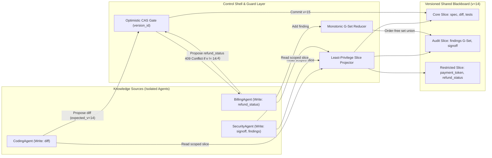
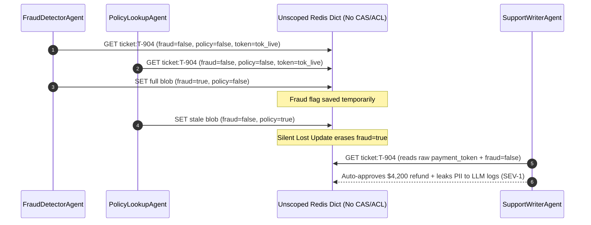

# Module 08: Shared State and Blackboards

> **Prerequisites:** [Module 01: Multi-Agent Topologies Overview](../01-multi-agent-topologies-overview/README.md), [Module 07: Inter-Agent Communication](../07-inter-agent-communication/README.md), and [Track 11, Module 12: LangGraph State and Nodes](../../11-langchain-and-langgraph/12-langgraph-state-and-nodes/README.md).  
> **Estimated Reading Time:** 32 minutes  
> **Target Audience:** AI Systems Architects, Distributed Backend Engineers, Multi-Agent Platform Engineers

> [!TIP]
> **The Golden Rule of Shared State:** Never broadcast raw conversation transcripts across $N$ peer agents in an $O(N^2)$ mesh or dump mutable JSON into an unguarded shared dictionary; coordinate concurrent agents through a **versioned, schema-validated Blackboard** combining **Optimistic Concurrency Control (`version_id` CAS)**, **Least-Privilege Slice ACLs**, and **Monotonic CRDT Reducers**.

---

## Why This Matters

A four-agent prototype usually starts with message passing: `Planner` emails `Coder`, `Coder` messages `Tester`, `Tester` pings `Security`, and everyone forwards the growing chat thread to everyone else. By the time you scale to `10` specialized agents running concurrently over `5` refinement rounds, point-to-point messaging generates $O(N^2)$ chatter—consuming hundreds of thousands of redundant input tokens just re-reading stale dialogue.

Replacing chat meshes with a naive `"shared state dict"` solves the quadratic token explosion but introduces two far deadlier distributed-systems bugs: **silent lost updates** (Agent B overwrites Agent A's fraud flag using a stale read snapshot) and **horizontal privilege escalation** (a public-facing `SupportWriterAgent` reads `payment_token` or `customer_ssn` simply because everything sits in one global state object). Classical **Blackboard Architecture**—hardened with database-grade Compare-And-Swap (`CAS`), scoped read/write slices, and monotonic set reducers—turns chaotic agent teams into deterministic, auditable pipelines.

---

## 1. Classical Blackboard Architecture for Concurrent LLM Teams

Originally formalized for speech understanding in Hearsay-II (Erman et al., 1980) and generalized by Nii (1986) and Hayes-Roth (1985), the **Blackboard Architecture** decouples domain specialists from direct knowledge of each other by organizing work around three strict components:

1. **The Structured Shared Blackboard (Artifact Store):** A typed, versioned workspace partitioned by domain sections (`spec`, `patch_diff`, `security_findings`, `billing_decision`). Unlike an append-only chat transcript, agents overwrite or reduce structured fields rather than replaying historical prose.
2. **Independent Knowledge Sources (Specialist Agents):** Stateless workers that subscribe to relevant blackboard trigger conditions, read *only* their authorized field slice, invoke tools/LLMs, and propose typed state mutations.
3. **The Control Shell (Scheduler & Guard):** Evaluates blackboard precondition events, enforces read/write **Slice ACLs**, serializes conflicting mutations via **Optimistic Concurrency (`version_id` CAS)**, and merges additive fields via **monotonic reducers**.



### Quantitative Mechanics: $O(N^2)$ Mesh Chatter vs. $O(N)$ Blackboard & CAS Contention

Before choosing a state topology, model its token scaling and write-contention math:

- **Point-to-Point Mesh vs. Blackboard Token Scaling:** Across $N$ agents executing $R$ coordination rounds, a full peer broadcast mesh generates $E_{\text{mesh}} = N(N-1)$ directed messages per round. At $m$ average message tokens, cumulative peer traffic scales quadratically:

$$T_{\text{mesh}}(N, R, m) = R \cdot N(N-1) \cdot m$$

  By contrast, when each agent reads only its authorized slice $s_{\text{read}}$ and emits a structured patch $s_{\text{write}}$, Blackboard traffic scales linearly in $N$:

$$T_{\text{bb}}(N, R) = R \cdot N \cdot \left( s_{\text{read}} + s_{\text{write}} \right)$$

  At $N = 15$ agents and $R = 5$ rounds ($m = 180$ tokens, $s_{\text{read}} + s_{\text{write}} = 310$ tokens), mesh messaging burns `189,000` tokens across `1,050` peer deliveries versus `23,250` tokens across `75` slice operations—an `8.13x` token reduction.

- **Optimistic Concurrency (CAS) Retry Expectation:** If $K$ concurrent workers read version $v$ simultaneously and attempt whole-artifact CAS updates over a commit window where collision probability per attempt is $p_{\text{collide}}$, the expected attempts required per worker scales as:

$$E[\text{attempts}] = \frac{1}{1 - p_{\text{collide}}}$$

  Partitioning independent domains onto **field-level versions** (`field_versions["diff"]`, `field_versions["refund_status"]`) or **monotonic CRDT sets** drops $p_{\text{collide}} \to 0$ across disjoint workers while preserving strict `CAS` integrity whenever two agents touch the *same* critical decision field.

### Three Production Primitives Every Shared Blackboard Needs

| Primitive | Mechanism | Failure Mode Prevented | Production Rule |
| :--- | :--- | :--- | :--- |
| **Optimistic CAS (`version_id`)** | Every read returns `(slice_data, version_id)`. Writes submit `expected_version`; store commits atomically only if `current_version == expected_version`, else returns `409 Conflict` | Silent Lost Updates (`Last-Write-Wins` overwriting `fraud_flag=True` or security blocks) | Never accept blind `PUT /state` overwrites on decision flags; re-read & merge on `409` |
| **Least-Privilege Slice ACLs** | Control Shell projects a deterministic subset of keys per `agent_role` on read and validates `write_keys` before mutation | Accidental PII leakage (`payment_token`, `ssn`) into general prompts & unauthorized approval spoofing | Default-deny all keys; explicitly whitelist `read_keys` and `write_keys` per agent role |
| **Monotonic Reducers (CRDTs)** | Additive collections (`findings`, `citations`, `risk_tags`) merge via commutative/idempotent set union (`G-Set`) or `(lamport_ts, agent_id)` `LWW-Element-Set` | High retry storms when parallel workers append independent findings at the same instant | Use CRDT reducers for append-only observations; reserve strict CAS for state-machine enums |

---

## 2. Systematic Comparison Matrix: State Sharing Patterns

| Architecture Pattern | Token Complexity | Write Safety | Secret / PII Isolation | Primary Production Limitation |
| :--- | :--- | :--- | :--- | :--- |
| **Point-to-Point Peer Mesh** | $O(R \cdot N^2)$ | Poor (divergent local views) | None without per-edge redaction | Exponential token explosion & inconsistent beliefs across agents |
| **Shared Append-Only Transcript** | $O(R^2 \cdot N)$ | Append-safe only | Poor (all agents read entire chat) | Context rot, Lost-in-the-Middle decay, and PII exposure across roles |
| **Unscoped Shared Dict (`LWW`)** | $O(R \cdot N)$ | Unsafe (silent lost updates) | None (flat global namespace) | Concurrent workers silently clobber peer flags (`fraud_flag`, `tests_passed`) |
| **Versioned Least-Privilege Blackboard** | $O(R \cdot N)$ | Strong (`CAS` + `CRDT` merge) | Strict role-scoped slice projection | Requires schema discipline, ACL policy table, and `409` retry logic |

---

## 3. Production War Story Post-Mortem: The \$215,000 Silent Lost-Update & PII Leak

| Field | Incident Details |
| :--- | :--- |
| **Severity** | **SEV-1** (Fraud Control Bypass + PCI/PII Context Leakage) |
| **Detection / Resolution Time** | Detected 6 hours post-deploy via Stripe chargeback spike / Mitigated in 45 minutes (auto-refund paused + CAS/ACL patch deployed) |
| **Impact** | **\$215,000** in fraudulent refunds auto-approved after `fraud_flag` overwrites; raw `payment_token` leaked into external email-draft LLM logs |

### What Happened

A fintech support platform orchestrated three parallel agents—`FraudDetectorAgent`, `PolicyLookupAgent`, and `SupportWriterAgent`—against a Redis-backed JSON state object (`ticket:{id}`). When refund ticket `#T-904` arrived:

1. Both `FraudDetectorAgent` and `PolicyLookupAgent` executed `GET ticket:T-904` concurrently at `t = 0 ms`, each caching `{"fraud_flag": false, "policy_ok": false, "payment_token": "tok_live_9841"}`.
2. At `t = 410 ms`, `FraudDetectorAgent` flagged stolen-card velocity and executed `SET ticket:T-904` with `"fraud_flag": true`.
3. At `t = 500 ms`, `PolicyLookupAgent` finished checking the 30-day purchase window and blindly wrote its modified initial snapshot (`{"fraud_flag": false, "policy_ok": true, ...}`), **silently erasing** `fraud_flag = true`.
4. Seconds later, `SupportWriterAgent` read the entire unscoped JSON blob—including `payment_token`—into its third-party LLM prompt to draft the approval message, logging sensitive billing tokens inside prompt observability traces.



### Root Cause Analysis

- Full-blob `GET`/`SET` without `version_id` Compare-And-Swap (`WATCH`/`MULTI` or `IF expected_version == current_version`) created a classic read-modify-write race condition.
- Zero **Least-Privilege Slice ACLs** allowed `SupportWriterAgent` to read PCI metadata (`payment_token`) that belonged exclusively to `BillingExecutorAgent`.

### The Fix & Architectural Hardening

- **Field-Scoped CAS + Retry:** Added monotonically increasing `version_id` (`int64`) per blackboard partition; stale writes return `409 Conflict`, forcing the worker to re-read the updated slice and reapply its own field patch only.
- **Monotonic Finding `G-Set`:** Migrated `risk_signals` and `audit_notes` to an append-only deduplicated union reducer so concurrent analysts never collide on additive findings.
- **Role-Scoped Slice Projection:** Configured strict `SlicePolicy` allowlists so `SupportWriterAgent` receives only `{"ticket_id", "customer_first_name", "policy_summary", "decision"}` and is physically blocked from reading `payment_token` or writing `fraud_flag`.

---

## 4. Multi-Language Production Implementation: Versioned CAS & Sliced Blackboard

Below is a production-hardened **Versioned Least-Privilege Blackboard** across **Go**, **TypeScript**, **Python**, and **C#**. Every implementation enforces three invariants: (1) optimistic `CAS` (`expectedVersion`), (2) role-scoped read/write `SlicePolicy` ACLs, and (3) commutative monotonic `G-Set` reducer merges for concurrent findings.

````carousel

```go
package blackboard

import (
	"errors"
	"fmt"
	"sort"
	"sync"
)

var (
	ErrVersionConflict = errors.New("409 conflict: stale blackboard version")
	ErrACLDenied       = errors.New("403 forbidden: agent lacks slice permission")
)

type SlicePolicy struct {
	ReadKeys  map[string]bool
	WriteKeys map[string]bool
}

type SliceSnapshot struct {
	Version  int64
	Fields   map[string]string
	Findings []string
}

type VersionedBlackboard struct {
	mu       sync.RWMutex
	version  int64
	fields   map[string]string
	findings map[string]struct{} // Monotonic G-Set
	policies map[string]SlicePolicy
}

func NewVersionedBlackboard(initial map[string]string, policies map[string]SlicePolicy) *VersionedBlackboard {
	cp := make(map[string]string, len(initial))
	for k, v := range initial {
		cp[k] = v
	}
	return &VersionedBlackboard{
		version:  1,
		fields:   cp,
		findings: make(map[string]struct{}),
		policies: policies,
	}
}

// ReadSlice projects only keys explicitly authorized for agentRole.
func (b *VersionedBlackboard) ReadSlice(agentRole string) (SliceSnapshot, error) {
	b.mu.RLock()
	defer b.mu.RUnlock()

	pol, ok := b.policies[agentRole]
	if !ok {
		return SliceSnapshot{}, fmt.Errorf("%w: unknown role %s", ErrACLDenied, agentRole)
	}
	view := make(map[string]string)
	for k := range pol.ReadKeys {
		if val, exists := b.fields[k]; exists {
			view[k] = val
		}
	}
	fList := make([]string, 0, len(b.findings))
	for f := range b.findings {
		fList = append(fList, f)
	}
	sort.Strings(fList)
	return SliceSnapshot{Version: b.version, Fields: view, Findings: fList}, nil
}

// CommitPatch applies a partial update iff expectedVersion matches and all keys pass write ACLs.
func (b *VersionedBlackboard) CommitPatch(agentRole string, expectedVersion int64, patch map[string]string, newFindings []string) (int64, error) {
	b.mu.Lock()
	defer b.mu.Unlock()

	pol, ok := b.policies[agentRole]
	if !ok {
		return b.version, fmt.Errorf("%w: unknown role %s", ErrACLDenied, agentRole)
	}
	for k := range patch {
		if !pol.WriteKeys[k] {
			return b.version, fmt.Errorf("%w: role %s cannot write %s", ErrACLDenied, agentRole, k)
		}
	}
	if expectedVersion != b.version {
		return b.version, fmt.Errorf("%w: expected=%d actual=%d", ErrVersionConflict, expectedVersion, b.version)
	}
	for k, v := range patch {
		b.fields[k] = v
	}
	for _, f := range newFindings { // Order-free monotonic union
		b.findings[f] = struct{}{}
	}
	b.version++
	return b.version, nil
}
```

<!-- slide -->

```typescript
export interface SlicePolicy {
  readonly readKeys: ReadonlySet<string>;
  readonly writeKeys: ReadonlySet<string>;
}

export interface SliceSnapshot {
  readonly version: number;
  readonly fields: Readonly<Record<string, string>>;
  readonly findings: readonly string[];
}

export class CASConflictError extends Error {
  constructor(public readonly expected: number, public readonly actual: number) {
    super(`409 Conflict: expected version ${expected}, actual ${actual}`);
  }
}

export class SliceACLError extends Error {}

export class VersionedBlackboard {
  private version = 1;
  private readonly fields = new Map<string, string>();
  private readonly findings = new Set<string>(); // Monotonic G-Set

  constructor(
    initialFields: Record<string, string>,
    private readonly policies: ReadonlyMap<string, SlicePolicy>,
  ) {
    for (const [k, v] of Object.entries(initialFields)) {
      this.fields.set(k, v);
    }
  }

  readSlice(agentRole: string): SliceSnapshot {
    const policy = this.policies.get(agentRole);
    if (!policy) throw new SliceACLError(`403 Forbidden: unknown role ${agentRole}`);

    const projected: Record<string, string> = {};
    for (const key of policy.readKeys) {
      const value = this.fields.get(key);
      if (value !== undefined) projected[key] = value;
    }
    return {
      version: this.version,
      fields: Object.freeze(projected),
      findings: Object.freeze([...this.findings].sort()),
    };
  }

  commitPatch(
    agentRole: string,
    expectedVersion: number,
    patch: Record<string, string>,
    newFindings: readonly string[] = [],
  ): number {
    const policy = this.policies.get(agentRole);
    if (!policy) throw new SliceACLError(`403 Forbidden: unknown role ${agentRole}`);

    for (const key of Object.keys(patch)) {
      if (!policy.writeKeys.has(key)) {
        throw new SliceACLError(`403 Forbidden: ${agentRole} lacks write ACL for '${key}'`);
      }
    }
    if (expectedVersion !== this.version) {
      throw new CASConflictError(expectedVersion, this.version);
    }
    for (const [key, value] of Object.entries(patch)) {
      this.fields.set(key, value);
    }
    for (const finding of newFindings) {
      this.findings.add(finding); // Idempotent monotonic set union
    }
    this.version += 1;
    return this.version;
  }
}
```

<!-- slide -->

```python
"""
versioned_blackboard.py
CAS-protected, slice-isolated blackboard with monotonic G-Set finding reduction.
"""
from dataclasses import dataclass, field
import threading
from typing import Mapping, Sequence


class CASConflictError(RuntimeError):
    """Raised when an agent submits a patch against a stale blackboard version."""


class SliceACLError(PermissionError):
    """Raised when an agent attempts to read/write fields outside its slice."""


@dataclass(frozen=True)
class SlicePolicy:
    read_keys: frozenset[str]
    write_keys: frozenset[str]


@dataclass(frozen=True)
class SliceSnapshot:
    version: int
    fields: Mapping[str, str]
    findings: tuple[str, ...]


class VersionedBlackboard:
    def __init__(self, initial: Mapping[str, str], policies: Mapping[str, SlicePolicy]) -> None:
        self._lock = threading.RLock()
        self._version = 1
        self._fields: dict[str, str] = dict(initial)
        self._findings: set[str] = set()  # Monotonic G-Set reducer
        self._policies = dict(policies)

    def read_slice(self, agent_role: str) -> SliceSnapshot:
        with self._lock:
            policy = self._policies.get(agent_role)
            if policy is None:
                raise SliceACLError(f"Unknown agent role: {agent_role}")
            scoped = {k: self._fields[k] for k in policy.read_keys if k in self._fields}
            return SliceSnapshot(
                version=self._version,
                fields=scoped,
                findings=tuple(sorted(self._findings)),
            )

    def commit_patch(
        self,
        agent_role: str,
        expected_version: int,
        patch: Mapping[str, str],
        new_findings: Sequence[str] = (),
    ) -> int:
        with self._lock:
            policy = self._policies.get(agent_role)
            if policy is None:
                raise SliceACLError(f"Unknown agent role: {agent_role}")
            unauthorized = set(patch.keys()) - policy.write_keys
            if unauthorized:
                raise SliceACLError(f"{agent_role} cannot write keys: {sorted(unauthorized)}")
            if expected_version != self._version:
                raise CASConflictError(f"Expected v={expected_version}, actual v={self._version}")
            self._fields.update(patch)
            self._findings.update(new_findings)  # Commutative & idempotent union
            self._version += 1
            return self._version
```

<!-- slide -->

```csharp
using System;
using System.Collections.Generic;
using System.Linq;

namespace GenAI.Blackboard;

public sealed record SlicePolicy(IReadOnlySet<string> ReadKeys, IReadOnlySet<string> WriteKeys);

public sealed record SliceSnapshot(long Version, IReadOnlyDictionary<string, string> Fields, IReadOnlyList<string> Findings);

public sealed class CasConflictException : Exception
{
    public CasConflictException(long expected, long actual)
        : base($"409 Conflict: expected version {expected}, actual {actual}.") { }
}

public sealed class VersionedBlackboard
{
    private readonly object _gate = new();
    private long _version = 1;
    private readonly Dictionary<string, string> _fields;
    private readonly HashSet<string> _findings = new(StringComparer.Ordinal);
    private readonly IReadOnlyDictionary<string, SlicePolicy> _policies;

    public VersionedBlackboard(
        IDictionary<string, string> initialFields,
        IReadOnlyDictionary<string, SlicePolicy> policies)
    {
        _fields = new Dictionary<string, string>(initialFields, StringComparer.Ordinal);
        _policies = policies;
    }

    public SliceSnapshot ReadSlice(string agentRole)
    {
        lock (_gate)
        {
            if (!_policies.TryGetValue(agentRole, out var policy))
                throw new UnauthorizedAccessException($"Unknown role '{agentRole}'.");

            var scoped = policy.ReadKeys
                .Where(k => _fields.ContainsKey(k))
                .ToDictionary(k => k, k => _fields[k], StringComparer.Ordinal);

            return new SliceSnapshot(
                _version,
                scoped,
                _findings.OrderBy(x => x, StringComparer.Ordinal).ToArray());
        }
    }

    public long CommitPatch(
        string agentRole,
        long expectedVersion,
        IDictionary<string, string> patch,
        IEnumerable<string>? newFindings = null)
    {
        lock (_gate)
        {
            if (!_policies.TryGetValue(agentRole, out var policy))
                throw new UnauthorizedAccessException($"Unknown role '{agentRole}'.");

            foreach (var key in patch.Keys)
            {
                if (!policy.WriteKeys.Contains(key))
                    throw new UnauthorizedAccessException($"Role '{agentRole}' cannot write '{key}'.");
            }
            if (expectedVersion != _version)
                throw new CasConflictException(expectedVersion, _version);

            foreach (var (key, value) in patch)
                _fields[key] = value;

            if (newFindings is not null)
            {
                foreach (var item in newFindings)
                    _findings.Add(item); // Monotonic G-Set union
            }

            return ++_version;
        }
    }
}
```

````

---

## 5. Practical Hands-On Verification CLI Workflows

Run these deterministic Python 3.13 verification scripts locally—no third-party packages or API keys required.

### Workflow 1: Quantify $O(N^2)$ Mesh Chatter vs. $O(N)$ Blackboard Slices

Measure peer messages and cumulative token traffic across $N \in \{3, 6, 10, 15\}$ agents over `5` rounds:

```bash
python -c '
def simulate_tokens(n_agents, rounds=5, msg_tokens=180, slice_read=220, slice_write=90):
    mesh_msgs = rounds * n_agents * (n_agents - 1)
    mesh_tokens = mesh_msgs * msg_tokens
    bb_ops = rounds * n_agents
    bb_tokens = bb_ops * (slice_read + slice_write)
    ratio = mesh_tokens / bb_tokens
    print(f"N={n_agents:<2} | Mesh: {mesh_msgs:>4} msgs, {mesh_tokens:>7,} tok | Blackboard: {bb_ops:>3} ops, {bb_tokens:>6,} tok | Savings: {ratio:.2f}x")

for n in (3, 6, 10, 15):
    simulate_tokens(n)
'
```

**Expected Output:**

```text
N=3  | Mesh:   30 msgs,   5,400 tok | Blackboard:  15 ops,  4,650 tok | Savings: 1.16x
N=6  | Mesh:  150 msgs,  27,000 tok | Blackboard:  30 ops,  9,300 tok | Savings: 2.90x
N=10 | Mesh:  450 msgs,  81,000 tok | Blackboard:  50 ops, 15,500 tok | Savings: 5.23x
N=15 | Mesh: 1050 msgs, 189,000 tok | Blackboard:  75 ops, 23,250 tok | Savings: 8.13x
```

### Workflow 2: Reproduce Concurrent Lost Updates vs. CAS + Monotonic G-Set Merge

Observe how naive Last-Write-Wins clobbers `fraud_flag = True`, whereas optimistic `CAS` blocks the stale snapshot and preserves both fields alongside monotonic findings:

```bash
python -c '
import copy

class Blackboard:
    def __init__(self):
        self.version = 1
        self.state = {"ticket_id": "T-904", "fraud_flag": False, "policy_ok": False}
        self.findings = set()

    def write_lww(self, patch):
        self.state.update(patch)
        self.version += 1

    def write_cas(self, expected_version, patch):
        if expected_version != self.version:
            return False, self.version
        self.state.update(patch)
        self.version += 1
        return True, self.version

    def merge_finding(self, item):
        self.findings.add(item)

bb_lww = Blackboard()
snap_fraud = copy.deepcopy(bb_lww.state)
snap_policy = copy.deepcopy(bb_lww.state)
snap_fraud["fraud_flag"] = True
bb_lww.write_lww(snap_fraud)
snap_policy["policy_ok"] = True
bb_lww.write_lww(snap_policy)
print("Naive LWW final state:", bb_lww.state)

bb_cas = Blackboard()
v_fraud = bb_cas.version
v_policy = bb_cas.version
ok1, v_now = bb_cas.write_cas(v_fraud, {"fraud_flag": True})
ok2, v_now2 = bb_cas.write_cas(v_policy, {"policy_ok": True})
print(f"CAS write_1 (Fraud): ok={ok1}, new_ver={v_now}")
print(f"CAS write_2 (Policy stale v={v_policy}): ok={ok2}, actual_ver={v_now2}")
ok2_retry, v_final = bb_cas.write_cas(v_now2, {"policy_ok": True})
bb_cas.merge_finding("fraud:high_velocity")
bb_cas.merge_finding("policy:within_30d")
print(f"CAS retry: ok={ok2_retry}, final_ver={v_final}, state={bb_cas.state}")
print("Monotonic findings:", sorted(bb_cas.findings))
'
```

**Expected Output:**

```text
Naive LWW final state: {'ticket_id': 'T-904', 'fraud_flag': False, 'policy_ok': True}
CAS write_1 (Fraud): ok=True, new_ver=2
CAS write_2 (Policy stale v=1): ok=False, actual_ver=2
CAS retry: ok=True, final_ver=3, state={'ticket_id': 'T-904', 'fraud_flag': True, 'policy_ok': True}
Monotonic findings: ['fraud:high_velocity', 'policy:within_30d']
```

### Workflow 3: Verify Least-Privilege Blackboard Slice ACL Enforcement

Confirm that `CodingAgent` and `SecurityAgent` never read `payment_token`, and unauthorized cross-domain field writes fail loudly:

```bash
python -c '
SLICE_POLICY = {
    "CodingAgent":   {"read": {"spec", "test_results"}, "write": {"diff"}},
    "SecurityAgent": {"read": {"spec", "diff"}, "write": {"security_signoff"}},
    "BillingAgent":  {"read": {"ticket_id", "payment_token"}, "write": {"refund_status"}},
}

blackboard = {
    "ticket_id": "T-904",
    "spec": "Add idempotency key to /refunds",
    "diff": "+ idempotency_key = req.headers[...]",
    "test_results": "14 passed, 0 failed",
    "payment_token": "tok_live_9841_SENSITIVE",
    "security_signoff": "PENDING",
    "refund_status": "HOLD",
}

def read_slice(agent):
    allowed = SLICE_POLICY[agent]["read"]
    return {k: v for k, v in blackboard.items() if k in allowed}

def write_field(agent, field, value):
    if field not in SLICE_POLICY[agent]["write"]:
        return f"DENIED: {agent} lacks write ACL for [{field}]"
    blackboard[field] = value
    return f"ALLOWED: {agent} updated [{field}]"

for agent in ("CodingAgent", "SecurityAgent", "BillingAgent"):
    print(f"{agent} visible keys:", sorted(read_slice(agent).keys()))

print(write_field("CodingAgent", "security_signoff", "APPROVED"))
print(write_field("CodingAgent", "diff", "+ validated idempotency key"))
print(write_field("SecurityAgent", "security_signoff", "APPROVED"))
'
```

**Expected Output:**

```text
CodingAgent visible keys: ['spec', 'test_results']
SecurityAgent visible keys: ['diff', 'spec']
BillingAgent visible keys: ['payment_token', 'ticket_id']
DENIED: CodingAgent lacks write ACL for [security_signoff]
ALLOWED: CodingAgent updated [diff]
ALLOWED: SecurityAgent updated [security_signoff]
```

### Hands-On Exercises

1. **Field-Level CAS Partitioning:** Modify Workflow 2 so each key tracks its own `field_versions[key]` counter (`version_id` per domain key). Confirm that concurrent updates to `fraud_flag` and `policy_ok` both commit on the first try (`0` CAS retries) while two simultaneous writes to `refund_status` still collide safely.
2. **LWW-Element-Set with Lamport Clocks:** Implement a tie-broken status field `(value, lamport_ts, agent_id)` so concurrent retries resolve deterministically without losing causal ordering.
3. **Optional Live Storage Probe:** Back the `VersionedBlackboard` interface with Redis `WATCH` / `MULTI` or PostgreSQL `UPDATE blackboard SET data = $1, version = version + 1 WHERE id = $2 AND version = $3` and verify `rowcount == 0` triggers an automatic `409` retry loop.

### Independent Challenge

A 12-agent software-remediation swarm coordinates through a single shared Redis key containing `repo_diff`, `unit_test_logs`, `customer_pii_dump`, and `deploy_approved`. Engineers observe three recurring failures: (a) context windows hit `90K` tokens after 4 iterations because `unit_test_logs` and raw dialogue keep growing, (b) `DeployAgent` sometimes sees `deploy_approved = True` overwritten back to `False` when `DocsAgent` finishes late, and (c) external prompt traces expose `customer_pii_dump`. Redesign the state architecture using Blackboard primitives without slowing parallel agents down.

<details><summary>Architectural Discussion</summary>

Split the single Redis blob into a **Control-Shell-governed Versioned Blackboard** with three structural fixes: (1) **Bounded Artifact References + Slices**—store verbose `unit_test_logs` in object storage with a bounded summary/URI on the blackboard so agents read only compact `read_keys` ($O(N)$ slice traffic instead of unbounded log transcripts); (2) **Field-Level CAS + Monotonic Reducers**—give `deploy_approved` and `docs_status` independent `field_versions` with `expected_version` CAS checks, while migrating additive findings/notes to deduplicated `G-Set` unions so late-finishing `DocsAgent` commits cannot overwrite `deploy_approved`; and (3) **Default-Deny Slice ACLs**—isolate `customer_pii_dump` into a restricted PII partition accessible *only* to `ComplianceSanitizerAgent`, physically omitting that key from `Coder`, `Docs`, and `Deploy` prompt projections.

</details>

---

## 6. Common Mistakes & Troubleshooting

- **Replacing point-to-point chat with a single global `messages` list inside shared state:** Dumping every internal agent turn into one shared `messages` key preserves $O(R^2 \cdot N)$ prompt inflation and broadcasts irrelevant/sensitive context to every specialist. Project scoped slices instead.
- **Using global blob-level CAS across disjoint parallel workers:** If `VersionedBlackboard` increments one `version` integer across 8 unrelated fields, parallel workers touching disjoint keys suffer needless `409 Conflict` thundering-herd retries. Scope CAS versions per logical partition or field group.
- **Treating `Last-Write-Wins` timestamps as conflict resolution:** Wall-clock clocks skew across distributed containers (`NTP` drift) and silently drop concurrent updates on critical boolean flags (`fraud_flag`, `approved`). Reserve LWW strictly for idempotent metadata, never security/financial gates.
- **Enforcing read ACLs via system prompt instructions (`"Ignore payment_token"`):** Prompt-level access control is vulnerable to prompt injection and still leaks secrets to third-party LLM telemetry. Filter unauthorized keys in the **Control Shell** before serialization.

---

## 7. Operational Validation Checkpoints & Checkpoint Quiz

### Operational Validation Checkpoints

<details><summary><strong>Checkpoint 1: Diagnosing why a parallel agent team keeps losing security verdicts</strong></summary>

Two parallel nodes—`LintAgent` and `SecurityAgent`—both read state at `t = 0`, transform the full dictionary, and call `state_store.put(doc_id, full_dict)`. Roughly `15%` of runs finish with `security_passed = True` even though `SecurityAgent` flagged a critical CVE. Explain the root cause and minimal fix.

**Validation:** Both agents execute read-modify-write against the same key using full-object Last-Write-Wins (`put(full_dict)`). Whenever `SecurityAgent` commits first and `LintAgent` finishes milliseconds later with its stale initial snapshot (`security_passed = True`), `LintAgent` silently clobbers the CVE block. Fix by moving to field-scoped patch commits gated by Optimistic CAS (`WHERE version = expected_version`) plus monotonic `G-Set` union for `cve_findings`.

</details>

<details><summary><strong>Checkpoint 2: Preventing secret exfiltration across multi-tenant agents</strong></summary>

A customer-facing `EmailDraftAgent` suddenly included an internal Stripe API key fragment in an outbound customer reply after a `BillingDebugAgent` wrote raw error headers onto the shared blackboard. How should the blackboard enforce isolation?

**Validation:** Never rely on agents voluntarily ignoring fields in shared state. Enforce **Least-Privilege Slice ACLs** inside the Control Shell's `read_slice(agent_role)` projector: `EmailDraftAgent` gets `read_keys = {"customer_name", "resolution_summary"}` and physically never receives `raw_gateway_headers` or `payment_token` in its serialized input.

</details>

<details><summary><strong>Checkpoint 3: Eliminating CAS retry storms on additive agent outputs</strong></summary>

Six parallel `ResearchAgent` workers write extracted evidence citations onto a shared blackboard protected by a single global `version_id`, causing `70%` of commits to fail with `409 Conflict` and triple API latency. How do you eliminate retry contention without dropping findings?

**Validation:** Evidence citations are additive, order-independent collections—not mutually exclusive state transitions. Replace global CAS overwrites on `citations` with a **Monotonic `G-Set` (Grow-Only Set) CRDT reducer** keyed by deterministic content hash (`sha256(source_url + span)`). Concurrent workers union new citations commutatively with zero `409` retries, reserving strict CAS only for exclusive status transitions.

</details>

### Checkpoint Quiz

1. How does the token complexity of a $N$-agent team over $R$ rounds change when moving from a full peer-to-peer message mesh to a sliced Shared Blackboard?
2. What are the three core structural components of the classical Blackboard Architecture?
3. Why does Optimistic Concurrency Control (`version_id` CAS) fail to eliminate contention for parallel workers appending to a shared `findings` list, and what primitive solves that cleanly?
4. Why must Least-Privilege Slice ACLs be enforced in the Control Shell rather than inside LLM system prompts?
5. What happens when `PolicyLookupAgent` retries after receiving a `409 Conflict` from `VersionedBlackboard.commit_patch`?

<details><summary>Answers</summary>

1. Peer-to-peer broadcast scales quadratically per round as $O(R \cdot N^2)$, whereas reading/writing scoped slices on a Shared Blackboard scales linearly as $O(R \cdot N)$, eliminating redundant cross-agent forwarding.
2. (1) **The Structured Shared Blackboard** (typed, partitioned workspace), (2) **Independent Knowledge Sources** (specialist agents), and (3) **The Control Shell** (scheduler enforcing preconditions, CAS, slice ACLs, and reducers).
3. Under high concurrency, a shared global `version_id` causes `K - 1` out of `K` simultaneous list-appenders to hit `409 Conflict` and re-run. Replacing whole-list CAS overwrites with a **Monotonic `G-Set` CRDT reducer** makes union merges commutative and idempotent with zero conflicts.
4. Prompt-based redaction still serializes sensitive fields (`payment_token`, PII) across network/API boundaries into LLM observability logs and can be bypassed via prompt injection. Control Shell projection strips unauthorized fields *before* any LLM call.
5. `PolicyLookupAgent` catches `409 Conflict`, calls `read_slice()` to fetch the newly committed `version_id` and updated state (e.g., `fraud_flag = True`), recomputes/validates its own patch against the fresh slice, and resubmits `commit_patch` with the new `expected_version`.

</details>

---

## Further Reading & Sources

- [LangGraph Docs: State, Channels & Reducers](https://langchain-ai.github.io/langgraph/) — official documentation on typed state schemas and monotonic state reducer functions (`add_messages`, custom `Annotated` reducers).
- [Redis Docs: Transactions & Optimistic Locking (`WATCH` / `CAS`)](https://redis.io/docs/latest/develop/interact/transactions/) — canonical Compare-And-Swap optimistic locking pattern used for distributed blackboard state.
- [PostgreSQL Docs: Transaction Isolation & Optimistic Concurrency](https://www.postgresql.org/docs/current/transaction-iso.html) — foundational MVCC and atomic conditional `UPDATE ... WHERE version = $1` persistence patterns.
- [Track 11, Module 12: LangGraph State and Nodes](../../11-langchain-and-langgraph/12-langgraph-state-and-nodes/README.md) — deep dive into `TypedDict` state reducers and node state updates.
- [Module 07: Inter-Agent Communication](../07-inter-agent-communication/README.md) — message schemas and communication protocols preceding shared blackboards.

## Next

[Module 09: Conflict Resolution and Consensus](../09-conflict-resolution-and-consensus/README.md)
