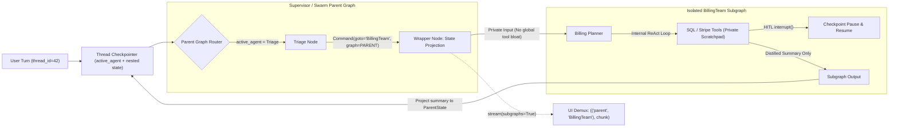
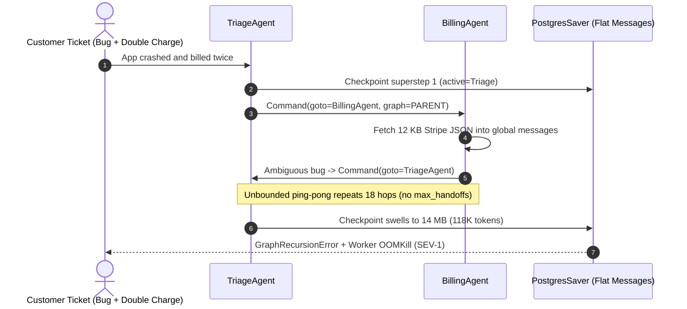

# Module 10: Multi-Agent With LangGraph

> **Prerequisites:** [Module 03: The Supervisor Pattern](../03-the-supervisor-pattern/README.md), [Module 05: Swarm and Handoff Patterns](../05-swarm-and-handoff-patterns/README.md), [Track 11, Module 12: LangGraph State and Nodes](../../11-langchain-and-langgraph/12-langgraph-state-and-nodes/README.md), and [Track 11, Module 15: Checkpointing and Persistence](../../11-langchain-and-langgraph/15-checkpointing-and-persistence/README.md).  
> **Estimated Reading Time:** 36 minutes  
> **Target Audience:** AI Backend Engineers, LangGraph Architects, Production Orchestration Developers

> [!TIP]
> **The Golden Rule of Multi-Agent LangGraph:** Encapsulate each specialist team inside a **typed, isolated `StateGraph` subgraph**, drive cross-agent transitions with explicit **`Command(goto=..., update=..., graph=Command.PARENT)`** objects guarded by a `max_handoffs` counter, and stream **`subgraphs=True`** namespaces rather than leaking raw tool-call scratchpads into one unbounded global `messages` list.

---

## Why This Matters

Once you move from architectural diagrams ([Modules 01–09](../01-multi-agent-topologies-overview/README.md)) into production Python or TypeScript code, **LangGraph** models multi-agent workflows as stateful directed cyclic graphs with durable thread checkpointing. That power creates a deceptively common anti-pattern: gluing four specialist ReAct agents onto one flat `MessagesState` where every SQL payload, failed tool call, and internal reflection gets appended to a single shared `messages` array.

Within four agent hops, the shared transcript swells past `15K–80K` tokens, subsequent agents hallucinate over peer tool calls they don't own, `PostgresSaver` checkpoint rows balloon into megabytes per thread, and decentralized handoff loops ping-pong until `GraphRecursionError` crashes the request. Mastering **`Command` routing**, **Swarm `active_agent` persistence**, **Hierarchical Subgraph state projection**, **`.with_config()` isolation**, and **`subgraphs=True` streaming** fixes all four failure modes cleanly.

---

## 1. Native LangGraph Multi-Agent Topologies & State Isolation

LangGraph implements three core multi-agent coordination patterns on top of one primitive—the **`Command`** return object, which fuses **state mutation** (`update={...}`) and **dynamic control flow** (`goto=...`, `graph=Command.PARENT`) in a single atomic transition:

1. **Supervisor (`create_supervisor` / `Command` Router):** A central `supervisor` node inspects high-level parent state, routes to a specialist node or subgraph via `Command(goto="billing_team")`, and regains control once the worker finishes (`goto="supervisor"` or `__end__`).
2. **Swarm (`create_swarm` / Handoff Tools + `active_agent`):** Decentralized peer agents carry **handoff tools** (`transfer_to_billing`). Invoking a handoff tool returns `Command(goto="billing_agent", graph=Command.PARENT, update={"active_agent": "billing_agent", ...})`. Because `active_agent` persists in the thread Checkpointer, follow-up user turns resume directly on `billing_agent` without re-triaging.
3. **Hierarchical Subgraphs (Schema Projection vs. Shared Schema):**
   - *Shared Schema (`parent.add_node("team", compiled_subgraph)`):* Parent and subgraph share identical state keys (`messages`). Fast to wire, but leaks internal tool chatter globally.
   - *Wrapper Node State Projection (Recommended for Production):* Parent invokes `compiled_subgraph.invoke(private_input, config)` inside a typed wrapper node, confining multi-step SQL/API tool traces inside the subgraph's `private_messages` schema and returning *only* a concise `handoff_summary` and structured artifacts to `ParentState`.



### Quantitative Mechanics: Context Isolation Savings & Hop Budgeting

- **Flat Shared Messages vs. Subgraph Isolation:** Suppose $K$ specialists execute sequentially, where specialist $i$ generates $t_i$ internal tool-payload tokens and distills a $s_i$-token handoff summary ($s_i \ll t_i$). In a flat shared `messages` list, context grows cumulatively so total input tokens billed across $K$ hops scale as:

$$T_{\text{flat}} = \sum_{i=1}^{K} \left( Q_0 + t_i + \sum_{j=1}^{i-1} (t_j + s_j) \right)$$

  Under **Subgraph Wrapper Projection**, each specialist pays only for prior distilled summaries plus its *own* internal scratchpad:

$$T_{\text{isolated}} = \sum_{i=1}^{K} \left( Q_0 + t_i + \sum_{j=1}^{i-1} s_j \right)$$

  In a 4-hop pipeline (`Triage`, `BillingSQL`, `PolicyRAG`, `Responder`), isolating internal tool JSON drops final parent context from `5,110` tokens to `760` tokens (`6.7x` smaller) and slashes cumulative input tokens by `> 52%`.

- **Explicit `recursion_limit` & `max_handoffs` Sizing:** Never rely on LangGraph's default `recursion_limit=25` as your business guardrail. Compute an explicit per-request superstep budget across $K$ expected specialists averaging $m_i$ tool calls each ($2$ graph steps per tool turn):

$$L_{\text{rec}} = \sum_{i=1}^{K} (2 \cdot m_i + 1) + \text{handoff\_margin}$$

  Always pair `recursion_limit` in `.with_config(...)` with an explicit `handoffs: int` counter in state so ping-pong loops terminate gracefully via `ESCALATE_HUMAN` *before* throwing `GraphRecursionError`.

### Scoping `.with_config()`, `subgraphs=True` Streaming, and Thread Interrupts

| LangGraph Feature | Exact Mechanism | Production Benefit |
| :--- | :--- | :--- |
| **`.with_config(RunnableConfig)`** | Attach `{"tags": ["team:billing"], "configurable": {"tenant_id": ...}, "recursion_limit": 18}` per subgraph or call | Per-team LangSmith/OTel attribution, tenant DB routing, and dynamic hop caps without recompiling graphs |
| **`stream(..., subgraphs=True)`** | Yields `(namespace_tuple, mode, payload)`—e.g., `(("parent", "BillingSubgraph:abc"), "updates", {...})` | UIs show clean status indicators (`"Checking invoice..."`) while suppressing raw internal tool JSON |
| **Nested `interrupt()` + `Checkpointer`** | Calling `interrupt(payload)` inside a nested subgraph snapshots *both* parent and subgraph checkpoints on `thread_id` | Human reviewers approve a `$450` refund mid-swarm and resume the exact paused subgraph node cleanly |

---

## 2. Systematic Comparison Matrix: LangGraph Multi-Agent Patterns

| Pattern | Control Flow | Context Isolation | Turn-Resume Latency | Best Production Use Case |
| :--- | :--- | :--- | :--- | :--- |
| **Supervisor (`create_supervisor`)** | Central router LLM chooses next agent (`Command`) | Moderate (requires wrapper nodes or summary filtering) | Re-evaluates supervisor each turn | Structured enterprise workflows needing centralized audit/routing policy |
| **Swarm (`create_swarm` + `active_agent`)** | Peer agents hand off directly via tools (`Command.PARENT`) | Low–Moderate unless subgraphs wrapped | Fast (resumes straight on `active_agent`) | Multi-turn customer support (Triage $\to$ Billing $\to$ Tech) staying with one specialist |
| **Hierarchical Subgraphs (Wrapper Nodes)** | Multi-tier Supervisors delegating to encapsulated teams | High (private scratchpads stripped on return) | Controlled (bounded per-team budgets) | Complex multi-domain pipelines (`SQL` + `RAG` + `Code`) with heavy tool payloads |
| **Single Monolithic ReAct Agent** | Single loop over all tools | None (flat prompt) | Fastest (`1` agent hop) | `< 6` non-overlapping tools where one system prompt maintains high accuracy |

---

## 3. Production War Story Post-Mortem: Infinite Swarm Ping-Pong & Checkpointer OOM

| Field | Incident Details |
| :--- | :--- |
| **Severity** | **SEV-1** (Worker Pod OOM Crashes + API Token Quota Exhaustion) |
| **Detection / Resolution Time** | Detected in 14 minutes via Kubernetes OOMKill alerts & OpenAI TPM throttle / Mitigated in 25 minutes |
| **Impact** | `18`-hop handoff loops hit `118K` context tokens per request; `PostgresSaver` checkpoint rows grew to `14 MB` per thread, crashing API workers |

### What Happened

A SaaS support backend migrated from a single agent to a 3-agent **LangGraph Swarm** (`TriageAgent`, `BillingAgent`, `TechnicalAgent`) backed by `PostgresSaver`:

1. Both `TriageAgent` and `BillingAgent` had overlapping prompt boundaries (`"If uncertain whether a discrepancy is technical or billing, transfer to the other specialist"`).
2. Handoff tools emitted `Command(goto=target, graph=Command.PARENT, update={"messages": state["messages"] + [tool_msg]})` with **no `handoff_count` limit** and **shared flat `messages`** containing raw `12 KB` Stripe webhook payloads.
3. On ambiguous bug-plus-invoice tickets, `TriageAgent` handed off to `BillingAgent`, which queried Stripe (`12 KB` JSON appended to global `messages`), felt unsure, and handed right back to `TriageAgent`.
4. The pair ping-ponged until hitting `recursion_limit=25`, accumulating `118K` tokens per run and checkpointing massive JSON blobs at every superstep until concurrent requests OOM-killed the worker pool.



### Root Cause Analysis

- **Ambiguous Handoff Contracts Without Loop Counter:** Overlapping transfer instructions lacked a `handoff_count` state key and deterministic circuit breaker.
- **Unisolated Subgraph State:** Appending `12 KB` tool responses directly to the parent `messages` list multiplied token and checkpoint storage quadratically across hops.
- **Missing `.with_config(recursion_limit=...)` Tight Bounds:** Relying on default `25` steps wasted ~`20` LLM calls per stuck conversation before aborting.

### The Fix & Architectural Hardening

- **Hard `max_handoffs = 4` State Guard:** Added `handoff_count` and `visited_agents` to parent `SwarmState`; exceeding `4` handoffs routes immediately to an `escalate_human` node via `interrupt()`.
- **Wrapper Subgraph State Projection:** Moved Stripe/SQL tool execution into private subgraph keys (`private_scratchpad`) so only a `150`-token summary ever reaches `ParentState` and `PostgresSaver`.
- **Per-Graph `recursion_limit` & `.with_config()`:** Set tight `recursion_limit=14` and streamed `subgraphs=True` to filter noisy internal tool tuples from user SSE streams.

---

## 4. Multi-Language Production Implementation: `Command` Routing & Subgraph Isolation

Python (`langgraph`) and TypeScript (`@langchain/langgraph`) execute `StateGraph`, `Command`, and `subgraphs=True` natively; **Go** and **C#** backends either orchestrate LangGraph Server over HTTP/SSE (`subgraphs=true` namespace streams) or run identical typed `Command(goto, update, graph=PARENT)` state-machine routers. Below are clean production implementations across all four languages.

````carousel

```go
package langgraphclient

import (
	"fmt"
	"strings"
)

// GraphCommand mirrors LangGraph's atomic state update + routing primitive.
type GraphCommand struct {
	Goto        string
	TargetGraph string // "" (local) or "PARENT"
	Update      map[string]string
}

type SwarmState struct {
	ActiveAgent   string
	HandoffCount  int
	MaxHandoffs   int
	ParentSummary []string
}

// RouteHandoff enforces max_handoffs before applying Command(goto=..., graph=PARENT).
func RouteHandoff(state *SwarmState, cmd GraphCommand) (string, error) {
	if cmd.TargetGraph == "PARENT" && cmd.Goto != "__end__" {
		if state.HandoffCount >= state.MaxHandoffs {
			state.ActiveAgent = "escalate_human"
			return "ESCALATE_HUMAN", fmt.Errorf("max_handoffs=%d exceeded", state.MaxHandoffs)
		}
		state.HandoffCount++
		state.ActiveAgent = cmd.Goto
	}
	if summary, ok := cmd.Update["handoff_summary"]; ok && summary != "" {
		// Wrapper projection: commit distilled summary only, never raw tool payloads
		state.ParentSummary = append(state.ParentSummary, summary)
	}
	return cmd.Goto, nil
}

// DemuxSubgraphEvent parses LangGraph Server SSE namespace streams (subgraphs=true).
func DemuxSubgraphEvent(namespace []string, mode, node, text string) string {
	nsLabel := "root"
	if len(namespace) > 0 {
		nsLabel = strings.Join(namespace, "/")
	}
	if mode == "messages" && strings.HasSuffix(nsLabel, "internal_tools") {
		return "" // Suppress noisy subgraph tool tokens from user UI
	}
	return fmt.Sprintf("[%s :: %s] %s", nsLabel, node, text)
}
```

<!-- slide -->

```typescript
// TypeScript (@langchain/langgraph pattern) showing Command(PARENT), active_agent & subgraph wrapper isolation
import { Annotation, Command, END, StateGraph } from "@langchain/langgraph";

export const SwarmState = Annotation.Root({
  activeAgent: Annotation<string>({ reducer: (_, next) => next, default: () => "triage" }),
  handoffCount: Annotation<number>({ reducer: (_, next) => next, default: () => 0 }),
  summaries: Annotation<string[]>({
    reducer: (prev, next) => [...prev, ...next],
    default: () => [],
  }),
});

const BillingSubState = Annotation.Root({
  query: Annotation<string>(),
  privateToolLog: Annotation<string[]>({
    reducer: (prev, next) => [...prev, ...next],
    default: () => [],
  }),
  distilledAnswer: Annotation<string>(),
});

// Isolated subgraph keeps bulky API payloads out of SwarmState
const billingSubgraph = new StateGraph(BillingSubState)
  .addNode("lookup", async (s) => ({
    privateToolLog: [...s.privateToolLog, "RAW_STRIPE_JSON_12KB..."],
    distilledAnswer: "Invoice #881 is eligible for $450 refund.",
  }))
  .addEdge("__start__", "lookup")
  .addEdge("lookup", END)
  .compile();

export async function callBillingWrapper(
  state: typeof SwarmState.State,
): Promise<Command> {
  if (state.handoffCount >= 4) {
    return new Command({ goto: "escalate_human", update: { activeAgent: "escalate_human" } });
  }
  // Project ONLY needed query into subgraph; discard privateToolLog on return
  const subResult = await billingSubgraph.invoke(
    { query: state.summaries.at(-1) ?? "", privateToolLog: [], distilledAnswer: "" },
    { tags: ["team:billing"], recursionLimit: 10 },
  );
  return new Command({
    goto: END,
    graph: Command.PARENT,
    update: {
      activeAgent: "triage",
      handoffCount: state.handoffCount + 1,
      summaries: [subResult.distilledAnswer],
    },
  });
}
```

<!-- slide -->

```python
"""
langgraph_multi_agent.py
Idiomatic LangGraph Supervisor/Swarm Command routing + isolated subgraph wrapper + stream(subgraphs=True).
Requires: pip install langgraph langchain-core
"""
from typing import Annotated, Literal, TypedDict
import operator
from langgraph.checkpoint.memory import MemorySaver
from langgraph.graph import END, START, StateGraph
from langgraph.types import Command


class ParentSwarmState(TypedDict):
    user_query: str
    active_agent: str
    handoff_count: int
    summaries: Annotated[list[str], operator.add]  # Distilled handoff notes only


class BillingPrivateState(TypedDict):
    query: str
    raw_stripe_logs: list[str]  # Never promoted to ParentSwarmState
    summary: str


def billing_tool_node(state: BillingPrivateState) -> dict:
    return {
        "raw_stripe_logs": ["{raw_charge: 45000, metadata: ...12KB...}"],
        "summary": "Verified invoice #881 eligible for $450 refund.",
    }


billing_subgraph = (
    StateGraph(BillingPrivateState)
    .add_node("billing_lookup", billing_tool_node)
    .add_edge(START, "billing_lookup")
    .add_edge("billing_lookup", END)
    .compile()
)


def triage_node(state: ParentSwarmState) -> Command[Literal["billing_team", "escalate_human"]]:
    if state["handoff_count"] >= 4:
        return Command(goto="escalate_human", update={"active_agent": "escalate_human"})
    if "refund" in state["user_query"].lower():
        return Command(
            goto="billing_team",
            update={"active_agent": "billing_team", "handoff_count": state["handoff_count"] + 1},
        )
    return Command(goto="escalate_human")


def call_billing_wrapper(state: ParentSwarmState) -> Command[Literal["__end__"]]:
    # Subgraph config scoping via .with_config()
    scoped_sub = billing_subgraph.with_config({"tags": ["team:billing"], "recursion_limit": 8})
    sub_out = scoped_sub.invoke({"query": state["user_query"], "raw_stripe_logs": [], "summary": ""})
    return Command(
        goto=END,
        graph=Command.PARENT,
        update={"summaries": [sub_out["summary"]]},
    )


def build_app():
    builder = StateGraph(ParentSwarmState)
    builder.add_node("triage", triage_node)
    builder.add_node("billing_team", call_billing_wrapper)
    builder.add_node("escalate_human", lambda s: {"summaries": ["Escalated to human queue."]})
    builder.add_edge(START, "triage")
    builder.add_edge("escalate_human", END)
    return builder.compile(checkpointer=MemorySaver())
```

<!-- slide -->

```csharp
using System;
using System.Collections.Generic;

namespace GenAI.LangGraphInterop;

public sealed record GraphCommand(
    string Goto,
    string? TargetGraph,
    IReadOnlyDictionary<string, string> Update);

public sealed class SwarmThreadState
{
    public string ActiveAgent { get; set; } = "triage";
    public int HandoffCount { get; set; }
    public int MaxHandoffs { get; init; } = 4;
    public List<string> Summaries { get; } = new();
}

public static class SubgraphCoordinator
{
    // Applies Command(goto, graph=PARENT) semantics and filters bulky internal subgraph logs.
    public static string ApplyParentCommand(SwarmThreadState state, GraphCommand cmd)
    {
        if (string.Equals(cmd.TargetGraph, "PARENT", StringComparison.Ordinal) &&
            !string.Equals(cmd.Goto, "__end__", StringComparison.Ordinal))
        {
            if (state.HandoffCount >= state.MaxHandoffs)
            {
                state.ActiveAgent = "escalate_human";
                return "escalate_human";
            }

            state.HandoffCount++;
            state.ActiveAgent = cmd.Goto;
        }

        if (cmd.Update.TryGetValue("handoff_summary", out var summary) && !string.IsNullOrWhiteSpace(summary))
        {
            state.Summaries.Add(summary);
        }

        return cmd.Goto;
    }

    // Demultiplexes SSE events produced by LangGraph Server stream(subgraphs=true).
    public static string? FormatSubgraphFrame(IReadOnlyList<string> ns, string mode, string node, string chunk)
    {
        var path = ns.Count == 0 ? "root" : string.Join("/", ns);
        if (mode == "messages" && path.Contains("internal_tools", StringComparison.Ordinal))
            return null; // Hide internal tool scratchpads from end-user stream

        return $"[{path} :: {node}] {chunk}";
    }
}
```

````

---

## 5. Practical Hands-On Verification CLI Workflows

Run these deterministic Python 3.13 simulation scripts locally with zero external packages or API keys to benchmark LangGraph multi-agent mechanics.

### Workflow 1: Quantify Flat Global State vs. Subgraph Private Scratchpad Isolation

Measure exact parent context size and cumulative billed tokens across a 4-agent pipeline with vs. without wrapper-node state projection:

```bash
python -c '
def run_hops(isolated_subgraphs=False):
    global_tokens = 250
    total_billed = 0
    agents = [("Triage", 650, 90), ("BillingSQL", 1400, 120), ("PolicyRAG", 1800, 140), ("Responder", 500, 160)]
    for name, internal_tool_tok, handoff_summary_tok in agents:
        step_input = global_tokens + internal_tool_tok
        total_billed += step_input
        if isolated_subgraphs:
            global_tokens += handoff_summary_tok
        else:
            global_tokens += internal_tool_tok + handoff_summary_tok
    mode = "Subgraph Isolated" if isolated_subgraphs else "Flat Shared Global"
    print(f"{mode:<20} | Final Parent Context: {global_tokens:>5,} tok | Cumulative Input Billed: {total_billed:>6,} tok")

run_hops(isolated_subgraphs=False)
run_hops(isolated_subgraphs=True)
'
```

**Expected Output:**

```text
Flat Shared Global   | Final Parent Context: 5,110 tok | Cumulative Input Billed: 12,550 tok
Subgraph Isolated    | Final Parent Context:   760 tok | Cumulative Input Billed:  6,000 tok
```

### Workflow 2: Simulate Swarm `Command` Handoffs, `subgraphs=True` Stream, & Ping-Pong Guard

Verify normal `Command.PARENT` transitions alongside an active `max_handoffs=4` circuit breaker emitting tuple namespaces:

```bash
python -c '
def simulate_swarm(max_handoffs=4, ping_pong=True):
    state = {"active_agent": "TriageAgent", "handoffs": 0, "done": False}
    events = []
    for step in range(1, 10):
        curr = state["active_agent"]
        h = state["handoffs"]
        events.append((("parent_graph", curr), "model_update", f"step={step} handoffs={h}"))
        if ping_pong:
            target = "BillingAgent" if curr == "TriageAgent" else "TriageAgent"
        else:
            target = "BillingAgent" if curr == "TriageAgent" else "__end__"
        if target == "__end__":
            state["done"] = True
            events.append((("parent_graph", curr), "command_goto", "__end__"))
            break
        if h >= max_handoffs:
            events.append((("parent_graph", "guardrail"), "circuit_break", f"max_handoffs={max_handoffs} exceeded -> ESCALATE_HUMAN"))
            break
        state["active_agent"] = target
        state["handoffs"] = h + 1
        events.append((("parent_graph", curr), "command_parent", f"goto={target}"))
    return events

print("=== Normal Swarm Resolution ===")
for ns, kind, msg in simulate_swarm(max_handoffs=4, ping_pong=False):
    print(f"  ns={ns} | {kind:<15} | {msg}")
print("=== Ping-Pong Guard Triggered ===")
for ns, kind, msg in simulate_swarm(max_handoffs=4, ping_pong=True):
    print(f"  ns={ns} | {kind:<15} | {msg}")
'
```

**Expected Output:**

```text
=== Normal Swarm Resolution ===
  ns=('parent_graph', 'TriageAgent') | model_update    | step=1 handoffs=0
  ns=('parent_graph', 'TriageAgent') | command_parent  | goto=BillingAgent
  ns=('parent_graph', 'BillingAgent') | model_update    | step=2 handoffs=1
  ns=('parent_graph', 'BillingAgent') | command_goto    | __end__
=== Ping-Pong Guard Triggered ===
  ns=('parent_graph', 'TriageAgent') | model_update    | step=1 handoffs=0
  ns=('parent_graph', 'TriageAgent') | command_parent  | goto=BillingAgent
  ns=('parent_graph', 'BillingAgent') | model_update    | step=2 handoffs=1
  ns=('parent_graph', 'BillingAgent') | command_parent  | goto=TriageAgent
  ns=('parent_graph', 'TriageAgent') | model_update    | step=3 handoffs=2
  ns=('parent_graph', 'TriageAgent') | command_parent  | goto=BillingAgent
  ns=('parent_graph', 'BillingAgent') | model_update    | step=4 handoffs=3
  ns=('parent_graph', 'BillingAgent') | command_parent  | goto=TriageAgent
  ns=('parent_graph', 'TriageAgent') | model_update    | step=5 handoffs=4
  ns=('parent_graph', 'guardrail') | circuit_break   | max_handoffs=4 exceeded -> ESCALATE_HUMAN
```

### Workflow 3: Simulate Thread Checkpointing, Nested Subgraph Interrupt, & Resume

Trace `thread_id="thread-42"` saving `active_agent` and `interrupted_in` tuple inside a checkpointer and resuming mid-subgraph after human sign-off:

```bash
python -c '
checkpointer = {}

def invoke_thread(thread_id, user_msg=None, human_approval=None):
    ckpt = checkpointer.get(thread_id, {"active_agent": "TriageAgent", "interrupted_in": None, "status": "NEW"})
    if ckpt["interrupted_in"] and human_approval is not None:
        sub_ns = ckpt["interrupted_in"]
        ckpt["status"] = f"RESUMED_IN:{sub_ns} -> {human_approval}"
        ckpt["interrupted_in"] = None
        checkpointer[thread_id] = ckpt
        return ckpt
    if user_msg and "refund" in user_msg.lower():
        ckpt["active_agent"] = "BillingSubgraph"
        ckpt["interrupted_in"] = ("parent", "BillingSubgraph", "approve_refund_node")
        ckpt["status"] = "PAUSED_FOR_HITL"
    checkpointer[thread_id] = ckpt
    return ckpt

print("Turn 1 (user request):", invoke_thread("thread-42", user_msg="Refund invoice #881 for $450"))
print("State mid-pause:      ", checkpointer["thread-42"])
print("Turn 2 (human resume):", invoke_thread("thread-42", human_approval="APPROVED_BY_FINANCE"))
'
```

**Expected Output:**

```text
Turn 1 (user request): {'active_agent': 'BillingSubgraph', 'interrupted_in': ('parent', 'BillingSubgraph', 'approve_refund_node'), 'status': 'PAUSED_FOR_HITL'}
State mid-pause:       {'active_agent': 'BillingSubgraph', 'interrupted_in': ('parent', 'BillingSubgraph', 'approve_refund_node'), 'status': 'PAUSED_FOR_HITL'}
Turn 2 (human resume): {'active_agent': 'BillingSubgraph', 'interrupted_in': None, 'status': "RESUMED_IN:('parent', 'BillingSubgraph', 'approve_refund_node') -> APPROVED_BY_FINANCE"}
```

### Hands-On Exercises

1. **Cycle Detection in Swarm Handoffs:** Extend Workflow 2 to track `visited_pair_transitions` (e.g., `("BillingAgent", "TriageAgent")`); trip `circuit_break` immediately on the second repeat of any reverse edge instead of waiting for `max_handoffs=4`.
2. **Namespace Stream Filter:** Write a consumer over Workflow 2's event tuples that logs `command_*` transitions to an audit sink while printing only `model_update` frames from the outermost `parent_graph` namespace.
3. **Optional Live LangGraph Execution (`pip install langgraph`):** Run the Python snippet from Section 4 (`build_app().stream(..., subgraphs=True, config={"configurable": {"thread_id": "demo-1"}})`) and verify `billing_subgraph`'s `raw_stripe_logs` never appear in `ParentSwarmState["summaries"]`.

### Independent Challenge

Your team has a 3-tier LangGraph hierarchy (`TopSupervisor -> ResearchTeamSubgraph -> WebScraperSubgraph`) using `PostgresSaver`. Product managers ask for three things simultaneously: (1) stream live `"Searching SEC filings..."` progress indicators from `WebScraperSubgraph` to the browser UI without showing raw HTML scrape chunks, (2) keep total checkpoint row sizes under `150 KB` per thread, and (3) support pausing inside `ResearchTeamSubgraph` for analyst approval on high-cost deep-search runs. Explain the exact LangGraph primitives and state-schema design needed.

<details><summary>Architectural Discussion</summary>

Configure three coordinated LangGraph mechanisms: (1) **Wrapper Node Projection at Both Tier Boundaries**—give `WebScraperSubgraph` and `ResearchTeamSubgraph` private `raw_html_scratchpad` keys that are *not* mapped back to parent `StateGraph` schemas; return only distilled citation objects and a brief `summary` upward, keeping `PostgresSaver` checkpoint rows compact (`< 50 KB`); (2) **`.stream(..., stream_mode=["custom", "updates"], subgraphs=True)`**—emit lightweight custom progress events (`get_stream_writer()`) from inside `WebScraperSubgraph` tagged by namespace tuple `(("top", "research", "scraper"), "custom", "Searching SEC filings...")` while dropping verbose internal `messages` frames at the API gateway; and (3) **Checkpointed Nested `interrupt()`**—pass a single `PostgresSaver` at the top-level compiled graph (subgraphs automatically inherit parent persistence) so calling `interrupt()` inside `ResearchTeamSubgraph` pauses cleanly and resumes via `Command(resume=approval)` on the same `thread_id`.

</details>

---

## 6. Common Mistakes & Troubleshooting

- **Passing raw `state["messages"]` unmodified between parent and child subgraphs:** Sharing `messages` across teams lets internal ReAct tool calls and verbose JSON payloads pollute every downstream agent prompt. Use wrapper nodes to project clean inputs and distilled outputs.
- **Omitting `graph=Command.PARENT` when returning a `Command` inside a subgraph or handoff tool:** Without `graph=Command.PARENT`, LangGraph attempts to resolve `goto="billing_agent"` inside the *local* subgraph node registry and raises `ValueError: Node not found`.
- **Creating separate `MemorySaver()`/`PostgresSaver()` instances inside each subgraph:** Compile child subgraphs *without* a checkpointer (unless intentionally stateless/isolated) and pass ONE checkpointer at the top-level parent `compile(checkpointer=...)` so parent and nested subgraph interrupts serialize cohesively under one `thread_id`.
- **Streaming `stream_mode="messages"` with `subgraphs=True` straight to end users:** Users see confusing raw tool-calling tokens from internal critic/SQL subagents. Filter by the namespace tuple `ns` emitted alongside each streamed chunk.

---

## 7. Operational Validation Checkpoints & Checkpoint Quiz

### Operational Validation Checkpoints

<details><summary><strong>Checkpoint 1: Fixing an unresponsive Swarm handoff inside a nested subgraph</strong></summary>

Inside a compiled `TriageSubgraph`, an agent's handoff tool returns `Command(goto="billing_agent", update={"active_agent": "billing_agent"})`, throwing a runtime error claiming `"billing_agent"` does not exist in the graph. Why did it fail and what single argument fixes it?

**Validation:** Because `TriageSubgraph` is nested inside the parent Swarm graph, `Command(goto=...)` defaults to local subgraph scope (`graph=None`). Since `"billing_agent"` lives in the parent graph, add **`graph=Command.PARENT`** so LangGraph applies the state update and routes control across the parent `StateGraph`.

</details>

<details><summary><strong>Checkpoint 2: Diagnosing why UI users see raw internal SQL errors during streaming</strong></summary>

After enabling `app.stream(inputs, config, stream_mode="messages", subgraphs=True)` to show multi-agent progress, end users suddenly see raw intermediate SQL retries and JSON stack traces streaming into the chat bubble. How do you fix this cleanly?

**Validation:** With `subgraphs=True`, every yielded chunk carries its originating **namespace tuple** `(ns, chunk)` (e.g., `(("parent", "sql_subgraph:12f"), msg)`). Update your SSE/WebSocket server handler to inspect `ns` (or filter by node tag attached via `.with_config({"tags": ["user_visible"]})`), forwarding only user-facing responder/progress frames while routing subgraph `internal_tools` tuples exclusively to observability logs.

</details>

<details><summary><strong>Checkpoint 3: Preventing `PostgresSaver` checkpoint bloat in a 6-agent pipeline</strong></summary>

A 6-agent research workflow hits `9 MB` per thread row in PostgreSQL after just `3` user turns, degrading `get_state()` latency to `900 ms`. Identify the architectural cause and cure.

**Validation:** All 6 subgraphs shared one flat `messages` key with an `add_messages` reducer, persisting every intermediate web-scrape payload and raw tool response across every checkpoint superstep. Convert child agents to **Wrapper-Isolated Subgraphs** storing verbose tool blobs in ephemeral local state (or object storage references) and promoting only compact summaries into `ParentState`.

</details>

### Checkpoint Quiz

1. What two actions does a single LangGraph `Command` object combine atomically?
2. Why does a LangGraph **Swarm** track `active_agent` inside persisted graph state?
3. When should you embed a subgraph directly via `add_node("team", sub)` versus wrapping it inside a Python/TS projection function?
4. What does passing `subgraphs=True` to `graph.stream()` or `graph.get_state()` change in the returned output?
5. Why should you never rely solely on `recursion_limit=25` to stop Swarm handoff loops?

<details><summary>Answers</summary>

1. A `Command` combines **state mutation** (`update={...}`) and **dynamic control-flow routing** (`goto=...`, optionally targeting `graph=Command.PARENT`) in a single atomic return value.
2. Persisting `active_agent` in the thread checkpointer ensures subsequent user turns resume directly with the specialist currently handling the conversation rather than restarting from `Triage` every turn.
3. Direct `add_node` works when parent and subgraph share identical state keys and schemas; a **wrapper projection node** is needed whenever schemas differ or when you must isolate internal subgraph tool logs from parent state.
4. It surfaces **nested namespace context**—`stream()` yields `(namespace_tuple, chunk)` pairs identifying which subgraph emitted each frame, and `get_state(config, subgraphs=True)` exposes paused state inside nested subgraphs.
5. `recursion_limit` counts *all* supersteps (including internal tool cycles) and crashes with `GraphRecursionError` after burning dozens of expensive LLM calls. An explicit `handoff_count` guard lets you gracefully route to `escalate_human` or a fallback node after e.g. `3–4` transfers.

</details>

---

## Further Reading & Sources

- [LangGraph Official Documentation](https://langchain-ai.github.io/langgraph/) — core reference for `StateGraph`, `Command`, subgraphs, streaming (`subgraphs=True`), and checkpointers.
- [LangGraph Multi-Agent Reference Examples](https://github.com/langchain-ai/langgraph/tree/main/examples/multi_agent) — canonical Supervisor, Swarm, and Hierarchical Agent Team implementations.
- [LangChain Documentation Hub](https://docs.langchain.com/) — guides on `.with_config()`, runtime tags, and LangSmith multi-agent tracing.
- [Track 11, Module 15: Checkpointing and Persistence](../../11-langchain-and-langgraph/15-checkpointing-and-persistence/README.md) — deep dive into `MemorySaver`, `PostgresSaver`, and `thread_id` snapshots.
- [Module 09: Conflict Resolution and Consensus](../09-conflict-resolution-and-consensus/README.md) — consensus gates applicable at LangGraph join/merge nodes.

## Next

[Module 11: CrewAI](../11-crewai/README.md)
