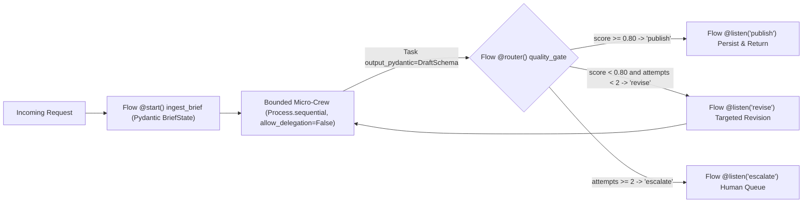
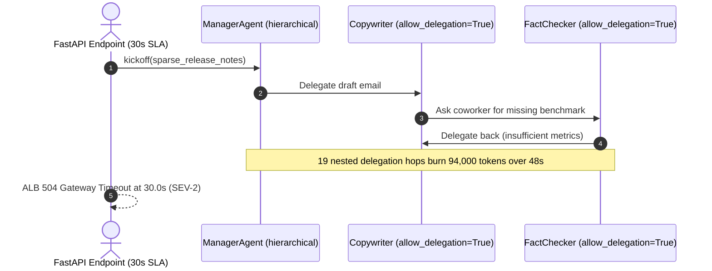

# Module 11: CrewAI

> **Prerequisites:** [Module 02: The Orchestrator-Worker Pattern](../02-the-orchestrator-worker-pattern/README.md), [Module 06: Sequential and Parallel Pipelines](../06-sequential-and-parallel-pipelines/README.md), and [Module 10: Multi-Agent With LangGraph](../10-multi-agent-with-langgraph/README.md).  
> **Estimated Reading Time:** 33 minutes  
> **Target Audience:** AI Backend Engineers, Product AI Engineers, Multi-Agent Platform Developers

> [!TIP]
> **The Golden Rule of Production CrewAI:** Keep **Crews** small, sequential (`Process.sequential`), stripped of bloated narrative backstories (`allow_delegation=False`), and contract-bound via **`output_pydantic`**—and drive all branching, retries, and SLA routing deterministically inside **CrewAI Flows** (`@start`, `@listen`, `@router`), never inside an unconstrained `Process.hierarchical` manager loop.

---

## Why This Matters

CrewAI popularized multi-agent development with an intuitive human-org metaphor: give an `Agent` a `role`, `goal`, and `backstory`; bind it to a `Task` with `expected_output`; drop three agents into a `Crew(process=Process.hierarchical)`; and watch a `"Manager"` orchestrate research, drafting, and editing automatically. In a `10`-minute demo, that abstraction feels effortless.

In production behind a `12`-second API SLA, free-form role-playing Crews expose sharp operational edges: narrative `backstory` strings add hundreds of hidden overhead tokens on *every* ReAct loop iteration; CrewAI's internal prompt templates and coworker delegation tools consume silent token budgets before user inputs arrive; and `Process.hierarchical` manager agents regularly fall into multi-turn delegation ping-pong that violates `P95`/`P99` latency guarantees. Understanding when to use **Crews** versus deterministic **CrewAI Flows** turns CrewAI from a flaky prototype library into a predictable backend workflow runner.

---

## 1. Role-Playing Crews vs. Deterministic CrewAI Flows

CrewAI splits multi-agent orchestration across two distinct abstraction layers:

1. **Crews (Autonomous Task Collaboration):**
   - `Agent(role, goal, backstory, allow_delegation=False, max_iter=4)`: Defines persona instructions, bound tools, and loop caps.
   - `Task(description, expected_output, agent, context=[...], output_pydantic=Schema)`: Encodes explicit upstream task dependencies (`context`) and strict structured output schemas (`output_pydantic`).
   - `Process.sequential` vs. `Process.hierarchical`: `sequential` executes tasks in fixed topological/list order; `hierarchical` spawns a dynamic Manager LLM that plans and delegates subtasks via coworker tool calls.
2. **Flows (`Flow[StateModel]`, `@start`, `@listen`, `@router`, `@persist`):**
   - **Event-Driven Deterministic Backbone:** Normal Python methods decorated with `@start()`, `@listen(upstream_or_route)` (supporting `or_` / `and_` joins), and `@router(prev_step)` returning exact string branch keys (`"publish"`, `"revise"`, `"escalate"`).
   - **Typed Pydantic `self.state`:** Shared structured state validated across step transitions—executing conditional branching in `< 1 ms` with zero LLM routing calls—while launching bounded `Sequential` Micro-Crews *only* where open-ended reasoning is genuinely required.



### Honest Engineering Critique: Hidden Prompts & The `backstory` Token Tax

Inspecting CrewAI's compiled system messages in production reveals three hidden costs that naive tutorials omit:

- **The `backstory` + ReAct Scaffold Token Tax:** Every `Agent` compiles `role`, `goal`, `backstory`, ReAct format instructions (`Thought / Action / Observation`), and tool schemas into the system prompt on **every single ReAct iteration**. A colorful `240`-token narrative backstory paired with `allow_delegation=True` (`~190` tokens for coworker delegation schemas) and `~220` tokens of base ReAct scaffolding injects `650` overhead tokens *per turn*. Across `4` agents averaging `5` iterations, scaffolding alone burns `13,000` tokens (`\$0.03250` per request at `\$2.50/1M`) before any user document is read!
- **Hidden Internal Prompts:** CrewAI injects opinionated internal templates (persona framing, task-output expectations, delegation prompts) that shift across library minor versions. Production teams must pin `crewai` versions and trace raw LLM payloads via callbacks/OTel rather than assuming only your `Task.description` reaches the model.
- **`Process.hierarchical` Tail-Latency Explosion:** Because the Manager LLM decides dynamically when work is `"good enough"`, ambiguous edge cases cause `7–11+` manager-to-worker round trips (`P95 = 18.47 s`, `P99 = 21.35 s`), blowing past synchronous gateway timeouts. Moving branching logic into a Python `@router()` Flow keeps non-LLM transitions sub-millisecond and holds `P99` under `3.3 s`.

### Quantitative Mechanics: Scaffold Overhead & SLA Sizing

Model the pure hidden prompt overhead across $A$ agents executing $I_i$ ReAct turns before counting task data:

$$T_{\text{scaffold}} = \sum_{i=1}^{A} I_i \cdot \left( T_{\text{react\_sys}} + T_{\text{role\_goal\_backstory}, i} + \mathbb{1}_{\text{deleg}, i} \cdot T_{\text{coworker\_tools}} \right)$$

Trimming backstories from `240` tokens to crisp `45`-token behavioral specs, setting `allow_delegation=False`, and wrapping only `2` specialist agents inside a deterministic `@router()` Flow cuts fixed scaffold burn by **`91.8%`** (`13,000 -> 1,060` tokens) while capping loop iterations strictly via `max_iter` and Flow attempt counters.

---

## 2. Systematic Comparison Matrix: CrewAI Execution Modes

| Mode | Control Determinism | Hidden Prompt Overhead | Tail Latency ($P_{99}$) | Best Production Fit |
| :--- | :--- | :--- | :--- | :--- |
| **`Crew(Process.sequential)`** | High (fixed task order + `context=[...]`) | Moderate (`backstory` + ReAct per step) | Predictable ($O(\sum \text{max\_iter})$) | Linear 2–3 step pipelines (`Extract -> Draft -> Format`) with `output_pydantic` |
| **`Crew(Process.hierarchical)`** | Low (Manager LLM delegates dynamically) | High (Manager prompts + coworker schemas) | Volatile (long delegation tail spikes) | Offline batch research/synthesis with relaxed async timeouts (`> 60 s`) |
| **`Flow` + Bounded Micro-Crews** | Very High (`@start`/`@router` Python code) | Low (tiny scoped Crews only where needed) | Tight & SLA-compliant | Production APIs requiring strict routing, conditional retries, and Pydantic state |
| **Raw LangGraph `StateGraph`** | Maximum (explicit nodes, edges, `Command`) | Minimal (zero hidden persona prompts) | Tightest (`sub-ms` graph edges) | High-throughput systems needing fine-grained token control & custom checkpointers |

---

## 3. Production War Story Post-Mortem: The `allow_delegation=True` Manager Timeout

| Field | Incident Details |
| :--- | :--- |
| **Severity** | **SEV-2** (30% Synchronous API 504 Gateway Timeouts + 6x Cost Spike) |
| **Detection / Resolution Time** | Detected 2 hours after release via 504 alarm / Mitigated in 35 minutes (delegation disabled + Flow router hotfix) |
| **Impact** | `94,000` tokens (`\$0.68` on a `\$29/mo` SaaS plan) burned on single ambiguous requests; `30%` of requests timed out at `30 s` |

### What Happened

A B2B marketing-ops team deployed a 5-agent `Process.hierarchical` Crew behind a synchronous FastAPI endpoint (`30 s` ALB timeout) to turn product release notes into customer emails:

1. Every agent carried a `200`-word creative backstory (`"You are an award-winning Enterprise Storyteller..."`) with `allow_delegation=True` enabled by default on worker agents.
2. When a sparse feature note arrived without benchmark numbers, `ManagerAgent` delegated research to `AnalystAgent`, who delegated copy polishing to `CopywriterAgent`, who asked `FactCheckerAgent` for missing benchmarks, who delegated back to `AnalystAgent`.
3. `19` nested delegation and coworker-question turns executed across `48` seconds—consuming `94,000` cumulative tokens—while the upstream load balancer severed the HTTP connection at `30 s` with `504 Gateway Timeout`.



### Root Cause Analysis

- **`allow_delegation=True` Cascading Sub-Calls:** Enabling coworker delegation on workers let non-manager agents spawn recursive side conversations outside the caller's SLA tracking.
- **Unconstrained `Process.hierarchical` Looping:** Without deterministic routing or hard total-step caps, ambiguous input caused endless polite manager-worker clarifications.
- **Synchronous HTTP Coupling:** Long-running multi-agent crews were called inline inside a `30 s` request-response endpoint without async job kickoff or Flow caps.

### The Fix & Architectural Hardening

- **Replaced Hierarchical Crew with a `Flow` + 2-Agent `Sequential` Micro-Crew:** Moved missing-field validation into a `0.5 ms` Python `@router()` step *before* calling any LLM.
- **Enforced `allow_delegation=False` & `max_iter=3`:** Stripped narrative backstories to 2 crisp constraint sentences (`~45` tokens) and validated outputs using `output_pydantic`.
- **Async Kickoff Pattern:** Non-trivial Flows run asynchronously via job IDs (`/kickoff` + polling/webhook) with strict token/time circuit breakers.

---

## 4. Multi-Language Production Implementation: Flow Orchestration & Worker Integration

CrewAI's SDK executes natively in **Python** (`crewai`). In polyglot microservice stacks, **Python** defines the deterministic `Flow` + `Sequential` Micro-Crew (`output_pydantic`, `allow_delegation=False`), while **Go**, **TypeScript**, and **C#** backends trigger CrewAI worker endpoints asynchronously (`/kickoff` -> `/status/{id}`) with strict SLA timeouts and schema validation.

````carousel

```go
package crewaiclient

import (
	"bytes"
	"context"
	"encoding/json"
	"errors"
	"fmt"
	"net/http"
	"time"
)

type KickoffRequest struct {
	Topic       string `json:"topic"`
	MaxAttempts int    `json:"max_attempts"`
}

type KickoffResponse struct {
	KickoffID string `json:"kickoff_id"`
}

// FlowBriefOutput mirrors CrewAI Task output_pydantic contract.
type FlowBriefOutput struct {
	Verdict      string  `json:"verdict"`
	QualityScore float64 `json:"quality_score"`
	Summary      string  `json:"summary"`
}

type FlowStatusResponse struct {
	State  string           `json:"state"` // "PENDING" | "SUCCESS" | "FAILED"
	Result *FlowBriefOutput `json:"result,omitempty"`
}

// RunCrewFlowWithSLA triggers a CrewAI Flow worker asynchronously and enforces a hard SLA deadline.
func RunCrewFlowWithSLA(ctx context.Context, baseURL string, topic string, sla time.Duration) (*FlowBriefOutput, error) {
	ctx, cancel := context.WithTimeout(ctx, sla)
	defer cancel()

	body, _ := json.Marshal(KickoffRequest{Topic: topic, MaxAttempts: 2})
	req, err := http.NewRequestWithContext(ctx, http.MethodPost, baseURL+"/kickoff", bytes.NewReader(body))
	if err != nil {
		return nil, err
	}
	req.Header.Set("Content-Type", "application/json")

	resp, err := http.DefaultClient.Do(req)
	if err != nil {
		return nil, fmt.Errorf("kickoff failed: %w", err)
	}
	defer resp.Body.Close()

	var started KickoffResponse
	if err := json.NewDecoder(resp.Body).Decode(&started); err != nil {
		return nil, err
	}

	ticker := time.NewTicker(400 * time.Millisecond)
	defer ticker.Stop()
	for {
		select {
		case <-ctx.Done():
			return nil, fmt.Errorf("crewai SLA timeout after %s: %w", sla, ctx.Err())
		case <-ticker.C:
			pollReq, _ := http.NewRequestWithContext(ctx, http.MethodGet, baseURL+"/status/"+started.KickoffID, nil)
			pollResp, err := http.DefaultClient.Do(pollReq)
			if err != nil {
				continue
			}
			var st FlowStatusResponse
			_ = json.NewDecoder(pollResp.Body).Decode(&st)
			pollResp.Body.Close()
			if st.State == "SUCCESS" && st.Result != nil {
				if st.Result.QualityScore < 0 || st.Result.Verdict == "" {
					return nil, errors.New("invalid pydantic contract from CrewAI worker")
				}
				return st.Result, nil
			}
			if st.State == "FAILED" {
				return nil, errors.New("crewai flow execution failed")
			}
		}
	}
}
```

<!-- slide -->

```typescript
// TypeScript service client invoking a Python CrewAI Flow worker with strict SLA & schema validation
export interface CrewFlowBriefResult {
  readonly verdict: "PUBLISHED" | "ESCALATED";
  readonly quality_score: number;
  readonly summary: string;
}

export async function executeCrewFlowWithBudget(
  workerUrl: string,
  topic: string,
  slaMs = 12_000,
): Promise<CrewFlowBriefResult> {
  const controller = new AbortController();
  const timer = setTimeout(() => controller.abort(), slaMs);

  try {
    const startRes = await fetch(`${workerUrl}/kickoff`, {
      method: "POST",
      headers: { "Content-Type": "application/json" },
      body: JSON.stringify({ topic, max_attempts: 2 }),
      signal: controller.signal,
    });
    if (!startRes.ok) throw new Error(`Kickoff HTTP ${startRes.status}`);
    const { kickoff_id } = (await startRes.json()) as { kickoff_id: string };

    while (!controller.signal.aborted) {
      await new Promise((r) => setTimeout(r, 350));
      const pollRes = await fetch(`${workerUrl}/status/${kickoff_id}`, {
        signal: controller.signal,
      });
      if (!pollRes.ok) continue;
      const data = (await pollRes.json()) as { state: string; result?: CrewFlowBriefResult };
      if (data.state === "SUCCESS" && data.result) {
        if (typeof data.result.quality_score !== "number" || !data.result.summary) {
          throw new Error("CrewAI result violated output_pydantic schema contract");
        }
        return data.result;
      }
      if (data.state === "FAILED") throw new Error("CrewAI Flow failed");
    }
    throw new Error(`CrewAI Flow breached SLA budget of ${slaMs}ms`);
  } finally {
    clearTimeout(timer);
  }
}
```

<!-- slide -->

```python
"""
crewai_flow_pipeline.py
Production CrewAI Flow combining deterministic @router branching with bounded Sequential Micro-Crews.
Requires: pip install crewai pydantic
"""
from crewai import Agent, Crew, Process, Task
from crewai.flow.flow import Flow, listen, router, start
from pydantic import BaseModel, Field


class DraftContract(BaseModel):
    summary: str = Field(..., min_length=20, max_length=600)
    quality_score: float = Field(..., ge=0.0, le=1.0)


class PipelineState(BaseModel):
    topic: str = ""
    attempts: int = 0
    draft: DraftContract | None = None
    verdict: str = "PENDING"


def build_micro_crew() -> Crew:
    # Concise specs (low backstory token tax) + allow_delegation=False + tight max_iter
    researcher = Agent(
        role="Technical Analyst",
        goal="Extract 3 verifiable facts about the topic.",
        backstory="Concise systems engineer. Output facts only.",
        allow_delegation=False,
        max_iter=3,
    )
    writer = Agent(
        role="Brief Writer",
        goal="Produce a validated summary with self-check score.",
        backstory="Technical editor adhering strictly to JSON schema.",
        allow_delegation=False,
        max_iter=2,
    )
    t_research = Task(
        description="Analyze {topic} and list 3 concrete facts.",
        expected_output="Bullet list of 3 technical facts.",
        agent=researcher,
    )
    t_draft = Task(
        description="Draft a concise brief from context and assign quality_score.",
        expected_output="Valid DraftContract JSON.",
        agent=writer,
        context=[t_research],
        output_pydantic=DraftContract,
    )
    return Crew(agents=[researcher, writer], tasks=[t_research, t_draft], process=Process.sequential)


class ProductionBriefFlow(Flow[PipelineState]):
    @start()
    def run_micro_crew(self) -> None:
        self.state.attempts += 1
        result = build_micro_crew().kickoff(inputs={"topic": self.state.topic})
        self.state.draft = result.pydantic

    @router(run_micro_crew)
    def quality_gate(self) -> str:
        if self.state.draft and self.state.draft.quality_score >= 0.80:
            return "publish"
        if self.state.attempts < 2:
            return "revise"
        return "escalate"

    @listen("revise")
    def retry_once(self) -> None:
        self.run_micro_crew()

    @listen("publish")
    def finalize(self) -> str:
        self.state.verdict = "PUBLISHED"
        return self.state.draft.summary if self.state.draft else ""

    @listen("escalate")
    def escalate_human(self) -> str:
        self.state.verdict = "ESCALATED"
        return "Queued for manual editorial review."
```

<!-- slide -->

```csharp
using System;
using System.Net.Http;
using System.Net.Http.Json;
using System.Threading;
using System.Threading.Tasks;

namespace GenAI.CrewAIIntegration;

public sealed record CrewDraftContract(string Summary, double QualityScore, string Verdict);

public sealed record CrewStatusPayload(string State, CrewDraftContract? Result);

public sealed class CrewAiFlowClient
{
    private readonly HttpClient _http;

    public CrewAiFlowClient(HttpClient http) => _http = http;

    public async Task<CrewDraftContract> ExecuteWithSlaAsync(
        string topic,
        TimeSpan slaTimeout,
        CancellationToken ct = default)
    {
        using var slaCts = CancellationTokenSource.CreateLinkedTokenSource(ct);
        slaCts.CancelAfter(slaTimeout);

        var startResp = await _http.PostAsJsonAsync(
            "/kickoff",
            new { topic, max_attempts = 2 },
            slaCts.Token);
        startResp.EnsureSuccessStatusCode();

        var started = await startResp.Content.ReadFromJsonAsync<KickoffAck>(cancellationToken: slaCts.Token)
            ?? throw new InvalidOperationException("Missing kickoff_id.");

        while (!slaCts.IsCancellationRequested)
        {
            await Task.Delay(350, slaCts.Token);
            var status = await _http.GetFromJsonAsync<CrewStatusPayload>(
                $"/status/{started.KickoffId}",
                slaCts.Token);

            if (status is { State: "SUCCESS", Result: not null })
            {
                if (string.IsNullOrWhiteSpace(status.Result.Summary) || status.Result.QualityScore is < 0 or > 1)
                    throw new InvalidOperationException("Output violated DraftContract schema.");
                return status.Result;
            }
            if (status?.State == "FAILED")
                throw new InvalidOperationException("CrewAI Flow worker reported failure.");
        }

        throw new TimeoutException($"CrewAI Flow exceeded SLA of {slaTimeout.TotalSeconds:F1}s.");
    }

    private sealed record KickoffAck(string KickoffId);
}
```

````

---

## 5. Practical Hands-On Verification CLI Workflows

Run these deterministic Python 3.13 scripts offline—no third-party packages or API keys required.

### Workflow 1: Quantify CrewAI `backstory` & `allow_delegation` Token Tax

Compare a verbose 4-agent delegating Crew against a concise `allow_delegation=False` configuration and a Flow-wrapped 2-agent Micro-Crew:

```bash
python -c '
def crew_token_tax(agents, iters_per_agent, backstory_tok, allow_delegation, react_scaffold_tok=220, price_per_1m=2.50):
    deleg_tok = 190 if allow_delegation else 0
    per_turn = react_scaffold_tok + backstory_tok + deleg_tok
    total_overhead = agents * iters_per_agent * per_turn
    cost_usd = (total_overhead / 1_000_000) * price_per_1m
    return per_turn, total_overhead, cost_usd

profiles = [
    ("Verbose + Delegation", 4, 5, 240, True),
    ("Concise + NoDelegation", 4, 2, 45, False),
    ("Flow + 2-Agent Micro", 2, 2, 45, False),
]
for label, a, iters, bs, deleg in profiles:
    pt, tot, usd = crew_token_tax(a, iters, bs, deleg)
    print(f"{label:<22} | per_turn={pt:>3} tok | total_scaffold={tot:>5,} tok | overhead=${usd:.5f}/req")
'
```

**Expected Output:**

```text
Verbose + Delegation   | per_turn=650 tok | total_scaffold=13,000 tok | overhead=$0.03250/req
Concise + NoDelegation | per_turn=265 tok | total_scaffold=2,120 tok | overhead=$0.00530/req
Flow + 2-Agent Micro   | per_turn=265 tok | total_scaffold=1,060 tok | overhead=$0.00265/req
```

### Workflow 2: Execute a Deterministic Flow (`@start`, `@router`, `@listen`) State Machine

Verify zero-LLM conditional routing (`@router`), bounded attempt counting (`attempts < 2`), and typed dataclass state updates:

```bash
python -c '
from dataclasses import dataclass

def start():
    def dec(fn):
        fn._flow_kind = "start"
        return fn
    return dec

def router(trigger):
    def dec(fn):
        fn._flow_kind = "router"
        fn._trigger = trigger.__name__
        return fn
    return dec

def listen(label):
    def dec(fn):
        fn._flow_kind = "listen"
        fn._trigger = label if isinstance(label, str) else label.__name__
        return fn
    return dec

@dataclass
class BriefState:
    topic: str = "Vector Indexing"
    quality_score: float = 0.0
    attempts: int = 0
    verdict: str = ""

class ContentFlow:
    def __init__(self, state):
        self.state = state

    @start()
    def ingest_brief(self):
        self.state.attempts += 1
        self.state.quality_score = 0.62 if self.state.attempts == 1 else 0.89
        print(f"[start] attempt={self.state.attempts} score={self.state.quality_score:.2f}")

    @router(ingest_brief)
    def quality_gate(self):
        if self.state.quality_score >= 0.80:
            return "publish"
        if self.state.attempts < 2:
            return "revise"
        return "escalate"

    @listen("revise")
    def rewrite_once(self):
        print("[listen:revise] deterministic retry triggered")
        self.ingest_brief()
        route = self.quality_gate()
        if route == "publish":
            self.publish_report()

    @listen("publish")
    def publish_report(self):
        self.state.verdict = "PUBLISHED"
        print(f"[listen:publish] verdict={self.state.verdict}")

flow = ContentFlow(BriefState())
flow.ingest_brief()
branch = flow.quality_gate()
for name in dir(flow):
    fn = getattr(flow, name)
    if getattr(fn, "_flow_kind", None) == "listen" and getattr(fn, "_trigger", None) == branch:
        fn()
print("Final FlowState:", flow.state)
'
```

**Expected Output:**

```text
[start] attempt=1 score=0.62
[listen:revise] deterministic retry triggered
[start] attempt=2 score=0.89
[listen:publish] verdict=PUBLISHED
Final FlowState: BriefState(topic='Vector Indexing', quality_score=0.89, attempts=2, verdict='PUBLISHED')
```

### Workflow 3: Benchmark SLA Breach Rate (`Process.hierarchical` vs. `Flow + Micro-Crew`)

Simulate `500` requests under a `12.0 s` API SLA comparing stochastic manager delegation hops against a deterministic Flow + 2-step Sequential Micro-Crew:

```bash
python -c '
import random

rng = random.Random(42)
def percentile(vals, q):
    s = sorted(vals)
    idx = min(len(s) - 1, int(round(q * (len(s) - 1))))
    return s[idx]

hier_latencies = []
flow_latencies = []
for _ in range(500):
    deleg_hops = rng.choices([2, 4, 7, 11], weights=[0.40, 0.35, 0.15, 0.10])[0]
    hier_latencies.append(1.8 + deleg_hops * rng.uniform(1.1, 1.9))
    flow_latencies.append(0.05 + 2 * rng.uniform(1.1, 1.6))

sla_sec = 12.0
for name, samples in [("Process.hierarchical", hier_latencies), ("Flow + Micro-Crew", flow_latencies)]:
    breaches = sum(1 for x in samples if x > sla_sec)
    print(f"{name:<20} | P50={percentile(samples, 0.50):5.2f}s | P95={percentile(samples, 0.95):5.2f}s | P99={percentile(samples, 0.99):5.2f}s | SLA(>{sla_sec:.0f}s) breach={breaches/len(samples)*100:4.1f}%")
'
```

**Expected Output:**

```text
Process.hierarchical | P50= 7.32s | P95=18.47s | P99=21.35s | SLA(>12s) breach=20.0%
Flow + Micro-Crew    | P50= 2.77s | P95= 3.20s | P99= 3.24s | SLA(>12s) breach= 0.0%
```

### Hands-On Exercises

1. **Escalation Path Verification:** Modify Workflow 2 so `quality_score` remains `0.62` on attempt 2, add `@listen("escalate")`, and verify `Final FlowState` settles cleanly at `verdict="ESCALATED"` instead of looping infinitely.
2. **Explicit `context` DAG Pruning:** In a 4-task `Process.sequential` Crew (`T1 -> T2 -> T3 -> T4`), calculate how disabling default implicit full-history pass-through and specifying `context=[T1, T3]` on `T4` trims context length.
3. **Optional Live CrewAI Probe (`pip install crewai`):** Run `ProductionBriefFlow().kickoff()` with `verbose=True` and inspect the exact compiled system prompt sent to the LLM to measure real-world `backstory` + ReAct scaffold tokens with `tiktoken`.

### Independent Challenge

A media analytics startup builds a customer-facing `"Competitive Brief"` endpoint using a 4-agent `Process.hierarchical` CrewAI crew (`Scout`, `FactVerifier`, `Strategist`, `Editor`) with `180`-word persona backstories and `allow_delegation=True`. Product complaints cite (a) wildly inconsistent JSON formatting breaking the frontend parser, (b) `28`-second $P_{99}$ latencies, and (c) `\$0.11` per brief inference costs on short 3-paragraph queries. Refactor this into a production CrewAI architecture meeting a `< 8 s` $P_{99}$ SLA and `< \$0.015` per request without switching away from CrewAI.

<details><summary>Architectural Discussion</summary>

Three coordinated CrewAI refactors resolve all three symptoms: (1) **Move Control Flow to a `Flow[BriefState]`**—replace `Process.hierarchical` with deterministic `@start` -> `@router` -> `@listen` Python routing so branching and missing-data validation take `< 1 ms` instead of Manager LLM calls; (2) **Split into a 2-Agent `Process.sequential` Micro-Crew + `output_pydantic`**—merge overlapping personas into `Analyst` + `Editor` (`allow_delegation=False`, `max_iter=2`), strip backstories down to 2 concise constraint sentences (`~40` tokens instead of `180` words), and attach `output_pydantic=BriefSchema` to the final `Task` so the frontend never receives malformed JSON; and (3) **Deterministic Pre-Fetch**—run web/DB lookups inside an initial `@start()` Python step *before* invoking the Crew, cutting ReAct tool-loop iterations and locking $P_{99}$ under `5–7 s` at `< \$0.01` per brief.

</details>

---

## 6. Common Mistakes & Troubleshooting

- **Shipping `Process.hierarchical` directly on synchronous HTTP APIs:** Manager LLMs introduce unpredictable multi-turn delegation spikes (`P99 > 20 s`). Reserve `hierarchical` for offline async batch jobs and use Flows + `Process.sequential` for strict SLAs.
- **Writing 200-word creative novel `backstory` prompts:** Narrative fluff (`"Born in Silicon Valley, raised on distributed systems..."`) multiplies token overhead across *every* ReAct loop step without improving accuracy. Keep `backstory` to 1–2 concrete behavioral constraints.
- **Leaving `allow_delegation=True` enabled across worker agents:** Workers randomly invoke `"Ask question to coworker"` when uncertain, causing hidden recursive LLM calls and surprise billing spikes. Set `allow_delegation=False` by default.
- **Parsing raw `crew.kickoff().raw` strings with regex:** Always bind `output_pydantic=MyModel` (or `output_json`) on terminal `Task`s so Pydantic enforces structural invariants before Flow state transitions continue.

---

## 7. Operational Validation Checkpoints & Checkpoint Quiz

### Operational Validation Checkpoints

<details><summary><strong>Checkpoint 1: Diagnosing why a simple 3-agent Crew burns 18,000 tokens</strong></summary>

A CrewAI pipeline processes `500`-token user prompts with `3` sequential agents, yet telemetry logs `18,500` prompt tokens per request. No external RAG documents are attached. Where are the tokens going?

**Validation:** CrewAI injects its ReAct formatting scaffold, `role`/`goal`/`backstory` blocks, tool JSON schemas, and coworker delegation tools (`allow_delegation=True`) into *every* agent's LLM call across *every* `max_iter` loop iteration (`T_scaffold`), plus appends previous tasks' raw outputs into downstream `Task` prompts. Disabling `allow_delegation`, trimming narrative `backstory` strings to ~40 tokens, bounding `max_iter`, and scoping `Task(..., context=[...])` removes the majority of the bloat.

</details>

<details><summary><strong>Checkpoint 2: Choosing between `Flow @router` and `Process.hierarchical`</strong></summary>

A workflow must verify whether a retrieved customer invoice exceeds `\$1,000`, route high-value invoices to a compliance crew, and retry formatting once if JSON validation fails. Should you encode this in `Process.hierarchical` or a CrewAI `Flow`?

**Validation:** Encode this in a **CrewAI `Flow`** using `@start()`, `@router()`, and `@listen()`. Threshold checks (`amount > 1000`) and retry counters (`attempts < 2`) are deterministic software logic—running an LLM Manager in `Process.hierarchical` wastes latency, costs extra tokens, and risks non-deterministic rule violations.

</details>

<details><summary><strong>Checkpoint 3: Fixing silent schema drift at Crew-to-API handoffs</strong></summary>

Downstream frontend components crash intermittently when a `Crew` returns prose headers (`"Here is your JSON:\n..."`) instead of clean objects. What CrewAI `Task` parameter enforces strict structural validation?

**Validation:** Attach **`output_pydantic=MyPydanticSchema`** on the terminal `Task` (and read `result.pydantic` instead of `result.raw`). CrewAI instructs structured/validated output matching your Pydantic model fields and raises/retries validation cleanly before returning control to the enclosing `Flow`.

</details>

### Checkpoint Quiz

1. What is the architectural boundary between a **CrewAI `Crew`** and a **CrewAI `Flow`**?
2. Why does a verbose `200`-word `backstory` cost far more than `200` tokens across a single request?
3. What does setting `allow_delegation=False` on worker `Agent` instances prevent?
4. How does `Task(context=[t1, t3])` improve multi-task efficiency inside `Process.sequential`?
5. Why does `Process.hierarchical` degrade $P_{99}$ latency compared to `Flow` + `Process.sequential` micro-crews?

<details><summary>Answers</summary>

1. A **Flow** manages macro-level deterministic orchestration (`@start`, `@listen`, `@router`), Pydantic state transitions, and retries in Python code, while a **Crew** handles bounded micro-level collaborative LLM tasks inside individual Flow steps.
2. CrewAI re-injects each agent's `role`, `goal`, and `backstory` alongside ReAct scaffolding on **every single ReAct iteration** across every agent in the crew, multiplying that prompt tax by `agents * iterations`.
3. It removes CrewAI's internal `Delegate work to coworker` and `Ask question to coworker` tools from the agent's prompt, stopping unpredictable recursive sub-conversations and saving ~190 scaffold tokens per turn.
4. Passing explicit `context=[t1, t3]` restricts a downstream task's prompt strictly to the outputs of `t1` and `t3`, preventing unrelated intermediate task outputs from bloating context.
5. `Process.hierarchical` relies on an LLM Manager dynamically planning, delegating, and reviewing peer outputs over variable turn counts, creating heavy-tailed delegation loops (`7–11+` hops), whereas `@router()` transitions execute in sub-millisecond deterministic Python.

</details>

---

## Further Reading & Sources

- [CrewAI Official Docs: Flows Concept & Architecture](https://docs.crewai.com/en/concepts/flows) — canonical reference for `@start`, `@listen`, `@router`, `FlowState`, and `@persist`.
- [CrewAI Documentation Hub](https://docs.crewai.com/) — guides on `Agent`, `Task(output_pydantic=...)`, `Process.sequential`, and `Process.hierarchical`.
- [Module 10: Multi-Agent With LangGraph](../10-multi-agent-with-langgraph/README.md) — contrasting lower-level explicit `StateGraph` + `Command` orchestration with CrewAI abstractions.
- [Module 12: AutoGen and Semantic Kernel](../12-autogen-and-semantic-kernel/README.md) — conversational actor group chats and Microsoft's enterprise agent stack.

## Next

[Module 12: AutoGen and Semantic Kernel](../12-autogen-and-semantic-kernel/README.md)
