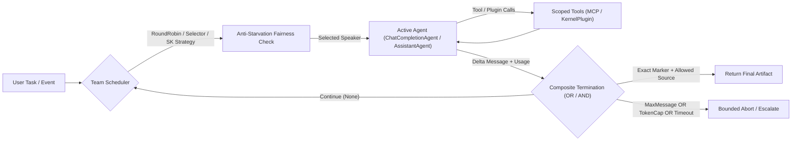
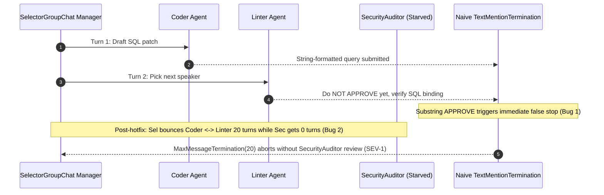

# Module 12: AutoGen and Semantic Kernel

> **Prerequisites:** [Module 07: Inter-Agent Communication](../07-inter-agent-communication/README.md), [Module 09: Conflict Resolution and Consensus](../09-conflict-resolution-and-consensus/README.md), and [Module 11: CrewAI](../11-crewai/README.md).  
> **Estimated Reading Time:** 35 minutes  
> **Target Audience:** AI Platform Engineers, Enterprise .NET/Python/JVM Architects, Multi-Agent Systems Engineers

> [!TIP]
> **The Golden Rule of AutoGen & Semantic Kernel:** Never run a conversational `GroupChat` or `AgentGroupChat` with a bare string termination check (`"APPROVE"`) or an unguarded LLM speaker selector; always compose **source-scoped exact termination guards OR'd with hard message/token caps** (`ScopedExactTerm | MaxMessageTermination | TokenUsageTermination`) alongside **anti-starvation speaker selection**, and target Microsoft's converged **Microsoft Agent Framework** trajectory for new enterprise builds.

---

## Why This Matters

Graph runtimes ([Module 10](../10-multi-agent-with-langgraph/README.md)) and role-playing flows ([Module 11](../11-crewai/README.md)) excel at explicit DAG pipelines, whereas **Microsoft AutoGen** and **Microsoft Semantic Kernel (SK)** pioneered **conversational multi-agent group chats** and **enterprise SDK integration** across Python, C# (.NET), and Java. Instead of hardcoding every transition edge upfront, agents participate in a shared thread governed by **speaker selection** and **termination strategies**.

In production, open-ended group chats fail in two subtle, recurring ways that rarely appear in quickstart demos: **false-positive termination** (a critic writes `"Do NOT APPROVE this yet"` and `TextMentionTermination("APPROVE")` immediately terminates the workflow!) and **speaker starvation** (an LLM speaker selector bounces back and forth between `Coder` and `Linter` for 15 rounds while `SecurityAuditor` never gets a single turn). Understanding AutoGen v0.4's asynchronous actor redesign alongside Semantic Kernel's enterprise middleware—and how Microsoft unified both into the **Microsoft Agent Framework**—keeps conversational teams deterministic, bounded, and safe.

---

## 1. AutoGen v0.4 Actor Architecture vs. Semantic Kernel Convergence

### AutoGen's Architectural Rewrite: Legacy v0.2 to Actor-Based v0.4

Legacy AutoGen (`v0.2`, `pyautogen`) relied on synchronous, blocking `ConversableAgent` / `UserProxyAgent` loops (`initiate_chat`) where orchestration state, LLM prompts, and local code execution lived inside tightly coupled objects—making distributed scaling, pause/resume streaming, and multi-tenant concurrency awkward.

**AutoGen v0.4** completely split the stack into an **asynchronous, event-driven actor runtime (`autogen-core`)** and a high-level multi-agent team layer (**`autogen-agentchat`**):

1. **Three Core Team Topologies (`autogen_agentchat.teams`):**
   - `RoundRobinGroupChat`: Deterministic cyclic rotation (`Agent A -> Agent B -> Agent C -> Agent A`). Zero selector LLM calls, predictable turn counts.
   - `SelectorGroupChat`: Uses a fast LLM (or deterministic custom `selector_func`) after each message to choose the next speaker, with `allow_repeated_speaker=False` to block immediate self-replies.
   - `Swarm`: Decentralized peer handoffs where active agents transfer control directly via `HandoffMessage` tool calls—eliminating central selector overhead on every turn.
2. **Composable Delta Termination (`autogen_agentchat.conditions`):**
   - Evaluates **only the delta messages** emitted since the previous turn, automatically resetting between runs.
   - Combines deterministically via bitwise `|` (**OR**) and `&` (**AND**): e.g. `TextMentionTermination("<<TERMINATE>>", sources=["SecurityVerifier"]) | MaxMessageTermination(12) | TokenUsageTermination(max_total_tokens=20_000) | TimeoutTermination(30)`.

### Microsoft Semantic Kernel & The Unified Microsoft Agent Framework

While AutoGen grew out of Microsoft Research in Python, **Microsoft Semantic Kernel** evolved in Microsoft's product engineering stack (.NET/C#, Python, Java) with strong enterprise guarantees:

- **`Kernel` & Plugin Dependency Injection:** Strongly typed `KernelPlugin` tool contracts, `IFunctionInvocationFilter` / prompt middleware, OpenTelemetry instrumentation, and Azure/Entra security integration.
- **`ChatCompletionAgent` & `AgentGroupChat`:** Wraps specialized instructions and `Kernel` plugins behind unified `SelectionStrategy` (`SequentialSelectionStrategy`, `KernelFunctionSelectionStrategy`) and `TerminationStrategy` (`MaximumIterationCount`, `KernelFunctionTerminationStrategy`) abstractions.
- **Microsoft Agent Framework Convergence:** Microsoft unified AutoGen's flexible actor/conversational multi-agent orchestration with Semantic Kernel's enterprise session management, middleware, .NET/Python parity, and explicit graph-based workflows (`GroupChatOrchestration` and deterministic workflow graphs) so teams no longer have to choose between research flexibility and enterprise SDK rigor.



### Quantitative Mechanics: GroupChat Token Growth & Selector Overhead

In a shared `GroupChat` of $T$ turns where each turn appends $m_{\text{turn}}$ tokens to the conversation context, cumulative token consumption scales quadratically in turns—and `SelectorGroupChat` pays an additional LLM selection call ($c_{\text{sel}}$ tokens and $L_{\text{sel}}$ ms) before *every* turn:

$$C_{\text{groupchat}} = \sum_{t=1}^{T} \left( t \cdot m_{\text{turn}} + \mathbb{1}_{\text{selector}} \cdot c_{\text{sel}} \right), \qquad L_{\text{groupchat}} = \sum_{t=1}^{T} \left( L_{\text{agent}} + \mathbb{1}_{\text{selector}} \cdot L_{\text{sel}} \right)$$

Over `6` turns (`m_turn = 420` tokens, `c_sel = 280` tokens, `L_agent = 650 ms`, `L_sel = 240 ms`), `SelectorGroupChat` consumes `10,500` tokens (`5.34 s`) versus `8,820` tokens (`3.90 s`) for `RoundRobinGroupChat`, while a direct `4`-turn `Swarm` handoff finishes in `4,200` tokens (`2.60 s`). Use `SelectorGroupChat` only when dynamic routing justifies the per-turn selector latency—and always enforce a **starvation window $W$** so idle critical participants (`SecurityAuditor`) cannot be sidelined indefinitely.

---

## 2. Systematic Comparison Matrix: AutoGen & Semantic Kernel Runtimes

| Runtime / Pattern | Language Parity | Concurrency Model | Termination & Safety | Best Production Fit |
| :--- | :--- | :--- | :--- | :--- |
| **AutoGen v0.2 (Legacy)** | Python only | Sync blocking (`initiate_chat`) | Basic `is_termination_msg` lambda | Deprecated prototypes; avoid for new scalable services |
| **AutoGen v0.4 (`autogen-agentchat`)** | Python (async-first; .NET core preview) | Async actor pub/sub (`autogen-core`) | Composable `|` / `&` conditions (`MaxMessage`, `TokenUsage`, `Timeout`) | Dynamic Python research/coding teams, `Swarm`, streaming actor pipelines |
| **Semantic Kernel `AgentGroupChat`** | C# (.NET), Python, Java | Async .NET/Python with `Kernel` DI | Pluggable `SelectionStrategy` + `TerminationStrategy` | Enterprise .NET/JVM shops needing typed plugins, filters, and OTel |
| **Microsoft Agent Framework (Converged)** | .NET / Python unified trajectory | Event/actor + deterministic graphs | Enterprise session state + middleware + graph gates | Forward-looking Microsoft enterprise multi-agent deployments |

---

## 3. Production War Story Post-Mortem: False-Positive Termination & Security Starvation

| Field | Incident Details |
| :--- | :--- |
| **Severity** | **SEV-1** (Unreviewed SQL Injection PR Auto-Approved + Security Agent Starved) |
| **Detection / Resolution Time** | Detected 3 hours later by pre-prod DAST scanner / Fixed in 50 minutes (source-scoped marker + hybrid anti-starvation selector) |
| **Impact** | Vulnerable auth PR received premature `"APPROVED"` verdict on turn 2; subsequent patch revealed `SecurityAuditor` received `0` turns across 20-message chats |

### What Happened

An internal developer-platform team deployed an AutoGen v0.4 `SelectorGroupChat` PR reviewer with three agents (`Coder`, `Linter`, `SecurityAuditor`) and `TextMentionTermination("APPROVE") | MaxMessageTermination(20)`:

1. **Bug 1 (Substring Termination Match):** On turn 1, `Coder` submitted a string-formatted SQL patch. On turn 2, `Linter` spotted an edge case and wrote: `"Do NOT APPROVE yet—check parameterized query binding first."` Because `TextMentionTermination("APPROVE")` performs a raw case-sensitive substring scan across *any* participant's output, it matched `"APPROVE"` inside `"Do NOT APPROVE"`, exiting immediately and marking the PR review complete!
2. **Bug 2 (Speaker-Selection Starvation):** After engineers hotfixed the stop token to `"FINAL_VERDICT_PASS"`, an LLM `SelectorGroupChat` manager got locked into a rapid `Coder <-> Linter` nitpick cycle over formatting for `20` consecutive turns (`Coder=10, Linter=10, SecurityAuditor=0`), hitting `MaxMessageTermination(20)` without ever scheduling `SecurityAuditor`.



### Root Cause Analysis

- **Unscoped Substring Matching:** Generic English words (`"APPROVE"`, `"DONE"`, `"PASS"`) routinely appear inside negated sentences (`"Do NOT APPROVE"`), causing false-positive exits.
- **Unbounded LLM Speaker Selection:** Without a deterministic fairness window (`W = 4` turns max without speaking), the selector LLM latched onto the last two conversational turns and starved quiet critical reviewers.

### The Fix & Architectural Hardening

- **Source-Scoped Exact Sentinel (`| MaxMessage | TokenCap`):** Replaced `"APPROVE"` with a unique trailing sentinel `` `<<TERMINATE>>` `` accepted *only* when emitted by `source == "SecurityAuditor"`, OR'd with `MaxMessageTermination(12)` and `TokenUsageTermination(max_total_tokens=16000)`.
- **Anti-Starvation Hybrid Selector:** Wrapped the LLM selector inside a `selector_func` override that inspects `last_seen[agent]`; if any participant has been idle for `>= W` turns (`W = 4`), the scheduler deterministically selects the longest-starved agent instead of querying the LLM selector.

---

## 4. Multi-Language Production Implementation: Starvation-Safe GroupChat & Composite Guards

Below are production-grade conversational GroupChat coordinators across **Go**, **TypeScript**, **Python** (AutoGen v0.4 `autogen-agentchat` style), and **C#** (Microsoft Semantic Kernel `ChatCompletionAgent` + `AgentGroupChat` strategy style)—all implementing **anti-starvation speaker selection** and **source-scoped composite termination guards**.

````carousel

```go
package groupchat

import (
	"context"
	"fmt"
	"strings"
)

type AgentMessage struct {
	Source string
	Text   string
	Tokens int
}

// StarvationSafeSelector enforces fairness window W over dynamic LLM picks.
type StarvationSafeSelector struct {
	Participants []string
	Window       int
	LastSeen     map[string]int
}

func (s *StarvationSafeSelector) PickNext(turn int, lastSpeaker string, llmSuggested string) string {
	longestIdle := ""
	oldestTurn := turn
	for _, agent := range s.Participants {
		if agent == lastSpeaker {
			continue // Mirrors allow_repeated_speaker=false
		}
		last, ok := s.LastSeen[agent]
		if !ok {
			last = -1
		}
		if turn-last >= s.Window && last < oldestTurn {
			oldestTurn = last
			longestIdle = agent
		}
	}
	if longestIdle != "" {
		s.LastSeen[longestIdle] = turn
		return longestIdle // Override LLM selector to prevent starvation
	}
	for _, p := range s.Participants {
		if p == llmSuggested && p != lastSpeaker {
			s.LastSeen[p] = turn
			return p
		}
	}
	// Deterministic fallback if LLM returned unknown alias
	for _, p := range s.Participants {
		if p != lastSpeaker {
			s.LastSeen[p] = turn
			return p
		}
	}
	return s.Participants[0]
}

// CheckCompositeTermination implements (ScopedExactMarker | MaxMessages | TokenCap).
func CheckCompositeTermination(ctx context.Context, msg AgentMessage, totalMsgs, totalTokens, maxMsgs, maxTokens int) (bool, string) {
	if ctx.Err() != nil {
		return true, "TIMEOUT_TERMINATION"
	}
	if msg.Source == "SecurityAuditor" && strings.HasSuffix(strings.TrimSpace(msg.Text), "<<TERMINATE>>") {
		return true, "SCOPED_SENTINEL_STOP"
	}
	if totalMsgs >= maxMsgs {
		return true, fmt.Sprintf("MAX_MESSAGE_STOP:%d", totalMsgs)
	}
	if totalTokens >= maxTokens {
		return true, fmt.Sprintf("TOKEN_USAGE_STOP:%d", totalTokens)
	}
	return false, ""
}
```

<!-- slide -->

```typescript
export interface ChatDelta {
  readonly source: string;
  readonly text: string;
  readonly tokens: number;
}

export type TerminationPredicate = (
  delta: ChatDelta,
  totalMessages: number,
  totalTokens: number,
) => string | null;

// Composable OR combinator matching AutoGen's (condA | condB) semantics
export function orTermination(...conditions: TerminationPredicate[]): TerminationPredicate {
  return (delta, totalMessages, totalTokens) => {
    for (const cond of conditions) {
      const reason = cond(delta, totalMessages, totalTokens);
      if (reason !== null) return reason;
    }
    return null;
  };
}

export const scopedSentinelStop =
  (allowedSource: string, marker = "<<TERMINATE>>"): TerminationPredicate =>
  (delta) =>
    delta.source === allowedSource && delta.text.trim().endsWith(marker)
      ? `SCOPED_STOP(${allowedSource})`
      : null;

export const maxMessagesStop =
  (limit: number): TerminationPredicate =>
  (_delta, totalMessages) =>
    totalMessages >= limit ? `MAX_MESSAGES(${totalMessages})` : null;

export const tokenCapStop =
  (maxTokens: number): TerminationPredicate =>
  (_delta, _totalMessages, totalTokens) =>
    totalTokens >= maxTokens ? `TOKEN_CAP(${totalTokens})` : null;

export function selectNextSpeakerWithFairness(
  participants: readonly string[],
  turn: number,
  lastSpeaker: string | null,
  lastSeen: Map<string, number>,
  llmChoice: string,
  starvationWindow = 4,
): string {
  const starved = participants
    .filter((p) => p !== lastSpeaker && turn - (lastSeen.get(p) ?? -1) >= starvationWindow)
    .sort((a, b) => (lastSeen.get(a) ?? -1) - (lastSeen.get(b) ?? -1));

  const chosen =
    starved[0] ??
    (participants.includes(llmChoice) && llmChoice !== lastSpeaker
      ? llmChoice
      : participants.find((p) => p !== lastSpeaker) ?? participants[0]);

  lastSeen.set(chosen, turn);
  return chosen;
}
```

<!-- slide -->

```python
"""
autogen_v04_guarded_team.py
AutoGen v0.4 (autogen-agentchat) SelectorGroupChat with anti-starvation selector_func
and composable (SourceScopedExact | MaxMessage | TokenUsage) termination.
Requires: pip install autogen-agentchat autogen-ext
"""
from typing import Sequence
from autogen_agentchat.agents import AssistantAgent
from autogen_agentchat.base import TerminationCondition
from autogen_agentchat.conditions import MaxMessageTermination, TokenUsageTermination
from autogen_agentchat.messages import BaseAgentEvent, BaseChatMessage, StopMessage
from autogen_agentchat.teams import SelectorGroupChat


class ScopedExactTermination(TerminationCondition):
    """Terminates ONLY when an authorized source ends its message with an exact sentinel."""

    def __init__(self, marker: str = "<<TERMINATE>>", allowed_sources: Sequence[str] = ("SecurityAuditor",)) -> None:
        self._marker = marker
        self._allowed = set(allowed_sources)
        self._terminated = False

    @property
    def terminated(self) -> bool:
        return self._terminated

    async def __call__(self, messages: Sequence[BaseAgentEvent | BaseChatMessage]) -> StopMessage | None:
        for msg in messages:
            content = getattr(msg, "content", "")
            if msg.source in self._allowed and isinstance(content, str) and content.strip().endswith(self._marker):
                self._terminated = True
                return StopMessage(content=f"Verified exit by {msg.source}", source=msg.source)
        return None

    async def reset(self) -> None:
        self._terminated = False


def build_anti_starvation_selector(participants: list[str], starvation_window: int = 4):
    """Forces longest-idle reviewer turn if LLM selector ignores them >= starvation_window turns."""

    def selector_func(messages: Sequence[BaseAgentEvent | BaseChatMessage]) -> str | None:
        turn = len(messages)
        if turn == 0:
            return participants[0]
        last_speaker = messages[-1].source
        last_seen = {p: -1 for p in participants}
        for idx, msg in enumerate(messages):
            if msg.source in last_seen:
                last_seen[msg.source] = idx
        starved = [
            p for p in participants if p != last_speaker and (turn - last_seen[p]) >= starvation_window
        ]
        if starved:
            return min(starved, key=lambda p: last_seen[p])
        return None  # Fall back to LLM selector when no agent is starved

    return selector_func


def create_guarded_review_team(model_client) -> SelectorGroupChat:
    coder = AssistantAgent("Coder", model_client=model_client, system_message="Propose minimal fixes.")
    linter = AssistantAgent("Linter", model_client=model_client, system_message="Check style and types.")
    security = AssistantAgent(
        "SecurityAuditor",
        model_client=model_client,
        system_message="Audit auth/SQL safety. End with <<TERMINATE>> ONLY when safe.",
    )
    termination = (
        ScopedExactTermination("<<TERMINATE>>", ["SecurityAuditor"])
        | MaxMessageTermination(max_messages=12)
        | TokenUsageTermination(max_total_tokens=16_000)
    )
    return SelectorGroupChat(
        participants=[coder, linter, security],
        model_client=model_client,
        termination_condition=termination,
        selector_func=build_anti_starvation_selector(["Coder", "Linter", "SecurityAuditor"]),
        allow_repeated_speaker=False,
    )
```

<!-- slide -->

```csharp
using System;
using System.Collections.Generic;
using System.Linq;
using System.Threading;
using System.Threading.Tasks;
using Microsoft.SemanticKernel;
using Microsoft.SemanticKernel.Agents;
using Microsoft.SemanticKernel.Agents.Chat;

namespace GenAI.SemanticKernelAgents;

// Enterprise Semantic Kernel SelectionStrategy preventing SecurityAuditor starvation.
public sealed class AntiStarvationSelectionStrategy : SelectionStrategy
{
    private readonly int _starvationWindow;
    private readonly Dictionary<string, int> _lastSeenTurn = new(StringComparer.Ordinal);
    private int _turn;

    public AntiStarvationSelectionStrategy(int starvationWindow = 4)
        => _starvationWindow = starvationWindow;

    protected override Task<Agent> SelectAgentAsync(
        IReadOnlyList<Agent> agents,
        IReadOnlyList<ChatMessageContent> history,
        CancellationToken cancellationToken = default)
    {
        _turn++;
        var lastAuthor = history.Count > 0 ? history[^1].AuthorName : null;

        // Guarantee idle specialists are never starved by talkative peers
        var starved = agents
            .Where(a => !string.Equals(a.Name, lastAuthor, StringComparison.Ordinal))
            .Where(a => _turn - _lastSeenTurn.GetValueOrDefault(a.Name ?? "", 0) >= _starvationWindow)
            .OrderBy(a => _lastSeenTurn.GetValueOrDefault(a.Name ?? "", 0))
            .FirstOrDefault();

        var chosen = starved ?? agents.FirstOrDefault(a => !string.Equals(a.Name, lastAuthor, StringComparison.Ordinal)) ?? agents[0];
        if (chosen.Name is not null)
            _lastSeenTurn[chosen.Name] = _turn;

        return Task.FromResult(chosen);
    }
}

// Source-scoped exact sentinel termination paired with SK's built-in MaximumIterationCount guard.
public sealed class ScopedSentinelTerminationStrategy : TerminationStrategy
{
    private readonly string _allowedAgent;
    private readonly string _marker;

    public ScopedSentinelTerminationStrategy(string allowedAgent, string marker = "<<TERMINATE>>", int maxIterations = 12)
    {
        _allowedAgent = allowedAgent;
        _marker = marker;
        MaximumIterationCount = maxIterations;
    }

    protected override Task<bool> ShouldAgentTerminateAsync(
        Agent agent,
        IReadOnlyList<ChatMessageContent> history,
        CancellationToken cancellationToken)
    {
        if (history.Count == 0) return Task.FromResult(false);
        var last = history[^1];
        bool matched = string.Equals(agent.Name, _allowedAgent, StringComparison.Ordinal)
            && (last.Content?.TrimEnd().EndsWith(_marker, StringComparison.Ordinal) ?? false);
        return Task.FromResult(matched);
    }
}
```

````

---

## 5. Practical Hands-On Verification CLI Workflows

Run these deterministic Python 3.13 scripts offline—no third-party packages or API keys required.

### Workflow 1: Reproduce Substring `TextMentionTermination` Bug vs. Composite Guard

Confirm how naive `"APPROVE"` substring matching aborts prematurely on `Critic`'s warning (`"Do NOT APPROVE yet"`), while `ScopedExactTermination | MaxMessageTermination | TokenUsageTermination` waits cleanly for `SecurityVerifier`:

```bash
python -c '
class TermCond:
    def __or__(self, other):
        return OrTerm(self, other)
    def __and__(self, other):
        return AndTerm(self, other)

class OrTerm(TermCond):
    def __init__(self, a, b):
        self.a, self.b = a, b
    def check(self, delta, total_msgs, total_tok):
        return self.a.check(delta, total_msgs, total_tok) or self.b.check(delta, total_msgs, total_tok)

class AndTerm(TermCond):
    def __init__(self, a, b):
        self.a, self.b = a, b
    def check(self, delta, total_msgs, total_tok):
        return self.a.check(delta, total_msgs, total_tok) and self.b.check(delta, total_msgs, total_tok)

class NaiveTextTerm(TermCond):
    def __init__(self, token):
        self.token = token
    def check(self, delta, total_msgs, total_tok):
        for _, text in delta:
            if self.token in text:
                return f"NAIVE_STOP: matched {self.token}"
        return None

class ScopedExactTerm(TermCond):
    def __init__(self, marker, allowed_sources):
        self.marker = marker
        self.allowed_sources = set(allowed_sources)
    def check(self, delta, total_msgs, total_tok):
        for src, text in delta:
            if src in self.allowed_sources and text.strip().endswith(self.marker):
                return f"SCOPED_STOP: {src} emitted {self.marker}"
        return None

class MaxMsgTerm(TermCond):
    def __init__(self, limit):
        self.limit = limit
    def check(self, delta, total_msgs, total_tok):
        return f"MAX_MSG_STOP:{total_msgs}" if total_msgs >= self.limit else None

class TokenCapTerm(TermCond):
    def __init__(self, max_tok):
        self.max_tok = max_tok
    def check(self, delta, total_msgs, total_tok):
        return f"TOKEN_STOP:{total_tok}" if total_tok >= self.max_tok else None

stream = [
    ("Coder", "Added parameterized query."),
    ("Critic", "Do NOT APPROVE yet, verify edge case first."),
    ("Coder", "Fixed edge case."),
    ("SecurityVerifier", "Verified cleanly. <<TERMINATE>>"),
]
naive_guard = NaiveTextTerm("APPROVE")
hardened_guard = ScopedExactTerm("<<TERMINATE>>", ["SecurityVerifier"]) | MaxMsgTerm(8) | TokenCapTerm(6000)

for label, guard in [("Naive Substring Guard", naive_guard), ("Hardened Composite Guard", hardened_guard)]:
    tok = 0
    for idx, msg in enumerate(stream, 1):
        tok += 350
        reason = guard.check([msg], idx, tok)
        if reason:
            print(f"{label:<25} | stopped at msg #{idx} ({msg[0]}) -> {reason}")
            break
'
```

**Expected Output:**

```text
Naive Substring Guard     | stopped at msg #2 (Critic) -> NAIVE_STOP: matched APPROVE
Hardened Composite Guard  | stopped at msg #4 (SecurityVerifier) -> SCOPED_STOP: SecurityVerifier emitted <<TERMINATE>>
```

### Workflow 2: Reproduce `SelectorGroupChat` Speaker Starvation vs. Anti-Starvation Fairness

Observe `SecurityAuditor` receiving `0` turns out of `12` under an unguarded LLM selector, versus guaranteed `3` turns under an anti-starvation fairness window (`win=4`):

```bash
python -c '
from collections import Counter

PARTICIPANTS = ["Coder", "Linter", "SecurityAuditor"]

def simulate_selector(turns=12, anti_starvation_window=None):
    counts = Counter()
    last_seen = {p: -1 for p in PARTICIPANTS}
    last_speaker = None
    history = []
    for t in range(turns):
        llm_pick = "Linter" if last_speaker == "Coder" else "Coder"
        chosen = llm_pick
        if anti_starvation_window is not None:
            starved = [p for p in PARTICIPANTS if p != last_speaker and (t - last_seen[p]) >= anti_starvation_window]
            if starved:
                chosen = min(starved, key=lambda p: last_seen[p])
        counts[chosen] += 1
        last_seen[chosen] = t
        last_speaker = chosen
        history.append(chosen)
    return counts, history

for label, win in [("Unguarded LLM Selector", None), ("Anti-Starvation (win=4)", 4)]:
    c, h = simulate_selector(turns=12, anti_starvation_window=win)
    summary = ", ".join(f"{p}={c[p]}" for p in PARTICIPANTS)
    print(f"{label:<24} | turns: {summary} | seq={h[:6]}...")
'
```

**Expected Output:**

```text
Unguarded LLM Selector   | turns: Coder=6, Linter=6, SecurityAuditor=0 | seq=['Coder', 'Linter', 'Coder', 'Linter', 'Coder', 'Linter']...
Anti-Starvation (win=4)  | turns: Coder=6, Linter=3, SecurityAuditor=3 | seq=['Coder', 'Linter', 'Coder', 'SecurityAuditor', 'Coder', 'Linter']...
```

### Workflow 3: Profile `RoundRobinGroupChat` vs. `SelectorGroupChat` vs. `Swarm`

Quantify cumulative token spend and latency overhead across `RoundRobinGroupChat`, `SelectorGroupChat` (`280` selector tokens + `240 ms` per turn), and `Swarm` peer handoffs:

```bash
python -c '
def benchmark_team(mode, turns, ctx_per_turn=420, selector_overhead_tok=280, turn_ms=650, selector_ms=240):
    total_tokens = 0
    total_ms = 0
    for t in range(1, turns + 1):
        agent_tok = t * ctx_per_turn
        sel_tok = selector_overhead_tok if mode == "SelectorGroupChat" else 0
        total_tokens += agent_tok + sel_tok
        total_ms += turn_ms + (selector_ms if mode == "SelectorGroupChat" else 0)
    print(f"{mode:<20} | turns={turns} | total_tokens={total_tokens:>6,} | total_latency={total_ms/1000:5.2f}s")

for m, t in [("RoundRobinGroupChat", 6), ("SelectorGroupChat", 6), ("Swarm(Handoff)", 4)]:
    benchmark_team(m, t)
'
```

**Expected Output:**

```text
RoundRobinGroupChat  | turns=6 | total_tokens= 8,820 | total_latency= 3.90s
SelectorGroupChat    | turns=6 | total_tokens=10,500 | total_latency= 5.34s
Swarm(Handoff)       | turns=4 | total_tokens= 4,200 | total_latency= 2.60s
```

### Hands-On Exercises

1. **Combined `AND` + `OR` Termination Gate:** Modify Workflow 1 so termination triggers only when `(ScopedExactTerm("<<TERMINATE>>", ["SecurityVerifier"]) & ScopedExactTerm("<<LINT_OK>>", ["Linter"])) | MaxMsgTerm(8) | TokenCapTerm(6000)`—proving how `&` enforces multi-signoff consensus while `|` preserves safety bounds.
2. **Invalid Speaker Fallback Handling:** Extend Workflow 2 so `llm_pick` occasionally hallucinates `"SeniorCoder"` (not in `PARTICIPANTS`) or repeats `last_speaker`; add deterministic validation falling back cleanly without raising `KeyError`.
3. **Optional Live AutoGen / Semantic Kernel Probe:** Instantiate `RoundRobinGroupChat` (`autogen-agentchat`) or `AgentGroupChat` (`Microsoft.SemanticKernel.Agents`) with an intentional `"Do NOT TERMINATE"` prompt and verify your scoped sentinel + iteration cap stops on turn limit rather than prematurely exiting.

### Independent Challenge

A .NET financial engineering team runs a 4-agent Semantic Kernel `AgentGroupChat` (`Planner`, `SqlAnalyst`, `ComplianceOfficer`, `ReportWriter`) using a `KernelFunctionSelectionStrategy` prompt and a `KernelFunctionTerminationStrategy` prompt that checks `"Does the conversation show consensus to finish?"`. In production, (1) `ReportWriter` gets called prematurely on turn 2 before `ComplianceOfficer` runs `35%` of the time, (2) long chats occasionally loop until hitting Azure OpenAI TPM limits because the termination LLM keeps hedging `"Almost ready"`, and (3) engineering asks whether to rewrite everything in AutoGen Python to fix it. Design the minimal enterprise fix across the Microsoft agent stack.

<details><summary>Architectural Discussion</summary>

Do **not** rewrite a .NET Semantic Kernel service into Python just to solve orchestration bugs—the failure modes live in the strategies, not the language runtime: (1) **Deterministic Termination Composite**—replace fuzzy LLM-based `"Does it look done?"` termination with a deterministic **source-scoped marker** emitted strictly by `ComplianceOfficer` / `ReportWriter` combined with `MaximumIterationCount = 10` and a hard token-budget `IFunctionInvocationFilter` circuit breaker; (2) **Anti-Starvation Hybrid Selection**—enforce phase gating or an anti-starvation fairness constraint in `SelectionStrategy` so `ReportWriter` cannot be scheduled until `ComplianceOfficer` has spoken at least once on the current turn sequence; and (3) **Align with Microsoft Agent Framework Workflow Graphs**—where the turn sequence (`Planner -> SqlAnalyst -> ComplianceOfficer -> ReportWriter`) is largely fixed, replace open-ended `AgentGroupChat` LLM selection altogether with explicit sequential/graph orchestration, eliminating per-turn selector LLM calls entirely.

</details>

---

## 6. Common Mistakes & Troubleshooting

- **Using bare English words (`"APPROVE"`, `"DONE"`, `"STOP"`) in `TextMentionTermination`:** Any agent quoting or negating the word (`"Do NOT STOP yet"`) immediately kills the workflow. Use unique sentinel markers (`` `<<TERMINATE>>` ``) scoped to authorized `sources=[...]`.
- **Applying `TextMentionTermination` *without* `| MaxMessageTermination | TokenUsageTermination`:** If an agent ignores formatting instructions or refuses to emit the stop phrase, the loop runs indefinitely until wallet exhaustion or gateway timeout.
- **Confusing AutoGen v0.2 sync tutorials with AutoGen v0.4 (`autogen-agentchat`) APIs:** Mixing legacy `ConversableAgent.initiate_chat()` snippets with async `autogen-agentchat` `SelectorGroupChat` / `RoundRobinGroupChat` causes immediate import and runtime mismatches—always check package versions (`autogen-agentchat>=0.4`).
- **Using `SelectorGroupChat` when turn order is actually fixed:** Querying an LLM selector adds ~`250 ms` and ~`300` tokens on *every* single turn; when workflow transitions are predictable (`Coder -> Tester -> Reviewer`), `RoundRobinGroupChat` or a deterministic `Swarm`/graph cuts latency and token cost immediately.

---

## 7. Operational Validation Checkpoints & Checkpoint Quiz

### Operational Validation Checkpoints

<details><summary><strong>Checkpoint 1: Fixing premature termination inside a GroupChat review loop</strong></summary>

An AutoGen `RoundRobinGroupChat` configured with `TextMentionTermination("FINISHED")` exits prematurely on turn 2 whenever `CriticAgent` replies `"The draft is NOT FINISHED—please add unit tests."` Why did this happen and how do you eliminate false exits?

**Validation:** `TextMentionTermination("FINISHED")` performs an unguarded substring check across all participants. `"NOT FINISHED"` contains `"FINISHED"`, triggering an immediate `StopMessage`. Fix by requiring an exact trailing sentinel (`<<TERMINATE>>`) restricted via source check (`allowed_sources=["SecurityReviewer"]` or `ScopedExactTermination`) **OR'd** (`|`) with `MaxMessageTermination` and `TokenUsageTermination`.

</details>

<details><summary><strong>Checkpoint 2: Curing `ComplianceAgent` starvation in `SelectorGroupChat`</strong></summary>

In a 4-agent `SelectorGroupChat`, `Planner` and `Executor` exchange `10` back-and-forth turns while `ComplianceAgent` is never picked once before `MaxMessageTermination(10)` triggers. How do you guarantee `ComplianceAgent` runs?

**Validation:** LLM-based speaker selectors frequently suffer from conversational recency bias, locking onto the last two active speakers. Wrap speaker selection in a custom `selector_func` (or custom `SelectionStrategy` in Semantic Kernel) implementing an **anti-starvation fairness window** (`turn - last_seen[agent] >= W`): whenever any participant goes unscheduled for `W` turns, force-select the longest-starved agent deterministically.

</details>

<details><summary><strong>Checkpoint 3: Choosing between AutoGen Python and Semantic Kernel / Microsoft Agent Framework</strong></summary>

An enterprise backend team running C# ASP.NET Core microservices with Azure Entra ID and OpenTelemetry needs a multi-agent workflow integrating internal SQL plugins. Should they deploy AutoGen v0.2 in a Python sidecar or adopt Semantic Kernel / Microsoft Agent Framework in .NET?

**Validation:** Adopt **Semantic Kernel / Microsoft Agent Framework directly in .NET**. Semantic Kernel provides native C# `KernelPlugin` dependency injection, `IFunctionInvocationFilter` middleware, Entra auth, and OpenTelemetry tracing without cross-language RPC overhead, while converging directly onto Microsoft's unified Agent Framework (combining AutoGen-style multi-agent collaboration with enterprise .NET rigor).

</details>

### Checkpoint Quiz

1. What core architectural shift separates AutoGen v0.4 (`autogen-core` / `autogen-agentchat`) from legacy AutoGen v0.2?
2. How do AutoGen's bitwise operators (`|` and `&`) work when combining `TerminationCondition` objects?
3. What causes **speaker-selection starvation** in `SelectorGroupChat` and `KernelFunctionSelectionStrategy`, and how does a fairness window fix it?
4. Why does `SelectorGroupChat` incur higher latency and token cost per turn than `RoundRobinGroupChat` or `Swarm`?
5. What strengths did Semantic Kernel and AutoGen each contribute to the unified **Microsoft Agent Framework**?

<details><summary>Answers</summary>

1. Legacy v0.2 used synchronous, blocking `ConversableAgent.initiate_chat()` loops, whereas v0.4 introduced an **asynchronous actor-based event runtime (`autogen-core`)** paired with composable async team abstractions (`RoundRobinGroupChat`, `SelectorGroupChat`, `Swarm`) in `autogen-agentchat`.
2. `|` (**OR**) terminates as soon as *any* sub-condition triggers (ideal for `ScopedExact | MaxMessage | TokenUsage`), while `&` (**AND**) requires *all* composed conditions to be satisfied simultaneously (e.g., dual sign-off from two distinct reviewers).
3. LLM selectors exhibit recency bias toward the two most recently active participants (`Coder <-> Linter`), starving quieter specialists. A fairness window checks `(turn - last_seen[agent]) >= W` and deterministically schedules the longest-idle agent when exceeded.
4. `SelectorGroupChat` invokes an extra LLM inference call *before every turn* to pick the next speaker, adding both extra context tokens ($c_{\text{sel}}$) and extra round-trip latency ($L_{\text{sel}}$) per step.
5. **AutoGen** contributed lightweight actor message passing, dynamic multi-agent team patterns (`Swarm`, `GroupChat`), and conversational abstractions; **Semantic Kernel** contributed enterprise SDK parity (.NET/Python/Java), typed plugins, middleware filters, session state, and OpenTelemetry observability—converging alongside deterministic graph workflows.

</details>

---

## Further Reading & Sources

- [Microsoft AutoGen v0.4 Stable Documentation (AgentChat)](https://microsoft.github.io/autogen/stable/) — official guide for `RoundRobinGroupChat`, `SelectorGroupChat`, `Swarm`, and composable termination conditions.
- [Microsoft Semantic Kernel Agent Framework Docs](https://learn.microsoft.com/en-us/semantic-kernel/frameworks/agent/) — reference for `ChatCompletionAgent`, `AgentGroupChat` strategies, and migration guidance toward Microsoft Agent Framework.
- [Module 09: Conflict Resolution and Consensus](../09-conflict-resolution-and-consensus/README.md) — consensus voting and sycophancy guards for multi-agent group chats.
- [Module 11: CrewAI](../11-crewai/README.md) — contrasting role-playing Crews and Flows with conversational actor frameworks.

## Next

[Module 13: The OpenAI Agents SDK](../13-the-openai-agents-sdk/README.md)
