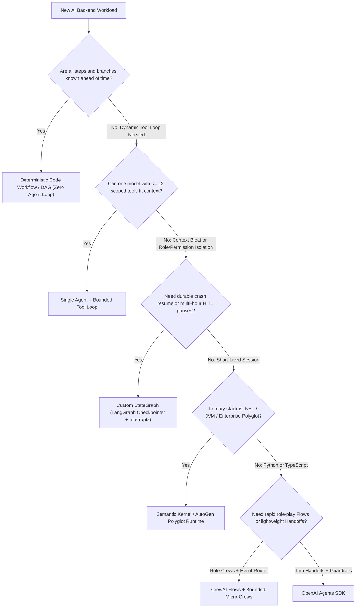
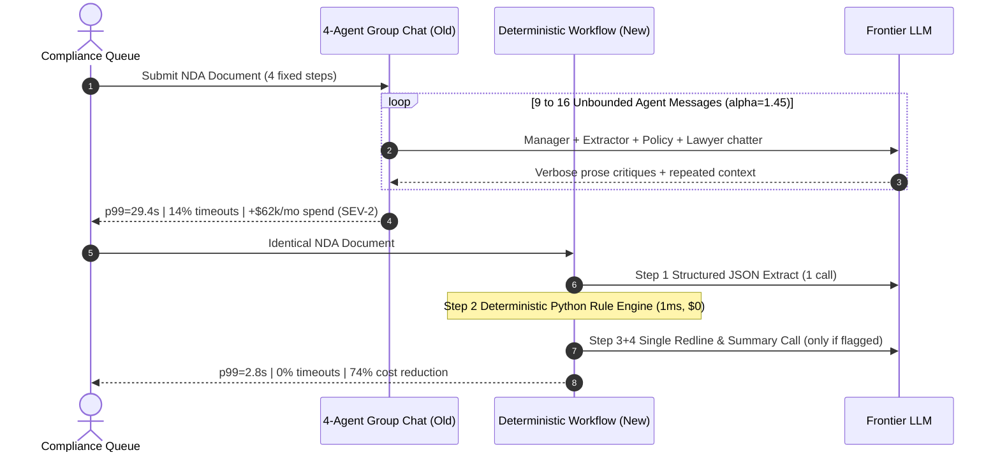

# Module 14: Choosing an Orchestration Approach

> **Prerequisites:** [Module 00: When One Agent Isn't Enough](../00-when-one-agent-isnt-enough/README.md), [Module 10: Multi-Agent With LangGraph](../10-multi-agent-with-langgraph/README.md), [Module 11: CrewAI](../11-crewai/README.md), [Module 12: AutoGen and Semantic Kernel](../12-autogen-and-semantic-kernel/README.md), and [Module 13: The OpenAI Agents SDK](../13-the-openai-agents-sdk/README.md).  
> **Estimated Reading Time:** 35 minutes  
> **Target Audience:** Staff AI Engineers, Principal Backend Architects, Engineering Managers

> [!TIP]
> **The Golden Rule of Orchestration Selection:** Always start at the **lowest coordination complexity** that passes your hard production gates (**Single Agent -> Deterministic Workflow -> Typed StateGraph -> Multi-Agent SDK**). Never adopt conversational multi-agent swarms for linear or rule-bound pipelines; justify every framework decision quantitatively across the **7 production axes**, monthly **Total Cost of Ownership (TCO)**, and **team skill gating** before writing production glue code.

---

## Why This Matters

After learning LangGraph, CrewAI, AutoGen/Semantic Kernel, and the OpenAI Agents SDK ([Modules 10–13](../10-multi-agent-with-langgraph/README.md)), the hardest architectural mistake is no longer "how to wire two agents"—it is **picking the wrong orchestration paradigm for the workload**.

In production backend systems, mis-matched frameworks destroy velocity and unit economics from opposite directions. Teams drop an unconstrained multi-agent role-play loop onto a deterministic invoice-extraction pipeline, exploding `p99` latency from `3 s` to `28 s` while burning `3x–5x` more LLM tokens on internal agent chatter. Conversely, other teams force a long-running, multi-day human-in-the-loop incident responder onto a stateless runner with zero checkpointing—and lose hours of diagnostic progress whenever a Kubernetes pod restarts. A rigorous, repeatable **7-axis engineering rubric** eliminates framework fashion from architecture reviews.

---

## 1. The Orchestration Decision Funnel & 7 Production Axes

Before scoring frameworks, pass every proposed AI backend workload through a sequential complexity gate: only move right/down when an explicit capability cannot be satisfied cleanly at the simpler rung.



### The 7 Production Evaluation Axes

Every candidate orchestration architecture $a \in \mathcal{A}$ must be scored (`1` = weak/manual DIY, `5` = native/production-hardened) across seven orthogonal engineering axes:

1. **State Durability & Crash/HITL Resume ($A_1$):** Native superstep checkpoint persistence (`PostgresSaver`, Temporal, DB state machine) surviving worker `SIGKILL` without repeating completed side effects.
2. **Cyclic Routing Expressiveness ($A_2$):** First-class support for conditional loops, self-correction retries, map-reduce `Send()` fan-out, and explicit cycle bounds.
3. **Token & Abstraction Efficiency ($A_3$):** Minimal orchestration tax $\alpha_{\text{orch}}$ (system persona bloat, manager re-planning prompts, and redundant message forwarding).
4. **Streaming & Human-in-the-Loop UX ($A_4$):** Token-level + node-level event streaming (`subgraphs=True`, `run_streamed`) paired with replay-safe pause/edit/approve flows.
5. **Observability & OpenTelemetry Parity ($A_5$):** Clean propagation of `trace_id`, `gen_ai.*` semantic attributes, and PII scrubbing across async/threaded workers.
6. **Model & Vendor Portability ($A_6$):** Frictionless switching across OpenAI, Anthropic, Gemini, Bedrock, and self-hosted vLLM without rewriting graph semantics.
7. **Polyglot Enterprise Stack Parity ($A_7$):** Native first-party SDK maturity across JVM (Java/Kotlin), `.NET` (C#), Go, TypeScript, and Python.

### Quantitative Decision Score & Monthly TCO Formulas

To remove subjective bias in an Architecture Decision Record (`ADR.md`), require both **hard-gate filtering** (e.g., disqualifying any candidate where $A_1 < A_{1,\min}$ for durable HITL workloads) and a **weighted fit score**:

$$S(a) = \left(\sum_{j=1}^{7} w_j \cdot r_{a,j}\right) - \lambda_{\text{lock}} \cdot \mathbb{I}(\text{vendor\_lock}_a) - \lambda_{\text{skill}} \cdot \max\bigl(0, S_{\text{req},a} - S_{\text{team}}\bigr), \qquad \sum_{j=1}^{7} w_j = 1.0$$

Pair fit scoring with **Monthly Orchestration Total Cost of Ownership ($\text{TCO}_{\text{monthly}}$)** incorporating each framework's orchestration token overhead factor $\alpha_{\text{orch}, a}$, checkpoint storage/write cost $c_{\text{ckpt}, a}$, and engineering maintenance burden $H_{\text{maint}, a}$:

$$\text{TCO}_{\text{monthly}}(a) = N_{\text{req}} \cdot \left( \frac{T_{\text{base}} \cdot (1 + \alpha_{\text{orch}, a})}{1000} \cdot c_{1\text{k}} + c_{\text{ckpt}, a} \right) + C_{\text{eng}} \cdot H_{\text{maint}, a}$$

At `500,000` requests/month (`3,000` base tokens/request), jumping from a deterministic workflow ($\alpha_{\text{orch}} = 0.04$) to a chatty conversational framework ($\alpha_{\text{orch}} = 0.65$) inflates monthly inference token spend by nearly `59%` before accounting for higher `p99` tail timeouts!

---

## 2. Systematic Comparison Matrix: 6 Orchestration Paradigms Across 7 Axes

| Production Axis / Attribute | Single Agent + Tools | Deterministic DAG / Code Workflow | Custom `StateGraph` (LangGraph) | CrewAI Flows (+ Micro-Crews) | AutoGen / Semantic Kernel | OpenAI Agents SDK |
| :--- | :--- | :--- | :--- | :--- | :--- | :--- |
| **1. State Durability & Resume** | `2/5` (App-managed chat log) | `5/5` (Queue/Temporal/DB native) | `5/5` (`PostgresSaver` + `put_writes` + `BaseStore`) | `3/5` (`@persist` Flow state; Crews ephemeral) | `3/5` (SK Process / runtime state; AG2 event log) | `2/5` (Stateless `Runner`; app stores history) |
| **2. Cyclic Routing Expressiveness** | `2/5` (Single ReAct tool loop) | `1/5` (Static DAG; explicit code retries) | `5/5` (Arbitrary cycles, `Send()`, `Command`) | `3/5` (`@router` loops; avoid `hierarchical` loops) | `4/5` (GroupChat selectors / SK Processes) | `4/5` (`handoff()` + `as_tool()` bounded by `max_turns`) |
| **3. Token & Abstraction Efficiency ($\alpha_{\text{orch}}$)** | `5/5` ($\alpha \approx 0.08$) | `5/5` ($\alpha \approx 0.04$) | `4/5` ($\alpha \approx 0.18$ with schema projection) | `3/5` ($\alpha \approx 0.42$; backstory/prompt templates) | `2/5` ($\alpha \approx 0.65$ in multi-turn group chat) | `4/5` ($\alpha \approx 0.16$; thin prompt layer) |
| **4. Streaming & HITL UX** | `2/5` (Tool-confirm wrapper DIY) | `3/5` (Webhook/queue approval step) | `5/5` (Native `interrupt()`, `Command(resume)`, `subgraphs=True`) | `3/5` (Flow pause hooks; coarse Crew logs) | `3/5` (UserProxy / event hooks) | `3/5` (`run_streamed` + guardrails; DIY pause DB) |
| **5. Observability / OTel Integration** | `5/5` (Standard HTTP + OTel `gen_ai.*`) | `5/5` (Direct trace spans per step) | `5/5` (LangSmith `RunTree` + OTel spans) | `3/5` (Callback hooks; opaque internal prompts) | `4/5` (Strong .NET/Python OTel diagnostics in SK) | `4/5` (Built-in `trace()` spans; OAI dashboard bias) |
| **6. Model / Vendor Portability** | `5/5` (Any HTTP/SDK client) | `5/5` (Any model per step) | `5/5` (Model-agnostic via `BaseChatModel`) | `4/5` (LiteLLM multi-provider support) | `4/5` (Multi-provider connectors) | `2/5` (Optimized for OpenAI Responses/Chat APIs) |
| **7. Polyglot Parity (JVM/.NET/Go/TS/Py)** | `5/5` (Universal HTTP/SDKs) | `5/5` (Any language natively) | `3/5` (Python & TS strong; DIY in Go/.NET/JVM) | `1/5` (Python-only ecosystem) | `5/5` (First-class C#/.NET, Java, Python via SK) | `3/5` (Python & TS first-party; DIY in Go/C#) |
| **Ideal Production Archetype** | Bounded retrieval + 4–10 tools | Fixed ETL, classification, compliance | Crash-resilient HITL ops & cyclic agents | Rapid Python content/research Flows | `.NET` / JVM enterprise microservices | Fast Python/TS triage meshes & guardrails |

---

## 3. Production SEV-2 War Story Post-Mortem: The \$62,000 Role-Play Pipeline Overkill

| Field | Incident Details |
| :--- | :--- |
| **Severity** | **SEV-2** (Chronic `p99` Latency SLA Breach & Unplanned **\$62,000/month** Token Burn) |
| **Detection / Resolution Time** | Detected 18 days post-launch via FinOps billing anomaly / Resolved in 5 days by replacing conversational group chat with a deterministic DAG |
| **Impact** | `p99` latency degraded from `3.2 s` to `29.4 s`; `14%` of jobs timed out in endless manager critique cycles; **\$62,000** monthly overspend |

### What Happened

A legal-tech team automated incoming NDA compliance reviews consisting of four predictable steps: (1) extract parties/dates into JSON, (2) verify 12 fixed policy rules via Python/SQL, (3) draft redline clauses for flagged rules, and (4) produce an executive summary. Instead of using a **Deterministic Code Workflow** with structured outputs, the team modeled the pipeline as an unconstrained **4-agent conversational group chat** (`Extractor`, `PolicyAnalyst`, `RedlineLawyer`, `Manager`) inside an open-ended multi-agent loop.

Every NDA triggered `9–16` round-trip LLM messages per document: agents thanked one another, paraphrased raw JSON in prose, and the `Manager` repeatedly asked `RedlineLawyer` to "double-check formatting" (`\alpha_{\text{orch}} = 1.45`). Worse, when an agent failed JSON formatting slightly, the group debated how to fix it instead of running a `0.5 ms` deterministic Pydantic validator!



### Root Cause Analysis

- **Topology Mis-Classification:** The workload had **fixed control flow** (`Q1 = Yes` in the decision funnel), meaning dynamic agentic routing provided zero functional value while adding quadratic context replay overhead.
- **LLM Validation Instead of Deterministic Code:** Using a conversational agent to verify static policy rules and JSON formatting turned a `1 ms`, `\$0` deterministic check into multiple `2,500`-token LLM calls.

### The Fix & Architectural Hardening

- **Downgraded Coordination Rung:** Replaced the 4-agent conversational loop with a **2-call Deterministic Workflow** (`Extract JSON` -> `Deterministic Rule Check` -> `Conditional Redline`).
- **Introduced Architecture Decision Gating:** Mandated running the **7-Axis Rubric + TCO Calculator** during design reviews; any multi-agent proposal must outperform a Single Agent or Deterministic DAG baseline by `>= 10%` task accuracy on a benchmark before deployment.

---

## 4. Multi-Language Production Decision Engine: 7-Axis Scorer & TCO Gatekeeper

Below is a deterministic **7-Axis Architecture Scorer, Hard-Gate Filter, Skill-Gap Penalty Evaluator, and Monthly TCO Calculator** implemented across **Go**, **TypeScript**, **Python**, and **C#** to standardize `ADR.md` selection reviews.

````carousel

```go
package orchestrationdecision

import (
	"fmt"
	"math"
	"sort"
)

type AxisProfile struct {
	Name           string
	Durability     float64
	Cyclic         float64
	Efficiency     float64
	HitlUX         float64
	OTel           float64
	Portability    float64
	PolyglotParity float64
	AlphaOrch      float64
	VendorLock     bool
	MinTeamSkill   int
}

type WorkloadSpec struct {
	Weights         [7]float64
	MinDurability   float64
	MinCyclic       float64
	MinPolyglot     float64
	TeamSkill       int
	LockPenalty     float64
	MonthlyRequests float64
	BaseTokens      float64
	CostPer1kTokens float64
}

type ScoredCandidate struct {
	Name       string
	FitScore   float64
	MonthlyUSD float64
}

func EvaluateCandidates(profiles []AxisProfile, spec WorkloadSpec) []ScoredCandidate {
	var results []ScoredCandidate
	for _, p := range profiles {
		if p.Durability < spec.MinDurability || p.Cyclic < spec.MinCyclic || p.PolyglotParity < spec.MinPolyglot {
			continue // Hard architectural gate failed
		}
		axes := [7]float64{p.Durability, p.Cyclic, p.Efficiency, p.HitlUX, p.OTel, p.Portability, p.PolyglotParity}
		score := 0.0
		for i := range axes {
			score += spec.Weights[i] * axes[i]
		}
		if p.VendorLock {
			score -= spec.LockPenalty
		}
		skillGap := math.Max(0, float64(p.MinTeamSkill-spec.TeamSkill))
		score -= 0.50 * skillGap

		tokCost := spec.MonthlyRequests * ((spec.BaseTokens * (1.0 + p.AlphaOrch)) / 1000.0) * spec.CostPer1kTokens
		results = append(results, ScoredCandidate{Name: p.Name, FitScore: score, MonthlyUSD: tokCost})
	}
	sort.Slice(results, func(i, j int) bool { return results[i].FitScore > results[j].FitScore })
	return results
}

func FormatADRTopPick(ranked []ScoredCandidate) string {
	if len(ranked) == 0 {
		return "NO_CANDIDATE_PASSED_HARD_GATES"
	}
	return fmt.Sprintf("RECOMMENDED=%s score=%.2f est_token_spend=$%.2f/mo", ranked[0].Name, ranked[0].FitScore, ranked[0].MonthlyUSD)
}
```

<!-- slide -->

```typescript
export interface CandidateProfile {
  readonly name: string;
  readonly scores: readonly [number, number, number, number, number, number, number]; // 7 axes
  readonly alphaOrch: number;
  readonly vendorLocked: boolean;
  readonly minTeamSkill: number;
  readonly monthlyMaintHours: number;
}

export interface WorkloadRequirements {
  readonly weights: readonly [number, number, number, number, number, number, number];
  readonly minDurability: number;
  readonly minCyclic: number;
  readonly minPolyglot: number;
  readonly teamSkill: number;
  readonly lockPenalty: number;
  readonly monthlyRequests: number;
  readonly baseTokens: number;
  readonly costPer1kTokens: number;
  readonly engHourlyRate: number;
}

export interface AdrRanking {
  readonly name: string;
  readonly fitScore: number;
  readonly monthlyTcoUsd: number;
}

export function scoreOrchestrators(
  candidates: readonly CandidateProfile[],
  req: WorkloadRequirements,
): AdrRanking[] {
  const ranked: AdrRanking[] = [];

  for (const c of candidates) {
    const [dur, cyc, , , , , poly] = c.scores;
    if (dur < req.minDurability || cyc < req.minCyclic || poly < req.minPolyglot) {
      continue;
    }
    const weighted = c.scores.reduce((acc, s, i) => acc + s * req.weights[i], 0);
    const lockPen = c.vendorLocked ? req.lockPenalty : 0;
    const skillGap = Math.max(0, c.minTeamSkill - req.teamSkill);
    const fitScore = Number((weighted - lockPen - 0.5 * skillGap).toFixed(3));

    const tokenCost = req.monthlyRequests * ((req.baseTokens * (1 + c.alphaOrch)) / 1000) * req.costPer1kTokens;
    const engCost = c.monthlyMaintHours * req.engHourlyRate;
    ranked.push({ name: c.name, fitScore, monthlyTcoUsd: Number((tokenCost + engCost).toFixed(2)) });
  }

  return ranked.sort((a, b) => b.fitScore - a.fitScore);
}
```

<!-- slide -->

```python
"""
orchestration_decision_engine.py
7-Axis Production Rubric, Hard-Gate Filter, Skill-Gap Penalty, and Monthly TCO Calculator.
"""
from dataclasses import dataclass


@dataclass(frozen=True)
class OrchestratorProfile:
    name: str
    durability: int
    cyclic: int
    efficiency: int
    hitl_ux: int
    otel: int
    portability: int
    polyglot_parity: int
    alpha_orch: float
    vendor_locked: bool
    min_skill: int
    ckpt_cost_per_req: float
    maint_hours_per_month: float


@dataclass(frozen=True)
class WorkloadGateSpec:
    weights: dict[str, float]
    min_durability: int
    min_cyclic: int
    min_polyglot: int
    team_skill: int
    lock_penalty: float = 0.35
    monthly_requests: int = 500_000
    base_tokens: int = 3_000
    cost_per_1k_tokens: float = 0.003
    eng_hourly_usd: float = 140.0


AXES = ("durability", "cyclic", "efficiency", "hitl_ux", "otel", "portability", "polyglot_parity")


def rank_architectures(
    profiles: list[OrchestratorProfile],
    spec: WorkloadGateSpec,
) -> list[tuple[float, float, str]]:
    if abs(sum(spec.weights.values()) - 1.0) > 1e-6:
        raise ValueError("Axis weights must sum to 1.0")

    ranked: list[tuple[float, float, str]] = []
    for p in profiles:
        if p.durability < spec.min_durability or p.cyclic < spec.min_cyclic or p.polyglot_parity < spec.min_polyglot:
            continue
        weighted = sum(spec.weights[ax] * getattr(p, ax) for ax in AXES)
        skill_gap = max(0, p.min_skill - spec.team_skill)
        score = weighted - (spec.lock_penalty if p.vendor_locked else 0.0) - (0.50 * skill_gap)

        token_cost = spec.monthly_requests * ((spec.base_tokens * (1.0 + p.alpha_orch)) / 1000.0) * spec.cost_per_1k_tokens
        ckpt_cost = spec.monthly_requests * p.ckpt_cost_per_req
        eng_cost = spec.maint_hours_per_month * spec.eng_hourly_usd
        tco = token_cost + ckpt_cost + eng_cost
        ranked.append((round(score, 3), round(tco, 2), p.name))

    ranked.sort(key=lambda row: row[0], reverse=True)
    return ranked
```

<!-- slide -->

```csharp
using System;
using System.Collections.Generic;
using System.Linq;

namespace GenAI.OrchestrationRubric;

public sealed record OrchestratorProfile(
    string Name,
    double Durability,
    double Cyclic,
    double Efficiency,
    double HitlUx,
    double OTel,
    double Portability,
    double PolyglotParity,
    double AlphaOrch,
    bool VendorLocked,
    int MinSkill,
    double MaintHoursPerMonth);

public sealed record WorkloadRequirements(
    double[] Weights,
    double MinDurability,
    double MinCyclic,
    double MinPolyglot,
    int TeamSkill,
    double LockPenalty = 0.35,
    long MonthlyRequests = 500_000,
    int BaseTokens = 3_000,
    double CostPer1kTokens = 0.003,
    double EngHourlyRate = 140.0);

public sealed record DecisionResult(string Name, double FitScore, double MonthlyTcoUsd);

public static class ArchitectureRubric
{
    public static IReadOnlyList<DecisionResult> Rank(
        IEnumerable<OrchestratorProfile> candidates,
        WorkloadRequirements req)
    {
        if (req.Weights.Length != 7) throw new ArgumentException("Exactly 7 axis weights required.");

        return candidates
            .Where(c => c.Durability >= req.MinDurability && c.Cyclic >= req.MinCyclic && c.PolyglotParity >= req.MinPolyglot)
            .Select(c =>
            {
                double[] axes = { c.Durability, c.Cyclic, c.Efficiency, c.HitlUx, c.OTel, c.Portability, c.PolyglotParity };
                double weighted = axes.Zip(req.Weights, (a, w) => a * w).Sum();
                double lockPen = c.VendorLocked ? req.LockPenalty : 0.0;
                double skillGap = Math.Max(0, c.MinSkill - req.TeamSkill);
                double fit = Math.Round(weighted - lockPen - 0.50 * skillGap, 3);

                double tokSpend = req.MonthlyRequests * ((req.BaseTokens * (1.0 + c.AlphaOrch)) / 1000.0) * req.CostPer1kTokens;
                double tco = Math.Round(tokSpend + c.MaintHoursPerMonth * req.EngHourlyRate, 2);
                return new DecisionResult(c.Name, fit, tco);
            })
            .OrderByDescending(r => r.FitScore)
            .ToList();
    }
}
```

````

---

## 5. Practical Hands-On Verification CLI Workflows

Run all three offline Python 3.13 decision-engine checks directly in your terminal—zero external packages or API keys required.

### Workflow 1: Score 4 Real Backend Workloads Across All 6 Orchestration Approaches

Evaluate four contrasting enterprise workloads (`Invoice_ETL_Classify`, `K8s_Incident_HITL`, `Support_Triage_Mesh`, `DotNet_ERP_Copilot`) through the 7-axis hard-gate & skill-penalty formula:

```bash
python -c '
SCORES = {
    "SingleAgent":       {"durability": 2, "cyclic": 2, "efficiency": 5, "hitl_ux": 2, "otel": 5, "portability": 5, "polyglot_parity": 5, "vendor_lock": 0, "min_skill": 1},
    "DeterministicDAG":  {"durability": 5, "cyclic": 1, "efficiency": 5, "hitl_ux": 3, "otel": 5, "portability": 5, "polyglot_parity": 5, "vendor_lock": 0, "min_skill": 1},
    "LangGraph":         {"durability": 5, "cyclic": 5, "efficiency": 4, "hitl_ux": 5, "otel": 5, "portability": 5, "polyglot_parity": 3, "vendor_lock": 0, "min_skill": 4},
    "CrewAIFlows":       {"durability": 3, "cyclic": 3, "efficiency": 3, "hitl_ux": 3, "otel": 3, "portability": 4, "polyglot_parity": 1, "vendor_lock": 0, "min_skill": 2},
    "AutoGen_SK":        {"durability": 3, "cyclic": 4, "efficiency": 2, "hitl_ux": 3, "otel": 4, "portability": 4, "polyglot_parity": 5, "vendor_lock": 0, "min_skill": 3},
    "OpenAIAgentsSDK":   {"durability": 2, "cyclic": 4, "efficiency": 5, "hitl_ux": 3, "otel": 4, "portability": 2, "polyglot_parity": 3, "vendor_lock": 1, "min_skill": 2},
}
WORKLOADS = [
    ("Invoice_ETL_Classify", {"durability": 0.15, "cyclic": 0.05, "efficiency": 0.35, "hitl_ux": 0.05, "otel": 0.15, "portability": 0.15, "polyglot_parity": 0.10}, {"min_dur": 3, "min_cyc": 1, "min_poly": 1, "team_skill": 3, "lock_w": 0.35}),
    ("K8s_Incident_HITL",    {"durability": 0.30, "cyclic": 0.25, "efficiency": 0.10, "hitl_ux": 0.20, "otel": 0.10, "portability": 0.05, "polyglot_parity": 0.00}, {"min_dur": 5, "min_cyc": 4, "min_poly": 1, "team_skill": 4, "lock_w": 0.35}),
    ("Support_Triage_Mesh",  {"durability": 0.05, "cyclic": 0.30, "efficiency": 0.30, "hitl_ux": 0.10, "otel": 0.15, "portability": 0.00, "polyglot_parity": 0.10}, {"min_dur": 2, "min_cyc": 3, "min_poly": 2, "team_skill": 2, "lock_w": 0.10}),
    ("DotNet_ERP_Copilot",   {"durability": 0.15, "cyclic": 0.15, "efficiency": 0.10, "hitl_ux": 0.10, "otel": 0.15, "portability": 0.10, "polyglot_parity": 0.25}, {"min_dur": 3, "min_cyc": 2, "min_poly": 5, "team_skill": 4, "lock_w": 0.35}),
]
axes = ["durability", "cyclic", "efficiency", "hitl_ux", "otel", "portability", "polyglot_parity"]
for name, w, gates in WORKLOADS:
    ranked = []
    for arch, s in SCORES.items():
        if s["durability"] < gates["min_dur"] or s["cyclic"] < gates["min_cyc"] or s["polyglot_parity"] < gates["min_poly"]:
            continue
        skill_gap = max(0, s["min_skill"] - gates["team_skill"])
        score = sum(w[ax] * s[ax] for ax in axes) - gates["lock_w"] * s["vendor_lock"] - 0.50 * skill_gap
        ranked.append((score, arch))
    ranked.sort(reverse=True)
    top_str = ", ".join(f"{a}={sc:.2f}" for sc, a in ranked[:2])
    print(f"{name:<22} -> WINNER: {ranked[0][1]:<17} | Top2: {top_str}")
'
```

**Expected Output:**

```text
Invoice_ETL_Classify   -> WINNER: DeterministicDAG  | Top2: DeterministicDAG=4.70, LangGraph=3.95
K8s_Incident_HITL      -> WINNER: LangGraph         | Top2: LangGraph=4.90
Support_Triage_Mesh    -> WINNER: OpenAIAgentsSDK   | Top2: OpenAIAgentsSDK=3.90, LangGraph=3.50
DotNet_ERP_Copilot     -> WINNER: AutoGen_SK        | Top2: AutoGen_SK=3.80
```

### Workflow 2: Orchestration Overhead ($\alpha_{\text{orch}}$) & Monthly TCO Breakeven Audit

Compute exact monthly token, checkpointer infrastructure, and engineering maintenance spend at `500,000` requests/month:

```bash
python -c '
def monthly_tco(n_req, t_base=3000, c_per_1k=0.003, eng_hr=140):
    print(f"Volume={n_req:,} req/mo | Base_Tok={t_base:,}")
    for arch, alpha, c_ckpt, h_maint in [
        ("DeterministicDAG", 0.04, 0.0001, 12),
        ("OpenAIAgentsSDK",  0.16, 0.0001, 16),
        ("LangGraph",        0.18, 0.0004, 24),
        ("CrewAIFlows",      0.42, 0.0002, 20),
        ("AutoGen_SK",       0.65, 0.0003, 28),
    ]:
        tok_cost = n_req * ((t_base * (1 + alpha)) / 1000.0) * c_per_1k
        infra_cost = n_req * c_ckpt
        eng_cost = eng_hr * h_maint
        total = tok_cost + infra_cost + eng_cost
        print(f"  {arch:<17} | alpha={alpha:.2f} | token=${tok_cost:>9,.2f} | ckpt=${infra_cost:>6,.2f} | eng=${eng_cost:>5,.2f} | TOTAL=${total:>10,.2f}")

monthly_tco(500_000)
'
```

**Expected Output:**

```text
Volume=500,000 req/mo | Base_Tok=3,000
  DeterministicDAG  | alpha=0.04 | token=$ 4,680.00 | ckpt=$ 50.00 | eng=$1,680.00 | TOTAL=$  6,410.00
  OpenAIAgentsSDK   | alpha=0.16 | token=$ 5,220.00 | ckpt=$ 50.00 | eng=$2,240.00 | TOTAL=$  7,510.00
  LangGraph         | alpha=0.18 | token=$ 5,310.00 | ckpt=$200.00 | eng=$3,360.00 | TOTAL=$  8,870.00
  CrewAIFlows       | alpha=0.42 | token=$ 6,390.00 | ckpt=$100.00 | eng=$2,800.00 | TOTAL=$  9,290.00
  AutoGen_SK        | alpha=0.65 | token=$ 7,425.00 | ckpt=$150.00 | eng=$3,920.00 | TOTAL=$ 11,495.00
```

### Workflow 3: Team Skill Gating & Vendor Lock-In Sensitivity Sweep

Observe how team familiarity (`team_skill = 2..4`) and multi-cloud portability constraints (`lock_penalty`) shift optimal architecture choice:

```bash
python -c '
for skill in [2, 3, 4]:
    for lock_pen in [0.00, 0.50, 1.00]:
        lg_score = 4.35 - 0.50 * max(0, 4 - skill)
        oai_score = 3.70 - lock_pen * 1.0 - 0.50 * max(0, 2 - skill)
        dag_score = 3.90 - 0.50 * max(0, 1 - skill)
        winner = max([(lg_score, "LangGraph"), (oai_score, "OpenAIAgentsSDK"), (dag_score, "DeterministicDAG")])[1]
        print(f"team_skill={skill} | lock_penalty={lock_pen:.2f} -> LangGraph={lg_score:.2f} OpenAIAgents={oai_score:.2f} DetDAG={dag_score:.2f} | WINNER={winner}")
'
```

**Expected Output:**

```text
team_skill=2 | lock_penalty=0.00 -> LangGraph=3.35 OpenAIAgents=3.70 DetDAG=3.90 | WINNER=DeterministicDAG
team_skill=2 | lock_penalty=0.50 -> LangGraph=3.35 OpenAIAgents=3.20 DetDAG=3.90 | WINNER=DeterministicDAG
team_skill=2 | lock_penalty=1.00 -> LangGraph=3.35 OpenAIAgents=2.70 DetDAG=3.90 | WINNER=DeterministicDAG
team_skill=3 | lock_penalty=0.00 -> LangGraph=3.85 OpenAIAgents=3.70 DetDAG=3.90 | WINNER=DeterministicDAG
team_skill=3 | lock_penalty=0.50 -> LangGraph=3.85 OpenAIAgents=3.20 DetDAG=3.90 | WINNER=DeterministicDAG
team_skill=3 | lock_penalty=1.00 -> LangGraph=3.85 OpenAIAgents=2.70 DetDAG=3.90 | WINNER=DeterministicDAG
team_skill=4 | lock_penalty=0.00 -> LangGraph=4.35 OpenAIAgents=3.70 DetDAG=3.90 | WINNER=LangGraph
team_skill=4 | lock_penalty=0.50 -> LangGraph=4.35 OpenAIAgents=3.20 DetDAG=3.90 | WINNER=LangGraph
team_skill=4 | lock_penalty=1.00 -> LangGraph=4.35 OpenAIAgents=2.70 DetDAG=3.90 | WINNER=LangGraph
```

### Hands-On Exercises

1. **Add a Latency SLA Disqualifier:** Extend Workflow 1's gate dictionary with `max_alpha=0.20` (disqualifying frameworks whose orchestration overhead violates a `3.0 s` latency SLA) and inspect which candidates drop out on `Support_Triage_Mesh`.
2. **Scale-Volume Inflection Check:** Re-run Workflow 2 at `N_req = 50,000` vs `N_req = 5,000,000` requests/month to find the volume threshold where token overhead $\alpha_{\text{orch}}$ surpasses engineering maintenance cost $C_{\text{eng}} \cdot H_{\text{maint}}$ as the dominant TCO term.
3. **Polyglot Service Split Check:** Propose a hybrid architecture where a `.NET` API gateway orchestrates deterministic workflow steps via Semantic Kernel Processes while delegating one complex diagnostic cycle to a Python LangGraph microservice over HTTP/gRPC.

### Independent Challenge

A regulated European healthcare platform runs a **`.NET 8` / C#** backend processing `800,000` patient-intake triage cases/month. The system requires: (a) strict **EU data residency** across self-hosted open-weights models (`vLLM` on Azure/on-prem), (b) deterministic **4-step clinical coding** (`parse -> lookup ICD-10 -> check contraindications -> draft doctor note`), and (c) an optional human clinician review step (`approve/edit`) that can pause up to `48 hours` before committing to the EHR database. An engineering lead proposes building the entire system in Python `CrewAI (Process.hierarchical)` because "it looked fast in a hackathon." Critique that choice using the **7-axis rubric**, and design the winning architecture.

<details><summary>Architectural Discussion</summary>

`CrewAI (Process.hierarchical)` fails three hard gates simultaneously: (1) **Polyglot Stack Parity (`1/5`)**—it forces a `.NET 8` engineering org to maintain a Python-only runtime; (2) **State Durability (`< 5/5`)**—hierarchical Crews lack durable 48-hour transactional pause/resume with optimistic EHR locking; and (3) **Token Efficiency ($\alpha_{\text{orch}}$)**—dynamic manager role-play loops add latency and unpredictable billing on `800,000` monthly cases whose clinical coding flow is largely deterministic. The winning design stays native on **`.NET 8` using a Deterministic Workflow / Semantic Kernel Process** backed by PostgreSQL/Temporal for durable `48-hour` clinician approval pauses, invoking self-hosted `vLLM` endpoints over OpenAI-compatible HTTP while keeping rule checks deterministic in C#.

</details>

---

## 6. Common Mistakes & Troubleshooting

- **Picking a multi-agent framework before benchmarking a Single Agent + Tools baseline:** Without a Single Agent or Deterministic DAG baseline on `>= 30` real test cases, you cannot verify whether multi-agent complexity improved accuracy or simply burned extra tokens.
- **Confusing "Framework Demo Speed" with "Production TCO":** Frameworks with heavy hidden prompt wrappers ($\alpha_{\text{orch}} \ge 0.40$) look cheap at `1,000` dev runs but cost thousands of extra dollars monthly once traffic passes `500K` requests.
- **Ignoring team language parity until post-MVP:** Dropping a Python-only framework inside a pure Go or `.NET` enterprise platform creates deployment silos, duplicated auth/OTel plumbing, and operational on-call fragility.
- **Treating `Vendor Portability` as an afterthought on day 1:** Hard-coupling orchestration state to one provider's hosted assistant thread API turns a sudden model pricing hike or regional outage into a multi-month rewrite.

---

## 7. Operational Validation Checkpoints & Checkpoint Quiz

### Operational Validation Checkpoints

<details><summary><strong>Checkpoint 1: Defending a Deterministic Workflow over Multi-Agent Handoffs</strong></summary>

A product manager asks why your fraud-scoring backend (`fetch user -> run 6 SQL rules -> call 1 structured-output LLM explanation`) isn't built with four collaborating agents in AutoGen or CrewAI. How do you justify your choice quantitatively?

**Validation:** Cite the Orchestration Decision Funnel (`Q1 = Yes`: branches and sequence are fully known ahead of time) and the TCO formula: deterministic DAG orchestration keeps $\alpha_{\text{orch}} \approx 0.04$ (`~74%` fewer tokens than conversational multi-agent loops), enforces sub-second deterministic SQL policy rules with zero hallucination surface, and integrates natively with standard OTel traces and retry queues.

</details>

<details><summary><strong>Checkpoint 2: Handling a `72-Hour` Durable HITL Pause Constraint</strong></summary>

Your architecture team initially chose the OpenAI Agents SDK (`Runner.run`) for an enterprise cloud-infrastructure remediation bot, then realized human SecOps reviews regularly take `4–72 hours` across pod restarts and blue/green deployments. What fails, and which axis drives the pivot?

**Validation:** **Axis 1 (State Durability & Crash/HITL Resume)** and **Axis 4 (HITL UX)** disqualify a stateless per-run loop unless paired with custom external state persistence. You pivot to a durable **StateGraph (`LangGraph` + `PostgresSaver` + `interrupt()` / `Command(resume)`)** or a **Durable Workflow Engine (Temporal / Semantic Kernel Process)** that checkpoints supersteps atomically to PostgreSQL and resumes cleanly days later on any worker pod.

</details>

<details><summary><strong>Checkpoint 3: Applying Team-Skill Gating to Avoid Operational Stalls</strong></summary>

In Workflow 3, `LangGraph` scores `4.35` cleanly for an experienced team (`skill=4`), yet `DeterministicDAG` wins (`3.90` vs `3.35`) when `team_skill=2`. Why does the rubric penalize `SkillGap` explicitly instead of blindly picking the highest raw feature ceiling?

**Validation:** Complex cyclic state machines with custom reducers, `pending_writes`, and asynchronous subgraph checkpointers carry real debugging and on-call maintenance risk if the owning team lacks runtime mastery. The `SkillGap` penalty models operational reality: a clean deterministic workflow shipped reliably beats an under-understood cyclic graph that stalls in production incidents.

</details>

### Checkpoint Quiz

1. What are the **7 production evaluation axes** used to score orchestration frameworks?
2. At what point in the decision funnel should you upgrade from a Single Agent + Tools to multi-agent orchestration?
3. Explain what $\alpha_{\text{orch}}$ represents in the Monthly TCO formula and why it differs dramatically between a Deterministic DAG and an unconstrained Group Chat.
4. Why must hard architectural gates (like minimum durability or `.NET`/JVM parity) run *before* weighted linear scoring?
5. When is the **OpenAI Agents SDK** (`handoff()` + `agent.as_tool()`) a better engineering fit than **LangGraph** (`StateGraph`)?

<details><summary>Answers</summary>

1. (1) State Durability & Crash/HITL Resume, (2) Cyclic Routing Expressiveness, (3) Token & Abstraction Efficiency ($\alpha_{\text{orch}}$), (4) Streaming & HITL UX, (5) Observability & OTel Integration, (6) Model/Vendor Portability, and (7) Polyglot Enterprise Stack Parity.
2. Only when a single-model tool loop fails due to context pollution across orthogonal domains, conflicting tool permissions/security boundaries, or multi-role critique/parallel fan-out—verified empirically against a single-agent baseline.
3. $\alpha_{\text{orch}}$ measures fractional token inflation caused by framework persona templates, manager routing turns, and repeated context forwarding. Deterministic DAGs keep $\alpha_{\text{orch}} \approx 0.04$, whereas chatty multi-agent conversations replay entire histories across turns ($\alpha_{\text{orch}} \ge 0.65$).
4. Weighted sums allow high scores on non-critical axes (e.g., rapid ergonomics) to mask fatal blockers (e.g., zero crash durability on 48-hour HITL workflows or Python-only runtime in a `.NET` shop). Hard gates reject non-viable candidates immediately.
5. When the team builds in Python or TypeScript on OpenAI models, workflows complete within a single request/session without multi-day durable checkpointing, and thin conversational handoffs plus blocking guardrails matter more than arbitrary persistent graph time-travel.

</details>

---

## Further Reading & Sources

- [LangGraph Official Docs: Persistence & Checkpointing](https://docs.langchain.com/oss/python/langgraph/persistence) — durable superstep checkpointing (`PostgresSaver`), `BaseStore`, and crash-recovery semantics.
- [OpenAI Agents SDK Official Docs](https://openai.github.io/openai-agents-python/) — lightweight Python/TS handoff, tool-agent, and guardrail execution engine.
- [OpenTelemetry Semantic Conventions for GenAI](https://opentelemetry.io/docs/specs/semconv/gen-ai/) — vendor-neutral `gen_ai.*` tracing attributes across polyglot runtimes.
- [Why Do Multi-Agent LLM Systems Fail? (Cemri et al., 2025)](https://arxiv.org/abs/2503.13657) — empirical study showing when added multi-agent complexity fails to outperform well-engineered simpler baselines.
- [Track 12, Module 00: When One Agent Isn't Enough](../00-when-one-agent-isnt-enough/README.md) — foundational diagnostic baseline before introducing multi-agent coordination.

## Next

[Module 15: Multi-Agent Failure Modes](../15-multi-agent-failure-modes/README.md)
