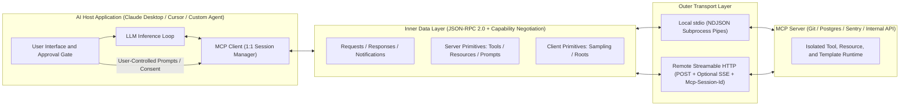
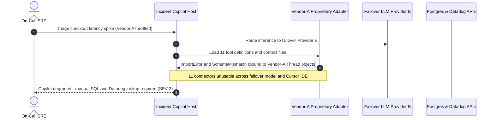

# Module 00: What MCP Is and Why It Exists

> **Prerequisites:** [Track 06, Module 06: Function Calling Basics](../../06-openai-and-the-model-landscape/06-function-calling-basics/README.md), [Track 10, Module 04: Tools — Definition and Schemas](../../10-ai-agents/04-tools-definition-and-schemas/README.md), and [Track 10, Module 06: Tool Execution and Error Handling](../../10-ai-agents/06-tool-execution-and-error-handling/README.md).  
> **Estimated Reading Time:** 32 minutes  
> **Target Audience:** AI Backend Engineers, Platform Tooling Architects, Agent Infrastructure Developers

> [!TIP]
> **The Golden Rule of MCP:** Treat the Model Context Protocol not as "another function-calling wrapper," but as a **transport-agnostic, runtime-negotiated JSON-RPC 2.0 application boundary** modeled on the Language Server Protocol (LSP): decouple **what** external capabilities exist (`Tools`, `Resources`, `Prompts`) and **who governs each primitive** (`Model`, `Application`, `User`) from whichever AI host or model family consumes them—and stick to plain REST/OpenAPI whenever a single internal service only needs static, stateless CRUD endpoints.

---

## Why This Matters

Before late 2024, every AI application reinvented tool connectivity inside its own walled garden. OpenAI shipped bespoke Assistant tools and short-lived ChatGPT Plugins (`ai-plugin.json`); Anthropic documented custom `tool_use` loops; LangChain accumulated hundreds of Python-only `@tool` wrappers; and AI IDEs like Cursor and VS Code built proprietary extension bridges. Every time a team switched LLM providers, upgraded an agent SDK, or exposed an internal Jira/Postgres connector to a second AI workspace, engineers rewrote authentication, parameter serialization, error formatting, and context injection from scratch.

Even worse, plain HTTP/REST APIs and OpenAPI specs failed to cover how real-world AI hosts operate. An OpenAPI spec cannot spawn an isolated local subprocess over standard pipes (`stdio`) to inspect a developer's uncommitted Git diff without opening a localhost TCP port. It cannot push a live notification when a database schema or workspace file changes (`notifications/resources/updated`), declare which workspace directories an AI server is allowed to touch (`Roots`), or ask the host's LLM for a safe, user-approved sub-completion without handing raw LLM API keys to third-party plugins (`Sampling`). **Model Context Protocol (MCP)** solves these exact distributed-systems gaps through a clean, open wire standard.

---

## 1. The "USB-C for AI" Grounded in Distributed-Systems Protocol Design

The popular **"USB-C for AI"** metaphor holds up only when unpacked into real protocol mechanics. USB-C did not succeed by making laptops faster; it succeeded by decoupling **physical framing, power/capability negotiation, and standardized pinouts** so any compliant peripheral works across any compliant host.

In software engineering, MCP directly follows the architectural blueprint of Microsoft's **Language Server Protocol (LSP)**. Before LSP, every code editor (Vim, Emacs, Eclipse, VS Code) wrote custom autocomplete and diagnostics logic for every compiler (Python, Go, Rust, TypeScript). LSP placed a single JSON-RPC 2.0 wire boundary between editors and language servers with an explicit startup capability handshake. MCP applies that exact pattern to **AI Hosts** and **External Context/Tool Servers**:



### The Dual-Layer Architecture

MCP cleanly separates **message semantics** from **byte transport**:

1. **Inner Data Layer (JSON-RPC 2.0 + Lifecycle State):** Defines standard JSON-RPC 2.0 `request` (`id`, `method`, `params`), `response` (`id`, `result` or `error`), and one-way `notification` (`method`, `params`, no `id`) envelopes. In standard sessionful MCP (`2024-11-05` through `2025-11-25`, covered in depth in [Module 07](../07-the-initialization-handshake/README.md)), the connection opens with an `initialize` handshake negotiating `protocolVersion` and capability bitmasks, followed by `notifications/initialized`. *(Note: Recent `2026-07-28` specification profiles also introduced stateless per-request `_meta` capability headers and `server/discover` RPCs for load-balanced cloud deployments where sticky HTTP sessions add operational friction.)*
2. **Outer Transport Layer (`stdio` and `Streamable HTTP`):**
   - **`stdio`:** The Host spawns the MCP server as a local child subprocess and exchanges newline-delimited JSON (`NDJSON`) messages over `stdin`/`stdout`, reserving `stderr` strictly for diagnostic logs. Zero network sockets, zero TLS certificates, and native OS process isolation.
   - **`Streamable HTTP`:** Replaces MCP's deprecated dual-endpoint `HTTP+SSE` (`2024-11-05`) transport with a single `/mcp` endpoint supporting standard HTTP `POST` JSON responses, optional Server-Sent Events (`text/event-stream`) for long-running progress/server pushes, `Mcp-Session-Id` tracking, and OAuth 2.1 Resource Server authorization.

### The Five Stateful Session Primitives & Control Authority

MCP's sharpest architectural contribution is **who controls each primitive**—eliminating the mistake of dumping everything into model-invoked functions:

| Primitive | Direction & RPC Methods | Control Authority | Purpose & Production Example |
| :--- | :--- | :--- | :--- |
| **`Tools`** | Client → Server (`tools/list`, `tools/call`) | **Model-Controlled** (Host gates mutations) | Executable verbs with side effects or dynamic lookups (e.g., `create_jira_ticket`, `run_readonly_sql`). Host translates schemas into LLM `tools[]`. |
| **`Resources`** | Client → Server (`resources/list`, `resources/read`, `resources/subscribe`) | **Application-Controlled** | URI-addressed read-only context (`postgres://prod/schema`, `file:///repo/README.md`, `logs://checkout/errors`). Host decides whether to attach directly, chunk into RAG, or display in UI. |
| **`Prompts`** | Client → Server (`prompts/list`, `prompts/get`) | **User-Controlled** | Parameterized workflow templates surfaced in the Host UI as `/slash` commands (e.g., `/postmortem-review service=payments`). Never triggered autonomously by the LLM. |
| **`Sampling`** | Server → Client (`sampling/createMessage`) | **Server-Initiated / Host-Gated** | Allows an MCP Server to request an LLM completion *through* the Host without ever holding LLM API keys. Host enforces human approval, model choice, and token caps. |
| **`Roots`** | Server → Client (`roots/list`, `notifications/roots/list_changed`) | **Host-Declared Boundary** | Declares authorized workspace URIs (e.g., `file:///Users/eng/checkout-svc`) so local servers reject path traversal outside approved project roots. |

### Quantitative Protocol Mechanics: Handshake Amortization & Schema Token Tax

Engineers evaluating MCP often worry about protocol chatter. Compute the exact wire and context-window numbers first:

1. **Amortized Handshake Overhead:** Suppose a session performs an `initialize` exchange (`~920` bytes total) plus `tools/list` (`~480` bytes per tool across $K$ tools). Over $R$ runtime calls inside a session, per-call wire overhead is:

$$\bar{O}_{\text{handshake}}(K, R) = \frac{920 + 480 \cdot K}{R} \quad \text{bytes/turn}$$

With `K = 15` tools over `R = 20` turns, setup chatter amortizes to `406 bytes/turn`—negligible compared to a single HTTP TLS handshake.

2. **Context Window Schema Tax (The Real Cost Bottleneck):** Unlike wire bytes, **every active MCP tool schema enters the LLM's prompt on every inference turn**. Across $T$ agent turns and $K$ discovered tools averaging $\bar{S}_{\text{tool}}$ tokens per JSON schema (`~180–260` tokens):

$$\text{Tokens}_{\text{catalog}}(K, T) = T \cdot K \cdot \bar{S}_{\text{tool}}$$

Attaching `85` uncurated MCP tools (`220` tokens each) across a `10`-turn workflow consumes $10 \times 85 \times 220 = \mathbf{187{,}000}$ input schema tokens before counting a single line of retrieved data! Use `Resources` for passive context and keep active `Tools` scoped tightly per task.

### When Plain REST/OpenAPI Suffices vs. When MCP Wins

MCP adds an abstraction boundary; **do not use it everywhere**. Reach for plain **REST/OpenAPI** when:
- You maintain **one** internal backend communicating with **one** proprietary frontend/agent (`M = 1`) over predictable, stateless request/response endpoints.
- You never need local workstation `stdio` subprocess execution, dynamic runtime `list_changed` capability updates, `Resources` subscriptions, or server-initiated `Sampling`.

Adopt **MCP** when:
- Multiple AI hosts (`Claude Desktop`, `Cursor`, `VS Code`, custom Slack/CLI agents) need reusable access to shared tools/data sources.
- Servers need **local zero-port execution** (`stdio`) respecting host `Roots` without opening unauthenticated localhost HTTP listeners.
- You need strict separation between **model-callable verbs (`Tools`)**, **app-injected context (`Resources`)**, and **user-triggered templates (`Prompts`)**.

---

## 2. Systematic Comparison Matrix: Proprietary Adapters vs. Plain REST/OpenAPI vs. MCP

| Architectural Dimension | Proprietary Vendor Tool Adapters | Plain REST / OpenAPI 3.1 | Model Context Protocol (MCP) |
| :--- | :--- | :--- | :--- |
| **Wire Standard** | SDK-specific Python/TS classes or vendor JSON | HTTP/1.1 or HTTP/2 + REST + YAML/JSON OpenAPI | JSON-RPC 2.0 over `stdio` or `Streamable HTTP` |
| **Host Portability** | Locked to one vendor SDK or agent framework | Requires custom OpenAPI-to-tool parser per host | Native interoperability across compliant MCP hosts |
| **Local Subprocess Execution** | Custom subprocess wrappers per app | Requires binding localhost HTTP ports (CSRF/firewall risk) | First-class `stdio` pipes with OS process isolation |
| **Runtime Capability Discovery** | Static compile-time registration | Static OpenAPI document fetched out-of-band | Live `initialize` negotiation + `tools/list` + `list_changed` push |
| **Context vs. Action Separation** | Everything collapsed into executable functions | GET endpoints still look like actions to LLM wrappers | Explicit split: `Tools` (model), `Resources` (app), `Prompts` (user) |
| **Server-Initiated LLM Calls** | Impossible without leaking LLM API keys to tools | Impossible natively | Built-in `sampling/createMessage` gated by Host approval |
| **Best Production Fit** | Rapid single-script prototype (`< 2` weeks) | Single-app stateless microservices (`M = 1`) | Multi-host AI tooling, IDEs, enterprise data connectors |

---

## 3. Production War Story Post-Mortem: The Proprietary Adapter Upgrade Collapse

| Field | Incident Details |
| :--- | :--- |
| **Severity** | **SEV-2** (Complete Loss of Internal Incident Triage Copilot Across 3 Engineering Teams) |
| **Detection / Resolution Time** | Detected immediately during provider failover drill / Mitigated in `42` engineering hours across `4` teams (`\$28,500` engineering + SLA delay impact) |
| **Impact** | `11` internal connectors (`PagerDuty`, `Datadog`, `Postgres`, `GitHub`, `Jira`, `Sentry`, etc.) failed simultaneously; emergency model-provider swap blocked for `2` days |

### What Happened

A fintech platform team built an internal **Incident Triage Copilot** using a proprietary vendor Assistants SDK plus `11` custom Python tool wrappers tightly bound to Vendor A's thread/run API objects (`ToolOutput(tool_call_id=...)`, custom annotation decorators, and vendor-specific file-attachment IDs). Two quarters later, a second team built a **Cursor IDE extension** re-implementing `6` of the same connectors in TypeScript.

During a regional rate-limit outage on Vendor A, platform engineers attempted an emergency failover to Vendor B's LLM inference endpoint. Every single tool adapter failed to load because:
1. Tool schemas, retry state, and file attachments depended directly on Vendor A's SDK classes rather than a provider-neutral wire contract.
2. Three connectors read raw local Kubernetes logs via in-process shell wrappers that broke outside Vendor A's runtime loop.
3. Engineers had to rewrite and re-test `11` Python adapters and duplicate schema translations in `42` frantic hours while SREs lost automated triage during live incidents.



### Root Cause Analysis

- **Tight Coupling Between Inference SDK and Tool Runtime:** Tool definitions, auth logic, and execution lived inside vendor-specific SDK wrappers instead of behind a neutral wire protocol.
- **No Separation Between Passive Context and Actions:** Logs and schema context were modeled as fragile vendor file uploads instead of URI-addressed `Resources`.

### Architectural Hardening & Verified Fix

- **Migrated Connectors to Isolated MCP Servers:** Wrapped `Postgres`, `Datadog`, `Sentry`, and `GitHub` behind `stdio` and `Streamable HTTP` MCP servers exposing clean JSON-RPC `Tools` and `Resources`.
- **Decoupled LLM Provider Routing in the Host:** The Host now translates discovered MCP `inputSchema` payloads into *any* LLM provider's `tools[]` contract (OpenAI, Anthropic, Gemini, or self-hosted vLLM) in one `40`-line adapter, allowing instant zero-rewrite failover—and letting Cursor and Claude Desktop reuse the exact same servers untouched.

---

## 4. Multi-Language Production Code: MCP Protocol Negotiator & Control-Authority Router

Below is a production-hardened **MCP Capability Negotiator & Control-Authority Router** implemented across **Go**, **TypeScript**, **Python**, and **C#**. It handles JSON-RPC 2.0 request/notification validation, capability intersection during `initialize`, and strict control-authority enforcement (`Tools` = model, `Resources` = application, `Prompts` = user).

````carousel

```go
package mcpcore

import (
	"encoding/json"
	"errors"
	"fmt"
)

type ControlAuthority string

const (
	ControlModel ControlAuthority = "model"
	ControlApp   ControlAuthority = "application"
	ControlUser  ControlAuthority = "user"
)

type JSONRPCRequest struct {
	JSONRPC string          `json:"jsonrpc"`
	ID      any             `json:"id,omitempty"`
	Method  string          `json:"method"`
	Params  json.RawMessage `json:"params,omitempty"`
}

type Capabilities struct {
	Tools     bool `json:"tools"`
	Resources bool `json:"resources"`
	Prompts   bool `json:"prompts"`
	Sampling  bool `json:"sampling"`
	Roots     bool `json:"roots"`
}

type NegotiatedSession struct {
	ProtocolVersion string
	Initialized     bool
	ActiveCaps      Capabilities
}

// NegotiateCapabilities intersects client and server capabilities during initialize.
func NegotiateCapabilities(clientVersion string, clientCaps, serverCaps Capabilities) (*NegotiatedSession, error) {
	if clientVersion == "" {
		return nil, errors.New("missing protocolVersion in initialize params")
	}
	return &NegotiatedSession{
		ProtocolVersion: clientVersion,
		Initialized:     true,
		ActiveCaps: Capabilities{
			Tools:     serverCaps.Tools,
			Resources: serverCaps.Resources,
			Prompts:   serverCaps.Prompts,
			Sampling:  clientCaps.Sampling,
			Roots:     clientCaps.Roots,
		},
	}, nil
}

// AuthorizePrimitive enforces MCP control-authority boundaries before dispatch.
func (s *NegotiatedSession) AuthorizePrimitive(req JSONRPCRequest, caller ControlAuthority) error {
	if req.JSONRPC != "2.0" {
		return fmt.Errorf("invalid jsonrpc version: %q", req.JSONRPC)
	}
	if !s.Initialized {
		return errors.New("session not initialized")
	}
	switch req.Method {
	case "tools/call":
		if !s.ActiveCaps.Tools {
			return errors.New("server capability tools not negotiated")
		}
		if caller != ControlModel {
			return fmt.Errorf("tools/call requires model-initiated authority, got %s", caller)
		}
	case "resources/read":
		if !s.ActiveCaps.Resources {
			return errors.New("server capability resources not negotiated")
		}
		if caller != ControlApp {
			return fmt.Errorf("resources/read requires application authority, got %s", caller)
		}
	case "prompts/get":
		if !s.ActiveCaps.Prompts {
			return errors.New("server capability prompts not negotiated")
		}
		if caller != ControlUser {
			return fmt.Errorf("prompts/get requires user authority, got %s", caller)
		}
	default:
		return fmt.Errorf("unsupported MCP method: %s", req.Method)
	}
	return nil
}
```

<!-- slide -->

```typescript
export type ControlAuthority = "model" | "application" | "user";

export interface McpCapabilities {
  readonly tools: boolean;
  readonly resources: boolean;
  readonly prompts: boolean;
  readonly sampling: boolean;
  readonly roots: boolean;
}

export interface JsonRpcRequest {
  readonly jsonrpc: "2.0";
  readonly id?: string | number;
  readonly method: string;
  readonly params?: Record<string, unknown>;
}

export class McpProtocolRouter {
  private initialized = false;
  private negotiatedVersion = "";
  private activeCaps: McpCapabilities = {
    tools: false,
    resources: false,
    prompts: false,
    sampling: false,
    roots: false,
  };

  public negotiate(
    protocolVersion: string,
    clientCaps: Pick<McpCapabilities, "sampling" | "roots">,
    serverCaps: Pick<McpCapabilities, "tools" | "resources" | "prompts">,
  ): McpCapabilities {
    if (!protocolVersion.trim()) {
      throw new Error("initialize rejected: protocolVersion is required");
    }
    this.negotiatedVersion = protocolVersion;
    this.activeCaps = {
      tools: serverCaps.tools,
      resources: serverCaps.resources,
      prompts: serverCaps.prompts,
      sampling: clientCaps.sampling,
      roots: clientCaps.roots,
    };
    this.initialized = true;
    return this.activeCaps;
  }

  public validateDispatch(req: JsonRpcRequest, caller: ControlAuthority): string {
    if (req.jsonrpc !== "2.0") {
      throw new Error("Invalid JSON-RPC version; expected '2.0'");
    }
    if (!this.initialized) {
      throw new Error("Protocol violation: method invoked before initialize handshake");
    }

    const expectedControl: Record<string, { cap: keyof McpCapabilities; auth: ControlAuthority }> = {
      "tools/call": { cap: "tools", auth: "model" },
      "resources/read": { cap: "resources", auth: "application" },
      "prompts/get": { cap: "prompts", auth: "user" },
    };

    const rule = expectedControl[req.method];
    if (!rule) {
      throw new Error(`Method not found: ${req.method}`);
    }
    if (!this.activeCaps[rule.cap]) {
      throw new Error(`Capability '${rule.cap}' was not negotiated in ${this.negotiatedVersion}`);
    }
    if (caller !== rule.auth) {
      throw new Error(`Authority mismatch: ${req.method} is ${rule.auth}-controlled, not ${caller}`);
    }
    return `DISPATCH_OK[${this.negotiatedVersion}]: ${req.method}`;
  }
}
```

<!-- slide -->

```python
"""
mcp_negotiator.py
Validates JSON-RPC 2.0 envelopes, negotiates MCP capabilities, and enforces primitive control boundaries.
"""
from dataclasses import dataclass
from typing import Any, Literal

ControlAuthority = Literal["model", "application", "user"]


@dataclass(frozen=True)
class NegotiatedCapabilities:
    protocol_version: str
    tools: bool
    resources: bool
    prompts: bool
    sampling: bool
    roots: bool


class McpSessionGate:
    def __init__(self) -> None:
        self._caps: NegotiatedCapabilities | None = None

    def initialize(
        self,
        protocol_version: str,
        client_caps: dict[str, Any],
        server_caps: dict[str, Any],
    ) -> NegotiatedCapabilities:
        if not protocol_version:
            raise ValueError("protocolVersion must be non-empty during initialize")
        self._caps = NegotiatedCapabilities(
            protocol_version=protocol_version,
            tools="tools" in server_caps,
            resources="resources" in server_caps,
            prompts="prompts" in server_caps,
            sampling="sampling" in client_caps,
            roots="roots" in client_caps,
        )
        return self._caps

    def authorize_request(self, envelope: dict[str, Any], authority: ControlAuthority) -> dict[str, Any]:
        if envelope.get("jsonrpc") != "2.0" or "method" not in envelope:
            return {"code": -32600, "message": "Invalid JSON-RPC 2.0 Request"}
        if self._caps is None:
            return {"code": -32002, "message": "Session not initialized"}

        method = envelope["method"]
        rules: dict[str, tuple[bool, ControlAuthority]] = {
            "tools/call": (self._caps.tools, "model"),
            "resources/read": (self._caps.resources, "application"),
            "prompts/get": (self._caps.prompts, "user"),
        }
        if method not in rules:
            return {"code": -32601, "message": f"Unsupported method: {method}"}

        enabled, required_authority = rules[method]
        if not enabled:
            return {"code": -32001, "message": f"Capability disabled for {method}"}
        if authority != required_authority:
            return {
                "code": -32003,
                "message": f"{method} is {required_authority}-controlled; rejected {authority} call",
            }
        return {"ok": True, "method": method, "protocol": self._caps.protocol_version}
```

<!-- slide -->

```csharp
using System;
using System.Collections.Generic;

namespace GenAI.McpCore;

public enum ControlAuthority
{
    Model,
    Application,
    User
}

public sealed record Capabilities(
    bool Tools,
    bool Resources,
    bool Prompts,
    bool Sampling,
    bool Roots);

public sealed record JsonRpcEnvelope(
    string JsonRpc,
    string Method,
    long? Id = null);

public sealed class McpSessionBoundary
{
    private Capabilities? _negotiated;
    private string _protocolVersion = string.Empty;

    public Capabilities Initialize(string protocolVersion, Capabilities clientCaps, Capabilities serverCaps)
    {
        if (string.IsNullOrWhiteSpace(protocolVersion))
            throw new ArgumentException("protocolVersion is required during initialize.");

        _protocolVersion = protocolVersion;
        _negotiated = new Capabilities(
            Tools: serverCaps.Tools,
            Resources: serverCaps.Resources,
            Prompts: serverCaps.Prompts,
            Sampling: clientCaps.Sampling,
            Roots: clientCaps.Roots);
        return _negotiated;
    }

    public string AuthorizeCall(JsonRpcEnvelope envelope, ControlAuthority caller)
    {
        if (!string.Equals(envelope.JsonRpc, "2.0", StringComparison.Ordinal))
            throw new InvalidOperationException("JSON-RPC version must be 2.0.");
        if (_negotiated is null)
            throw new InvalidOperationException("Cannot invoke methods prior to initialize handshake.");

        var rules = new Dictionary<string, (bool Enabled, ControlAuthority Required)>
        {
            ["tools/call"] = (_negotiated.Tools, ControlAuthority.Model),
            ["resources/read"] = (_negotiated.Resources, ControlAuthority.Application),
            ["prompts/get"] = (_negotiated.Prompts, ControlAuthority.User),
        };

        if (!rules.TryGetValue(envelope.Method, out var rule))
            throw new KeyNotFoundException($"Method not found: {envelope.Method}");
        if (!rule.Enabled)
            throw new InvalidOperationException($"Capability not negotiated for {envelope.Method}");
        if (caller != rule.Required)
            throw new UnauthorizedAccessException(
                $"{envelope.Method} requires {rule.Required} authority, received {caller}");

        return $"AUTHORIZED[{_protocolVersion}] -> {envelope.Method}";
    }
}
```

````

---

## 5. Practical Hands-On Verification CLI Workflows

Run these deterministic Python 3.13 verification scripts locally offline—no API keys or external packages required.

### Workflow 1: Simulate an End-to-End JSON-RPC 2.0 `stdio` Handshake & Primitive Dispatch

Inspect exact newline-delimited JSON (`NDJSON`) request, notification, and response frames across `initialize`, `notifications/initialized`, `tools/list`, `resources/read`, and `prompts/get`:

```bash
python -c '
import json

server_caps = {"tools": {"listChanged": True}, "resources": {"subscribe": True}, "prompts": {"listChanged": False}}
client_caps = {"roots": {"listChanged": True}, "sampling": {}}

def handle_rpc(msg):
    method = msg["method"]
    rid = msg.get("id")
    if method == "initialize":
        negotiated = sorted(set(server_caps) | set(client_caps))
        return {"jsonrpc": "2.0", "id": rid, "result": {"protocolVersion": msg["params"]["protocolVersion"], "capabilities": server_caps, "negotiatedNamespaces": negotiated}}
    if method == "notifications/initialized":
        return None
    if method == "tools/list":
        return {"jsonrpc": "2.0", "id": rid, "result": {"tools": [{"name": "query_metrics", "control": "model"}]}}
    if method == "resources/read":
        uri = msg["params"]["uri"]
        return {"jsonrpc": "2.0", "id": rid, "result": {"contents": [{"uri": uri, "mimeType": "text/plain", "text": "p99_latency_ms=42.8 error_rate=0.002"}]}}
    if method == "prompts/get":
        return {"jsonrpc": "2.0", "id": rid, "result": {"messages": [{"role": "user", "content": "Analyze p99 spikes from attached resource"}]}}
    return {"jsonrpc": "2.0", "id": rid, "error": {"code": -32601, "message": "Method not found"}}

wire_requests = [
    {"jsonrpc": "2.0", "id": 1, "method": "initialize", "params": {"protocolVersion": "2025-11-25", "capabilities": client_caps}},
    {"jsonrpc": "2.0", "method": "notifications/initialized"},
    {"jsonrpc": "2.0", "id": 2, "method": "tools/list"},
    {"jsonrpc": "2.0", "id": 3, "method": "resources/read", "params": {"uri": "metrics://prod/checkout"}},
    {"jsonrpc": "2.0", "id": 4, "method": "prompts/get", "params": {"name": "triage_spike"}},
]

for req in wire_requests:
    ndjson_in = json.dumps(req, separators=(",", ":"))
    resp = handle_rpc(req)
    print(f"-> C2S ({len(ndjson_in)} B): {ndjson_in}")
    if resp is not None:
        ndjson_out = json.dumps(resp, separators=(",", ":"))
        print(f"<- S2C ({len(ndjson_out)} B): {ndjson_out}")
    else:
        print("<- (notification: no response frame)")
'
```

**Expected Output:**

```text
-> C2S (148 B): {"jsonrpc":"2.0","id":1,"method":"initialize","params":{"protocolVersion":"2025-11-25","capabilities":{"roots":{"listChanged":true},"sampling":{}}}}
<- S2C (249 B): {"jsonrpc":"2.0","id":1,"result":{"protocolVersion":"2025-11-25","capabilities":{"tools":{"listChanged":true},"resources":{"subscribe":true},"prompts":{"listChanged":false}},"negotiatedNamespaces":["prompts","resources","roots","sampling","tools"]}}
-> C2S (54 B): {"jsonrpc":"2.0","method":"notifications/initialized"}
<- (notification: no response frame)
-> C2S (46 B): {"jsonrpc":"2.0","id":2,"method":"tools/list"}
<- S2C (88 B): {"jsonrpc":"2.0","id":2,"result":{"tools":[{"name":"query_metrics","control":"model"}]}}
-> C2S (93 B): {"jsonrpc":"2.0","id":3,"method":"resources/read","params":{"uri":"metrics://prod/checkout"}}
<- S2C (152 B): {"jsonrpc":"2.0","id":3,"result":{"contents":[{"uri":"metrics://prod/checkout","mimeType":"text/plain","text":"p99_latency_ms=42.8 error_rate=0.002"}]}}
-> C2S (80 B): {"jsonrpc":"2.0","id":4,"method":"prompts/get","params":{"name":"triage_spike"}}
<- S2C (118 B): {"jsonrpc":"2.0","id":4,"result":{"messages":[{"role":"user","content":"Analyze p99 spikes from attached resource"}]}}
```

### Workflow 2: Quantify Handshake Amortization vs. LLM Tool Catalog Token Tax

Measure why protocol handshake bytes are negligible while uncurated tool schemas quickly dominate LLM token consumption:

```bash
python -c '
def catalog_profile(num_tools, avg_schema_tokens=220, turns=10, init_bytes=920, list_bytes_per_tool=480):
    handshake_bytes = init_bytes + num_tools * list_bytes_per_tool
    amortized_per_turn = handshake_bytes / turns
    per_turn_prompt_tokens = num_tools * avg_schema_tokens
    total_schema_tokens = per_turn_prompt_tokens * turns
    print(f"tools={num_tools:<3} | handshake={handshake_bytes:>6,} B | amort_wire/turn={amortized_per_turn:>7.1f} B | schema_tok/turn={per_turn_prompt_tokens:>6,} | {turns}-turn_total={total_schema_tokens:>7,} tok")

for k in [5, 15, 40, 85]:
    catalog_profile(k)
'
```

**Expected Output:**

```text
tools=5   | handshake= 3,320 B | amort_wire/turn=  332.0 B | schema_tok/turn= 1,100 | 10-turn_total= 11,000 tok
tools=15  | handshake= 8,120 B | amort_wire/turn=  812.0 B | schema_tok/turn= 3,300 | 10-turn_total= 33,000 tok
tools=40  | handshake=20,120 B | amort_wire/turn= 2012.0 B | schema_tok/turn= 8,800 | 10-turn_total= 88,000 tok
tools=85  | handshake=41,720 B | amort_wire/turn= 4172.0 B | schema_tok/turn=18,700 | 10-turn_total=187,000 tok
```

### Workflow 3: Architectural Decision Gate — Plain REST/OpenAPI vs. MCP

Evaluate five realistic backend integration workloads against concrete architectural requirements:

```bash
python -c '
workloads = [
    {"name": "Local Git Repo Assistant", "multi_host": True, "local_stdio": True, "dynamic_push": True, "sampling_needed": False},
    {"name": "Single-App Stripe Webhook", "multi_host": False, "local_stdio": False, "dynamic_push": False, "sampling_needed": False},
    {"name": "Multi-IDE DB Schema + Query", "multi_host": True, "local_stdio": True, "dynamic_push": True, "sampling_needed": False},
    {"name": "Static Currency Converter API", "multi_host": False, "local_stdio": False, "dynamic_push": False, "sampling_needed": False},
    {"name": "Log Triage Agentic Reviewer", "multi_host": True, "local_stdio": False, "dynamic_push": True, "sampling_needed": True},
]

for w in workloads:
    name = w["name"]
    score = (
        2 * int(w["multi_host"])
        + 2 * int(w["local_stdio"])
        + 1 * int(w["dynamic_push"])
        + 2 * int(w["sampling_needed"])
    )
    verdict = "USE_MCP" if score >= 3 else "PLAIN_REST_OR_OPENAPI"
    print(f"{name:<30} | score={score}/7 -> {verdict}")
'
```

**Expected Output:**

```text
Local Git Repo Assistant       | score=5/7 -> USE_MCP
Single-App Stripe Webhook      | score=0/7 -> PLAIN_REST_OR_OPENAPI
Multi-IDE DB Schema + Query    | score=5/7 -> USE_MCP
Static Currency Converter API  | score=0/7 -> PLAIN_REST_OR_OPENAPI
Log Triage Agentic Reviewer    | score=5/7 -> USE_MCP
```

### Hands-On Exercises

1. **Add `sampling/createMessage` Handling:** Extend Workflow 1's `handle_rpc` function to simulate a server-to-client `sampling/createMessage` request carrying `maxTokens: 250` and a Host guard that rejects requests exceeding `maxTokens: 200`.
2. **Convert Static Read Tools to Resources:** In Workflow 2, suppose `30` of the `85` tools are read-only document/schema getters (`get_table_ddl`, `get_runbook`, `read_config`). Re-compute the `10`-turn schema token savings when you move those `30` getters to URI-addressed MCP `Resources` (`resources/read`) attached on demand instead of model-callable `Tools`.
3. **Optional Live SDK Inspection (Requires Local MCP Server Package):** Install the official `mcp` Python SDK in an isolated virtual environment and run `mcp dev` or the official MCP Inspector against a minimal sample server to watch live `initialize` and `tools/list` JSON-RPC frames in your terminal.

### Independent Challenge

A platform team maintains a legacy internal REST microservice (`invoice-service`, OpenAPI 3.1) consumed solely by one internal Python FastAPI chatbot (`M = 1`) running inside the same Kubernetes VPC. Another engineer proposes wrapping `invoice-service` in an MCP server solely because *"MCP is the modern AI standard."* Meanwhile, a separate developer-productivity team wants to share a local codebase dependency analyzer + internal SQL explorer across `Claude Desktop`, `Cursor`, `VS Code`, and a CLI CI bot (`M = 4`). Decide for **both** teams whether to choose plain REST/OpenAPI or MCP, and justify your verdict using transport, capability negotiation, and schema token overhead mechanics.

<details><summary>Architectural Discussion</summary>

For `invoice-service` (`M = 1`, same Kubernetes VPC, stateless CRUD, single backend consumer), **plain REST/OpenAPI suffices**—wrapping it in MCP introduces extra JSON-RPC framing, session setup, and maintenance overhead with zero cross-host reuse benefit. For the developer-productivity tooling (`M = 4` polyglot hosts including desktop IDEs and CLI runners), **MCP is strictly superior**: local `stdio` lets desktop IDEs run the codebase analyzer inside user-approved `Roots` without binding localhost TCP ports, while `Resources` (`schema://...`) and `Tools` expose the SQL explorer once across all four hosts without rewriting vendor adapters.

</details>

---

## 6. Common Mistakes & Troubleshooting

- **Wrapping every existing REST endpoint 1:1 into an MCP Tool:** Turning `60` fine-grained REST CRUD paths into `60` MCP tools injects `13,000+` schema tokens per turn into the LLM context. Group static data into `Resources` (`application`-controlled) and expose coarse, intent-aligned `Tools`.
- **Confusing `Tools` and `Prompts`:** Modeling a repeatable workflow template (`"run a security audit using OWASP checklist"`) as an LLM-invoked `Tool` strips user control and wastes tool-selection inference steps. Expose workflow templates as user-controlled `Prompts`.
- **Writing debug logs to `stdout` on a `stdio` server:** Under MCP `stdio` transport, `stdout` is strictly reserved for valid JSON-RPC 2.0 NDJSON frames. A single `print("debug")` statement corrupts the Host's JSON parser and tears down the session—always log exclusively to `stderr`.
- **Assuming MCP handles LLM credentials inside the Server:** Servers should never require `OPENAI_API_KEY` or `ANTHROPIC_API_KEY` to summarize text; use `sampling/createMessage` so the Host mediates model choice, token limits, and user approval.

---

## 7. Operational Validation Checkpoints & Checkpoint Quiz

### Operational Validation Checkpoints

<details><summary><strong>Checkpoint 1: Diagnosing why a stdio MCP server crashes immediately on handshake</strong></summary>

A developer runs a newly built Python MCP `stdio` server inside Claude Desktop, and the Host immediately disconnects with `JSON Parse Error: Unexpected token 'S' in JSON at position 0`. What caused this failure, and how do you fix it?

**Validation:** Something inside the server (a startup banner, logging library default handler, or `print("Starting MCP server...")`) wrote non-JSON text to `stdout`. Because `stdio` transport multiplexes newline-delimited JSON-RPC 2.0 messages directly over `stdout`, any stray text corrupts protocol framing. Redirect all application logs and third-party logger stream handlers strictly to `sys.stderr`.

</details>

<details><summary><strong>Checkpoint 2: Choosing the right primitive for read-only database schemas vs. mutations</strong></summary>

You are exposing PostgreSQL table DDL schemas, a SQL `SELECT` runner, and a reusable weekly incident-review template through an MCP server. Assign each capability to the exact MCP primitive and explain who controls invocation.

**Validation:** Table DDL schemas belong in **Resources** (`resources/read`, **application-controlled**—the Host attaches schema URIs deterministically without burning tool-call turns). The SQL `SELECT` runner belongs in **Tools** (`tools/call`, **model-controlled**—the LLM dynamically formulates parameterized queries). The weekly incident-review workflow belongs in **Prompts** (`prompts/get`, **user-controlled**—explicitly selected by the human via UI/slash command).

</details>

<details><summary><strong>Checkpoint 3: Preventing server API key sprawl during LLM-assisted tool workflows</strong></summary>

An MCP server parses large build logs and needs an LLM to classify root causes before returning results. A junior engineer proposes adding `ANTHROPIC_API_KEY` to the MCP server's environment variables. Why does MCP architecture forbid or discourage this pattern, and what primitive replaces it?

**Validation:** Embedding LLM keys inside an external MCP server violates Host governance: the Host loses visibility into token spend, model selection, data egress, and user consent. Instead, the server invokes **`sampling/createMessage`** back to its paired Client, allowing the Host to enforce approval prompts, cap `maxTokens`, and bill the user's configured model centrally.

</details>

### Checkpoint Quiz

1. What two layers compose the Model Context Protocol, and what are the two primary standard transports?
2. List the three server-exposed MCP primitives and identify **who controls** each (`Model`, `Application`, or `User`).
3. How do **`Sampling`** and **`Roots`** work in the opposite direction (`Server -> Client`) compared to `Tools` (`Client -> Server`)?
4. Why does `stdout` pollution break `stdio` MCP servers while `stderr` remains safe?
5. When should a backend team skip MCP and keep a plain REST/OpenAPI microservice?

<details><summary>Answers</summary>

1. The **Inner Data Layer** (JSON-RPC 2.0 messages, capability negotiation, primitives) and the **Outer Transport Layer** (`stdio` over subprocess stdin/stdout pipes and `Streamable HTTP` with optional SSE and `Mcp-Session-Id`).
2. **`Tools`** (model-controlled), **`Resources`** (application-controlled), and **`Prompts`** (user-controlled).
3. In `Sampling` (`sampling/createMessage`), a Server requests an LLM completion from the Host via its Client without holding LLM credentials. In `Roots` (`roots/list`), the Server queries the Host/Client to discover which filesystem or URI boundaries it is permitted to inspect.
4. `stdio` uses `stdout` exclusively for newline-delimited JSON-RPC 2.0 protocol frames; arbitrary debug strings invalidate JSON parsing and terminate the session, whereas `stderr` is designated for diagnostic logs.
5. When a single internal app (`M = 1`) consumes static, stateless backend endpoints over an internal network with no need for cross-host portability, local zero-port `stdio` execution, dynamic capability push, or `Sampling`/`Roots` primitives.

</details>

---

## Further Reading & Sources

- [Model Context Protocol — Architecture Overview](https://modelcontextprotocol.io/docs/concepts/architecture) — official breakdown of the Data Layer, Transport Layer, and Host/Client/Server roles.
- [Model Context Protocol — Official Specification](https://modelcontextprotocol.io/specification) — canonical wire definitions for JSON-RPC framing, lifecycle revisions, `Tools`, `Resources`, `Prompts`, `Sampling`, and `Roots`.
- [Model Context Protocol — Getting Started](https://modelcontextprotocol.io/docs/get-started/intro) — official orientation and SDK setup workflows.
- [Language Server Protocol (LSP) Specification](https://microsoft.github.io/language-server-protocol/) — the foundational JSON-RPC IDE protocol pattern that inspired MCP.
- [Track 10, Module 04: Tools — Definition and Schemas](../../10-ai-agents/04-tools-definition-and-schemas/README.md) — Agent-Computer Interface (ACI) and schema token economics inside LLM prompts.

## Next

[Module 01: The M×N Integration Problem](../01-the-mxn-integration-problem/README.md)
