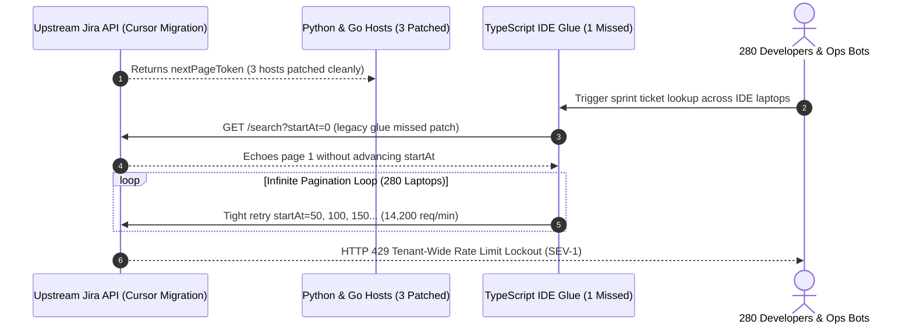

# Module 01: The M×N Integration Problem

> **Prerequisites:** [Module 00: What MCP Is and Why It Exists](../00-what-mcp-is-and-why-it-exists/README.md) and [Track 06, Module 17: Provider Abstraction and Model Routing](../../06-openai-and-the-model-landscape/17-provider-abstraction-and-model-routing/README.md).  
> **Estimated Reading Time:** 30 minutes  
> **Target Audience:** Platform Architects, AI Infrastructure Engineers, Engineering Managers

> [!TIP]
> **The Golden Rule of Integration Complexity:** Connecting $M$ AI host applications directly to $N$ external tools or data sources via bespoke adapters scales multiplicatively as $M \times N$—guaranteeing that every upstream API bump breaks $M$ separate codebases simultaneously. The moment an ecosystem crosses $M \ge 2$ hosts and $N \ge 3$ integrations (or vice versa), inserting a standardized wire boundary collapses both implementation surface and schema-drift blast radius to $M + N$.

---

## Why This Matters

In early AI demos, an engineering team connects **one** custom agent (`M = 1`) to **two** tools (`N = 2`): a GitHub wrapper and a PostgreSQL query helper. Writing two bespoke Python functions takes an afternoon, so building an integration protocol feels like premature abstraction.

Six months later, that same company runs **five** AI hosts (`Claude Desktop`, `Cursor`, `VS Code Copilot`, an internal Slack Ops Bot, and a web compliance assistant: $M = 5$) across **ten** external systems (`GitHub`, `Jira`, `Postgres`, `Slack`, `Sentry`, `PagerDuty`, `Linear`, `Confluence`, `Datadog`, and `Snowflake`: $N = 10$). Without a shared boundary, the organization must build and continuously patch $5 \times 10 = \mathbf{50}$ bespoke connectors across Python, TypeScript, and Go—each duplicating OAuth token refresh, pagination cursors, `429` backoff, error formatting, and schema validation. Worse, every upstream API deprecation triggers an emergency multi-repo patch storm across all `5` hosts.

---

## 1. Combinatorial Scaling: From $M \times N$ Glue to $M + N$ Protocol Architecture

Inserting a universal wire boundary (JSON-RPC 2.0 over `stdio` / `Streamable HTTP`) transforms an entangled bipartite graph into a star topology around one canonical specification:

```mermaid
flowchart LR
    subgraph Before["Bespoke M x N Glue (3 Hosts x 4 Sources = 12 Entangled Connectors)"]
        H1["Host 1 (Cursor TS)"] -->|"Custom Adapter 1-A"| S1["GitHub API"]
        H1 -->|"Custom Adapter 1-B"| S2["Jira REST"]
        H2["Host 2 (Slack Bot Py)"] -->|"Custom Adapter 2-A"| S1
        H2 -->|"Custom Adapter 2-C"| S3["Postgres"]
        H3["Host 3 (Web Agent Go)"] -->|"Custom Adapter 3-B"| S2
        H3 -->|"Custom Adapter 3-D"| S4["Sentry"]
        H1 -.->|"6 more bespoke edges"| S4
    end

    subgraph After["Standardized M + N MCP Boundary (3 Clients + 4 Servers = 7 Implementations)"]
        MH1["Host 1 + MCP Client"] <-->|"MCP Wire Spec"| Bus(("JSON-RPC 2.0 Standard"))
        MH2["Host 2 + MCP Client"] <-->|"MCP Wire Spec"| Bus
        MH3["Host 3 + MCP Client"] <-->|"MCP Wire Spec"| Bus
        Bus <-->|"1 Shared Contract"| MS1["GitHub MCP Server"]
        Bus <-->|"1 Shared Contract"| MS2["Jira MCP Server"]
        Bus <-->|"1 Shared Contract"| MS3["Postgres MCP Server"]
        Bus <-->|"1 Shared Contract"| MS4["Sentry MCP Server"]
    end
```



### Quantitative Scaling & Break-Even Economics

Let $M \ge 1$ be the number of AI hosts (clients/runtimes) and $N \ge 1$ be the number of external tools or data systems.

1. **Connector Surface Count:**

$$C_{\text{bespoke}}(M, N) = M \cdot N \qquad \text{vs.} \qquad C_{\text{MCP}}(M, N) = M + N$$

2. **Exact Combinatorial Break-Even Condition:** Standardizing strictly reduces connector count whenever:

$$M \cdot N > M + N \quad \Longleftrightarrow \quad (M - 1)(N - 1) > 1$$

- At $M = 1$ (a single bespoke agent), $1 \cdot N = N < 1 + N$: bespoke integration actually builds **one fewer** component (`0` protocol overhead).
- At $M = 2, N = 2$, both architectures require `4` components (`2 × 2 = 2 + 2 = 4`).
- For **every ecosystem with $M \ge 2, N \ge 3$ or $M \ge 3, N \ge 2$**, $M + N$ strictly wins—and at $M = 8, N = 20$, integration count drops from `160` connectors to `28` (`5.7x` reduction).

3. **Annual Engineering Total Cost of Ownership (TCO):** Real production connectors are not "write once." Each upstream API ships an average of $u$ breaking schema/auth changes per year requiring $h_{\text{patch}}$ engineering hours on top of $h_{\text{glue}}$ annual upkeep (or $h_{\text{client}}$ / $h_{\text{server}}$ for MCP components) at loaded hourly engineering rate $r_{\text{eng}}$:

$$\text{TCO}_{\text{bespoke}}(M, N) = M \cdot N \cdot \big(h_{\text{glue}} + u \cdot h_{\text{patch}}\big) \cdot r_{\text{eng}}$$

$$\text{TCO}_{\text{MCP}}(M, N) = \Big(M \cdot h_{\text{client}} + N \cdot \big(h_{\text{server}} + u \cdot h_{\text{patch}}\big)\Big) \cdot r_{\text{eng}}$$

Notice where the $u \cdot h_{\text{patch}}$ drift term sits: in bespoke $M \times N$, upstream API churn is multiplied by $M \cdot N$; in MCP, $u \cdot h_{\text{patch}}$ scales **only with $N$**, completely independent of how many AI hosts consume that server!

### Four Hidden Multipliers Behind $M \times N$ Failure

Connector count understates the real operational pain because four secondary failure surfaces also scale multiplicatively:

1. **Polyglot SDK Drift:** IDEs (`Cursor`, `VS Code`) run TypeScript/Node; agent backends run Python or Go; enterprise connectors run C# or Java. Fixing a single Jira OAuth PKCE refresh race condition requires translating and verifying the fix across `3–4` different languages.
2. **Schema & Prompt Drift Across Hosts:** Each host formats tool errors, pagination hints, and JSON descriptions slightly differently. A prompt workaround tuned in Host A fails silently in Host B until an engineer duplicates the wrapper.
3. **Auth & Secret Multiplication:** Under $M \times N$, every host stores raw API tokens (`GITHUB_TOKEN`, `POSTGRES_DSN`, `PAGERDUTY_KEY`) across $M$ deployment environments, multiplying credential rotation and audit surface by $M$.
4. **Incident Blast Radius per API Change:** Deprecating one endpoint field forces $O(M)$ coordinated PR reviews, CI pipelines, and rollout windows instead of $O(1)$ update on a single MCP server.

---

## 2. Systematic Comparison Matrix: $M \times N$ Glue vs. Shared Monorepo Library vs. $M + N$ Wire Protocol

| Architectural Criterion | Bespoke $M \times N$ Per-Host Glue | Shared Internal Monorepo SDK | Standardized $M + N$ Wire Protocol (MCP) |
| :--- | :--- | :--- | :--- |
| **Total Implementations** | $M \times N$ independent adapters | $N$ wrappers + $M$ language bindings if polyglot | $M$ host clients + $N$ servers (`M + N`) |
| **Polyglot Host Support** | Manual rewrite per language | Breaks immediately across TS IDEs + Python/Go services | Language-agnostic JSON-RPC 2.0 wire boundary |
| **Blast Radius per API Change** | $O(M)$ PRs across all hosts | $O(1)$ code edit, but requires $M$ host package bumps | $O(1)$ server deploy (`list_changed` notifies hosts live) |
| **Third-Party Desktop/IDE Reuse** | Zero (cannot plug into Claude Desktop or Cursor) | Zero (closed apps cannot import your private SDK) | Immediate reuse across any MCP-compatible host |
| **Secret & Fault Isolation** | Secrets shared inside every host process | Secrets shared inside host process memory | Isolated per server subprocess or remote OAuth service |
| **Marginal Cost of Host #6** | Write $N$ new connectors (`O(N)`) | Re-bind library + deploy (`O(N)` if new runtime) | Implement/enable `1` MCP Client (`O(1)`) |

---

## 3. Production War Story Post-Mortem: The Jira Pagination Deprecation & Rate-Limit Storm

| Field | Incident Details |
| :--- | :--- |
| **Severity** | **SEV-1** (Company-Wide Jira API Lockout & Broken Sprint/Incident Automation) |
| **Detection / Resolution Time** | Detected in `19` minutes via Atlassian `429` lockout alert / Mitigated in `6.5` hours (`\$64,000` engineering + productivity impact) |
| **Impact** | `14,200` duplicate API requests/minute triggered tenant-wide rate limiting across `4` internal AI hosts; `1` unpatched TypeScript IDE connector caused an infinite cursor loop |

### What Happened

An engineering organization maintained `4` internal AI hosts (`Slack Incident Bot`, `Python Release Agent`, `Go Compliance Auditor`, and a `TypeScript IDE Helper`) connected directly to `6` SaaS tools (`24` bespoke glue adapters). When Jira deprecated offset-based `startAt` pagination on its v2 issue-search endpoint in favor of `nextPageToken` cursors, platform engineers scrambled to patch all `4` Jira adapters:

1. Teams updated the Python, Go, and Slack adapters before the deprecation cutoff date.
2. Nobody noticed that the TypeScript IDE extension still pinned a legacy `jira-search-glue.ts` module parsing `total` and incrementing `startAt += 50`.
3. When Jira began returning empty `startAt` echoes alongside `nextPageToken`, the TypeScript extension entered a tight `while (results.length < 500)` retry loop across `280` developer laptops simultaneously, hammering Atlassian at `14,200` requests/min and locking out every automated CI and incident ticket bot across the company.



### Root Cause Analysis

- **Multiplicative Drift Surface ($O(M)$ Patch Fan-Out):** Fixing one upstream API breaking change required hunting down `4` separate implementations across `3` programming languages.
- **No Shared Circuit Breaker or Wire Contract:** Each bespoke adapter owned its own pagination loop and retry budget, making organization-wide rate governance impossible.

### Architectural Hardening & Verified Fix

- **Consolidated onto `1` Canonical Jira MCP Server:** Replaced all `4` language-specific Jira wrappers with a single `Streamable HTTP` Jira MCP server encapsulating cursor pagination, OAuth token refresh, and shared token-bucket rate limiting.
- **Zero-Host Rollout on Future Upstream Changes:** When Atlassian later updated webhook/field schemas, `1` PR against the Jira MCP server updated all `4` hosts simultaneously (`4x` lower blast radius, zero missed client codebases).

---

## 4. Multi-Language Production Code: $M \times N$ vs. $M + N$ TCO Analyzer & Contract Registry

Below is an **$M \times N$ Complexity Analyzer & Polyglot Capability Contract Registry** across **Go**, **TypeScript**, **Python**, and **C#**. It quantifies connector counts, break-even economics, upstream drift blast radius, and verifies that one canonical server contract satisfies multiple heterogeneous hosts without bespoke duplication.

````carousel

```go
package integrationmath

import "fmt"

type IntegrationProfile struct {
	Hosts              int
	Sources            int
	GlueHoursPerEdge   float64
	ClientHoursPerHost float64
	ServerHoursPerSrc  float64
	BreakingChangesYr  float64
	PatchHoursPerBreak float64
	EngineerRateUSD    float64
}

type IntegrationReport struct {
	BespokeConnectors int
	McpConnectors     int
	BespokeAnnualUSD  float64
	McpAnnualUSD      float64
	NetSavingsUSD     float64
	BlastReduction    float64
}

func EvaluateScaling(p IntegrationProfile) IntegrationReport {
	bespoke := p.Hosts * p.Sources
	mcp := p.Hosts + p.Sources

	bespokeHrs := float64(bespoke) * (p.GlueHoursPerEdge + p.BreakingChangesYr*p.PatchHoursPerBreak)
	mcpHrs := float64(p.Hosts)*p.ClientHoursPerHost + float64(p.Sources)*(p.ServerHoursPerSrc+p.BreakingChangesYr*p.PatchHoursPerBreak)

	bespokeUSD := bespokeHrs * p.EngineerRateUSD
	mcpUSD := mcpHrs * p.EngineerRateUSD

	return IntegrationReport{
		BespokeConnectors: bespoke,
		McpConnectors:     mcp,
		BespokeAnnualUSD:  bespokeUSD,
		McpAnnualUSD:      mcpUSD,
		NetSavingsUSD:     bespokeUSD - mcpUSD,
		BlastReduction:    float64(p.Hosts),
	}
}

func FormatSummary(p IntegrationProfile) string {
	r := EvaluateScaling(p)
	return fmt.Sprintf("M=%d N=%d -> edges %d vs %d | TCO $%.0f vs $%.0f (save $%.0f, %.0fx smaller blast radius)",
		p.Hosts, p.Sources, r.BespokeConnectors, r.McpConnectors,
		r.BespokeAnnualUSD, r.McpAnnualUSD, r.NetSavingsUSD, r.BlastReduction)
}
```

<!-- slide -->

```typescript
export interface IntegrationConfig {
  readonly hosts: number;
  readonly sources: number;
  readonly glueHoursPerEdge: number;
  readonly clientHoursPerHost: number;
  readonly serverHoursPerSource: number;
  readonly annualBreaksPerSource: number;
  readonly patchHoursPerBreak: number;
  readonly hourlyRateUsd: number;
}

export interface ScalingMetrics {
  readonly bespokeEdges: number;
  readonly mcpEdges: number;
  readonly strictlyBetter: boolean;
  readonly annualSavingsUsd: number;
  readonly driftPatchesPerYearBespoke: number;
  readonly driftPatchesPerYearMcp: number;
}

export function analyzeMxN(cfg: IntegrationConfig): ScalingMetrics {
  if (cfg.hosts < 1 || cfg.sources < 1) {
    throw new RangeError("hosts and sources must both be >= 1");
  }
  const bespokeEdges = cfg.hosts * cfg.sources;
  const mcpEdges = cfg.hosts + cfg.sources;
  const strictlyBetter = (cfg.hosts - 1) * (cfg.sources - 1) > 1;

  const bespokeHours = bespokeEdges * (cfg.glueHoursPerEdge + cfg.annualBreaksPerSource * cfg.patchHoursPerBreak);
  const mcpHours =
    cfg.hosts * cfg.clientHoursPerHost +
    cfg.sources * (cfg.serverHoursPerSource + cfg.annualBreaksPerSource * cfg.patchHoursPerBreak);

  return {
    bespokeEdges,
    mcpEdges,
    strictlyBetter,
    annualSavingsUsd: (bespokeHours - mcpHours) * cfg.hourlyRateUsd,
    driftPatchesPerYearBespoke: bespokeEdges * cfg.annualBreaksPerSource,
    driftPatchesPerYearMcp: cfg.sources * cfg.annualBreaksPerSource,
  };
}
```

<!-- slide -->

```python
"""
mxn_analyzer.py
Computes M*N vs M+N break-even thresholds, annual engineering TCO, and upstream API blast radius.
"""
from dataclasses import dataclass


@dataclass(frozen=True)
class EcosystemParams:
    hosts: int
    sources: int
    glue_hours_per_edge: float = 38.0
    client_hours_per_host: float = 45.0
    server_hours_per_source: float = 42.0
    breaks_per_source_yr: float = 1.5
    patch_hours_per_break: float = 10.0
    hourly_rate_usd: float = 135.0


@dataclass(frozen=True)
class ComplexityAudit:
    bespoke_edges: int
    mcp_edges: int
    break_even_reached: bool
    bespoke_annual_usd: float
    mcp_annual_usd: float
    annual_savings_usd: float
    patch_blast_factor: int


def audit_integration_complexity(p: EcosystemParams) -> ComplexityAudit:
    if p.hosts < 1 or p.sources < 1:
        raise ValueError("hosts and sources must be positive integers")

    bespoke_edges = p.hosts * p.sources
    mcp_edges = p.hosts + p.sources
    bespoke_hours = bespoke_edges * (p.glue_hours_per_edge + p.breaks_per_source_yr * p.patch_hours_per_break)
    mcp_hours = p.hosts * p.client_hours_per_host + p.sources * (
        p.server_hours_per_source + p.breaks_per_source_yr * p.patch_hours_per_break
    )

    bespoke_usd = bespoke_hours * p.hourly_rate_usd
    mcp_usd = mcp_hours * p.hourly_rate_usd
    return ComplexityAudit(
        bespoke_edges=bespoke_edges,
        mcp_edges=mcp_edges,
        break_even_reached=(p.hosts - 1) * (p.sources - 1) > 1,
        bespoke_annual_usd=bespoke_usd,
        mcp_annual_usd=mcp_usd,
        annual_savings_usd=bespoke_usd - mcp_usd,
        patch_blast_factor=p.hosts,
    )
```

<!-- slide -->

```csharp
using System;

namespace GenAI.IntegrationEconomics;

public sealed record EcosystemModel(
    int Hosts,
    int Sources,
    double GlueHoursPerEdge = 38.0,
    double ClientHoursPerHost = 45.0,
    double ServerHoursPerSource = 42.0,
    double BreaksPerSourceYr = 1.5,
    double PatchHoursPerBreak = 10.0,
    double HourlyRateUsd = 135.0);

public sealed record ScalingAudit(
    int BespokeConnectors,
    int McpConnectors,
    bool StrictlyFewerEdges,
    double AnnualSavingsUsd,
    int SingleApiBreakBlastRadiusBespoke,
    int SingleApiBreakBlastRadiusMcp);

public static class ComplexityCalculator
{
    public static ScalingAudit Evaluate(EcosystemModel model)
    {
        if (model.Hosts < 1 || model.Sources < 1)
            throw new ArgumentOutOfRangeException(nameof(model), "Hosts and Sources must be >= 1.");

        int bespoke = model.Hosts * model.Sources;
        int mcp = model.Hosts + model.Sources;

        double bespokeHours = bespoke * (model.GlueHoursPerEdge + model.BreaksPerSourceYr * model.PatchHoursPerBreak);
        double mcpHours =
            model.Hosts * model.ClientHoursPerHost +
            model.Sources * (model.ServerHoursPerSource + model.BreaksPerSourceYr * model.PatchHoursPerBreak);

        return new ScalingAudit(
            BespokeConnectors: bespoke,
            McpConnectors: mcp,
            StrictlyFewerEdges: (model.Hosts - 1) * (model.Sources - 1) > 1,
            AnnualSavingsUsd: (bespokeHours - mcpHours) * model.HourlyRateUsd,
            SingleApiBreakBlastRadiusBespoke: model.Hosts,
            SingleApiBreakBlastRadiusMcp: 1);
    }
}
```

````

---

## 5. Practical Hands-On Verification CLI Workflows

Run these deterministic Python 3.13 scripts locally offline—no API keys or third-party dependencies required.

### Workflow 1: Compute Exact Break-Even & Annual Engineering TCO Across $(M, N)$ Growth

Observe where `M = 1` slightly favors bespoke glue (`net_delta = -\$8,775`), `M = 2, N = 2` reaches structural parity (`4 vs 4`), and `M >= 2, N >= 3` yields massive savings:

```bash
python -c '
def tco_comparison(m, n, h_glue=38, h_client=45, h_server=42, u_breaks=1.5, h_patch=10, rate_usd=135):
    bespoke_edges = m * n
    mcp_edges = m + n
    bespoke_hours = bespoke_edges * (h_glue + u_breaks * h_patch)
    mcp_hours = m * h_client + n * (h_server + u_breaks * h_patch)
    bespoke_usd = bespoke_hours * rate_usd
    mcp_usd = mcp_hours * rate_usd
    savings_usd = bespoke_usd - mcp_usd
    print(f"M={m:<2} N={n:<2} | bespoke={bespoke_edges:>3} vs MCP={mcp_edges:>2} | hrs: {bespoke_hours:>6.0f} vs {mcp_hours:>5.0f} | annual_TCO: ${bespoke_usd:>9,.0f} vs ${mcp_usd:>7,.0f} | net_delta=${savings_usd:>+9,.0f}")

for m, n in [(1, 5), (2, 2), (2, 3), (3, 5), (5, 10), (8, 20)]:
    tco_comparison(m, n)
'
```

**Expected Output:**

```text
M=1  N=5  | bespoke=  5 vs MCP= 6 | hrs:    265 vs   330 | annual_TCO: $   35,775 vs $ 44,550 | net_delta=$   -8,775
M=2  N=2  | bespoke=  4 vs MCP= 4 | hrs:    212 vs   204 | annual_TCO: $   28,620 vs $ 27,540 | net_delta=$   +1,080
M=2  N=3  | bespoke=  6 vs MCP= 5 | hrs:    318 vs   261 | annual_TCO: $   42,930 vs $ 35,235 | net_delta=$   +7,695
M=3  N=5  | bespoke= 15 vs MCP= 8 | hrs:    795 vs   420 | annual_TCO: $  107,325 vs $ 56,700 | net_delta=$  +50,625
M=5  N=10 | bespoke= 50 vs MCP=15 | hrs:   2650 vs   795 | annual_TCO: $  357,750 vs $107,325 | net_delta=$ +250,425
M=8  N=20 | bespoke=160 vs MCP=28 | hrs:   8480 vs  1500 | annual_TCO: $1,144,800 vs $202,500 | net_delta=$ +942,300
```

### Workflow 2: Simulate Upstream API Drift Blast Radius

Compare emergency PR count across `4` real-world API breaking changes when supporting `5` AI hosts:

```bash
python -c '
hosts = ["claude-desktop", "cursor-ide", "vscode-copilot", "slack-ops-bot", "web-compliance"]
sources = ["github", "jira", "postgres", "slack", "sentry", "pagerduty", "linear", "confluence", "datadog", "snowflake"]

breaking_events = [
    ("jira", "v2 search pagination deprecated"),
    ("github", "GraphQL rate header renamed"),
    ("slack", "conversations.history cursor required"),
    ("sentry", "DSN auth token header enforced"),
]

bespoke_prs = 0
mcp_prs = 0
for src, desc in breaking_events:
    bespoke_touch = len(hosts)
    mcp_touch = 1
    bespoke_prs += bespoke_touch
    mcp_prs += mcp_touch
    print(f"Event [{src:<6}]: {desc:<40} | bespoke_PRs={bespoke_touch} vs MCP_PRs={mcp_touch}")

print(f"Total emergency patches for {len(breaking_events)} API changes across {len(hosts)} hosts: bespoke={bespoke_prs} vs MCP={mcp_prs} ({bespoke_prs/mcp_prs:.1f}x blast reduction)")
'
```

**Expected Output:**

```text
Event [jira  ]: v2 search pagination deprecated          | bespoke_PRs=5 vs MCP_PRs=1
Event [github]: GraphQL rate header renamed              | bespoke_PRs=5 vs MCP_PRs=1
Event [slack ]: conversations.history cursor required    | bespoke_PRs=5 vs MCP_PRs=1
Event [sentry]: DSN auth token header enforced           | bespoke_PRs=5 vs MCP_PRs=1
Total emergency patches for 4 API changes across 5 hosts: bespoke=20 vs MCP=4 (5.0x blast reduction)
```

### Workflow 3: Polyglot Host Capability Intersection Check

Verify how **one** canonical Postgres MCP server serves four heterogeneous AI hosts via capability negotiation without building four bespoke database adapters:

```bash
python -c '
server_contract = {
    "server": "postgres-readonly-mcp",
    "protocolVersion": "2025-11-25",
    "capabilities": {"tools": {"listChanged": True}, "resources": {"subscribe": True}, "prompts": {}},
    "tools": ["describe_tables", "run_select_query"],
}

host_dialects = [
    {"host": "Cursor-IDE", "wants": ["tools", "resources"], "supports_subscribe": True},
    {"host": "Slack-Bot-Agent", "wants": ["tools"], "supports_subscribe": False},
    {"host": "Claude-Desktop", "wants": ["tools", "resources", "prompts"], "supports_subscribe": True},
    {"host": "CLI-Audit-Runner", "wants": ["resources"], "supports_subscribe": False},
]

for hd in host_dialects:
    host = hd["host"]
    avail = set(server_contract["capabilities"].keys())
    matched = sorted(avail & set(hd["wants"]))
    sub_active = ("resources" in matched) and hd["supports_subscribe"] and server_contract["capabilities"]["resources"]["subscribe"]
    print(f"{host:<17} | matched_primitives={matched} | resource_subscribe={sub_active} | shared_server_builds=1")
'
```

**Expected Output:**

```text
Cursor-IDE        | matched_primitives=['resources', 'tools'] | resource_subscribe=True | shared_server_builds=1
Slack-Bot-Agent   | matched_primitives=['tools'] | resource_subscribe=False | shared_server_builds=1
Claude-Desktop    | matched_primitives=['prompts', 'resources', 'tools'] | resource_subscribe=True | shared_server_builds=1
CLI-Audit-Runner  | matched_primitives=['resources'] | resource_subscribe=False | shared_server_builds=1
```

### Hands-On Exercises

1. **Sensitivity Sweep on API Churn (`u_breaks`):** Modify Workflow 1 to test `u_breaks = 4.0` (rapidly changing internal microservices) for `M = 2, N = 2`. Observe how high API churn shifts the break-even point so MCP saves money even at `2 × 2`.
2. **Add Host #6 (`Mobile Voice Copilot`):** Extend Workflow 2 to include a 6th host (`mobile-voice`) and compute both the initial onboarding work (`N = 10` bespoke connectors vs. `1` MCP Client) and the updated `4`-event patch blast radius.
3. **Optional Live Ecosystem Audit:** Inspect your current IDE (`Cursor` or `VS Code`) and desktop assistant (`Claude Desktop`) MCP config files (`mcp.json` / `claude_desktop_config.json`) to verify how one shared server binary serves multiple host apps concurrently.

### Independent Challenge

Your CTO asks you to justify a Q1 platform migration budget. Currently, your company runs `3` internal LLM hosts (a customer-support web bot, a developer CLI assistant, and `Cursor` seats) wired with custom Python/TS connectors to `7` internal systems (`Salesforce`, `Zendesk`, `Postgres`, `Datadog`, `GitHub`, `Stripe`, `Snowflake`). You estimate that adding `2` more hosts (`Slack Ops Bot`, `Finance Audit Agent`) and `3` more systems (`Confluence`, `PagerDuty`, `Linear`) over the next 12 months will create severe maintenance drag. Calculate the exact connector delta today vs. 12 months from now, quantify the blast-radius difference for a single Salesforce API breaking upgrade, and explain why a **shared Python library** alone fails to solve the problem for `Cursor` and the Go-based CLI.

<details><summary>Architectural Discussion</summary>

Today (`M = 3, N = 7`), bespoke integration requires $3 \times 7 = 21$ connectors vs. $3 + 7 = 10$ via MCP (`11` fewer). Twelve months from now (`M = 5, N = 10`), bespoke grows to $5 \times 10 = 50$ connectors vs. $5 + 10 = 15$ via MCP (`35` fewer; `70%` surface reduction). For a single Salesforce API upgrade, bespoke requires `5` separate patches across Python, TypeScript, and Go vs. `1` Salesforce MCP server update. A shared Python library fails because `Cursor` (TypeScript/desktop) and a Go CLI cannot directly import Python packages in-process—whereas MCP standardizes the language-agnostic JSON-RPC wire protocol so every host speaks to one server.

</details>

---

## 6. Common Mistakes & Troubleshooting

- **Adopting MCP at $M = 1, N = 1$ solely for "future-proofing" when deadlines are tight:** At $M = 1$, $M + N = 1 + N > 1 \cdot N$, so building an MCP protocol boundary adds negative short-term ROI unless you know a second host (`M >= 2`) or external desktop IDE (`Cursor`/`Claude Desktop`) is imminent.
- **Confusing "shared Python wrapper repo" with solving $M \times N$:** An internal Python library still leaves `M × N` fragmentation the moment a TypeScript IDE, Go microservice, or closed-source desktop host enters your stack.
- **Leaking host-specific prompt idioms into MCP servers:** Putting `"Return markdown formatted specifically for Slack Block Kit"` inside a shared `Jira` MCP server breaks `Cursor` and `Web Agent` reuse. Keep MCP servers neutral and let each Host format outputs for its own UI.
- **Forgetting OAuth/rate-limit centralization:** Even after migrating to MCP, if you spawn `5` separate local `stdio` instances per user with uncoordinated burst retries, downstream rate limits can still trip—use shared `Streamable HTTP` MCP servers for rate-limited multi-user SaaS APIs.

---

## 7. Operational Validation Checkpoints & Checkpoint Quiz

### Operational Validation Checkpoints

<details><summary><strong>Checkpoint 1: Proving the exact break-even math to an architecture review board</strong></summary>

A staff engineer argues: *"MCP still requires building `M` clients plus `N` servers, so it only saves effort at huge Google scale like `M=50`."* Prove mathematically the exact threshold where $M + N$ becomes strictly smaller than $M \cdot N$.

**Validation:** Solve $M \cdot N > M + N$: subtracting $M + N - 1$ from both sides factors cleanly to $(M - 1)(N - 1) > 1$. Since $M, N \in \mathbb{Z}^+$, equality occurs at $M = 2, N = 2$ (`4 vs 4`), and **strictly fewer components occur as soon as $M \ge 2, N \ge 3$ or $M \ge 3, N \ge 2$** (`6 vs 5`). You do not need Google scale—two AI apps talking to three tools already cross break-even.

</details>

<details><summary><strong>Checkpoint 2: Diagnosing why "a shared monorepo SDK" still failed across engineering teams</strong></summary>

A company packaged its `8` tool connectors into an internal Python wheel (`company-ai-tools`). Six months later, `Cursor` engineers and a Rust/Go platform CLI team rebuilt all `8` integrations anyway, returning the org to `24` connectors. Why did the shared library fail to break $M \times N$?

**Validation:** In-process language SDKs only collapse $M$ across hosts sharing **one runtime language and process model**. Closed-source desktop hosts (`Claude Desktop`, `Cursor`) and polyglot services (`Go`, `TypeScript`) cannot import a Python wheel. Only an **out-of-process wire protocol** (JSON-RPC 2.0 over `stdio` or `Streamable HTTP`) decouples host runtime language from server implementation language.

</details>

<details><summary><strong>Checkpoint 3: Containment verification after an upstream SaaS schema change</strong></summary>

GitHub deprecates a REST search parameter used across your organization's `Claude Desktop`, `Cursor`, `Slack Ops Bot`, and `CI Review Agent`. Contrast the operational rollout steps under bespoke $M \times N$ vs. $M + N$ MCP.

**Validation:** Under bespoke $M \times N$, engineers must locate, patch, test, and redeploy `4` separate codebases (often in `2–3` languages and separate release cycles), risking partial drift or rate-limit loops from missed hosts. Under $M + N$ MCP, engineers patch and deploy **`1` GitHub MCP Server** (keeping the MCP tool `inputSchema` stable or emitting `notifications/tools/list_changed`), immediately updating all `4` hosts atomically.

</details>

### Checkpoint Quiz

1. Write the exact inequality for when MCP's $M + N$ component count is strictly smaller than bespoke $M \times N$.
2. What is the total connector count for `M = 4` hosts and `N = 9` tools under bespoke glue vs. MCP?
3. Why does upstream API schema drift cost $O(M \cdot N)$ in bespoke connectors vs. $O(N)$ in MCP?
4. When does $M = 1$ favor plain bespoke/REST adapters over introducing MCP?
5. Name two operational failure surfaces besides raw LOC count that multiply across $M$ bespoke adapters.

<details><summary>Answers</summary>

1. $(M - 1)(N - 1) > 1$ (every integer pair with $M \ge 2, N \ge 3$ or $M \ge 3, N \ge 2$).
2. Bespoke: $4 \times 9 = 36$ connectors. MCP: $4 + 9 = 13$ components (`23` fewer implementations).
3. In bespoke integration, each breaking change in 1 source forces updates across all $M$ host adapters; in MCP, the change is absorbed inside `1` server per source, leaving all $M$ host clients untouched.
4. When a single internal application (`M = 1`) connects to stateless internal microservices with no polyglot desktop IDE reuse, no local `stdio` requirement, and no roadmap for a second host.
5. Polyglot SDK/language drift, duplicated OAuth/secret rotation surfaces, uncoordinated `429` retry loops, and mismatched tool error/schema formatting across hosts.

</details>

---

## Further Reading & Sources

- [Model Context Protocol — Introduction & Problem Statement](https://modelcontextprotocol.io/docs/get-started/intro) — official motivation explaining the $M \times N$ integration bottleneck.
- [Model Context Protocol — Architecture Concepts](https://modelcontextprotocol.io/docs/concepts/architecture) — how Hosts, Clients, and Servers collapse $M \times N$ into $M + N$.
- [Language Server Protocol (LSP) Specification](https://microsoft.github.io/language-server-protocol/) — the canonical historical precedent reducing $M$ editors $\times$ $N$ languages to $M + N$.
- [Track 06, Module 17: Provider Abstraction and Model Routing](../../06-openai-and-the-model-landscape/17-provider-abstraction-and-model-routing/README.md) — complementary $M + N$ decoupling on the *model inference* side of the stack.

## Next

[Module 02: MCP vs. Function Calling vs. Plugins](../02-mcp-vs-function-calling-vs-plugins/README.md)
