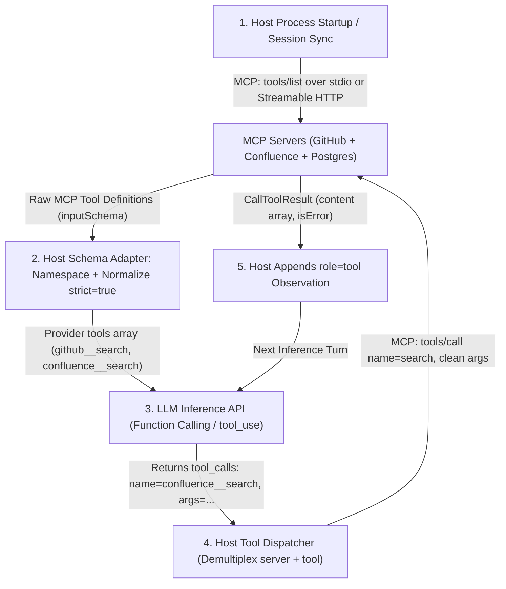
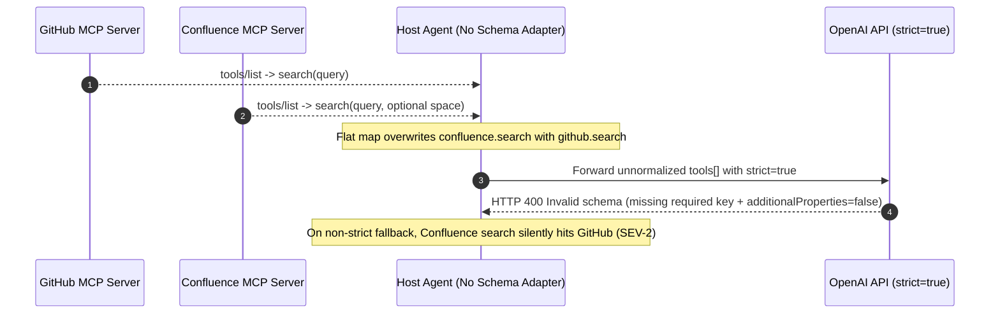

# Module 02: MCP vs. Function Calling vs. Plugins

> **Prerequisites:** [Module 01: The M×N Integration Problem](../01-the-mxn-integration-problem/README.md), [Track 06, Module 06: Function Calling Basics](../../06-openai-and-the-model-landscape/06-function-calling-basics/README.md), [Track 11, Module 08: Tools and Toolkits](../../11-langchain-and-langgraph/08-tools-and-toolkits/README.md), and [Track 12, Module 07: Inter-Agent Communication](../../12-agent-orchestration-and-multi-agent-systems/07-inter-agent-communication/README.md).  
> **Estimated Reading Time:** 34 minutes  
> **Target Audience:** AI Backend Engineers, Agent Runtime Architects, API Gateway Engineers

> [!TIP]
> **The Golden Rule of AI Tool Layering:** MCP and LLM Function Calling are **orthogonal, complementary layers—never alternatives**. LLM Function Calling is the **single-turn inference contract** (`tools[]` in, `tool_calls[]` out) between your Host and an LLM endpoint; MCP is the **wire discovery, transport, and execution protocol** that fetches dynamic schemas from isolated servers, feeds them *into* the Host's LLM Function Calling payload, and routes `tool_calls[]` back out for execution.

---

## Why This Matters

One of the costliest misconceptions in GenAI backend architecture is treating **Function Calling**, **LangChain `@tool` wrappers**, **Legacy ChatGPT Plugins**, **MCP**, and **Agent2Agent (`A2A`)** as competing substitutes. Teams routinely make three expensive architectural mistakes from that confusion:

1. **Expecting an LLM to speak MCP directly:** An LLM inference API (`OpenAI`, `Anthropic`, `Gemini`, `vLLM`) never opens a `stdio` pipe or sends JSON-RPC `tools/call` frames. Your Host application bridges the two layers.
2. **Dumping raw MCP `inputSchema` objects into `strict: true` Function Calling without a Host Schema Adapter:** MCP uses standard JSON Schema, whereas OpenAI/Anthropic strict structured tool decoding rejects unclosed objects (`additionalProperties` missing), un-required optional keys, and duplicate tool names (`search` colliding across GitHub and Confluence servers).
3. **Treating MCP as Agent-to-Agent orchestration (or vice versa):** Using MCP to orchestrate opaque multi-hour autonomous agent workflows hits bidirectional task-lifecycle limits better handled by `A2A`, while replacing MCP tool servers with heavy autonomous sub-agents wastes tokens and latency.

---

## 1. The Five Orthogonal Integration Layers in a Single Request Lifecycle

Every modern AI system sits across distinct, composable layers rather than a single monolithic protocol:

1. **LLM API Function Calling (Inference Layer):** A stateless per-request JSON contract (`tools[]` / `tool_use` / `tool_calls[]`) inside an LLM HTTP API. Grammar-constrained decoding forces the model to emit syntactically valid JSON arguments matching a tool name—*and nothing else*. The LLM never executes code.
2. **Framework Tool Wrappers (In-Process SDK Layer):** Ergonomic decorators like LangChain `@tool` or PydanticAI function decorators that inspect Python/TS type hints inside your Host process and serialize them into provider `tools[]` payloads. Locked to your application's language and memory space.
3. **Legacy ChatGPT HTTP Plugins (Static Web Manifest Era, Deprecated):** Early 2023 integration pattern pairing a static `/.well-known/ai-plugin.json` descriptor with a public OpenAPI YAML specification. Required public HTTPS endpoints, lacked local `stdio` execution, lacked server-push notifications (`list_changed`), lacked `Resources`/`Prompts` separation, and lacked `Sampling`/`Roots`.
4. **Model Context Protocol (MCP — Vertical Context/Tool Wire Layer):** An open JSON-RPC 2.0 protocol connecting a Host/Client to external Servers over `stdio` or `Streamable HTTP`. Discovers `Tools`, `Resources`, and `Prompts` dynamically at runtime and routes execution cleanly across process boundaries.
5. **Agent2Agent (`A2A` — Horizontal Agent Delegation Layer):** An open peer-to-peer protocol (`a2a-protocol.org`) where one autonomous agent delegates long-running tasks to another opaque autonomous agent discovered via `/.well-known/agent.json` (`AgentCard`), exchanging artifacts and task state updates rather than exposing raw low-level tools.

### End-to-End Request Flow: Where MCP Meets Function Calling

Watch how MCP and LLM Function Calling collaborate inside one Host turn:



### Quantitative Latency & Schema-Normalization Math

1. **Where Does Wall-Clock Latency Go?** Total single tool-turn latency $T_{\text{turn}}$ decomposes into inference vs. transport vs. execution:

$$T_{\text{turn}} = T_{\text{prefill}}\!\left(S_{\text{sys}} + S_{\text{tools}}\right) + T_{\text{decode}}\!\left(O_{\text{call}}\right) + T_{\text{wire\_MCP}} + T_{\text{exec}} + T_{\text{synthesis}}$$

Over a local `stdio` pipe, $T_{\text{wire\_MCP}} \approx 0.5\text{–}1.5\text{ ms}$—less than **`0.2%`** of an `850 ms` LLM inference call! Even over persistent `Streamable HTTP`, transport overhead (`~20–35 ms`) stays minor compared to model prefill and downstream DB/API execution, provided your Host caches `tools/list` within the session instead of re-fetching schemas on every turn.

2. **Schema Normalization Rules at the Host Adapter Boundary:** Never forward raw MCP `inputSchema` dictionaries verbatim to `strict: true` LLM endpoints. Your Host Adapter must enforce three transformations deterministically:
   - **Collision-Safe Namespacing:** Prefix tool names with `{server_id}__{tool_name}` (truncating + appending an 8-char SHA-256 hash suffix if `len > 64`) so two servers exposing `search` never collide inside `tools[]`, and validate against `^[a-zA-Z0-9_-]{1,64}$`.
   - **Strict Object Closure:** Recursively set `"additionalProperties": false` on every `"type": "object"` schema node.
   - **Explicit Nullable Optionality:** OpenAI `strict: true` requires *every* property key to appear in `"required"`. Convert optional MCP fields (`k not in required`) into `"type": [original_type, "null"]`, add `k` to `"required"`, and strip `None`/`null` values back out before sending `tools/call` to the MCP server!

---

## 2. Systematic Comparison Matrix: Five AI Integration Mechanisms

| Dimension | LLM API Function Calling | Framework `@tool` Wrappers | Legacy ChatGPT HTTP Plugins | Model Context Protocol (MCP) | Agent2Agent (`A2A`) |
| :--- | :--- | :--- | :--- | :--- | :--- |
| **Stack Layer** | Model inference contract | In-process SDK ergonomics | Deprecated HTTP OpenAPI manifest | Vertical context/tool wire protocol | Horizontal multi-agent delegation |
| **Direction** | Host ↔ LLM Endpoint | Code inside Host process | Cloud ChatGPT → Public REST | Host/Client ↔ Tool/Data Server | Agent ↔ Autonomous Peer Agent |
| **Local Process (`stdio`)** | N/A (model only emits JSON) | Yes (same language runtime) | **No** (public HTTPS required) | **Yes** (`stdio` + `Streamable HTTP`) | No (HTTP JSON-RPC + SSE) |
| **Dynamic Discovery** | Passed statically per API call | Imported at Python/TS startup | Static `ai-plugin.json` fetch | Live `tools/list` + `list_changed` push | `/.well-known/agent.json` AgentCard |
| **Bidirectional Callbacks** | None | Direct local function calls | None | `Sampling`, `Roots`, Progress, Logs | Async `Task` status & artifact streams |
| **Primitives Exposed** | `tools[]` function schemas only | Local callable functions | OpenAPI HTTP operations | `Tools`, `Resources`, `Prompts` | Agent `Skills`, `Tasks`, `Artifacts` |
| **Primary Production Role** | Force structured tool choice | Rapid host-internal callbacks | Historical predecessor only | Standardized tool & context boundary | Cross-service autonomous agent handoff |

---

## 3. Production War Story Post-Mortem: The Strict-Mode Rejection & Colliding `search` Incident

| Field | Incident Details |
| :--- | :--- |
| **Severity** | **SEV-2** (`42%` of Enterprise Agent Sessions Failed HTTP `400` + Cross-Server Query Misrouting) |
| **Detection / Resolution Time** | Detected in `14` minutes via elevated LLM `400 Bad Request` metrics / Mitigated in `3.5` hours (with `19` hours total cleanup) |
| **Impact** | `github` and `confluence` MCP servers both exposed a tool named `search`, silently misrouting internal docs queries to GitHub; OpenAI rejected optional parameters lacking strict schema closure |

### What Happened

An internal developer-experience team built a unified AI assistant connecting `3` MCP servers (`github`, `confluence`, and `jira`) into an OpenAI `strict: true` Function Calling loop. Rather than writing a **Host Schema Adapter**, engineers simply concatenated every server's raw `tools/list` output directly into OpenAI's `tools[]` parameter and maintained a flat `tool_name -> client` lookup map.

Two production bugs triggered simultaneously:
1. Both `github` and `confluence` servers registered a tool named `search`. The Host's flat map overwrote `confluence -> search` with `github -> search` (`last-writer-wins`), causing questions about internal HR/runbook policies in Confluence to silently query public/private GitHub issues instead.
2. When `jira` pushed an updated tool definition containing an optional `"max_results": {"type": "integer"}` field omitted from `"required"`, OpenAI's strict grammar compiler immediately threw HTTP `400: Invalid schema for function 'search': 'required' is required to be supplied and to be an array including every key in properties`—crashing `42%` of live enterprise user turns.



### Root Cause Analysis

- **Confusing MCP Wire Schemas with Provider-Specific Grammar Constraints:** Valid MCP `inputSchema` JSON is standard JSON Schema Draft 2020-12 / 07, not guaranteed to satisfy OpenAI's or Anthropic's stricter decoding subsets.
- **Un-namespaced Global Tool Registry:** Tool names in MCP are scoped per server (`1:1` Client), never globally unique across independent third-party servers.

### Architectural Hardening & Verified Fix

- **Implemented Deterministic Host Schema Adapter:** Every MCP tool is now mapped to `{server_id}__{tool_name}` (with SHA-256 truncation under `64` chars), recursively normalized for `strict: true` (`additionalProperties: false`, nullable optional fields), and tracked in an explicit `(wire_name) -> (client_id, original_tool_name)` dispatch table.
- **Null-Stripping Before `tools/call`:** Optional nullable arguments returned as `null` by the LLM are stripped by the Host Adapter before invoking `tools/call` so MCP servers receive clean, spec-compliant parameters.

---

## 4. Multi-Language Production Code: MCP-to-Function-Calling Host Schema Adapter

Below is a production-ready **Host Schema Adapter & Demultiplexing Dispatcher** across **Go**, **TypeScript**, **Python**, and **C#**. It bridges MCP `tools/list` schemas safely into `strict: true` LLM Function Calling payloads while eliminating cross-server tool name collisions.

````carousel

```go
package mcpbridge

import (
	"crypto/sha256"
	"encoding/hex"
	"fmt"
	"maps"
	"slices"
)

type McpToolDef struct {
	ServerID    string
	Name        string
	Description string
	InputSchema map[string]any
}

type ProviderTool struct {
	WireName    string
	Description string
	Parameters  map[string]any
	Strict      bool
}

type DispatchTarget struct {
	ServerID string
	ToolName string
}

func MakeSafeWireName(serverID, toolName string) string {
	raw := serverID + "__" + toolName
	if len(raw) <= 64 {
		return raw
	}
	sum := sha256.Sum256([]byte(raw))
	suffix := hex.EncodeToString(sum[:])[:8]
	return raw[:55] + "_" + suffix
}

func StrictifySchema(schema map[string]any) map[string]any {
	out := maps.Clone(schema)
	if out["type"] != "object" {
		return out
	}
	rawProps, _ := out["properties"].(map[string]any)
	rawReq, _ := out["required"].([]string)
	reqSet := make(map[string]bool, len(rawReq))
	for _, r := range rawReq {
		reqSet[r] = true
	}

	newProps := make(map[string]any, len(rawProps))
	allKeys := make([]string, 0, len(rawProps))
	for k, v := range rawProps {
		allKeys = append(allKeys, k)
		propMap, ok := v.(map[string]any)
		if !ok {
			newProps[k] = v
			continue
		}
		sub := StrictifySchema(propMap)
		if !reqSet[k] {
			if t, ok := sub["type"].(string); ok {
				sub["type"] = []string{t, "null"}
			}
		}
		newProps[k] = sub
	}
	slices.Sort(allKeys)
	out["properties"] = newProps
	out["required"] = allKeys
	out["additionalProperties"] = false
	return out
}

func BuildProviderCatalog(tools []McpToolDef) ([]ProviderTool, map[string]DispatchTarget, error) {
	catalog := make([]ProviderTool, 0, len(tools))
	dispatch := make(map[string]DispatchTarget, len(tools))
	for _, t := range tools {
		wire := MakeSafeWireName(t.ServerID, t.Name)
		if _, dup := dispatch[wire]; dup {
			return nil, nil, fmt.Errorf("wire name collision: %s", wire)
		}
		dispatch[wire] = DispatchTarget{ServerID: t.ServerID, ToolName: t.Name}
		catalog = append(catalog, ProviderTool{
			WireName:    wire,
			Description: t.Description,
			Parameters:  StrictifySchema(t.InputSchema),
			Strict:      true,
		})
	}
	return catalog, dispatch, nil
}
```

<!-- slide -->

```typescript
import { createHash } from "node:crypto";

export interface McpToolSpec {
  readonly serverId: string;
  readonly name: string;
  readonly description: string;
  readonly inputSchema: Record<string, unknown>;
}

export interface DispatchRoute {
  readonly serverId: string;
  readonly originalToolName: string;
}

export function makeWireToolName(serverId: string, toolName: string): string {
  const raw = `${serverId}__${toolName}`;
  if (raw.length <= 64) return raw;
  const hash = createHash("sha256").update(raw).digest("hex").slice(0, 8);
  return `${raw.slice(0, 55)}_${hash}`;
}

export function strictifyJsonSchema(schema: Record<string, unknown>): Record<string, unknown> {
  const copy: Record<string, unknown> = { ...schema };
  if (copy.type !== "object") return copy;

  const props = (copy.properties as Record<string, Record<string, unknown>>) ?? {};
  const requiredSet = new Set((copy.required as string[] | undefined) ?? []);
  const strictProps: Record<string, unknown> = {};

  for (const [key, propSchema] of Object.entries(props)) {
    const normalized = strictifyJsonSchema(propSchema);
    if (!requiredSet.has(key)) {
      if (typeof normalized.type === "string") {
        normalized.type = [normalized.type, "null"];
      } else if (Array.isArray(normalized.type) && !normalized.type.includes("null")) {
        normalized.type = [...normalized.type, "null"];
      }
    }
    strictProps[key] = normalized;
  }

  copy.properties = strictProps;
  copy.required = Object.keys(props);
  copy.additionalProperties = false;
  return copy;
}

export function adaptMcpToolsForLlm(mcpTools: readonly McpToolSpec[]) {
  const dispatchTable = new Map<string, DispatchRoute>();
  const providerTools = mcpTools.map((tool) => {
    const wireName = makeWireToolName(tool.serverId, tool.name);
    if (dispatchTable.has(wireName)) {
      throw new Error(`Duplicate wire tool name detected: ${wireName}`);
    }
    dispatchTable.set(wireName, { serverId: tool.serverId, originalToolName: tool.name });
    return {
      type: "function" as const,
      function: {
        name: wireName,
        description: tool.description,
        strict: true,
        parameters: strictifyJsonSchema(tool.inputSchema),
      },
    };
  });
  return { providerTools, dispatchTable };
}
```

<!-- slide -->

```python
"""
mcp_function_bridge.py
Bridges MCP tools/list schemas into strict LLM Function Calling definitions and demultiplexes calls.
"""
from dataclasses import dataclass
import hashlib
from typing import Any


@dataclass(frozen=True)
class McpToolDefinition:
    server_id: str
    name: str
    description: str
    input_schema: dict[str, Any]


def wire_tool_name(server_id: str, tool_name: str) -> str:
    raw = f"{server_id}__{tool_name}"
    if len(raw) <= 64:
        return raw
    digest = hashlib.sha256(raw.encode("utf-8")).hexdigest()[:8]
    return f"{raw[:55]}_{digest}"


def strictify_schema(schema: dict[string, Any]) -> dict[str, Any]:
    node = dict(schema)
    if node.get("type") != "object":
        return node

    props: dict[str, Any] = node.get("properties", {})
    orig_req = set(node.get("required", []))
    strict_props: dict[str, Any] = {}

    for key, val in props.items():
        sub = strictify_schema(val)
        if key not in orig_req:
            typ = sub.get("type")
            if isinstance(typ, str):
                sub["type"] = [typ, "null"]
            elif isinstance(typ, list) and "null" not in typ:
                sub["type"] = [*typ, "null"]
        strict_props[key] = sub

    node["properties"] = strict_props
    node["required"] = list(props.keys())
    node["additionalProperties"] = False
    return node


def build_llm_tools(
    catalog: list[McpToolDefinition],
) -> tuple[list[dict[str, Any]], dict[str, tuple[str, str]]]:
    llm_tools: list[dict[str, Any]] = []
    dispatch_map: dict[str, tuple[str, str]] = {}

    for item in catalog:
        wname = wire_tool_name(item.server_id, item.name)
        if wname in dispatch_map:
            raise ValueError(f"Tool wire name collision: {wname}")
        dispatch_map[wname] = (item.server_id, item.name)
        llm_tools.append(
            {
                "type": "function",
                "function": {
                    "name": wname,
                    "description": item.description,
                    "strict": True,
                    "parameters": strictify_schema(item.input_schema),
                },
            }
        )
    return llm_tools, dispatch_map


def demux_tool_call(
    wire_name: str,
    raw_arguments: dict[str, Any],
    dispatch_map: dict[str, tuple[str, str]],
) -> tuple[str, dict[str, Any]]:
    server_id, orig_tool = dispatch_map[wire_name]
    clean_args = {k: v for k, v in raw_arguments.items() if v is not None}
    rpc_payload = {
        "jsonrpc": "2.0",
        "method": "tools/call",
        "params": {"name": orig_tool, "arguments": clean_args},
    }
    return server_id, rpc_payload
```

<!-- slide -->

```csharp
using System;
using System.Collections.Generic;
using System.Linq;
using System.Security.Cryptography;
using System.Text;

namespace GenAI.McpBridge;

public sealed record McpToolSpec(
    string ServerId,
    string Name,
    string Description,
    Dictionary<string, object> InputSchema);

public sealed record DispatchRoute(string ServerId, string OriginalToolName);

public static class McpToFunctionBridge
{
    public static string MakeWireName(string serverId, string toolName)
    {
        var raw = $"{serverId}__{toolName}";
        if (raw.Length <= 64) return raw;
        var hashBytes = SHA256.HashData(Encoding.UTF8.GetBytes(raw));
        var suffix = Convert.ToHexString(hashBytes).ToLowerInvariant()[..8];
        return $"{raw[..55]}_{suffix}";
    }

    public static Dictionary<string, object> StripNullArguments(IDictionary<string, object?> rawArgs) =>
        rawArgs
            .Where(kv => kv.Value is not null)
            .ToDictionary(kv => kv.Key, kv => kv.Value!);

    public static Dictionary<string, DispatchRoute> BuildDispatchRegistry(IEnumerable<McpToolSpec> tools)
    {
        var map = new Dictionary<string, DispatchRoute>(StringComparer.Ordinal);
        foreach (var tool in tools)
        {
            var wire = MakeWireName(tool.ServerId, tool.Name);
            if (!map.TryAdd(wire, new DispatchRoute(tool.ServerId, tool.Name)))
                throw new InvalidOperationException($"Colliding MCP wire tool name: {wire}");
        }
        return map;
    }
}
```

````

---

## 5. Practical Hands-On Verification CLI Workflows

Run these deterministic Python 3.13 verification scripts offline—no API keys or third-party dependencies required.

### Workflow 1: Full Round-Trip — `tools/list` → Strict Adapter → LLM `tool_calls` → `tools/call`

Observe how two colliding `search` tools across `github` and `confluence` are safely namespaced, strictified for LLM Function Calling, and cleanly demultiplexed back to `tools/call` with `null` optional arguments stripped:

```bash
python -c '
import hashlib, json

def strictify_schema(schema):
    node = dict(schema)
    if node.get("type") == "object":
        props = node.get("properties", {})
        orig_req = set(node.get("required", []))
        new_props = {}
        for k, v in props.items():
            sub = strictify_schema(v)
            if k not in orig_req:
                t = sub.get("type")
                if isinstance(t, str):
                    sub["type"] = [t, "null"]
                elif isinstance(t, list) and "null" not in t:
                    sub["type"] = t + ["null"]
            new_props[k] = sub
        node["properties"] = new_props
        node["required"] = list(props.keys())
        node["additionalProperties"] = False
    return node

def make_wire_name(server_id, tool_name):
    raw = f"{server_id}__{tool_name}"
    if len(raw) <= 64:
        return raw
    digest = hashlib.sha256(raw.encode()).hexdigest()[:8]
    return f"{raw[:55]}_{digest}"

mcp_catalog = [
    ("github", {"name": "search", "description": "Search GitHub issues", "inputSchema": {"type": "object", "properties": {"query": {"type": "string"}, "limit": {"type": "integer"}}, "required": ["query"]}}),
    ("confluence", {"name": "search", "description": "Search Confluence pages", "inputSchema": {"type": "object", "properties": {"query": {"type": "string"}, "space": {"type": "string"}}, "required": ["query"]}}),
]

dispatch = {}
llm_tools = []
for srv, tool in mcp_catalog:
    wire_name = make_wire_name(srv, tool["name"])
    dispatch[wire_name] = (srv, tool["name"])
    llm_tools.append({"type": "function", "function": {"name": wire_name, "strict": True, "parameters": strictify_schema(tool["inputSchema"])}})

print("1) Adapted LLM tools[] payload:")
print(json.dumps(llm_tools, indent=2))

mock_tool_call = {"name": "confluence__search", "arguments": {"query": "SEV-1 runbook", "space": None}}
target_srv, orig_tool = dispatch[mock_tool_call["name"]]
clean_args = {k: v for k, v in mock_tool_call["arguments"].items() if v is not None}
mcp_call = {"jsonrpc": "2.0", "id": 9, "method": "tools/call", "params": {"name": orig_tool, "arguments": clean_args}}
print(f"2) Routed to server={target_srv}: {json.dumps(mcp_call)}")
'
```

**Expected Output:**

```text
1) Adapted LLM tools[] payload:
[
  {
    "type": "function",
    "function": {
      "name": "github__search",
      "strict": true,
      "parameters": {
        "type": "object",
        "properties": {
          "query": {
            "type": "string"
          },
          "limit": {
            "type": [
              "integer",
              "null"
            ]
          }
        },
        "required": [
          "query",
          "limit"
        ],
        "additionalProperties": false
      }
    }
  },
  {
    "type": "function",
    "function": {
      "name": "confluence__search",
      "strict": true,
      "parameters": {
        "type": "object",
        "properties": {
          "query": {
            "type": "string"
          },
          "space": {
            "type": [
              "string",
              "null"
            ]
          }
        },
        "required": [
          "query",
          "space"
        ],
        "additionalProperties": false
      }
    }
  }
]
2) Routed to server=confluence: {"jsonrpc": "2.0", "id": 9, "method": "tools/call", "params": {"name": "search", "arguments": {"query": "SEV-1 runbook"}}}
```

### Workflow 2: Provider Strict-Schema Compatibility Linter

Audit raw MCP tool catalogs for `64`-character limits, invalid identifier characters, missing `additionalProperties: false`, and un-required optional properties before calling an LLM provider:

```bash
python -c '
import re

def audit_provider_compatibility(server_id, tool_name, schema):
    issues = []
    wire = f"{server_id}__{tool_name}"
    if len(wire) > 64:
        issues.append(f"name_len={len(wire)}>64")
    if not re.match(r"^[a-zA-Z0-9_-]+$", wire):
        issues.append("invalid_chars")
    if schema.get("additionalProperties") is not False:
        issues.append("missing_additionalProperties_false")
    props = set(schema.get("properties", {}).keys())
    req = set(schema.get("required", []))
    if props != req:
        missing = sorted(props - req)
        issues.append(f"unrequired_keys={missing}")
    return wire, issues

cases = [
    ("github", "search", {"type": "object", "properties": {"query": {"type": "string"}, "limit": {"type": "integer"}}, "required": ["query"]}),
    ("enterprise_crm_connector_v2", "query_customer_contract_amendments_with_history", {"type": "object", "properties": {"id": {"type": "string"}}, "required": ["id"], "additionalProperties": False}),
    ("billing", "get_invoice", {"type": "object", "properties": {"invoice_id": {"type": "string"}}, "required": ["invoice_id"], "additionalProperties": False}),
]

for srv, tname, sch in cases:
    wire, probs = audit_provider_compatibility(srv, tname, sch)
    joined = ",".join(probs)
    status = "PASS_STRICT" if not probs else f"NEEDS_ADAPTER({joined})"
    print(f"{wire:<45} | {status}")
'
```

**Expected Output:**

```text
github__search                                | NEEDS_ADAPTER(missing_additionalProperties_false,unrequired_keys=['limit'])
enterprise_crm_connector_v2__query_customer_contract_amendments_with_history | NEEDS_ADAPTER(name_len=76>64)
billing__get_invoice                          | PASS_STRICT
```

### Workflow 3: End-to-End Latency Overhead Comparison Across Stack Layers

Verify how tiny MCP's `stdio` wire hop is relative to LLM inference and why `A2A` serves coarse multi-step delegation rather than sub-millisecond tool calls:

```bash
python -c '
scenarios = [
    ("In-Process @tool Callback", 0.05, 850.0, 12.0),
    ("MCP Local stdio Subprocess", 1.20, 850.0, 12.0),
    ("MCP Remote Streamable HTTP", 28.00, 850.0, 12.0),
    ("Remote A2A Agent Delegation", 42.00, 2100.0, 480.0),
]

for label, wire_ms, llm_ms, exec_ms in scenarios:
    total = wire_ms + llm_ms + exec_ms
    wire_pct = (wire_ms / total) * 100.0
    print(f"{label:<28} | wire={wire_ms:>5.2f} ms ({wire_pct:>4.2f}%) | llm={llm_ms:>6.1f} ms | exec={exec_ms:>5.1f} ms | total={total:>7.2f} ms")
'
```

**Expected Output:**

```text
In-Process @tool Callback    | wire= 0.05 ms (0.01%) | llm= 850.0 ms | exec= 12.0 ms | total= 862.05 ms
MCP Local stdio Subprocess   | wire= 1.20 ms (0.14%) | llm= 850.0 ms | exec= 12.0 ms | total= 863.20 ms
MCP Remote Streamable HTTP   | wire=28.00 ms (3.15%) | llm= 850.0 ms | exec= 12.0 ms | total= 890.00 ms
Remote A2A Agent Delegation  | wire=42.00 ms (1.60%) | llm=2100.0 ms | exec=480.0 ms | total=2622.00 ms
```

### Hands-On Exercises

1. **Nested Object Normalization:** Extend Workflow 1's `strictify_schema` so nested objects inside `"items"` (for `"type": "array"`) also receive `"additionalProperties": false` and full `"required"` arrays. Test on a batch-update tool accepting `items: {"type": "object", "properties": {"id": {"type": "string"}, "note": {"type": "string"}}, "required": ["id"]}`.
2. **Anthropic `tool_use` Formatter:** Write a parallel mapper converting Workflow 1's `mcp_catalog` into Anthropic's `input_schema` shape (`{"name": ..., "description": ..., "input_schema": ...}`) instead of OpenAI's `{"type": "function", "function": {...}}`.
3. **Optional Live Function-Calling Bridge Probe (Requires API Key):** Pass Workflow 1's adapted `llm_tools` to your OpenAI or Anthropic client (`tool_choice="auto"`), capture the returned `tool_calls` JSON, demultiplex it with your dispatch table, and verify that zero `400` schema rejections occur.

### Independent Challenge

A platform architect wants to integrate an autonomous **Vendor Security Review Agent** (owned by an external SaaS partner, taking 3–8 minutes per assessment via multi-step reasoning) *and* an internal **Read-Only Postgres Schema + Query Explorer** into your company's internal coding assistant (`Cursor` + custom Python orchestrator). Meanwhile, an engineer suggests replacing your Python host's OpenAI Function Calling `tools[]` parameter *"entirely with MCP so we don't need OpenAI Function Calling anymore."* Diagnose the engineer's misconception and map **MCP**, **LLM Function Calling**, and **`A2A`** cleanly onto each component of this system.

<details><summary>Architectural Discussion</summary>

First, clarify to the engineer that **MCP cannot replace LLM Function Calling**: the LLM API still requires `tools[]` schemas during inference to emit structured `tool_calls`. Your Host reads tool schemas via MCP `tools/list`, normalizes them via a Host Schema Adapter into OpenAI `tools[]`, and routes returned `tool_calls` back over MCP `tools/call`. Second, map the two external integrations cleanly: the **Postgres Explorer** belongs behind **MCP** (deterministic `Resources` for table schemas + `Tools` for read-only `SELECT` queries, shared across `Cursor` and the Python orchestrator), whereas the **3–8 minute autonomous Vendor Security Review Agent** belongs behind **A2A** (horizontal agent-to-agent task delegation via an `AgentCard` and asynchronous task status/artifact updates, possibly using MCP internally for its own tools).

</details>

---

## 6. Common Mistakes & Troubleshooting

- **Forwarding raw MCP `inputSchema` straight into OpenAI `strict: true`:** Fails with HTTP `400` whenever an MCP server declares optional fields outside `required` or omits `"additionalProperties": false`. Always run a recursive Host Schema Adapter.
- **Un-namespaced tool registration across multiple MCP servers:** Registering raw `tool.name` (`search`, `list_files`, `query`) causes silent overwrites or LLM confusion when two servers share common verb names. Prefix every tool with `{server_id}__` (or a deterministic hash under `64` chars) in the Host registry.
- **Leaking `null` placeholder values back into `tools/call`:** When you convert optional MCP parameters to `["string", "null"]` for `strict: true`, the LLM frequently emits `"limit": null`. Strip `None`/`null` keys before dispatching `tools/call` so servers expecting missing keys or integers do not fail schema validation.
- **Using A2A for lightweight deterministic DB lookups (or MCP for multi-minute autonomous agents):** Wrapping a `12 ms` SQL lookup as an A2A agent wastes seconds of agent reasoning; conversely, forcing an autonomous 5-minute research agent into a synchronous `tools/call` hits client RPC timeouts.

---

## 7. Operational Validation Checkpoints & Checkpoint Quiz

### Operational Validation Checkpoints

<details><summary><strong>Checkpoint 1: Diagnosing why MCP tools fail OpenAI strict Function Calling with HTTP 400</strong></summary>

A backend engineer discovers a community MCP server via `tools/list`, forwards its `inputSchema` directly inside OpenAI's `tools=[{"type": "function", "function": ..., "strict": True}]`, and hits `400 Invalid schema: 'additionalProperties' must be false`. Explain why valid MCP schemas fail here and how the Host fixes it.

**Validation:** MCP `inputSchema` uses standard JSON Schema, which defaults `additionalProperties` to `true` and allows optional fields to be omitted from `required`. OpenAI's `strict: true` grammar compiler requires `"additionalProperties": false` on every object and all property keys listed in `"required"`. Fix by running a Host Schema Adapter that injects `"additionalProperties": false`, wraps optional types with `"null"`, adds all keys to `"required"`, and strips `null` arguments before forwarding `tools/call`.

</details>

<details><summary><strong>Checkpoint 2: Explaining why "MCP replaces Function Calling" is an architectural category error</strong></summary>

During a design review, a team lead asks: *"If we adopt MCP everywhere, can we stop passing `tools[]` to Claude and GPT APIs?"* Explain concisely why the answer is no and trace how the two work together.

**Validation:** No. LLM inference APIs remain stateless HTTP endpoints that only know how to select tools passed in `tools[]` and return structured `tool_calls`. MCP operates between the Host and external Tool/Context Servers (`stdio`/`Streamable HTTP`)—not between the Host and the LLM. At runtime, the Host discovers tools over MCP `tools/list`, converts them into the LLM's `tools[]` parameter, receives `tool_calls` from the LLM, executes them via MCP `tools/call`, and feeds results back into the prompt.

</details>

<details><summary><strong>Checkpoint 3: Drawing the boundary between MCP and Agent2Agent (A2A)</strong></summary>

An organization builds both (1) a Snowflake read-only SQL query connector and (2) an autonomous Legal Contract Redline Agent that runs multi-step reasoning and occasionally asks for human clarifications over 3 minutes. Which protocol (`MCP` vs. `A2A`) fits each, and can they coexist?

**Validation:** Use **MCP** for the Snowflake connector (vertical Host-to-deterministic-tool/data access exposing `Resources` and `Tools`). Use **A2A** for the autonomous Legal Contract Redline Agent (horizontal peer delegation between opaque autonomous agents via `AgentCard`, asynchronous task states, and artifact streaming). They complement each other directly: your orchestrator delegates to the Legal Agent via `A2A`, while the Legal Agent may call its own clause-search tools via `MCP`.

</details>

### Checkpoint Quiz

1. Why were legacy ChatGPT HTTP Plugins (`ai-plugin.json` + OpenAPI) insufficient for local developer workflows and modern agent hosts?
2. Which component translates MCP `tools/list` definitions into provider-specific `tools[]` payloads?
3. What three transformations should a production Host Schema Adapter perform on every MCP `inputSchema` before enabling `strict: true` Function Calling?
4. Why does `stdio` MCP execution add negligible latency (`< 0.2%`) to a typical agent turn?
5. Contrast **MCP** and **A2A** in one sentence.

<details><summary>Answers</summary>

1. Legacy plugins required public HTTPS endpoints with static OpenAPI files, offering zero local `stdio` subprocess execution, zero dynamic `list_changed` push updates, zero `Resources`/`Prompts` separation, and zero `Sampling`/`Roots` callbacks.
2. The **Host** application (specifically its schema adapter layer bridging the MCP Client's discovered catalog to the LLM provider SDK).
3. (1) Collision-safe tool namespacing (`{server_id}__{tool_name}` within 64 chars), (2) recursive `"additionalProperties": false` injection on all objects, and (3) nullable typing (`["T", "null"]`) + full `"required"` inclusion for optional fields (stripping `null` back out before `tools/call`).
4. Local `stdio` pipes transfer JSON-RPC frames in `~0.5–1.5 ms`, which is tiny compared to `~700–1,200 ms` LLM prefill/decode inference latency.
5. **MCP** is a vertical protocol connecting an AI Host/Agent to deterministic external tools and context (`Tools`, `Resources`, `Prompts`), whereas **A2A** is a horizontal protocol enabling opaque autonomous agents to discover each other and delegate asynchronous multi-step tasks.

</details>

---

## Further Reading & Sources

- [Model Context Protocol — Architecture & Concepts](https://modelcontextprotocol.io/docs/concepts/architecture) — how Hosts bridge MCP servers into LLM inference.
- [OpenAI Docs — Function Calling Guide](https://platform.openai.com/docs/guides/function-calling) — strict schema constraints (`additionalProperties: false`, required keys, 64-char names).
- [Anthropic Docs — Tool Use Overview](https://docs.anthropic.com/en/docs/agents-and-tools/tool-use/overview) — `input_schema` and `tool_use` execution loop mechanics.
- [Agent2Agent (A2A) Protocol Documentation](https://a2a-protocol.org) — official specification for horizontal agent-to-agent delegation complementary to MCP.
- [Track 12, Module 07: Inter-Agent Communication](../../12-agent-orchestration-and-multi-agent-systems/07-inter-agent-communication/README.md) — typed envelopes, FIPA performatives, and A2A integration boundaries.

## Next

[Module 03: Architecture: Hosts, Clients and Servers](../03-architecture-hosts-clients-and-servers/README.md)
