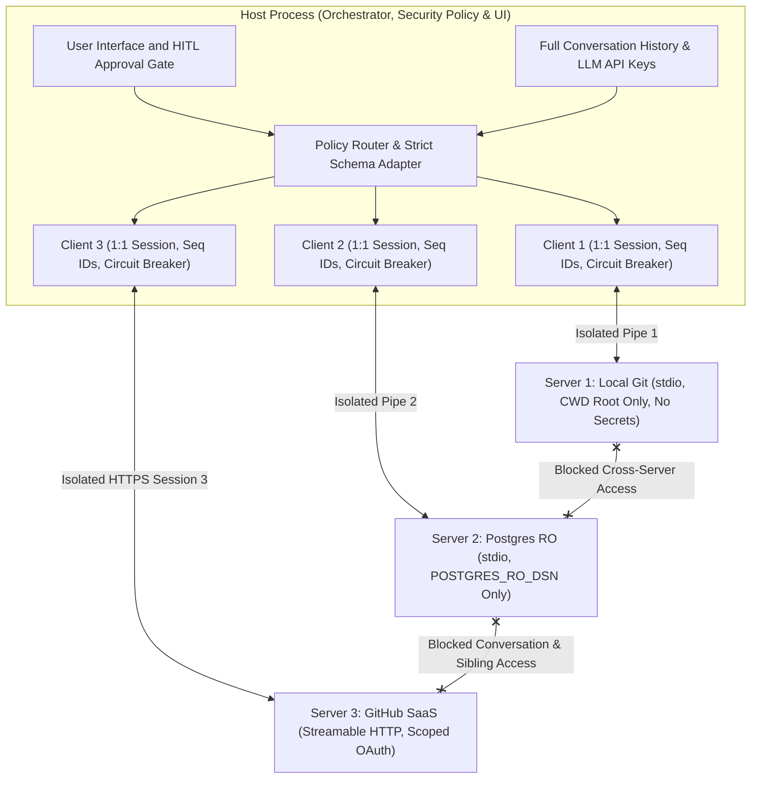
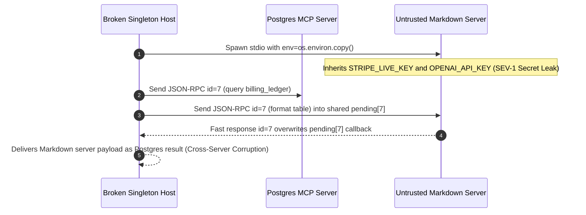

# Module 03: Architecture: Hosts, Clients and Servers

> **Prerequisites:** [Module 02: MCP vs. Function Calling vs. Plugins](../02-mcp-vs-function-calling-vs-plugins/README.md) and [Track 10, Module 13: Human-in-the-Loop Patterns](../../10-ai-agents/13-human-in-the-loop-patterns/README.md).  
> **Estimated Reading Time:** 34 minutes  
> **Target Audience:** AI Systems Architects, Security Engineers, Backend Platform Developers

> [!TIP]
> **The Golden Rule of MCP Topology:** Enforce MCP's **3-role isolation topology (`1 Host : N isolated 1:1 Clients : N Servers`)** as a strict security and fault-containment boundary: the **Host** owns the user session, LLM API keys, and approval gates; each **Client** owns **exactly one** stateful connection to **exactly one** Server with its own request-ID space, secret allowlist, and circuit breaker; and **no Server may ever inspect sibling servers' sessions or read the full user conversation directly**.

---

## Why This Matters

When engineers write a custom MCP Host runtime for the first time, they routinely collapse the **Host** and **Client** into one shared singleton, pass `os.environ.copy()` into every spawned local server subprocess, or assume a third-party MCP server can coordinate directly with another server.

Breaking that three-role separation turns every community or internal plugin into a catastrophic **lateral-movement and cascading-outage vulnerability**. An untrusted Markdown helper server spawned with an unscoped Host environment immediately inherits `OPENAI_API_KEY`, `STRIPE_SECRET_KEY`, and `DATABASE_URL`. Worse, sharing a single JSON-RPC request ID counter or multiplexed channel across servers causes cross-server `id` collisions and silent data corruption, while missing per-Client circuit breakers let one wedged external server hang the entire AI workspace.

---

## 1. The Three-Role Topology & Strict Isolation Invariants

The official MCP architecture separates responsibilities cleanly across **Host**, **Client**, and **Server**:



### Exact Responsibilities of Each Role

1. **Host (The Orchestrator & Policy Enforcement Point):**
   - **Lifecycle & UX Owner:** Applications like `Claude Desktop`, `Cursor`, `VS Code`, or your custom backend agent runner.
   - **Sole Owner of Sensitive Global State:** Holds the user's complete conversation history, LLM provider credentials (`ANTHROPIC_API_KEY`, `OPENAI_API_KEY`), and global authorization policies.
   - **Mediates All Cross-Server & Sampling Flows:** Only the Host aggregates tool schemas across Clients, asks the user for consent before executing mutating `tools/call` actions or server-initiated `sampling/createMessage` calls, and enforces filesystem `Roots`.
2. **Client (1:1 Stateful Protocol Conduit Inside the Host):**
   - **Strict 1:1 Cardinality:** For $N$ connected servers, the Host instantiates **$N$ separate Client instances**. One Client never talks to two Servers.
   - **Session & Transport Isolation:** Owns one underlying transport channel (`stdio` child process pipes or `Streamable HTTP` `Mcp-Session-Id`), runs its own `initialize` handshake and capability registry, tracks its own monotonic JSON-RPC request `id` -> pending `Promise`/`Future` map, and enforces per-server timeouts and circuit breakers.
   - **Credential Scoping:** Injects *only* the minimum allowlisted environment variables or OAuth token audience required by its single paired Server.
3. **Server (Lightweight Isolated Capability Provider):**
   - **Blind to Siblings and Conversation History:** Exposes `Tools`, `Resources`, and `Prompts` over JSON-RPC 2.0, seeing *only* explicit arguments passed to `tools/call`, resource URIs requested via `resources/read`, or approved messages attached to a `sampling/createMessage` call.
   - **Least-Privilege Runtime:** Runs inside its own OS process (`stdio`) or isolated microservice/container (`Streamable HTTP`) so a crash (`SIGSEGV`, OOM, uncaught exception) terminates only that single server.

### Quantitative Isolation & Blast-Radius Mechanics

1. **Topology Cardinality & Request-ID Namespace Safety:** A Host managing $N$ MCP servers maintains $1 : N$ Host-to-Client ownership and $N \times (1 : 1)$ Client-to-Server bindings. Giving each Client its own monotonic integer counter `seq_j` (or namespaced ID `"{client_id}:{seq}"`) guarantees zero pending-RPC collisions across concurrent async calls.
2. **Failure Blast-Radius Containment:** Compare a monolithic in-process host plugin runtime against isolated 1:1 MCP Clients + subprocess/remote Servers when `1` connector crashes or stalls:

$$\text{Degraded Availability}_{\text{monolith}} = 0\% \quad \text{vs.} \quad \text{Degraded Availability}_{\text{MCP}}(N) = \frac{N - 1}{N}$$

With `N = 6` MCP servers, a segfault or `502 Bad Gateway` in one unstable connector drops `16.7%` of capability surface while `83.3%` (`5/6` healthy servers) continue operating uninterrupted behind per-Client circuit breakers.

3. **Subprocess Resource & File Descriptor Accounting (`stdio`):** Each local `stdio` Client-Server pair spawns an independent child OS process allocating `3` standard pipes (`stdin`, `stdout`, `stderr`) plus server resident memory $M_{\text{srv}, j}$ (`~35–120 MB` for Node/Python servers). Total local Host footprint scales as:

$$M_{\text{total}} = M_{\text{host}} + \sum_{j=1}^{N} M_{\text{srv}, j}, \qquad \text{FDs}_{\text{IPC}} \ge 3N$$

Spinning up `25` local `stdio` Node/Python servers per developer workstation quickly consumes `2+ GB` RAM—which is why shared enterprise connectors (`Jira`, `Datadog`, `Confluence`) should transition to remote `Streamable HTTP` servers rather than `25` per-laptop `stdio` processes.

4. **Sampling Context-Isolation Guard (`includeContext`):** In MCP's `sampling/createMessage`, servers can indicate `"includeContext": "none" | "thisServer" | "allServers"`. A security-hardened Host **must reject or strip `"allServers"`** by default so a third-party server cannot trick the Host into leaking sibling servers' proprietary tool outputs inside a sampling prompt!

---

## 2. Systematic Comparison Matrix: Responsibilities Across Host, Client, and Server

| Architectural Responsibility | MCP Host | MCP Client (`1:1` Inside Host) | MCP Server (`1` Isolated Unit) |
| :--- | :--- | :--- | :--- |
| **Multiplicity** | `1` per application session | `N` per Host (`1` per connected Server) | `1` per external capability boundary |
| **Owns Full Chat History?** | **Yes** (sole owner) | No (only sees its Server's calls) | **Never** |
| **Holds LLM Provider API Keys?** | **Yes** (mediates `sampling`) | No | **Never** |
| **Enforces Human Approval (HITL)?** | **Yes** (UI prompts & policy rules) | Surfaces tool metadata to Host | No (may hint `annotations`, cannot bypass) |
| **Tracks JSON-RPC `id` & Transport?** | Delegates to each Client | **Yes** (`1:1` pipe/HTTP session state) | Replies with matching `id` only |
| **Executes Domain Logic / DB Queries?** | Never directly for MCP tools | Never | **Yes** (using least-privilege creds) |
| **Sees Sibling Servers' Data?** | **Yes** (aggregates across Clients) | **No** (isolated per session) | **Never** |
| **Crash Blast Radius** | Terminates entire user session | Isolates & trips circuit for `1` Server | Contained to `1/N` capabilities |

---

## 3. Production War Story Post-Mortem: The Shared-Env Secret Leak & JSON-RPC ID Collision

| Field | Incident Details |
| :--- | :--- |
| **Severity** | **SEV-1** (Production Credential Exposure + Silent Cross-Server Response Corruption) |
| **Detection / Resolution Time** | Caught in pre-GA penetration test & shadow staging replay / Fixed in `9` hours across Host runtime rewrite |
| **Impact** | `100%` of Host secrets (`OPENAI_API_KEY`, `STRIPE_LIVE_KEY`) inherited by untrusted community `stdio` servers; concurrent tool calls mismatched responses across servers on identical JSON-RPC `id: 7` |

### What Happened

An engineering team wrote a custom Python agent Host to orchestrate `4` MCP servers (`postgres-ro`, `github`, `slack`, and an external community `markdown-formatter`). To ship quickly, the Host implemented a single global `McpTransportManager` singleton rather than strict `1:1` Client instances:

1. **Shared Environment Inheritance:** When spawning `stdio` subprocesses via `subprocess.Popen`, the Host passed `env=os.environ.copy()` without an allowlist. Every spawned server—including third-party `markdown-formatter`—received `OPENAI_API_KEY`, `STRIPE_LIVE_KEY`, and `POSTGRES_ADMIN_URL` inside `/proc/<pid>/environ`.
2. **Global ID Collision on Multiplexed Reader:** Instead of each Client owning an isolated session and pending-request dictionary, the manager maintained a single `pending_futures[id]` table while two servers reset or echoed overlapping integer IDs (`id: 7`) during concurrent execution. A slow `github` response (`id: 7`) resolved a `postgres-ro` query future (`id: 7`)—injecting repository metadata as synthetic database query output into the LLM prompt!



### Root Cause Analysis

- **Violating `1:1` Client Isolation:** Multiplexing multiple servers onto a shared pending-ID map erased session boundaries between independent JSON-RPC streams.
- **Violating Least-Privilege Subprocess Spawning:** Inheriting full parent `os.environ` inside `stdio` servers violated the Host security boundary (`Host` secrets leaked downward into `Server` processes).

### Architectural Hardening & Verified Fix

- **Strict `IsolatedMcpClient` Per Server:** Every server connection now spawns its own `IsolatedMcpClient` instance carrying a dedicated transport reader, isolated pending-request table (`pending_requests[client_id:seq]`), and per-server `CircuitBreaker`.
- **Mandatory Env Scrubbing & Allowlisting:** `stdio` spawns start from an empty clean environment populated *strictly* with `PATH` plus explicit per-server `allowed_env_keys` (`postgres-ro` receives only `POSTGRES_RO_DSN`; `markdown-formatter` receives `{}`).

---

## 4. Multi-Language Production Code: Isolated `1:1` Client Registry & Host Policy Boundary

Below is a production-hardened **Host Topology & 1:1 Client Isolation Registry** across **Go**, **TypeScript**, **Python**, and **C#**. It enforces strict per-Client request ID namespaces, environment secret scrubbing (`allowedEnvKeys`), cross-server isolation, and per-Server circuit breakers so one crashing server never degrades healthy siblings.

````carousel

```go
package mcptopology

import (
	"errors"
	"fmt"
	"sync"
	"sync/atomic"
)

type ServerSpec struct {
	ServerID       string
	AllowedEnvKeys map[string]bool
	AllowSampling  bool
}

type IsolatedClient struct {
	Spec        ServerSpec
	seq         atomic.Int64
	mu          sync.Mutex
	failures    int
	circuitOpen bool
	healthy     bool
}

type HostOrchestrator struct {
	hostEnv map[string]string
	clients map[string]*IsolatedClient
}

func NewHostOrchestrator(hostEnv map[string]string) *HostOrchestrator {
	return &HostOrchestrator{
		hostEnv: hostEnv,
		clients: make(map[string]*IsolatedClient),
	}
}

// RegisterServer builds a strict 1:1 Client and scrubs all non-allowlisted Host secrets.
func (h *HostOrchestrator) RegisterServer(spec ServerSpec, initialHealthy bool) map[string]string {
	scrubbedEnv := make(map[string]string)
	for k := range spec.AllowedEnvKeys {
		if val, ok := h.hostEnv[k]; ok {
			scrubbedEnv[k] = val
		}
	}
	h.clients[spec.ServerID] = &IsolatedClient{
		Spec:    spec,
		healthy: initialHealthy,
	}
	return scrubbedEnv
}

func (h *HostOrchestrator) CallServerTool(serverID, tool string) (string, error) {
	c, ok := h.clients[serverID]
	if !ok {
		return "", fmt.Errorf("unknown server %q", serverID)
	}
	c.mu.Lock()
	defer c.mu.Unlock()
	if c.circuitOpen {
		return "", fmt.Errorf("circuit open for isolated client %s", serverID)
	}
	reqID := fmt.Sprintf("%s:%d", serverID, c.seq.Add(1))
	if !c.healthy {
		c.failures++
		if c.failures >= 2 {
			c.circuitOpen = true
		}
		return "", errors.New("server transport EOF (blast radius isolated to " + serverID + ")")
	}
	return fmt.Sprintf("[%s] ok -> %s", reqID, tool), nil
}
```

<!-- slide -->

```typescript
export interface ServerBoundaryPolicy {
  readonly serverId: string;
  readonly allowedEnvKeys: ReadonlySet<string>;
  readonly allowSampling: boolean;
  readonly maxSamplingTokens: number;
}

export class IsolatedMcpClient {
  private seq = 0;
  private consecutiveFailures = 0;
  public circuitOpen = false;

  constructor(
    public readonly policy: ServerBoundaryPolicy,
    public readonly scopedEnv: Readonly<Record<string, string>>,
    private isHealthy = true,
  ) {}

  public invokeTool(toolName: string): { ok: true; requestId: string; result: string } | { ok: false; error: string } {
    if (this.circuitOpen) {
      return { ok: false, error: `CIRCUIT_OPEN(${this.policy.serverId})` };
    }
    this.seq += 1;
    const requestId = `${this.policy.serverId}:${this.seq}`;
    if (!this.isHealthy) {
      this.consecutiveFailures += 1;
      if (this.consecutiveFailures >= 2) this.circuitOpen = true;
      return { ok: false, error: `TRANSPORT_EOF(${requestId})` };
    }
    this.consecutiveFailures = 0;
    return { ok: true, requestId, result: `${this.policy.serverId}.${toolName} executed cleanly` };
  }
}

export class McpHostRegistry {
  private readonly clients = new Map<string, IsolatedMcpClient>();

  constructor(private readonly hostEnv: Readonly<Record<string, string>>) {}

  public attachServer(policy: ServerBoundaryPolicy, healthy = true): IsolatedMcpClient {
    const scrubbedEnv: Record<string, string> = {};
    for (const key of policy.allowedEnvKeys) {
      if (this.hostEnv[key] !== undefined) scrubbedEnv[key] = this.hostEnv[key];
    }
    const client = new IsolatedMcpClient(policy, scrubbedEnv, healthy);
    this.clients.set(policy.serverId, client);
    return client;
  }

  public authorizeSampling(serverId: string, includeContext: string, maxTokens: number): boolean {
    const client = this.clients.get(serverId);
    if (!client || !client.policy.allowSampling) return false;
    if (includeContext === "allServers") return false; // Prevent cross-server data exfiltration
    return maxTokens <= client.policy.maxSamplingTokens;
  }
}
```

<!-- slide -->

```python
"""
mcp_host_topology.py
Enforces 1 Host : N isolated 1:1 Clients topology, env secret scrubbing, and sampling isolation.
"""
from dataclasses import dataclass, field


@dataclass(frozen=True)
class ServerPolicy:
    server_id: str
    allowed_env_keys: frozenset[str]
    allow_sampling: bool = False
    max_sampling_tokens: int = 400


@dataclass
class IsolatedClientSession:
    policy: ServerPolicy
    scoped_env: dict[str, str]
    healthy: bool = True
    seq: int = 0
    failures: int = 0
    circuit_open: bool = False
    pending_ids: set[str] = field(default_factory=set)

    def dispatch_tool(self, tool_name: str) -> dict[str, object]:
        if self.circuit_open:
            return {"ok": False, "server": self.policy.server_id, "error": "CIRCUIT_OPEN"}
        self.seq += 1
        req_id = f"{self.policy.server_id}:{self.seq}"
        self.pending_ids.add(req_id)
        try:
            if not self.healthy:
                self.failures += 1
                if self.failures >= 2:
                    self.circuit_open = True
                return {"ok": False, "id": req_id, "error": "SERVER_EOF"}
            self.failures = 0
            return {"ok": True, "id": req_id, "output": f"{self.policy.server_id}.{tool_name}"}
        finally:
            self.pending_ids.discard(req_id)


class McpHostBoundary:
    def __init__(self, host_env: dict[str, str]) -> None:
        self._host_env = dict(host_env)
        self._clients: dict[str, IsolatedClientSession] = {}

    def spawn_client(self, policy: ServerPolicy, healthy: bool = True) -> IsolatedClientSession:
        scrubbed_env = {k: self._host_env[k] for k in policy.allowed_env_keys if k in self._host_env}
        session = IsolatedClientSession(policy=policy, scoped_env=scrubbed_env, healthy=healthy)
        self._clients[policy.server_id] = session
        return session

    def evaluate_sampling(self, server_id: str, include_context: str, max_tokens: int) -> tuple[bool, str]:
        client = self._clients.get(server_id)
        if client is None or not client.policy.allow_sampling:
            return False, "SAMPLING_NOT_AUTHORIZED"
        if include_context == "allServers":
            return False, "CROSS_SERVER_CONTEXT_DENIED"
        if max_tokens > client.policy.max_sampling_tokens:
            return False, "TOKEN_BUDGET_EXCEEDED"
        return True, "APPROVED_THIS_SERVER_ONLY"
```

<!-- slide -->

```csharp
using System;
using System.Collections.Generic;
using System.Threading;

namespace GenAI.McpTopology;

public sealed record ServerPolicy(
    string ServerId,
    IReadOnlySet<string> AllowedEnvKeys,
    bool AllowSampling = false,
    int MaxSamplingTokens = 400);

public sealed class IsolatedMcpClient
{
    private long _seq;
    private int _failures;
    public ServerPolicy Policy { get; }
    public IReadOnlyDictionary<string, string> ScopedEnv { get; }
    public bool CircuitOpen { get; private set; }
    private readonly bool _healthy;

    public IsolatedMcpClient(ServerPolicy policy, IReadOnlyDictionary<string, string> scopedEnv, bool healthy = true)
    {
        Policy = policy;
        ScopedEnv = scopedEnv;
        _healthy = healthy;
    }

    public (bool Ok, string RequestId, string Payload) CallTool(string toolName)
    {
        if (CircuitOpen) return (false, string.Empty, "CIRCUIT_OPEN");
        long id = Interlocked.Increment(ref _seq);
        string reqId = $"{Policy.ServerId}:{id}";
        if (!_healthy)
        {
            if (Interlocked.Increment(ref _failures) >= 2) CircuitOpen = true;
            return (false, reqId, "SERVER_EOF");
        }
        return (true, reqId, $"{Policy.ServerId}.{toolName}");
    }
}

public sealed class McpHostCoordinator
{
    private readonly IReadOnlyDictionary<string, string> _hostEnv;
    private readonly Dictionary<string, IsolatedMcpClient> _clients = new(StringComparer.Ordinal);

    public McpHostCoordinator(IReadOnlyDictionary<string, string> hostEnv) => _hostEnv = hostEnv;

    public IsolatedMcpClient RegisterServer(ServerPolicy policy, bool healthy = true)
    {
        var scrubbed = new Dictionary<string, string>(StringComparer.Ordinal);
        foreach (var key in policy.AllowedEnvKeys)
        {
            if (_hostEnv.TryGetValue(key, out var val)) scrubbed[key] = val;
        }
        var client = new IsolatedMcpClient(policy, scrubbed, healthy);
        _clients[policy.ServerId] = client;
        return client;
    }
}
```

````

---

## 5. Practical Hands-On Verification CLI Workflows

Run these deterministic Python 3.13 verification scripts offline—no API keys or third-party packages required.

### Workflow 1: Verify `1:1` Client Isolation & Per-Server Blast-Radius Containment

Simulate `3` isolated `ClientSession` bindings (`git`, `postgres`, `weather`). Crash `weather` until its per-Client circuit breaker opens, then confirm `git` and `postgres` continue serving cleanly with isolated request ID namespaces:

```bash
python -c '
class ClientSession:
    def __init__(self, client_id, server_name, healthy=True):
        self.client_id = client_id
        self.server_name = server_name
        self.healthy = healthy
        self.seq = 0
        self.pending = {}
        self.failures = 0
        self.circuit_open = False

    def call_tool(self, tool, args):
        if self.circuit_open:
            return {"ok": False, "client": self.client_id, "error": "CIRCUIT_OPEN"}
        self.seq += 1
        req_id = f"{self.client_id}:{self.seq}"
        self.pending[req_id] = tool
        if not self.healthy:
            self.failures += 1
            if self.failures >= 2:
                self.circuit_open = True
            self.pending.pop(req_id, None)
            return {"ok": False, "client": self.client_id, "id": req_id, "error": "SERVER_EOF"}
        self.pending.pop(req_id, None)
        return {"ok": True, "client": self.client_id, "id": req_id, "result": f"{self.server_name}.{tool}({args})"}

clients = {
    "git": ClientSession("c-git", "local-git", healthy=True),
    "postgres": ClientSession("c-pg", "prod-ro-pg", healthy=True),
    "weather": ClientSession("c-wx", "third-party-wx", healthy=False),
}

for target, tool, args in [
    ("weather", "forecast", "NYC"),
    ("weather", "forecast", "SFO"),
    ("weather", "forecast", "LON"),
    ("git", "git_status", "HEAD"),
    ("postgres", "describe_schema", "orders"),
]:
    out = clients[target].call_tool(tool, args)
    print(f"target={target:<8} -> {out}")

healthy_count = sum(1 for c in clients.values() if not c.circuit_open)
print(f"Host active capability availability: {healthy_count}/{len(clients)} servers healthy (blast radius contained)")
'
```

**Expected Output:**

```text
target=weather  -> {'ok': False, 'client': 'c-wx', 'id': 'c-wx:1', 'error': 'SERVER_EOF'}
target=weather  -> {'ok': False, 'client': 'c-wx', 'id': 'c-wx:2', 'error': 'SERVER_EOF'}
target=weather  -> {'ok': False, 'client': 'c-wx', 'error': 'CIRCUIT_OPEN'}
target=git      -> {'ok': True, 'client': 'c-git', 'id': 'c-git:1', 'result': 'local-git.git_status(HEAD)'}
target=postgres -> {'ok': True, 'client': 'c-pg', 'id': 'c-pg:1', 'result': 'prod-ro-pg.describe_schema(orders)'}
Host active capability availability: 2/3 servers healthy (blast radius contained)
```

### Workflow 2: Audit Subprocess Environment Scrubbing & Secret Leak Prevention

Verify that Host secrets (`OPENAI_API_KEY`, `STRIPE_SECRET_KEY`) never cross into spawned MCP server environments and sibling servers cannot read each other's credentials:

```bash
python -c '
host_env = {
    "PATH": "/usr/bin:/bin",
    "OPENAI_API_KEY": "sk-live-secret-999",
    "STRIPE_SECRET_KEY": "rk-live-secret-777",
    "POSTGRES_RO_DSN": "postgres://ro_user:pw@db:5432/analytics",
    "GITHUB_TOKEN": "ghp_scoped_read_123",
}

allowlists = {
    "postgres-server": {"PATH", "POSTGRES_RO_DSN"},
    "github-server": {"PATH", "GITHUB_TOKEN"},
    "untrusted-markdown-server": {"PATH"},
}

for server_name, allowed in allowlists.items():
    child_env = {k: v for k, v in host_env.items() if k in allowed}
    leaked_llm_keys = [k for k in child_env if "OPENAI" in k or "STRIPE" in k]
    keys_sorted = sorted(child_env.keys())
    print(f"{server_name:<26} | injected_keys={keys_sorted} | host_secret_leaks={leaked_llm_keys}")
'
```

**Expected Output:**

```text
postgres-server            | injected_keys=['PATH', 'POSTGRES_RO_DSN'] | host_secret_leaks=[]
github-server              | injected_keys=['GITHUB_TOKEN', 'PATH'] | host_secret_leaks=[]
untrusted-markdown-server  | injected_keys=['PATH'] | host_secret_leaks=[]
```

### Workflow 3: Host-Mediated Sampling & Cross-Server Context Gate

Simulate a Server invoking `sampling/createMessage` through its `1:1` Client and verify how the Host enforces authorization, token budgets, and `allServers` isolation:

```bash
python -c '
def handle_sampling_request(server_id, req, host_policy):
    max_tok = req.get("maxTokens", 0)
    cap = host_policy["max_tokens_per_call"]
    if server_id not in host_policy["sampling_allowed_servers"]:
        return {"approved": False, "reason": "CAPABILITY_DENIED_BY_HOST"}
    if max_tok > cap:
        return {"approved": False, "reason": f"TOKEN_CAP_EXCEEDED({max_tok}>{cap})"}
    if req.get("includeContext") == "allServers":
        return {"approved": False, "reason": "CROSS_SERVER_CONTEXT_BLOCKED"}
    if not host_policy["user_approved"]:
        return {"approved": False, "reason": "USER_CONSENT_REJECTED"}
    return {"approved": True, "server": server_id, "sanitized_context": "thisServerOnly", "model": "claude-sonnet", "billed_tokens": min(max_tok, 180)}

policy = {"sampling_allowed_servers": {"repo-analyzer"}, "max_tokens_per_call": 500, "user_approved": True}
requests = [
    ("untrusted-wx", {"maxTokens": 200, "includeContext": "none"}),
    ("repo-analyzer", {"maxTokens": 2000, "includeContext": "thisServer"}),
    ("repo-analyzer", {"maxTokens": 300, "includeContext": "allServers"}),
    ("repo-analyzer", {"maxTokens": 300, "includeContext": "thisServer"}),
]

for srv, rq in requests:
    res = handle_sampling_request(srv, rq, policy)
    print(f"from={srv:<14} req={rq} -> {res}")
'
```

**Expected Output:**

```text
from=untrusted-wx   req={'maxTokens': 200, 'includeContext': 'none'} -> {'approved': False, 'reason': 'CAPABILITY_DENIED_BY_HOST'}
from=repo-analyzer  req={'maxTokens': 2000, 'includeContext': 'thisServer'} -> {'approved': False, 'reason': 'TOKEN_CAP_EXCEEDED(2000>500)'}
from=repo-analyzer  req={'maxTokens': 300, 'includeContext': 'allServers'} -> {'approved': False, 'reason': 'CROSS_SERVER_CONTEXT_BLOCKED'}
from=repo-analyzer  req={'maxTokens': 300, 'includeContext': 'thisServer'} -> {'approved': True, 'server': 'repo-analyzer', 'sanitized_context': 'thisServerOnly', 'model': 'claude-sonnet', 'billed_tokens': 180}
```

### Hands-On Exercises

1. **Circuit Breaker Half-Open Recovery:** Extend Workflow 1's `ClientSession` with a `cooldown_calls` counter so after `2` skipped requests while `CIRCUIT_OPEN`, the Client probes the server once (`HALF_OPEN`) and restores availability to `3/3` if `healthy` becomes `True`.
2. **Subprocess Resource Budget Check:** Write a Python check verifying that launching `N = 12` `stdio` Node/Python servers averaging `85 MB` RSS each fits within a `1,500 MB` container memory cap alongside a `300 MB` Host (`300 + 12*85 = 1,320 MB`), and flag when adding server `#15` triggers an OOM recommendation to offload shared servers to `Streamable HTTP`.
3. **Optional Live Subprocess Boundary Inspection:** Launch a local `stdio` MCP server using Python's `subprocess.Popen(..., env={"PATH": os.environ["PATH"]})` and verify inside `/proc/<pid>/environ` (Linux/macOS `ps eww`) that Host LLM API keys are absent from the server process.

### Independent Challenge

A security architect reviews a startup's custom enterprise MCP Host that connects `Claude` to three internal services: `HR-Payroll` (sensitive employee salaries), `GitHub-Engineering`, and an external vendor `PDF-OCR` MCP server. Currently, the Host allows `PDF-OCR` to request `sampling/createMessage` with `includeContext: "allServers"`, and all three servers are spawned inside one shared Python container with shared environment variables. Identify **three distinct MCP topology boundary violations** in this deployment and design the exact Host/Client/Server architecture required to eliminate cross-server data exfiltration and credential theft.

<details><summary>Architectural Discussion</summary>

Violation #1 is **shared container/env spawning**, which lets `PDF-OCR` read `HR-Payroll` DB credentials and `GitHub` tokens directly from process memory/environ—cure by running each server in its own sandboxed process/network namespace with strict per-Client `env` allowlists. Violation #2 is **allowing `includeContext: "allServers"` on `sampling/createMessage`**, which lets `PDF-OCR` exfiltrate salary data already fetched by `HR-Payroll` into the Host's chat context via a sampling prompt—cure by rejecting `"allServers"` inside the Host's sampling policy gate and disabling `sampling` entirely for untrusted external servers. Violation #3 is **missing per-Client HITL approval for sensitive cross-boundary actions**—even with isolated servers, the Host LLM itself can still bridge data from `HR-Payroll` into `PDF-OCR` tool arguments (confused-deputy risk, explored deeply in [Module 15](../15-security-and-trust-boundaries/README.md)), requiring explicit Host data-classification policies and human confirmation gates before calling external servers after reading confidential resources.

</details>

---

## 6. Common Mistakes & Troubleshooting

- **Sharing one Client or pending-request table across multiple Servers:** Violates `1:1` Client-Server pairing and causes JSON-RPC `id` collisions, capability bleed, and shared transport crashes. Instantiate one isolated Client object per Server connection.
- **Spawning `stdio` servers with inherited parent `os.environ`:** Automatically leaks Host secrets (`OPENAI_API_KEY`, AWS credentials, sibling database DSNs) to every third-party MCP plugin. Always start from an empty env dictionary + strict per-server `allowed_env_keys`.
- **Letting a crashed MCP Server hang or panic the entire Host loop:** Missing per-Client request timeouts (`tools/call` deadline) and circuit breakers turn one unresponsive remote server into a frozen UI/API thread pool.
- **Assuming isolated servers eliminate cross-server prompt injection:** Even when Server A cannot inspect Server B directly, the **Host's LLM** reads both servers' outputs inside one shared context window—always enforce Host-level approval gates on untrusted -> privileged tool chains ([Module 15](../15-security-and-trust-boundaries/README.md)).

---

## 7. Operational Validation Checkpoints & Checkpoint Quiz

### Operational Validation Checkpoints

<details><summary><strong>Checkpoint 1: Fixing JSON-RPC ID collisions across concurrent MCP servers</strong></summary>

A custom TypeScript Host manages `4` MCP servers through a single `Map<number, Deferred>` keyed only by JSON-RPC integer `id`. When two servers run concurrently and both receive `id = 1`, one server's result resolves the wrong tool call. What topology invariant was violated, and how do you fix it?

**Validation:** The Host violated the **`1:1` Client-to-Server isolation invariant** by multiplexing multiple independent JSON-RPC streams onto a global request-ID table. Fix by instantiating `1` dedicated `McpClient` object per Server, each owning its own transport reader, its own monotonic request ID sequence, and its own isolated `pendingRequests` map.

</details>

<details><summary><strong>Checkpoint 2: Preventing an untrusted `stdio` MCP server from stealing Host API keys</strong></summary>

During a security review, an engineer discovers that launching a third-party `stdio` diagram-generator MCP server inside a Python Host grants that subprocess read access to `ANTHROPIC_API_KEY` and `PROD_DB_PASSWORD`. Explain why and provide the exact spawn fix.

**Validation:** Subprocess spawns inherit the parent Host's environment (`os.environ`) by default. Because the Host owns LLM API keys while Servers should never hold them, spawning with default env inheritance breaks the Host-Server trust boundary. Fix by passing an explicit scrubbed environment dictionary (`env={"PATH": ...}` plus strictly allowlisted keys required by that specific server alone).

</details>

<details><summary><strong>Checkpoint 3: Containing a crashing server without taking down the AI agent</strong></summary>

An organization connects `5` MCP servers to an internal customer-support Host. At 02:00 UTC, the `shipping-tracker` remote MCP server begins hanging for 60 seconds and dropping connections (`502`). How does a properly architected Host prevent a `100%` agent outage?

**Validation:** Because each `Client` isolates `1` server connection with independent deadlines and a per-Client **Circuit Breaker**, `shipping-tracker`'s Client times out rapidly (e.g., `5s`) and opens its circuit after threshold failures. The Host informs the LLM that `shipping-tracker` is temporarily unavailable while keeping the remaining `4/5` (`80%`) servers (`orders`, `billing`, `faq`, `crm`) completely responsive.

</details>

### Checkpoint Quiz

1. What is the exact cardinality between **Host**, **Client**, and **Server** in MCP?
2. Which role—Host, Client, or Server—owns the full user conversation history and LLM provider API keys?
3. Why should a Host block `sampling/createMessage` requests specifying `includeContext: "allServers"` from untrusted servers?
4. When a single Server out of $N$ crashes in an isolated `1:1` Client architecture, what fraction of healthy server capabilities stays operational?
5. Why is spawning `25` local Python/Node `stdio` servers per developer laptop an architectural smell compared to `Streamable HTTP`?

<details><summary>Answers</summary>

1. `1` Host manages $N$ Clients ($1:N$), and each Client maintains strictly **`1:1`** stateful session coupling with `1` Server.
2. Only the **Host**. Clients manage individual server sessions, and Servers remain blind to full chat transcripts and LLM credentials.
3. `"allServers"` asks the Host to attach context/outputs belonging to *sibling* MCP servers into the sampling prompt, creating a direct cross-server data exfiltration path.
4. $\frac{N - 1}{N}$ (all remaining healthy servers keep serving through their isolated Clients and circuit breakers).
5. Each `stdio` server spawns a dedicated OS subprocess holding `3+` IPC file descriptors and `~35–120 MB` RSS RAM (`~1–2+ GB` total overhead for `25` servers) plus duplicated auth tokens per workstation; remote `Streamable HTTP` consolidates multi-user SaaS servers cleanly.

</details>

---

## Further Reading & Sources

- [Model Context Protocol — Architecture (Hosts, Clients, Servers)](https://modelcontextprotocol.io/docs/concepts/architecture) — canonical specification of the 3-role topology and isolation principles.
- [Model Context Protocol — Official Specification](https://modelcontextprotocol.io/specification) — normative rules for client-server sessions, `sampling`, `roots`, and security boundaries.
- [Track 10, Module 13: Human-in-the-Loop Patterns](../../10-ai-agents/13-human-in-the-loop-patterns/README.md) — implementing approval gates inside the Host before executing irreversible actions.
- [Module 04: The Protocol: JSON-RPC Foundations](../04-the-protocol-json-rpc-foundations/README.md) — diving into the exact JSON-RPC 2.0 wire format riding inside every Client-Server link.

## Next

[Module 04: The Protocol: JSON-RPC Foundations](../04-the-protocol-json-rpc-foundations/README.md)
