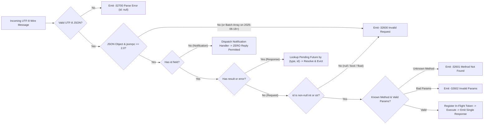
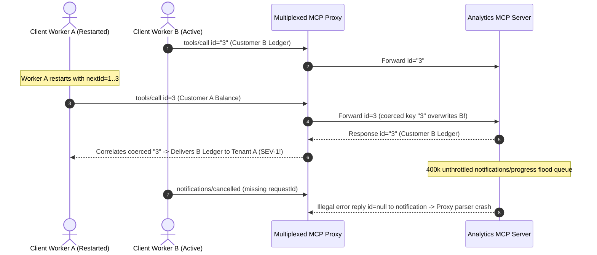

# Module 04: The Protocol: JSON-RPC Foundations

> **Prerequisites:** [Module 02: MCP vs. Function Calling vs. Plugins](../02-mcp-vs-function-calling-vs-plugins/README.md) and [Module 03: Architecture: Hosts, Clients and Servers](../03-architecture-hosts-clients-and-servers/README.md).  
> **Estimated Reading Time:** 30 minutes  
> **Target Audience:** AI Backend Engineers, Protocol Infrastructure Developers, Agent Runtime Engineers

> [!TIP]
> **The Golden Rule of MCP JSON-RPC Foundations:** Treat JSON-RPC 2.0 in MCP as a **strictly typed, correlation-tracked duplex envelope—never loose REST-over-JSON**: every `Request` requires a non-null session-unique `id` and receives exactly one matching `Response`, every `Notification` omits `id` and forbids any reply, and every in-flight call must track `(type(id), id)`, `_meta.progressToken`, and `notifications/cancelled` to prevent cross-session data leaks and zombie execution.

---

## Why This Matters

When engineers first open an MCP wire trace, they often dismiss it as trivial JSON payloads wrapped with `"jsonrpc": "2.0"`. That assumption works in a single-threaded toy demo—and blows up catastrophically in concurrent production agent runtimes.

Unlike stateless HTTP REST where a client sends one request and blocks on one reply, MCP runs a **bidirectional, full-duplex RPC protocol**. While a client waits on a slow `tools/call`, the server can fire `notifications/progress` updates every `250 ms` *and* issue a reverse server-to-client `sampling/createMessage` or `roots/list` request over the exact same stream. If your dispatcher treats notifications like requests and replies with an error envelope, resets sequential integer IDs (`1`, `2`, `3`) on reconnects, conflates numeric `1` with string `"1"`, or ignores `notifications/cancelled` races, you trigger silent response hijacking—injecting User A's database query result straight into User B's LLM prompt.

---

## 1. Wire-Level JSON-RPC 2.0 Envelope Anatomy in MCP

Every message exchanged between an MCP Client and MCP Server is UTF-8 encoded JSON-RPC 2.0. The MCP specification imposes **stricter constraints** than generic JSON-RPC 2.0 on message IDs and batching:

1. **Request Object (Expects Exactly One Response):**
   - `"jsonrpc": "2.0"` (exact string literal; missing or `"1.0"` is `-32600`).
   - `"id"`: MUST be a **string or integer** and **MUST NOT be `null`** (MCP tightens generic JSON-RPC 2.0 here to guarantee unambiguous correlation). A sender MUST NOT reuse an `id` within the same active session.
   - `"method"`: string naming the RPC operation (e.g., `"tools/call"`, `"resources/read"`, `"sampling/createMessage"`).
   - `"params"` *(optional)*: structured JSON object (or omitted). Special MCP metadata lives under `"params": { "_meta": { "progressToken": "..." } }`.

2. **Response Object (`result` and `error` Are Mutually Exclusive):**
   - `"jsonrpc": "2.0"`
   - `"id"`: MUST echo the **exact value and JSON type** of the originating Request's `id` (`1` and `"1"` are distinct keys; only parse/invalid-request failures before an ID can be extracted use `"id": null`).
   - Either `"result": <any JSON value>` **OR** `"error": { "code": <int>, "message": <string>, "data"?: <any> }` — **never both and never neither**.

3. **Notification Object (One-Way Fire-and-Forget):**
   - `"jsonrpc": "2.0"`
   - `"method"`: string (MCP notifications conventionally start with `"notifications/"`, e.g., `"notifications/initialized"`, `"notifications/progress"`, `"notifications/cancelled"`).
   - `"params"` *(optional)*: structured object.
   - **Invariant:** A Notification **MUST NOT** include an `"id"` field, and the receiver **MUST NEVER** send back a Response (not even an error object if the notification was malformed!).

4. **Batching Evolution (`2025-03-26` vs. `2025-06-18+`):**
   - Generic JSON-RPC 2.0 permits JSON array batching (`[{...}, {...}]`). MCP briefly permitted batching in `2025-03-26`, then **removed JSON-RPC batching in `2025-06-18`** to simplify stream correlation, per-request HTTP SSE framing, and bidirectional server requests. Compliant `2025-06-18+` peers reject top-level JSON arrays with `-32600 Invalid Request`.



### Standard JSON-RPC 2.0 Error Code Space

The JSON-RPC 2.0 specification reserves codes `-32768` through `-32000` for protocol and implementation-defined server errors:

| Code | Standard Name | Exact Trigger Condition | Typical Wire `id` Echoed |
| :--- | :--- | :--- | :--- |
| **`-32700`** | **Parse error** | Invalid UTF-8 bytes or malformed JSON syntax received by parser | `null` (ID unparseable) |
| **`-32600`** | **Invalid Request** | Missing `"jsonrpc": "2.0"`, `"id": null`, missing `method`, batch array on `2025-06-18+`, or pre-init protocol violation | Request `id` or `null` |
| **`-32601`** | **Method not found** | RPC `method` does not exist or its capability was not negotiated during initialization | Request `id` |
| **`-32602`** | **Invalid params** | `params` missing required keys, wrong field types, or unknown tool name in `tools/call` | Request `id` |
| **`-32603`** | **Internal error** | Unhandled runtime panic/exception inside the JSON-RPC server framework itself | Request `id` |
| **`-32000` to `-32099`** | **Server error (Reserved)** | Implementation-defined transport/application errors (e.g., `-32002` commonly used in MCP SDKs for Resource not found, `-32001` request timeout) | Request `id` |

> [!WARNING]
> **Never confuse protocol errors (`error`) with tool business failures (`isError: true`):** When a database query fails syntax validation or an external API returns HTTP `429`, `tools/call` returns a normal JSON-RPC `result` containing `"isError": true` so the LLM can read the error and recover—covered in depth in [Module 08](../08-primitive-tools/README.md).

### Bidirectional Duplex Requests, Progress, and Cancellation

Because MCP operates over a **symmetric duplex channel**, *both* sides maintain an outbound ID generator and an in-flight correlation map:

- **Client $\rightarrow$ Server Requests:** `initialize`, `tools/list`, `tools/call`, `resources/read`, `prompts/get`, `ping`.
- **Server $\rightarrow$ Client Requests:** `sampling/createMessage`, `roots/list`, `elicitation/create`, `ping`. Note that Server `id: 1` and Client `id: 1` do **not** collide only if each side tracks *outbound* pending requests separately from *inbound* active requests!
- **Progress (`notifications/progress`):** A sender attaches `"params": { "_meta": { "progressToken": "tok-42" } }` (non-null string or integer, unique among active requests). The receiver emits `notifications/progress` frames with `{"progressToken": "tok-42", "progress": 250, "total": 1000, "message": "Indexing shard 1/4"}`. `progress` values MUST increase monotonically, SHOULD remain $\le \text{total}$ when `total` is known, and MUST cease once the final Response is sent.
- **Cancellation (`notifications/cancelled`):** Either peer can abort its own previously sent Request by transmitting `{"jsonrpc": "2.0", "method": "notifications/cancelled", "params": {"requestId": 42, "reason": "User cancelled"}}`. Because responses and cancellations travel asynchronously, **race conditions are guaranteed**: if `requestId` already finished or is unknown, the receiver MUST silently ignore the cancellation (no response, no error), and MUST avoid sending a duplicate Response if cancellation wins first.

### Quantitative Envelope, Memory, and Control-Plane Math

Before deploying high-concurrency MCP servers, bound three protocol quantities:

- **In-Flight Correlation Table Memory:** For $N_{\text{inflight}}$ concurrent pending requests per gateway, where each entry stores a typed `(type, id)` key ($S_{\text{key}}$), callback/channel future ($S_{\text{future}}$), and deadline/progress metadata ($S_{\text{meta}}$):

$$M_{\text{pending}} \approx N_{\text{inflight}} \cdot \left(S_{\text{key}} + S_{\text{future}} + S_{\text{meta}}\right)$$

- **Progress Notification Bandwidth Ratio:** If a tool runs for duration $T_{\text{exec}}$ seconds while emitting `notifications/progress` at frequency $f_{\text{prog}}$ Hz with serialized frame size $B_{\text{prog}}$ bytes, total control-plane overhead is:

$$B_{\text{overhead}} = f_{\text{prog}} \cdot T_{\text{exec}} \cdot B_{\text{prog}}, \qquad \eta_{\text{prog}} = \frac{f_{\text{prog}} \cdot T_{\text{exec}} \cdot B_{\text{prog}}}{B_{\text{req}} + B_{\text{res}}}$$

Emitting unthrottled progress inside a `500 Hz` loop over `4.0 s` sends `2,000` frames (`320 KB` of control-plane noise) for a single `2 KB` tool response ($\eta_{\text{prog}} = 156.25\times$)! Throttle progress emission to $\le 2\text{–}5\text{ Hz}$ or step deltas $\ge 5\%\text{–}10\%$.

- **Orphaned Slot Accumulation Without Cancellation:** If clients disconnect at rate $\lambda_{\text{abort}}$ (req/s) and uncancelled workers linger until upstream timeout $T_{\text{orphan}}$, Little's Law guarantees leaked worker slots equal:

$$W_{\text{orphan}} = \lambda_{\text{abort}} \cdot T_{\text{orphan}}$$

At $\lambda_{\text{abort}} = 15\text{ req/s}$ and an uncancelled `120 s` SQL query timeout, `1,800` database workers stay pinned doing dead work unless `notifications/cancelled` triggers immediate `context.Cancel()` / `AbortController.abort()`.

---

## 2. Systematic Comparison Matrix: JSON-RPC 2.0 (MCP) vs. Alternative RPC/API Protocols

| Dimension | JSON-RPC 2.0 (MCP Profile) | REST / OpenAPI (HTTP/1.1–2) | gRPC (HTTP/2 + Protobuf) | GraphQL (HTTP POST) |
| :--- | :--- | :--- | :--- | :--- |
| **Wire Format & Framing** | UTF-8 JSON; transport-agnostic (`\n` stdio or HTTP/SSE) | JSON over HTTP verbs + URL paths | Binary Protobuf length-prefixed HTTP/2 frames | JSON query/mutation string over HTTP |
| **Native Server-to-Client Calls** | **First-class duplex** (`sampling`, `roots` over same session) | None natively (requires webhooks/polling) | Bidirectional streams (app-defined framing) | Subscriptions only (not arbitrary RPC requests) |
| **Correlation & Multiplexing** | Explicit typed `id` (`string \| int`, non-null, single-session unique) | Request/response bound to HTTP stream order | HTTP/2 Stream ID managed at L7 transport | Sequential HTTP or client-tagged WS frames |
| **Error Semantics** | Standard `-32700..-32603` + structured `error.data` | HTTP status codes (`4xx/5xx`) + ad-hoc JSON | `grpc-status` codes + `google.rpc.Status` | `200 OK` wrapping partial `errors[]` array |
| **Progress & Cancellation** | Native `notifications/progress` + `notifications/cancelled` | Non-standard (polling or custom SSE) | HTTP/2 `RST_STREAM` cancellation; custom progress | Non-standard |
| **LLM / Tool Ecosystem Fit** | High — human-inspectable JSON, minimal transport assumptions | Moderate — no standard server-push/sampling | Low for dynamic third-party agent plugins (requires `.proto` compilation) | Low — query planner overhead for simple tool calls |

---

## 3. Production War Story Post-Mortem: The \$94,000 Silent ID-Collision & Progress Flood Outage

| Field | Incident Details |
| :--- | :--- |
| **Severity** | **SEV-1** (Cross-Tenant Data Misrouting & MCP Gateway Buffer Exhaustion) |
| **Detection / Resolution Time** | Detected 45 minutes post-deploy via customer escalation / Mitigated in 2 hours (gateway drained, ID allocator & throttler patched) |
| **Impact** | `11` enterprise prompts received another tenant's tool output via ID collision; **\$94,000** SLA credit exposure; gateway workers saturated on `2.4 GB/min` progress frame floods |

### What Happened

A fintech engineering team built an internal Node/Python MCP proxy pooling long-lived backend connections to a shared `analytics-mcp` worker process. Three JSON-RPC bugs occurred simultaneously under load:

1. **ID Counter Reset & String/Int Coercion:** Each stateless API worker initialized a local counter `nextId = 1` for outbound requests and stored pending promises in a JavaScript object keyed by coerced string `pending[String(msg.id)]`. When Worker A restarted after an OOM, it sent `id: 3` while Worker B already had `id: "3"` in flight over the multiplexed channel—swapping query results between two customers!
2. **Error Loop on Malformed Notification:** When an upstream client aborted a call and accidentally sent a buggy `notifications/cancelled` missing `requestId`, the server replied with a JSON-RPC `-32602` error envelope containing `"id": null`. The client proxy attempted to correlate `"id": null`, crashed its parser loop, and triggered aggressive reconnect storms.
3. **Unthrottled Progress Loop:** A `400,000`-row Snowflake export loop called `emit_progress()` on *every single row*, generating `400,000` JSON-RPC `notifications/progress` frames in `6 seconds`—exhausting the socket write buffer and starving all `ping` and cancellation frames behind the queue.



### Root Cause Analysis

- Outbound request IDs were generated by per-worker resetting integers (`1, 2, 3`) instead of collision-free session-unique IDs (`UUIDv7` or monotonic atomic `uint64` prefixed by worker epoch), and correlation maps coerced integer `3` and string `"3"` to the same map key.
- The dispatcher violated the JSON-RPC 2.0 **zero-reply rule for notifications**, transmitting a `-32602` response to a message lacking `"id"`.
- Progress updates lacked time/percentage throttling, letting tight data loops starve control frames on the duplex stream.

### The Fix & Architectural Hardening

- **Typed Monotonic Session IDs:** Switched outbound IDs to monotonic atomic counters scoped strictly per transport session (`"w<epoch>-<seq>"`) and indexed correlation maps by composite `(type, id)` keys.
- **Strict Notification Firewall:** Added an early envelope invariant guard: if `"id"` is absent, drop into the notification path where the response writer handle is `nil`—making it structurally impossible to emit a response to a notification.
- **Debounced Progress & Cooperative Cancellation:** Throttled `notifications/progress` with both a `200 ms` minimum interval and `>= 5%` progress delta, and wired `notifications/cancelled` directly to each request's cancellation token (`context.Context` / `AbortController`).

---

## 4. Multi-Language Production Implementation: Duplex JSON-RPC 2.0 Codec & Correlation Router

Below is a production-hardened **JSON-RPC 2.0 Envelope Validator & Correlation Router** across **Go**, **TypeScript**, **Python**, and **C#**. Every implementation enforces MCP's non-null `string | int` ID rule, rejects batch arrays (`2025-06-18+`), guarantees zero replies to notifications, tracks strict `(type, id)` correlation, and handles `notifications/cancelled` races cleanly.

````carousel

```go
package mcprpc

import (
	"bytes"
	"context"
	"encoding/json"
	"errors"
	"fmt"
	"sync"
	"sync/atomic"
)

const (
	CodeParseError     = -32700
	CodeInvalidRequest = -32600
	CodeMethodNotFound = -32601
	CodeInvalidParams  = -32602
	CodeInternalError  = -32603
)

type RPCError struct {
	Code    int    `json:"code"`
	Message string `json:"message"`
	Data    any    `json:"data,omitempty"`
}

type Envelope struct {
	JSONRPC string          `json:"jsonrpc"`
	ID      json.RawMessage `json:"id,omitempty"`
	Method  string          `json:"method,omitempty"`
	Params  json.RawMessage `json:"params,omitempty"`
	Result  json.RawMessage `json:"result,omitempty"`
	Error   *RPCError       `json:"error,omitempty"`
}

type IDKey struct {
	Kind string // "int" or "str"
	Raw  string
}

func ParseStrictID(raw json.RawMessage) (IDKey, error) {
	trimmed := bytes.TrimSpace(raw)
	if len(trimmed) == 0 || bytes.Equal(trimmed, []byte("null")) {
		return IDKey{}, errors.New("id must not be null or empty in MCP")
	}
	if trimmed[0] == '"' {
		var s string
		if err := json.Unmarshal(trimmed, &s); err != nil {
			return IDKey{}, err
		}
		return IDKey{Kind: "str", Raw: s}, nil
	}
	var n int64
	dec := json.NewDecoder(bytes.NewReader(trimmed))
	dec.UseNumber()
	if err := json.Unmarshal(trimmed, &n); err != nil {
		return IDKey{}, errors.New("numeric id must be an integer")
	}
	return IDKey{Kind: "int", Raw: fmt.Sprintf("%d", n)}, nil
}

type Router struct {
	seq       atomic.Uint64
	mu        sync.Mutex
	outbound  map[IDKey]chan Envelope
	inflight  map[IDKey]context.CancelFunc
	seenInIDs map[IDKey]struct{}
}

func NewRouter() *Router {
	return &Router{
		outbound:  make(map[IDKey]chan Envelope),
		inflight:  make(map[IDKey]context.CancelFunc),
		seenInIDs: make(map[IDKey]struct{}),
	}
}

func (r *Router) NextID() json.RawMessage {
	id := fmt.Sprintf(`"req-%d"`, r.seq.Add(1))
	return json.RawMessage(id)
}

func (r *Router) HandleRaw(ctx context.Context, raw []byte, handler func(context.Context, string, json.RawMessage) (json.RawMessage, *RPCError)) ([]byte, error) {
	trimmed := bytes.TrimSpace(raw)
	if len(trimmed) > 0 && trimmed[0] == '[' {
		return marshalErr(json.RawMessage("null"), CodeInvalidRequest, "JSON-RPC batching is disabled in MCP 2025-06-18+")
	}
	var env Envelope
	if err := json.Unmarshal(trimmed, &env); err != nil {
		return marshalErr(json.RawMessage("null"), CodeParseError, "Parse error")
	}
	if env.JSONRPC != "2.0" {
		return marshalErr(json.RawMessage("null"), CodeInvalidRequest, "jsonrpc must equal 2.0")
	}

	// Response branch: match outbound pending call
	if env.Method == "" && (len(env.Result) > 0 || env.Error != nil) {
		if len(env.Result) > 0 && env.Error != nil {
			return nil, errors.New("invalid response: result and error are mutually exclusive")
		}
		key, err := ParseStrictID(env.ID)
		if err != nil {
			return nil, err
		}
		r.mu.Lock()
		ch, ok := r.outbound[key]
		if ok {
			delete(r.outbound, key)
		}
		r.mu.Unlock()
		if ok {
			ch <- env
		}
		return nil, nil
	}

	if env.Method == "" {
		return marshalErr(json.RawMessage("null"), CodeInvalidRequest, "missing method")
	}

	// Notification branch: NO id -> ZERO response permitted
	if len(env.ID) == 0 {
		if env.Method == "notifications/cancelled" {
			var p struct {
				RequestID json.RawMessage `json:"requestId"`
			}
			if json.Unmarshal(env.Params, &p) == nil {
				if key, err := ParseStrictID(p.RequestID); err == nil {
					r.mu.Lock()
					cancel, active := r.inflight[key]
					r.mu.Unlock()
					if active {
						cancel() // Silent no-op if already finished
					}
				}
			}
		}
		return nil, nil
	}

	// Request branch: enforce non-null unique id
	key, err := ParseStrictID(env.ID)
	if err != nil {
		return marshalErr(json.RawMessage("null"), CodeInvalidRequest, err.Error())
	}
	reqCtx, cancel := context.WithCancel(ctx)
	r.mu.Lock()
	if _, dup := r.seenInIDs[key]; dup {
		r.mu.Unlock()
		return marshalErr(env.ID, CodeInvalidRequest, "duplicate request id in session")
	}
	r.seenInIDs[key] = struct{}{}
	r.inflight[key] = cancel
	r.mu.Unlock()

	defer func() {
		cancel()
		r.mu.Lock()
		delete(r.inflight, key)
		r.mu.Unlock()
	}()

	res, rpcErr := handler(reqCtx, env.Method, env.Params)
	if reqCtx.Err() != nil {
		return nil, nil // Request cancelled before reply
	}
	if rpcErr != nil {
		return marshalErr(env.ID, rpcErr.Code, rpcErr.Message)
	}
	return json.Marshal(Envelope{JSONRPC: "2.0", ID: env.ID, Result: res})
}

func marshalErr(id json.RawMessage, code int, msg string) ([]byte, error) {
	return json.Marshal(Envelope{
		JSONRPC: "2.0",
		ID:      id,
		Error:   &RPCError{Code: code, Message: msg},
	})
}
```

<!-- slide -->

```typescript
export type JsonRpcId = string | number;

export interface JsonRpcError {
  readonly code: number;
  readonly message: string;
  readonly data?: unknown;
}

export interface JsonRpcResponse {
  readonly jsonrpc: "2.0";
  readonly id: JsonRpcId | null;
  readonly result?: unknown;
  readonly error?: JsonRpcError;
}

function idKey(id: unknown): string | null {
  if (typeof id === "string") return `str:${id}`;
  if (typeof id === "number" && Number.isInteger(id)) return `int:${id}`;
  return null;
}

export class McpJsonRpcRouter {
  private readonly outbound = new Map<string, { resolve: (v: unknown) => void; reject: (e: unknown) => void }>();
  private readonly inflight = new Map<string, AbortController>();
  private readonly seenInbound = new Set<string>();
  private seq = 0;

  public nextId(): string {
    this.seq += 1;
    return `cli-${this.seq}`;
  }

  public async dispatchRaw(
    rawLine: string,
    handleRequest: (method: string, params: Record<string, unknown>, signal: AbortSignal) => Promise<unknown>,
    handleNotification?: (method: string, params: Record<string, unknown>) => void,
  ): Promise<string | null> {
    let parsed: unknown;
    try {
      parsed = JSON.parse(rawLine);
    } catch {
      return JSON.stringify({ jsonrpc: "2.0", id: null, error: { code: -32700, message: "Parse error" } });
    }

    if (Array.isArray(parsed)) {
      return JSON.stringify({
        jsonrpc: "2.0",
        id: null,
        error: { code: -32600, message: "Invalid Request: batching unsupported in MCP 2025-06-18+" },
      });
    }
    if (typeof parsed !== "object" || parsed === null || (parsed as Record<string, unknown>).jsonrpc !== "2.0") {
      return JSON.stringify({ jsonrpc: "2.0", id: null, error: { code: -32600, message: "Invalid Request" } });
    }

    const msg = parsed as Record<string, unknown>;

    // Response frame (must contain XOR result/error)
    if (!("method" in msg) && ("result" in msg || "error" in msg)) {
      if ("result" in msg && "error" in msg) {
        throw new Error("Protocol violation: Response cannot contain both result and error");
      }
      const key = idKey(msg.id);
      if (!key) return null;
      const waiter = this.outbound.get(key);
      if (waiter) {
        this.outbound.delete(key);
        if ("error" in msg) waiter.reject(msg.error);
        else waiter.resolve(msg.result);
      }
      return null;
    }

    if (typeof msg.method !== "string" || msg.method.length === 0) {
      return JSON.stringify({ jsonrpc: "2.0", id: null, error: { code: -32600, message: "Invalid Request: missing method" } });
    }

    const params = (typeof msg.params === "object" && msg.params !== null ? msg.params : {}) as Record<string, unknown>;

    // Notification: NO id -> strictly ZERO response bytes allowed
    if (!("id" in msg)) {
      if (msg.method === "notifications/cancelled") {
        const key = idKey(params.requestId);
        if (key) {
          this.inflight.get(key)?.abort(params.reason ?? "cancelled");
        }
      } else {
        handleNotification?.(msg.method, params);
      }
      return null;
    }

    const key = idKey(msg.id);
    if (!key) {
      return JSON.stringify({ jsonrpc: "2.0", id: null, error: { code: -32600, message: "Invalid Request: id must be string or integer" } });
    }
    if (this.seenInbound.has(key)) {
      return JSON.stringify({ jsonrpc: "2.0", id: msg.id as JsonRpcId, error: { code: -32600, message: "Duplicate session request id" } });
    }
    this.seenInbound.add(key);

    const controller = new AbortController();
    this.inflight.set(key, controller);
    try {
      const result = await handleRequest(msg.method, params, controller.signal);
      if (controller.signal.aborted) return null;
      return JSON.stringify({ jsonrpc: "2.0", id: msg.id as JsonRpcId, result });
    } catch (err: unknown) {
      if (controller.signal.aborted) return null;
      const code = typeof (err as { code?: number })?.code === "number" ? (err as { code: number }).code : -32603;
      const message = err instanceof Error ? err.message : "Internal error";
      return JSON.stringify({ jsonrpc: "2.0", id: msg.id as JsonRpcId, error: { code, message } });
    } finally {
      this.inflight.delete(key);
    }
  }
}
```

<!-- slide -->

```python
"""
mcp_jsonrpc_router.py
Strict MCP JSON-RPC 2.0 envelope validator, typed correlation router, and throttled progress tracker.
"""
from __future__ import annotations

import json
import threading
import time
from typing import Any, Callable


class RpcMethodError(Exception):
    def __init__(self, code: int, message: str, data: Any = None) -> None:
        super().__init__(message)
        self.code = code
        self.message = message
        self.data = data


def strict_id_key(req_id: Any) -> tuple[str, str | int] | None:
    if isinstance(req_id, bool):
        return None
    if isinstance(req_id, int):
        return ("int", req_id)
    if isinstance(req_id, str):
        return ("str", req_id)
    return None


class ProgressThrottler:
    """Rate-limits notifications/progress to avoid saturating duplex pipes or SSE queues."""

    def __init__(self, min_interval_sec: float = 0.2, min_pct_step: float = 5.0) -> None:
        self._min_interval = min_interval_sec
        self._min_pct = min_pct_step
        self._last_ts = 0.0
        self._last_pct = -min_pct_step

    def maybe_build(self, token: str | int, progress: float, total: float | None, message: str = "") -> dict[str, Any] | None:
        now = time.monotonic()
        pct = (progress / total * 100.0) if total and total > 0 else progress
        is_final = total is not None and progress >= total
        if not is_final and (now - self._last_ts) < self._min_interval and (pct - self._last_pct) < self._min_pct:
            return None
        self._last_ts = now
        self._last_pct = pct
        params: dict[str, Any] = {"progressToken": token, "progress": progress}
        if total is not None:
            params["total"] = total
        if message:
            params["message"] = message
        return {"jsonrpc": "2.0", "method": "notifications/progress", "params": params}


class McpJsonRpcDispatcher:
    def __init__(self) -> None:
        self._lock = threading.Lock()
        self._inflight: dict[tuple[str, str | int], threading.Event] = {}
        self._seen_ids: set[tuple[str, str | int]] = set()

    def _err(self, req_id: str | int | None, code: int, message: str) -> str:
        return json.dumps({"jsonrpc": "2.0", "id": req_id, "error": {"code": code, "message": message}}, separators=(",", ":"))

    def handle_line(
        self,
        raw_line: str,
        handler: Callable[[str, dict[str, Any], threading.Event], Any],
    ) -> str | None:
        try:
            msg = json.loads(raw_line)
        except json.JSONDecodeError:
            return self._err(None, -32700, "Parse error")

        if isinstance(msg, list):
            return self._err(None, -32600, "Invalid Request: JSON-RPC batching removed in MCP 2025-06-18+")
        if not isinstance(msg, dict) or msg.get("jsonrpc") != "2.0" or not isinstance(msg.get("method"), str):
            return self._err(None, -32600, "Invalid Request")

        method = msg["method"]
        params = msg.get("params") if isinstance(msg.get("params"), dict) else {}

        # Notification path: MUST return None (no reply permitted)
        if "id" not in msg:
            if method == "notifications/cancelled":
                key = strict_id_key(params.get("requestId"))
                if key is not None:
                    with self._lock:
                        ev = self._inflight.get(key)
                    if ev is not None:
                        ev.set()
            return None

        req_id = msg["id"]
        key = strict_id_key(req_id)
        if key is None:
            return self._err(None, -32600, "Invalid Request: id must be non-null string or integer")

        cancel_ev = threading.Event()
        with self._lock:
            if key in self._seen_ids:
                return self._err(req_id, -32600, "Invalid Request: duplicate request id in session")
            self._seen_ids.add(key)
            self._inflight[key] = cancel_ev

        try:
            result = handler(method, params, cancel_ev)
            if cancel_ev.is_set():
                return None
            return json.dumps({"jsonrpc": "2.0", "id": req_id, "result": result}, separators=(",", ":"))
        except RpcMethodError as exc:
            return None if cancel_ev.is_set() else self._err(req_id, exc.code, exc.message)
        except Exception:
            return None if cancel_ev.is_set() else self._err(req_id, -32603, "Internal error")
        finally:
            with self._lock:
                self._inflight.pop(key, None)
```

<!-- slide -->

```csharp
using System;
using System.Collections.Concurrent;
using System.Collections.Generic;
using System.Text.Json;
using System.Text.Json.Nodes;
using System.Threading;
using System.Threading.Tasks;

namespace GenAI.Mcp.Protocol;

public sealed record RpcError(int Code, string Message);

public sealed class McpJsonRpcDispatcher
{
    private readonly ConcurrentDictionary<string, CancellationTokenSource> _inflight = new();
    private readonly ConcurrentDictionary<string, byte> _seenInboundIds = new();

    private static string? TryTypedKey(JsonNode? idNode)
    {
        if (idNode is not JsonValue val) return null;
        if (val.TryGetValue<string>(out var s)) return $"str:{s}";
        if (val.TryGetValue<long>(out var i)) return $"int:{i}";
        return null; // Rejects null, bool, double, object, array
    }

    private static string BuildError(JsonNode? idNode, int code, string message)
    {
        var resp = new JsonObject
        {
            ["jsonrpc"] = "2.0",
            ["id"] = idNode?.DeepClone(),
            ["error"] = new JsonObject { ["code"] = code, ["message"] = message }
        };
        return resp.ToJsonString();
    }

    public async Task<string?> DispatchAsync(
        string rawJson,
        Func<string, JsonObject, CancellationToken, Task<JsonNode>> handler,
        CancellationToken hostCt)
    {
        JsonNode? node;
        try
        {
            node = JsonNode.Parse(rawJson);
        }
        catch (JsonException)
        {
            return BuildError(null, -32700, "Parse error");
        }

        if (node is JsonArray)
            return BuildError(null, -32600, "Invalid Request: batching unsupported in MCP 2025-06-18+");

        if (node is not JsonObject obj || obj["jsonrpc"]?.GetValue<string>() != "2.0")
            return BuildError(null, -32600, "Invalid Request");

        var method = obj["method"]?.GetValue<string>();
        if (string.IsNullOrEmpty(method))
            return BuildError(null, -32600, "Invalid Request: missing method");

        var paramsObj = obj["params"] as JsonObject ?? new JsonObject();

        // Notification branch: zero reply permitted
        if (!obj.ContainsKey("id"))
        {
            if (method == "notifications/cancelled")
            {
                var targetKey = TryTypedKey(paramsObj["requestId"]);
                if (targetKey != null && _inflight.TryGetValue(targetKey, out var cts))
                    cts.Cancel();
            }
            return null;
        }

        var idNode = obj["id"];
        var key = TryTypedKey(idNode);
        if (key == null)
            return BuildError(null, -32600, "Invalid Request: id must be non-null string or integer");

        if (!_seenInboundIds.TryAdd(key, 0))
            return BuildError(idNode, -32600, "Invalid Request: duplicate request id");

        using var linkedCts = CancellationTokenSource.CreateLinkedTokenSource(hostCt);
        _inflight[key] = linkedCts;
        try
        {
            var result = await handler(method, paramsObj, linkedCts.Token);
            if (linkedCts.IsCancellationRequested) return null;

            return new JsonObject
            {
                ["jsonrpc"] = "2.0",
                ["id"] = idNode!.DeepClone(),
                ["result"] = result
            }.ToJsonString();
        }
        catch (OperationCanceledException)
        {
            return null;
        }
        catch (KeyNotFoundException)
        {
            return BuildError(idNode, -32601, $"Method not found: {method}");
        }
        catch (ArgumentException ex)
        {
            return BuildError(idNode, -32602, ex.Message);
        }
        catch (Exception)
        {
            return BuildError(idNode, -32603, "Internal error");
        }
        finally
        {
            _inflight.TryRemove(key, out _);
        }
    }
}
```

````

---

## 5. Practical Hands-On Verification CLI Workflows

Run these deterministic Python 3.13 verification scripts offline—zero third-party libraries or API keys required.

### Workflow 1: Strict JSON-RPC 2.0 Wire Validator & Error Code Router

Verify how an MCP dispatcher routes valid requests, enforces zero-reply semantics on notifications, rejects `id: null` and batch arrays (`2025-06-18+`), and maps `-32700`, `-32600`, `-32601`, and `-32602`:

```bash
python -c '
import json

KNOWN_METHODS = {"tools/list", "tools/call", "ping"}

def dispatch_wire(raw_line):
    try:
        msg = json.loads(raw_line)
    except json.JSONDecodeError as exc:
        return json.dumps({"jsonrpc": "2.0", "id": None, "error": {"code": -32700, "message": f"Parse error: {exc.msg}"}})
    if isinstance(msg, list):
        return json.dumps({"jsonrpc": "2.0", "id": None, "error": {"code": -32600, "message": "Invalid Request: JSON-RPC batching disabled in MCP 2025-06-18+"}})
    if not isinstance(msg, dict) or msg.get("jsonrpc") != "2.0" or not isinstance(msg.get("method"), str):
        req_id = msg.get("id") if isinstance(msg, dict) else None
        return json.dumps({"jsonrpc": "2.0", "id": req_id, "error": {"code": -32600, "message": "Invalid Request: bad envelope"}})
    if "id" not in msg:
        return None
    req_id = msg["id"]
    if req_id is None or isinstance(req_id, bool) or not isinstance(req_id, (int, str)):
        return json.dumps({"jsonrpc": "2.0", "id": None, "error": {"code": -32600, "message": "Invalid Request: MCP id must be non-null string or integer"}})
    method = msg["method"]
    params = msg.get("params", {})
    if method not in KNOWN_METHODS:
        return json.dumps({"jsonrpc": "2.0", "id": req_id, "error": {"code": -32601, "message": f"Method not found: {method}"}})
    if method == "tools/call" and (not isinstance(params, dict) or not isinstance(params.get("name"), str)):
        return json.dumps({"jsonrpc": "2.0", "id": req_id, "error": {"code": -32602, "message": "Invalid params: tools/call requires string name"}})
    return json.dumps({"jsonrpc": "2.0", "id": req_id, "result": {"ok": True, "method": method}})

wires = [
    ("Valid Request", "{\"jsonrpc\":\"2.0\",\"id\":1,\"method\":\"ping\"}"),
    ("Notification", "{\"jsonrpc\":\"2.0\",\"method\":\"notifications/initialized\"}"),
    ("Broken JSON", "{\"jsonrpc\":\"2.0\",\"id\":2,"),
    ("Null ID", "{\"jsonrpc\":\"2.0\",\"id\":null,\"method\":\"ping\"}"),
    ("Batch Array", "[{\"jsonrpc\":\"2.0\",\"id\":3,\"method\":\"ping\"}]"),
    ("Unknown Method", "{\"jsonrpc\":\"2.0\",\"id\":\"req-4\",\"method\":\"unknown/op\"}"),
    ("Invalid Params", "{\"jsonrpc\":\"2.0\",\"id\":5,\"method\":\"tools/call\",\"params\":{\"name\":42}}"),
]

for label, raw in wires:
    out = dispatch_wire(raw)
    rendered = out if out is not None else "<NO RESPONSE PERMITTED>"
    print(f"{label:<16} -> {rendered}")
'
```

**Expected Output:**

```text
Valid Request    -> {"jsonrpc": "2.0", "id": 1, "result": {"ok": true, "method": "ping"}}
Notification     -> <NO RESPONSE PERMITTED>
Broken JSON      -> {"jsonrpc": "2.0", "id": null, "error": {"code": -32700, "message": "Parse error: Expecting property name enclosed in double quotes"}}
Null ID          -> {"jsonrpc": "2.0", "id": null, "error": {"code": -32600, "message": "Invalid Request: MCP id must be non-null string or integer"}}
Batch Array      -> {"jsonrpc": "2.0", "id": null, "error": {"code": -32600, "message": "Invalid Request: JSON-RPC batching disabled in MCP 2025-06-18+"}}
Unknown Method   -> {"jsonrpc": "2.0", "id": "req-4", "error": {"code": -32601, "message": "Method not found: unknown/op"}}
Invalid Params   -> {"jsonrpc": "2.0", "id": 5, "error": {"code": -32602, "message": "Invalid params: tools/call requires string name"}}
```

### Workflow 2: Duplex Correlation Table, Cancellation Race & Progress Throttling

Verify strict `(type, id)` separation between `1` and `"1"`, cooperative suppression of cancelled responses, silent no-op on late `notifications/cancelled`, and `200x` reduction in progress traffic:

```bash
python -c '
class DuplexRouter:
    def __init__(self):
        self.pending = {}
        self.completed = set()
        self.sent_frames = []

    def _key(self, req_id):
        return (type(req_id).__name__, req_id)

    def register_request(self, req_id, method):
        k = self._key(req_id)
        if k in self.pending or k in self.completed:
            raise ValueError(f"Duplicate session request ID: {k}")
        self.pending[k] = {"method": method, "cancelled": False}

    def handle_cancel(self, req_id, reason):
        k = self._key(req_id)
        if k not in self.pending:
            return "SILENT_NOOP_RACE"
        self.pending[k]["cancelled"] = True
        return f"CANCELLED:{reason}"

    def complete_request(self, req_id, value):
        k = self._key(req_id)
        entry = self.pending.pop(k, None)
        self.completed.add(k)
        if entry and entry["cancelled"]:
            return "DROPPED_RESPONSE_ALREADY_CANCELLED"
        self.sent_frames.append({"jsonrpc": "2.0", "id": req_id, "result": value})
        return f"SENT_RESULT:{req_id!r}"

    def emit_throttled_progress(self, token, total_steps, min_delta=250):
        emitted = []
        last_sent = -min_delta
        for step in range(0, total_steps + 1):
            if step - last_sent >= min_delta or step == total_steps:
                emitted.append({"jsonrpc": "2.0", "method": "notifications/progress", "params": {"progressToken": token, "progress": step, "total": total_steps}})
                last_sent = step
        return emitted

router = DuplexRouter()
router.register_request(1, "tools/call")
router.register_request("1", "tools/call")
router.register_request(2, "tools/call")

print("Distinct keys int 1 vs str \"1\":", len(router.pending))
print("Cancel req 2:", router.handle_cancel(2, "user aborted"))
print("Complete req 2:", router.complete_request(2, {"rows": 10}))
print("Complete req 1:", router.complete_request(1, {"rows": 5}))
print("Late cancel req 1:", router.handle_cancel(1, "timeout race"))
print("Complete req \"1\":", router.complete_request("1", {"rows": 9}))
frames = router.emit_throttled_progress("tok-9", 1000, min_delta=250)
last_p = frames[-1]["params"]
prog, tot = last_p["progress"], last_p["total"]
print(f"Progress 1000 raw updates -> {len(frames)} throttled frames, last={prog}/{tot}")
'
```

**Expected Output:**

```text
Distinct keys int 1 vs str "1": 3
Cancel req 2: CANCELLED:user aborted
Complete req 2: DROPPED_RESPONSE_ALREADY_CANCELLED
Complete req 1: SENT_RESULT:1
Late cancel req 1: SILENT_NOOP_RACE
Complete req "1": SENT_RESULT:'1'
Progress 1000 raw updates -> 5 throttled frames, last=1000/1000
```

### Workflow 3: Progress Notification Control-Plane Overhead Sweep

Quantify why unthrottled progress emission saturates stdio pipes and SSE buffers compared to `2 Hz–5 Hz` debouncing for a `4.0 s` tool returning a `2,048`-byte result (`160`-byte progress frame):

```bash
python -c '
def profile_progress(exec_sec=4.0, freq_hz=500.0, frame_bytes=160, payload_bytes=2048):
    notif_count = int(exec_sec * freq_hz)
    overhead_bytes = notif_count * frame_bytes
    eta = overhead_bytes / payload_bytes
    print(f"freq={freq_hz:>5.1f} Hz | frames={notif_count:>4} | ctrl_bytes={overhead_bytes:>7,} B | overhead_ratio={eta:>6.2f}x")

for hz in [500.0, 20.0, 5.0, 2.0]:
    profile_progress(freq_hz=hz)
'
```

**Expected Output:**

```text
freq=500.0 Hz | frames=2000 | ctrl_bytes=320,000 B | overhead_ratio=156.25x
freq= 20.0 Hz | frames=  80 | ctrl_bytes= 12,800 B | overhead_ratio=  6.25x
freq=  5.0 Hz | frames=  20 | ctrl_bytes=  3,200 B | overhead_ratio=  1.56x
freq=  2.0 Hz | frames=   8 | ctrl_bytes=  1,280 B | overhead_ratio=  0.62x
```

### Hands-On Exercises

1. **Boolean ID Rejection Check:** Test passing `"id": true` into your JSON-RPC parser (remember Python's `isinstance(True, int)` is `True`!). Ensure your strict validator rejects booleans with `-32600` rather than storing `("int", True)`.
2. **Result/Error Mutual Exclusion Check:** Extend Workflow 1 to parse incoming *Response* frames and raise a protocol violation error if a peer returns *both* `"result"` and `"error"` or *neither*.
3. **Monotonic Progress Guard:** Add a guard inside `ProgressThrottler` that rejects or clamps out-of-order `progress` values (`progress < prev_progress`) emitted by parallel worker threads.

### Independent Challenge

A multi-agent host connects to a remote MCP server that supports bidirectional `sampling/createMessage` (Server $\rightarrow$ Client) alongside `tools/call` (Client $\rightarrow$ Server). Both peers start generating sequential integer IDs (`1, 2, 3...`). Under heavy load, the Server issues `sampling/createMessage` with `id: 7` at the exact instant the Client issues `tools/call` with `id: 7`, and the transport layer drops both frames into a single shared `in_flight_requests` map keyed solely by `id`. Describe the failure mode, explain why `id: 7` from the server does not collide with `id: 7` from the client when routed properly, and specify the two separate correlation tables required.

<details><summary>Architectural Discussion</summary>

When a single shared map keys inbound and outbound requests together, the Client's own pending `tools/call` (`id: 7`) collides with the Server's incoming `sampling/createMessage` (`id: 7`), or a Server Response (`id: 7`) could resolve the wrong waiter. In a bidirectional duplex RPC peer, **request ID uniqueness is scoped per sender direction**: the Client's outbound `pending_outbound_requests` table tracks IDs *it sent* (waiting on incoming Responses that lack `method`), while its `active_inbound_requests` table tracks IDs *the Server sent* (for incoming Requests carrying `method`, supporting `notifications/cancelled`). Separating dispatch by **message shape** (has `method` $\rightarrow$ inbound Request/Notification vs. lacks `method` and has `result`/`error` $\rightarrow$ outbound Response resolution) eliminates cross-direction ID collisions completely.

</details>

---

## 6. Common Mistakes & Troubleshooting

- **Returning an error response to a malformed Notification:** JSON-RPC 2.0 forbids replying to any message without `"id"`. Sending `{"jsonrpc":"2.0","id":null,"error":...}` for a bad notification confuses clients expecting strict request-response pairing. Log it to `stderr` or server telemetry instead.
- **Accepting `"id": null` on MCP Requests:** While base JSON-RPC 2.0 discourages `null` IDs, MCP **explicitly prohibits `"id": null` on Requests** and prohibits reusing IDs within a session. Reject `"id": null` with `-32600`.
- **Forgetting Python `isinstance(True, int) == True` or JS loose equality:** Passing `id: true` or keying maps with `pending[String(id)]` lets `1` and `"1"` collide or allows boolean IDs past naive `int` checks. Always check type explicitly before indexing.
- **Emitting `-32601 Method not found` for missing `progressToken` or `notifications/cancelled` races:** A `notifications/cancelled` arriving milliseconds after the request finished is normal async behavior on the wire—ignore it silently rather than logging panic alerts or emitting error frames.

---

## 7. Operational Validation Checkpoints & Checkpoint Quiz

### Operational Validation Checkpoints

<details><summary><strong>Checkpoint 1: Diagnosing a response-to-notification loop</strong></summary>

A client logs `Unmatched response id=null (-32602)` right after sending `notifications/progress`, causing the transport reader to drop the connection. What rule did the server violate?

**Validation:** `notifications/progress` omits `"id"` and is a JSON-RPC **Notification**. Even if `params` failed schema checks, the receiver is strictly forbidden by JSON-RPC 2.0 from transmitting *any* Response object (including an `"id": null` error) back to a notification.

</details>

<details><summary><strong>Checkpoint 2: Explaining batch array rejection on modern MCP peers</strong></summary>

An older client sends `[{"jsonrpc":"2.0","id":1,"method":"ping"},{"jsonrpc":"2.0","id":2,"method":"tools/list"}]` to a `2025-06-18` MCP server and receives `-32600 Invalid Request`. Why?

**Validation:** While generic JSON-RPC 2.0 supports JSON array batching (briefly permitted in MCP `2025-03-26`), MCP **removed batching support in `2025-06-18+`** to simplify Streamable HTTP SSE scoping and correlation. Send individual JSON objects (`{...}`) rather than arrays.

</details>

<details><summary><strong>Checkpoint 3: Preventing cancellation race double-replies</strong></summary>

A client sends `notifications/cancelled` for `requestId: 19` while a `tools/call` worker thread finishes `1 ms` later and writes `{"jsonrpc":"2.0","id":19,"result":...}` onto the socket. How should both client and server handle this?

**Validation:** On the server, check the per-request cancellation token atomically before serializing/flushing the response so cancelled handlers drop output cleanly (`return None`). On the client, once a request is marked cancelled and removed from `pending_outbound`, ignore any late arriving response for `id: 19` silently rather than crashing.

</details>

### Checkpoint Quiz

1. Which two fields are mutually exclusive inside a valid JSON-RPC 2.0 Response object?
2. What distinguishes an MCP Request from a generic JSON-RPC 2.0 Request regarding the `"id"` field?
3. Map each code to its meaning: `-32700`, `-32600`, `-32601`, `-32602`, `-32603`.
4. Where does `progressToken` live inside an outbound Request, and what constraint applies to successive `progress` values in `notifications/progress`?
5. How does a peer legally react if it receives `notifications/cancelled` for an already completed `requestId`?

<details><summary>Answers</summary>

1. `"result"` and `"error"` — a valid JSON-RPC 2.0 Response MUST contain exactly one of them, never both and never neither.
2. In MCP, `"id"` MUST be a non-null `string` or `integer` (booleans, floats, and `null` are rejected), and MUST NOT be reused by the sender within the same session.
3. `-32700` Parse error (invalid JSON); `-32600` Invalid Request (bad envelope/batch/null ID); `-32601` Method not found; `-32602` Invalid params; `-32603` Internal error.
4. `progressToken` sits inside `params._meta.progressToken`; successive `progress` numbers MUST increase monotonically (and SHOULD remain $\le \text{total}$ when `total` is present).
5. It MUST silently ignore the late `notifications/cancelled` (a normal wire race condition) without emitting any error response or notification.

</details>

---

## Further Reading & Sources

- [JSON-RPC 2.0 Specification](https://www.jsonrpc.org/specification) — canonical wire definitions for Request, Response, Notification, and error codes `-32700` to `-32000`.
- [Model Context Protocol Specification (2025-06-18 Base & Architecture)](https://modelcontextprotocol.io/specification/2025-06-18) — normative MCP JSON-RPC constraints (non-null `id`, single-session uniqueness, batch removal).
- [MCP Specification: Progress Utility](https://modelcontextprotocol.io/specification/2025-06-18/basic/utilities/progress) — normative behavior for `_meta.progressToken` and `notifications/progress`.
- [MCP Specification: Cancellation Utility](https://modelcontextprotocol.io/specification/2025-06-18/basic/utilities/cancellation) — normative handling of `notifications/cancelled` and async race conditions.

## Next

[Module 05: Transports: stdio](../05-transports-stdio/README.md)
