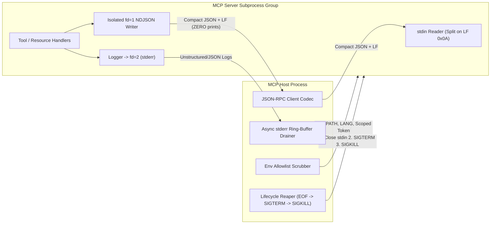
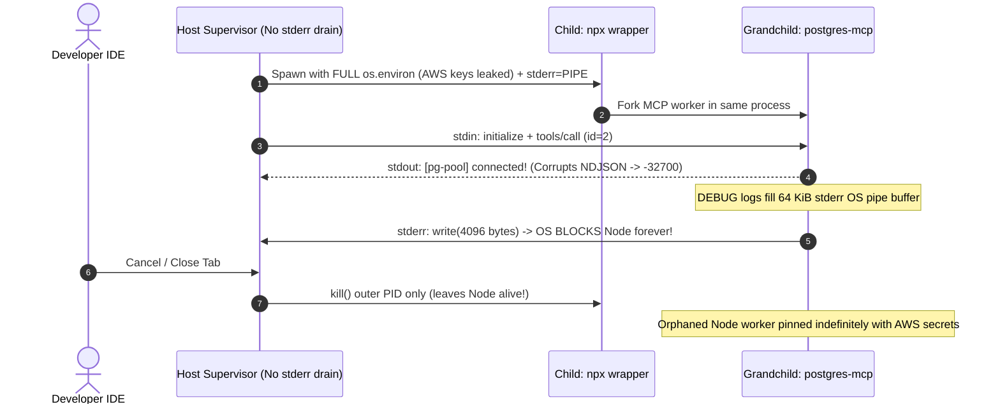

# Module 05: Transports: stdio

> **Prerequisites:** [Module 03: Architecture: Hosts, Clients and Servers](../03-architecture-hosts-clients-and-servers/README.md) and [Module 04: The Protocol: JSON-RPC Foundations](../04-the-protocol-json-rpc-foundations/README.md).  
> **Estimated Reading Time:** 30 minutes  
> **Target Audience:** AI Backend Engineers, CLI/IDE Host Developers, Systems & Runtime Engineers

> [!TIP]
> **The Golden Rule of MCP `stdio` Transport:** Treat `stdout` as an **exclusive binary-clean JSON-RPC wire channel** and `stderr` as the **only permissible diagnostic sink**: a single stray `print()`, SDK banner, or embedded literal newline inside serialized JSON breaks NDJSON framing instantly, while failing to drain `stderr`, scrub `env`, or reap process groups via `EOF -> SIGTERM -> SIGKILL` causes silent OS pipe deadlocks, credential leaks, and zombie processes.

---

## Why This Matters

Over `80%` of local developer MCP servers (Claude Desktop, Cursor, VS Code, local CLI agents) communicate over **`stdio`**—the host application spawns the MCP server as an OS child process and talks directly over standard input and standard output pipes. Because `stdio` carries zero HTTP overhead, round-trip pipe latency sits below `0.1 ms`.

Yet `stdio` fails in subtle systems ways that never appear in HTTP APIs. A third-party database driver calls `console.log("connected")` or Python's `tqdm` prints a progress bar to `stdout`, poisoning the JSON-RPC stream with `-32700 Parse error`. Worse, if the host ignores `stderr` without an async reader thread, verbose debug logs hit the `64 KiB` Linux/macOS OS pipe limit and freeze the child process permanently inside `write(2)`. Finally, naive `subprocess.Popen` inherits the entire parent environment (`AWS_SECRET_ACCESS_KEY`, `OPENAI_API_KEY`) and leaves orphaned grandchild processes running after exit.

---

## 1. Subprocess Architecture & Newline-Delimited JSON (NDJSON) Framing

In MCP `stdio` transport, the **Client/Host spawns the Server** as a subprocess and wires three anonymous OS pipes:

1. **`stdin` (Client $\rightarrow$ Server):** Client writes UTF-8 JSON-RPC messages, each terminated by a single newline `\n` (`0x0A`).
2. **`stdout` (Server $\rightarrow$ Client):** Server writes UTF-8 JSON-RPC messages, each terminated by a single newline `\n`. **Messages MUST NOT contain embedded literal `\r` or `\n` characters**—any newlines inside tool text MUST be JSON-escaped as `\\n` (`json.dumps(..., separators=(",", ":"))`, never `indent=2`).
3. **`stderr` (Server $\rightarrow$ Client, Optional Diagnostics):** Server writes structured logs, tracebacks, and startup notices strictly to `stderr`. **Host MUST continuously drain `stderr`** into a bounded ring buffer or logger—never leave `stderr` connected to an unread `PIPE`.



### Guarding `stdout` Against Accidental Library Pollution

Never assume `print()` or third-party imports behave cleanly. Apply **file-descriptor isolation** at process entry before importing libraries:

| Runtime | Dangerous Default Sink | Production `stdio` Hardening Pattern |
| :--- | :--- | :--- |
| **Python** | `print(...)` and `logging.StreamHandler()` write to `sys.stdout` or `stderr` inconsistently | Duplicate `os.dup(1)` for MCP wire writer, then redirect `sys.stdout = sys.stderr` (`os.dup2(2, 1)`) so stray prints land safely in `stderr` |
| **Node.js / TypeScript** | `console.log(...)` and `console.info(...)` write directly to `process.stdout`! | Bind `process.stdout.write` exclusively to MCP transport; alias `console.log = console.error` at boot |
| **Go** | `fmt.Println(...)` writes to `os.Stdout`; standard `log` writes to `os.Stderr` | Pass `os.Stdout` to MCP transport once, overwrite `os.Stdout = os.Stderr`, and configure `slog.NewTextHandler(os.Stderr, ...)` |
| **C# / .NET** | `Console.WriteLine(...)` and ASP.NET/EF console loggers write to `stdout` | Capture `Console.OpenStandardOutput()` for MCP transport, redirect `Console.SetOut(Console.Error)`, route `ILogger` to `stderr` (`LogToStandardErrorThreshold = Trace`) |

### Process Lifecycle, Pipe Deadlock, and Environment Scrubbing

1. **Graceful Shutdown Escalation (`EOF -> SIGTERM -> SIGKILL`):**
   - MCP defines **no JSON-RPC `shutdown` method**. To terminate a `stdio` server cleanly:
     1. Client **closes child's `stdin`** (sends `EOF` so server finishes active requests and exits `0`).
     2. Wait grace timeout $T_{\text{eof}}$ (typically `2–3 s`).
     3. Send `SIGTERM` (POSIX) or `CTRL_BREAK_EVENT` / process-group terminate (Windows), wait $T_{\text{term}}$ (`2–3 s`).
     4. Send `SIGKILL` (`kill -9` / `TerminateProcess`) to the **entire process group** (`start_new_session=True` + `os.killpg` on POSIX, Job Object with `JOB_OBJECT_LIMIT_KILL_ON_JOB_CLOSE` on Windows), then call `wait()` to **reap the zombie PCB entry**.
2. **Environment Variable Scrubbing (`env` Hygiene):**
   - Spawning `npx` or `python` with inherited `os.environ` exposes `AWS_SECRET_ACCESS_KEY`, `OPENAI_API_KEY`, `DATABASE_URL`, and `GITHUB_TOKEN` to untrusted local MCP servers!
   - Always pass an **explicit minimal allowlist**: `{PATH, HOME/USERPROFILE, LANG, LC_ALL, TMPDIR, SSL_CERT_FILE}` plus *only* the specific credentials explicitly provisioned for that server.

### Quantitative Pipe Buffer, Deadlock, and Startup Math

- **OS Pipe Buffer Deadlock Deadline ($T_{\text{block}}$):** On Linux (`fcntl F_GETPIPE_SZ`), default pipe capacity is $B_{\text{pipe}} = 65,536\text{ bytes}$ (`64 KiB`); Windows anonymous pipes default to `4–64 KiB`. If a server writes diagnostic logs to an undrained `stderr` pipe at rate $R_{\text{log}}$ bytes/s, the OS blocks the server permanently at:

$$T_{\text{block}} = \frac{B_{\text{pipe}}}{R_{\text{log}}}$$

At $R_{\text{log}} = 16\text{ KiB/s}$, an undrained `stderr` pipe freezes the entire MCP server in exactly `4.00 seconds`!

- **Bidirectional Pipe Deadlock Condition:** When a host writes a large payload $S_{\text{msg}} > B_{\text{pipe}}$ synchronously to `stdin` *while* the server simultaneously writes a large response $S_{\text{res}} > B_{\text{pipe}}$ synchronously to `stdout` without draining each other concurrently, both processes block in `write(2)` forever. Concurrent reader/writer tasks (asyncio streams or dedicated I/O threads) eliminate this deadlock.

- **Cold-Start Amortization:** Total latency for the first tool call on an on-demand `stdio` server is:

$$L_{\text{first}} = L_{\text{spawn}} + L_{\text{pkg\_mgr}} + L_{\text{runtime\_init}} + L_{\text{handshake}}$$

Spawning `npx -y @org/mcp-server` on every turn incurs $L_{\text{pkg\_mgr}} \approx 1,200\text{–}4,000\text{ ms}$ repeatedly, whereas keeping a long-lived session over pre-installed binaries drops per-call transport overhead below `0.1 ms`.

---

## 2. Systematic Comparison Matrix: `stdio` vs. Streamable HTTP vs. Unix Domain Sockets

| Dimension | MCP `stdio` (Subprocess Pipes) | Streamable HTTP (`/mcp` + SSE) | Unix Domain Sockets / Named Pipes |
| :--- | :--- | :--- | :--- |
| **Network Exposure** | **Zero network sockets** (local UID OS pipes only) | TCP socket (`127.0.0.1` or remote TLS endpoint) | Local filesystem path / Windows pipe ACLs |
| **Round-Trip Overhead** | **Sub-millisecond (`< 0.1 ms`)** kernel pipe copy | `1–50 ms` (HTTP headers + TLS + optional network hop) | Sub-millisecond (`< 0.1 ms`), no HTTP framing |
| **Multi-Client Sharing** | **1:1 exclusive** (1 subprocess per client session) | **1:N multiplexed** (shared server handles many clients) | **1:N local** (multiple clients connect to one daemon) |
| **Framing Fragility** | High if `stdout` is polluted by stray `print`/`console.log` | Clean MIME boundaries (`application/json` / SSE) | Custom framing (`\n` or length-prefixed) |
| **Secret & Process Risk** | Inherits `env` + UID unless scrubbed; orphan risk | Clear OAuth 2.1 Bearer / tenant boundary | Filesystem DAC/ACL permissions |
| **MCP Spec Standard Status** | **First-class standard transport** | **First-class standard transport** | Custom/non-standard transport |

---

## 3. Production War Story Post-Mortem: The `console.log` Framing Crash & 64 KiB `stderr` Pipe Freeze

| Field | Incident Details |
| :--- | :--- |
| **Severity** | **SEV-1** (IDE Agent Complete Hang, Secret Exposure Audit & `480` Zombie Subprocesses) |
| **Detection / Resolution Time** | Detected 2 hours post-rollout via support queue spike / Mitigated in 3 hours (host async `stderr` drain + `env` scrubber + server `stdout` FD redirect) |
| **Impact** | `100%` of agent tool calls froze after `~90 s` under `DEBUG=*`; `stdout` `[DB]` logs triggered `-32700` crashes; `480` leaked `node` processes retained parent `AWS_SESSION_TOKEN` |

### What Happened

An engineering platform team rolled out a TypeScript IDE coding assistant spawning a local `postgres-mcp` `stdio` server (`npx -y @internal/postgres-mcp`). Two bugs plus one missing OS safeguard struck at once:

1. **Shared ORM `console.log`:** The internal database wrapper printed `console.log("[pg-pool] connected to primary")` on the first query. Because Node's `console.log` writes to `stdout`, the IDE host received `[pg-pool] connected to primary` instead of JSON-RPC, crashing the reader with `-32700 Parse error`.
2. **Undrained `stderr` Pipe Freeze:** For users running with `DEBUG=pg:*`, the server wrote `~1 KB/s` of trace diagnostics to `stderr`. The host opened `stderr=PIPE` in Python `subprocess.Popen` to "capture errors on crash" **but never read from `proc.stderr` while alive**. Exactly `64 KiB` later (`~65 s`), the OS blocked `stderr` writes in the child, hanging the single-threaded Node event loop indefinitely.
3. **Orphan Leak with Inherited Env:** When users closed the hung IDE tab, the host only killed the outer `npx` shim—leaving `480` zombie `node` worker children alive holding the developer's full inherited `AWS_SECRET_ACCESS_KEY` and `GITHUB_TOKEN`.



### Root Cause Analysis

- `console.log` defaulted to `stdout`, colliding directly with the NDJSON MCP wire channel.
- Opening `stderr=PIPE` without a background consumer thread caused kernel pipe-buffer saturation at `64 KiB`, freezing the child event loop.
- Spawning without an `env` allowlist exposed sensitive host credentials, and killing only the wrapper PID instead of the process group (`killpg` / Windows Job Object) leaked orphaned child workers.

### The Fix & Architectural Hardening

- **Server-Side `fd=1` Quarantine:** Duplicated original `stdout` (`fd=1`) exclusively for the JSON-RPC transport stream at line 1 of `main()`, then redirected `console.log` / `sys.stdout` / `os.Stdout` straight to `stderr` (`fd=2`).
- **Continuous Async `stderr` Ring Buffer:** Attached a dedicated daemon reader thread/task draining `proc.stderr` continuously into a bounded `256`-line ring buffer for crash diagnostics.
- **Scrubbed Env & Process-Group Reaping:** Switched `Popen` to an explicit `env` allowlist and process-group isolation (`start_new_session=True` + `EOF -> SIGTERM -> SIGKILL` + `wait()`).

---

## 4. Multi-Language Production Implementation: Hardened `stdio` Subprocess Supervisor

Below is a production-hardened **MCP `stdio` Subprocess Transport Supervisor** across **Go**, **TypeScript**, **Python**, and **C#**. Every implementation scrubs `env` to a strict allowlist, enforces compact single-line NDJSON framing (rejecting embedded `\r`/`\n` and `stdout` pollution), drains `stderr` asynchronously into a ring buffer, and executes clean `EOF -> SIGTERM -> SIGKILL` shutdown.

````carousel

```go
package mcpstdio

import (
	"bufio"
	"bytes"
	"context"
	"errors"
	"fmt"
	"io"
	"os"
	"os/exec"
	"sync"
	"time"
)

type StdioSupervisor struct {
	cmd        *exec.Cmd
	stdin      io.WriteCloser
	stdout     *bufio.Scanner
	writeMu    sync.Mutex
	stderrRing []string
	stderrMu   sync.Mutex
	done       chan error
}

func ScrubbedEnv(extraAllowed map[string]string) []string {
	allow := []string{"PATH", "HOME", "LANG", "LC_ALL", "TMPDIR", "USERPROFILE", "SYSTEMROOT"}
	var env []string
	for _, k := range allow {
		if v, ok := os.LookupEnv(k); ok {
			env = append(env, k+"="+v)
		}
	}
	for k, v := range extraAllowed {
		env = append(env, k+"="+v)
	}
	return env
}

func StartServer(ctx context.Context, bin string, args []string, extraEnv map[string]string) (*StdioSupervisor, error) {
	cmd := exec.Command(bin, args...)
	cmd.Env = ScrubbedEnv(extraEnv)
	stdin, err := cmd.StdinPipe()
	if err != nil {
		return nil, err
	}
	stdoutPipe, err := cmd.StdoutPipe()
	if err != nil {
		return nil, err
	}
	stderrPipe, err := cmd.StderrPipe()
	if err != nil {
		return nil, err
	}
	if err := cmd.Start(); err != nil {
		return nil, err
	}

	scanner := bufio.NewScanner(stdoutPipe)
	scanner.Buffer(make([]byte, 64*1024), 10*1024*1024) // Allow up to 10 MiB NDJSON messages

	sup := &StdioSupervisor{
		cmd:    cmd,
		stdin:  stdin,
		stdout: scanner,
		done:   make(chan error, 1),
	}
	go sup.drainStderr(stderrPipe)
	go func() { sup.done <- cmd.Wait() }()
	return sup, nil
}

func (s *StdioSupervisor) drainStderr(r io.Reader) {
	sc := bufio.NewScanner(r)
	for sc.Scan() {
		s.stderrMu.Lock()
		if len(s.stderrRing) >= 200 {
			s.stderrRing = s.stderrRing[1:]
		}
		s.stderrRing = append(s.stderrRing, sc.Text())
		s.stderrMu.Unlock()
	}
}

func (s *StdioSupervisor) WriteFrame(compactJSON []byte) error {
	if bytes.ContainsAny(compactJSON, "\r\n") {
		return errors.New("stdio framing violation: JSON message must not contain embedded newlines")
	}
	s.writeMu.Lock()
	defer s.writeMu.Unlock()
	if _, err := s.stdin.Write(append(compactJSON, '\n')); err != nil {
		return err
	}
	return nil
}

func (s *StdioSupervisor) ReadFrame() ([]byte, error) {
	if !s.stdout.Scan() {
		if err := s.stdout.Err(); err != nil {
			return nil, err
		}
		return nil, io.EOF
	}
	line := bytes.TrimSpace(s.stdout.Bytes())
	if len(line) == 0 || line[0] != '{' {
		return nil, fmt.Errorf("stdout protocol pollution detected: %q", string(line))
	}
	return line, nil
}

func (s *StdioSupervisor) Shutdown(grace time.Duration) error {
	_ = s.stdin.Close() // Phase 1: EOF
	select {
	case err := <-s.done:
		return err
	case <-time.After(grace):
	}
	if s.cmd.Process != nil {
		_ = s.cmd.Process.Signal(os.Interrupt) // Phase 2: SIGTERM/Interrupt
	}
	select {
	case err := <-s.done:
		return err
	case <-time.After(grace):
	}
	if s.cmd.Process != nil {
		_ = s.cmd.Process.Kill() // Phase 3: SIGKILL + reap
	}
	return <-s.done
}
```

<!-- slide -->

```typescript
import { spawn, type ChildProcessWithoutNullStreams } from "node:child_process";
import * as readline from "node:readline";

const ENV_ALLOWLIST = ["PATH", "HOME", "LANG", "LC_ALL", "TMPDIR", "USERPROFILE", "SYSTEMROOT"] as const;

export function buildScrubbedEnv(scopedVars: Record<string, string> = {}): NodeJS.ProcessEnv {
  const clean: NodeJS.ProcessEnv = {};
  for (const key of ENV_ALLOWLIST) {
    if (process.env[key]) clean[key] = process.env[key];
  }
  return { ...clean, ...scopedVars };
}

export class HardenedStdioTransport {
  private readonly child: ChildProcessWithoutNullStreams;
  private readonly stderrTail: string[] = [];
  private readonly frameQueue: string[] = [];
  private readonly waiters: Array<(line: string | null) => void> = [];
  private closed = false;

  constructor(command: string, args: string[], scopedEnv: Record<string, string> = {}) {
    this.child = spawn(command, args, {
      env: buildScrubbedEnv(scopedEnv),
      stdio: ["pipe", "pipe", "pipe"],
      detached: process.platform !== "win32",
    });

    // Mandatory async stderr drainer prevents 64 KiB pipe deadlock
    const errRl = readline.createInterface({ input: this.child.stderr, crlfDelay: Infinity });
    errRl.on("line", (line) => {
      if (this.stderrTail.length >= 200) this.stderrTail.shift();
      this.stderrTail.push(line);
    });

    const outRl = readline.createInterface({ input: this.child.stdout, crlfDelay: Infinity });
    outRl.on("line", (line) => {
      const trimmed = line.trim();
      if (!trimmed) return;
      const waiter = this.waiters.shift();
      if (waiter) waiter(trimmed);
      else this.frameQueue.push(trimmed);
    });

    this.child.on("exit", () => {
      this.closed = true;
      while (this.waiters.length > 0) this.waiters.shift()!(null);
    });
  }

  public sendMessage(payload: Record<string, unknown>): void {
    const compact = JSON.stringify(payload);
    if (compact.includes("\n") || compact.includes("\r")) {
      throw new Error("stdio framing violation: serialized JSON contains embedded newline");
    }
    this.child.stdin.write(`${compact}\n`, "utf8");
  }

  public async readMessage(): Promise<Record<string, unknown> | null> {
    const line =
      this.frameQueue.shift() ??
      (this.closed ? null : await new Promise<string | null>((resolve) => this.waiters.push(resolve)));
    if (line === null) return null;
    try {
      return JSON.parse(line) as Record<string, unknown>;
    } catch {
      throw new Error(`stdout corruption (non-JSON output from MCP server): ${line.slice(0, 120)}`);
    }
  }

  public async shutdown(graceMs = 2000): Promise<number | null> {
    if (this.closed) return this.child.exitCode;
    this.child.stdin.end(); // Step 1: Close stdin (EOF)
    const exited = await this.waitExit(graceMs);
    if (exited !== undefined) return exited;

    this.signalGroup("SIGTERM"); // Step 2: SIGTERM
    const termed = await this.waitExit(graceMs);
    if (termed !== undefined) return termed;

    this.signalGroup("SIGKILL"); // Step 3: SIGKILL
    return (await this.waitExit(1000)) ?? null;
  }

  private signalGroup(sig: NodeJS.Signals): void {
    if (!this.child.pid) return;
    try {
      if (process.platform !== "win32") process.kill(-this.child.pid, sig);
      else this.child.kill(sig);
    } catch {
      // Process already exited
    }
  }

  private waitExit(ms: number): Promise<number | null | undefined> {
    if (this.closed) return Promise.resolve(this.child.exitCode);
    return new Promise((resolve) => {
      const timer = setTimeout(() => resolve(undefined), ms);
      this.child.once("exit", (code) => {
        clearTimeout(timer);
        resolve(code);
      });
    });
  }
}
```

<!-- slide -->

```python
"""
stdio_supervisor.py
Hardened MCP stdio transport supervisor: env scrubbing, NDJSON framing, async stderr drainer, and EOF->SIGTERM->SIGKILL reaping.
"""
from __future__ import annotations

from collections import deque
import json
import os
import signal
import subprocess
import threading
from typing import Any

ENV_ALLOWLIST = ("PATH", "HOME", "LANG", "LC_ALL", "TMPDIR", "USERPROFILE", "SYSTEMROOT")


def build_scrubbed_env(extra_scoped: dict[str, str] | None = None) -> dict[str, str]:
    clean = {k: os.environ[k] for k in ENV_ALLOWLIST if k in os.environ}
    if extra_scoped:
        clean.update(extra_scoped)
    return clean


class HardenedStdioClient:
    def __init__(self, command: list[str], scoped_env: dict[str, str] | None = None) -> None:
        popen_kwargs: dict[str, Any] = {
            "stdin": subprocess.PIPE,
            "stdout": subprocess.PIPE,
            "stderr": subprocess.PIPE,
            "env": build_scrubbed_env(scoped_env),
            "text": True,
            "encoding": "utf-8",
            "bufsize": 1,
        }
        if os.name != "nt":
            popen_kwargs["start_new_session"] = True
        self._proc = subprocess.Popen(command, **popen_kwargs)
        self._write_lock = threading.Lock()
        self._stderr_tail: deque[str] = deque(maxlen=200)
        self._stderr_thread = threading.Thread(target=self._drain_stderr, daemon=True)
        self._stderr_thread.start()

    def _drain_stderr(self) -> None:
        assert self._proc.stderr is not None
        for line in self._proc.stderr:
            self._stderr_tail.append(line.rstrip("\r\n"))

    def send(self, message: dict[str, Any]) -> None:
        assert self._proc.stdin is not None
        wire = json.dumps(message, separators=(",", ":"), ensure_ascii=False)
        if "\n" in wire or "\r" in wire:
            raise ValueError("stdio violation: JSON frame contains embedded newline")
        with self._write_lock:
            self._proc.stdin.write(wire + "\n")
            self._proc.stdin.flush()

    def recv(self) -> dict[str, Any] | None:
        assert self._proc.stdout is not None
        raw = self._proc.stdout.readline()
        if raw == "":
            return None
        stripped = raw.rstrip("\r\n")
        try:
            obj = json.loads(stripped)
        except json.JSONDecodeError as exc:
            raise RuntimeError(f"stdout protocol corruption: {stripped[:120]!r} | stderr={list(self._stderr_tail)[-5:]}") from exc
        if not isinstance(obj, dict):
            raise RuntimeError("Invalid JSON-RPC frame type on stdout")
        return obj

    def close(self, grace_sec: float = 2.0) -> int:
        if self._proc.stdin and not self._proc.stdin.closed:
            self._proc.stdin.close()  # 1. Close stdin (EOF)
        try:
            return self._proc.wait(timeout=grace_sec)
        except subprocess.TimeoutExpired:
            pass

        if os.name != "nt":
            os.killpg(self._proc.pid, signal.SIGTERM)  # 2. SIGTERM group
        else:
            self._proc.terminate()
        try:
            return self._proc.wait(timeout=grace_sec)
        except subprocess.TimeoutExpired:
            pass

        if os.name != "nt":
            os.killpg(self._proc.pid, signal.SIGKILL)  # 3. SIGKILL group + wait reap
        else:
            self._proc.kill()
        return self._proc.wait(timeout=2.0)
```

<!-- slide -->

```csharp
using System;
using System.Collections.Concurrent;
using System.Collections.Generic;
using System.Diagnostics;
using System.IO;
using System.Text;
using System.Text.Json;
using System.Threading;
using System.Threading.Tasks;

namespace GenAI.Mcp.Transports;

public sealed class HardenedStdioTransport : IAsyncDisposable
{
    private static readonly string[] EnvAllowlist = ["PATH", "HOME", "LANG", "TMPDIR", "USERPROFILE", "SYSTEMROOT"];
    private readonly Process _process;
    private readonly SemaphoreSlim _writeLock = new(1, 1);
    private readonly ConcurrentQueue<string> _stderrRing = new();
    private readonly Task _stderrDrainer;

    public HardenedStdioTransport(string fileName, string arguments, IDictionary<string, string>? scopedEnv = null)
    {
        var psi = new ProcessStartInfo(fileName, arguments)
        {
            RedirectStandardInput = true,
            RedirectStandardOutput = true,
            RedirectStandardError = true,
            StandardInputEncoding = new UTF8Encoding(false),
            StandardOutputEncoding = new UTF8Encoding(false),
            StandardErrorEncoding = new UTF8Encoding(false),
            UseShellExecute = false,
            CreateNoWindow = true,
        };

        // Scrub inherited environment before adding allowlisted keys
        psi.Environment.Clear();
        foreach (var key in EnvAllowlist)
        {
            var val = Environment.GetEnvironmentVariable(key);
            if (!string.IsNullOrEmpty(val)) psi.Environment[key] = val;
        }
        if (scopedEnv != null)
        {
            foreach (var kv in scopedEnv) psi.Environment[kv.Key] = kv.Value;
        }

        _process = Process.Start(psi) ?? throw new InvalidOperationException("Failed to start MCP server process.");
        _stderrDrainer = Task.Run(DrainStderrAsync);
    }

    private async Task DrainStderrAsync()
    {
        while (await _process.StandardError.ReadLineAsync() is { } line)
        {
            _stderrRing.Enqueue(line);
            while (_stderrRing.Count > 200) _stderrRing.TryDequeue(out _);
        }
    }

    public async Task SendAsync(JsonDocument message, CancellationToken ct)
    {
        var wire = JsonSerializer.Serialize(message.RootElement);
        if (wire.Contains('\n') || wire.Contains('\r'))
            throw new InvalidOperationException("stdio framing error: embedded newline in JSON payload.");

        await _writeLock.WaitAsync(ct);
        try
        {
            await _process.StandardInput.WriteLineAsync(wire.AsMemory(), ct);
            await _process.StandardInput.FlushAsync(ct);
        }
        finally
        {
            _writeLock.Release();
        }
    }

    public async Task<JsonDocument?> ReceiveAsync(CancellationToken ct)
    {
        var line = await _process.StandardOutput.ReadLineAsync(ct);
        if (line is null) return null;
        try
        {
            return JsonDocument.Parse(line);
        }
        catch (JsonException ex)
        {
            throw new InvalidDataException($"stdout protocol pollution: {line}", ex);
        }
    }

    public async ValueTask DisposeAsync()
    {
        try
        {
            _process.StandardInput.Close(); // 1. Signal EOF
            using var eofCts = new CancellationTokenSource(TimeSpan.FromSeconds(2));
            await _process.WaitForExitAsync(eofCts.Token);
        }
        catch (OperationCanceledException)
        {
            if (!_process.HasExited) _process.Kill(entireProcessTree: true); // 2. Escalate + reap tree
            await _process.WaitForExitAsync();
        }
        await _stderrDrainer;
        _process.Dispose();
        _writeLock.Dispose();
    }
}
```

````

---

## 5. Practical Hands-On Verification CLI Workflows

Run these deterministic Python 3.13 scripts offline to test real `stdio` subprocess NDJSON piping, newline validation, and environment variable scrubbing.

### Workflow 1: Live Child Subprocess NDJSON `stdio` Ping-Pong & `stdout` Pollution Detection

Spawn a real unbuffered Python child process over OS `stdin`/`stdout`/`stderr` pipes, exchange valid NDJSON frames, inject a stray `stdout` debug banner, and verify quarantine vs decode failure:

```bash
python -c '
import json, os, subprocess, sys

server_code = "\n".join([
    "import json, sys",
    "sys.stderr.write(\"[server] boot ok on stderr\\n\"); sys.stderr.flush()",
    "for raw in sys.stdin:",
    "    line = raw.strip()",
    "    if not line: continue",
    "    req = json.loads(line)",
    "    if req.get(\"method\") == \"pollute\":",
    "        sys.stdout.write(\"DEBUG: accidental stdout banner!\\n\")",
    "    resp = {\"jsonrpc\": \"2.0\", \"id\": req[\"id\"], \"result\": {\"pong\": req[\"method\"]}}",
    "    sys.stdout.write(json.dumps(resp, separators=(\",\", \":\")) + \"\\n\")",
    "    sys.stdout.flush()",
])

proc = subprocess.Popen(
    [sys.executable, "-u", "-c", server_code],
    stdin=subprocess.PIPE, stdout=subprocess.PIPE, stderr=subprocess.PIPE,
    text=True, encoding="utf-8"
)

for idx, method in enumerate(["ping", "pollute"], start=1):
    frame = json.dumps({"jsonrpc": "2.0", "id": idx, "method": method}, separators=(",", ":")) + "\n"
    proc.stdin.write(frame)
    proc.stdin.flush()

proc.stdin.close()
out_lines = proc.stdout.read().splitlines()
err_lines = proc.stderr.read().splitlines()
rc = proc.wait(timeout=3)

print("stderr lines:", err_lines)
for line in out_lines:
    try:
        parsed = json.loads(line)
        print("OK_FRAME :", parsed)
    except json.JSONDecodeError:
        print("CORRUPT  :", repr(line), "-> -32700 FRAMING BREACH")
print("exit_code:", rc)
'
```

**Expected Output:**

```text
stderr lines: ['[server] boot ok on stderr']
OK_FRAME : {'jsonrpc': '2.0', 'id': 1, 'result': {'pong': 'ping'}}
CORRUPT  : 'DEBUG: accidental stdout banner!' -> -32700 FRAMING BREACH
OK_FRAME : {'jsonrpc': '2.0', 'id': 2, 'result': {'pong': 'pollute'}}
exit_code: 0
```

### Workflow 2: Compact NDJSON Invariant & `stderr` Pipe Saturation Probe

Verify that compact JSON serialization escapes embedded newlines safely while `indent=2` triggers an immediate framing failure, and compute `stderr` pipe freeze deadlines across log rates:

```bash
python -c '
import json

def serialize_ndjson(obj, pretty=False):
    payload = json.dumps(obj, indent=2 if pretty else None, separators=None if pretty else (",", ":"))
    has_embedded_nl = ("\n" in payload) or ("\r" in payload)
    return payload, has_embedded_nl

sample = {"jsonrpc": "2.0", "id": 1, "result": {"note": "line1\nline2"}}
compact, bad_compact = serialize_ndjson(sample, pretty=False)
pretty, bad_pretty = serialize_ndjson(sample, pretty=True)
print(f"compact_len={len(compact)} embedded_newline={bad_compact} -> wire={compact}")
print(f"pretty_len={len(pretty)}  embedded_newline={bad_pretty} -> REJECTED BY STDIO TRANSPORT")

for rate_kib_s in [4, 16, 64]:
    t_deadlock = 64.0 / rate_kib_s
    print(f"stderr_rate={rate_kib_s:>2} KiB/s on 64 KiB pipe -> deadlock in {t_deadlock:.2f}s if undrained")
'
```

**Expected Output:**

```text
compact_len=57 embedded_newline=False -> wire={"jsonrpc":"2.0","id":1,"result":{"note":"line1\nline2"}}
pretty_len=79  embedded_newline=True -> REJECTED BY STDIO TRANSPORT
stderr_rate= 4 KiB/s on 64 KiB pipe -> deadlock in 16.00s if undrained
stderr_rate=16 KiB/s on 64 KiB pipe -> deadlock in 4.00s if undrained
stderr_rate=64 KiB/s on 64 KiB pipe -> deadlock in 1.00s if undrained
```

### Workflow 3: Subprocess Environment Allowlist Audit

Confirm that scrubbing `env` before spawning strips sensitive parent credentials (`AWS_SECRET_ACCESS_KEY`, `OPENAI_API_KEY`) while preserving `PATH` and the server's explicit scoped token:

```bash
python -c '
import json, os, subprocess, sys

parent_env = {
    "PATH": os.environ.get("PATH", ""),
    "SYSTEMROOT": os.environ.get("SYSTEMROOT", ""),
    "AWS_SECRET_ACCESS_KEY": "AKIA_SENSITIVE_LEAK",
    "OPENAI_API_KEY": "sk-secret-parent-key",
    "MCP_SERVER_TOKEN": "scoped-readonly-token",
}
ALLOWLIST = {"PATH", "SYSTEMROOT", "LANG", "LC_ALL", "TMPDIR", "MCP_SERVER_TOKEN"}
scrubbed_env = {k: v for k, v in parent_env.items() if k in ALLOWLIST and v}

code = "import json, os; tracked = [\"AWS_SECRET_ACCESS_KEY\", \"MCP_SERVER_TOKEN\", \"OPENAI_API_KEY\", \"PATH\"]; print(json.dumps({k: (k in os.environ) for k in tracked}))"
proc = subprocess.run([sys.executable, "-c", code], env=scrubbed_env, capture_output=True, text=True, check=True)
print("Child env audit:", proc.stdout.strip())
'
```

**Expected Output:**

```text
Child env audit: {"AWS_SECRET_ACCESS_KEY": false, "MCP_SERVER_TOKEN": true, "OPENAI_API_KEY": false, "PATH": true}
```

### Hands-On Exercises

1. **FD Quarantine Fix:** Modify Workflow 1's `server_code` to duplicate `fd=1` into `proto_out = os.fdopen(os.dup(1), "w")` and run `os.dup2(2, 1)` before `sys.stdout.write("DEBUG: accidental stdout banner!\n")`. Confirm `out_lines` remains 100% pure JSON-RPC while `"DEBUG: accidental stdout banner!"` appears cleanly inside `err_lines`.
2. **Process-Group Cleanup:** Modify Workflow 1 so the child spawns a long-running `sleep(60)` grandchild inside `start_new_session=True`, then test closing `stdin` + `SIGTERM` -> `SIGKILL` to verify zero leftover sleeping grandchildren.
3. **Oversized Payload Non-Blocking Pipe Test:** Send a `256 KiB` JSON-RPC request and receive a `256 KiB` response simultaneously between two Python threads over OS pipes (exceeding the `64 KiB` pipe buffer) and prove concurrent reader/writer threads prevent deadlock.

### Independent Challenge

A developer runs a Python MCP server using `uvicorn` and `fastmcp` inside a host IDE via `stdio`. Every time the server starts, it prints `INFO:     Started server process [18432]` or a `tqdm` progress bar on first indexing, causing the IDE to report `"Server disconnected: unexpected token 'I' in JSON at position 0"`. Meanwhile, when run manually in a terminal, everything looks fine! Diagnose why manual terminal testing hid the failure and implement the exact startup quarantine required to guarantee `stdout` never receives non-protocol bytes—even from C extensions or third-party loggers.

<details><summary>Architectural Discussion</summary>

When tested interactively in a terminal, both `fd=1` (`stdout`) and `fd=2` (`stderr`) render identically onto the developer's TTY, masking which descriptor received the banner! Under MCP `stdio`, the host reads `fd=1` exclusively as NDJSON. Even redirecting Python's `sys.stdout = sys.stderr` misses C-level libraries (`printf`, Rust/C++ bindings, native `tqdm` / `stderr=sys.stdout` wrappers) that write directly to OS file descriptor `1`. The bulletproof fix runs at process entrypoint **before importing dependencies**: save `proto_fd = os.dup(1)`, create the transport writer `proto_stream = os.fdopen(proto_fd, "w", encoding="utf-8", buffering=1)`, execute `os.dup2(2, 1)` so OS `fd=1` points to `stderr`, and set `sys.stdout = sys.stderr`. Now any Python `print()` or C `printf()` writes to `stderr` while only `proto_stream` emits NDJSON frames.

</details>

---

## 6. Common Mistakes & Troubleshooting

- **Using `json.dumps(..., indent=2)` on `stdio`:** Pretty-printed JSON injects literal `\n` characters inside a single message, splitting one JSON-RPC envelope into dozens of invalid lines. Always emit compact single-line JSON (`separators=(",", ":")`) terminated by a single `\n`.
- **Using `console.log()` in Node.js MCP servers:** In Node.js, `console.log` writes to `stdout`, not `stderr`! Always use `console.error()` or redirect `console.log` at process entry.
- **Calling `subprocess.Popen(..., stderr=subprocess.PIPE)` without reading `stderr`:** Leaving `stderr` unread causes the child process to freeze completely once OS pipe buffers fill (`64 KiB`). Always spawn an async drain task/thread or pass `stderr=sys.stderr` / file descriptor.
- **Killing only the wrapper PID on exit:** Spawning via `npx`, `uvx`, or `/bin/sh -c` creates wrapper parents; terminating only the parent leaves orphaned server workers alive holding locks and credentials. Always spawn in a new process group/Job Object and terminate the entire tree.

---

## 7. Operational Validation Checkpoints & Checkpoint Quiz

### Operational Validation Checkpoints

<details><summary><strong>Checkpoint 1: Fixing the 90-second IDE hang under verbose logging</strong></summary>

A `stdio` server works smoothly during light queries, then freezes completely mid-tool-call whenever `LOG_LEVEL=DEBUG` is enabled—with zero CPU usage on either host or server. What happened?

**Validation:** The host opened `stderr=PIPE` on the child process without continuously reading from it. Under `LOG_LEVEL=DEBUG`, the server filled the `64 KiB` kernel pipe buffer and blocked inside `write(2)` to `fd=2` forever. Attach an asynchronous `stderr` drainer loop (or bounded ring buffer) so the `stderr` pipe never stalls.

</details>

<details><summary><strong>Checkpoint 2: Auditing child credential exposure</strong></summary>

A host launches a third-party Markdown-formatting `stdio` MCP server using `subprocess.Popen(["npx", "-y", "md-mcp"], stdin=PIPE, stdout=PIPE)` without specifying `env`. What security boundary failed?

**Validation:** Passing `env=None` inherits the entire parent environment, leaking `AWS_SECRET_ACCESS_KEY`, `OPENAI_API_KEY`, `DATABASE_URL`, and local tokens into an unverified third-party package running under the user's UID. Construct an explicit minimal allowlist (`PATH`, `HOME`, `LANG`, `TMPDIR`) plus only explicitly scoped credentials.

</details>

<details><summary><strong>Checkpoint 3: Handling multi-line tool strings in NDJSON</strong></summary>

A `read_file` tool returns Python source code containing `120` newlines. Does returning that code violate MCP `stdio`'s "no embedded newlines" rule?

**Validation:** No—provided it is serialized properly! Inside a valid JSON string (`{"jsonrpc":"2.0","id":4,"result":{"content":[{"type":"text","text":"def f():\n    return 1"}]}}`), newlines are escaped as the two characters `\n` (`0x5C 0x6E`), NOT literal LF bytes (`0x0A`). Only literal unescaped `\r`/`\n` inside the serialized JSON frame breaks NDJSON framing.

</details>

### Checkpoint Quiz

1. Which character delimits individual JSON-RPC messages over MCP `stdio`, and what happens if JSON is serialized with `indent=4`?
2. Which standard stream (`stdin`, `stdout`, `stderr`) is safe for application logging in an MCP `stdio` server, and what OS failure occurs if the host fails to drain it?
3. List the 3-step shutdown escalation sequence for terminating an MCP `stdio` server without leaking zombies.
4. Why does `subprocess.Popen` without `env=...` pose a security hazard for local IDE hosts?
5. Why is `os.dup2(2, 1)` after duplicating `fd=1` stronger than simply writing `sys.stdout = sys.stderr` in Python?

<details><summary>Answers</summary>

1. A single newline (`\n`, `0x0A`) delimits each UTF-8 JSON-RPC message; `indent=4` inserts literal newlines inside a single JSON object, causing `-32700 Parse error` on every fragment.
2. `stderr` is the only safe diagnostic sink. If the host sets `stderr=PIPE` without draining it continuously, logs exceeding the kernel pipe capacity (`~64 KiB`) permanently deadlock the server inside `write(2)`.
3. (1) Close child's `stdin` (EOF) and wait for graceful exit; (2) send `SIGTERM` / interrupt to the process group and wait; (3) send `SIGKILL` / terminate process tree and `wait()` to reap the zombie PCB.
4. Child processes inherit all parent environment variables (`AWS_*`, `OPENAI_API_KEY`, `DATABASE_URL`), allowing malicious or compromised MCP servers to exfiltrate local secrets.
5. `sys.stdout = sys.stderr` only intercepts Python-level `print()`; `os.dup2(2, 1)` (after duplicating original `fd=1` for the protocol stream) redirects even C-extension `printf()` and native child libraries away from the protocol wire.

</details>

---

## Further Reading & Sources

- [Model Context Protocol Specification: Transports (`stdio`)](https://modelcontextprotocol.io/specification/2025-06-18/basic/transports#stdio) — normative specification for newline-delimited UTF-8 JSON-RPC framing, `stderr` logging, and shutdown.
- [MCP Docs: Understanding Transports](https://modelcontextprotocol.io/docs/concepts/transports) — architectural overview of local `stdio` vs. remote HTTP transports.
- [Module 04: The Protocol: JSON-RPC Foundations](../04-the-protocol-json-rpc-foundations/README.md) — envelope syntax and `-32700` parse error semantics.

## Next

[Module 06: Transports: Streamable HTTP and SSE](../06-transports-streamable-http-and-sse/README.md)
