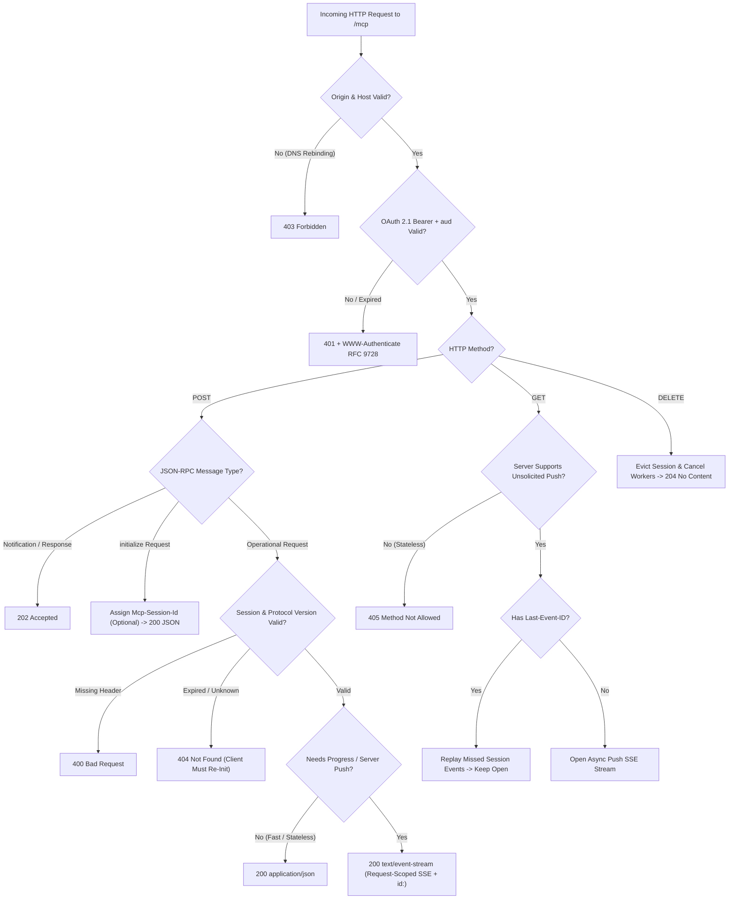
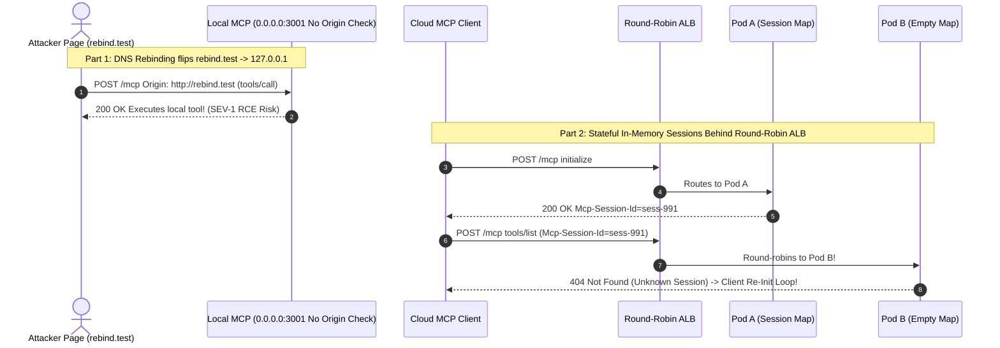

# Module 06: Transports: Streamable HTTP and SSE

> **Prerequisites:** [Module 04: The Protocol: JSON-RPC Foundations](../04-the-protocol-json-rpc-foundations/README.md) and [Module 05: Transports: stdio](../05-transports-stdio/README.md).  
> **Estimated Reading Time:** 35 minutes  
> **Target Audience:** Distributed Systems Engineers, API Gateway Architects, Cloud AI Platform Engineers

> [!TIP]
> **The Golden Rule of MCP Streamable HTTP:** Retire legacy `2024-11-05` dual-endpoint HTTP+SSE (`GET /sse` + `POST /messages`) and adopt **Streamable HTTP (`/mcp`)**: let `POST /mcp` upgrade to `text/event-stream` *only* when streaming progress or server-initiated requests, bind local servers strictly to `127.0.0.1` with mandatory `Origin` validation to block DNS rebinding, validate `Authorization: Bearer` audience claims (`OAuth 2.1`), and design explicitly for **stateless horizontal scaling** or **session-sticky / Redis-backed `Last-Event-ID` replay**.

---

## Why This Matters

Local `stdio` subprocesses collapse the moment your MCP server must live across a network boundary—inside a Kubernetes cluster, behind an API gateway, or inside serverless containers shared across `10,000` users.

MCP's initial `2024-11-05` remote transport paired a permanent `GET /sse` stream with a separate `POST /messages` endpoint. In cloud production, that split created an operational nightmare: AWS Lambda and Cloud Run workers could not hold open indefinite `GET /sse` connections, and round-robin load balancers dropped `POST /messages` onto pods that lacked the `GET /sse` socket in memory. Starting with `2025-03-26` (and hardened in `2025-06-18` with `MCP-Protocol-Version` and OAuth 2.1 resource metadata), MCP replaced HTTP+SSE with **Streamable HTTP**—unifying everything behind a single `/mcp` route while exposing subtle traps around DNS rebinding on localhost, sticky load balancing, and SSE stream resumption.

---

## 1. Transport Evolution: Legacy HTTP+SSE (`2024-11-05`) vs. Streamable HTTP (`2025-03-26+`)

### Why Legacy `2024-11-05` HTTP+SSE Was Deprecated

Under `2024-11-05`, a client first opened `GET /sse`, waited for an initial `endpoint` event (`/messages?sessionId=abc`), and posted JSON-RPC requests to `POST /messages?sessionId=abc` (which immediately returned HTTP `202 Accepted` with an empty body while answers traveled asynchronously over the original `GET /sse` connection). That architecture suffered three fatal cloud flaws:

1. **Zero Stateless Support:** Even a trivial `1 ms` `ping` or `tools/list` call required holding an open `GET /sse` socket in memory.
2. **Hard Affinity Coupling:** Every `POST /messages` had to land on the *exact process* holding the open `GET /sse` TCP socket, or rely on complex cross-pod pub/sub just to answer synchronous RPCs.
3. **No Request-Scoped Streams or Resumption:** One global SSE pipe multiplexed every response with no standard `Last-Event-ID` replay semantics.

### How Unified Streamable HTTP (`/mcp`) Works

Streamable HTTP consolidates all client-server traffic onto **one endpoint** (conventionally `/mcp`) supporting `POST`, optional `GET`, and `DELETE`:

1. **Client $\rightarrow$ Server (`POST /mcp`):**
   - Client sends `Accept: application/json, text/event-stream`, `Content-Type: application/json`, and (after `initialize` in `2025-06-18+`) `MCP-Protocol-Version: 2025-06-18` plus `Mcp-Session-Id` if assigned.
   - **Notifications & Responses (no reply expected):** Server returns **`202 Accepted`** with empty body (or `4xx` on invalid input).
   - **Requests (`id` present):** Server dynamically chooses **one of two response encodings**:
     - `200 OK` + **`Content-Type: application/json`**: Single JSON-RPC Response returned synchronously and socket closes—ideal for stateless/serverless endpoints.
     - `200 OK` + **`Content-Type: text/event-stream`**: Server opens a **request-scoped SSE stream** carrying `notifications/progress`, server-initiated requests (e.g., `sampling/createMessage`), and finally the matching JSON-RPC Response before closing the stream cleanly!
2. **Server $\rightarrow$ Client Async Push (`GET /mcp`):**
   - Optional standalone SSE channel (`Accept: text/event-stream`) for unsolicited server push (`notifications/tools/list_changed`). Servers operating in stateless request-response mode SHOULD return **`405 Method Not Allowed`**.
3. **Session State (`Mcp-Session-Id` & `DELETE /mcp`):**
   - On `initialize`, a stateful server MAY set response header `Mcp-Session-Id: <cryptographically-random-visible-ASCII>` (`0x21–0x7E`).
   - Subsequent requests MUST include `Mcp-Session-Id`; missing required header returns `400 Bad Request`, while expired/evicted sessions return `404 Not Found` (signaling the client to re-run `initialize`).
   - Client sends `DELETE /mcp` with `Mcp-Session-Id` to terminate explicitly (`200`/`204`, or `405` if unsupported).
4. **Resumable Streams (`id:` & `Last-Event-ID`):**
   - Servers assign globally unique event IDs (`id: ev-1042\nevent: message\ndata: {...}\n\n`) on SSE streams. If TCP drops mid-stream, the client reconnects via `GET /mcp` with `Last-Event-ID: ev-1042` to replay missed events scoped **strictly to that session/stream** (never cross-session!).



### Critical HTTP Security Defenses: DNS Rebinding & OAuth 2.1

1. **Localhost DNS Rebinding Attack:**
   - Suppose a developer runs a local MCP HTTP server on `0.0.0.0:3001` without auth. An attacker site `https://evil.example` resolves its domain to attacker IP `203.0.113.5` with `TTL=0`, loads malicious JavaScript, then flips DNS `A` record to `127.0.0.1`! When JS runs `fetch("http://evil.example:3001/mcp", {method: "POST", ...})`, the browser executes same-origin requests directly against the victim's `localhost:3001` MCP server!
   - **Mandatory Defenses:**
     - **Validate `Origin` strictly:** Reject requests carrying an unallowlisted `Origin` header with **`403 Forbidden`**.
     - **Validate `Host` header** against expected `localhost:<port>` / `127.0.0.1:<port>`.
     - **Bind `127.0.0.1` (loopback only)** instead of `0.0.0.0` for local servers.
2. **OAuth 2.1 Bearer Authorization & RFC 9728 Protected Resource Metadata:**
   - Remote HTTP MCP servers act as **OAuth 2.1 Resource Servers**. Unauthenticated requests receive `401 Unauthorized` with `WWW-Authenticate: Bearer resource_metadata="https://mcp.example.com/.well-known/oauth-protected-resource"`.
   - Servers MUST validate JWT `aud` (Audience) claims matching their own canonical server URI (preventing **token passthrough / confused-deputy** attacks across MCP servers) and enforce PKCE (`S256`) + Resource Indicators (`RFC 8707`).

### Load Balancing Topologies & Quantitative Sizing Formulas

- **Open `GET /mcp` Socket Memory:** Holding $C_{\text{active}}$ persistent `GET` SSE connections with kernel + user-space buffers $M_{\text{sock}}$ requires:

$$M_{\text{sse}} = C_{\text{active}} \cdot M_{\text{sock}}$$

At $C_{\text{active}} = 10,000$ connections and $M_{\text{sock}} = 64\text{ KiB}$, idle `GET` sockets pin **`625.0 MiB` RAM** before executing a single tool call—motivating stateless `POST -> application/json` whenever async push isn't required.

- **SSE Replay Buffer Footprint (`Last-Event-ID`):** Retaining recent events across active streams for reconnect window $T_{\text{resume}}$ (seconds) at emission rate $r_{\text{ev}}$ (events/s) and average serialized event size $\bar{S}$ bytes requires:

$$M_{\text{replay}} = C_{\text{active}} \cdot r_{\text{ev}} \cdot T_{\text{resume}} \cdot \bar{S}$$

- **SSE Framing Efficiency:** Every SSE message adds ~`34` bytes of wire framing (`id: ...\nevent: message\ndata: \n\n`), giving payload efficiency:

$$\eta_{\text{SSE}} = \frac{\bar{S}}{\bar{S} + B_{\text{frame}}}$$

---

## 2. Systematic Comparison Matrix: HTTP+SSE (`2024-11-05`) vs. Streamable HTTP Modes

| Dimension | Legacy HTTP+SSE (`2024-11-05`, Deprecated) | Streamable HTTP — Stateless Mode | Streamable HTTP — Stateful Sticky / Resumable |
| :--- | :--- | :--- | :--- |
| **Endpoint Topology** | Dual endpoints (`GET /sse` + `POST /messages`) | Single unified `/mcp` (`POST` only; `GET` -> `405`) | Single unified `/mcp` (`POST` + `GET` + `DELETE`) |
| **`Mcp-Session-Id`** | URL query `?sessionId=...` | Omitted (`None` issued) | Cryptographically random ASCII header |
| **Fast RPC Response** | `202` on `POST`; result pushed via `GET /sse` | Synchronous `200 application/json` | Synchronous `200 JSON` or scoped `text/event-stream` |
| **Serverless / Round-Robin LB** | **Broken** (permanent socket pinned in RAM) | **Native 100%** (any pod/Lambda handles any request) | Requires sticky LB (`Mcp-Session-Id` hash) or Redis pub/sub |
| **Disconnect Recovery** | Full reconnect + lose in-flight replies | Standard idempotent HTTP retry | Reconnect `GET /mcp` with `Last-Event-ID` replay |
| **Idle Memory per Client** | High (permanent SSE socket + buffers) | **Zero** between requests | Moderate (`GET` socket + bounded replay buffer) |

---

## 3. Production War Story Post-Mortem: The DNS Rebinding Localhost RCE & ALB Round-Robin 404 Storm

| Field | Incident Details |
| :--- | :--- |
| **Severity** | **SEV-1** (Local Dev Workstation Arbitrary Tool Invocation Risk + Cloud Production `404` Outage) |
| **Detection / Resolution Time** | Security pen-test caught localhost DNS rebinding in 1 day; cloud `404` storm erupted within `5` minutes of multi-pod scale-out / Fixed in 4 hours |
| **Impact** | Malicious browser page could invoke unauthenticated local shell/file MCP tools; cloud cluster returned `62%` `404 Session Not Found` errors triggering infinite client re-init storms |

### What Happened

A developer-tools team migrated a local `stdio` MCP server to HTTP for browser IDE and cloud SaaS integration, making two classic transport mistakes:

1. **Unprotected Local Bind (`0.0.0.0:3001`):** On developer laptops, the server listened on `0.0.0.0:3001` with **no `Origin` check** and no auth token. During a red-team exercise, visiting a crafted webpage triggered a DNS rebinding sequence flipping `rebind.attacker.test` from the attacker's IP (`TTL=0`) to `127.0.0.1`, invoking `POST http://rebind.attacker.test:3001/mcp` (`tools/call`) directly from the browser!
2. **Round-Robin Load Balancing With In-Memory `Mcp-Session-Id`:** In cloud staging, Kubernetes scaled the deployment from `1` pod to `4` pods behind an AWS ALB using round-robin routing. Pod A handled `initialize` and issued `Mcp-Session-Id: sess-991`. Half a second later, the client's `notifications/initialized` and `tools/list` hit Pod B—which had no `sess-991` in memory and immediately returned `404 Not Found`! The client automatically ran `initialize` again (landing on Pod C), creating an infinite reconnect amplification loop.



### Root Cause Analysis

- Local server lacked `Origin` header validation, `Host` allowlisting, and loopback-only (`127.0.0.1`) binding.
- Stateful `Mcp-Session-Id` state lived in process-local RAM while L7 load balancing lacked session affinity or external shared session/event storage.

### The Fix & Architectural Hardening

- **Local DNS-Rebinding Guard:** Bound local listeners strictly to `127.0.0.1`, rejected requests with non-allowlisted `Origin` or `Host` headers (`403 Forbidden`), and required per-launch ephemeral Bearer secrets.
- **Stateless Default + Shared Redis Session Store:** Converted read-heavy endpoints to **Stateless Streamable HTTP** (no `Mcp-Session-Id`, `POST -> application/json`, `405` on `GET`), and moved stateful streaming sessions into Redis Streams keyed by `(session_id, stream_id)` with `consistent-hash` ALB affinity.

---

## 4. Multi-Language Production Implementation: Streamable HTTP `/mcp` Endpoint

Below is a production-hardened **Streamable HTTP `/mcp` Handler** across **Go**, **TypeScript**, **Python**, and **C#**. Every implementation validates `Origin` (blocking DNS rebinding with `403`), enforces `Mcp-Session-Id` (`400`/`404`) and `MCP-Protocol-Version`, handles `202 Accepted` for notifications, negotiates `application/json` vs. `text/event-stream` SSE with `id:` tags, and supports `DELETE /mcp` cleanup.

````carousel

```go
package mcphttp

import (
	"crypto/rand"
	"encoding/hex"
	"encoding/json"
	"fmt"
	"io"
	"net/http"
	"strings"
	"sync"
)

type StreamableServer struct {
	mu             sync.RWMutex
	sessions       map[string]string // sessionID -> negotiated protocolVersion
	allowedOrigins map[string]bool
}

func NewStreamableServer(origins []string) *StreamableServer {
	allowed := make(map[string]bool, len(origins))
	for _, o := range origins {
		allowed[o] = true
	}
	return &StreamableServer{
		sessions:       make(map[string]string),
		allowedOrigins: allowed,
	}
}

func newSessionID() string {
	b := make([]byte, 16)
	_, _ = rand.Read(b)
	return hex.EncodeToString(b)
}

func (s *StreamableServer) ServeHTTP(w http.ResponseWriter, r *http.Request) {
	if r.URL.Path != "/mcp" {
		http.NotFound(w, r)
		return
	}
	// Mandatory DNS rebinding protection
	if origin := r.Header.Get("Origin"); origin != "" && !s.allowedOrigins[origin] {
		http.Error(w, "Forbidden Origin", http.StatusForbidden)
		return
	}

	switch r.Method {
	case http.MethodPost:
		s.handlePost(w, r)
	case http.MethodGet:
		// Example stateful push check; stateless servers return 405 Method Not Allowed
		sid := r.Header.Get("Mcp-Session-Id")
		if sid == "" {
			http.Error(w, "Missing Mcp-Session-Id", http.StatusBadRequest)
			return
		}
		s.mu.RLock()
		_, ok := s.sessions[sid]
		s.mu.RUnlock()
		if !ok {
			http.Error(w, "Session Not Found", http.StatusNotFound)
			return
		}
		w.Header().Set("Content-Type", "text/event-stream")
		w.Header().Set("Cache-Control", "no-cache")
		_, _ = fmt.Fprint(w, ": connected\n\n")
		if f, ok := w.(http.Flusher); ok {
			f.Flush()
		}
		<-r.Context().Done()
	case http.MethodDelete:
		sid := r.Header.Get("Mcp-Session-Id")
		s.mu.Lock()
		_, existed := s.sessions[sid]
		delete(s.sessions, sid)
		s.mu.Unlock()
		if !existed {
			http.Error(w, "Session Not Found", http.StatusNotFound)
			return
		}
		w.WriteHeader(http.StatusNoContent)
	default:
		http.Error(w, "Method Not Allowed", http.StatusMethodNotAllowed)
	}
}

func (s *StreamableServer) handlePost(w http.ResponseWriter, r *http.Request) {
	body, err := io.ReadAll(io.LimitReader(r.Body, 4<<20))
	if err != nil {
		http.Error(w, "Bad Request", http.StatusBadRequest)
		return
	}
	var msg map[string]any
	if err := json.Unmarshal(body, &msg); err != nil {
		http.Error(w, "Invalid JSON", http.StatusBadRequest)
		return
	}

	method, _ := msg["method"].(string)
	_, hasID := msg["id"]

	// Notifications and client Responses -> 202 Accepted
	if !hasID {
		w.WriteHeader(http.StatusAccepted)
		return
	}

	if method == "initialize" {
		sid := newSessionID()
		s.mu.Lock()
		s.sessions[sid] = "2025-06-18"
		s.mu.Unlock()
		w.Header().Set("Content-Type", "application/json")
		w.Header().Set("Mcp-Session-Id", sid)
		_ = json.NewEncoder(w).Encode(map[string]any{
			"jsonrpc": "2.0",
			"id":      msg["id"],
			"result": map[string]any{
				"protocolVersion": "2025-06-18",
				"capabilities":    map[string]any{"tools": map[string]any{}},
				"serverInfo":      map[string]any{"name": "go-mcp-http", "version": "1.0.0"},
			},
		})
		return
	}

	sid := r.Header.Get("Mcp-Session-Id")
	if sid == "" {
		http.Error(w, "Missing Mcp-Session-Id", http.StatusBadRequest)
		return
	}
	s.mu.RLock()
	negotiatedVer, ok := s.sessions[sid]
	s.mu.RUnlock()
	if !ok {
		http.Error(w, "Session expired or unknown", http.StatusNotFound)
		return
	}
	if hdrVer := r.Header.Get("MCP-Protocol-Version"); hdrVer != "" && hdrVer != negotiatedVer {
		http.Error(w, "Unsupported MCP-Protocol-Version", http.StatusBadRequest)
		return
	}

	if method == "tools/call" && strings.Contains(r.Header.Get("Accept"), "text/event-stream") {
		w.Header().Set("Content-Type", "text/event-stream")
		w.Header().Set("Cache-Control", "no-cache")
		f, _ := w.(http.Flusher)
		prog, _ := json.Marshal(map[string]any{
			"jsonrpc": "2.0", "method": "notifications/progress",
			"params": map[string]any{"progressToken": "t1", "progress": 1, "total": 1},
		})
		_, _ = fmt.Fprintf(w, "id: ev-1\nevent: message\ndata: %s\n\n", prog)
		if f != nil {
			f.Flush()
		}
		res, _ := json.Marshal(map[string]any{
			"jsonrpc": "2.0", "id": msg["id"],
			"result": map[string]any{"content": []map[string]string{{"type": "text", "text": "ok"}}},
		})
		_, _ = fmt.Fprintf(w, "id: ev-2\nevent: message\ndata: %s\n\n", res)
		if f != nil {
			f.Flush()
		}
		return
	}

	w.Header().Set("Content-Type", "application/json")
	_ = json.NewEncoder(w).Encode(map[string]any{"jsonrpc": "2.0", "id": msg["id"], "result": map[string]bool{"ok": true}})
}
```

<!-- slide -->

```typescript
import crypto from "node:crypto";
import http from "node:http";

const ALLOWED_ORIGINS = new Set(["http://localhost:3000", "http://127.0.0.1:3000"]);
const sessions = new Map<string, string>(); // sessionId -> protocolVersion

function readJsonBody(req: http.IncomingMessage): Promise<Record<string, unknown>> {
  return new Promise((resolve, reject) => {
    const chunks: Buffer[] = [];
    req.on("data", (c: Buffer) => chunks.push(c));
    req.on("end", () => {
      try {
        resolve(JSON.parse(Buffer.concat(chunks).toString("utf8")) as Record<string, unknown>);
      } catch (e) {
        reject(e);
      }
    });
    req.on("error", reject);
  });
}

export const mcpHttpServer = http.createServer(async (req, res) => {
  if (req.url !== "/mcp") {
    res.writeHead(404).end("Not Found");
    return;
  }

  // DNS rebinding guard: strictly enforce Origin allowlist
  const origin = req.headers.origin;
  if (origin && !ALLOWED_ORIGINS.has(origin)) {
    res.writeHead(403).end("Forbidden Origin");
    return;
  }

  const sessionId = req.headers["mcp-session-id"] as string | undefined;

  if (req.method === "DELETE") {
    if (!sessionId || !sessions.delete(sessionId)) {
      res.writeHead(404).end("Session Not Found");
      return;
    }
    res.writeHead(204).end();
    return;
  }

  if (req.method === "GET") {
    // Stateless servers return 405; stateful push verifies session and optional Last-Event-ID
    if (!sessionId) {
      res.writeHead(400).end("Missing Mcp-Session-Id");
      return;
    }
    if (!sessions.has(sessionId)) {
      res.writeHead(404).end("Session Not Found");
      return;
    }
    res.writeHead(200, { "Content-Type": "text/event-stream", "Cache-Control": "no-cache", Connection: "keep-alive" });
    res.write(": stream open\n\n");
    return;
  }

  if (req.method !== "POST") {
    res.writeHead(405).end("Method Not Allowed");
    return;
  }

  let msg: Record<string, unknown>;
  try {
    msg = await readJsonBody(req);
  } catch {
    res.writeHead(400).end("Malformed JSON");
    return;
  }

  // Notifications & client-to-server Responses -> 202 Accepted
  if (!("id" in msg)) {
    res.writeHead(202).end();
    return;
  }

  if (msg.method === "initialize") {
    const newSid = crypto.randomBytes(16).toString("hex");
    sessions.set(newSid, "2025-06-18");
    res.writeHead(200, { "Content-Type": "application/json", "Mcp-Session-Id": newSid });
    res.end(
      JSON.stringify({
        jsonrpc: "2.0",
        id: msg.id,
        result: {
          protocolVersion: "2025-06-18",
          capabilities: { tools: { listChanged: true } },
          serverInfo: { name: "ts-streamable-mcp", version: "1.0.0" },
        },
      }),
    );
    return;
  }

  if (!sessionId) {
    res.writeHead(400).end("Missing Mcp-Session-Id");
    return;
  }
  const expectedVer = sessions.get(sessionId);
  if (!expectedVer) {
    res.writeHead(404).end("Unknown or Expired Mcp-Session-Id");
    return;
  }
  const hdrVer = req.headers["mcp-protocol-version"] as string | undefined;
  if (hdrVer && hdrVer !== expectedVer) {
    res.writeHead(400).end("Invalid MCP-Protocol-Version");
    return;
  }

  const accept = req.headers.accept ?? "";
  if (msg.method === "tools/call" && accept.includes("text/event-stream")) {
    res.writeHead(200, { "Content-Type": "text/event-stream", "Cache-Control": "no-cache" });
    const progressFrame = JSON.stringify({
      jsonrpc: "2.0",
      method: "notifications/progress",
      params: { progressToken: "job-1", progress: 1, total: 1 },
    });
    res.write(`id: ev-1\nevent: message\ndata: ${progressFrame}\n\n`);
    const resultFrame = JSON.stringify({
      jsonrpc: "2.0",
      id: msg.id,
      result: { content: [{ type: "text", text: "streamed tool result" }] },
    });
    res.write(`id: ev-2\nevent: message\ndata: ${resultFrame}\n\n`);
    res.end();
    return;
  }

  res.writeHead(200, { "Content-Type": "application/json" });
  res.end(JSON.stringify({ jsonrpc: "2.0", id: msg.id, result: { ok: true } }));
});
// Always bind loopback 127.0.0.1 for local deployments, never 0.0.0.0:
// mcpHttpServer.listen(3001, "127.0.0.1");
```

<!-- slide -->

```python
"""
streamable_http_server.py
Reference Streamable HTTP (/mcp) endpoint with Origin DNS-rebinding defense, Mcp-Session-Id lifecycle,
202 Accepted notifications, request-scoped SSE streaming, and Last-Event-ID replay hooks.
"""
from __future__ import annotations

import http.server
import json
import secrets
from typing import Any

ALLOWED_ORIGINS = {"http://127.0.0.1", "http://localhost"}
SUPPORTED_VERSION = "2025-06-18"


class StreamableMcpState:
    def __init__(self) -> None:
        self.sessions: dict[str, str] = {}
        self.event_log: dict[str, list[tuple[str, str]]] = {}


class StreamableMcpHandler(http.server.BaseHTTPRequestHandler):
    state = StreamableMcpState()

    def _validate_origin(self) -> bool:
        origin = self.headers.get("Origin")
        if origin and not any(origin == a or origin.startswith(a + ":") for a in ALLOWED_ORIGINS):
            self.send_error(403, "Forbidden Origin (DNS rebinding guard)")
            return False
        return True

    def do_POST(self) -> None:
        if self.path != "/mcp" or not self._validate_origin():
            return
        length = int(self.headers.get("Content-Length", "0"))
        try:
            msg: dict[str, Any] = json.loads(self.rfile.read(length).decode("utf-8"))
        except (UnicodeDecodeError, json.JSONDecodeError):
            self.send_error(400, "Invalid JSON payload")
            return

        if "id" not in msg:
            self.send_response(202)
            self.end_headers()
            return

        method = msg.get("method", "")
        if method == "initialize":
            sid = secrets.token_hex(16)
            self.state.sessions[sid] = SUPPORTED_VERSION
            self.state.event_log[sid] = []
            body = json.dumps({
                "jsonrpc": "2.0",
                "id": msg["id"],
                "result": {
                    "protocolVersion": SUPPORTED_VERSION,
                    "capabilities": {"tools": {"listChanged": True}},
                    "serverInfo": {"name": "py-streamable-mcp", "version": "1.0.0"},
                },
            }).encode("utf-8")
            self.send_response(200)
            self.send_header("Content-Type", "application/json")
            self.send_header("Mcp-Session-Id", sid)
            self.send_header("Content-Length", str(len(body)))
            self.end_headers()
            self.wfile.write(body)
            return

        sid = self.headers.get("Mcp-Session-Id")
        if not sid:
            self.send_error(400, "Missing Mcp-Session-Id")
            return
        if sid not in self.state.sessions:
            self.send_error(404, "Session Not Found")
            return
        proto_hdr = self.headers.get("MCP-Protocol-Version")
        if proto_hdr and proto_hdr != self.state.sessions[sid]:
            self.send_error(400, "Unsupported MCP-Protocol-Version")
            return

        accept = self.headers.get("Accept", "")
        if method == "tools/call" and "text/event-stream" in accept:
            self.send_response(200)
            self.send_header("Content-Type", "text/event-stream")
            self.send_header("Cache-Control", "no-cache")
            self.end_headers()
            events = [
                ("ev-1", {"jsonrpc": "2.0", "method": "notifications/progress", "params": {"progressToken": "p1", "progress": 1, "total": 1}}),
                ("ev-2", {"jsonrpc": "2.0", "id": msg["id"], "result": {"content": [{"type": "text", "text": "done"}]}}),
            ]
            for eid, payload in events:
                raw = json.dumps(payload, separators=(",", ":"))
                self.state.event_log[sid].append((eid, raw))
                self.wfile.write(f"id: {eid}\nevent: message\ndata: {raw}\n\n".encode("utf-8"))
                self.wfile.flush()
            return

        out = json.dumps({"jsonrpc": "2.0", "id": msg["id"], "result": {"ok": True}}).encode("utf-8")
        self.send_response(200)
        self.send_header("Content-Type", "application/json")
        self.send_header("Content-Length", str(len(out)))
        self.end_headers()
        self.wfile.write(out)

    def do_GET(self) -> None:
        if self.path != "/mcp" or not self._validate_origin():
            return
        sid = self.headers.get("Mcp-Session-Id")
        if not sid or sid not in self.state.sessions:
            self.send_error(400 if not sid else 404, "Invalid session")
            return
        last_id = self.headers.get("Last-Event-ID")
        self.send_response(200)
        self.send_header("Content-Type", "text/event-stream")
        self.send_header("Cache-Control", "no-cache")
        self.end_headers()
        events = self.state.event_log.get(sid, [])
        start = next((i + 1 for i, (eid, _) in enumerate(events) if eid == last_id), 0) if last_id else len(events)
        for eid, raw in events[start:]:
            self.wfile.write(f"id: {eid}\nevent: message\ndata: {raw}\n\n".encode("utf-8"))
        self.wfile.flush()

    def do_DELETE(self) -> None:
        sid = self.headers.get("Mcp-Session-Id")
        if sid and sid in self.state.sessions:
            self.state.sessions.pop(sid, None)
            self.state.event_log.pop(sid, None)
            self.send_response(204)
            self.end_headers()
        else:
            self.send_error(404, "Session Not Found")
```

<!-- slide -->

```csharp
using System;
using System.Collections.Concurrent;
using System.IO;
using System.Security.Cryptography;
using System.Text.Json;
using System.Text.Json.Nodes;
using System.Threading.Tasks;
using Microsoft.AspNetCore.Builder;
using Microsoft.AspNetCore.Http;

namespace GenAI.Mcp.HttpTransport;

public static class StreamableMcpEndpoint
{
    private static readonly ConcurrentDictionary<string, string> Sessions = new();

    public static void MapStreamableMcp(this WebApplication app, string allowedOrigin = "http://localhost:3000")
    {
        app.MapPost("/mcp", async (HttpContext ctx) =>
        {
            var origin = ctx.Request.Headers.Origin.ToString();
            if (!string.IsNullOrEmpty(origin) && !string.Equals(origin, allowedOrigin, StringComparison.Ordinal))
                return Results.StatusCode(StatusCodes.Status403Forbidden);

            var msg = await JsonNode.ParseAsync(ctx.Request.Body) as JsonObject;
            if (msg is null) return Results.BadRequest("Invalid JSON");

            // Notifications & responses -> 202 Accepted
            if (!msg.ContainsKey("id")) return Results.Accepted();

            var method = msg["method"]?.GetValue<string>();
            if (method == "initialize")
            {
                var sid = Convert.ToHexString(RandomNumberGenerator.GetBytes(16));
                Sessions[sid] = "2025-06-18";
                ctx.Response.Headers["Mcp-Session-Id"] = sid;
                return Results.Json(new
                {
                    jsonrpc = "2.0",
                    id = msg["id"],
                    result = new
                    {
                        protocolVersion = "2025-06-18",
                        capabilities = new { tools = new { listChanged = true } },
                        serverInfo = new { name = "dotnet-mcp-http", version = "1.0.0" }
                    }
                });
            }

            var reqSid = ctx.Request.Headers["Mcp-Session-Id"].ToString();
            if (string.IsNullOrEmpty(reqSid)) return Results.BadRequest("Missing Mcp-Session-Id");
            if (!Sessions.TryGetValue(reqSid, out var expectedVer)) return Results.NotFound("Unknown Session");

            var hdrVer = ctx.Request.Headers["MCP-Protocol-Version"].ToString();
            if (!string.IsNullOrEmpty(hdrVer) && hdrVer != expectedVer)
                return Results.BadRequest("Unsupported MCP-Protocol-Version");

            var accept = ctx.Request.Headers.Accept.ToString();
            if (method == "tools/call" && accept.Contains("text/event-stream", StringComparison.OrdinalIgnoreCase))
            {
                ctx.Response.StatusCode = StatusCodes.Status200OK;
                ctx.Response.ContentType = "text/event-stream";
                await using var writer = new StreamWriter(ctx.Response.Body);
                var resultJson = JsonSerializer.Serialize(new
                {
                    jsonrpc = "2.0",
                    id = msg["id"],
                    result = new { content = new[] { new { type = "text", text = "ok" } } }
                });
                await writer.WriteAsync($"id: ev-1\nevent: message\ndata: {resultJson}\n\n");
                await writer.FlushAsync();
                return Results.Empty;
            }

            return Results.Json(new { jsonrpc = "2.0", id = msg["id"], result = new { ok = true } });
        });

        app.MapDelete("/mcp", (HttpContext ctx) =>
        {
            var sid = ctx.Request.Headers["Mcp-Session-Id"].ToString();
            return Sessions.TryRemove(sid, out _) ? Results.NoContent() : Results.NotFound();
        });
    }
}
```

````

---

## 5. Practical Hands-On Verification CLI Workflows

Run these deterministic Python 3.13 scripts offline using Python's standard library—zero third-party dependencies or external servers needed.

### Workflow 1: Live Localhost Streamable HTTP (`/mcp`) Server & Security Gate Test

Launch an ephemeral `127.0.0.1` Streamable HTTP server in a background thread and verify `Origin` DNS-rebinding rejection (`403`), `Mcp-Session-Id` assignment, missing session (`400`), notification (`202`), request-scoped SSE streaming (`text/event-stream`), and `DELETE` teardown (`404` afterward):

```bash
python -c '
import http.server, json, secrets, threading, urllib.request, urllib.error

SESSIONS = {}
ALLOWED_ORIGINS = {"http://127.0.0.1", "http://localhost"}

class MCPHandler(http.server.BaseHTTPRequestHandler):
    def log_message(self, fmt, *args):
        pass

    def _check_origin(self):
        origin = self.headers.get("Origin")
        if origin and not any(origin.startswith(o) for o in ALLOWED_ORIGINS):
            self.send_response(403)
            self.end_headers()
            self.wfile.write(b"Forbidden Origin")
            return False
        return True

    def do_POST(self):
        if self.path != "/mcp" or not self._check_origin():
            return
        length = int(self.headers.get("Content-Length", "0"))
        body = json.loads(self.rfile.read(length).decode("utf-8"))
        method = body.get("method", "")
        if "id" not in body:
            self.send_response(202)
            self.end_headers()
            return
        if method == "initialize":
            sid = secrets.token_hex(8)
            SESSIONS[sid] = True
            resp = {"jsonrpc": "2.0", "id": body["id"], "result": {"protocolVersion": "2025-06-18", "capabilities": {"tools": {}}, "serverInfo": {"name": "demo", "version": "1.0"}}}
            data = json.dumps(resp).encode("utf-8")
            self.send_response(200)
            self.send_header("Content-Type", "application/json")
            self.send_header("Mcp-Session-Id", sid)
            self.send_header("Content-Length", str(len(data)))
            self.end_headers()
            self.wfile.write(data)
            return
        sid = self.headers.get("Mcp-Session-Id")
        if not sid:
            self.send_response(400)
            self.end_headers()
            self.wfile.write(b"Missing Mcp-Session-Id")
            return
        if sid not in SESSIONS:
            self.send_response(404)
            self.end_headers()
            self.wfile.write(b"Unknown Session")
            return
        accept = self.headers.get("Accept", "")
        if "text/event-stream" in accept and method == "tools/call":
            self.send_response(200)
            self.send_header("Content-Type", "text/event-stream")
            self.send_header("Cache-Control", "no-cache")
            self.end_headers()
            prog = json.dumps({"jsonrpc": "2.0", "method": "notifications/progress", "params": {"progressToken": "p1", "progress": 1, "total": 1}})
            res = json.dumps({"jsonrpc": "2.0", "id": body["id"], "result": {"content": [{"type": "text", "text": "done"}]}})
            self.wfile.write(f"id: ev-1\nevent: message\ndata: {prog}\n\nid: ev-2\nevent: message\ndata: {res}\n\n".encode("utf-8"))
            return
        resp = json.dumps({"jsonrpc": "2.0", "id": body["id"], "result": {"ok": True}}).encode("utf-8")
        self.send_response(200)
        self.send_header("Content-Type", "application/json")
        self.end_headers()
        self.wfile.write(resp)

    def do_DELETE(self):
        sid = self.headers.get("Mcp-Session-Id")
        if sid in SESSIONS:
            del SESSIONS[sid]
            self.send_response(204)
        else:
            self.send_response(404)
        self.end_headers()

srv = http.server.ThreadingHTTPServer(("127.0.0.1", 0), MCPHandler)
port = srv.server_address[1]
t = threading.Thread(target=srv.serve_forever, daemon=True)
t.start()
base = f"http://127.0.0.1:{port}/mcp"

def call(method="POST", payload=None, headers=None):
    req = urllib.request.Request(base, data=json.dumps(payload).encode() if payload is not None else None, headers=headers or {}, method=method)
    try:
        with urllib.request.urlopen(req, timeout=2) as r:
            return r.status, r.headers.get("Content-Type"), r.headers.get("Mcp-Session-Id"), r.read().decode()
    except urllib.error.HTTPError as e:
        return e.code, None, None, e.read().decode()

print("1. Evil Origin :", call("POST", {"jsonrpc": "2.0", "id": 1, "method": "ping"}, {"Origin": "https://evil.example", "Content-Type": "application/json"})[:2])
st, ct, sid, body = call("POST", {"jsonrpc": "2.0", "id": 1, "method": "initialize"}, {"Origin": "http://localhost", "Content-Type": "application/json"})
print("2. Initialize  :", st, ct, "has_session_id=", bool(sid))
print("3. Missing SID :", call("POST", {"jsonrpc": "2.0", "id": 2, "method": "ping"}, {"Content-Type": "application/json"})[:2])
print("4. Notification:", call("POST", {"jsonrpc": "2.0", "method": "notifications/initialized"}, {"Mcp-Session-Id": sid, "Content-Type": "application/json"})[:2])
st_s, ct_s, _, body_s = call("POST", {"jsonrpc": "2.0", "id": 3, "method": "tools/call", "params": {"name": "scan"}}, {"Mcp-Session-Id": sid, "Accept": "application/json, text/event-stream", "Content-Type": "application/json"})
print("5. SSE Call    :", st_s, ct_s, "events=", body_s.count("event: message"))
print("6. DELETE      :", call("DELETE", headers={"Mcp-Session-Id": sid})[0])
print("7. Post-DELETE :", call("POST", {"jsonrpc": "2.0", "id": 4, "method": "ping"}, {"Mcp-Session-Id": sid, "Content-Type": "application/json"})[:2])
srv.shutdown()
srv.server_close()
'
```

**Expected Output:**

```text
1. Evil Origin : (403, None)
2. Initialize  : 200 application/json has_session_id= True
3. Missing SID : (400, None)
4. Notification: (202, None)
5. SSE Call    : 200 text/event-stream events= 2
6. DELETE      : 204
7. Post-DELETE : (404, None)
```

### Workflow 2: Resumable SSE Event Store & `Last-Event-ID` Replay Engine

Verify lossless replay after a simulated mid-stream disconnect without duplicating `ev-10` already received by the client:

```bash
python -c '
import json

class EventStore:
    def __init__(self, stream_id):
        self.stream_id = stream_id
        self.events = []

    def append(self, ev_id, payload_obj):
        self.events.append((ev_id, json.dumps(payload_obj, separators=(",", ":"))))

    def replay_after(self, last_event_id):
        if last_event_id is None:
            return list(self.events)
        for idx, (ev_id, _) in enumerate(self.events):
            if ev_id == last_event_id:
                return self.events[idx + 1:]
        return []

store = EventStore("stream-99")
store.append("ev-10", {"jsonrpc": "2.0", "method": "notifications/progress", "params": {"progress": 25}})
store.append("ev-11", {"jsonrpc": "2.0", "method": "notifications/progress", "params": {"progress": 75}})
store.append("ev-12", {"jsonrpc": "2.0", "id": 7, "result": {"status": "complete"}})

print("Before drop received: ev-10")
replayed = store.replay_after("ev-10")
print("Replayed after Last-Event-ID=ev-10:", [eid for eid, _ in replayed])
for eid, data in replayed:
    print(f"  id: {eid} | data: {data}")
'
```

**Expected Output:**

```text
Before drop received: ev-10
Replayed after Last-Event-ID=ev-10: ['ev-11', 'ev-12']
  id: ev-11 | data: {"jsonrpc":"2.0","method":"notifications/progress","params":{"progress":75}}
  id: ev-12 | data: {"jsonrpc":"2.0","id":7,"result":{"status":"complete"}}
```

### Workflow 3: Stateful SSE Socket RAM & Replay Buffer Capacity Sweep

Quantify socket memory and `Last-Event-ID` replay buffer RAM across connection counts (`64 KiB` socket + `30 s` window at `2 events/s` of `512 B` each):

```bash
python -c '
def capacity_calc(conns=10_000, sock_kib=64, events_per_sec=2.0, resume_sec=30.0, avg_event_b=512):
    sse_ram_mib = (conns * sock_kib) / 1024.0
    replay_ram_mib = (conns * events_per_sec * resume_sec * avg_event_b) / (1024.0 * 1024.0)
    frame_overhead_pct = (34.0 / (avg_event_b + 34.0)) * 100.0
    print(f"conns={conns:>6,} | GET_SSE_RAM={sse_ram_mib:>6.1f} MiB | replay_buf={replay_ram_mib:>6.1f} MiB | sse_frame_overhead={frame_overhead_pct:.2f}%")

for c in [500, 2_500, 10_000, 50_000]:
    capacity_calc(conns=c)
'
```

**Expected Output:**

```text
conns=   500 | GET_SSE_RAM=  31.2 MiB | replay_buf=  14.6 MiB | sse_frame_overhead=6.23%
conns= 2,500 | GET_SSE_RAM= 156.2 MiB | replay_buf=  73.2 MiB | sse_frame_overhead=6.23%
conns=10,000 | GET_SSE_RAM= 625.0 MiB | replay_buf= 293.0 MiB | sse_frame_overhead=6.23%
conns=50,000 | GET_SSE_RAM=3125.0 MiB | replay_buf=1464.8 MiB | sse_frame_overhead=6.23%
```

### Hands-On Exercises

1. **Enforce `MCP-Protocol-Version` Header:** Extend Workflow 1's `MCPHandler.do_POST` to validate `MCP-Protocol-Version` on post-init calls and return `400 Bad Request` if an unsupported version like `"1999-01-01"` is passed.
2. **Host-Header DNS Rebinding Check:** Add a `Host` header check inside `_check_origin()` verifying `Host` starts with `127.0.0.1:` or `localhost:`, returning `403` when an attacker hits `Host: evil.example:8080`.
3. **Stateless Serverless Toggle:** Add a `STATELESS = True` switch in Workflow 1 where `initialize` issues *no* `Mcp-Session-Id`, `POST` returns `application/json`, and `GET /mcp` returns `405 Method Not Allowed`.

### Independent Challenge

Your platform team wants to deploy a multi-tenant MCP Server on AWS Lambda behind API Gateway (hard `29 s` synchronous HTTP limit, no sticky sessions, zero persistent background RAM between invocations). A junior engineer suggests implementing legacy `2024-11-05` HTTP+SSE (`GET /sse` + `POST /messages`) or stateful Streamable HTTP with in-memory `Mcp-Session-Id` tracking. Explain why *both* fail on AWS Lambda, and specify the exact Streamable HTTP configuration (status codes, headers, `GET` behavior, auth) that succeeds on Lambda with zero sticky state.

<details><summary>Architectural Discussion</summary>

Both `2024-11-05` HTTP+SSE and in-memory `Mcp-Session-Id` fail on AWS Lambda because Lambda freezes or recycles execution environments between requests and routes sequential invocations across arbitrary cold/warm containers—breaking open `GET /sse` sockets and causing immediate `404 Unknown Session` errors when `Mcp-Session-Id` lives in container RAM. The Lambda-native solution is **Stateless Streamable HTTP**: (1) Omit `Mcp-Session-Id` on `initialize` (relying on signed `Authorization: Bearer` JWTs with `aud` checks for identity and `MCP-Protocol-Version` per request), (2) handle `POST /mcp` synchronously with `200 OK` + `Content-Type: application/json` for requests (`<= 29 s`) and `202 Accepted` for notifications, and (3) return `405 Method Not Allowed` on `GET /mcp`. If long-running `> 29 s` streaming tools are needed, offload *only* those endpoints to ECS/Kubernetes behind consistent-hashing L7 affinity with Redis-backed `Last-Event-ID` event logs.

</details>

---

## 6. Common Mistakes & Troubleshooting

- **Binding local HTTP MCP servers to `0.0.0.0` without `Origin` validation:** Exposes every local developer tool (`filesystem`, `git`, `shell`) to remote browser DNS-rebinding attacks. Bind `127.0.0.1` and strictly allowlist `Origin` + `Host`.
- **Returning `200 OK` with `{}` to JSON-RPC Notifications on `POST /mcp`:** Violates both JSON-RPC (no response to notifications) and Streamable HTTP (`202 Accepted` empty body).
- **Skipping `aud` claim verification on OAuth 2.1 Bearer JWTs:** Accepting any valid token from your identity provider without verifying `aud == https://your-mcp-server.example/mcp` invites **confused-deputy token replay** across downstream services.
- **Replaying `Last-Event-ID` globally instead of per-stream/session:** If `ev-1` is not scoped tightly to `(session_id, stream_id)`, a malicious or buggy client passing another session's `Last-Event-ID` could receive cross-tenant SSE frames!

---

## 7. Operational Validation Checkpoints & Checkpoint Quiz

### Operational Validation Checkpoints

<details><summary><strong>Checkpoint 1: Diagnosing `404 Not Found` flaps on Kubernetes</strong></summary>

A stateful Streamable HTTP MCP server runs `3` replicas behind an NGINX Ingress. Clients complete `initialize`, then randomly receive `404 Session Not Found` on `tools/list`. Why, and how do you fix it?

**Validation:** `Mcp-Session-Id` was stored in pod-local memory while NGINX round-robined subsequent `POST` requests to another pod. Either switch to **Stateless Streamable HTTP** (omit `Mcp-Session-Id`, return `application/json`), configure deterministic consistent-hash affinity on `Mcp-Session-Id`, or externalize session + `Last-Event-ID` event state into Redis.

</details>

<details><summary><strong>Checkpoint 2: Interpreting `405 Method Not Allowed` on `GET /mcp`</strong></summary>

An MCP client sends `GET /mcp` with `Accept: text/event-stream` after `initialize` and receives HTTP `405 Method Not Allowed`. Is the server broken?

**Validation:** No—the Streamable HTTP specification explicitly permits servers that do not expose unsolicited server-to-client push streams (such as stateless serverless endpoints) to return `405` on `GET /mcp`. Clients MUST treat `405` on `GET /mcp` gracefully and continue issuing `POST /mcp` requests.

</details>

<details><summary><strong>Checkpoint 3: Auditing `202` vs `200` on `POST /mcp`</strong></summary>

When a client posts `{"jsonrpc":"2.0","method":"notifications/initialized"}` to `POST /mcp`, what HTTP status code should a compliant Streamable HTTP server return, and why?

**Validation:** **`202 Accepted`** with no body. Because `notifications/initialized` lacks `"id"`, it is a notification expecting zero JSON-RPC response payload; returning `202 Accepted` confirms receipt at the HTTP transport layer without violating JSON-RPC's zero-reply rule.

</details>

### Checkpoint Quiz

1. Why did MCP deprecate the `2024-11-05` HTTP+SSE transport (`GET /sse` + `POST /messages`) in favor of `2025-03-26+` Streamable HTTP?
2. Which two `Content-Type` values can a Streamable HTTP server return (`200 OK`) in response to a `POST /mcp` JSON-RPC Request?
3. Explain the browser **DNS Rebinding** attack against a localhost MCP HTTP server and list the three mandatory defenses.
4. What HTTP status code must a server return if a client sends an expired `Mcp-Session-Id`, and what action must the client take?
5. How does `Last-Event-ID` work with `GET /mcp` during a mid-stream network disconnect?

<details><summary>Answers</summary>

1. Legacy HTTP+SSE required maintaining a permanent open `GET /sse` TCP socket for every session—making stateless serverless deployments impossible, complicating horizontal scaling, and lacking per-request stream scoping or `Last-Event-ID` resumability.
2. Either `application/json` (single synchronous JSON-RPC response) or `text/event-stream` (request-scoped SSE stream emitting progress/server requests followed by the final response).
3. An attacker's webpage serves JS from `evil.test` (`TTL=0`) then flips DNS to `127.0.0.1`, tricking the browser into issuing same-origin `POST /mcp` requests against the user's local MCP server. Defend by: (1) validating `Origin` strictly (`403` otherwise), (2) validating `Host` and binding strictly to `127.0.0.1` instead of `0.0.0.0`, and (3) requiring authentication tokens.
4. Server returns **`404 Not Found`**; the client MUST clear its stale session ID and start a fresh connection with `initialize`.
5. Each SSE event carries a unique `id:` field; on reconnect via `GET /mcp`, the client sends `Last-Event-ID: <id>`, instructing the server to replay missed events emitted *after* that ID within the exact session/stream scope.

</details>

---

## Further Reading & Sources

- [Model Context Protocol Specification: Streamable HTTP Transport](https://modelcontextprotocol.io/specification/2025-06-18/basic/transports#streamable-http) — normative spec for `/mcp`, `Mcp-Session-Id`, `MCP-Protocol-Version`, `Last-Event-ID`, and DNS-rebinding defenses.
- [MCP Specification: Authorization (OAuth 2.1)](https://modelcontextprotocol.io/specification/2025-06-18/basic/authorization) — OAuth 2.1 Bearer token validation and RFC 9728 Protected Resource Metadata.
- [WHATWG HTML Standard: Server-Sent Events](https://html.spec.whatwg.org/multipage/server-sent-events.html) — canonical wire framing for `id:`, `event:`, `data:`, and `Last-Event-ID`.
- [Module 05: Transports: stdio](../05-transports-stdio/README.md) — local subprocess transport alternative.

## Next

[Module 07: The Initialization Handshake](../07-the-initialization-handshake/README.md)
