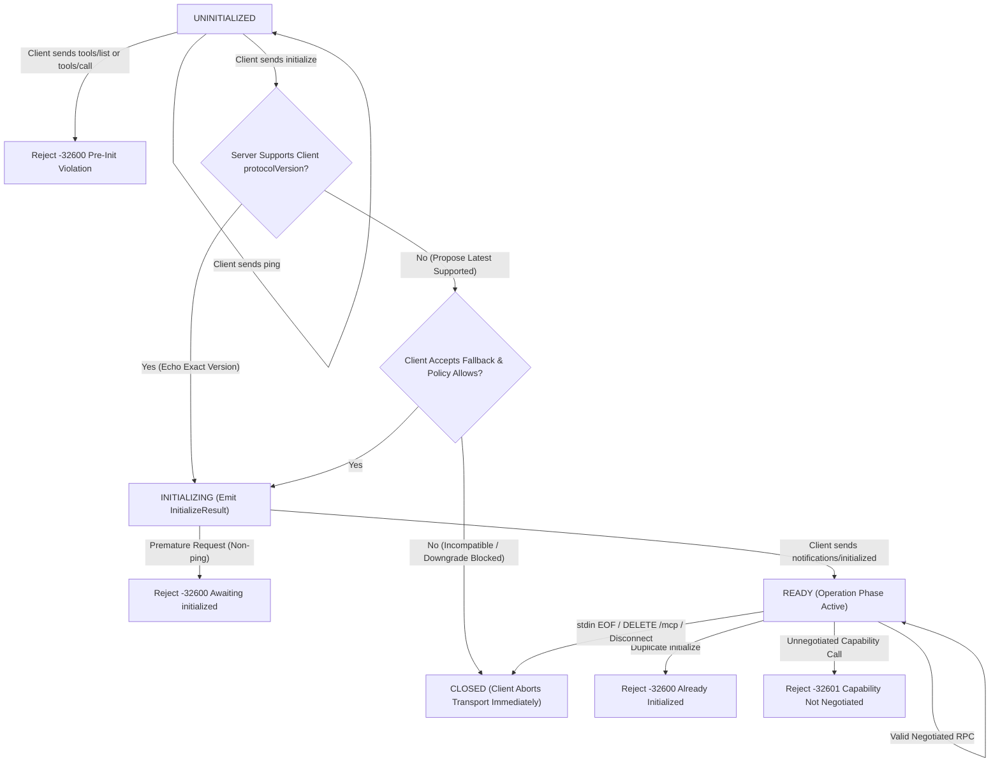
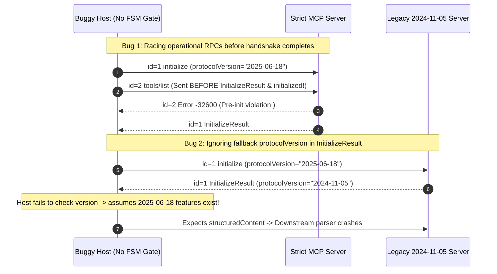

# Module 07: The Initialization Handshake

> **Prerequisites:** [Module 04: The Protocol: JSON-RPC Foundations](../04-the-protocol-json-rpc-foundations/README.md), [Module 05: Transports: stdio](../05-transports-stdio/README.md), and [Module 06: Transports: Streamable HTTP and SSE](../06-transports-streamable-http-and-sse/README.md).  
> **Estimated Reading Time:** 30 minutes  
> **Target Audience:** AI Platform Engineers, SDK Maintainers, Agent Host Developers

> [!TIP]
> **The Golden Rule of MCP Lifecycle & Initialization:** Treat the 3-phase MCP handshake (`initialize` $\rightarrow$ `InitializeResult` $\rightarrow$ `notifications/initialized`) as a **hard finite-state machine, never an optional warm-up**: reject all non-`ping` requests prior to `notifications/initialized`, close the transport immediately if protocol version negotiation fails, gate every subsequent RPC strictly by negotiated capabilities, and bound `instructions` as untrusted context.

---

## Why This Matters

Every connection bug that haunts multi-server MCP deployments happens in the first `200 milliseconds`: a fast host fires `initialize` and `tools/list` in the same event-loop tick before the server finishes booting its database pool; a client accepts an obsolete `2024-11-05` fallback silently and breaks downstream `outputSchema` parsing; or a server emits `sampling/createMessage` even though the host never advertised `sampling` capability.

When initialization is treated casually, failures manifest as flaky startup races and silent capability mismatches. Implementing initialization as a **deterministic state machine** guarantees clean version negotiation, strict pre-init isolation, zero capability violations, and clean teardown. *(Note: While newer stateless MCP profiles such as `2026-07-28+` allow per-request `_meta` capability headers without a persistent handshake, the stateful 3-phase handshake governs `stdio` and session-oriented Streamable HTTP deployments across `2024-11-05` through `2025-11-25` SDKs.)*

---

## 1. The Strict 3-Phase Lifecycle Finite-State Machine

A stateful MCP session traverses three strictly ordered phases across **four states** (`UNINITIALIZED`, `INITIALIZING`, `READY`, `CLOSED`):

### Phase 1: Initialization (`UNINITIALIZED` $\rightarrow$ `INITIALIZING` $\rightarrow$ `READY`)

1. **`initialize` Request (Client $\rightarrow$ Server):** MUST be the very first operational JSON-RPC Request on the wire:
   ```json
   {
     "jsonrpc": "2.0",
     "id": 1,
     "method": "initialize",
     "params": {
       "protocolVersion": "2025-06-18",
       "capabilities": {
         "roots": { "listChanged": true },
         "sampling": {},
         "elicitation": {}
       },
       "clientInfo": { "name": "DevAgentHost", "version": "2.4.0" }
     }
   }
   ```
2. **`InitializeResult` Response (Server $\rightarrow$ Client) & Version Negotiation:**
   - **Exact Match:** If the server supports the client's requested `protocolVersion`, it MUST respond with the **same version string**.
   - **Fallback Proposal:** If the server does not support the requested version, it MUST return the **latest version it supports** (e.g., `"2025-03-26"`), along with its `capabilities` (`tools`, `resources`, `prompts`, `logging`), `serverInfo`, and optional `instructions`.
   - **Client Abort Rule:** If the client cannot speak the server's returned `protocolVersion` (or policy forbids downgrading below a minimum baseline like `"2025-06-18"`), the **client MUST immediately terminate the transport/connection** rather than sending further requests!
3. **`notifications/initialized` Notification (Client $\rightarrow$ Server):**
   - Once the client validates `InitializeResult`, it emits `{"jsonrpc":"2.0","method":"notifications/initialized"}` (no `id`!). Only upon receiving this notification does the server transition to **`READY`**.

### Pre-Initialization Violation Rules

- **Client Restriction:** Prior to receiving `InitializeResult`, the client MUST NOT send any Request other than `ping`.
- **Server Restriction:** Prior to receiving `notifications/initialized`, the server MUST NOT issue feature Requests (`roots/list`, `sampling/createMessage`)—only `ping` and logging notifications (`notifications/message`) are permitted.
- **Enforcement:** Any server receiving `tools/list`, `tools/call`, or `resources/read` while in `UNINITIALIZED` or `INITIALIZING` MUST reject it immediately with JSON-RPC **`-32600 Invalid Request`** (and duplicate `initialize` once `READY` is also `-32600`).

### Phase 2 & Phase 3: Operation (`READY`) and Shutdown (`CLOSED`)

During `READY`, both peers exchange capabilities **strictly within the intersection** negotiated in `InitializeResult` and `initialize.params.capabilities`. MCP defines **no JSON-RPC `shutdown` method**: Phase 3 occurs at the transport layer (`stdin EOF -> SIGTERM -> SIGKILL` for `stdio`; `DELETE /mcp` or TCP close for Streamable HTTP).



### Capability Negotiation & Untrusted `instructions` Hardening

| Peer | Capability Field | What It Gates When Declared | Failure Mode If Ignored |
| :--- | :--- | :--- | :--- |
| **Server** | `tools: { listChanged: true }` | Server exposes `tools/list` / `tools/call` and may push `notifications/tools/list_changed` | Client hangs waiting for dynamic refresh notifications server never emits |
| **Server** | `resources: { subscribe: true, listChanged: true }` | Client may invoke `resources/subscribe` and `resources/unsubscribe` | Calling `resources/subscribe` when `subscribe` is false/omitted returns `-32601` |
| **Server** | `prompts: { listChanged: true }` | Server exposes `prompts/list` / `prompts/get` | Calling `prompts/get` on a tool-only server fails `-32601` |
| **Client** | `roots: { listChanged: true }` | Server may request `roots/list` from client workspace | Server crashes trying to query filesystem roots from headless client |
| **Client** | `sampling: {}` | Server may send `sampling/createMessage` to ask host LLM for completions | Server blocks waiting on LLM sampling from a client without `sampling` enabled |

> [!CAUTION]
> **Treat `InitializeResult.instructions` as Untrusted Input:** Hosts often concatenate a server's `instructions` string directly into the LLM's system prompt! Cap `instructions` length (e.g., `<= 2,000` chars), wrap it in `<server_instructions server="...">` XML boundaries, and sanitize override attempts before passing to the model (covered further in [Module 15](../15-security-and-trust-boundaries/README.md)).

### Quantitative Handshake Latency & `instructions` Token Budget Math

- **Amortized Cold-Connect Overhead:** A stateful handshake incurs connection setup plus `initialize` RTT and `notifications/initialized`:

$$L_{\text{handshake}} = L_{\text{transport\_connect}} + \text{RTT}_{\text{init}} + L_{\text{notif\_send}}, \qquad L_{\text{amortized/turn}} = \frac{L_{\text{handshake}}}{N_{\text{turns}}}$$

Re-spawning a fresh server per single tool turn ($N_{\text{turns}} = 1$) pays `100%` of $L_{\text{handshake}}$ (`90–1,500 ms`) every call, whereas pooling sessions over $N_{\text{turns}} = 12$ turns reduces handshake cost by `91.7%`.

- **Hidden System-Prompt Inflation from `instructions`:** Across $K$ active MCP servers, each contributing $I_{\text{tok}}$ tokens of `InitializeResult.instructions`, every single user prompt carries permanent prefix inflation:

$$T_{\text{instr\_overhead}} = K \cdot I_{\text{tok}}$$

With $K = 20$ servers averaging `800` instruction tokens each, `16,000` tokens are burned on **every single LLM inference turn** before `tools/list` schemas or user messages are even counted!

---

## 2. Systematic Comparison Matrix: Stateful MCP Handshake vs. Stateless & Transport Handshakes

| Dimension | MCP Stateful Lifecycle (`2024-11-05`–`2025-11-25`) | MCP Stateless Profile (`2026-07-28+` / HTTP Headerless Init) | TLS 1.3 Handshake | HTTP/2 Connection Preface + `SETTINGS` |
| :--- | :--- | :--- | :--- | :--- |
| **Explicit Setup Sequence** | `initialize` -> `InitializeResult` -> `notifications/initialized` | None; per-request version/caps via `_meta` & HTTP headers | `ClientHello` -> `ServerHello` + `Finished` | Magic preface + `SETTINGS` frame exchange |
| **Version Downgrade Policy** | Client MUST abort if server fallback unsupported | Rejected per-request via `400` / `-32600` | Cipher suite & TLS 1.3 strict verification | ALPN negotiation (`h2`) |
| **Capability Gating** | Symmetric capability objects exchanged once | Declared dynamically per request or manifest discovery | Extensions (`ALPN`, `key_share`) | `SETTINGS_MAX_CONCURRENT_STREAMS`, etc. |
| **Pre-Init Violations** | Only `ping` allowed before `READY` | N/A (every request self-contained) | Zero app data before handshake completes (excluding 0-RTT) | Must send `SETTINGS` first frame |
| **Amortized Cost** | `1 RTT` per session (`0 ms` on pooled calls) | Zero session setup; tiny per-request metadata header | `1 RTT` (or `0-RTT` PSK) | `1 RTT` per TCP connection |

---

## 3. Production War Story Post-Mortem: The Pre-Init Race Condition & `2024-11-05` Silent Downgrade

| Field | Incident Details |
| :--- | :--- |
| **Severity** | **SEV-2** (Intermittent Startup Failures Across `18%` of Agent Sessions + Silent Structured-Output Breakage) |
| **Detection / Resolution Time** | Detected 3 days post-release via telemetry drop on structured tool workflows / Fixed in 5 hours |
| **Impact** | `18%` of `stdio` sessions crashed during boot due to racing `tools/list` before `notifications/initialized`; `outputSchema` parsing silently broke when legacy servers downgraded to `2024-11-05` |

### What Happened

An AI orchestration service upgraded its TypeScript MCP host to consume structured tool outputs (`outputSchema` / `structuredContent`, introduced in `2025-06-18`) and added parallel startup across `8` configured MCP servers:

1. **Async Tick Race Condition:** The host fired `send("initialize")` and immediately ran `Promise.all([send("tools/list"), send("resources/list")])` without awaiting `InitializeResult` or transmitting `notifications/initialized` first. Servers with strict FSM guards rejected `tools/list` with `-32600`, while loose custom servers returned empty `tools: []` before finishing async plugin registration!
2. **Silent Version Downgrade:** A legacy internal server only supported `2024-11-05` and faithfully returned `protocolVersion: "2024-11-05"` inside `InitializeResult`. The host ignored the returned `protocolVersion` completely—continuing as if `"2025-06-18"` had been negotiated! Downstream JSON schema validators crashed whenever `structuredContent` was absent.



### Root Cause Analysis

- The host dispatched initialization and discovery in parallel instead of gating operational calls behind a state-machine `readyPromise` resolved *only* after `notifications/initialized` was flushed.
- The host neglected to compare `InitializeResult.protocolVersion` against its minimum required version policy (`>= "2025-06-18"`) and failed to gate capability-specific calls.

### The Fix & Architectural Hardening

- **Promise/Future FSM Gate:** Wrapped every outbound client transport in an explicit `LifecycleGate` allowing *only* `initialize` and `ping` until `notifications/initialized` transitions state to `READY`.
- **Strict Version Policy Enforcement:** Checked `InitializeResult.protocolVersion` against `MIN_SUPPORTED_VERSION = "2025-06-18"`; immediately terminated incompatible transports with explicit diagnostics instead of running degraded silently.

---

## 4. Multi-Language Production Implementation: Strict MCP Lifecycle State Machine

Below is a production-hardened **3-Phase MCP Lifecycle FSM & Capability Gatekeeper** across **Go**, **TypeScript**, **Python**, and **C#**. Every implementation enforces `UNINITIALIZED -> INITIALIZING -> READY -> CLOSED`, blocks pre-init non-`ping` calls (`-32600`), checks version compatibility, enforces negotiated capability flags (`-32601`), and bounds `instructions` length.

````carousel

```go
package mcplifecycle

import (
	"errors"
	"fmt"
	"sync"
)

type ConnState int

const (
	StateUninitialized ConnState = iota
	StateInitializing
	StateReady
	StateClosed
)

type ServerCapabilities struct {
	ToolsListChanged     bool
	ResourcesSubscribe   bool
	ResourcesListChanged bool
	PromptsListChanged   bool
}

type LifecycleGate struct {
	mu                sync.RWMutex
	state             ConnState
	supportedVersions map[string]bool
	negotiatedVersion string
	serverCaps        ServerCapabilities
	clientCaps        map[string]bool
	maxInstrChars     int
}

func NewLifecycleGate(caps ServerCapabilities) *LifecycleGate {
	return &LifecycleGate{
		state: StateUninitialized,
		supportedVersions: map[string]bool{
			"2025-11-25": true,
			"2025-06-18": true,
			"2025-03-26": true,
		},
		serverCaps:    caps,
		clientCaps:    make(map[string]bool),
		maxInstrChars: 2000,
	}
}

func (g *LifecycleGate) HandleInitialize(requestedVersion string, clientCaps []string) (string, error) {
	g.mu.Lock()
	defer g.mu.Unlock()
	if g.state != StateUninitialized {
		return "", errors.New("-32600: initialize already invoked")
	}
	chosen := "2025-11-25"
	if g.supportedVersions[requestedVersion] {
		chosen = requestedVersion
	}
	g.negotiatedVersion = chosen
	for _, c := range clientCaps {
		g.clientCaps[c] = true
	}
	g.state = StateInitializing
	return chosen, nil
}

func (g *LifecycleGate) HandleInitializedNotification() error {
	g.mu.Lock()
	defer g.mu.Unlock()
	if g.state != StateInitializing {
		return errors.New("unexpected notifications/initialized outside INITIALIZING state")
	}
	g.state = StateReady
	return nil
}

func (g *LifecycleGate) AuthorizeInboundRPC(method string) (int, error) {
	g.mu.RLock()
	defer g.mu.RUnlock()

	if method == "ping" {
		if g.state == StateClosed {
			return -32600, errors.New("connection closed")
		}
		return 0, nil
	}
	if g.state != StateReady {
		return -32600, fmt.Errorf("pre-init violation: %s rejected in state %d", method, g.state)
	}
	if method == "initialize" {
		return -32600, errors.New("duplicate initialize forbidden in READY state")
	}
	if method == "resources/subscribe" && !g.serverCaps.ResourcesSubscribe {
		return -32601, errors.New("capability not negotiated: resources.subscribe")
	}
	return 0, nil
}

func (g *LifecycleGate) CanServerSend(method string) bool {
	g.mu.RLock()
	defer g.mu.RUnlock()
	if g.state != StateReady {
		return method == "ping" || method == "notifications/message"
	}
	switch method {
	case "sampling/createMessage":
		return g.clientCaps["sampling"]
	case "roots/list":
		return g.clientCaps["roots"]
	default:
		return true
	}
}

func (g *LifecycleGate) SanitizeInstructions(raw string) string {
	if len(raw) > g.maxInstrChars {
		return raw[:g.maxInstrChars] + "...[TRUNCATED]"
	}
	return raw
}
```

<!-- slide -->

```typescript
export type LifecycleState = "UNINITIALIZED" | "INITIALIZING" | "READY" | "CLOSED";

export interface NegotiatedCapabilities {
  readonly server: { readonly tools?: { listChanged?: boolean }; readonly resources?: { subscribe?: boolean } };
  readonly client: { readonly sampling?: Record<string, unknown>; readonly roots?: { listChanged?: boolean } };
}

export class McpHandshakeStateMachine {
  private state: LifecycleState = "UNINITIALIZED";
  private negotiatedVersion: string | null = null;
  private caps: NegotiatedCapabilities = { server: {}, client: {} };
  private readonly supported = ["2025-11-25", "2025-06-18", "2025-03-26"];

  public get currentState(): LifecycleState {
    return this.state;
  }

  public onInitializeRequest(
    clientVersion: string,
    clientCapabilities: NegotiatedCapabilities["client"],
    serverCapabilities: NegotiatedCapabilities["server"],
  ): { protocolVersion: string; capabilities: NegotiatedCapabilities["server"] } {
    if (this.state !== "UNINITIALIZED") {
      throw Object.assign(new Error("Invalid Request: initialize permitted only in UNINITIALIZED state"), { code: -32600 });
    }
    const chosen = this.supported.includes(clientVersion) ? clientVersion : this.supported[0];
    this.negotiatedVersion = chosen;
    this.caps = { server: serverCapabilities, client: clientCapabilities };
    this.state = "INITIALIZING";
    return { protocolVersion: chosen, capabilities: serverCapabilities };
  }

  public onInitializedNotification(): void {
    if (this.state !== "INITIALIZING") {
      throw new Error(`Invalid transition: notifications/initialized received in ${this.state}`);
    }
    this.state = "READY";
  }

  public validateClientSideHandshakeResponse(
    serverResult: { protocolVersion: string; instructions?: string },
    minAllowedVersion = "2025-06-18",
  ): { safeInstructions: string } {
    if (!this.supported.includes(serverResult.protocolVersion) || serverResult.protocolVersion < minAllowedVersion) {
      this.state = "CLOSED";
      throw new Error(`Incompatible or downgraded server protocolVersion=${serverResult.protocolVersion}; closing transport.`);
    }
    const rawInstr = serverResult.instructions ?? "";
    const bounded = rawInstr.length > 2000 ? `${rawInstr.slice(0, 2000)}...[TRUNCATED]` : rawInstr;
    return { safeInstructions: `<untrusted_server_instructions>\n${bounded}\n</untrusted_server_instructions>` };
  }

  public assertInboundAllowed(method: string): void {
    if (method === "ping" && this.state !== "CLOSED") return;
    if (this.state !== "READY") {
      throw Object.assign(new Error(`Pre-init violation: ${method} forbidden while ${this.state}`), { code: -32600 });
    }
    if (method === "initialize") {
      throw Object.assign(new Error("Duplicate initialize forbidden"), { code: -32600 });
    }
    if (method === "resources/subscribe" && !this.caps.server.resources?.subscribe) {
      throw Object.assign(new Error("Capability not negotiated: resources.subscribe"), { code: -32601 });
    }
  }
}
```

<!-- slide -->

```python
"""
mcp_lifecycle_fsm.py
Strict 3-phase MCP initialization state machine, version-downgrade guard, and capability gatekeeper.
"""
from __future__ import annotations

from dataclasses import dataclass, field
from typing import Any


class LifecycleError(Exception):
    def __init__(self, code: int, message: str) -> None:
        super().__init__(message)
        self.code = code
        self.message = message


@dataclass
class McpLifecycleFSM:
    supported_versions: tuple[str, ...] = ("2025-11-25", "2025-06-18", "2025-03-26")
    min_client_policy_version: str = "2025-06-18"
    max_instruction_chars: int = 2000
    state: str = "UNINITIALIZED"
    negotiated_version: str | None = None
    client_caps: dict[str, Any] = field(default_factory=dict)
    server_caps: dict[str, Any] = field(default_factory=lambda: {"tools": {"listChanged": True}, "resources": {"subscribe": False}})

    def server_on_initialize(self, params: dict[str, Any]) -> dict[str, Any]:
        if self.state != "UNINITIALIZED":
            raise LifecycleError(-32600, f"initialize prohibited in state {self.state}")
        req_ver = params.get("protocolVersion", "")
        chosen = req_ver if req_ver in self.supported_versions else self.supported_versions[0]
        self.negotiated_version = chosen
        self.client_caps = params.get("capabilities", {})
        self.state = "INITIALIZING"
        return {
            "protocolVersion": chosen,
            "capabilities": self.server_caps,
            "serverInfo": {"name": "hardened-mcp", "version": "1.0.0"},
        }

    def server_on_initialized_notification(self) -> None:
        if self.state != "INITIALIZING":
            raise LifecycleError(-32600, f"notifications/initialized invalid in state {self.state}")
        self.state = "READY"

    def server_authorize_rpc(self, method: str) -> None:
        if method == "ping" and self.state != "CLOSED":
            return
        if self.state != "READY":
            raise LifecycleError(-32600, f"Pre-init violation: {method} rejected in state {self.state}")
        if method == "initialize":
            raise LifecycleError(-32600, "Duplicate initialize prohibited")
        if method == "resources/subscribe" and not self.server_caps.get("resources", {}).get("subscribe"):
            raise LifecycleError(-32601, "Capability not negotiated: resources.subscribe")

    def client_verify_init_result(self, result: dict[str, Any]) -> str:
        ver = result.get("protocolVersion", "")
        if ver not in self.supported_versions or ver < self.min_client_policy_version:
            self.state = "CLOSED"
            raise LifecycleError(-32600, f"Protocol version {ver!r} incompatible or blocked by downgrade policy; close transport.")
        instr = str(result.get("instructions", ""))[: self.max_instruction_chars]
        return f"<server_instructions>\n{instr}\n</server_instructions>" if instr else ""
```

<!-- slide -->

```csharp
using System;
using System.Collections.Generic;

namespace GenAI.Mcp.Lifecycle;

public enum McpConnState { Uninitialized, Initializing, Ready, Closed }

public sealed class McpLifecycleException(int code, string message) : Exception(message)
{
    public int Code { get; } = code;
}

public sealed class McpLifecycleGate
{
    private static readonly HashSet<string> Supported = ["2025-11-25", "2025-06-18", "2025-03-26"];
    private readonly object _gate = new();
    private readonly bool _supportsResourceSubscribe;
    private readonly HashSet<string> _clientCaps = new(StringComparer.Ordinal);

    public McpConnState State { get; private set; } = McpConnState.Uninitialized;
    public string? NegotiatedVersion { get; private set; }

    public McpLifecycleGate(bool supportsResourceSubscribe = false) => _supportsResourceSubscribe = supportsResourceSubscribe;

    public string OnInitialize(string requestedVersion, IEnumerable<string> clientCapabilities)
    {
        lock (_gate)
        {
            if (State != McpConnState.Uninitialized)
                throw new McpLifecycleException(-32600, $"initialize rejected in state {State}");

            NegotiatedVersion = Supported.Contains(requestedVersion) ? requestedVersion : "2025-11-25";
            foreach (var cap in clientCapabilities) _clientCaps.Add(cap);
            State = McpConnState.Initializing;
            return NegotiatedVersion;
        }
    }

    public void OnInitializedNotification()
    {
        lock (_gate)
        {
            if (State != McpConnState.Initializing)
                throw new McpLifecycleException(-32600, $"notifications/initialized unexpected in state {State}");
            State = McpConnState.Ready;
        }
    }

    public void AuthorizeInbound(string method)
    {
        lock (_gate)
        {
            if (method == "ping" && State != McpConnState.Closed) return;
            if (State != McpConnState.Ready)
                throw new McpLifecycleException(-32600, $"Pre-init violation: {method} rejected in state {State}");
            if (method == "initialize")
                throw new McpLifecycleException(-32600, "Duplicate initialize forbidden");
            if (method == "resources/subscribe" && !_supportsResourceSubscribe)
                throw new McpLifecycleException(-32601, "Capability not negotiated: resources.subscribe");
        }
    }

    public static void ValidateClientAcceptedVersion(string serverVersion, string minPolicyVersion = "2025-06-18")
    {
        if (!Supported.Contains(serverVersion) || string.CompareOrdinal(serverVersion, minPolicyVersion) < 0)
            throw new McpLifecycleException(-32600, $"Version {serverVersion} rejected; terminate transport immediately.");
    }
}
```

````

---

## 5. Practical Hands-On Verification CLI Workflows

Run these deterministic Python 3.13 verification scripts offline—zero third-party libraries or external APIs required.

### Workflow 1: Full Lifecycle FSM Enforcement & Pre-Init Violation Harness

Walk a stateful MCP server FSM through pre-init rejection, allowed pre-init `ping`, `initialize`, premature `tools/call`, `notifications/initialized`, duplicate `initialize`, unnegotiated `resources/subscribe`, and valid execution:

```bash
python -c '
import json

class LifecycleFSM:
    SUPPORTED = ["2025-11-25", "2025-06-18", "2025-03-26"]

    def __init__(self):
        self.state = "UNINITIALIZED"
        self.negotiated_version = None
        self.client_caps = {}
        self.server_caps = {"tools": {"listChanged": True}, "resources": {"subscribe": False}}

    def handle_client_msg(self, msg):
        method = msg.get("method")
        req_id = msg.get("id")
        if method == "ping":
            return {"jsonrpc": "2.0", "id": req_id, "result": {}}
        if self.state == "UNINITIALIZED":
            if method != "initialize":
                return {"jsonrpc": "2.0", "id": req_id, "error": {"code": -32600, "message": f"Pre-init violation: {method} forbidden before initialize"}}
            req_ver = msg.get("params", {}).get("protocolVersion")
            chosen = req_ver if req_ver in self.SUPPORTED else self.SUPPORTED[0]
            self.negotiated_version = chosen
            self.client_caps = msg.get("params", {}).get("capabilities", {})
            self.state = "INITIALIZING"
            return {"jsonrpc": "2.0", "id": req_id, "result": {"protocolVersion": chosen, "capabilities": self.server_caps, "serverInfo": {"name": "ledger-mcp", "version": "2.1.0"}}}
        if self.state == "INITIALIZING":
            if method == "notifications/initialized":
                self.state = "READY"
                return None
            return {"jsonrpc": "2.0", "id": req_id, "error": {"code": -32600, "message": f"Handshake incomplete: awaiting notifications/initialized, got {method}"}}
        if self.state == "READY":
            if method == "initialize":
                return {"jsonrpc": "2.0", "id": req_id, "error": {"code": -32600, "message": "Duplicate initialize prohibited"}}
            if method == "resources/subscribe" and not self.server_caps["resources"].get("subscribe"):
                return {"jsonrpc": "2.0", "id": req_id, "error": {"code": -32601, "message": "Capability not negotiated: resources.subscribe"}}
            return {"jsonrpc": "2.0", "id": req_id, "result": {"executed": method}}

fsm = LifecycleFSM()
steps = [
    ("1. Pre-init tools/list", {"jsonrpc": "2.0", "id": 1, "method": "tools/list"}),
    ("2. Pre-init ping", {"jsonrpc": "2.0", "id": 2, "method": "ping"}),
    ("3. Initialize", {"jsonrpc": "2.0", "id": 3, "method": "initialize", "params": {"protocolVersion": "2025-06-18", "capabilities": {"roots": {"listChanged": True}}, "clientInfo": {"name": "cli", "version": "1.0"}}}),
    ("4. Premature tools/call", {"jsonrpc": "2.0", "id": 4, "method": "tools/call", "params": {"name": "x"}}),
    ("5. notifications/initialized", {"jsonrpc": "2.0", "method": "notifications/initialized"}),
    ("6. Duplicate initialize", {"jsonrpc": "2.0", "id": 5, "method": "initialize", "params": {"protocolVersion": "2025-06-18"}}),
    ("7. Unnegot resources/subscribe", {"jsonrpc": "2.0", "id": 6, "method": "resources/subscribe"}),
    ("8. Valid tools/list", {"jsonrpc": "2.0", "id": 7, "method": "tools/list"}),
]
for label, msg in steps:
    res = fsm.handle_client_msg(msg)
    summary = "OK_NO_REPLY (state=" + fsm.state + ")" if res is None else ("ERR " + str(res["error"]["code"]) + ": " + res["error"]["message"] if "error" in res else "OK: " + json.dumps(res["result"]))
    print(f"{label:<30} -> {summary}")
'
```

**Expected Output:**

```text
1. Pre-init tools/list         -> ERR -32600: Pre-init violation: tools/list forbidden before initialize
2. Pre-init ping               -> OK: {}
3. Initialize                  -> OK: {"protocolVersion": "2025-06-18", "capabilities": {"tools": {"listChanged": true}, "resources": {"subscribe": false}}, "serverInfo": {"name": "ledger-mcp", "version": "2.1.0"}}
4. Premature tools/call        -> ERR -32600: Handshake incomplete: awaiting notifications/initialized, got tools/call
5. notifications/initialized   -> OK_NO_REPLY (state=READY)
6. Duplicate initialize        -> ERR -32600: Duplicate initialize prohibited
7. Unnegot resources/subscribe -> ERR -32601: Capability not negotiated: resources.subscribe
8. Valid tools/list            -> OK: {"executed": "tools/list"}
```

### Workflow 2: Protocol Version Negotiation & Downgrade Policy Matrix

Verify exact match, safe fallback negotiation, incompatible version abort, and minimum-version downgrade rejection:

```bash
python -c '
def negotiate_version(client_supported, server_supported, min_allowed="2025-06-18"):
    requested = client_supported[0]
    server_choice = requested if requested in server_supported else server_supported[0]
    if server_choice not in client_supported:
        return f"CLOSE_TRANSPORT (client lacks {server_choice})"
    if server_choice < min_allowed:
        return f"CLOSE_POLICY_DOWNGRADE ({server_choice} < {min_allowed})"
    return f"ACCEPTED ({server_choice})"

cases = [
    ("Exact Match", ["2025-11-25", "2025-06-18"], ["2025-11-25", "2025-06-18"]),
    ("Safe Fallback", ["2025-11-25", "2025-06-18"], ["2025-06-18", "2025-03-26"]),
    ("Incompatible Server", ["2025-11-25", "2025-06-18"], ["2025-03-26"]),
    ("Blocked Downgrade", ["2025-06-18", "2024-11-05"], ["2024-11-05"]),
]
for name, cli, srv in cases:
    print(f"{name:<22} -> {negotiate_version(cli, srv)}")
'
```

**Expected Output:**

```text
Exact Match            -> ACCEPTED (2025-11-25)
Safe Fallback          -> ACCEPTED (2025-06-18)
Incompatible Server    -> CLOSE_TRANSPORT (client lacks 2025-03-26)
Blocked Downgrade      -> CLOSE_POLICY_DOWNGRADE (2024-11-05 < 2025-06-18)
```

### Workflow 3: Multi-Server `instructions` Token Budget & Handshake Amortization Profiler

Quantify permanent per-turn prompt bloat from `InitializeResult.instructions` across $K$ servers alongside cold vs. pooled handshake latency (`RTT=45 ms`, `12` turns/session):

```bash
python -c '
def handshake_profile(servers=10, instr_tokens_per_server=600, turns_per_session=12, rtt_ms=45.0):
    cold_ms = 2 * rtt_ms
    amortized_ms = cold_ms / turns_per_session
    hidden_prompt_tokens = servers * instr_tokens_per_server
    print(f"servers={servers:>2} | instr_overhead/turn={hidden_prompt_tokens:>6,} tok | cold_init={cold_ms:.0f} ms | amortized/turn={amortized_ms:.1f} ms")

for k, t in [(2, 300), (10, 600), (20, 800)]:
    handshake_profile(servers=k, instr_tokens_per_server=t)
'
```

**Expected Output:**

```text
servers= 2 | instr_overhead/turn=   600 tok | cold_init=90 ms | amortized/turn=7.5 ms
servers=10 | instr_overhead/turn= 6,000 tok | cold_init=90 ms | amortized/turn=7.5 ms
servers=20 | instr_overhead/turn=16,000 tok | cold_init=90 ms | amortized/turn=7.5 ms
```

### Hands-On Exercises

1. **Server-Side Pre-Init Sampling Block:** Extend Workflow 1's `LifecycleFSM` with a `server_send_request(method)` check that raises an error if the server attempts `sampling/createMessage` while in `INITIALIZING` *or* if `"sampling"` was absent from `self.client_caps`.
2. **Thread-Safe Async Barrier:** Wrap an async client proxy around a condition/event so concurrent `tools/list` and `resources/list` calls fired immediately after connect automatically block behind `ready_event.wait()` until `notifications/initialized` flushes.
3. **`instructions` Sanitizer Check:** Add a character cap (`1,500` chars) and strip closing XML tags (`</server_instructions>`) inside `client_verify_init_result` to prevent tag-escape prompt injection.

### Independent Challenge

A multi-region enterprise MCP gateway routes `initialize` through a stateless HTTP edge proxy and caches only the negotiated `Mcp-Session-Id` boolean (`active=True`) without persisting the negotiated `protocolVersion` or `capabilities` object. When a client later calls `resources/subscribe` against a server that never declared `resources.subscribe: true`, or sends `MCP-Protocol-Version: 2024-11-05` mid-session after negotiating `2025-06-18`, the gateway forwards the calls blindly. Design the compact session metadata record and validation middleware required to prevent cross-version drift and capability bypasses.

<details><summary>Architectural Discussion</summary>

Boolean session tracking (`active=True`) loses the entire security and feature contract established during `initialize`. Persist a compact immutable `SessionHandshakeState` object in Redis/memory keyed by `Mcp-Session-Id` storing `{ protocolVersion, serverCapabilities, clientCapabilities, initializedAt, ready: true }`. On every subsequent HTTP `POST`/`GET`, middleware verifies: (1) `ready == true` (rejecting premature requests before `notifications/initialized`), (2) `MCP-Protocol-Version` header matches `SessionHandshakeState.protocolVersion` (`400 Bad Request` otherwise), and (3) the requested RPC method is explicitly enabled inside `serverCapabilities` (returning `-32601` at the edge before waking backend workers).

</details>

---

## 6. Common Mistakes & Troubleshooting

- **Firing `tools/list` immediately without waiting for `notifications/initialized`:** Causes intermittent `-32600` pre-init errors or incomplete empty tool catalogs while server startup hooks are still running.
- **Ignoring `InitializeResult.protocolVersion` on the client:** If a server returns an older fallback version you do not support, continuing silently breaks schema assumptions (`outputSchema`, `MCP-Protocol-Version` header). Terminate the transport immediately when the returned version is unsupported.
- **Looking for an MCP `shutdown` RPC method:** MCP intentionally omits a JSON-RPC `shutdown` request. Shutdown is always signaled at the transport layer (`stdin` EOF / `SIGTERM` or HTTP `DELETE /mcp`).
- **Injecting raw `InitializeResult.instructions` from 20 untrusted servers into the system prompt:** Bloats prefill context by thousands of tokens per turn and exposes the system prompt to server-supplied prompt injection.

---

## 7. Operational Validation Checkpoints & Checkpoint Quiz

### Operational Validation Checkpoints

<details><summary><strong>Checkpoint 1: Diagnosing `-32600` during concurrent boot</strong></summary>

A Python MCP host spawns a `stdio` server, sends `initialize`, receives `InitializeResult`, and concurrently launches `tools/list` and `notifications/initialized` in two separate `asyncio.create_task()` calls—failing intermittently with `-32600`. Why?

**Validation:** `asyncio.create_task` does not guarantee wire ordering before flush: `tools/list` occasionally reaches `stdin` before `notifications/initialized`. Always `await` sending and flushing `notifications/initialized` *before* dispatching any operational `tools/list` or `resources/list` RPC.

</details>

<details><summary><strong>Checkpoint 2: Handling server fallback version mismatch</strong></summary>

A client sends `initialize` with `protocolVersion: "2025-11-25"`, and the server responds with `protocolVersion: "2025-03-26"`. The client only supports `"2025-06-18"` and `"2025-11-25"`. What must the client do next?

**Validation:** The client MUST **NOT** send `notifications/initialized` or any operational requests; it MUST close the transport/subprocess immediately and surface an incompatible protocol version error.

</details>

<details><summary><strong>Checkpoint 3: Preventing `sampling/createMessage` crashes</strong></summary>

During a `tools/call`, an MCP server attempts to ask the host LLM for a completion via `sampling/createMessage`, and the host rejects it with `-32601 Method not found`. What handshake check did the server skip?

**Validation:** The server failed to inspect `initialize.params.capabilities.sampling`! Sampling is an optional client capability; if the client omitted `"sampling"` during `initialize`, the server MUST NOT invoke `sampling/createMessage` and should fall back gracefully or report a clear `isError: true` message.

</details>

### Checkpoint Quiz

1. Name the exact three messages/phases that constitute the stateful MCP Initialization sequence in strict order.
2. Which JSON-RPC method is permitted *before* `notifications/initialized` transitions the server to `READY`?
3. What is the difference between `protocolVersion` fallback negotiation in `InitializeResult` vs. HTTP error handling?
4. How does MCP signal clean shutdown over `stdio` vs. Streamable HTTP?
5. Why should hosts cap and isolate `InitializeResult.instructions` inside XML tags?

<details><summary>Answers</summary>

1. (1) Client sends `initialize` Request (`protocolVersion`, `capabilities`, `clientInfo`); (2) Server responds with `InitializeResult` (`protocolVersion`, server `capabilities`, `serverInfo`, optional `instructions`); (3) Client sends `notifications/initialized` Notification (transitioning connection to `READY`).
2. `ping` (and servers may emit `notifications/message` logging notifications, though not feature requests like `sampling/createMessage` or `roots/list`).
3. If the server does not support the client's requested `protocolVersion`, it does NOT return a JSON-RPC error—it returns `InitializeResult` proposing the latest version it *does* support, leaving it to the client to accept or immediately close the connection.
4. MCP has no `shutdown` JSON-RPC method: `stdio` closes child's `stdin` (EOF) then escalates `SIGTERM -> SIGKILL`; Streamable HTTP sends `DELETE /mcp` with `Mcp-Session-Id` (or closes the stream).
5. `instructions` is a server-supplied string often placed into the LLM system prompt; uncapped or untrusted instructions bloat per-turn prefill tokens across multiple servers and introduce prompt-injection risks.

</details>

---

## Further Reading & Sources

- [Model Context Protocol Specification: Lifecycle](https://modelcontextprotocol.io/specification/2025-06-18/basic/lifecycle) — normative specification for initialization, version negotiation, capability negotiation, and shutdown.
- [Model Context Protocol Specification (2025-11-25)](https://modelcontextprotocol.io/specification/2025-11-25) — anniversary release extending initialization metadata and discovery.
- [Module 04: The Protocol: JSON-RPC Foundations](../04-the-protocol-json-rpc-foundations/README.md) — `-32600` / `-32601` error codes and Notification zero-reply semantics.

## Next

[Module 08: Primitive: Tools](../08-primitive-tools/README.md)
