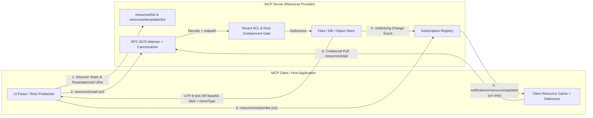
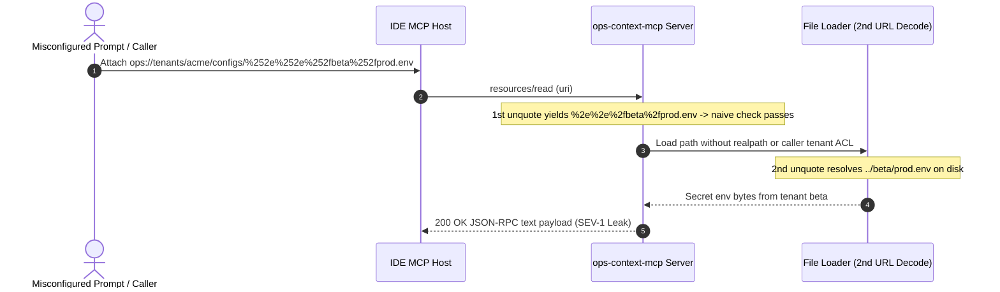

# Module 09: Primitive: Resources

> **Prerequisites:** [Module 07: The Initialization Handshake](../07-the-initialization-handshake/README.md) and [Module 08: Primitive: Tools](../08-primitive-tools/README.md).  
> **Estimated Reading Time:** 30 minutes  
> **Target Audience:** AI Backend Engineers, MCP Server Developers, Platform & Security Architects

> [!TIP]
> **The Golden Rule of MCP Resources:** Treat Resources as **application-controlled, URI-addressed read-only context slices—never unvalidated filesystem pass-throughs or substitutes for query tools**: canonicalize and tenant-check every expanded RFC 6570 URI *before* touching disk or databases, enforce strict `text` vs. base64 `blob` wire-size caps, and push freshness through debounced `notifications/resources/updated` events instead of client polling loops.

---

## Why This Matters

In [Module 08: Primitive: Tools](../08-primitive-tools/README.md), you built **model-controlled** capabilities: the LLM autonomously decides when to invoke `search_tickets` or `execute_sql` and passes JSON arguments during a reasoning loop. Yet most real-world AI workflows begin *before* the model ever chooses a tool—when a developer clicks `@schema.sql` in an IDE, attaches an incident log in Claude Desktop, or loads an account's latest configuration via a RAG pre-fetcher.

If you force every static document, log tail, or database schema behind a **Tool**, the host UI cannot render an attachment picker, IDE autocomplete cannot pre-populate file references, and the LLM wastes costly round-trips calling `read_file` just to discover context the application already wanted to supply. Conversely, if you expose dynamic **Resources** (`file://`, `db://`, `git://`) without canonical path validation, tenant ACL enforcement, base64 wire-budget limits, and subscription debouncing, a single double-encoded URI template (`%252e%252e`) leaks cross-tenant secrets—or a `50 MB` binary dump blows past your NDJSON pipe and OOMs the host process.

---

## 1. Control Inversion & Resource Protocol Architecture

MCP defines **Resources** as **application-controlled** read-only data entities exposed by a server and identified by RFC 3986 URIs (such as `file:///workspace/README.md`, `postgres://prod/public/orders/schema`, or `logs://payments/2026-11-11`). Unlike Tools (selected by the LLM), the **Client/Host** decides when and how to fetch a Resource—whether via a human clicking an attachment dropdown, deterministic RAG prefetching, or explicit `ctx.read_resource()` calls.



### Server Capability Negotiation & Core RPC Methods (`2025-06-18`)

During the initialization handshake ([Module 07](../07-the-initialization-handshake/README.md)), a server advertises Resource features via `capabilities.resources`:

```json
{
  "capabilities": {
    "resources": {
      "subscribe": true,
      "listChanged": true
    }
  }
}
```

| RPC Method / Notification | Direction | Purpose & Wire Contract |
| :--- | :--- | :--- |
| **`resources/list`** | Client $\rightarrow$ Server | Paginated discovery (`cursor` / `nextCursor`) returning concrete `Resource` descriptors (`uri`, `name`, optional `title`, `description`, `mimeType`, `size`, `annotations`). |
| **`resources/templates/list`** | Client $\rightarrow$ Server | Paginated discovery of parameterized **RFC 6570** `uriTemplate` patterns (e.g., `db://tenants/{tenant_id}/docs/{+path}`) so hosts can expand dynamic URIs without pre-enumerating millions of rows. |
| **`resources/read`** | Client $\rightarrow$ Server | Fetches `{"contents": [...]}` for a single concrete `uri`. Each item carries `uri`, optional `mimeType`, optional `annotations`, and **either** `"text"` (UTF-8) **or** `"blob"` (base64). |
| **`resources/subscribe`** / **`resources/unsubscribe`** | Client $\rightarrow$ Server | Registers or cancels per-URI change tracking when `capabilities.resources.subscribe` is `true`. |
| **`notifications/resources/updated`** | Server $\rightarrow$ Client | Lightweight push notification `{"uri": "..."}` indicating content changed. **Carries zero payload**—the client decides if and when to pull fresh bytes via `resources/read`. |
| **`notifications/resources/list_changed`** | Server $\rightarrow$ Client | Emitted when the set of available resources/templates changes (requires `listChanged: true`), prompting the client to refresh `resources/list`. |

### Payload Semantics: `text`, `blob`, `annotations`, and `resource_link`

1. **`text` vs. `blob` Separation:**
   - Use **`text`** for UTF-8 decodable formats (`text/plain`, `text/markdown`, `application/json`, `application/sql`, `text/csv`).
   - Use **`blob`** (standard Base64-encoded ASCII string) for binary formats (`image/png`, `application/pdf`, `application/octet-stream`, `audio/wav`). Never force arbitrary binary bytes into a UTF-8 `"text"` field with replacement characters (`\ufffd`)—it corrupts checksums and fails downstream parsers.
2. **Metadata Hints (`annotations`):**
   - `audience`: `["user"]`, `["assistant"]`, or `["user", "assistant"]` — guides whether a UI renders the data visually for the human, injects it into the LLM prompt, or both.
   - `priority`: float in `[0.0, 1.0]` (`1.0` = effectively mandatory context, `0.0` = low-priority optional background).
   - `lastModified`: ISO 8601 timestamp (`2026-11-11T09:15:00Z`) enabling conditional client cache validation.
3. **Oversize Guard (`resource_link`):**
   - Tools and prompts can also return a **`resource_link`** block (`type: "resource_link"`, `uri`, `name`, `mimeType`, `size`) pointing to a Resource URI *without* inlining megabytes of base64 inside a single tool response, letting the host fetch or stream only what fits its context budget.

### Dynamic URI Security: RFC 6570 Canonicalization & Tenant ACLs

Because `resources/templates/list` exposes parameterized URIs (`file:///logs/{service}/{+filename}` or `db://tenants/{tenant_id}/invoices/{id}`), naive handlers commit two classic security errors:

1. **Multi-Pass URL Decoding Bypass:** A client or prompt supplies `%252e%252e%252f` (double-encoded `../`). If your router runs `startswith("/var/logs/")` *before* `unquote()`, or runs `unquote()` only once before passing the string to an HTTP/S3 proxy that decodes a second time, traversal escapes containment.
2. **Prefix String Trick & Missing Tenant Binding:** Checking `path.startswith("/data/acme")` allows `/data/acme-competitor/secret.csv`! Always canonicalize with `os.path.realpath()` (resolving symlinks and `..` segments), verify `os.path.commonpath([root_real, target_real]) == root_real`, and bind `tenant_id` in the URI against the authenticated session's caller claim—never trusting the URI parameter alone.

### Quantitative Mechanics: Base64 Expansion, Subscription Debouncing, and Context Budgets

Before exposing Resources at scale, quantify three resource costs:

- **Base64 `blob` Wire Amplification:** Encoding $B_{\text{raw}}$ binary bytes into base64 produces 4 ASCII bytes for every 3 raw bytes (rounded up), inflating JSON-RPC frame size by `33.3%` before JSON escaping:

$$B_{\text{wire}} = 4 \cdot \left\lceil \frac{B_{\text{raw}}}{3} \right\rceil + B_{\text{envelope}} \approx 1.333 \cdot B_{\text{raw}}$$

Sending a `30 MB` binary trace via `blob` generates a `40 MB` single-line JSON frame—exhausting `stdio` read buffers and blocking event loops during `json.loads()`. Always enforce a hard `MAX_RESOURCE_BYTES` cap (typically `1–4 MiB`) and expose larger artifacts via paginated byte-range URI templates (`artifact://{id}?offset={n}&limit={m}`).

- **Subscription Pull Amplification & Debounce Gain:** Because `notifications/resources/updated` triggers a follow-up `resources/read` of size $S_{\text{res}}$ bytes, an unthrottled file watcher firing at write rate $f_{\text{write}}$ Hz wastes bandwidth:

$$R_{\text{uncoalesced}} = f_{\text{write}} \cdot S_{\text{res}}, \qquad R_{\text{debounced}} \le \frac{1}{\Delta t_{\text{debounce}}} \cdot S_{\text{res}}$$

For a `50 KB` log file written `40` times/sec (`2,000 KB/s`), adding a `250 ms` server-side debounce drops pull traffic to `4 reads/s` (`200 KB/s`)—a **`90%` reduction**.

- **Host Context Window Budget:** Attaching $K$ resources into an LLM prompt consumes:

$$T_{\text{ctx}} = \sum_{i=1}^{K} \left\lceil \frac{\text{bytes}(r_i)}{\beta_{\text{tok}}} \right\rceil$$

where $\beta_{\text{tok}} \approx 3.5\text{–}4.0\text{ bytes/token}$ for English/code (`~250–285 tokens/KiB`).

---

## 2. Systematic Comparison Matrix: MCP Resources vs. Read-Only Tools vs. RAG Pre-Fetch

| Dimension | MCP Resource (`resources/read`) | MCP Read-Only Tool (`tools/call`) | Direct App/RAG Vector Query |
| :--- | :--- | :--- | :--- |
| **Control Model** | **Application-controlled** (Host UI, `@file` picker, deterministic prefetch) | **Model-controlled** (LLM decides arguments and loop count) | **Application-controlled** (semantic top-$k$ retrieval pipeline) |
| **Addressing & Discovery** | Canonical RFC 3986 URIs + RFC 6570 `uriTemplate` | Named RPC function + JSON Schema `inputSchema` | Vector embedding similarity + metadata filter |
| **Freshness & Push Support** | **Native push** via `resources/subscribe` + `notifications/resources/updated` | Pull-only (model must re-invoke tool explicitly) | Offline CDC / scheduled re-indexing lag |
| **Payload Formats** | UTF-8 `text` or Base64 `blob` with `mimeType` & `annotations` | Content blocks (`text`, `image`, `audio`, `resource_link`, `structuredContent`) | Text chunks + metadata scores |
| **Best Production Fit** | Open IDE files, DB schemas, live logs, user-selected documents, config snapshots | Dynamic multi-filter SQL/API search, aggregations, semantic queries with arbitrary predicates | Large multi-million-chunk corpora requiring dense + BM25 reranking |

> [!IMPORTANT]
> **Rule of Thumb (Resources vs. Read-Only Tools):** If a human or host UI should be able to browse, attach, or subscribe to a **known entity by URI** (`repo://owner/app/src/main.py`, `db://schema/orders`), expose a **Resource**. If the LLM needs to formulate arbitrary search queries, filters, or aggregations across records (`search_logs(query="timeout", severity="ERROR", limit=20)`), expose a **Read-Only Tool**.

---

## 3. Production War Story Post-Mortem: The Double-Encoded URI Template & 40 MB Heap-Dump Freeze

| Field | Incident Details |
| :--- | :--- |
| **Severity** | **SEV-1** (Cross-Tenant Secret Disclosure + IDE Client OOM & Event Loop Freeze) |
| **Detection / Resolution Time** | Detected 3 hours post-release via WAF anomaly alert & customer crash telemetry / Mitigated in 2 hours (canonical path gate + `2 MiB` wire cap + `250 ms` debounce) |
| **Impact** | Staging billing keys accessed via `%252e%252e` traversal in an internal DevOps MCP server; `28 MB` binary heap dump expanded to `37.3 MB` base64 crashing `19` developer IDE sessions |

### What Happened

A platform engineering team shipped an internal `ops-context-mcp` server exposing two parameterized resource templates:

1. `ops://tenants/{tenant}/configs/{+file}` for attaching environment YAML configs.
2. `ops://pods/{pod_id}/heapdump` with `resources/subscribe` enabled on active pods.

Three compounding bugs hit production on day one:

- **Bug 1 (Single-Decode Before Prefix Check):** The URI handler ran `urllib.parse.unquote(file)` once, checked `not ".." in path` *prior* to a downstream reverse-proxy helper that decoded URL escapes a second time. Passing `file=%252e%252e%252fbeta%252fstripe.env` bypassed the `..` check (`"%2e%2e%2f..."` had no literal `".."` yet!), resolved onto Tenant Beta's directory on disk, and returned another team's Stripe credentials inside `contents[0].text`.
- **Bug 2 (Unbounded Binary `blob`):** An engineer attached `ops://pods/checkout-7d9/heapdump` (`28 MB` raw binary). Base64 encoding inflated the single-line JSON-RPC payload to **`37.3 MB`**, saturating the `stdio` pipe reader and blocking the Node-based IDE host thread for `14 s` before crashing with an out-of-memory error.
- **Bug 3 (Uncoalesced `resources/subscribe` Storm):** A subscribed rolling log emitted `180` filesystem `inotify` events per second, triggering `180` `notifications/resources/updated` frames and `180` full `resources/read` re-transmissions per second.



### Root Cause Analysis

- String-level validation (`".." not in raw_path`) ran before full multi-pass canonicalization and failed to resolve OS paths via `realpath()` + `commonpath()`.
- The URI `{tenant}` segment was treated as trusted rather than cross-checked against the authenticated session's `caller_tenant`.
- `resources/read` lacked a `MAX_RESOURCE_WIRE_BYTES` cap and emitted raw `inotify` spikes without a debounce timer.

### The Fix & Architectural Hardening

- **Canonical Multi-Pass Decode + `realpath` + Caller ACL:** Normalized URL escapes until idempotent (`max_passes=3`), verified `os.path.commonpath([tenant_root_real, target_real]) == tenant_root_real`, and asserted `uri_tenant == session.caller_tenant`.
- **Hard Wire Cap (`2 MiB`) + Byte-Range Templates:** Rejected oversized binary reads with JSON-RPC `-32002` / summary `resource_link`, forcing large artifacts through paged slices.
- **Per-URI Subscription Debouncer (`250 ms`):** Coalesced rapid write bursts into at most one `notifications/resources/updated` notification per `250 ms` window per subscribed URI.

---

## 4. Multi-Language Production Implementation: Hardened Resource Router & Debounced Subscriber

Below are self-contained resource router implementations across **Go**, **TypeScript**, **Python**, and **C#**. Each enforces RFC 6570 template extraction, multi-pass decode canonicalization, root containment (`filepath.EvalSymlinks` / `realpath`), caller tenant ACLs, `text` vs. base64 `blob` framing with a strict byte cap, and subscription notification coalescing.

````carousel

```go
package mcpresources

import (
	"encoding/base64"
	"errors"
	"fmt"
	"net/url"
	"path/filepath"
	"regexp"
	"strings"
	"sync"
	"time"
)

var (
	ErrForbidden     = errors.New("forbidden: tenant ACL or root containment failure")
	ErrTooLarge      = errors.New("resource exceeds wire byte budget")
	ErrInvalidURI    = errors.New("invalid resource URI")
	tenantTemplateRe = regexp.MustCompile(`^db://tenants/([a-z0-9_-]+)/docs/(.+)$`)
)

type ResourceContent struct {
	URI      string `json:"uri"`
	MimeType string `json:"mimeType,omitempty"`
	Text     string `json:"text,omitempty"`
	Blob     string `json:"blob,omitempty"`
}

type ResourceRouter struct {
	TenantRoots  map[string]string
	MaxRawBytes  int
}

func canonicalUnquote(raw string, maxPasses int) (string, error) {
	cur := raw
	for i := 0; i < maxPasses; i++ {
		next, err := url.PathUnescape(cur)
		if err != nil {
			return "", ErrInvalidURI
		}
		if next == cur {
			break
		}
		cur = next
	}
	if strings.ContainsRune(cur, '\x00') {
		return "", ErrInvalidURI
	}
	return cur, nil
}

func (r *ResourceRouter) ResolvePath(rawURI, callerTenant string) (string, string, error) {
	m := tenantTemplateRe.FindStringSubmatch(rawURI)
	if m == nil {
		return "", "", ErrInvalidURI
	}
	uriTenant, rawRel := m[1], m[2]
	if uriTenant != callerTenant {
		return "", "", ErrForbidden
	}
	rootRaw, ok := r.TenantRoots[uriTenant]
	if !ok {
		return "", "", ErrForbidden
	}
	decoded, err := canonicalUnquote(rawRel, 3)
	if err != nil {
		return "", "", err
	}
	rootReal, err := filepath.EvalSymlinks(rootRaw)
	if err != nil {
		rootReal = filepath.Clean(rootRaw)
	}
	joined := filepath.Clean(filepath.Join(rootReal, filepath.FromSlash(strings.ReplaceAll(decoded, `\`, "/"))))
	rel, err := filepath.Rel(rootReal, joined)
	if err != nil || rel == ".." || strings.HasPrefix(rel, ".."+string(filepath.Separator)) || filepath.IsAbs(rel) {
		return "", "", ErrForbidden
	}
	return uriTenant, joined, nil
}

func (r *ResourceRouter) EncodePayload(uri, mime string, raw []byte) (ResourceContent, error) {
	if len(raw) > r.MaxRawBytes {
		return ResourceContent{}, fmt.Errorf("%w: %d > %d", ErrTooLarge, len(raw), r.MaxRawBytes)
	}
	if strings.HasPrefix(mime, "text/") || mime == "application/json" {
		return ResourceContent{URI: uri, MimeType: mime, Text: string(raw)}, nil
	}
	return ResourceContent{URI: uri, MimeType: mime, Blob: base64.StdEncoding.EncodeToString(raw)}, nil
}

// DebouncedNotifier coalesces rapid resource update events per URI.
type DebouncedNotifier struct {
	mu       sync.Mutex
	window   time.Duration
	pending  map[string]*time.Timer
	emitFunc func(uri string)
}

func NewDebouncedNotifier(window time.Duration, emit func(string)) *DebouncedNotifier {
	return &DebouncedNotifier{window: window, pending: make(map[string]*time.Timer), emitFunc: emit}
}

func (d *DebouncedNotifier) NotifyChanged(uri string) {
	d.mu.Lock()
	defer d.mu.Unlock()
	if _, exists := d.pending[uri]; exists {
		return // already scheduled within active window
	}
	d.pending[uri] = time.AfterFunc(d.window, func() {
		d.mu.Lock()
		delete(d.pending, uri)
		d.mu.Unlock()
		d.emitFunc(uri)
	})
}
```

<!-- slide -->

```typescript
import * as fs from "node:fs";
import * as path from "node:path";

export interface ResourceContent {
  uri: string;
  mimeType: string;
  text?: string;
  blob?: string;
}

const URI_TEMPLATE_RE = /^db:\/\/tenants\/([a-z0-9_-]+)\/docs\/(.+)$/;

export function canonicalDecode(raw: string, maxPasses = 3): string {
  let current = raw;
  for (let i = 0; i < maxPasses; i++) {
    let next: string;
    try {
      next = decodeURIComponent(current);
    } catch {
      throw new Error("Invalid percent-encoding in resource URI");
    }
    if (next === current) break;
    current = next;
  }
  if (current.includes("\0")) {
    throw new Error("Null byte forbidden in resource path");
  }
  return current.replaceAll("\\", "/");
}

export class HardenedResourceRouter {
  constructor(
    private readonly tenantRoots: Record<string, string>,
    private readonly maxRawBytes = 1_048_576,
  ) {}

  resolveAuthorizedPath(rawUri: string, callerTenant: string): string {
    const match = URI_TEMPLATE_RE.exec(rawUri);
    if (!match) throw new Error(`Invalid resource URI: ${rawUri}`);

    const [, uriTenant, rawRelPath] = match;
    if (uriTenant !== callerTenant || !(uriTenant in this.tenantRoots)) {
      throw new Error(`ACL denied: tenant=${callerTenant} cannot access ${uriTenant}`);
    }

    const decoded = canonicalDecode(rawRelPath);
    const rootReal = fs.realpathSync(this.tenantRoots[uriTenant]);
    const candidate = path.resolve(rootReal, decoded);
    const candidateReal = fs.existsSync(candidate) ? fs.realpathSync(candidate) : candidate;

    const rel = path.relative(rootReal, candidateReal);
    if (rel === ".." || rel.startsWith(`..${path.sep}`) || path.isAbsolute(rel)) {
      throw new Error(`Path traversal blocked for URI: ${rawUri}`);
    }
    return candidateReal;
  }

  encodeContent(uri: string, mimeType: string, raw: Buffer): ResourceContent {
    if (raw.byteLength > this.maxRawBytes) {
      throw new Error(`Resource size ${raw.byteLength} exceeds max ${this.maxRawBytes} bytes; return resource_link`);
    }
    if (mimeType.startsWith("text/") || mimeType === "application/json") {
      return { uri, mimeType, text: raw.toString("utf8") };
    }
    return { uri, mimeType, blob: raw.toString("base64") };
  }
}

export class SubscriptionDebouncer {
  private readonly timers = new Map<string, NodeJS.Timeout>();

  constructor(
    private readonly windowMs: number,
    private readonly sendUpdatedNotification: (uri: string) => void,
  ) {}

  markDirty(uri: string): void {
    if (this.timers.has(uri)) return;
    const handle = setTimeout(() => {
      this.timers.delete(uri);
      this.sendUpdatedNotification(uri);
    }, this.windowMs);
    this.timers.set(uri, handle);
  }
}
```

<!-- slide -->

```python
"""
hardened_resources.py
Production MCP Resource router with multi-pass URI canonicalization,
tenant ACL containment, text/blob size enforcement, and subscription debouncing.
"""
import asyncio
import base64
from dataclasses import dataclass
import os
import re
from typing import Callable
import urllib.parse

URI_TEMPLATE_RE = re.compile(r"^db://tenants/([a-z0-9_-]+)/docs/(.+)$")


class ResourceSecurityError(PermissionError):
    """Raised on ACL mismatch or path containment violation."""


@dataclass(frozen=True)
class ResourceContent:
    uri: str
    mime_type: str
    text: str | None = None
    blob: str | None = None


def canonical_unquote(raw: str, max_passes: int = 3) -> str:
    prev = raw
    for _ in range(max_passes):
        nxt = urllib.parse.unquote(prev)
        if nxt == prev:
            break
        prev = nxt
    if "\x00" in prev:
        raise ValueError("Null byte not permitted in resource URI")
    return prev.replace("\\", "/")


class HardenedResourceRouter:
    def __init__(self, tenant_roots: dict[str, str], max_raw_bytes: int = 1_048_576) -> None:
        self._roots = {k: os.path.realpath(v) for k, v in tenant_roots.items()}
        self._max_raw_bytes = max_raw_bytes

    def resolve_path(self, raw_uri: str, caller_tenant: str) -> str:
        match = URI_TEMPLATE_RE.match(raw_uri)
        if not match:
            raise ValueError(f"URI does not match template: {raw_uri}")

        uri_tenant, raw_rel = match.groups()
        if uri_tenant != caller_tenant or uri_tenant not in self._roots:
            raise ResourceSecurityError(f"Tenant {caller_tenant!r} denied access to {uri_tenant!r}")

        decoded = canonical_unquote(raw_rel, max_passes=3)
        root_real = self._roots[uri_tenant]
        target_real = os.path.realpath(os.path.join(root_real, decoded))
        if os.path.commonpath([root_real, target_real]) != root_real:
            raise ResourceSecurityError(f"Traversal escaped root for {raw_uri}")
        return target_real

    def encode_payload(self, uri: str, mime_type: str, data: bytes) -> ResourceContent:
        if len(data) > self._max_raw_bytes:
            raise ValueError(f"Resource {len(data)} B exceeds cap {self._max_raw_bytes} B; use resource_link")
        if mime_type.startswith("text/") or mime_type in ("application/json", "application/xml"):
            return ResourceContent(uri=uri, mime_type=mime_type, text=data.decode("utf-8"))
        return ResourceContent(
            uri=uri,
            mime_type=mime_type,
            blob=base64.b64encode(data).decode("ascii"),
        )


class SubscriptionDebouncer:
    def __init__(self, window_sec: float, emit_cb: Callable[[str], None]) -> None:
        self._window = window_sec
        self._emit = emit_cb
        self._pending: set[str] = set()

    def trigger(self, uri: str) -> None:
        if uri in self._pending:
            return
        self._pending.add(uri)
        loop = asyncio.get_running_loop()
        loop.call_later(self._window, self._flush, uri)

    def _flush(self, uri: str) -> None:
        self._pending.discard(uri)
        self._emit(uri)
```

<!-- slide -->

```csharp
using System;
using System.Collections.Concurrent;
using System.Collections.Generic;
using System.IO;
using System.Text;
using System.Text.RegularExpressions;
using System.Threading;

namespace GenAI.Mcp.Resources;

public sealed record ResourceContent(string Uri, string MimeType, string? Text = null, string? Blob = null);

public sealed class HardenedResourceRouter
{
    private static readonly Regex TemplateRegex = new(
        @"^db://tenants/([a-z0-9_-]+)/docs/(.+)$",
        RegexOptions.Compiled);

    private readonly Dictionary<string, string> _tenantRoots;
    private readonly int _maxRawBytes;

    public HardenedResourceRouter(IDictionary<string, string> tenantRoots, int maxRawBytes = 1_048_576)
    {
        _tenantRoots = new Dictionary<string, string>(StringComparer.Ordinal);
        foreach (var kv in tenantRoots)
        {
            _tenantRoots[kv.Key] = Path.GetFullPath(kv.Value).TrimEnd(Path.DirectorySeparatorChar) + Path.DirectorySeparatorChar;
        }
        _maxRawBytes = maxRawBytes;
    }

    public static string CanonicalUnescape(string raw, int maxPasses = 3)
    {
        string current = raw;
        for (int i = 0; i < maxPasses; i++)
        {
            string next = Uri.UnescapeDataString(current);
            if (string.Equals(next, current, StringComparison.Ordinal)) break;
            current = next;
        }
        if (current.Contains('\0'))
            throw new ArgumentException("Null byte forbidden in URI path.");
        return current.Replace('\\', '/');
    }

    public string ResolveAuthorizedPath(string rawUri, string callerTenant)
    {
        var match = TemplateRegex.Match(rawUri);
        if (!match.Success)
            throw new ArgumentException($"Invalid resource URI: {rawUri}");

        string uriTenant = match.Groups[1].Value;
        string rawRel = match.Groups[2].Value;
        if (!string.Equals(uriTenant, callerTenant, StringComparison.Ordinal) ||
            !_tenantRoots.TryGetValue(uriTenant, out string? rootPrefix))
        {
            throw new UnauthorizedAccessException($"Caller {callerTenant} denied access to tenant {uriTenant}");
        }

        string decoded = CanonicalUnescape(rawRel);
        string candidate = Path.GetFullPath(Path.Combine(rootPrefix, decoded));
        if (!candidate.StartsWith(rootPrefix, StringComparison.Ordinal))
            throw new UnauthorizedAccessException($"Path traversal blocked for {rawUri}");

        return candidate;
    }

    public ResourceContent EncodePayload(string uri, string mimeType, byte[] raw)
    {
        if (raw.Length > _maxRawBytes)
            throw new InvalidOperationException($"Resource {raw.Length} B exceeds limit {_maxRawBytes} B.");

        if (mimeType.StartsWith("text/", StringComparison.OrdinalIgnoreCase) ||
            string.Equals(mimeType, "application/json", StringComparison.OrdinalIgnoreCase))
        {
            return new ResourceContent(uri, mimeType, Text: Encoding.UTF8.GetString(raw));
        }

        return new ResourceContent(uri, mimeType, Blob: Convert.ToBase64String(raw));
    }
}

public sealed class SubscriptionDebouncer : IDisposable
{
    private readonly ConcurrentDictionary<string, Timer> _pending = new();
    private readonly TimeSpan _window;
    private readonly Action<string> _emit;

    public SubscriptionDebouncer(TimeSpan window, Action<string> emit)
    {
        _window = window;
        _emit = emit;
    }

    public void MarkDirty(string uri)
    {
        _pending.GetOrAdd(uri, key => new Timer(_ =>
        {
            if (_pending.TryRemove(key, out var timer))
                timer.Dispose();
            _emit(key);
        }, null, _window, Timeout.InfiniteTimeSpan));
    }

    public void Dispose()
    {
        foreach (var kv in _pending) kv.Value.Dispose();
        _pending.Clear();
    }
}
```

````

---

## 5. Practical Hands-On Verification CLI Workflows

Run these deterministic Python 3.13 verification scripts offline—zero external packages or API keys needed.

### Workflow 1: Dynamic URI Template Canonicalization & Cross-Tenant ACL Blocker

Test how single-encoded (`%2e%2e`), double-encoded (`%252e%252e`), Windows backslash traversal (`..\..\`), and cross-tenant reads behave against a canonical `os.path.realpath` + `commonpath` router:

```bash
python -c '
import os, re, urllib.parse

BASE_DIR = os.path.realpath(os.getcwd())
TENANT_ROOTS = {
    "acme": os.path.join(BASE_DIR, "tenants", "acme"),
    "beta": os.path.join(BASE_DIR, "tenants", "beta"),
}
URI_RE = re.compile(r"^db://tenants/([a-z0-9_-]+)/docs/(.+)$")

def canonical_unquote(raw, max_passes=3):
    prev = raw
    for _ in range(max_passes):
        nxt = urllib.parse.unquote(prev)
        if nxt == prev:
            break
        prev = nxt
    return prev

def resolve_resource_uri(raw_uri, caller_tenant):
    m = URI_RE.match(raw_uri)
    if not m:
        return "REJECT(-32602): URI does not match db://tenants/{tenant_id}/docs/{+path}"
    uri_tenant, raw_path = m.groups()
    if uri_tenant != caller_tenant or uri_tenant not in TENANT_ROOTS:
        return f"REJECT(-32003): ACL denied tenant={caller_tenant} reading {uri_tenant}"
    decoded = canonical_unquote(raw_path).replace("\\", "/")
    if "\x00" in decoded:
        return "REJECT(-32602): Null byte detected"
    root = os.path.realpath(TENANT_ROOTS[uri_tenant])
    target = os.path.realpath(os.path.join(root, decoded))
    try:
        common = os.path.commonpath([root, target])
    except ValueError:
        return "REJECT(-32003): Cross-drive escape blocked"
    if common != root:
        return f"REJECT(-32003): Path traversal escaped root ({decoded})"
    rel = os.path.relpath(target, root).replace(os.sep, "/")
    return f"ALLOW(200): canonical_rel={rel}"

cases = [
    ("acme", "db://tenants/acme/docs/reports/q1.md"),
    ("acme", "db://tenants/acme/docs/%2e%2e/%2e%2e/etc/passwd"),
    ("acme", "db://tenants/acme/docs/%252e%252e/beta/secrets.txt"),
    ("acme", "db://tenants/acme/docs/..\\..\\windows\\win.ini"),
    ("acme", "db://tenants/beta/docs/invoice.pdf"),
]
for tenant, uri in cases:
    print(f"[{tenant}] {uri} -> {resolve_resource_uri(uri, tenant)}")
'
```

**Expected Output:**

```text
[acme] db://tenants/acme/docs/reports/q1.md -> ALLOW(200): canonical_rel=reports/q1.md
[acme] db://tenants/acme/docs/%2e%2e/%2e%2e/etc/passwd -> REJECT(-32003): Path traversal escaped root (../../etc/passwd)
[acme] db://tenants/acme/docs/%252e%252e/beta/secrets.txt -> REJECT(-32003): Path traversal escaped root (../beta/secrets.txt)
[acme] db://tenants/acme/docs/..\..\windows\win.ini -> REJECT(-32003): Path traversal escaped root (../../windows/win.ini)
[acme] db://tenants/beta/docs/invoice.pdf -> REJECT(-32003): ACL denied tenant=acme reading beta
```

### Workflow 2: `text` vs. Base64 `blob` Wire Amplification & Size Guard

Verify exact JSON-RPC wire byte expansion across UTF-8 text and binary `blob` assets and see when to reject oversized blobs in favor of `resource_link`:

```bash
python -c '
import base64, json

MAX_WIRE_BYTES = 1_048_576

def encode_resource(uri, mime, raw):
    is_text = mime.startswith("text/") or mime in ("application/json", "application/xml")
    if is_text:
        payload = {"uri": uri, "mimeType": mime, "text": raw.decode("utf-8")}
        mode = "text"
    else:
        payload = {"uri": uri, "mimeType": mime, "blob": base64.b64encode(raw).decode("ascii")}
        mode = "blob"
    frame = json.dumps({"jsonrpc": "2.0", "id": 7, "result": {"contents": [payload]}}, separators=(",", ":"))
    wire_bytes = len(frame.encode("utf-8"))
    ratio = wire_bytes / max(1, len(raw))
    status = "OK" if wire_bytes <= MAX_WIRE_BYTES else "REJECT_OVERSIZE_USE_LINK"
    return mode, len(raw), wire_bytes, ratio, status

samples = [
    ("file:///app/config.json", "application/json", ("{\"timeout_ms\":1500,\"retries\":3}" * 40).encode("utf-8")),
    ("file:///charts/latency.png", "image/png", b"\x89PNG\r\n\x1a\n" + (b"\x42" * 60_000)),
    ("file:///dumps/heap.bin", "application/octet-stream", b"\x00" * 900_000),
]
for uri, mime, data in samples:
    mode, raw_b, wire_b, ratio, status = encode_resource(uri, mime, data)
    print(f"{uri:<28} | mode={mode:<4} | raw={raw_b:>7,} B | wire={wire_b:>9,} B ({ratio:.3f}x) -> {status}")
'
```

**Expected Output:**

```text
file:///app/config.json      | mode=text | raw=  1,240 B | wire=    1,522 B (1.227x) -> OK
file:///charts/latency.png   | mode=blob | raw= 60,008 B | wire=   80,130 B (1.335x) -> OK
file:///dumps/heap.bin       | mode=blob | raw=900,000 B | wire=1,200,129 B (1.333x) -> REJECT_OVERSIZE_USE_LINK
```

### Workflow 3: Debounced `resources/subscribe` Coalescing Simulator

Measure how debouncing rapid file writes over `100 ms`, `250 ms`, and `500 ms` windows slashes `resources/read` re-pull traffic during bursty log flushes:

```bash
python -c '
def simulate_subscriptions(write_timestamps_ms, debounce_ms=250, payload_kb=48):
    uncoalesced_notifs = len(write_timestamps_ms)
    uncoalesced_kb = uncoalesced_notifs * payload_kb
    coalesced_notifs = 0
    window_end = -1
    for ts in write_timestamps_ms:
        if ts > window_end:
            coalesced_notifs += 1
            window_end = ts + debounce_ms
    coalesced_kb = coalesced_notifs * payload_kb
    savings = 100.0 * (1.0 - coalesced_kb / uncoalesced_kb)
    print(f"writes={len(write_timestamps_ms)} | debounce={debounce_ms}ms | uncoalesced={uncoalesced_notifs} reads ({uncoalesced_kb:,} KB) | coalesced={coalesced_notifs} reads ({coalesced_kb:,} KB) | saved={savings:.1f}%")

burst = [i * 15 for i in range(40)] + [1200 + i * 20 for i in range(25)]
for db in (0, 100, 250, 500):
    simulate_subscriptions(burst, debounce_ms=db)
'
```

**Expected Output:**

```text
writes=65 | debounce=0ms | uncoalesced=65 reads (3,120 KB) | coalesced=65 reads (3,120 KB) | saved=0.0%
writes=65 | debounce=100ms | uncoalesced=65 reads (3,120 KB) | coalesced=11 reads (528 KB) | saved=83.1%
writes=65 | debounce=250ms | uncoalesced=65 reads (3,120 KB) | coalesced=5 reads (240 KB) | saved=92.3%
writes=65 | debounce=500ms | uncoalesced=65 reads (3,120 KB) | coalesced=3 reads (144 KB) | saved=95.4%
```

### Hands-On Exercises

1. **Paginated Byte-Range Template:** Extend Workflow 2 so binary files larger than `512 KiB` return a JSON `resource_link` metadata descriptor plus an RFC 6570 template `artifact://{id}?offset={offset}&limit={limit}` capped at `262,144` raw bytes per slice.
2. **Symlink Escape Guard Verification:** On a POSIX environment (or using `sim_realpath` in Python), verify what happens when `tenants/acme/docs/shortcut` points to `/tenants/beta/secrets.txt`. Confirm `resolve_resource_uri` blocks it at `commonpath`.
3. **Optional Live MCP Inspector Probe (Requires Node.js):** Point `@modelcontextprotocol/inspector` (`npx @modelcontextprotocol/inspector`) against a sample server implementing `resources/list`, `resources/templates/list`, and `resources/read`, and verify the returned `mimeType` and `annotations.audience` fields in the wire panel.

### Independent Challenge

Your team runs a multi-tenant legal review platform exposing `1.4 million` PDF contracts via an MCP server. A junior engineer proposes returning all `1.4 million` contract URIs in `resources/list` and encoding every PDF into base64 `blob` inside `resources/read` (average PDF size: `4.5 MB`). Identify three fatal architectural failures in this design and sketch the exact MCP Resource + Tool topology you would deploy instead.

<details><summary>Architectural Discussion</summary>

1. **Enumerating 1.4M items in `resources/list` explodes discovery latency and client memory:** Even paginated at `100` items/page, `resources/list` requires `14,000` RPC round-trips. Replace bulk enumeration with **RFC 6570 `resources/templates/list`** (`contract://{tenant_id}/doc/{doc_id}/page/{page}`) paired with a read-only search **Tool** (`search_contracts(query, cursor)`) returning concise `resource_link` hits.
2. **4.5 MB PDFs blow up JSON-RPC `blob` frames:** Base64 expands `4.5 MB` to `6.0 MB` per read, stalling single-line NDJSON streams and wasting LLM context on raw PDF binary streams (most LLMs cannot parse raw PDF binary inside resource `blob` text buffers without dedicated text extraction). Expose extracted UTF-8 Markdown pages as `text/markdown` (`contract://{tenant_id}/doc/{doc_id}/page/{n}`) alongside a `resource_link` for original binary download.
3. **Missing tenant isolation:** Without binding `{tenant_id}` in the URI template to the verified caller's session token *before* storage lookup, any prompt or model guessing sequential `doc_id` integers could trigger cross-tenant document exfiltration.

</details>

---

## 6. Common Mistakes & Troubleshooting

- **Replacing `tools/call` search queries with `resources/list`:** Clients should not scan thousands of resources to find a matching invoice. Use `resources/templates/list` for direct URI lookup and expose a read-only `search_*` Tool when dynamic filtering or ranking is required.
- **Checking `uri.startswith(root)` without trailing separator or `realpath`:** `/srv/data/acme-corp/key` passes `startswith("/srv/data/acme")`! Always resolve symlinks with `realpath()` and enforce `os.path.commonpath([root_real, target_real]) == root_real`.
- **Inlining updated bytes inside `notifications/resources/updated`:** By MCP specification, `notifications/resources/updated` carries only `{"uri": "..."}`. Pushing huge payloads inside notifications floods clients that never opted to re-read that URI.
- **Decoding binary files with `.decode("utf-8", errors="replace")` into `"text"`:** Corrupts PDFs/images silently. Route UTF-8 formats to `"text"` and binary MIME types to base64 `"blob"`.

---

## 7. Operational Validation Checkpoints & Checkpoint Quiz

### Operational Validation Checkpoints

<details><summary><strong>Checkpoint 1: Diagnosing a double-encoded traversal bypass</strong></summary>

An MCP resource handler validates `if ".." in urllib.parse.unquote(uri_path): raise PermissionError()`, yet a security test reading `db://tenants/acme/docs/%252e%252e/beta/key.txt` still leaks Tenant Beta's file through a downstream file proxy. Why did the guard fail?

**Validation:** Single-pass `unquote()` converted `%252e%252e` into `%2e%2e`, which contains zero literal `".."` characters and passed the naive string check. When the downstream file loader performed a second URL decode, `%2e%2e` became `..` and escaped Tenant Acme's directory. Always decode iteratively until convergence, call `os.path.realpath()`, and verify `os.path.commonpath([root_real, target_real]) == root_real` *plus* `uri_tenant == caller_tenant`.

</details>

<details><summary><strong>Checkpoint 2: Calculating `blob` wire overhead and frame budget</strong></summary>

A monitoring server returns a `750 KiB` (`768,000`-byte) PNG flamegraph via `resources/read` using `"blob"`. Roughly how large is the base64 payload inside the JSON-RPC response, and why does this matter for `stdio` clients?

**Validation:** Base64 encoding expands raw bytes by $\frac{4}{3} \approx 1.333\times$, turning `768,000` bytes into `1,024,000` ASCII bytes (`~1,000 KiB`) plus JSON wrapper framing. Over `stdio`, the entire JSON-RPC response must serialize as one unbroken `\n`-delimited line; multi-megabyte `blob` frames stall single-threaded line readers and spike memory during `json.loads()`.

</details>

<details><summary><strong>Checkpoint 3: Preventing subscription storms on live logs</strong></summary>

After enabling `capabilities.resources.subscribe = true` on `logs://api/live`, a burst writing `100` log lines in `500 ms` triggers `100` consecutive `resources/read` calls from the client. What went wrong and how do you fix it?

**Validation:** Every filesystem write fired an immediate `notifications/resources/updated` frame, causing the subscribed client to pull the full log `100` times. Add a per-URI server-side debounce window (e.g., `250 ms`) so rapid writes coalesce into a single update notification, and coalesce overlapping pulls on the client cache.

</details>

### Checkpoint Quiz

1. Who controls when an MCP Resource is read and attached into LLM context—the model, the user/application host, or the server?
2. Which RPC method returns parameterized RFC 6570 resource patterns (`uriTemplate`), and why is it critical for large databases?
3. When should `resources/read` populate `"text"` vs. `"blob"` inside `contents[]`?
4. What fields are carried inside `notifications/resources/updated`, and what action must the client take to receive fresh data?
5. Why is `uri.startswith(root_dir)` insufficient for securing dynamic `file://` resources?

<details><summary>Answers</summary>

1. The **client/host application** (or user UI action) controls Resource selection and attachment—unlike Tools, which are model-controlled.
2. **`resources/templates/list`** returns RFC 6570 `uriTemplate` patterns, enabling parameterized lookup (`db://orders/{id}`) without enumerating millions of concrete URIs in `resources/list`.
3. Populate `"text"` for UTF-8 textual formats (`text/*`, `application/json`, source code) and `"blob"` (base64 ASCII) for binary formats (`image/*`, `application/pdf`, raw binaries).
4. `notifications/resources/updated` carries only `{"uri": "..."}` (no content bytes); the client pulls fresh content via `resources/read` if it still needs that resource.
5. `startswith` is defeated by sibling directory prefix matches (`/srv/acme-secrets`), `..` segments before normalization, double URL-encoding (`%252e%252e`), and OS symlinks pointing outside the root. Use iterative URL decoding + `realpath()` + `commonpath()`.

</details>

---

## Further Reading & Sources

- [Model Context Protocol Specification: Resources (`2025-06-18`)](https://modelcontextprotocol.io/specification/2025-06-18/server/resources) — normative schema for `resources/list`, `resources/read`, `resources/templates/list`, `resources/subscribe`, `text`/`blob`, and `annotations`.
- [RFC 6570: URI Template Specification](https://datatracker.ietf.org/doc/html/rfc6570) — Level 1–4 expansion syntax used by MCP `uriTemplate`.
- [Module 08: Primitive: Tools](../08-primitive-tools/README.md) — contrasting model-controlled tool execution against application-controlled resources.

## Next

[Module 10: Primitive: Prompts](../10-primitive-prompts/README.md)
