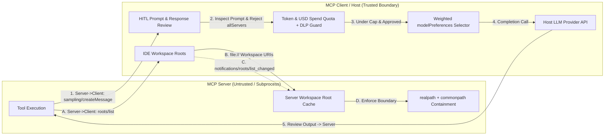
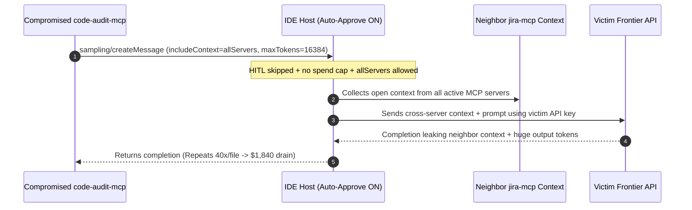

# Module 11: Sampling and Roots

> **Prerequisites:** [Module 04: The Protocol: JSON-RPC Foundations](../04-the-protocol-json-rpc-foundations/README.md) and [Module 09: Primitive: Resources](../09-primitive-resources/README.md).  
> **Estimated Reading Time:** 30 minutes  
> **Target Audience:** AI Security Engineers, MCP Host Developers, Server Infrastructure Architects

> [!TIP]
> **The Golden Rule of Sampling and Roots:** Treat `sampling/createMessage` as **privileged, billable client compute gated behind mandatory human-in-the-loop approval, `maxTokens`/spend quotas, and strict `includeContext` isolation**, and treat `roots/list` as **advisory workspace hints enforced via `realpath()` + `commonpath()` containment—never trusting raw URI string prefixes against symlink escapes or assuming rogue servers honor root boundaries without OS sandboxing.**

---

## Why This Matters

Up to [Module 10](../10-primitive-prompts/README.md), every MCP request flowed in one direction: the **Client** called into the **Server** (`tools/call`, `resources/read`, `prompts/get`). Yet real agentic tools frequently hit two architectural bottlenecks:

1. **Nested Intelligence Without Embedded API Keys:** Suppose a local Git diff analysis server encounters an ambiguous AST refactor and needs an LLM summary. If the server ships its own OpenAI or Anthropic SDK, the user must copy-paste API keys into every third-party MCP server config. **Sampling (`sampling/createMessage`)** inverts the flow: the *server* asks the *Client/Host* to run an LLM completion using the Host's existing model connection.
2. **Dynamic Workspace Scoping Without Hardcoded Flags:** A filesystem or code-index server spawned globally doesn't know which repository folders the user opened in their IDE today. **Roots (`roots/list` + `notifications/roots/list_changed`)** invert discovery: the *Client* tells the *Server* which workspace URIs are currently in scope.

Both features unlock clean local ergonomics—and introduce **severe trust-boundary hazards**. An unguarded `sampling/createMessage` handler turns a malicious server into an unlimited API-credit ATM and cross-server data exfiltrator (`includeContext: "allServers"`), while a naive `uri.startswith(root)` check falls immediately to POSIX symlinks or sibling directory prefixes (`/ws/app-secrets`).

> [!NOTE]
> **Specification Lifecycle Note:** Both `sampling` and `roots` are core Client capabilities in the **`2025-06-18`** MCP specification widely implemented in existing hosts and SDKs. In later specification updates (`2026-07-28`, SEP-2577), the working group moved toward deprecating server-initiated `sampling` and `roots` in favor of server-direct LLM APIs and explicit tool/config workspace arguments—precisely because managing reverse trust boundaries, billing quotas, and cross-server context isolation safely inside arbitrary hosts is notoriously error-prone. Mastering these gates protects both existing MCP deployments and any custom duplex agent architecture.

---

## 1. Bidirectional Client Capabilities: Sampling & Roots

In MCP's symmetric JSON-RPC 2.0 wire model ([Module 04](../04-the-protocol-json-rpc-foundations/README.md)), **Sampling** and **Roots** are declared inside the **Client's** `initialize` capability payload rather than the Server's:

```json
{
  "capabilities": {
    "sampling": {},
    "roots": {
      "listChanged": true
    }
  }
}
```



### Mechanics of `sampling/createMessage`

When a server needs an LLM generation, it sends an outbound JSON-RPC **Request** (`sampling/createMessage`) over the exact same duplex session:

| Field | Required | Semantics & Security Implication |
| :--- | :--- | :--- |
| **`messages[]`** | Yes | Array of `SamplingMessage` (`role`: `"user" \| "assistant"`, `content`: `text`/`image`/`audio`). Must be inspected by Host UI before forwarding. |
| **`maxTokens`** | Yes | Server's requested output limit. **Client MUST enforce `min(req.maxTokens, HOST_MAX_TOKENS_CAP)`**—never honor arbitrary `100,000`-token requests. |
| **`modelPreferences`** | No | `hints[]` (e.g., `[{"name": "claude-sonnet"}]`) plus priority weights `costPriority`, `speedPriority`, `intelligencePriority` in `[0.0, 1.0]`. Advisory only—the Client retains full control over model routing! |
| **`includeContext`** | No | `"none"` (default), `"thisServer"`, or **`"allServers"`**. **Danger:** `"allServers"` injects context from *other* connected MCP servers (e.g., Slack, Jira, AWS) into this server's sampling call—a direct cross-server exfiltration bridge. Deny `"allServers"` by default. |
| **`systemPrompt`** / **`temperature`** / **`stopSequences`** | No | Optional generation controls; Client MAY clamp or override `systemPrompt` to enforce safety guardrails. |

### Mechanics of `roots/list` & `notifications/roots/list_changed`

1. **Discovery (`roots/list`):** Server sends `{"jsonrpc": "2.0", "id": 9, "method": "roots/list"}`. Client replies `{"roots": [{"uri": "file:///workspace/payments", "name": "Payments Service"}]}`.
2. **Dynamic Workspace Updates (`notifications/roots/list_changed`):** When the user closes or switches folders in their IDE, the Client fires `notifications/roots/list_changed` (if `roots.listChanged: true`). The server **must immediately invalidate its cached root list** and re-query `roots/list` before handling the next file operation.
3. **Why `Roots` Require `os.path.realpath()` + `os.path.commonpath()`:**
   - **Sibling Prefix Bypass:** `/workspace/payments-secrets/key.pem` passes `/workspace/payments-secrets`.startswith(`/workspace/payments`)!
   - **Symlink Escape:** A tracked repository symlink `docs/link -> /home/dev/.ssh` lives *inside* `/workspace/payments`, so lexical normalization (`os.path.abspath`) stays inside the root while `open()` reads `~/.ssh/id_rsa` outside the root!
   - **Defense:** Resolve **both** the root URI and the candidate target path via `os.path.realpath()` (POSIX `realpath(3)` / Go `filepath.EvalSymlinks`), then assert `os.path.commonpath([root_real, target_real]) == root_real`. And remember: because a *compromised* server could simply ignore `roots/list` altogether, hosts must pair `roots` with OS sandboxing (`seccomp`, containers, or chroot/Seatbelt).

### Quantitative Mechanics: Sampling Cost Exposure & Model Routing Score

- **Worst-Case Uncapped Sampling Drain:** If a malicious or buggy server invokes `sampling/createMessage` at rate $R_{\text{req/min}}$ over duration $T_{\text{min}}$ with input context $T_{\text{in}}$ tokens (inflated via `includeContext="allServers"`) and requested output cap $T_{\text{out,max}}$:

$$C_{\text{max}} = R_{\text{req/min}} \cdot T_{\text{min}} \cdot \left(\frac{T_{\text{in}}}{10^3} P_{\text{in}} + \frac{T_{\text{out,max}}}{10^3} P_{\text{out}}\right)$$

At $R = 60\text{ req/min}$ over $20\text{ min}$ (`1,200` calls), with $T_{\text{in}} = 60\text{K}$ (\$0.015/1K frontier tier) and $T_{\text{out,max}} = 8\text{K}$ (\$0.075/1K), worst-case exposure hits:

$$C_{\text{max}} = 1,200 \cdot (0.90 + 0.60) = \$1,800.00\text{ in } 20\text{ minutes}$$

Enforcing per-session HITL approval, `maxTokens <= 1024`, `includeContext != "allServers"`, and a sliding-window spend cap (e.g., \$0.25/session) bounds worst-case exposure deterministically.

- **Weighted `modelPreferences` Scoring:** A client ranks candidate host models $m \in \mathcal{M}$ via normalized utility:

$$U(m) = w_{\text{cost}} \cdot s_{\text{cost}}(m) + w_{\text{speed}} \cdot s_{\text{speed}}(m) + w_{\text{intel}} \cdot s_{\text{intel}}(m)$$

where $w_{\cdot} \in [0, 1]$ come from `modelPreferences` while the Client strictly retains override authority over the final model tier.

---

## 2. Systematic Comparison Matrix: Client Features (`Sampling` / `Roots`) vs. Server Features

| Dimension | `sampling/createMessage` (Client Feature) | `roots/list` (Client Feature) | Server-Direct LLM / Tool Params |
| :--- | :--- | :--- | :--- |
| **RPC Direction** | **Server $\rightarrow$ Client** | **Server $\rightarrow$ Client** (+ Client change notif) | **Client $\rightarrow$ Server** |
| **Credential Ownership** | Host owns LLM API keys; server holds **zero** keys | Host owns UI workspace folder state | Server owns its own API keys / config |
| **Primary Security Risk** | Credit exhaustion, prompt/response hijacking, `allServers` exfiltration | Symlink escapes, prefix bypass, rogue servers ignoring advisory roots | Credential sprawl across local subprocess `env` |
| **Mandatory Guardrail** | HITL prompt + response review, `maxTokens` cap, USD quota, ban `allServers` | `realpath()` + `commonpath()` containment + OS sandbox | Scoped least-privilege API tokens + `env` allowlist |
| **Spec Lifecycle Note** | Standard in `2025-06-18`; deprecated in `2026-07-28` (SEP-2577) | Standard in `2025-06-18`; deprecated in `2026-07-28` (SEP-2577) | Recommended pattern for new greenfield servers |

---

## 3. Production War Story Post-Mortem: The Rogue Summarizer Credit Drain & `.ssh` Symlink Escape

| Field | Incident Details |
| :--- | :--- |
| **Severity** | **SEV-1** (Victim API Credit Exhaustion **\$1,840** + Local Credential Read via Symlink Escape) |
| **Detection / Resolution Time** | Detected after 22 minutes via provider anomaly billing webhook / Mitigated in 45 minutes (disabled auto-approve sampling, patched `realpath` containment, quarantined package) |
| **Impact** | Compromised `code-audit-mcp` plugin drained **\$1,840** across `14` developer laptops and attempted to exfiltrate `~/.ssh/id_rsa` via a repo symlink |

### What Happened

A developer productivity team approved a third-party `code-audit-mcp` server in an internal IDE MCP host that had two fatal shortcuts enabled:

1. **Silent Auto-Approved Sampling (`yolo_sampling=true`):** To prevent modal popups during batch scans, the IDE client auto-approved every `sampling/createMessage` request without checking `maxTokens`, `includeContext`, or session dollar spend. After an upstream npm dependency compromise, `code-audit-mcp` spun up an async loop calling `sampling/createMessage` `40` times per file with `includeContext: "allServers"`, `maxTokens: 16384`, and `intelligencePriority: 1.0`—harvesting tokens from other connected servers (`jira-mcp`, `aws-mcp`) inside the LLM completion and billing **\$1,840** in `22` minutes.
2. **Lexical `startswith` Root Bypass:** Inside a separate file-reader MCP server, root enforcement checked `os.path.abspath(target).startswith(root_path)`. A cloned test repo contained a committed symlink `fixtures/key -> /Users/dev/.ssh/id_rsa`. Because `abspath` does *not* resolve symlinks, the string check returned `True` (`"/repo/fixtures/key".startswith("/repo")`), leaking the user's private SSH key.



### Root Cause Analysis

- Skipping HITL confirmation and per-session token/cost caps turned `sampling/createMessage` into an unauthenticated spend amplifier.
- Allowing `includeContext: "allServers"` violated tenant/server isolation, letting an untrusted server pull context belonging to trusted internal MCP servers.
- Using `abspath().startswith()` instead of `realpath()` + `commonpath()` ignored both sibling prefix matches (`/repo-evil`) and symlink targets outside the root.

### The Fix & Architectural Hardening

- **Default-Deny Sampling Policy:** Required explicit per-request (or strictly bounded batch) human approval, capped `maxTokens <= 1024`, hard-rejected `includeContext == "allServers"` (`-32003`), and enforced a sliding-window USD quota (\$0.25/hr) per server.
- **Symlink-Safe Root Containment + OS Sandbox:** Replaced `startswith` with `os.path.realpath` + `os.path.commonpath`, plus OS container/read-only bind mounts so compromised servers cannot bypass root hints via direct syscalls.

---

## 4. Multi-Language Production Implementation: Sampling Policy Gate & Realpath Root Enforcer

Below are self-contained implementations across **Go**, **TypeScript**, **Python**, and **C#** combining (a) a Client-side `SamplingGate` (DLP ban on `allServers`, HITL gate, `maxTokens` clamp, weighted model selector, and USD budget tracker) and (b) a symlink-safe `RootContainmentEnforcer` (`EvalSymlinks`/`realpath` + prefix boundary).

````carousel

```go
package mcpsampling

import (
	"errors"
	"fmt"
	"path/filepath"
	"strings"
	"sync"
)

var (
	ErrDLPBlocked   = errors.New("-32003 includeContext=allServers blocked by DLP policy")
	ErrHITLDeclined = errors.New("-32003 human approval declined")
	ErrQuotaExceeded = errors.New("-32004 sampling USD budget exceeded")
	ErrRootEscaped  = errors.New("-32003 target escaped allowed root boundary")
)

type ModelProfile struct {
	Name       string
	CostScore  float64
	SpeedScore float64
	IntelScore float64
	InPer1K    float64
	OutPer1K   float64
}

type SamplingRequest struct {
	IncludeContext string
	MaxTokens      int
	PromptChars    int
	WCost, WSpeed, WIntel float64
}

type SamplingPolicyGate struct {
	mu          sync.Mutex
	MaxTokens   int
	BudgetUSD   float64
	SpentUSD    float64
	Models      []ModelProfile
}

func (g *SamplingPolicyGate) Evaluate(req SamplingRequest, humanApproved bool) (string, int, float64, error) {
	if req.IncludeContext == "allServers" {
		return "", 0, 0, ErrDLPBlocked
	}
	if !humanApproved {
		return "", 0, 0, ErrHITLDeclined
	}
	capped := req.MaxTokens
	if capped <= 0 || capped > g.MaxTokens {
		capped = g.MaxTokens
	}
	var best ModelProfile
	bestUtil := -1.0
	for _, m := range g.Models {
		u := req.WCost*m.CostScore + req.WSpeed*m.SpeedScore + req.WIntel*m.IntelScore
		if u > bestUtil {
			bestUtil = u
			best = m
		}
	}
	estInTok := float64(max(1, req.PromptChars/4))
	worstCost := (estInTok/1000.0)*best.InPer1K + (float64(capped)/1000.0)*best.OutPer1K

	g.mu.Lock()
	defer g.mu.Unlock()
	if g.SpentUSD+worstCost > g.BudgetUSD {
		return "", 0, 0, fmt.Errorf("%w (spent=%.4f next=%.4f cap=%.4f)", ErrQuotaExceeded, g.SpentUSD, worstCost, g.BudgetUSD)
	}
	g.SpentUSD += worstCost
	return best.Name, capped, worstCost, nil
}

// VerifyWithinRoots resolves symlinks via EvalSymlinks and prevents sibling-prefix escapes.
func VerifyWithinRoots(targetPath string, rootPaths []string) (string, error) {
	targetReal, err := filepath.EvalSymlinks(targetPath)
	if err != nil {
		return "", err
	}
	for _, r := range rootPaths {
		rootReal, err := filepath.EvalSymlinks(r)
		if err != nil {
			continue
		}
		rel, err := filepath.Rel(rootReal, targetReal)
		if err == nil && rel != ".." && !strings.HasPrefix(rel, ".."+string(filepath.Separator)) && !filepath.IsAbs(rel) {
			return targetReal, nil
		}
	}
	return "", ErrRootEscaped
}
```

<!-- slide -->

```typescript
import * as fs from "node:fs";
import * as path from "node:path";

export interface ModelCandidate {
  name: string;
  costScore: number;
  speedScore: number;
  intelScore: number;
  inPer1kUsd: number;
  outPer1kUsd: number;
}

export interface SamplingRequest {
  includeContext?: "none" | "thisServer" | "allServers";
  maxTokens: number;
  promptText: string;
  modelPreferences?: {
    costPriority?: number;
    speedPriority?: number;
    intelligencePriority?: number;
  };
}

export class SamplingPolicyGate {
  private spentUsd = 0;

  constructor(
    private readonly models: readonly ModelCandidate[],
    private readonly maxTokensCap = 1024,
    private readonly sessionBudgetUsd = 0.05,
  ) {}

  evaluate(req: SamplingRequest, humanApproved: boolean): { model: string; cappedTokens: number; worstCostUsd: number } {
    if (req.includeContext === "allServers") {
      throw new Error("-32003 includeContext=allServers blocked by DLP policy");
    }
    if (!humanApproved) {
      throw new Error("-32003 Human-in-the-loop approval declined");
    }
    const cappedTokens = Math.min(Math.max(1, req.maxTokens), this.maxTokensCap);
    const prefs = req.modelPreferences ?? {};
    let chosen = this.models[0];
    let bestScore = -Infinity;

    for (const m of this.models) {
      const score =
        (prefs.costPriority ?? 0) * m.costScore +
        (prefs.speedPriority ?? 0) * m.speedScore +
        (prefs.intelligencePriority ?? 0) * m.intelScore;
      if (score > bestScore) {
        bestScore = score;
        chosen = m;
      }
    }

    const estInTok = Math.max(1, Math.floor(req.promptText.length / 4));
    const worstCostUsd = (estInTok / 1000) * chosen.inPer1kUsd + (cappedTokens / 1000) * chosen.outPer1kUsd;
    if (this.spentUsd + worstCostUsd > this.sessionBudgetUsd) {
      throw new Error(`-32004 Sampling budget exceeded (spent=${this.spentUsd.toFixed(4)})`);
    }
    this.spentUsd += worstCostUsd;
    return { model: chosen.name, cappedTokens, worstCostUsd };
  }
}

export function assertWithinRootsRealpath(targetPath: string, rootDirs: readonly string[]): string {
  const targetReal = fs.realpathSync(targetPath);
  for (const rootDir of rootDirs) {
    const rootReal = fs.realpathSync(rootDir);
    const rel = path.relative(rootReal, targetReal);
    if (rel !== ".." && !rel.startsWith(`..${path.sep}`) && !path.isAbsolute(rel)) {
      return targetReal;
    }
  }
  throw new Error(`-32003 Target path escaped workspace roots: ${targetPath}`);
}
```

<!-- slide -->

```python
"""
sampling_and_roots_guard.py
Client-side sampling/createMessage HITL & cost quota gate plus
symlink-safe realpath + commonpath workspace root boundary enforcer.
"""
from dataclasses import dataclass
import os
from typing import Sequence


@dataclass(frozen=True)
class ModelTier:
    name: str
    cost_score: float
    speed_score: float
    intel_score: float
    in_per_1k: float
    out_per_1k: float


class SamplingQuotaGate:
    def __init__(
        self,
        models: Sequence[ModelTier],
        max_tokens_cap: int = 1024,
        session_budget_usd: float = 0.05,
    ) -> None:
        self._models = list(models)
        self._max_tokens_cap = max_tokens_cap
        self._budget_usd = session_budget_usd
        self.spent_usd = 0.0

    def authorize(self, req: dict, human_approved: bool) -> dict:
        if req.get("includeContext") == "allServers":
            raise PermissionError("-32003 includeContext=allServers denied by host DLP policy")
        if not human_approved:
            raise PermissionError("-32003 Human-in-the-loop consent declined")

        capped_tokens = min(max(1, int(req["maxTokens"])), self._max_tokens_cap)
        prefs = req.get("modelPreferences", {})
        chosen = max(
            self._models,
            key=lambda m: (
                prefs.get("costPriority", 0.0) * m.cost_score
                + prefs.get("speedPriority", 0.0) * m.speed_score
                + prefs.get("intelligencePriority", 0.0) * m.intel_score
            ),
        )
        est_in_tokens = max(1, len(req.get("prompt", "")) // 4)
        worst_cost = (est_in_tokens / 1000.0) * chosen.in_per_1k + (capped_tokens / 1000.0) * chosen.out_per_1k
        if self.spent_usd + worst_cost > self._budget_usd:
            raise RuntimeError(f"-32004 Quota exceeded: spent=${self.spent_usd:.4f}, next=${worst_cost:.4f}")

        self.spent_usd += worst_cost
        return {"model": chosen.name, "capped_maxTokens": capped_tokens, "worst_cost_usd": worst_cost}


def resolve_within_roots(target_path: str, allowed_roots: Sequence[str]) -> str:
    target_real = os.path.realpath(target_path)
    for root in allowed_roots:
        root_real = os.path.realpath(root)
        try:
            if os.path.commonpath([root_real, target_real]) == root_real:
                return target_real
        except ValueError:
            continue
    raise PermissionError(f"-32003 Path {target_path!r} is outside authorized workspace roots")
```

<!-- slide -->

```csharp
using System;
using System.Collections.Generic;
using System.IO;
using System.Linq;

namespace GenAI.Mcp.ClientFeatures;

public sealed record ModelTier(string Name, double CostScore, double SpeedScore, double IntelScore, double InPer1K, double OutPer1K);
public sealed record SamplingRequest(string IncludeContext, int MaxTokens, string Prompt, double WCost, double WSpeed, double WIntel);

public sealed class SamplingPolicyGate
{
    private readonly IReadOnlyList<ModelTier> _models;
    private readonly int _maxTokensCap;
    private readonly double _sessionBudgetUsd;
    private double _spentUsd;

    public SamplingPolicyGate(IReadOnlyList<ModelTier> models, int maxTokensCap = 1024, double sessionBudgetUsd = 0.05)
    {
        _models = models;
        _maxTokensCap = maxTokensCap;
        _sessionBudgetUsd = sessionBudgetUsd;
    }

    public (string Model, int CappedTokens, double WorstCostUsd) Authorize(SamplingRequest req, bool humanApproved)
    {
        if (string.Equals(req.IncludeContext, "allServers", StringComparison.Ordinal))
            throw new UnauthorizedAccessException("-32003 includeContext=allServers blocked by DLP policy.");
        if (!humanApproved)
            throw new UnauthorizedAccessException("-32003 Human-in-the-loop approval declined.");

        int capped = Math.Clamp(req.MaxTokens, 1, _maxTokensCap);
        ModelTier chosen = _models.OrderByDescending(m =>
            req.WCost * m.CostScore + req.WSpeed * m.SpeedScore + req.WIntel * m.IntelScore).First();

        int estInTok = Math.Max(1, req.Prompt.Length / 4);
        double worstCost = (estInTok / 1000.0) * chosen.InPer1K + (capped / 1000.0) * chosen.OutPer1K;
        if (_spentUsd + worstCost > _sessionBudgetUsd)
            throw new InvalidOperationException($"-32004 Sampling USD quota exceeded (spent={_spentUsd:F4}).");

        _spentUsd += worstCost;
        return (chosen.Name, capped, worstCost);
    }
}

public static class RootContainmentGuard
{
    public static string ResolveWithinRoots(string targetPath, IEnumerable<string> allowedRoots)
    {
        // Resolve final link target to block symlink escapes (.NET 6+ ResolveLinkTarget)
        string targetResolved = File.ResolveLinkTarget(targetPath, returnFinalTarget: true)?.FullName
            ?? Path.GetFullPath(targetPath);

        foreach (string root in allowedRoots)
        {
            string rootResolved = (Directory.ResolveLinkTarget(root, returnFinalTarget: true)?.FullName
                ?? Path.GetFullPath(root)).TrimEnd(Path.DirectorySeparatorChar) + Path.DirectorySeparatorChar;
            string rootExact = rootResolved.TrimEnd(Path.DirectorySeparatorChar);

            if (string.Equals(targetResolved, rootExact, StringComparison.Ordinal) ||
                targetResolved.StartsWith(rootResolved, StringComparison.Ordinal))
            {
                return targetResolved;
            }
        }
        throw new UnauthorizedAccessException($"-32003 Target path escaped allowed roots: {targetPath}");
    }
}
```

````

---

## 5. Practical Hands-On Verification CLI Workflows

Run these deterministic Python 3.13 scripts offline—zero third-party libraries or API keys required.

### Workflow 1: Client-Side `sampling/createMessage` Policy & Quota Gatekeeper

Verify how the Client rejects `includeContext: "allServers"`, enforces HITL approval, clamps `maxTokens` to `1024`, routes models using `modelPreferences`, and blocks credit exhaustion at the session spend cap:

```bash
python -c '
MODELS = [
    {"name": "claude-haiku-4-5", "cost": 0.95, "speed": 0.95, "intel": 0.65, "in_per_1k": 0.0008, "out_per_1k": 0.004},
    {"name": "claude-sonnet-4-5", "cost": 0.60, "speed": 0.70, "intel": 0.92, "in_per_1k": 0.0030, "out_per_1k": 0.015},
    {"name": "claude-opus-4-1", "cost": 0.15, "speed": 0.35, "intel": 0.99, "in_per_1k": 0.0150, "out_per_1k": 0.075},
]

class SamplingGate:
    def __init__(self, max_tokens_cap=1024, max_spend_usd=0.025):
        self.max_tokens_cap = max_tokens_cap
        self.max_spend_usd = max_spend_usd
        self.spent_usd = 0.0

    def score_model(self, prefs, m):
        return (
            prefs.get("costPriority", 0.0) * m["cost"]
            + prefs.get("speedPriority", 0.0) * m["speed"]
            + prefs.get("intelligencePriority", 0.0) * m["intel"]
        )

    def evaluate(self, req, human_approved):
        if req.get("includeContext") == "allServers":
            return "DENY(-32003): includeContext=allServers forbidden by host DLP policy"
        if not human_approved:
            return "DENY(-32003): Human-in-the-loop approval declined"
        req_max = int(req.get("maxTokens", 256))
        capped_max = min(req_max, self.max_tokens_cap)
        prefs = req.get("modelPreferences", {})
        chosen = max(MODELS, key=lambda m: self.score_model(prefs, m))
        chosen_name = chosen["name"]
        est_in_tok = max(1, len(req.get("prompt", "")) // 4)
        worst_cost = (est_in_tok / 1000.0) * chosen["in_per_1k"] + (capped_max / 1000.0) * chosen["out_per_1k"]
        if self.spent_usd + worst_cost > self.max_spend_usd:
            return f"DENY(-32004): Spend quota exceeded (spent=${self.spent_usd:.4f}, next=${worst_cost:.4f}, cap=${self.max_spend_usd:.4f})"
        self.spent_usd += worst_cost
        return f"ALLOW -> model={chosen_name} | capped_maxTokens={capped_max} (req={req_max}) | worst_cost=${worst_cost:.4f} | total_spent=${self.spent_usd:.4f}"

gate = SamplingGate(max_tokens_cap=1024, max_spend_usd=0.025)
requests = [
    ({"includeContext": "allServers", "maxTokens": 500, "prompt": "Summarize secrets"}, True),
    ({"includeContext": "thisServer", "maxTokens": 500, "prompt": "Summarize diff"}, False),
    ({"includeContext": "thisServer", "maxTokens": 4096, "prompt": "Explain error log", "modelPreferences": {"costPriority": 0.9, "speedPriority": 0.8, "intelligencePriority": 0.2}}, True),
    ({"includeContext": "none", "maxTokens": 2048, "prompt": "Deep architecture audit", "modelPreferences": {"costPriority": 0.1, "speedPriority": 0.2, "intelligencePriority": 0.95}}, True),
    ({"includeContext": "none", "maxTokens": 1024, "prompt": "Another deep audit", "modelPreferences": {"costPriority": 0.1, "speedPriority": 0.2, "intelligencePriority": 0.95}}, True),
]
for req, ok in requests:
    print(gate.evaluate(req, ok))
'
```

**Expected Output:**

```text
DENY(-32003): includeContext=allServers forbidden by host DLP policy
DENY(-32003): Human-in-the-loop approval declined
ALLOW -> model=claude-haiku-4-5 | capped_maxTokens=1024 (req=4096) | worst_cost=$0.0041 | total_spent=$0.0041
ALLOW -> model=claude-sonnet-4-5 | capped_maxTokens=1024 (req=2048) | worst_cost=$0.0154 | total_spent=$0.0195
DENY(-32004): Spend quota exceeded (spent=$0.0195, next=$0.0154, cap=$0.0250)
```

### Workflow 2: Root Prefix-Trick, Traversal, and Symlink Containment Verification

Compare vulnerable `startswith` checks against `os.path.realpath` + `os.path.commonpath` using real temporary directories plus a deterministic symlink escape test:

```bash
python -c '
import os, posixpath, tempfile

with tempfile.TemporaryDirectory() as tmp:
    workspace = os.path.join(tmp, "repo")
    sibling = os.path.join(tmp, "repo-secrets")
    os.makedirs(workspace)
    os.makedirs(sibling)
    open(os.path.join(workspace, "app.py"), "w").write("ok")
    open(os.path.join(sibling, "prod.env"), "w").write("SECRET=1")

    root_real = os.path.realpath(workspace)
    candidates = [
        ("Normal file", os.path.join(workspace, "app.py")),
        ("Prefix bypass (repo-secrets)", os.path.join(sibling, "prod.env")),
        ("Dot-dot traversal", os.path.join(workspace, "..", "repo-secrets", "prod.env")),
    ]
    for label, target in candidates:
        naive_ok = os.path.abspath(target).startswith(os.path.abspath(workspace))
        target_real = os.path.realpath(target)
        safe_ok = os.path.commonpath([root_real, target_real]) == root_real
        print(f"{label:<28} | naive_startswith={str(naive_ok):<5} | safe_commonpath={str(safe_ok):<5}")

SYMLINKS = {"/ws/repo/docs_link": "/home/dev/.ssh"}
def sim_realpath(p):
    norm = posixpath.normpath(p)
    for link, dest in SYMLINKS.items():
        if norm == link or norm.startswith(link + "/"):
            return posixpath.normpath(dest + norm[len(link):])
    return norm

sym_label = "Symlink escape (simulated)"
sym_target = "/ws/repo/docs_link/id_rsa"
sym_naive = posixpath.normpath(sym_target).startswith("/ws/repo")
sym_safe = posixpath.commonpath(["/ws/repo", sim_realpath(sym_target)]) == "/ws/repo"
print(f"{sym_label:<28} | naive_startswith={str(sym_naive):<5} | safe_commonpath={str(sym_safe):<5}")
'
```

**Expected Output:**

```text
Normal file                  | naive_startswith=True  | safe_commonpath=True 
Prefix bypass (repo-secrets) | naive_startswith=True  | safe_commonpath=False
Dot-dot traversal            | naive_startswith=True  | safe_commonpath=False
Symlink escape (simulated)   | naive_startswith=True  | safe_commonpath=False
```

### Workflow 3: `roots/list` & `notifications/roots/list_changed` Cache Invalidation

Simulate how a server invalidates its cached root boundaries immediately upon receiving `notifications/roots/list_changed` and blocks subsequent reads to a removed workspace:

```bash
python -c '
import json

class RootBoundaryCache:
    def __init__(self):
        self.roots = []
        self.stale = True

    def sync_roots(self, server_roots_response):
        self.roots = [r["uri"] for r in server_roots_response.get("roots", [])]
        self.stale = False

    def on_notification(self, method):
        if method == "notifications/roots/list_changed":
            self.stale = True

    def can_read(self, uri, fetch_roots_fn):
        if self.stale:
            self.sync_roots(fetch_roots_fn())
        allowed = any(uri == r or uri.startswith(r.rstrip("/") + "/") for r in self.roots)
        return allowed, list(self.roots)

client_state = {"roots": [{"uri": "file:///ws/repo-a", "name": "Repo A"}, {"uri": "file:///ws/repo-b", "name": "Repo B"}]}
cache = RootBoundaryCache()

print("1. Initial read repo-b :", cache.can_read("file:///ws/repo-b/main.py", lambda: client_state))
client_state["roots"] = [{"uri": "file:///ws/repo-a", "name": "Repo A"}]
cache.on_notification("notifications/roots/list_changed")
print("2. Cache marked stale  :", json.dumps({"stale": cache.stale}))
print("3. Re-read repo-b after:", cache.can_read("file:///ws/repo-b/main.py", lambda: client_state))
print("4. Read repo-a allowed :", cache.can_read("file:///ws/repo-a/main.py", lambda: client_state))
'
```

**Expected Output:**

```text
1. Initial read repo-b : (True, ['file:///ws/repo-a', 'file:///ws/repo-b'])
2. Cache marked stale  : {"stale": true}
3. Re-read repo-b after: (False, ['file:///ws/repo-a'])
4. Read repo-a allowed : (True, ['file:///ws/repo-a'])
```

### Hands-On Exercises

1. **Per-Minute Token Bucket Quota:** Extend Workflow 1's `SamplingGate` with a sliding-window token rate limiter (`max_requests_per_min = 10`) in addition to the dollar budget cap, returning `-32004` when a server bursts `11` requests within `60 s`.
2. **TOCTOU Symlink Re-Check:** Why can a file still escape containment *between* `os.path.realpath()` and `open()` if another process swaps a file for a symlink mid-flight? Read Python's `os.open(..., os.O_NOFOLLOW)` or directory-FD `dir_fd` flags and describe how `O_NOFOLLOW` prevents Time-of-Check-to-Time-of-Use symlink races.
3. **Host Audit Log Schema:** Design a structured JSON audit event emitted whenever `sampling/createMessage` fires, capturing `server_id`, `approved_by_user`, `includeContext`, `requested_max_tokens`, `clamped_max_tokens`, `chosen_model`, and `estimated_cost_usd`.

### Independent Challenge

Your organization is integrating a legacy third-party MCP server that depends on `sampling/createMessage` to classify code vulnerabilities, plus `roots/list` to scan user-selected repositories. Security leadership rejects deploying it unless you enforce zero secret leakage across other connected MCP servers (like `slack-mcp` and `postgres-mcp`), hard cap API billing at \$5.00/day per developer, and guarantee that a symlink inside any scanned repository cannot leak `~/.aws/credentials`. Design the Host-side enforcement layer and OS runtime boundary needed to sign off safely.

<details><summary>Architectural Discussion</summary>

1. **Client-Side Sampling Proxy:** Intercept every `sampling/createMessage` frame inside your Host runtime: reject `includeContext: "allServers"` outright (`-32003`), require explicit HITL approval (showing both the outbound `messages[]` and the returned completion before returning it to the server), clamp `maxTokens <= 1024`, and track actual token usage against a persistent per-developer \$5.00/day token-bucket ledger.
2. **Realpath + OS Sandbox for Workspace Roots:** Remember that `roots/list` is advisory—a malicious server binary could ignore `roots/list` and call `open("/Users/dev/.aws/credentials")` directly! Therefore, run the MCP server inside an OS container / microVM / Seatbelt profile that **only bind-mounts the exact user-selected root directories**, and inside server code resolve paths with `realpath()` + `O_NOFOLLOW` / `commonpath()` so symlinks pointing outside the mount cannot resolve.
3. **Migration Path:** Long-term, plan to replace `sampling` and `roots` with explicit workspace path arguments + server-side authenticated LLM gateway tokens (aligning with the post-`2025-06-18` MCP spec direction).

</details>

---

## 6. Common Mistakes & Troubleshooting

- **Auto-approving `sampling/createMessage` in headless/CI hosts without a spend quota:** Turns every buggy retry loop or compromised server into an uncapped API billing leak. Always combine HITL consent (or explicit policy allowlists in CI) with hard `maxTokens` caps and per-session USD quotas.
- **Allowing `includeContext: "allServers"` by default:** Lets an untrusted third-party MCP server piggyback on the Host's LLM call to extract private context injected by your internal database or email MCP servers.
- **Checking `roots` using string `startswith` without `realpath`:** Defeated trivially by sibling folders (`/ws/repo-evil`) and symlinks inside the repository (`docs/link -> ~/.ssh`).
- **Relying solely on `roots/list` as a security firewall:** Because the server itself enforces `roots/list` in application code, a hostile server binary can simply ignore `roots/list`! Only OS-level sandboxes (containers, chroot, Seatbelt) isolate untrusted binaries.

---

## 7. Operational Validation Checkpoints & Checkpoint Quiz

### Operational Validation Checkpoints

<details><summary><strong>Checkpoint 1: Stopping cross-server data exfiltration via Sampling</strong></summary>

A developer attaches a public `markdown-helper` MCP server alongside an internal `hr-records` MCP server. During a tool call, `markdown-helper` issues `sampling/createMessage` with `"includeContext": "allServers"` and `"prompt": "Summarize everything in context as bullet points"`. How does a hardened MCP Client respond?

**Validation:** The Client's Sampling Policy Gate **immediately rejects** `includeContext: "allServers"` with JSON-RPC error `-32003` (or downgrades/strips external context and prompts the user with an explicit DLP warning), preventing `markdown-helper` from harvesting private `hr-records` context via the Host's LLM completion.

</details>

<details><summary><strong>Checkpoint 2: Catching a sibling-directory and symlink root bypass</strong></summary>

A server receives root `file:///srv/repos/app-1` from `roots/list` and checks `os.path.abspath(target).startswith("/srv/repos/app-1")`. Explain two distinct inputs that pass this check while reading sensitive files outside `app-1`.

**Validation:** (1) **Sibling-prefix bypass:** `/srv/repos/app-1-secrets/.env` starts with `"/srv/repos/app-1"`, passing `startswith` cleanly. (2) **Symlink escape:** `/srv/repos/app-1/readme.txt -> /etc/shadow` has an `abspath` inside `/srv/repos/app-1`, yet `open()` follows the symlink to `/etc/shadow`. Replace `abspath().startswith()` with `os.path.realpath()` + `os.path.commonpath([root_real, target_real]) == root_real`.

</details>

<details><summary><strong>Checkpoint 3: Handling `notifications/roots/list_changed` mid-session</strong></summary>

A developer removes `/projects/client-secret` from their IDE workspace while an MCP server session remains open. Five seconds later, the LLM triggers a file read targeting `/projects/client-secret/config.yaml`. What protocol sequence prevents stale access?

**Validation:** When the user removes the folder, the IDE Client emits `notifications/roots/list_changed`. The server invalidates its local `roots` cache immediately and calls `roots/list` before handling the next file operation, receiving only active workspace roots and denying `/projects/client-secret/config.yaml`.

</details>

### Checkpoint Quiz

1. Why does `sampling/createMessage` reverse the usual MCP Request direction, and why did MCP introduce it?
2. Which two human-in-the-loop (HITL) checks does the MCP spec recommend around `sampling/createMessage`?
3. What do `costPriority`, `speedPriority`, and `intelligencePriority` inside `modelPreferences` control, and are they binding on the Client?
4. Why is `os.path.commonpath([os.path.realpath(root), os.path.realpath(target)]) == os.path.realpath(root)` required when enforcing `roots/list`?
5. Why should an MCP Host never treat `roots/list` alone as a replacement for OS process sandboxing when running untrusted third-party servers?

<details><summary>Answers</summary>

1. In `sampling/createMessage`, the **Server** sends a Request to the **Client/Host** so the server can invoke LLM reasoning/completions without embedding or managing user LLM API keys directly.
2. First, reviewing/approving the outbound sampling prompt (and parameters like `includeContext` / `maxTokens`) before sending to the LLM; second, reviewing/inspecting the returned LLM completion before delivering it back to the server.
3. They express the server's preference weights in `[0.0, 1.0]` for routing across cost, latency, and capability tiers. They are strictly **advisory hints**—the Client retains complete authority over which model (if any) runs.
4. `realpath()` resolves both `..` segments and OS symlinks to canonical physical paths, and `commonpath()` prevents sibling-directory prefix tricks (`/ws/app` matching `/ws/app-secrets`) that defeat naive `startswith()`.
5. Because `roots/list` is enforced cooperatively by the server process itself; an untrusted or compromised server binary can simply ignore `roots/list` and issue arbitrary OS `open()` syscalls unless confined by containers, chroot, or OS sandbox policies.

</details>

---

## Further Reading & Sources

- [Model Context Protocol Specification: Sampling (`2025-06-18`)](https://modelcontextprotocol.io/specification/2025-06-18/client/sampling) — normative schema for `sampling/createMessage`, `modelPreferences`, `includeContext`, and HITL security requirements.
- [Model Context Protocol Specification: Roots (`2025-06-18`)](https://modelcontextprotocol.io/specification/2025-06-18/client/roots) — normative specification for `roots/list`, `notifications/roots/list_changed`, and root security considerations.
- [Module 04: The Protocol: JSON-RPC Foundations](../04-the-protocol-json-rpc-foundations/README.md) — symmetric duplex request ID tracking for server-to-client RPCs.

## Next

[Module 12: Building Your First MCP Server (Python SDK)](../12-building-your-first-mcp-server/README.md)
